# ACT：机器人别再一步一猜，先把一段动作想明白

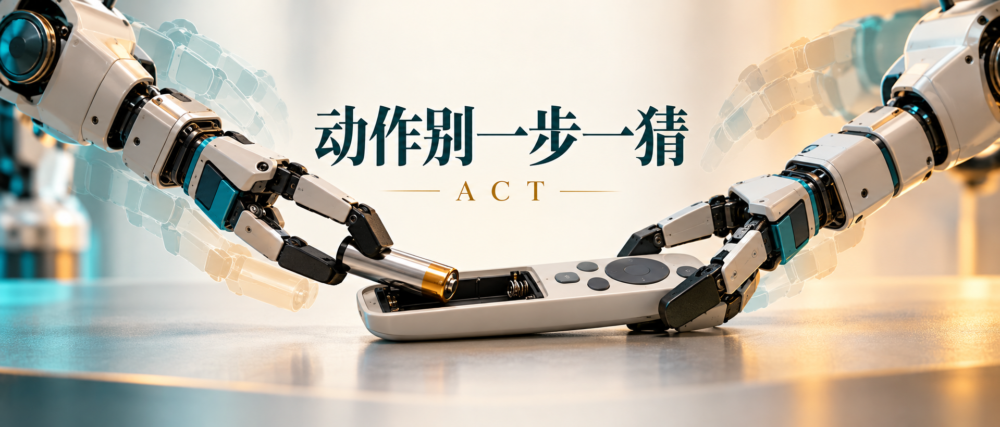

这里是「具身智能的 World」。把模型拆到输入、计算和输出，再拿实验看看它有没有真干活。

- 论文解读：顺着原文读懂方法、公式与图。
- 论文地图：按研究问题寻找阅读路线。
- 顶会顶刊集锦：汇总正式论文入口。
- 解读日程：查看未来一周选题。
- arXiv 新作：筛选值得跟进的研究。
- 具身榜：比较论文及其评分依据。
- 知识点宇宙：从一个技术点走向其他论文。

GitHub：[具身智能的 World](https://github.com/Zhu-Huixiang/embodied-world)。

给遥控器装电池，人看起来就是“咔哒”一下。机器人那边却可能是：拿起来，歪一点；放下去，再歪一点；最后使劲往里怼——完了，电池没进去，遥控器先滑走了。

ACT 要处理的技术分歧很实际：**高频控制一定要每次只预测下一步吗？** 普通行为克隆把当前画面映射到单步动作，细操作里小误差会不断累积；人的示范还会停顿、换手、调整姿势，同一个局面未必只有一条后续轨迹。作者把预测单位改成一段动作，再用新观察持续修正这段计划。与此同时，ALOHA 用便宜机械臂搭出能采集好示范的双臂系统。算法和硬件在这篇里是搭档。<!-- evidence:C01 -->

先带三个问题：

1. 不够精确的低价机械臂，靠什么采到足够精细的示范？
2. 一次预测100步，怎样避免闭着眼睛执行两秒，动作又怎么保持平滑？
3. 图像、关节和潜变量怎样算出动作块，实验说明哪一块最有用？

**论文信息**：*Learning Fine-Grained Bimanual Manipulation with Low-Cost Hardware*；Tony Z. Zhao、Vikash Kumar、Sergey Levine、Chelsea Finn；斯坦福大学、加州大学伯克利分校、Meta。首次公开于2023-04-23；本文读 RSS 2023 正式论文及附录。RSS 是机器人领域主要研究会议之一，强调机器人问题、方法与实验验证。<!-- evidence:C02 -->

[正式论文](https://www.roboticsproceedings.org/rss19/p016.html) · [原文 PDF](https://www.roboticsproceedings.org/rss19/p016.pdf) · [ALOHA 项目](https://tonyzhaozh.github.io/aloha/)

**阅读目录**

- 1 引言：便宜硬件怎样做精细活？
- 2 相关工作：模仿为什么越做越偏？
- 3 ALOHA：先把人的动作采好
- 4 ACT 方法：动作块、时间集成与条件生成
- 5 实验：六个实机任务，别只看最好的一项
- 6 消融：分别拆掉这些零件会怎样？
- 7 结论与局限：哪里卡在动作，哪里卡在眼睛？

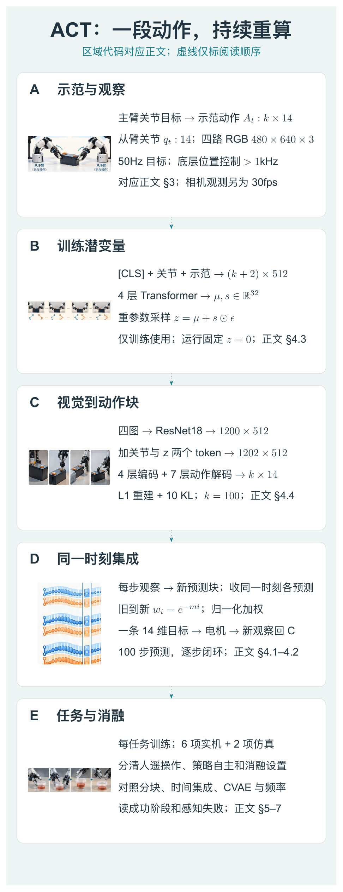

本图由 [DrawPaper skill](https://github.com/Zhu-Huixiang/ReadPaper/tree/main/drawpaper) 指挥 Codex，使用内置生图制作。

先走训练路线：**A** 采集四路图像、关节与示范动作，**B** 从示范动作推断训练潜变量，**C** 综合观察预测整段动作，用重建误差和 KL 项更新。运行时删掉 B，把潜变量固定为0；每步用 C 预测新动作块，**D** 将多个动作块中“指向当前这一刻”的预测合并，交给机械臂执行，再读新观察。**E** 是任务与消融检验。正文第3节拆A，第4节逐一拆B/C/D，第5–6节看E，最后再回到完整闭环。

## 1 引言：便宜硬件怎样做精细活？

透明小酱料杯很会折磨机器人。先轻轻推倒，再推到另一只夹爪里，夹住、抬起，另一侧从杯盖下方撬开。每步都和接触、形变、遮挡有关。若先把整套物理过程建模到足够精确，工作量已经够写另一篇论文了。

作者选的是直接学视觉到动作的闭环策略：画面告诉它杯子现在在哪，动作改了环境，再看下一帧。低价硬件的误差不消失，但策略可以根据视觉反馈调整。这样一来，问题从“完美建模每次接触”，转成“能否采到好示范，并稳定地模仿它”。<!-- evidence:C03 -->

这里的低价指研究机器人硬件的相对成本。整套 ALOHA 预算低于2万美元，在原论文时期是和一台研究级机械臂对比；它不是家庭玩具的价位。讲性价比也得先把购物车里到底装了什么说清楚。

## 2 相关工作：模仿为什么越做越偏？

**行为克隆（BC）**，先把它想成监督学习版“照着师傅做”：输入观察，输出师傅当时的动作。训练数据来自师傅走过的状态；机器人运行时稍微偏一下，就可能走进示范里很少出现的位置，再预测就更容易偏。这个循环叫**误差累积**。<!-- evidence:C04 -->

DAgger 等路线让专家对机器人实际走歪的状态补动作标签，优点是直接补救偏离；细操作里，反复纠错和噪声示范却可能又费事又破坏任务。ACT 选择从预测结构入手：让网络学一段连贯动作，而不是把每个时刻都当成一场全新的选择题。

另一个麻烦是人的节奏。比如夹爪已经靠近袋子，你停半秒确认一下，再夹。只看当下图像，模型不容易区分“现在该继续停”还是“已经停够了”。动作块能把局部时序组织进一次预测。它不保证所有历史依赖都被解决，但至少不用让每一帧都重新猜一遍上下文。

## 3 ALOHA：先把人的动作采好

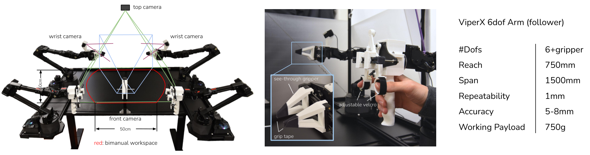

论文 Fig. 3。从左到右看相机布局、操作把手和机械臂规格。

这张图要说明的不是“机械臂数量多就厉害”，而是采集链路怎么服务精细操作。左边两只执行臂上方和正前方各一台相机，两只腕部再各一台，远景管整体，近景看夹爪。红色区域标双臂工作空间，长度标记给出布局尺度。中间是便于人反驱的把手、连续控制夹爪的剪刀式机构，以及贴抓握胶带的透视夹指。右表列自由度、范围与精度，**重复定位1 mm**和**绝对精度5–8 mm**是两项不同规格。<!-- evidence:C05 -->

### 3.1 主从关节映射：手带小臂，大臂跟着做

两台较小的 WidowX 当主臂，两台 ViperX 当从臂。人直接搬动主臂，读取各关节位置，让从臂跟随对应关节。比起先估人手姿态、再用逆运动学解机械臂关节，它避开了一些奇异位形附近的求解麻烦；机械臂自身重量也能缓冲手的小抖动。<!-- evidence:C06 -->

每臂6个关节加夹爪，共7维；双臂是14维。相机是四路480×640 RGB。遥操作目标在50 Hz发送，也就是每20 ms一次；电机内部位置控制器以超过1 kHz的频率追踪目标。别把这两个频率混成“神经网络每秒推理一千次”。相机视频另有自己的帧率，附录给出30 fps。<!-- evidence:C07 -->

### 3.2 训练动作为什么记主臂目标，而不是从臂实测？

假设主臂想把电池压进槽，目标关节角已经过去一点，从臂因为接触阻力暂时没到。两者的差正是底层位置控制器继续施力的来源。示范动作记录主臂关节目标，观察记录从臂实际关节；若把实际位置直接当目标，可能把这股“还得再压一点”的意图丢掉。<!-- evidence:C08 -->

> **基础扫盲｜本体感觉**：机器人自己身体的测量值，例如关节角。摄像头看外面，本体感觉告诉它“我的胳膊现在弯到哪了”。

论文的遥操作表里还有穿扎带、插内存、颠乒乓球。这些由人操纵的展示说明 ALOHA 能采怎样的动作；第5节 ACT 自主策略评估是另一组任务。看视频时先确认控制权在谁手里，很省误会。

## 4 ACT 方法：动作块、时间集成与条件生成

回到开头 C/D 区。定义当前观察 **oₜ** 为四路图像加14维关节 **qₜ**；动作 **aₜ∈ℝ¹⁴** 是下一时刻要追踪的绝对关节目标。k 是动作块长度。为了避免端点歧义，本文把一个块明确写成从t到t+k−1，共k步。

### 4.1 动作块：先预测一小段，再决定怎样执行

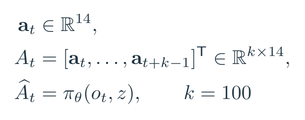

公式 1｜依据原文 §IV-A 展开的动作块表示。Aₜ 是 k×14 的矩阵，每行对应一时刻的双臂目标。

原设置 k=100，在50 Hz控制下覆盖约2秒。只按最朴素方式做，每隔100步观察一次、预测100步、执行完再观察；有效决策链变短了，但环境在中间变了怎么办？电池卡住了还硬往前，光想想就替遥控器紧张。

所以 ACT 的最终运行方案会**每个时刻重新预测一个块**。块长决定预测范围，查询频率决定多久吸收新观察。两个旋钮各管一件事，别把“100步预测”直接读成“100步开环”。<!-- evidence:C09 -->

### 4.2 时间集成：合并的是同一时刻的不同预测

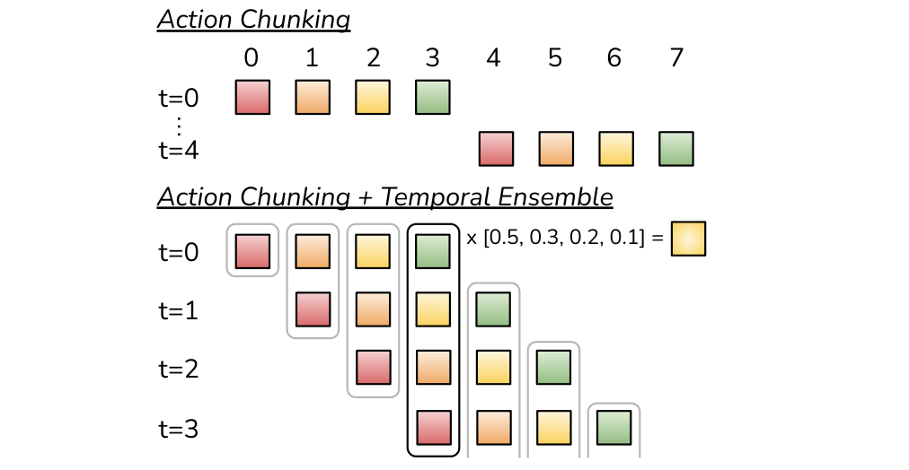

论文 Fig. 6。竖着找同一时间列，才是要拿来平均的动作。

上半图是普通分块：t=0生成0–3步，t=4再生成4–7步。颜色块代表动作时刻；横轴往右是未来时间。下半图每行是一个起算时刻的新预测，所以斜着叠成阶梯。同一竖列的多个方块，都在回答“当前这一刻该到哪个关节位置”。右边把它们加权合并。它不是把昨天的动作、今天的动作、明天的动作揉在一起，那会拖慢本来就该变化的轨迹。<!-- evidence:C10 -->

设 **âₜ⁽ⁱ⁾∈ℝ¹⁴** 是第i个、针对当前t的预测；按论文排列，i=0是最早产生的有效预测。m≥0控制指数衰减，wᵢ是对应权重，nₜ是此时收集到的有效预测数。

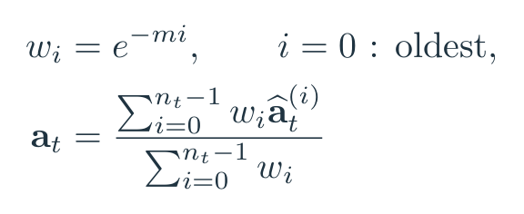

公式 2｜原文 Algorithm 2 与 §IV-A。分子逐关节加权，分母把权重归一化。

一个关节的教学例子：三个预测按旧到新是0.20、0.24、0.28 rad，令m=0.5，权重约1、0.607、0.368；输出约**0.227 rad**。论文这里**偏重旧预测**，不是常见的“最新一帧权重最大”。m越小，旧新差距越小，新观察更快进入最终动作。这个方向很容易凭直觉写反，所以值得停一下。<!-- evidence:C11 -->

平滑并非越强越好。旧计划能稳住轨迹，也可能延缓急剧变化时的纠正。第6节看它在什么方法上有用，不先把“做了平均”当成稳赢按钮。

### 4.3 CVAE：同一幅画面，可以有不同的后续走法

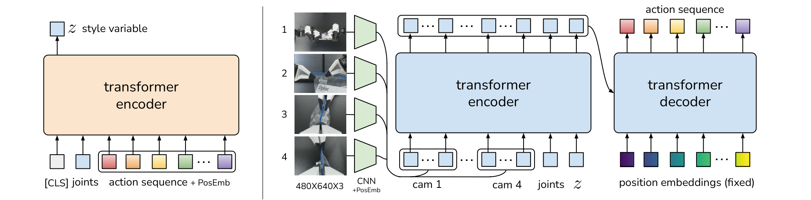

论文 Fig. 5。左边只在训练时出现，右边才是运行时的动作策略。

先抓大意：这个结构把“当前看见什么”和“这段示范采取什么动作风格”分开。左侧黄色块读当前关节与完整示范动作块，得到潜变量 **z∈ℝ³²**；右侧蓝色系统读四路图像、当前关节和z，预测动作块。上方箭头把z送到右侧，运行时左侧撤掉，z设为0。<!-- evidence:C12 -->

**条件变分自编码器（CVAE）**可以先想成带条件的压缩与还原：训练时把动作里的变化压成一个小编码，再要求解码器结合当前观察还原动作。这个编码不能随便塞满标准答案，于是还加一项正则，让它的分布接近标准高斯。

具体地，训练编码器 **qϕ(z|qₜ,Aₜ)** 输出32维均值 μ 和32维标准差 s；ϕ是它的参数。**ε∈ℝ³²** 是标准高斯噪声，“⊙”是逐元素相乘。重参数化写成 z=μ+s⊙ε，随机性来自ε，梯度仍能沿μ、s往回传。

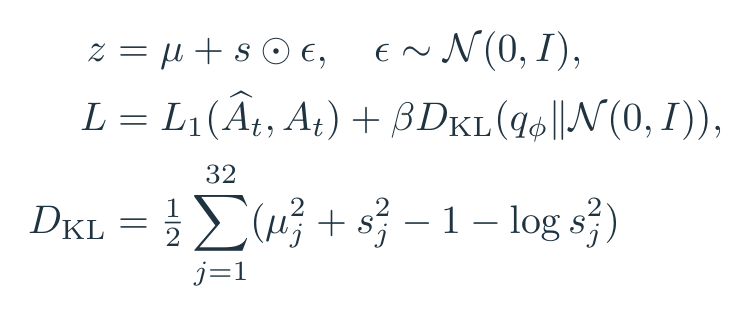

公式 3｜§IV-B/C 的训练目标。β控制潜变量正则强度；本文按实现段使用 L1 重建。

这里 θ 是动作策略参数，â是预测，a是示范目标；k×14个误差按绝对值聚合。**KL散度** DKL 衡量两个分布的差异，本式把编码分布拉向 N(0,I)；I是32×32单位矩阵，j逐个遍历32个潜变量维度。β=10是附录设置。每个关节偏了多少，就记多少，不再平方放大；最后和潜变量的正则项一起优化。<!-- evidence:C13 -->

若某潜变量维度μ=1、s=1，它对高斯KL贡献0.5；μ=0、s=1则贡献0。这个教学算例能看出“偏离标准高斯有代价”到底是怎么罚的。

z没有逐维命名成“快一点”“左边绕”。运行时设0也不是调用一个“平均示范动作文件”：**观察仍然变化，神经策略仍然根据画面生成整段动作**。零只是潜变量输入，不是把全部动作归零。

### 4.4 Transformer：四台相机怎样变成100×14？

这一步信息确实有点多，按形状拆就清楚了。每路480×640×3图像，经ResNet18变成 **15×20×512** 特征；空间展平为 **300×512**，加二维位置编码。四台相机拼在一起，得到 **1200×512**。关节qₜ由14投影到512，潜变量z由32投影到512，再加两个token，总输入 **1202×512**。按这个路线，四路视觉与身体状态就有了同一套特征宽度。<!-- evidence:C14 -->

训练左侧则是另一套序列：[CLS]一项、当前关节一项、k个示范动作，共 **(k+2)×512**。4层Transformer编码器综合它们，取[CLS]对应输出预测μ与s。**[CLS]**可以理解成专门收集整段信息的汇总座位。

运行右侧的Transformer编码器有4层，混合1202个观察token。动作解码器有7层，用 **k×512** 的固定位置嵌入作为查询；交叉注意力从观察编码里取信息，最后把每个位置的512维特征投影成14维动作。k=100，所以一次输出 **100×14**。8个注意力头、隐藏宽512、前馈宽3200来自附录超参数。<!-- evidence:C15 -->

> **基础扫盲｜交叉注意力**：查询来自一组序列，键和值来自另一组。这里“未来第37步”拿着自己的查询，去观察token里找与该动作相关的信息。

100个动作位置共同预测，不是先预测第1步、再把它喂回去生成第2步的自回归链。注意这里有两种“编码器”：训练潜变量编码器属于CVAE左半边；策略内部的视觉Transformer编码器属于CVAE解码器里面。名称嵌套有点绕，图中B和C分开看就不会串台。

模型每任务单独训练，约80M参数；论文报告单张11GB RTX2080Ti约5小时训练，推理约0.01秒。这个速度使持续查询有实现基础，真正执行关节目标仍交给电机底层控制器。<!-- evidence:C16 -->

## 5 实验：六个实机任务，别只看最好的一项

回到E区。六个实机任务通常各收50条示范，穿魔术贴带收100条；单条约8–14秒，累计动作数据约10–20分钟。考虑复位和采集失败，墙钟时间约30–60分钟。两项仿真任务各有脚本与人类示范两种训练集，每种50条成功示范。<!-- evidence:C17 -->

### 5.1 主表怎么读，比较的是哪些设置？

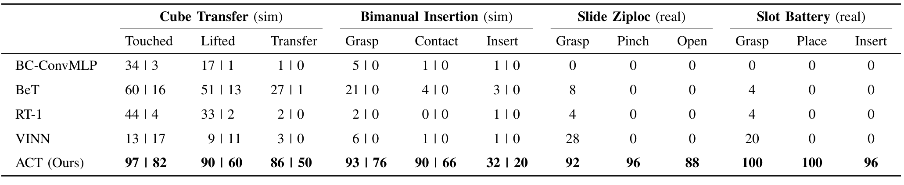

论文 Table II。仿真每格竖线左边是脚本数据，右边是人类数据；实机列直接读百分比。

四组任务从左往右是仿真搬方块、仿真双臂插接、实机拉链袋、实机装电池。每组又按任务进展拆几列，最右侧才是最终成功。行是BC-ConvMLP、BeT、RT-1、VINN和ACT。BeT/RT-1同样使用Transformer，所以这张表不是“Transformer打败传统网络”这么简单。<!-- evidence:C18 -->

仿真用3个训练种子、每个50次评估；实机是1个种子、25次评估。表中的百分比在这些任务设置下读：

| 最终任务 | ACT | 对照情况 |
| --- | --- | --- |
| 仿真搬方块，脚本示范 | 86% | BeT 27% |
| 仿真搬方块，人类示范 | 50% | BeT 1% |
| 实机拉链袋 | 88% | 四个基线最终均0% |
| 实机装电池 | 96% | 四个基线最终均0% |

88%对应25次中的22次，96%对应24次。人类示范的搬方块从脚本86%降到50%，也提醒我们：人的动作更自然，训练未必更容易。论文在这里测试的是逐任务小数据学习，不能拿它直接代表RT-1在原来大数据体系的全部表现。<!-- evidence:C19 -->

### 5.2 六个任务不是统一的“八九成”

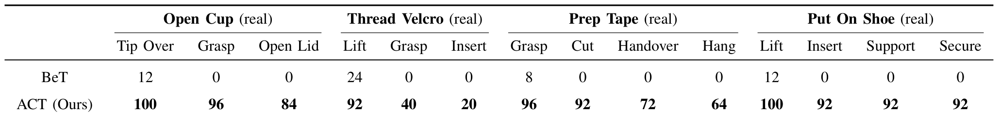

论文 Table III。每组从左往右看进度，重点找成功率在哪一步掉下去。

开杯、穿魔术贴带、备胶带、穿鞋分别占一组。ACT最终成功率是**84%、20%、64%、92%**；这组对照BeT最终均0%。<!-- evidence:C20 -->

最值得停下来的是穿带：拿起来92%，抓住尾部40%，插入20%。前半段看着很顺，到空中第二次抓取就跌了一截。作者观察到夹爪提前闭合、插入对不准；黑色细带在黑背景中又不显眼。任务已经把问题指向感知和接触阶段，不是把总分往文章里一贴就结束了。

备胶带也类似：96%抓到、92%切断、72%交接、64%挂好。前面抓得再稳，后面交接或挂放掉一次链子，整条任务照样功亏一篑。这才是长程精细操作的日常：前面的成功不保证最后的那一毫米。

## 6 消融：分别拆掉这些零件会怎样？

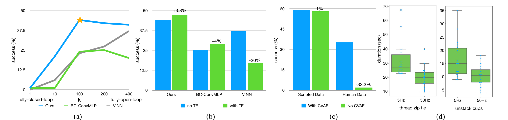

论文 Fig. 9。四块分别测试动作块、时间集成、CVAE和遥操作频率。

这张图先给一个大判断：在这组实验里，**分块和CVAE带来的变化，比给结果做平滑更大**。但四块实验的比较对象不同，需要分别读，不能把柱子随手拼成一张“贡献排行榜”。

### 6.1 块长：一帧一猜不行，一口气全做也不香

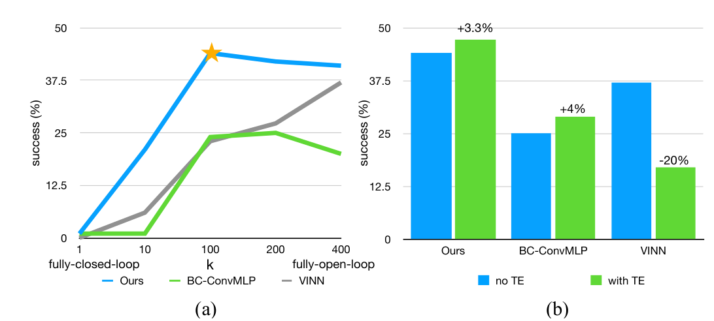

论文 Fig. 9(a–b) 局部。先看左半边：横轴是块长，纵轴是四种仿真设置的平均成功率；右半边留给下一小节对照。

(a)横轴k是块长，纵轴成功率；蓝线ACT，另两条是增加分块的BC-ConvMLP、VINN。这里先关闭时间集成，每个k单独训练，结果在两项仿真任务、两种数据来源共4种设置上平均。ACT从k=1约**1%**到k=100约**44%**，k进一步到200、400后略回落。<!-- evidence:C21 -->

左端反应勤但时序组织弱；右端越来越接近一次把全任务编完，中途响应少、长序列也更难学。这和D区解释对上了：要缩短有效决策链，还得保留新观察介入的机会。简单把输出维度加大也让另两个方法受益，说明分块不只是一种Transformer专属魔法。

### 6.2 时间集成：同样做平均，也有人被拖后腿

(b)横轴是三种方法，纵轴还是成功率，颜色比较有无TE。ACT增加**3.3个百分点**，BC-ConvMLP增加4个，VINN却下降20个。作者分别调了有无TE的超参数，比较各自最好设置；它不是锁住所有其他设置的纯单变量开关。<!-- evidence:C22 -->

VINN 是找相似示范、拿现成动作的近邻方法。作者的解释是：时间集成主要在平滑参数模型的预测误差；VINN 拿到的是数据里的真实动作，未必需要同一种平滑。它很适合提醒我们：平滑是有偏好的操作，不能只因为曲线看起来顺眼就默认更准。

### 6.3 CVAE：人类示范里的变化，才是这道题

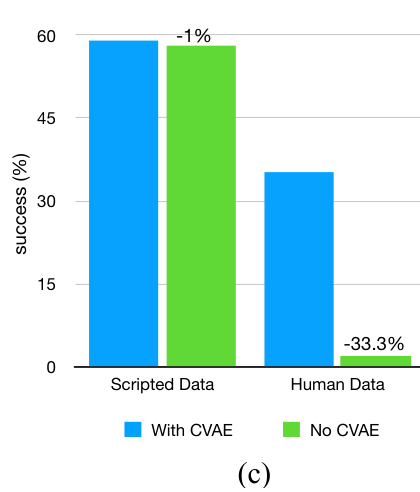

论文 Fig. 9(c) 局部。脚本与人类数据分成两组，颜色区分有无CVAE。

(c)纵轴是成功率，横轴把数据来源拆开。脚本数据里去掉CVAE几乎不变；人类数据里从**35.3%掉到2%**。去掉时保留动作序列预测，用L1直接训练。差别说明在这些任务里，动作块之外，还需要处理人的多种动作路径与噪声。<!-- evidence:C23 -->

这里不必把潜变量讲成玄学。它就是为训练时那些“同样能完成，但走法不完全一样”的动作差异留了编码余地。接着用高斯正则约束这条信息通道，使运行时固定z也能得到可用策略。

### 6.4 高频控制：这块是人操纵，不是策略跑分

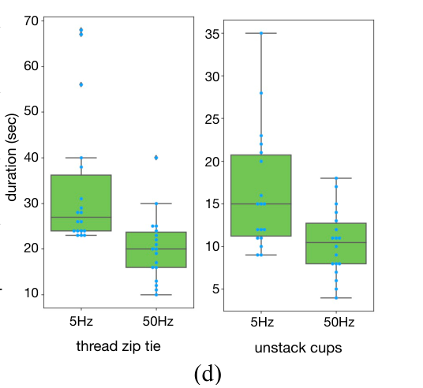

论文 Fig. 9(d) 局部。两项任务分别比较5Hz与50Hz的完成用时。

(d)是6名参与者的遥操作实验：横向比较5Hz与50Hz，纵轴是完成用时，箱线图和点展示分布。穿扎带平均约33秒降到20秒，分开杯子约16秒降到10秒。每种设置给练习时间，随后3次尝试，任务和频率顺序随机化。<!-- evidence:C24 -->

它支持高频反馈对这些精细任务有帮助，也补全A区硬件设计的理由。别把这组时间读成“ACT推理加速62%”，那是换了一道题。

## 7 结论与局限：哪里卡在动作，哪里卡在眼睛？

附录给了两个学失败的任务。拆糖纸：50条示范训练后，10次初评都能拿起，8次能拉两端，但没有一次完成拆开。难处在于接缝位置变化，视觉得认出那个细小断口。平放的小拉链袋也卡在空中的连续调整：起初抓的位置稍有不同，形变后拉口就跑到别处。<!-- evidence:C25 -->

这类失败很有价值。C区就算输出100×14的动作，输入里没看清关键接缝，后面一串动作也可能整齐地错下去。机械结构也有自己的边界：两指夹爪缺少多指协调，低成本电机出力有限，某些瓶盖和重物操作受限。不能把所有难题都推给数据量。

三个问题现在可以收回来。

第一，ALOHA用主从关节映射、易操作的夹爪和四路视觉，把低价硬件做成能稳定采精细示范的系统；视觉闭环弥补一部分误差。

第二，ACT预测的是一段动作，运行却能每步重算；时间集成对齐同一时刻，把多份预测合成一条指令，随后交给底层控制器追踪。

第三，图像特征、关节和训练潜变量经Transformer形成动作块；分块与CVAE在消融里作用明显，时间集成收益更依赖方法。六项实机任务的差异，则把后续问题具体到感知、抓取与接触。

这篇真正抓人的地方，是没有先把硬件堆到“误差几乎不存在”，再说算法会了。它让一个会偏、会卡、动作也不完全统一的系统，靠示范和结构设计开始做精细活。接下来更有意思的问题是：**当任务换了、场景变了，哪些规律可以共用，哪些还得重新教？**

---

阅读工具：[ReadPaper](https://github.com/Zhu-Huixiang/ReadPaper) · 配图工具：[DrawPaper](https://github.com/Zhu-Huixiang/ReadPaper/tree/main/drawpaper)。

可复制仓库地址：https://github.com/Zhu-Huixiang/ReadPaper

点击“阅读原文”进入GitHub文章，查看高清图、公式与可编辑图源。

---

公众号版由管理员在后台手动公开发表；永久文章链接待发表后补充。

关注公众号 **具身智能的 World**：

[原论文](https://www.roboticsproceedings.org/rss19/p016.html) · [证据索引](evidence.json)

[本篇知识星系](../../universe/papers/act.md) · [知识点宇宙](../../universe/README.md)
