# Transformer：句子不排队读了，意思还接得上吗？

**具身智能的 World**｜把值得读的论文，拆到能看懂计算的那一层。

论文解读：沿原文讲清问题、方法、公式与证据。  
论文地图：按科学问题找下一篇。  
顶会顶刊：查正式出处与原文。  
解读日程：看未来一周的阅读安排。  
arXiv 新作：看经过筛选的新研究。  
具身榜：比较七维评分与依据。  
知识点宇宙：从一个概念跳到使用它的论文。

[GitHub：Zhu-Huixiang/embodied-world](https://github.com/Zhu-Huixiang/embodied-world)

“只靠注意力就够了。”

2017 年把这句话写到标题上，多少有点掀桌子的意思。当时机器翻译的主角是循环神经网络，也有卷积路线。句子被当作序列，大家自然会觉得：那信息总得沿着序列走吧。

Transformer 挑战的恰恰是这条假设：**建模顺序，是否必须让计算也按词一个接一个排队？** 它保留编码器—解码器框架，把循环和卷积主干撤掉，用注意力直接建立词与词之间的联系。不是首创注意力，而是把注意力扶成了主干。<!-- evidence:C01 -->

三个问题先放在这儿：

1. Q、K、V 到底算了什么，为什么乘个矩阵就能交换上下文？
2. 不按词循环，顺序与未来信息靠什么管住？
3. 并行带来的收益在哪，为什么生成时仍然一个词一个词往外蹦？

**论文信息**  
Attention Is All You Need｜Ashish Vaswani、Noam Shazeer、Niki Parmar、Jakob Uszkoreit、Llion Jones、Aidan N. Gomez、Łukasz Kaiser、Illia Polosukhin。原文署名包括 Google Brain、Google Research、多伦多大学。  
首次 arXiv 公开：2017-06-12；本篇读 v7，2023-08-02。NeurIPS 2017，机器学习领域主要同行评审会议。  
[原文](https://arxiv.org/abs/1706.03762v7) · [会议论文页](https://papers.nips.cc/paper_files/paper/2017/hash/3f5ee243547dee91fbd053c1c4a845aa-Abstract.html) · [原代码](https://github.com/tensorflow/tensor2tensor)<!-- evidence:C02 -->

**阅读目录**

- [1 引言：把顺序问题与排队计算拆开](#attn-intro)
- [2 背景：远处的信息，要转几次手](#attn-background)
- [3 架构：沿原文小节拆完整 Transformer](#attn-architecture)
- [4 为什么用自注意力](#attn-cost)
- [5 训练：答案右移，未来遮住](#attn-training)
- [6 结果：分数、成本和消融一起看](#attn-results)
- [7 结论：机器人为何也用这套积木](#attn-conclusion)

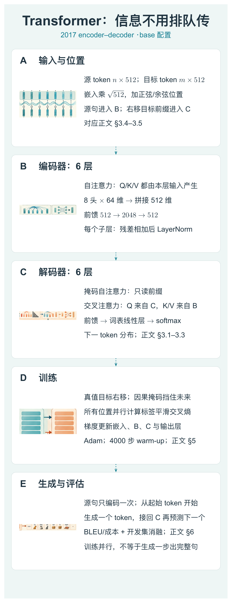

本图由 [DrawPaper skill](https://github.com/Zhu-Huixiang/ReadPaper/tree/main/drawpaper) 指挥 Codex，使用内置生图制作。

可复制地址：https://github.com/Zhu-Huixiang/ReadPaper/tree/main/drawpaper

A 是输入表示，源句进 B 编码器，目标前缀进 C 解码器；C 还会读取 B 的输出。训练时 D 同时给各位置计算损失，生成时 E 把新词接回 C。虚线向下对应文章的阅读路线。第 3 节拆 A/B/C，第 4 节算成本，第 5 节走 D，第 6 节拿 E 的指标验收。先记住：**左边处理整句输入，右边预测下一步输出。**

## 1 引言：把顺序问题与排队计算拆开

循环网络像接力。第一个词留下一个状态，第二个词读这个状态，再传给第三个词。它天然尊重顺序，但前一个状态没算完，后一个就得等。

句子一长，远处信息还要一路转手。注意力早已用来让解码器直接读取输入句子的相关部分；Transformer 更激进：既然这种直接读取有用，编码器内部、解码器内部也能这样交换信息吗？

于是，“词有先后”交给位置表示与可见性规则，“词之间怎么交换内容”交给注意力。两件事拆开，计算就有机会并行。<!-- evidence:C01 -->

## 2 背景：远处的信息，要转几次手

原文第 2 节比较循环与卷积，也回顾自注意力、记忆网络等路线。卷积能并行处理局部邻居，但要让远处两个词联系起来，通常要叠更多层；循环网络则沿序列逐步传播。自注意力允许任意位置在一层里读取另一位置。

北京青年报的一次对谈报道里，徐志胜回忆：演出前面漏了铺垫，结尾仍用力回梗，结果越使劲越冷场。一个包袱能不能接上，得看前面的信息在不在。拿来理解这里很合适：下一词预测，也要找得到相关前文。区别在于，Transformer 真正实现的不是“演员记性变好”，而是下面这套明确的读取运算。<!-- evidence:C03 -->

## 3 架构：沿原文小节拆完整 Transformer

### 3.1 编码器与解码器：两列各六层

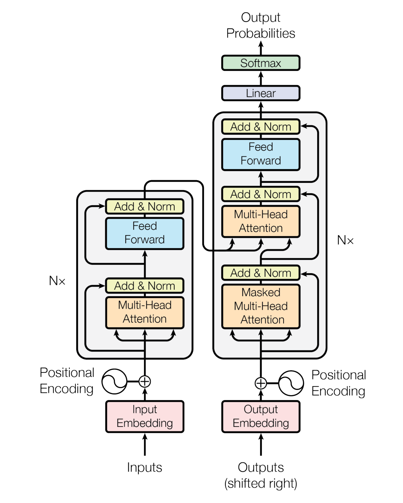

论文 Fig. 1。左列编码输入句子，右列在已生成前缀上逐词预测。

这张图的主线是两根从下向上的柱子。左侧 Inputs 经词嵌入和位置编码，进入六层编码器；右侧 Outputs 是**右移后的目标输入**，同样加位置，再进六层解码器。箭头横穿中间，是编码结果送到右侧的交叉注意力。

每个编码层有自注意力、前馈网络两个子层。解码层多一个面向源句的交叉注意力：掩码自注意力 → 交叉注意力 → 前馈网络。每个子层都有残差与归一化。最上面的 Linear 把特征映射到词表大小，Softmax 给出每个候选词的概率。图中 N× 表示重复六层，不是重复读六遍原句再投票。<!-- evidence:C04 -->

本篇默认讲 base：每个位置 512 维，编码器与解码器各 6 层，8 个注意力头。用 n 表示源句 token 数，m 表示目标序列 token 数，编码状态形状 n×512，解码状态形状 m×512。token 可以是子词片段；一句话有多少 token，不必等于汉字或单词数量。

### 3.2 注意力：Q、K、V 分工，不靠玄学

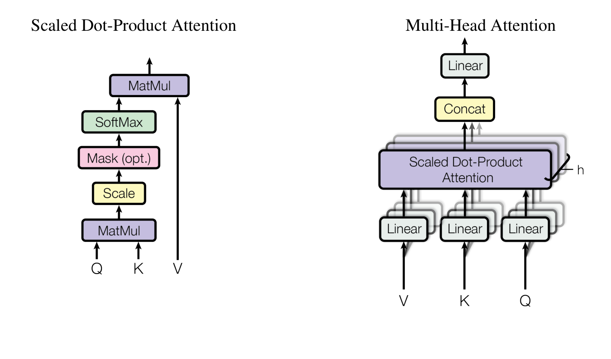

论文 Fig. 2。左边展示一次加权读取，右边把多个头并行拼接。

先读左图：Q 与 K 做矩阵乘法，缩放，再按需加掩码，Softmax 变成权重，最后与 V 相乘。右图是多组线性投影和注意力并行，拼接后再做输出线性变换。

> **基础扫盲｜Q、K、V**：query 是查询向量，key 是用来匹配的键向量，value 是实际读走的内容向量。同一词会经过不同可学习投影，得到三种角色。它们不是人工写好的关键词、字典释义与数据库地址。

令 n_q 是查询数，n_k 是可读取位置数；dₖ 是查询/键的通道数，dᵥ 是值的通道数。Q 每行一个查询，K 每行一个键，V 每行一份内容。ᵀ 是转置，A 是权重矩阵，Softmax 沿每一行归一化。

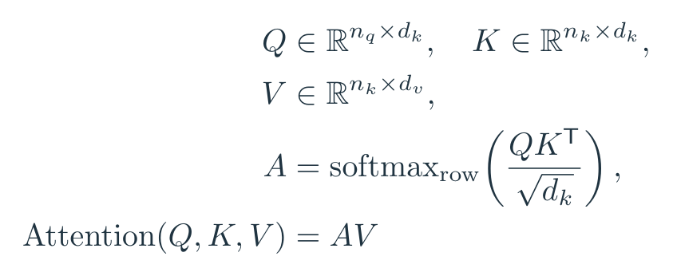

公式 1｜原文 Eq. (1)：先算匹配权重，再用权重混合 V。

QKᵀ 的形状是 n_q×n_k，每个查询都和每个键比一次。A 的每行加起来为 1，AV 的形状就是 n_q×dᵥ。查询数量保持不变，内容从所有可见位置按权重汇过来。

为什么除以 √dₖ？原文的解释是：若查询和键各通道近似零均值、单位方差，点积方差随 dₖ 增长。分数太大，Softmax 容易提前变成几乎独占的一票，梯度变小。缩放把分数拉回比较合适的量级。不是给模型装个“冷静一下”按钮，但这个比喻倒也挺贴。<!-- evidence:C05 -->

拿一个二维教学例子，只算一个查询、三个键。q=(1,0)，键分别为 (1,0)、(0,1)、(1,1)，点积是 1、0、1，除以 √2 后归一化：

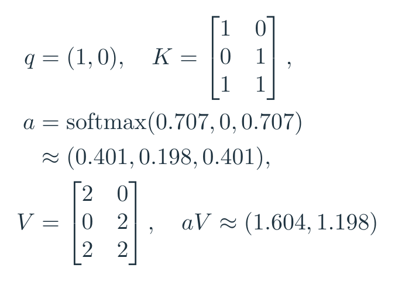

公式 2｜二维教学例子：注意力的输出是加权向量，不是把最大权重对应的词原样拷贝。

这里 V 的三行分别是 (2,0)、(0,2)、(2,2)。权重约 0.401、0.198、0.401，输出约 (1.604,1.198)。第三个位置得到了较多权重，却没有把其他位置直接删掉。完整向量会继续送往后面的投影与前馈网络。

**Q、K、V 到底算了什么，为什么乘个矩阵就能交换上下文？** QKᵀ 计算“本位置需要哪些位置”，AV 按这个分配混合内容；参数从预测任务的损失中学会怎样投影。所谓上下文，就是其他位置的表示经过这条通道进入当前表示。

#### 3.2.2 多头：八组小空间一起读

单个 512 维点积也能做注意力，但它只产生一张权重图。多头让不同投影子空间分别算权重。

以编码器自注意力为例，X 是 n×512 输入，i 为第 i 个头，Wᵢᴽ、Wᵢᴷ、Wᵢⱽ 是各头的投影矩阵，hᵢ 为该头输出；Wᴼ 是拼接后的输出投影。

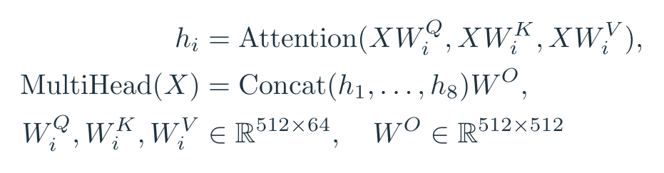

公式 3｜原文 §3.2.2 的 base 自注意力：八个 64 维头拼回 512 维。

每个头输出 n×64，横向拼成 n×512，再乘 Wᴼ。八个头并非人工指定“一个管主语，一个管宾语”，而是训练中可能学到不同关系；也可能有冗余。这个问题后面会用头数消融来查。

#### 3.2.3 三种注意力，来源要分清

编码器自注意力里 Q/K/V 都来自当前编码状态，源句各位置可以互读。解码器的掩码自注意力也来自自身，但看不到后面的目标词。交叉注意力则是 C 区产生 Q，B 区编码结果产生 K/V：输出端带着当前需求，去源句里找信息。

交叉注意力的每个头中，Q 为 m×64，K/V 为 n×64，权重为 m×n，输出 m×64。注意力并不要求两边序列一样长，这一点对以后理解视觉 token、语言 token、动作 token 怎么连接尤其有用。<!-- evidence:C06 -->

### 3.3 前馈层：交换信息后，每个位置再自己加工

注意力负责跨位置读信息，前馈网络则在每个位置独立做非线性变换。x 是某一位置的 512 维行向量，W₁、W₂ 为两层权重，b₁、b₂ 为偏置；max(0,·) 是 ReLU，负值截成零。Sublayer 指注意力或前馈子层，LayerNorm 对该位置的特征通道归一化。

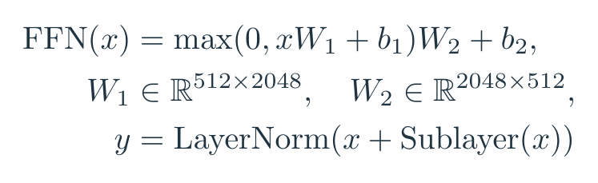

公式 4｜原文 Eq. (2) 与 §3.1：逐位置前馈网络，以及原版的残差后归一化。

512 → 2048 → 512，输出又回到统一宽度，方便残差相加。同层不同位置共用前馈参数，不同层有各自参数。原版的顺序是子层运算后加残差，再归一化；后来常见的先归一化版本是另一个设计，读历史论文时别自动替换。<!-- evidence:C07 -->

### 3.4—3.5 词嵌入与位置：顺序被写进向量

单纯自注意力会根据输入内容建立关系；如果把 token 顺序调换，运算不会凭空知道谁先谁后。A 区于是加入位置编码。

eₚ 是位置 p 的词嵌入，p 从 0 开始计位置；i 是频率通道索引，base 中取 0 到 255，2i 与 2i+1 对应偶数、奇数通道。PE 是位置向量，Xₚ 是送入网络的 512 维表示。

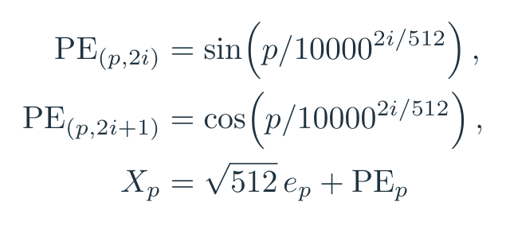

公式 5｜原文 §3.4–3.5：词嵌入和位置编码相加。

拿 i=0 看最简单的一对：位置 0 是 sin(0)=0、cos(0)=1；位置 1 约为 0.841、0.540。其他通道用不同波长，让相近与较远的位置有不同组合。词嵌入先乘 √512，再与位置相加。位置向量是输入线索，模型仍要学怎样利用它，不是加了正弦就自动掌握语法。<!-- evidence:C08 -->

**不按词循环，顺序与未来信息靠什么管住？** 位置编码提供位置线索，解码器的因果掩码决定当前步能看谁。顺序表示与信息权限，各有负责的模块。

## 4 为什么用自注意力

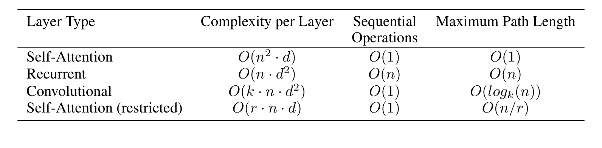

论文 Table 1。关注计算量、顺序步数和最远信息路径三列。

表中 n 是序列长度，d 是表示宽度，k 是卷积核宽度，r 是局部注意力允许读取的邻域大小。自注意力单层复杂度为 O(n²d)，循环网络为 O(nd²)；自注意力跨位置的顺序操作层数为 O(1)，循环是 O(n)。最远位置之间的传播路径，自注意力一层就能连接，循环需要沿链走。

这张表没有“任何输入都更省”的承诺。当 n 很大时，n×n 的注意力矩阵就要收账了。以 n=1000、8 个头为例，单层每个样本的注意力权重共有 800 万个数；还没算梯度与别的激活。这是按形状算的教学账，不是论文的显存实测。<!-- evidence:C09 -->

所以它解决了一类瓶颈，也暴露了长序列成本。后来图像、视频、机器人时序里各种窗口、稀疏与压缩设计，很多都在处理这笔账。

## 5 训练：答案右移，未来遮住

D 区训练时，完整目标句子已知。比如目标是“我 爱 机器人”，输入解码器的是“起始符 我 爱”，三个位置分别预测“我 爱 机器人”。

听起来像把答案摆桌上了？关键在掩码：预测“我”的位置只能读到起始符；预测“爱”的位置只能读到起始符和“我”。把不可见位置的注意力分数加上负无穷，Softmax 后权重为零。这样可以一口气计算所有训练位置，又不让每个位置偷看自己要预测的词。<!-- evidence:C10 -->

用 x 表示源句、y₍<t₎ 表示目标前缀，pθ 是模型预测分布，qₜ,ᵥ 是标签平滑后的目标概率，V_size 是词表大小，v 为词表索引，t 为目标位置。L 是训练损失。s 为训练步数，lr 是学习率。

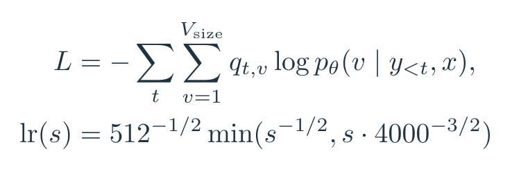

公式 6｜上式是标签平滑交叉熵的教学展开，下式为原文 Eq. (3) 的 base 学习率。

标签平滑 ε=0.1，让目标不再要求正确词概率绝对等于 1。学习率先随步数上升，4000 步后转为衰减。代入 s=4000，可算峰值约 0.000699；s=16000 时约 0.000349。前期别乱冲，后期逐步收小步子。<!-- evidence:C11 -->

原文训练数据包括 WMT14 英德约 450 万句对、英法约 3600 万句对；词表由子词切分建立。base 训练 10 万步，8 张 P100 约 12 小时；big 训练 30 万步，约 3.5 天。这里是 2017 年文中的配置和时间，不拿今天 GPU 的速度替它改账。<!-- evidence:C12 -->

生成就没法把真值前缀一次摆出来了。先生成一个 token，再把它接回 C 区，继续预测；推理采用 beam search 等策略。**并行带来的收益在哪，为什么生成时仍然一个词一个词往外蹦？** 训练时各位置的真值前缀已知，因果掩码允许并行计算；生成时后一个条件依赖刚生成的前一个结果，仍要逐步推进。

## 6 结果：分数、成本和消融一起看

### 6.1 翻译：质量提高，还把训练账单列出来

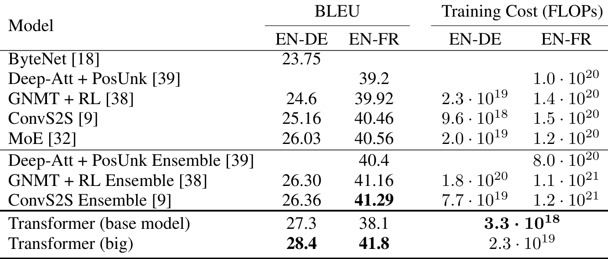

论文 Table 2。BLEU 越高越好，训练成本列是估计 FLOPs。

按行看模型，按列看语言任务和训练成本。BLEU 比较生成译文与参考译文的词片段重合，适合在同一测试设置下对比，别把 28.4 读成“翻译准确率 28.4%”。

本篇采用所读 v7 表 2 的英德结果：Transformer base 27.3，big 28.4；ConvS2S 25.16，表中的最佳既有 ensemble 为 26.36。base 与 big 的估计训练成本分别 3.3×10¹⁸、2.3×10¹⁹ FLOPs。ensemble 指多个模型合并预测，比较时要看清单模型与组合系统。<!-- evidence:C13 -->

| 英德设置 | BLEU |
| --- | ---: |
| ConvS2S | 25.16 |
| 既有最佳 ensemble | 26.36 |
| Transformer base | 27.3 |
| Transformer big | 28.4 |

单看这组结果已经足够支持文章的主要判断：在论文的机器翻译设置里，移除循环主干没有牺牲质量，并获得了有竞争力的训练成本。它不是“注意力凭一己之力解决全部语言问题”的证据，原文也做了下面这些拆件实验。

### 6.2 头越多越聪明？表 3 没这么给面子

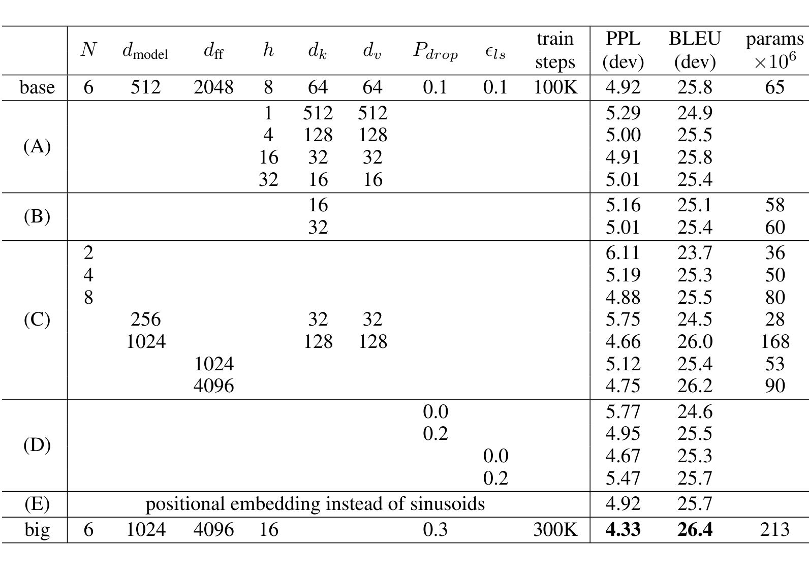

论文 Table 3。同一开发集上的消融，横向比较设置，纵向比较分数。

这张表切换到英德开发集 newstest2013，不能与上面的测试分数直接相减。左边是层数、宽度、头数、键/值维度、dropout、平滑系数等配置，右边是困惑度、BLEU、参数量。

固定大致计算量，1 个头 BLEU 24.9，8 个头的 base 为 25.8；改到 16 个头仍为 25.8，32 个头反而 25.4。多头有价值，数量也不是越堆越香。dₖ 太小会掉分，说明每个头用于判断匹配的空间也需要足够容量。<!-- evidence:C14 -->

dropout 关掉，BLEU 从 25.8 降到 24.6。标签平滑关掉，困惑度从 4.92 改善为 4.67，BLEU 却从 25.8 降为 25.3。困惑度反映对目标词概率的预测，BLEU 看整句生成后的片段匹配；优化一个数，另一个数不一定跟着走。<!-- evidence:C15 -->

位置编码也测了：正弦版 25.8，学出来的位置嵌入 25.7。原版正弦编码是合理选择，但实验没把它塑造成不可替代的秘方。<!-- evidence:C16 -->

### 6.3 句法分析与附录连线图

原文还把 Transformer 用于句法树生成。在仅 WSJ 监督数据下得到 91.3 F1，比较对象 Dyer 等为 91.7；半监督设置中得到 92.7。不同训练数据与系统要分开看，它主要展示了不专门为句法树重写架构，也能有不错表现。<!-- evidence:C17 -->

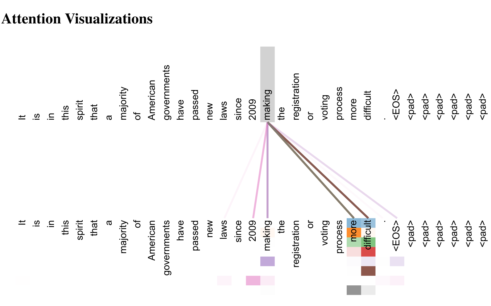

论文 Fig. 3。连线展示第五层的远距离注意力，颜色区分不同头。

这张图没有传统坐标轴。两排词是相同句子的查询位置与可读取位置，连线越显眼表示权重越大，颜色代表不同注意力头。原文挑出 making 附近的连线，展示它与较远短语的联系。先看远处能直接相连，再看同一词发出多种颜色的连接。

它是读取模式的例子；一个头恰好连向语法相关词，不等于这个头被严格分配了某项语法工作。把注意力图当观察窗口，结合表 3 的消融看，比给每根线编心理活动靠谱。<!-- evidence:C18 -->

## 7 结论：机器人为何也用这套积木

回头看 A/B/C，Transformer 提供了一种通用的计算接口：把输入变成 token，标明位置或时间，通过自注意力交换同类信息，通过交叉注意力读取另一类信息，最后接任务需要的输出。

机器人可以把图像块、语言指令、历史状态、动作序列送进类似结构。但 token 怎样定义、哪些位置可见、输出是动作分布还是连续向量，都要按具体论文重看。原论文的实验是机器翻译与句法分析，机器人应用的价值来自后来怎样接这些模块。

三问到这里接上：Q/K/V 用可训练匹配完成内容读取；位置编码与因果掩码分别管理顺序和可见性；训练能并行，生成依然受前缀依赖约束。下次看到一张满屏 Transformer 方块的机器人架构图，先问每个方块的 Q 从哪来、K/V 从哪来，再看掩码遮了谁。那些“融合”“对齐”“理解”的大词，往往就能落回几次明确的矩阵乘法。

阅读工具：[ReadPaper skill](https://github.com/Zhu-Huixiang/ReadPaper) · [DrawPaper skill](https://github.com/Zhu-Huixiang/ReadPaper/tree/main/drawpaper)。

可复制地址：https://github.com/Zhu-Huixiang/ReadPaper  
公众号读者可点「阅读原文」，到 GitHub 查看高清图、公式与本篇图源。

---

公众号版由管理员在后台手动公开发表；永久文章链接待发表后补充。

关注公众号 **具身智能的 World**：

[原论文](https://arxiv.org/abs/1706.03762v7) · [证据索引](evidence.json)

[本篇知识星系](../../universe/papers/attention.md) · [知识点宇宙](../../universe/README.md)
