# CLIP：把分类器写成一句话，凭什么管用？

这里是「具身智能的 World」。公众号和 GitHub 一起做这些事：

- 论文精讲：沿原文拆方法、公式和实验。
- 具身论文地图：按研究问题串起阅读路线。
- 顶会顶刊集锦：查正式出处，直达原文。
- 解读日程：查看接下来准备讲什么。
- arXiv 新作：筛选近期值得追的研究。
- 具身榜：看评分、证据和作者团队。
- 知识点宇宙：沿技术、公式和关联论文继续读。

GitHub：https://github.com/Zhu-Huixiang/embodied-world

**你想让视觉模型认一种新东西，为什么还得先给它标一批图？**

传统 ImageNet 分类器的答案是：因为它的输出栏已经写死了。训练时有 1000 个类别，最后就给你 1000 个分数。临时加一句“这是一种宠物狗”，模型也没地方接这句话。它守着那张类别表上班，新任务来了，还得先走一趟改表流程。这个接口，班味有点重。

CLIP 挑战的就是这个接口。它的全名是 Contrastive Language–Image Pre-training，意思是用图文对比做预训练。它让文字参与定义“要认什么”：先把照片和描述一起训练，再把下游类别写成句子。换任务时，类别向量换一套，图像编码器继续用。

这篇在具身榜排第一，综合分 96.41。它给视觉表征装上语言入口，后来机器人也接上了。先讲透原论文，再看 CLIPort 怎么接。<!-- evidence:C01 -->

带着三个问题读：

1. 不逐字生成配文，CLIP 怎样从图文配对学出视觉表示？
2. 只给类别文字，怎样拼出一个不用下游样本训练的分类器？
3. 换场景之后，它到底认得什么；这些能力怎样接到机器人上？

论文：*Learning Transferable Visual Models From Natural Language Supervision*。Alec Radford、Jong Wook Kim 等，OpenAI。首次公开于 2021-02-26；本文使用 ICML 2021 正式版及补充材料。ICML 是机器学习领域的主要国际会议，这篇收入 PMLR 第 139 卷。<!-- evidence:C02 -->

原文：https://proceedings.mlr.press/v139/radford21a.html

官方代码：https://github.com/openai/CLIP

**阅读目录**

- §1 引言：类别标签把视觉模型的嘴封住了。
- §2 方法：2.1 数据；2.2 配对目标；2.3 双编码器；2.4 预训练；2.5 零样本使用。
- §3 分析：3.1 早期方法对照；3.2 零样本；3.3 表征；3.4 换场景。
- §4 数据重叠；§5 社会影响；§6 局限。
- §7 相关工作；§8 结论，以及机器人怎么接这条链。

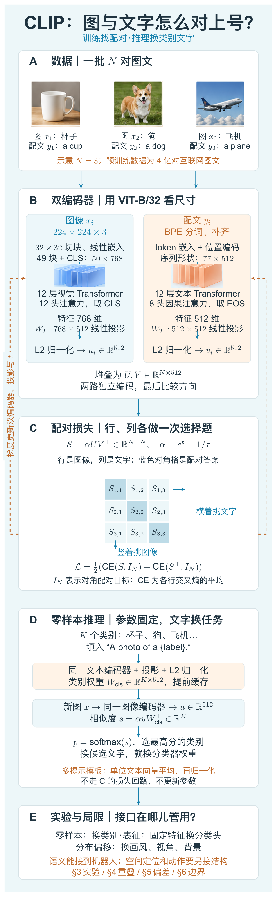

本图由 [DrawPaper skill](https://github.com/Zhu-Huixiang/ReadPaper/tree/main/drawpaper) 指挥 Codex，使用内置生图制作。

先认路。**A→B→C 是训练**：成对图文分别编码，投影、归一化，组成相似度矩阵；配对损失反过来更新两个编码器。**D 是推理**：类别句子提前编码成一组向量，新图进来跟它们比较。这里参数固定，不再走 C 的损失回路。

§2.1 看 A，§2.2–2.4 拆 B、C，§2.5 进入 D；§3–6 在 E 检验这套接口。全文就顺着这条线走：先把“怎么学”算出来，再问“学来的东西在哪里管用”。

图中 ℝ 表示实数空间，右上角写对象的形状；C 的 Iₙ 是 N×N 的单位矩阵，用对角线标出配对目标，CE 表示各行交叉熵的平均。D 的 Wcls 是类别权重表，s 是新图对各类别的分数，p 是对应的候选概率。下面把它们逐个算开。

## 1. 引言：视觉模型为什么非得等人标答案？

看一张狗的照片，ImageNet 标注员可能只给它“柯基”这个类别。网上的配文却可能是“Pepper 在草地上跑”。同一张图，多了名字、场景和动作。自然语言提供的监督范围，比固定的物种名单宽得多。

CLIP 的出发点是：这些现成配文能不能拿来学视觉？这样换个任务时，也能用文字交代任务，而不是重新组织标注。

原论文一开始就把相关路线摆了出来：VirTex 让模型预测图像描述，ConVIRT 用图文对比学习；更早的 Visual N-Grams 已探索过零样本迁移。CLIP 接着做的是大规模训练和系统评估。自然语言监督这条路，前人已经修过路基。<!-- evidence:C03 -->

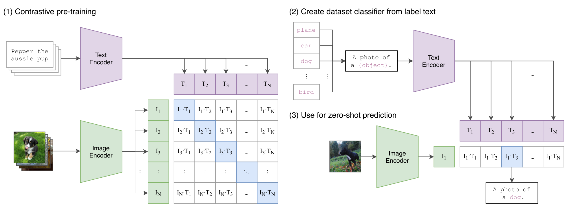

论文 Fig. 1。左边训练找配对，右边先把类别写成文字，再给新图分类。

左上紫色是文本编码器，左下绿色是图像编码器。它们各自输出一批向量：文字排成列，图像排成行，中间每个格子比较一对图文。蓝色对角格对应原本一起出现的样本，训练要把这些配对找回来。

右上先把 plane、car、dog 等类别填进“A photo of a {object}.”，紫色编码器把句子变成类别向量。右下新图经过绿色编码器，得到一个图像向量，跟整排类别向量做点积，最大的一格决定预测。

注意左边矩阵的宽度是训练批次里的文本数，右边是你提供的类别数。图里都用了 N，实际用途不同；后面我们把推理类别数写成 K，免得读着读着串线。

## 2. 方法：把图和文字放到同一张坐标纸上

### 2.1 数据：4 亿对，也得先处理“这都什么配文”

回到架构图 A。作者收集了 4 亿个图像—文本对，称为 WIT。检索使用约 50 万个查询词，每个查询最多纳入 2 万对，尽量覆盖不同视觉概念。<!-- evidence:C04 -->

网页元数据挺杂。“20160716_113957.JPG”也算标题，曝光参数也会混进描述。作者试着筛 YFCC100M，保留英文自然语言标题或描述后，约 1 亿张只剩 1500 万张。样本数涨了，文字却未必在说图。<!-- evidence:C04 -->

配文也很少替你把图里所有东西都数一遍。一句“周末快乐”可能配着狗、草地和人。CLIP 要从大量这种局部、带噪的联系里学语义，不是逐像素接受老师批改。

### 2.2 训练目标：完整写一句话，负担有点重

作者最初试过：图像编码后，让语言模型生成整段描述。模型得决定先说谁、用什么词、句子怎么结束。一张狗图可以配“狗在跑”，也能配“Pepper 玩疯了”，生成目标要照顾这些表达差异。

于是他们把题目改小：**这一批文字里，哪一句跟这张图配对？**

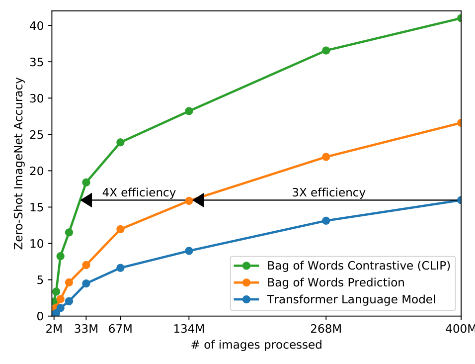

论文 Fig. 2。这张图要回答：同样拿配文学视觉，哪种训练题目更省样本？先看绿线，它更早达到相同准确率。

横轴是累计处理过的训练图像量（百万），按线性刻度排；纵轴是 ImageNet 零样本准确率（%），越高越好。蓝线是完整文本生成；橙线只预测词袋，也就是看文字里有哪些词，暂时不管词序；绿线把词袋预测换成对比目标。相同准确率处横着读，生成到词袋预测约快 3 倍，再换成对比目标约快 4 倍。这里的“快”指达到图中零样本水平所需的训练图像量。<!-- evidence:C05 -->

Fig. 2 用词袋模型探索哪种目标更省训练量；最终文本编码器换成了 Transformer。

#### 先把向量定义好

架构图 B 接收一批 N 对样本。xᵢ 是第 i 张图，yᵢ 是它的配文；i 从 1 到 N。图像编码器 f、文本编码器 g，分别把它们变成特征。我们用行向量写公式。

选 ViT-B/32 这版看尺寸：f(xᵢ) 有 768 个数，g(yᵢ) 有 512 个数。图像线性投影在公式里记作 W 的大写下标 I，形状是 768×512；文本投影 W 的大写下标 T，形状是 512×512。I、T 在这里分别标图像和文本，不是样本编号。两种特征都被映射到 512 维；uᵢ、vᵢ 是投影后、归一化的图像和文本向量。<!-- evidence:C06 -->

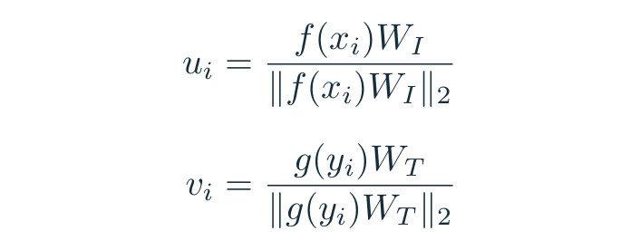

式（1），按论文 Fig. 3 展开的投影与归一化。

双竖线表示 L2 范数，也就是平方和再开根号；除以它以后，向量长度都变成 1。这样比较重点落在方向。否则某个向量光凭“声音大”、数值长，就可能占便宜。

<blockquote class="primer">
基础扫盲｜embedding 是模型给输入安排的一串坐标。512 维不是 512 个已命名属性；训练让合适的图文方向靠近。latent / embedding 空间听着玄，先把它当成一张维度很多的坐标纸。
</blockquote>

#### 那张 N×N 矩阵，到底装了什么？

把所有 uᵢ 叠成矩阵 U、所有 vᵢ 叠成 V，两者形状都是 N×512。U 乘 V 的转置，得到 N×N 的相似度表。转置就是把 V 的行列交换。表中第 i 行、第 j 列比较图像 i 和文本 j。

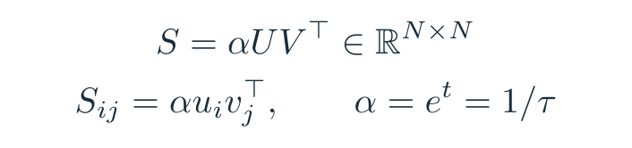

式（2），按论文 Fig. 3 展开的相似度计算。

S 是送给分类损失的分数矩阵。因为 u、v 长度为 1，点积就是余弦相似度；它问两个向量朝向是否接近。α 是正的可学习缩放系数，t 是它的对数，exp 表示指数函数；也可以写温度 τ=1/α。τ 越小，softmax 越偏向最高分。<!-- evidence:C07 -->

<blockquote class="primer">
基础扫盲｜softmax 把一组分数变成加起来等于 1 的候选概率：每个分数先取指数，再除以所有指数之和。温度好比放大分差的旋钮，排名不变，概率却能从“都差不多”变成“主要押这个”。
</blockquote>

监督答案就是配对编号。图 i 应该挑文本 i，文本 i 也应该挑图 i。也就是说，**对角线是这一批题的答案**。非对角线 N²−N 个组合都作为负例参与比较。<!-- evidence:C07 -->

#### 手算一小步，比念“对比学习”有用

架构图 C 用三对样本示意。下面是假设的教学分数，已经乘过 α：

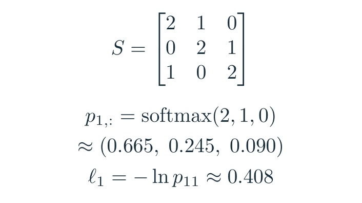

式（3），三对样本的教学例子。

式里的 p₁,: 用冒号表示“第一行全部候选的概率”。图 1 对三个文本的分数是 2、1、0。取指数约得 7.389、2.718、1，归一化后是 0.665、0.245、0.090。配对答案是文本 1，模型目前给它 66.5% 的候选概率。这张表就是一次图文“赛博对账”：同批谁跟谁原本一对，先对清楚，梯度才知道该往哪儿推。

已经排第一了，那咋了？正确项只有66.5%，损失还要催。交叉熵在这里只有一个正确类别，等于正确配对概率的负对数：−ln(0.665)≈0.408。若押错答案，正确配对概率很低，损失就会变大。

再竖着读第一列：文本 1 挑图像，分数是 2、0、1，正确配对概率仍约 0.665。这个例子恰好相同；一般矩阵里行、列的竞争对手不同，所以两边都得算。

#### 把 N 道题平均，再把两个方向平均

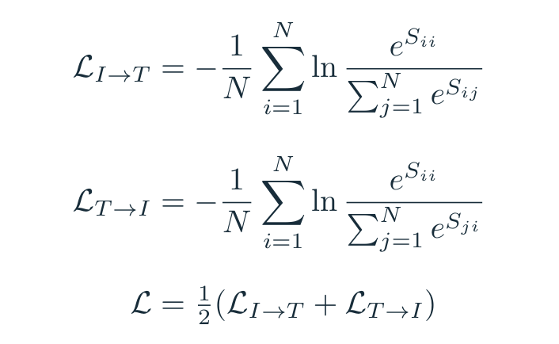

式（4），论文 Fig. 3 的双向交叉熵教学展开。

Lᵢ→ₜ 表示图像选文本的平均损失，Lₜ→ᵢ 表示文本选图像。分子 Sᵢᵢ 是配对格，分母求和里的 j 枚举这一行或这一列的全部候选；ln 是自然对数。最后 L 把两个方向平均。<!-- evidence:C07 -->

行损失负责“每张图找回配文”，列损失补上“每句文字找回图”。只看行，就少检查了反方向的混淆。

反向传播到底推哪儿？先只看第一行的损失 ℓ₁，它对分数 S₁ⱼ 的导数是：

式（5），单行交叉熵的标准导数，用于解释训练方向。

p₁ⱼ 是第一行 softmax 的第 j 个概率，方括号是指示函数：j=1 时为 1，其他时候为 0。刚才三个导数约是 −0.335、0.245、0.090。梯度下降减去导数，便会提高配对格的分数、降低错配格的分数；完整训练还叠加列方向及平均系数。

这些梯度经过点积、归一化和投影，回到两个编码器。架构图 C 的橙色虚线就在画这条参数更新路线。无需给“杯子”“狗”各装一个监督头，配对关系已经在推动视觉特征改变。

第一问的答案落在这里：**把写描述改成找配对，用批内竞争给两个编码器提供梯度。**

### 2.3 模型：两边各自干活，最后才对答案

CLIP 有 ResNet 和 ViT 两类图像编码器。ResNet 版改了网络 stem、抗混叠下采样，并用注意力池化汇总空间特征。ViT 版则把图像切块，让图块之间通过 Transformer 交换信息。Transformer 把注意力与逐 token 的变换堆成多层，前者交换信息，后者继续加工每个位置的特征。<!-- evidence:C08 -->

在架构图 B 的左路，ViT-B/32 接收 224×224×3 图像。32×32 切块，得到 7×7=49 个 patch；每块展平有 3072 个颜色数，线性变换成 768 维，再加一个 CLS 汇总 token，总共 50×768。加入位置编码、做归一化后，进入 12 层、12 头视觉 Transformer；最后取 CLS，归一化并投影到 512 维。<!-- evidence:C06 -->

<blockquote class="primer">
基础扫盲｜注意力让一个 token 按相关程度读取其他 token 的信息。CLS 是额外放进去的“汇总席位”，它跟图块一起计算，最后拿它代表整张图。token 在这里是一块图像的表示，不是一个单词。
</blockquote>

右路先用 BPE 分词，把文字拆成常见子词或字节组合；词表有 49,408 项。官方实现的序列长度是 77，含开始、结束和补齐位置；每个 token 映射为 512 维。12 层、8 头文本 Transformer 后，先做 LayerNorm，再取 EOS 结束位置的特征、线性投影。EOS 通过因果注意力读取前面的词，因此能汇总这句话。两路投影后都做式（1）的 L2 归一化。<!-- evidence:C06 -->

LayerNorm 处理一条特征内部的均值和方差，让后续网络更容易计算；L2 归一化则把整条向量的长度压到 1。这两个“归一化”在不同位置干不同的活，别混成一步。

这个结构没有把每张图的 patch 和每句话的词，送进同一个跨模态注意力模块。两路各算各的，最后比较向量。好处马上体现在 D：类别文字可以提前算好，新图进来不用陪着所有类别重新跑一遍文本网络。

论文最强的 ViT-L/14@336px 则用 336×336 输入、14×14 切块：576 个 patch 加 CLS，共 577 个视觉 token；视觉宽度 1024，24 层、16 头，最后投到 768 维。它的文本网络宽 768、12 层、12 头。下面论文默认的“CLIP”结果主要指这版；B/32 只是我们刚才拆尺寸用的版本。<!-- evidence:C09 -->

### 2.4 预训练：损失短，账单可不短

作者从零训练，批大小 32,768，训练 32 个 epoch。epoch 就是把训练集完整走一轮。每张图在一个批次里要跟其余 32,767 句文字竞争；N×N 约有 10.74 亿个分数组合。图像训练增强只用了随机方形裁切。<!-- evidence:C10 -->

公式看着从从容容，算力账单就没这么松弛了。论文最大的 ResNet 用 592 张 V100 训练 18 天，最大的 ViT 用 256 张 V100 训练 12 天；ViT-L/14 还在 336 分辨率多训练一轮。<!-- evidence:C10 -->

大批次提供很多负例，也带来一个值得记住的问题：同一批里的另一句“a dog”可能也描述得通这张狗图，但训练按样本配对编号仍把它当负例。模型在学细粒度联系时，也得承受这类配对噪声。这个目标奖励的是找回原配，不是人工检查过的全部语义匹配。

### 2.5 使用：一句话怎样变成分类器？

走到架构图 D。假设你想分 K=3 类：狗、杯子、飞机。把类别名填入“A photo of a {label}.”，分别过文本编码器、投影和归一化，得到 w₁、w₂、w₃。这里 wₖ 是第 k 类的单位向量；在 B/32 版中每个有 512 维。

新图只过一次图像网络，得到 u。与三个 wₖ 点积，乘缩放系数，再对 K 个分数做 softmax。

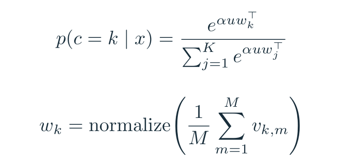

式（6），零样本分类及附录 B 的模板集成展开。

c 是候选类别索引，j 在分母里枚举 K 类；p(c=k｜x) 表示给定图 x、在这些候选中属于第 k 类的概率。分数最高的类别就是预测。所有 wₖ 拼起来，是一张 K×512 的分类器权重表。

过去你要用带标签的图片拟合这张表。现在文本编码器根据类别描述造出这张表。**文字编码器生成类别权重，新图与它们做相似度分类。** 这是第二问的答案。新增类别时，多编码一句话就能扩展候选列表。

“零样本”说的是没有用目标数据集的训练样本拟合分类器。模型此前已经见过 4 亿图文对，也能从类别名称拿到任务信息。这里的“零”省掉了哪一步，最好心里有数。

#### 提示词不是喊口号，它会改权重

“交个朋友”可以是客套话，也可以是老罗的直播公司名，得看上下文。boxer 也一样：拳击手，还是拳师犬？给它“A photo of a boxer, a type of pet.”，含义就往宠物上推。文本变了，wₖ 的方向也变了，图像分数随之变化。<!-- culture:luo-friend --><!-- evidence:C11 -->

附录 B 报告：ImageNet 上加默认“A photo of a {label}.”模板，准确率提高约 1.3 个百分点；再集成 80 种模板，额外提高约 3.5 个百分点。Fig. 13 中，36 个数据集的平均改进接近 5 个百分点。<!-- evidence:C11 -->

式（6）下半行写的是集成，normalize 就是式（1）那一步 L2 归一化：m 从 1 到 M 枚举模板，vₖ,ₘ 是第 k 类在第 m 个模板下的单位文本向量。把 M 个向量平均，再归一化成 wₖ。这套平均权重提前缓存，后续每张图还是跟 K 个类别向量比较。80 个模板提前把意见合成一张表，识图时直接查这张表。

## 3. 分析：它能认什么，实验得分开看

### 3.1 和早期零样本方法比，进步有多大？

Table 1 中，最佳 CLIP 的 ImageNet top-1 是 76.2%，Visual N-Grams 是 11.5%。top-1 就是模型第一名预测的准确率。76.2% 已接近原始监督 ResNet-50 的水平；CLIP 分类器没有使用 ImageNet 的 128 万张训练图来拟合。<!-- evidence:C12 -->

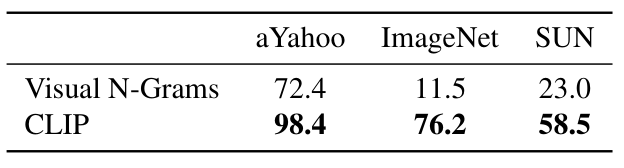

论文 Table 1。零样本方法在三套任务上的准确率（%）。

读表先别急着夸 76.2。横向是 aYahoo、ImageNet、SUN 三套任务；纵向两行是 Visual N-Grams 和 CLIP。挑 ImageNet 这一列竖着比：11.5 到 76.2，提高 64.7 个百分点；再看 SUN，23.0 到 58.5。它要说明的是零样本路线这几年能走多远，数据、模型和算力也一起换了，不能把整段差距都塞进“对比学习”四个字。<!-- evidence:C24 -->

两代系统的数据、网络、算力都变了。作者另外做了一个更接近的对照：CLIP ResNet-50 用相同 YFCC100M 数据训练，一张 V100 约一天就能达到 Visual N-Grams 报告的 ImageNet 水平。这更能帮我们看训练方法的效率。<!-- evidence:C12 -->

### 3.2 零样本：文字交代了你究竟想认什么

先问架构图 D 换到不同任务后能不能站住。Fig.4 的答案很有个性：认车型、认食物挺顺，数东西、看距离就容易卡壳。这不是一张全能选手成绩单。

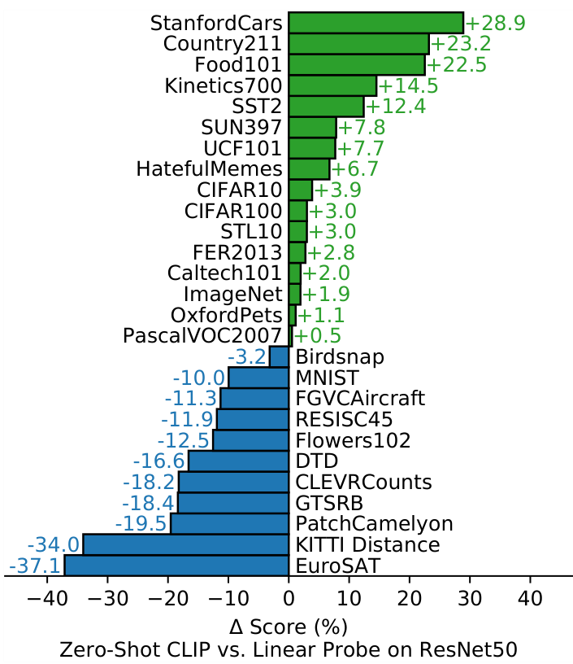

论文 Fig. 4。向右是 CLIP 更高，向左是 ResNet-50 线性探测更高；长度是百分点差。

纵轴逐行列 27 个数据集，图中按得分差排序；横轴 ΔScore 的 Δ 表示差，算 CLIP 得分减去基线得分，单位是**百分点**。零刻度表示打平。绿色条向右伸是 CLIP 更高，蓝色向左是基线更高；每根条端的数字告诉你差多少。这里比较两种“视觉特征＋分类头”的系统：CLIP 用文字造分类头，基线用目标数据标签拟合分类头。<!-- evidence:C25 -->

27 个数据集里，零样本 CLIP 赢了 16 个。基线用下游标签训练分类头，CLIP 用类别文字。<!-- evidence:C13 -->

差异很具体：StanfordCars 高 28.9 个百分点，Food101 高 22.5；EuroSAT 低 37.1，KITTI 距离分类低 34.0，CLEVR 数物体低 18.2。别只盯那个胜场总数。网上常见的车型、食物语义有帮助；卫星场景、距离和计数就没这么顺。<!-- evidence:C13 -->

刚才比的是一套有下游标签的基线。Fig.5 继续追问：同一个 CLIP 视觉底子，给它少量标注图片，能赢过直接给类别文字吗？先看左边零样本点的高度，再水平找紫色线：到每类四张左右，才到差不多的高度。

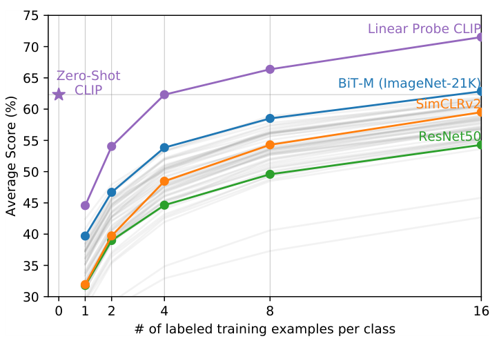

论文 Fig. 5。横轴每类标注图数，纵轴 20 个数据集的平均分；零样本点在最左边。

横轴是每类标注训练图数，刻度 0、1、2、4、8、16；这里按样本个数排，不把视觉上的间距当成等倍。纵轴是平均得分（%），越高越好。左侧紫色单点是零样本 CLIP，不用下游标注；紫色曲线是用同一 CLIP 视觉特征训练线性头。蓝、橙、绿三条突出曲线分别是 BiT-M、SimCLRv2、ResNet-50，浅灰是其他模型。<!-- evidence:C26 -->

统计选了每类至少有16张图的20个数据集。零样本表现接近同一CLIP特征的4-shot线性分类器，4-shot就是每类四张标注图。<!-- evidence:C14 -->

每类给四张标注图，怎么还跟不给图差不多？因为图片里可能同时有狗、草地、人，四个标签让分类器自己猜“究竟哪种差别是任务要看的”；一句准确的类别描述，能直接把要认的概念告诉它。文字监督和少量样本提供的信息不同。

附录 H.3 还有个容易读歪的地方：主评估里的视频任务取中心帧当图像；另一些零样本视频结果会平均各帧预测。CLIP 的输入依然是单帧图像，这些分数讨论的是动作类别识别，别顺手把时间动态也算到它头上。<!-- evidence:C15 -->

### 3.3 表征：换个分类头，才能单独看视觉底子

零样本测试把 B 的视觉表示和 D 的文字分类器一起考了。§3.3 要拆开：固定图像编码器，用下游样本训练线性分类器，看看视觉特征本身好不好。这叫 linear probe，像给已经做好的镜头换一张标定表。

Fig.6 把文本分类器拿开，所有方法按线性探测协议受考。它要看的是：图像特征迁移得怎样，推理一张图又要花多少计算？红色 CLIP 曲线向右上延伸，越大的模型花更多计算，也通常拿到更高分。

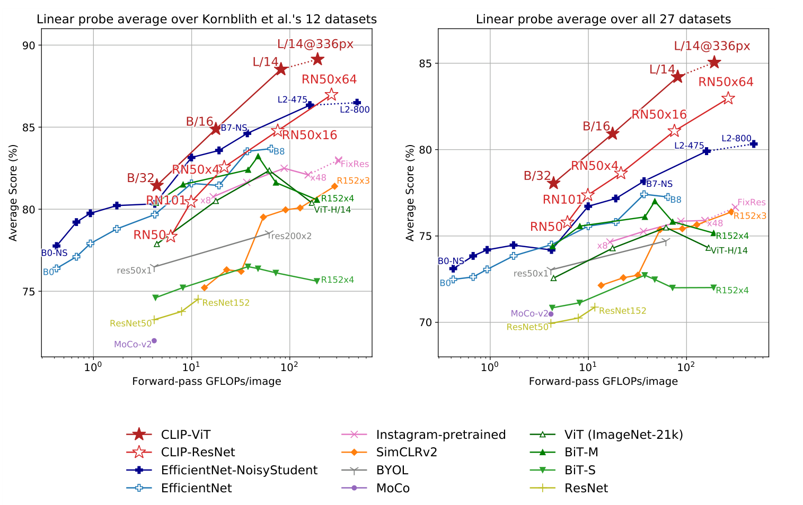

论文 Fig. 6。左边平均 12 个数据集，右边平均 27 个；横轴计算量，纵轴线性探测得分。

先认公共坐标。横轴 Forward-pass GFLOPs/image 是图像编码器一次前向计算的十亿级浮点运算量，按对数刻度排列；越左越省。纵轴 Average Score 是跨数据集的平均线性探测分数（%），越上越好。因此读这图要找“同样预算谁更高”，或“同样得分谁更靠左”。它衡量推理计算量，前面训练多少天是另一本账。

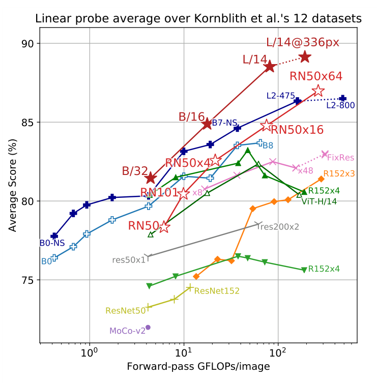

论文 Fig. 6 左图放大：12 个数据集。

红色实心星是 CLIP-ViT，红色空心星是 CLIP-ResNet；蓝色是两组 EfficientNet，其中深蓝实心十字为 Noisy Student。其他颜色对应图下图例中的监督或自监督模型。同色连线把同一家族的不同规模接起来，它不是训练过程随时间上涨。点旁 B/32、L/14 等是模型配置；虚线段连接以更高分辨率微调或评估的点。先找到最上面红色 L/14@336px，再看它左下方的深蓝十字：领先有多少，额外计算又有多少？<!-- evidence:C27 -->

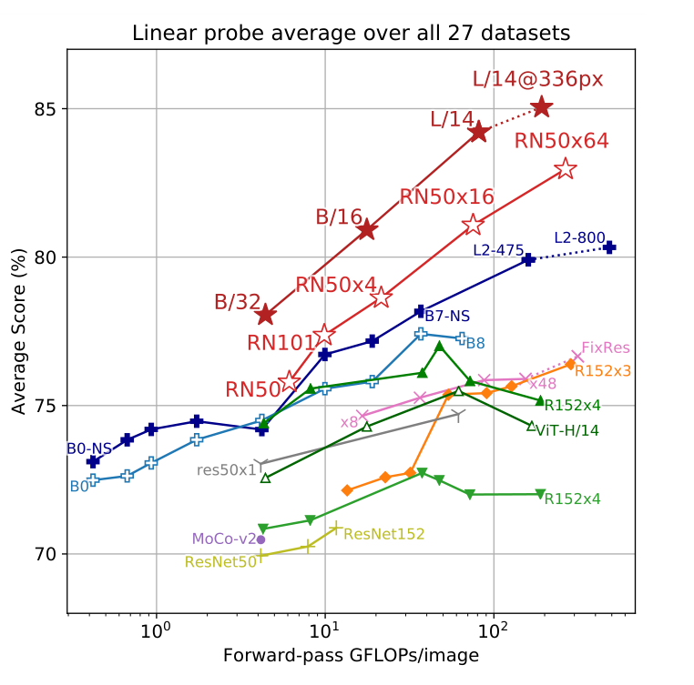

论文 Fig. 6 右图放大：27 个数据集。

右图扩成27个数据集，坐标含义与模型标记不变，但两边纵轴范围不同。先读刻度，再比红蓝差距，别凭“高了几厘米”下结论。扩大任务分布后，CLIP 相对优势更大；这也解释了为什么只盯一个熟悉榜单，会漏掉表征的另一部分能力。<!-- evidence:C27 -->

在 12 数据集评估上，最佳 CLIP 的平均分超过 Noisy Student EfficientNet-L2 约 2.6 个百分点；扩到 27 数据集后，优势约 5 个百分点。附录 A 说明，ViT 的线性探测使用最终投影前的图像特征，这和我们在 D 比较的归一化图文向量是两个取值位置。<!-- evidence:C16 -->

结果支持它学到了能迁移的视觉特征。至于哪个设计贡献多少，要看控制变量的实验；大数据、自然语言目标、网络选择在这篇里共同参与了结果。

### 3.4 换场景：香蕉一变成素描，就不认识了？

架构图 E 最关键的一关是分布偏移：训练或常规测试里习惯了某种照片，后来换画风、视角和背景。机器人相机也会遇到这种事，台面、光线、物体摆法一换，原来的视觉线索未必还在。

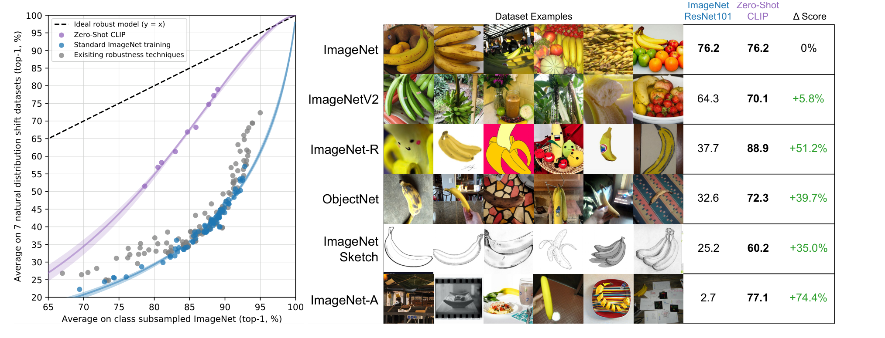

论文 Fig. 7。左边比较常规 ImageNet 与换场景后的平均准确率，右边用香蕉展示不同画风。

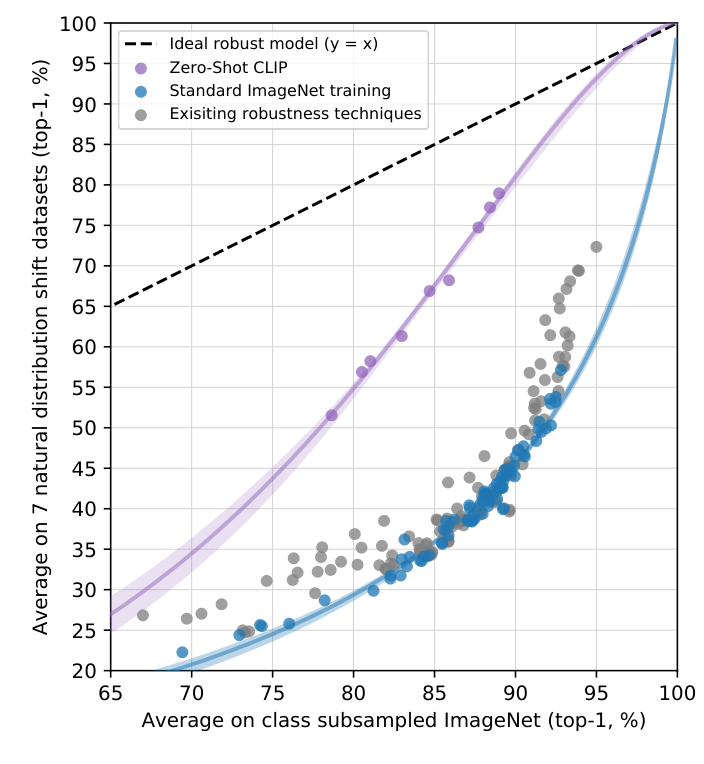

论文 Fig. 7 左图放大。横着找到常规题做得差不多的模型，再比较谁的点更高。

左图横轴是按类别子集匹配后的 ImageNet top-1，纵轴是七种自然分布偏移测试的平均 top-1。黑虚线 y=x 表示纵轴得分和横轴得分相等，也就是换场景还完全不掉分；点离它越远，掉分越多。蓝色点是标准 ImageNet 训练模型，灰色点是已有鲁棒性方法，紫色点是零样本 CLIP。拟合线周围的色带是 bootstrap 估计的 95% 置信区间；bootstrap 就是反复重采样，观察拟合线能晃动多大范围。

看相近横坐标，紫色普遍更高：常规题做得差不多，换场景之后保住的分数更多。作者将常规与偏移分布的差距最多缩小约 75%。75% 衡量的是原来掉的那部分分数，有多少被保住了。<!-- evidence:C17 -->

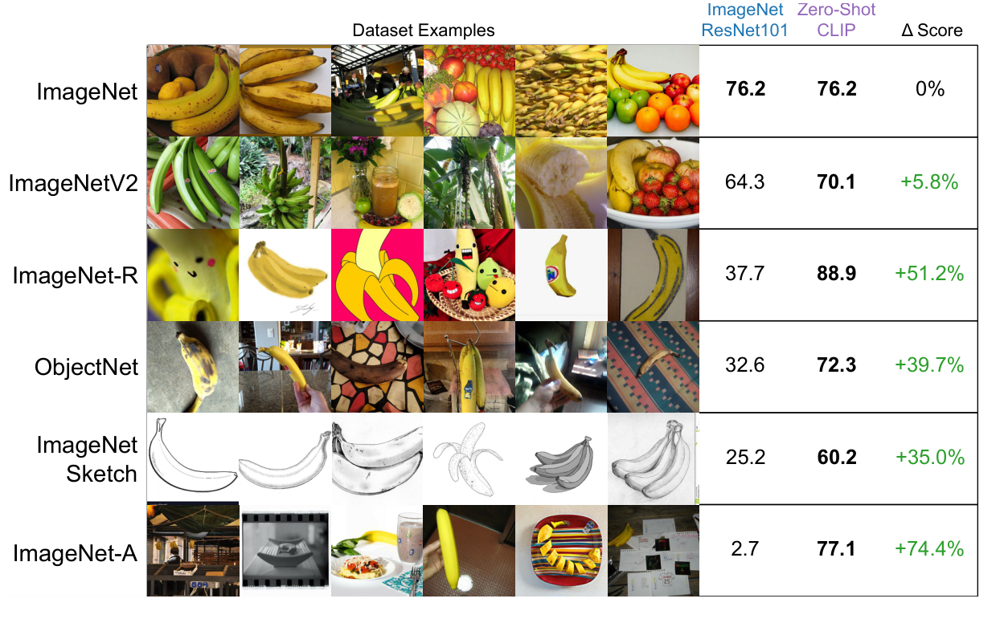

论文 Fig. 7 右图放大。每一行是一种测试分布，香蕉图片示范变化，右侧比较整个对应测试集。别把这张香蕉当成全场 MVP：右侧数字统计的是整套测试题，香蕉只负责示范画风。

右图把比较钉在具体模型上。两列分别是 ResNet-101 和最佳 CLIP；最右侧 ΔScore 用希腊字母 Δ 表示差值，算的是 CLIP 减去基线的百分点。普通 ImageNet 分数都是 76.2%。ImageNetV2 重新收集测试图，分别是 64.3% 和 70.1%；ImageNet-R 包含画作、卡通等图像，分别是 37.7% 和 88.9%；ObjectNet 改变物体视角、背景等条件，分别是 32.6% 和 72.3%；素描集分别是 25.2% 和 60.2%；ImageNet-A 刻意收集难住常规分类器的自然图像，分别是 2.7% 和 77.1%。<!-- evidence:C18 -->

那再用 ImageNet 标签训练一下呢？附录 D 把 CLIP 的视觉特征固定，在 ImageNet 上拟合线性分类器：ImageNet 准确率从 76.2% 升到 85.4%，ImageNet-R 却下降 4.7 个百分点，ObjectNet 下降 3.8，Sketch 下降 2.8。<!-- evidence:C19 -->

你把分类边界调得更适合 ImageNet，它就真的更会做 ImageNet 了。只是这份进步没有均匀带到其他场景。评机器人感知时，我会同时看新台面、新视角的表现；一个常规验证集涨分，还得追问涨在哪里。

## 4. 数据重叠：4 亿张图，会不会见过考题？

论文专门检查了 35 个数据集的近重复图像。检测到的重叠比例中位数为 2.2%，平均为 3.2%；用完整集与去重后的子集比较，最大的估计准确率增益是 Birdsnap 的 0.6 个百分点。<!-- evidence:C20 -->

附录 C 有个小细节：作者最初拿 CLIP 自己的语义向量找重复，发现两只不同的足球也能非常接近，反而同一张图换了缩放算法可能相似度下降。于是另训近重复检测器，检查裁切、压缩、旋转等变换，再人工设阈值。

这里再次回到 B：CLIP 的相似度主要服务语义配对。两只不同的足球可以语义相似，身份和几何位置却各有差别。去重和抓取定位，各自需要自己的判断依据。

## 5. 社会影响：给它什么选项，也在影响答案

D 的 softmax 分母由候选类别决定。候选集合换了，同一图像的概率就会变；当模型被要求给人物做社会属性分类时，类名设计还会放大训练数据中的偏差。原文 §5 和附录 E 展开了这些实验。<!-- evidence:C22 -->

你只给“狗、杯子、飞机”，就算输入是一把扳手，程序仍会在三类里挑第一名。像李雪琴吐槽她妈：失恋了、工作黄了，都劝回铁岭。出口先框好了。这里选了第一名，也可能三项都不对。softmax 把分数归一化成概率，不会自动设置“以上都不是”。机器人感知还得另设未知类别或拒识机制，再测阈值。<!-- culture:xueqin-tieling -->

## 6. 局限：认出“杯子”，距离抓住杯子还差什么？

沈腾在《羞羞的铁拳》里摆好高手架势，下一秒却跪了。认出“高手”和知道这一步怎样站稳，中间差着动作那层信息。§3.2 的计数、距离任务也露出缺口。机器人认出“杯子”，还得接到位置、姿态、接触和动作上。<!-- culture:shen-kneel -->

回到 B：图像压成一个全局向量，D 输出类别分数。这里没有直接输出哪个像素抓、夹爪转多少、下一时刻物体会去哪。你要这些东西，后续系统就得保留或重建空间信息，再学习动作接口。

零样本的开发过程也值得留意。作者用验证集表现指导过设计，27 数据集的选择和模型能力有共同演化。换到你的相机、你的物体时，还是得把候选文字和任务分布拿出来单独测。原文 §6 讨论的正是这一层评估问题。<!-- evidence:C23 -->

第三问到这里可以先答一半：**它提供可由语言指定的视觉语义，跨场景实验展示了这种接口的迁移价值；空间定位和控制由后续模型补上。**

## 7. 相关工作：CLIP 把几条旧路线接到了一起

原文把相关工作放在这里。DeViSE 做视觉—语义零样本迁移，VirTex 学图像描述，ConVIRT 学图文配对。CLIP 把互联网图文、双编码器和文字分类头接起来，再系统测试这套组合。<!-- evidence:C03 -->

回看架构图：A 提供监督，B、C 学配对，D 用文字换任务，E 看换了场景还行不行。双编码器只是中间一步，任务接口和迁移评估也得一起看。

## 8. 结论：机器人后来怎么接上这个语言入口？

原文结论落在自然语言监督的视觉预训练与零样本迁移。往机器人看，一个很具体的后续是 CLIPort：*What and Where Pathways for Robotic Manipulation*，CoRL 2021。<!-- evidence:C21 -->

CLIPort 用冻结 CLIP 提供语义特征，再跟保留空间结构的路径融合，学习语言条件的抓取—放置策略。它回答两个不同的需求：what 负责指令里的语义，where 负责动作的位置。CLIP 给这条链提供语言和视觉特征，机器人动作能力来自 CLIPort 的结构与示范训练。<!-- evidence:C21 -->

后续读具身论文，就沿箭头追问：语言改的是最后的类别权重，还是空间特征？留给控制器的是全局向量、密集特征，还是动作分布？接在哪儿，能干的活就不同。

开头三个问题，现在收回来：

1. 配对训练把一批图文变成双向选择题。对角线给答案，交叉熵让两路编码器学可比较的表示。
2. 类别句子经文本编码器变成分类器权重。新图跟它们比相似度，换类别时换文字向量。
3. 跨数据集和换画风实验展示了语义迁移；距离、计数和空间动作仍有各自的缺口。CLIPort 给出了把语义接到操作策略上的一个具体后续。

我更想留下的问题是：如果两个场景在语言上都叫“一个杯子”，但一个能抓、另一个被挡住了，我们需要训练视觉表示保留哪些差别？CLIP 的损失会鼓励它们在语义上靠近，机器人却可能需要把它们分开。下一步读机器人表征论文，就从这个矛盾追下去。

阅读工具：[ReadPaper](https://github.com/Zhu-Huixiang/ReadPaper) · [DrawPaper](https://github.com/Zhu-Huixiang/ReadPaper/tree/main/drawpaper)。点“阅读原文”，查看 GitHub 完整解读、高清图和可重编译公式。

---

公众号版由管理员在后台手动公开发表；永久文章链接待发表后补充。

关注公众号 **具身智能的 World**：

[原论文](https://proceedings.mlr.press/v139/radford21a.html) · [证据索引](evidence.json)

[本篇知识星系](../../universe/papers/clip.md) · [知识点宇宙](../../universe/README.md)
