# CQL：没试过的动作，凭什么拿高分？

设想一份历史操作记录：机械臂从来没在某个姿态下向右猛推。训练出来的价值网络却给这个动作打了高分。策略接下来会干什么？它很可能专挑这个动作。

在线强化学习还能去试：推坏了，收回一条失败数据，改分。离线强化学习面对的是封存的数据集，训练期间没有这次补考。**最诱人的那个动作，恰好可能是最缺证据的那个。** CQL 要处理的就是这种价值高估。<!-- evidence:C01 -->

这里有一处分歧。BCQ、BEAR、BRAC 等路线，会以不同方式限制学出来的策略偏离历史动作；CQL 则把主要约束放在给动作打分的 Q 函数上。它挑战的假设是：一定要先把策略管住，才能用好离线数据。作者试着让评分本身更保守，再让策略根据这个评分改进。<!-- evidence:C03 -->

我们沿着论文回答三个核心问题：

1. 数据没变，价值估计为什么会越训练越离谱？
2. CQL 怎样压低虚高动作，又不把数据里的好动作一起压垮？
3. 理论中的“保守”与实验里的提升各指什么，哪些任务仍会失手？

这里是「具身智能的 World」。配套 GitHub 可以从七个入口继续读：

- 论文解读：把方法、公式和实验串起来。
- 论文地图：按科学问题选择阅读路线。
- 顶会顶刊集锦：找到核实过的正式论文出处。
- 一周解读日程：看接下来准备拆解的问题。
- arXiv 新作：区分首次公开、版本更新与精选收录。
- 具身榜：对照七维评分及逐项依据。
- 知识点宇宙：沿着论文与共享技术的连接继续学。

入口：https://github.com/Zhu-Huixiang/embodied-world

**论文信息**

Conservative Q-Learning for Offline Reinforcement Learning；Aviral Kumar、Aurick Zhou、George Tucker、Sergey Levine。署名机构为 UC Berkeley 与 Google Research, Brain Team。首次公开于 2020 年 6 月 8 日；本文阅读 NeurIPS 2020 正式论文及配套补充材料。<!-- evidence:C02 --><!-- evidence:C52 -->

论文：https://proceedings.neurips.cc/paper_files/paper/2020/hash/0d2b2061826a5df3221116a5085a6052-Abstract.html

代码：https://github.com/aviralkumar2907/CQL <!-- evidence:C53 -->

**阅读目录**

- 1 引言：封存的数据，开放的动作想象
- 2 预备知识：高估如何钻进 Bellman 目标
- 3 CQL 框架：压低谁，又托住谁
  - 3.1 保守策略评估：从逐项下压到期望下界
  - 3.2 离线策略学习：用 log-sum-exp 找到虚高动作
  - 3.3 安全改进：相对行为策略的回报保证
- 4 实现：连续动作、策略更新与保守系数
- 5 相关工作：限制策略，还是修正评分
- 6 实验：提升、失手与消融
- 7 讨论：三个问题的答案，还有哪些代价

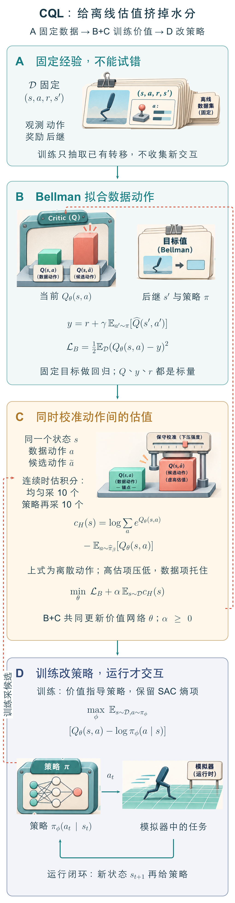

本图由 [DrawPaper skill](https://github.com/Zhu-Huixiang/ReadPaper/tree/main/drawpaper) 指挥 Codex，使用内置生图制作。

先按图走一遍。**训练路线**从 A 区的固定转移记录出发，B 区拟合 Bellman 目标，C 区额外修正动作估值，D 区根据修正后的 Q 更新策略。D 向 C 提供的候选动作只在网络里计算分数，不会产生新环境数据。**运行路线**更短：观测状态，策略输出动作，环境返回下一状态。全文 §2 对应 A、B，§3 解释 C，§4 接上 D，§6 检查最终回报。图中的 θ、φ 分别是价值网络与策略网络的参数，a 上的波浪号表示候选动作；t 表示运行时刻。D 区以单位熵系数画出 SAC 目标的骨架，实际算法的熵权重仍由基础实现决定。各公式的分布、算子和形状会在对应小节展开。

## 1 引言：封存的数据，开放的动作想象

离线强化学习想从旧经验中学出比数据采集者更好的策略。这里的“更好”值得认真对待：行为克隆只能学“当时怎么做”，强化学习还要根据奖励判断“哪些动作值得多做”，甚至把已有片段组合成更好的行为。

麻烦在于，神经网络对没见过的输入也会输出一个数。这个数总能算出来，可信度却要另看数据。策略优化又会主动寻找高分动作，于是偶然的高估被挑中，反复进入训练目标。<!-- evidence:C03 -->

脱口秀演员 71 在《新闻晨报》的[访谈](https://ep.shxwcb.com/2026/10/12/20261012-02-03-1_20261012001930.html)里，谈起自己的演出场次纪录时说：“只要你不去查，它就永远不会被打破，哈哈。”他紧接着把这种纪录称为自娱自乐。这是回顾 2022 年演出的自嘲。放在这里，只借它提醒一个判断：**没有碰到反证，并没有替高分补上证据。**离线算法缺的是那个动作之后的反馈；模型也没有人的“故意不查”。<!-- evidence:C54 --><!-- culture:seventyone-unchecked-record --><!-- meme:unchecked-record -->

CQL 的办法是，在 Bellman 拟合之外增加一个保守项，让缺少数据支撑却得分很高的动作付出代价。它保留了通过奖励改进策略的入口，也把“少信一点”落实成了优化目标。至于少信到什么程度，后面会看到，这不是无关紧要的超参数。<!-- evidence:C01 -->

## 2 预备知识：高估如何钻进 Bellman 目标

先认识图中 A 区的一张记录卡。数据集记作 D，每条转移是状态 s、动作 a、奖励 r、下一状态 s′。行为策略 πβ 是当初采数据时的动作分布；现在要学习的策略记作 π。π(a|s) 表示在状态 s 下选动作 a 的概率，连续动作时对应概率密度。

Qπ(s,a) 是一个标量：现在在 s 做 a，之后遵循 π，预期能拿到多少折扣累计奖励。γ 是折扣因子，范围为 0 到 1 之间。它让越远的奖励权重越小。Q 上面的帽子表示估计值，上标 k 是第 k 轮更新，不是乘方。对一个 B 条转移的批次，连续状态和动作可分别组织成 B×d_s、B×d_a 的数组，奖励和 Q 输出各为 B 个数；d_s、d_a 随任务而变。

图 B 的 Bellman 计算把一段长回报拆成“已经记下的本步奖励”加“下一步的估值”。下面用 yᵏ 记训练目标，用 L_B 记平方误差。期望符号 E 表示按下标指定的分布求平均；下一动作 a′ 来自策略 π。

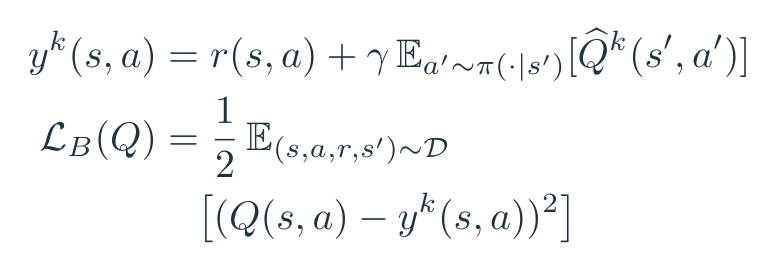

基础式。把论文的策略评估目标记作 yᵏ，把平方误差记作 L_B；后文的保守项加在同一个误差之外。

这一式在解释论文的策略评估骨架。连续控制落到 SAC 实现时，还会有它自己的熵正则细节。先看这个骨架就足够发现漏洞：左边拟合的是数据里真的做过的 a，右边查询的 a′ 却由策略提出，未必在 s′ 附近的数据中出现过。<!-- evidence:C03 -->

算一个教学例子：记录奖励为 1，γ=0.9，网络把下一动作打成 10 分，那么本步目标就是 1+0.9×10=10。如果下一动作其实只值 2，合理目标应是 2.8。下一步的 8 分高估，经过一次备份，就给本步多添了 7.2 分。这个例子只说明误差如何传递，不是论文中的测量值。

训练时查询的是数据见过的状态，因此论文重点处理动作分布偏移；策略部署后走到哪些状态，仍可能发生新的偏移。CQL 没有在这个入口额外学一台世界模型，也没有用想象轨迹替缺失反馈作证。<!-- evidence:C04 -->

## 3 CQL 框架：压低谁，又托住谁

### 3.1 保守策略评估：从逐项下压到期望下界

先固定 π，暂时不考虑怎样更新策略。图 C 的第一个版本很直接：选一个动作采样分布 μ，在数据状态上，压低 μ 所抽动作的 Q。α≥0 是保守项强度，arg min 表示选取使目标最小的 Q。原式（1）写成：

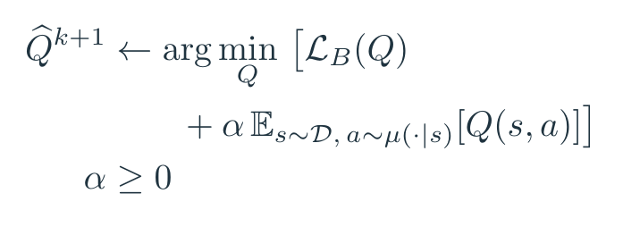

论文式（1），用 L_B 缩写。额外压低 μ 抽到的动作价值，代价是数据里的好动作也可能被压得过低。

为什么加一个正的 Q 平均值就能下压？因为优化器在最小化总损失，Q 越高，这一项越贵。不过，下压动作也可能是数据里的好动作；只要 μ 经常选中它，它就得挨压。论文在有限采样误差、支持集等条件及足够大的 α 下，分析了这种逐项保守估计。<!-- evidence:C05 --><!-- evidence:C07 -->

第二个版本加上一项补偿。用带帽子的 πβ 表示经验数据中的行为动作分布。我们把两个期望的差缩写为 C_μ(Q)：先计算候选动作的平均 Q，再减去数据动作的平均 Q。于是得到原式（2）。

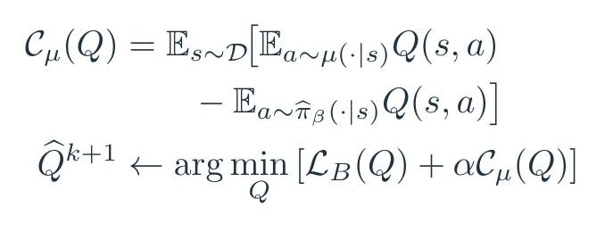

论文式（2），等价拆开。第一项向下压，第二项在最小化时相对托住数据动作；L_B 继续约束它们符合已记录的回报。

注意第二个负号。最小化时，数据动作的 Q 被相对托住；Bellman 误差仍在要求这些分数符合数据回报。因此它不是“看见过就无条件加分”，而是在整体下压中留下一根数据锚。<!-- evidence:C06 --><!-- evidence:C45 -->

这个改动使保证的对象变了。令 μ=π，论文证明的是**按目标策略平均后的价值下界**。某个动作的 Q 可以被抬高，只要策略加权后的总体估值仍然足够保守。不能把这个结论读成每个动作都被低估。<!-- evidence:C08 -->

附录把原因写得很清楚。先考虑能对每个状态动作单独存数的表格情形：B̂π 是用经验转移构造的 Bellman 算子。它给出拟合目标，保守项再减去 α(μ/π̂β−1)。下面第二行令 μ=π，把策略平均的修正量写成 D_π(s)；最后一行把它整理成非负平方项。

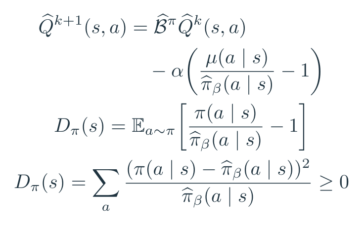

参照附录式（11）的经验表格教学改写。数据外倾向越强，扣减越大；令 μ=π 后，按目标策略平均的扣减非负，这是期望下界的关键。

例如，一个状态只有两种动作，数据频率为 (0.9,0.1)，目标策略却各选一半。取 α=1，第一个动作相对 Bellman 目标增加 4/9，第二个动作减少 4；按目标策略平均，净变化为 −16/9。**允许一个分数上升，仍可以让整个策略的估值下降。**这是教学数值，不是实验结果。<!-- evidence:C09 --><!-- evidence:C10 --><!-- evidence:C50 -->

分母也把条件摆在了眼前：经验行为概率必须在推导使用的位置有支撑；有限样本误差需要足够的 α 抵消。神经网络的参数彼此耦合，不能把这个表格最优解直接当作网络逐坐标更新公式。论文的函数逼近分析包含局部的神经切线核条件：它用当前参数附近的小步线性化描述网络变化，和任意深网在任意训练阶段都满足下界，还隔着距离。<!-- evidence:C43 -->

### 3.2 离线策略学习：用 log-sum-exp 找到虚高动作

现在放开 π：策略每轮都变，μ 应该盯着谁？原式（3）引入一个内部最大化，让 μ 偏向当前 Q 高的动作，再由外层最小化去压它。正则项控制 μ 不能过度集中。这个“先找高分、再给高分施压”的结构，把下压力量对准了策略容易利用的估值漏洞。<!-- evidence:C11 -->

CQL(H) 采用熵正则，对离散动作集合 A，最后得到原式（4）。定义 Z_Q(s) 为所有动作 exp Q 的和；log 是自然对数，exp 是指数函数。log Z_Q 是平滑的最大值：最高分动作通常占据最大权重，但其他动作也有贡献。C_H 是这个量减去数据动作均值后的保守项。

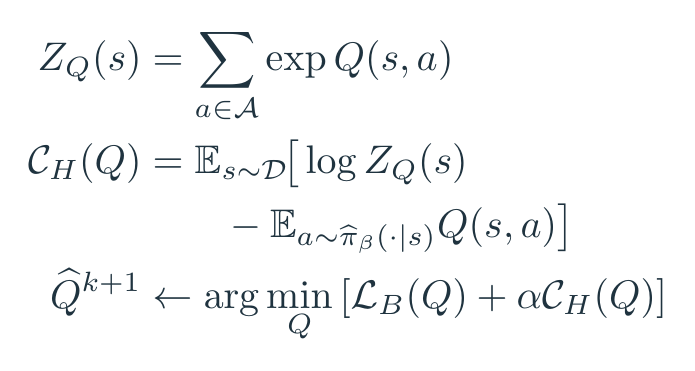

论文式（4），等价拆开。log-sum-exp 是平滑最大值；高估动作对它的贡献更大。

把“平滑最大值”再拆开。固定一个状态，σ_Q 是对各动作 Q 做 softmax 得到的权重向量，长度等于离散动作数，总和为 1。小写 c_H(s) 是这个状态单独的保守项，b 是遍历动作时用的求和索引。对某个 Q(s,a) 求偏导，得到：

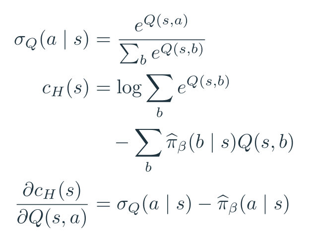

教学推导。只看一个状态的保守项：softmax 权重大于数据频率时，梯度下降会压低该动作的 Q；反过来则相对抬高。

这条教学推导直接告诉我们，梯度在忙什么。一个动作在 Q-softmax 里权重大，在数据里频率低，差值就为正；梯度下降会压低它的 Q。反过来，数据里的常见动作会被相对抬高。实际更新网络参数时，还要乘网络输出对参数的导数，并加上 Bellman 项的梯度。<!-- evidence:C49 -->

再算一个两动作例子。数据只做过第一个动作，网络给出的 Q 却是 (2,8)。保守项为 log(e²+e⁸)−2≈6.00248，两个 Q 输出上的梯度约为 (−0.99753,+0.99753)。第二个动作的高分越显眼，它承受的下压就越强。式子没有先识别“这是危险动作”，它识别的是**估值权重与数据频率不匹配**。<!-- evidence:C51 -->

这里的熵变分可以理解为：在同一尺度下，最大化“μ 的平均 Q 加 μ 的熵”，其最优分布是 Q 的 softmax。读附录时应以这个恒等式和论文最终式（4）对应理解；CQL 的实际目标不需要靠一个另训的行为模型才能计算。数据项直接从转移批次取动作即可。<!-- evidence:C12 --><!-- evidence:C19 -->

论文也讨论了 CQL(ρ)。ρ 在这里是动作先验分布，取上一轮策略，让候选搜索更靠近已有策略，动机之一是降低高维动作空间里的估计方差。它和 CQL(H) 具有共同的保守思想，但文中给出的指数加权 Q 版本不能简单当成同一个 log-sum-exp 公式换了名字。附录的 CQL(var) 则继续考察与方差、鲁棒期望有关的正则家族；主实验重点对比 H 与 ρ。<!-- evidence:C13 --><!-- evidence:C47 -->

策略在变，下界也要跟得上。定理 3.3 对策略与 Q-softmax 的接近程度、更新速度提出条件；新策略偏得太快，会吃掉原来保守估计留下的余量。定理 3.4 的“拉开间隙”讨论的是两类动作分布的期望差，不是给每个未见动作贴上“坏动作”标签。<!-- evidence:C14 --><!-- evidence:C15 -->

### 3.3 安全改进：相对行为策略的回报保证

论文用了 safe policy improvement 这个词。这里的 safe 对应**相对数据采集策略的回报保证**，不是机器人防碰撞或硬件安全认证。<!-- evidence:C17 -->

用 J(π,M) 表示策略 π 在环境 M 中的期望折扣回报，M̂ 表示由数据得到的经验环境。d_M̂^π 是该策略在经验环境下的折扣状态访问分布。D_CQL 衡量动作分布相对经验行为策略的偏移，它就是上一节那个非负量。π* 表示理论条件下得到的最优策略，ζ 汇集有限采样等因素与经验改进所决定的误差界。

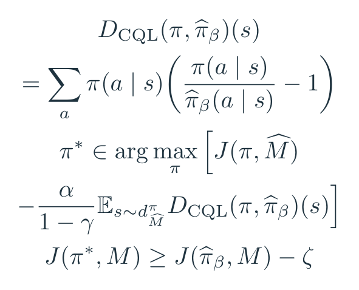

定理 3.5–3.6 的核心式。价值端的保守项隐含一个策略偏移惩罚；真实环境里的保证还要扣除误差项 ζ。

定理 3.5 把 CQL 的效果写成：追求经验回报，同时扣掉与策略偏移有关的惩罚。定理 3.6 再把它联系到真实环境中的回报下界，带有概率及采样条件。这里的 ζ 不能直接划掉，因此“安全改进”也不能直接翻译成每一次训练都严格超越行为策略。<!-- evidence:C16 --><!-- evidence:C17 -->

算法修正 Q，也就影响了策略可以偏离数据多远。但它通过“偏离后还能拿到多少保守价值”作选择，而不是给动作距离硬设同一个上限。

## 4 实现：连续动作、策略更新与保守系数

### 4.1 图 D 怎样接住修正后的 Q

连续控制采用 SAC（软演员评论家）风格的 actor–critic：一个网络选动作，另一个网络评价动作。SAC 在回报之外鼓励策略熵，也就是保留一定选择多样性。critic 接收状态与候选动作，输出标量 Q；actor 接收状态，输出动作分布。critic 用图 B、C 的目标更新，actor 则偏好 Q 较高的动作，并保留 SAC 的熵鼓励。目标网络或上一轮估计为 Bellman 目标提供较缓慢变化的参照。Atari 则基于 QR-DQN（分位数回归 DQN，用分位点描述回报分布），动作离散，直接由 Q 选择，不需要另一个连续动作 actor。<!-- evidence:C18 --><!-- evidence:C20 -->

这说明 CQL 是价值学习上的正则框架。它的输入可以沿用基础算法的状态表示；原论文的重点并不是设计视觉编码器、动作分块器或新的机器人底层控制器。

### 4.2 连续动作无穷多个，怎么求和

对机械控制的连续动作，Z_Q 变成对动作空间的积分。枚举所有力矩组合当然不行。附录 F 对每个数据状态，从有界动作空间的均匀分布 u 采 10 个动作，再从当前策略 π 采 10 个动作，用重要性权重近似积分。<!-- evidence:C21 -->

下式中 a_i^u、a_i^π 分别是两种来源的第 i 个样本；u(a)、π(a|s) 是采样密度，w 是 exp Q 除以相应密度后的权重。N=10，合计 20 个动作。除密度是为了补偿“某些动作更容易被采到”；取 log 后仍是有限采样近似。

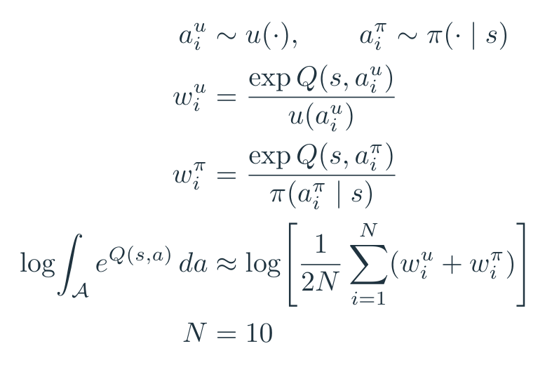

附录 F 的连续动作计算，改用积分记号并拆开权重。每个状态均匀采 10 个动作、当前策略再采 10 个，除以各自采样密度后估计 log 积分。

如果一个状态批次大小为 B，这一步可把候选动作整理成 B×20×d_a，经 critic 得到 B×20 个分数，再沿动作轴归约。它增加的是网络求值。图里 D→C 的虚线只表示训练采样，没有机器人真的执行这 20 个动作。

### 4.3 α 太大，也会把可学的东西压没

固定 α 容易理解，调起来却不省心。原论文在 Gym 任务用 α=5；Kitchen 和 Adroit 使用带阈值的 Lagrange 版本，τ=5；Atari 的 1% 与 10% 回放子集分别用 α=4、1，前 20% 回放设置用 0.5。这些数对应各自实验配置。<!-- evidence:C22 -->

Lagrange 版本把 C_H 的预算写成 τ。α 仍非负，但现在也被优化：当保守项超过阈值，增大 α 施加更多压力；低于阈值则减少压力。η_α 是教学更新式中的正步长，[x]_+ 表示 max(0,x)，t 是更新步。

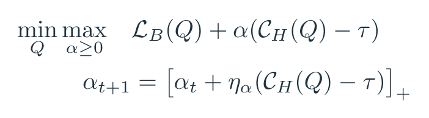

附录式（28）。C_H 超过预算 τ，α 增大；低于预算，α 减小。第二行是投影梯度上升的教学写法。

例如当前 C_H=7，τ=5，α=1，η_α=0.1，投影梯度上升会把 α 调成 1.2。这只是把对偶更新方向算给读者看，实际优化器有自己的参数化。<!-- evidence:C23 -->

附录 F 的敏感性分析很实在：τ=2 时，α 可能变得很大，Q 被压到很负；τ=10 时，一些人类演示数据集出现超过百万量级的 Q 高估。τ=5 是文中选用的折中，不是一条跨任务通用安全线。<!-- evidence:C24 -->

D4RL 实验训练 100 万次梯度步；critic 学习率 3×10⁻⁴，Gym actor 同为 3×10⁻⁴，其他连续任务通常用更慢的 3×10⁻⁵。这里的“慢一点”与前面保持策略更新可控的动机相呼应；实验设置本身并不构成深网下界的证明。<!-- evidence:C25 -->

## 5 相关工作：限制策略，还是修正评分

论文把相关工作放在实现之后，此时已经可以比较它们各自约束的对象。行为克隆把数据动作当监督目标，省掉了价值外推，却也少了利用奖励重新挑选行为的能力。BCQ 用生成动作候选等机制限制选择范围；BEAR 约束策略和数据动作分布的支持；BRAC 显式控制行为与新策略之间的分布差异。CQL 主要在 Q 的优化里加入惩罚。<!-- evidence:C03 --><!-- evidence:C19 -->

另一条路是估计不确定性：如果好几个 Q 网络意见不一致，就少信那个动作。论文指出，神经网络集成的分歧本身未必足以识别分布外输入；后面的 ensemble 对照会展示这个问题。CQL 则把保守性直接写进训练目标，让动作价值承担离开数据的代价。<!-- evidence:C38 -->

离线策略评估（OPE）则先问：给定一个策略，能否只靠旧数据估计它的表现？它与学习新策略相关，但目标不同。CQL §3.1 先固定策略推导保守评估，再把这个估计交给策略改进；新策略不断变化，也就需要继续检查下界成立的条件。<!-- evidence:C55 -->

我更关心这个取舍带来的两头损失：约束太弱，策略会利用价值漏洞；约束太强，旧数据里可以组合出来的改进也被一起压掉。因此评价 CQL，既要看回报有没有上去，也要看它是不是靠把所有分数压得极低换来表面的“安全”。

## 6 实验：提升、失手与消融

### 6.1 Gym：收益很大，但不是逐行第一

先看最直接的结果：同一离线数据上，CQL(H) 在若干任务明显优于行为克隆和 BEAR；也有任务被 BRAC 或 BEAR 超过。原表覆盖 HalfCheetah、Hopper、Walker2d，以及 random、medium、expert、medium-replay（回放混合数据）、medium-expert 等数据类型。它们是不同能力与采集过程的数据，不能把各行当成同难度重复测试。<!-- evidence:C26 -->

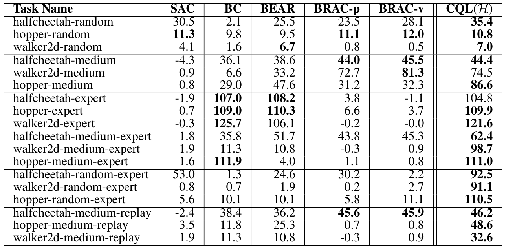

论文 Table 1。行区分任务与数据组成，列比较六种方法；数值为 4 个种子平均的归一化回报，可超过 100。

读表时，行是“数据类型×环境”，列是算法。数值为 D4RL 归一化回报，主表报告 4 个随机种子的平均值；这些值采用任务规定的参考尺度，不是“100% 成功率”。先把两个对照单独摘出来看。<!-- evidence:C26 -->

| hopper-medium | 归一化回报 |
| --- | ---: |
| BC | 29.0 |
| BEAR | 47.6 |
| CQL(H) | 86.6 |

| walker2d-medium-expert | 归一化回报 |
| --- | ---: |
| BC | 11.3 |
| BEAR | 10.8 |
| CQL(H) | 98.7 |

第一组说明在中等水平行为数据上，重新评价动作能带来超越模仿的收益。第二组更提醒我们：把专家和中等数据放在一起，并不会自动学到专家水平，算法如何处理混合数据很关键。<!-- evidence:C27 -->

但 walker2d-medium 中，CQL(H) 为 74.5，BRAC-v 为 81.3；halfcheetah-expert 中，CQL(H) 为 104.8，BEAR 为 108.2，BC 为 107.0。数据质量、环境和算法的组合决定了保守约束是否合算。<!-- evidence:C28 -->

### 6.2 AntMaze、Adroit、Kitchen：离线组合与高维动作

这一组结果最适合检验“从已有片段里学得更好”。AntMaze 需要把离线经历组合成到目标的路径；Adroit 是高自由度手部控制，包含人类演示数据；Kitchen 研究多子任务组合。主文明确提示 Kitchen 使用的是当时的旧数据集版本，复查这些值要保持这个版本条件。<!-- evidence:C29 --><!-- evidence:C30 --><!-- evidence:C31 -->

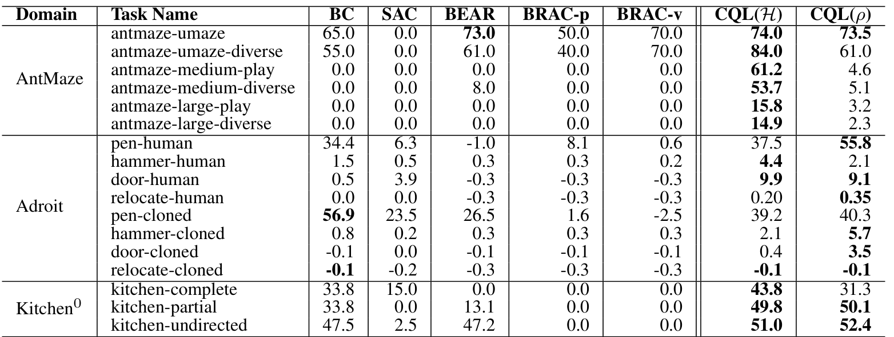

论文 Table 2。AntMaze、Adroit 与旧版 Kitchen 的归一化得分，均取 4 个种子平均；最后两列是 CQL(H) 与 CQL(ρ)。

表的三个分组依次是 AntMaze、Adroit、Kitchen，仍用归一化回报。看 AntMaze 的 medium-play 行，CQL(H)=61.2，CQL(ρ)=4.6，其余列出的对照为 0；到 large-diverse，H=14.9，ρ=2.3，其他对照仍为 0。这说明 H 在这些数据上取得了更有效的策略，但大迷宫本身依然很难。<!-- evidence:C29 -->

Adroit 的动作自由度为 24。pen-human 中，H=37.5，ρ=55.8，BC=34.4；到了 pen-cloned，BC=56.9，又高于 H=39.2 和 ρ=40.3。仅凭“高维”两个字挑一个 CQL 变体还不够，数据来源改变了它们的相对表现。<!-- evidence:C30 -->

Kitchen 的 9 自由度设置中，partial 数据上 H=49.8、ρ=50.1、BC=33.8；undirected 数据上则为 51.0、52.4、47.5。CQL 在这两行都超过 BC，收益幅度却不同。表格给了我们结果，机制解释仍要回到行为覆盖、奖励和价值误差，不能由一列高分倒推出模型已经懂得任意任务组合。<!-- evidence:C31 --><!-- evidence:C32 -->

### 6.3 Atari：只给早期经验，后期训练还会不会崩

图 1 回答另一个问题：当数据只来自 DQN 回放的前 20%，CQL 在离线训练过程中的回报怎样变化？红色 CQL 在多款游戏上保持了比橙色 QR-DQN、蓝色 REM 更好的表现，但最右侧 Seaquest 仍显示退化。先看全图，再放大两个局部。<!-- evidence:C33 --><!-- evidence:C36 -->

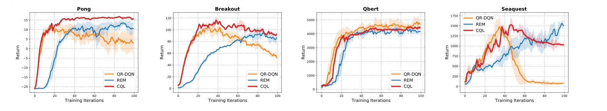

论文 Fig. 1。四幅是 Pong、Breakout、Qbert、Seaquest；橙色 QR-DQN、蓝色 REM、红色 CQL。横轴为训练迭代刻度，纵轴为各游戏回报；数据取在线 DQN 记录的前 20%。

横轴是离线训练进度，纵轴是对应游戏回报；每格一款游戏，量纲随游戏而变，不能比较不同小格的曲线高度。图中保留了原来的阴影带，图注没有指定其统计口径。Pong 展示相对稳定的提升，Seaquest 则提醒我们：加了保守项，训练曲线仍可能走坏。

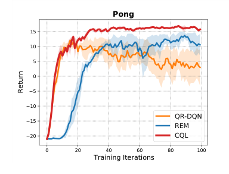

论文 Fig. 1，Pong 局部。横轴训练迭代，纵轴回报；红色 CQL 后期保持高位，橙色 QR-DQN 明显回落。

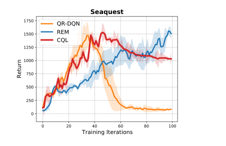

论文 Fig. 1，Seaquest 局部。蓝色 REM 后段回报最高；红色 CQL 有回落，橙色 QR-DQN 则跌近零。

论文还有另一套设置，从完整回放中随机抽 1% 或 10%。这是表 3 的条件，与图 1 的“前 20%”不同。下表按游戏分组，分别列小数据量设置及其算法回报。<!-- evidence:C33 -->

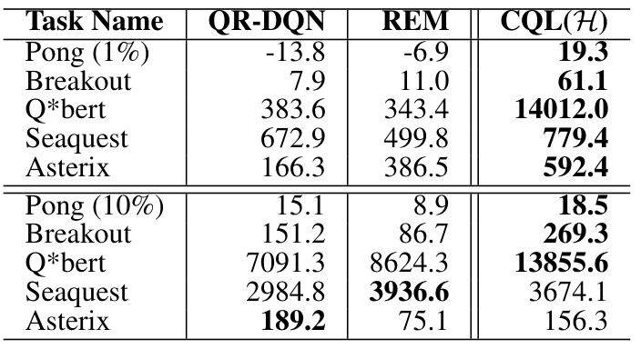

论文 Table 3。上五行使用 1% 回放数据，下五行使用 10%；三列比较 QR-DQN、REM 与 CQL(H) 的回报。

1% 数据下，Breakout 的 CQL 为 61.1，REM 为 11.0，QR-DQN 为 7.9；Qbert 分别为 14012.0、343.4、383.6。到了 10% 数据，Seaquest 的 CQL=3674.1，略低于 REM=3936.6；Asterix 的 CQL=156.3，也低于 QR-DQN=189.2。数据量变了，对照关系也会变。<!-- evidence:C34 --><!-- evidence:C35 -->

这些是模拟控制与电子游戏实验。人类演示提供数据，不等于在实体机器手上完成部署验证。对具身研究来说，它们支持的是一种如何使用旧经验的学习方法。<!-- evidence:C48 -->

### 6.4 分数真的更可信了，还是只会谦虚

表 4 直接测“预测价值减去实际折扣回报”。负值表示低估，正值表示高估；零附近更接近实际。它能区分保守目标的两个版本：式（1）把所有候选都往下压，式（2）保留数据动作补偿。

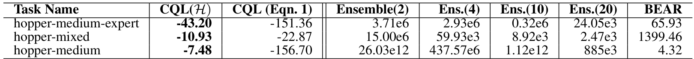

论文 Table 4。预测策略价值减去实际折扣回报，负数表示低估；CQL(H) 的扣减比 Eq. 1 变体温和。

在 hopper-medium，CQL(H) 的差为 −7.48，只有下压的式（1）为 −156.70，BEAR 为 +4.32。在 hopper-medium-expert，三者依次为 −43.20、−151.36、+65.93。式（2）的数据补偿让估值保持偏低，同时少损失了很多数值尺度。**下界贴近真实回报，才更有机会帮策略作选择。**<!-- evidence:C37 -->

同一表中，2、4、10、20 个 Q 网络的 ensemble 对照仍可能明显高估。这没有否定所有不确定性方法，但它说明“多训几个网取个保守值”在这些设置下没能自动修好外推。<!-- evidence:C38 -->

附录 B 继续追问：数据外候选是不是仍比数据动作更讨 Q 喜欢？定义第 k 轮的诊断量 Δ̂_k：先均匀抽一批候选 a′，取其最高估值 m_k，再减去同状态下数据动作的估值，最后对数据求平均。这里 N 只是诊断采样数量，不等于 §4 的重要性采样 N=10。

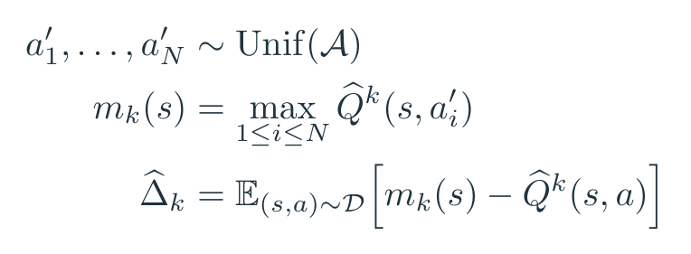

附录式（8）。先在均匀抽到的候选动作里找最高估值，再减去数据动作的估值；正值说明随机候选更受 Q 偏爱。

Δ̂ 越大，随机候选比实际数据动作越占便宜。它测的是估值偏好，不是那个候选的真实回报。附录图 2 把这个量与回报并排画：蓝色 BEAR、橙色 CQL；每个任务的左图画 Δ̂，右图画平均原始回报。<!-- evidence:C39 --><!-- evidence:C40 -->

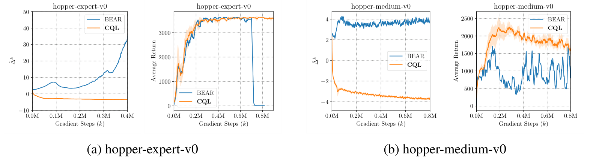

论文 Fig. 2。前两幅为 hopper-expert，后两幅为 hopper-medium；每对先画估值间隙，再画平均回报。BEAR 蓝色、CQL 橙色；横轴是百万梯度步，第一幅到 0.4M，其余到约 0.8M。

看 hopper-expert 的局部。BEAR 的估值间隙在后期上升，回报却退化；CQL 的间隙受到压制，回报更稳定。这个任务的间隙图横轴到 0.4M，回报图到 0.8M，要按各自刻度读，不能把两图相同横位置当成同一训练时刻。这样的并列变化符合论文对价值漏洞的解释，但“间隙下降”单独还不够，仍要看右边的实际回报。<!-- evidence:C40 -->

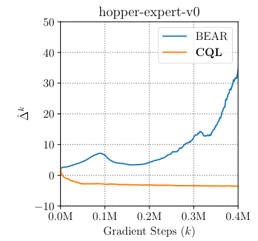

论文 Fig. 2(a)，左图。横轴 0–0.4M 梯度步，纵轴为随机候选最大 Q 减数据动作 Q；蓝色 BEAR 的间隙转为较大正值，橙色 CQL 保持负值。

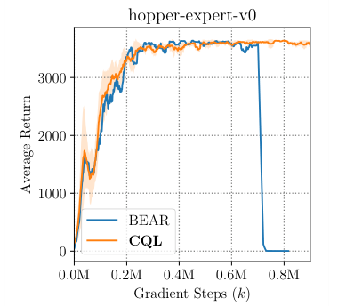

论文 Fig. 2(a)，右图。横轴到约 0.8M 梯度步，纵轴为平均回报；蓝色 BEAR 后期崩落，橙色 CQL 保持高位。

### 6.5 去掉数据补偿，会发生什么

最后看附录消融。这里表 5、表 6 使用的是原始平均回报，不能把数值与前面的归一化主表直接相减。<!-- evidence:C41 --><!-- evidence:C42 -->

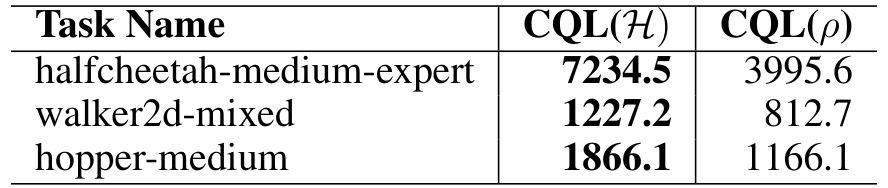

论文 Table 5。CQL(H) 与 CQL(ρ) 在三项 MuJoCo 任务上的原始平均回报，和 Table 1 的归一化分数采用不同尺度。

表 5 的 H 与 ρ 变体比较中，halfcheetah-medium-expert 为 7234.5 对 3995.6，walker2d-mixed 为 1227.2 对 812.7，hopper-medium 为 1866.1 对 1166.1。H 在这些行领先；再想起 pen-human 中 ρ 更好，就能看到变体选择确实依赖任务和数据。<!-- evidence:C41 -->

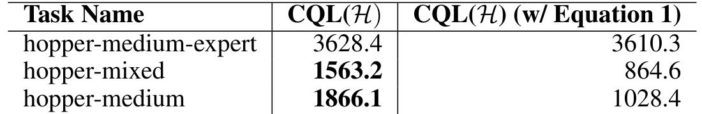

论文 Table 6。完整 CQL(H) 与移除数据动作 Q 抬升项的变体比较；三项原始平均回报展示“只压不抬”的代价。

表 6 删除“相对托住数据动作”的一项后，hopper-medium 原始回报从 1866.1 降到 1028.4，hopper-mixed 从 1563.2 降到 864.6；hopper-medium-expert 则是 3628.4 对 3610.3，差别很小。消融支持保留数据锚的用途，也展示它不是在所有数据条件下都贡献同样大的增益。<!-- evidence:C42 -->

## 7 讨论：三个问题的答案，还有哪些代价

**第一问，价值为什么越训练越离谱？** Bellman 左边拟合的是数据动作，右边却可能查询新策略提出的数据外动作。策略又主动追逐高 Q，偶然高估便反复被选择、传播。随着训练继续，策略表现仍可能下降；图 1 和附录间隙分析展示了这种退化。

**第二问，怎样下压又不压垮？** CQL(H) 用 log-sum-exp 盯住高估值候选，用数据动作的平均 Q 作锚，再和 Bellman 误差一起优化。它允许个别数据动作被相对抬高；理论中的关键下界是带条件的策略期望，而不是所有动作逐点都正确。表 4 和数据项消融说明，这个区别会影响估值尺度和最终回报。

**第三问，证据支持到哪里？** 在原论文的模拟控制和 Atari 条件下，CQL 改善了多组离线学习结果，部分困难任务收益很大；专家数据、不同动作维度与不同数据量下，对照方法仍可能更好。原文的严格深网理论与完全离线的可靠早停办法，也仍是讨论中的问题。<!-- evidence:C43 --><!-- evidence:C44 --><!-- evidence:C48 -->

对后来的机器人数据学习，我觉得 CQL 留下的一个具体检查习惯很有用：策略说某个动作好时，沿着训练目标往回找，看看这个高分究竟由哪些数据支撑。如果只是下一轮网络又给了它一个高分，那条闭环还没有接到真实反馈上。需要支付多少保守代价才能用好这些数据，要由任务回报、估值偏差和消融一起回答。

继续精读可以用 [ReadPaper skill](https://github.com/Zhu-Huixiang/ReadPaper)，整理方法图可以用 [DrawPaper skill](https://github.com/Zhu-Huixiang/ReadPaper/tree/main/drawpaper)。可复制地址：https://github.com/Zhu-Huixiang/ReadPaper

点击“阅读原文”，查看本文高清原图、精确公式与完整知识库入口：https://github.com/Zhu-Huixiang/embodied-world/tree/main/articles/cql-2006.04779

---

公众号版由管理员在后台手动公开发表；永久文章链接待发表后补充。

关注公众号 **具身智能的 World**：

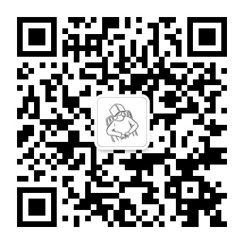

[原论文](https://proceedings.neurips.cc/paper_files/paper/2020/hash/0d2b2061826a5df3221116a5085a6052-Abstract.html) · [证据索引](evidence.json)

[本篇知识星系](../../universe/papers/cql.md) · [知识点宇宙](../../universe/README.md)
