# DDPM：只学预测噪声，怎么就能画画了？

这里是「具身智能的 World」。我们和 GitHub 一起，把具身智能论文里那些绕人的计算拆开讲：

- 论文解读：沿原文读方法、公式和实验。
- 论文地图：按研究问题找路线。
- 顶会顶刊集锦：找正式论文与原文入口。
- 解读日程：看接下来一周读什么。
- arXiv 新作：筛选值得继续追的工作。
- 具身榜：看评分依据，也看分歧。
- 知识点宇宙：沿一个概念，串起不同论文。

[GitHub：具身智能的 World](https://github.com/Zhu-Huixiang/embodied-world)

可复制地址：https://github.com/Zhu-Huixiang/embodied-world

把图弄花，再教网络把噪声猜出来。听起来像给自己找事：花了一大笔算力，学会擦黑板？

DDPM 偏偏靠这件事生成了图像。它碰的是生成模型里一个具体问题：**好看的样本，一定要靠 GAN 那种“生成器与判别器对着练”的方式吗？一个由许多小步组成、还能算概率的模型，能不能也画得好？** 另一条已经存在的路线——去噪得分匹配——让网络学习数据分布的方向，再搭采样算法。DDPM 把这个方向和反向概率链接在了一起。<!-- evidence:C01 -->

它没有重新发明“加噪再反过来”这个点子。真正要拆开的，是它怎样把一条概率链改写成容易训练的噪声回归，以及改了训练题目的权重后，为什么图更像了。

**带着三个问题往下读：**

1. 训练时明明知道原图，为什么偏要让网络预测噪声？
2. 训练只抽一个时间步，生成为什么要走一千步；每步到底算什么？
3. 图片更好看了，为什么概率分数未必更好；这和机器人动作有什么关系？

**论文信息**

- *Denoising Diffusion Probabilistic Models*，Jonathan Ho、Ajay Jain、Pieter Abbeel，加州大学伯克利分校。
- 首次公开：2020-06-19；本篇读 arXiv v2（2020-12-16），结合 NeurIPS 2020 出版页。
- NeurIPS 2020：机器学习主要会议，本篇属于生成模型的基础方法工作。
- [论文](https://arxiv.org/abs/2006.11239v2) · [正式出版页](https://proceedings.neurips.cc/paper/2020/hash/4c5bcfec8584af0d967f1ab10179ca4b-Abstract.html) · [项目](https://hojonathanho.github.io/diffusion/) · [代码](https://github.com/hojonathanho/diffusion)<!-- evidence:C02 -->

**阅读目录｜沿原文顺序走**

1. 引言：生成图像，为什么先练“破坏”？
2. 背景：一张图怎样变成一条概率链。
3. 方法：从反向分布，推到预测噪声、训练损失与 U-Net。
4. 实验：样本质量、消融、逐步编码与插值，分别回答什么。
5. 相关工作：它把哪些旧线索接到了一起。
6. 结尾：三个问题的答案，以及读动作扩散时要带走什么。

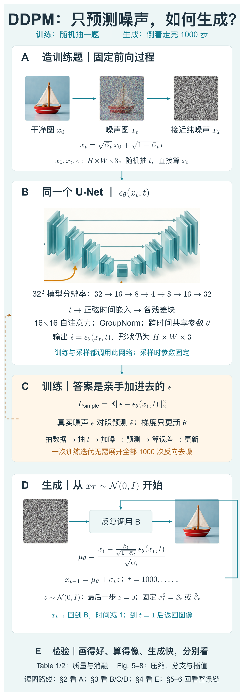

本图由 [DrawPaper skill](https://github.com/Zhu-Huixiang/ReadPaper/tree/main/drawpaper) 指挥 Codex，使用内置生图制作。

可复制地址：https://github.com/Zhu-Huixiang/ReadPaper/tree/main/drawpaper

先认路。**上面的 A→B→C 是训练：拿真图造一道带答案的题，网络猜噪声，拿误差更新参数。下面 D 是生成：从随机噪声出发，反复调用 B，逐步得到图像。** 图里的小帆船用来帮助认出这两条路线。

第 2 节拆 A；第 3 节先讲 B 的输出为什么成立，再讲 C 怎么训练、D 怎么采样，最后打开 U-Net 看内部。第 4 节是 E：拿论文图表检验前面的解释。后面说“A 区”“D 区”，就回到这里找位置。

## 1 引言：先把图毁了，再谈生成

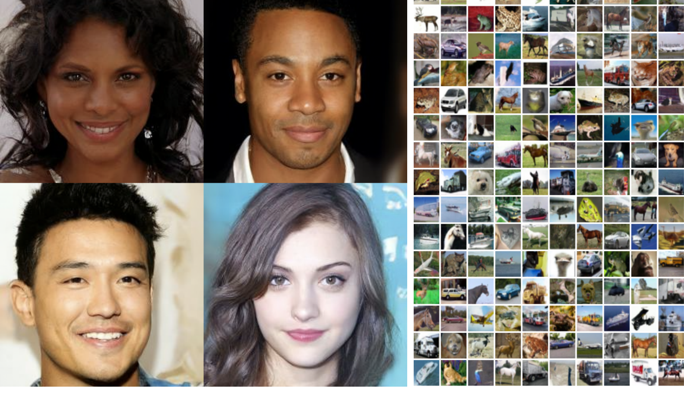

论文 Fig. 1。左边是 256×256 的人脸生成样本，右边是无条件 CIFAR10 小图。

这张图先交作业：小图能呈现不同物体，人脸也有连贯的五官和头发。它是一张**样本拼图，没有横纵坐标**。左边每块是一张生成的人脸；右边每个小格是一张 32×32 的彩色图。两边的数据、分辨率和模型设置不同，不能把右边当成左边的缩略图。<!-- evidence:C03 -->

“无条件”在这里是说，生成时没有额外输入“给我一辆车”这样的类别标签。网络从数据里学分布，再随机采一张。

2020 年的生成模型已经有几种做法。GAN 让生成器和判别器对练；自回归模型按照顺序预测像素；VAE 先用潜变量描述图像，再解码。扩散模型则把一次难解的生成拆成许多小的随机转移。早在 2015 年，Sohl-Dickstein 等人就提出了这条路线。DDPM 的问题是：**怎样选反向转移的输出和损失，才能让这条路线画出高质量图像？**<!-- evidence:C01 -->

它的切口有点像做题：直接问“怎样画一张照片”，太大；改问“给你一张有某种强度噪声的图，猜猜里面的噪声”，训练题就能批量生产了。至于这个小题怎么拼成生成器，光靠比喻还接不上，下面得算。

## 2 背景：每次只撒一点噪声，图会去哪里

### 2.1 两条链，先别把箭头看反

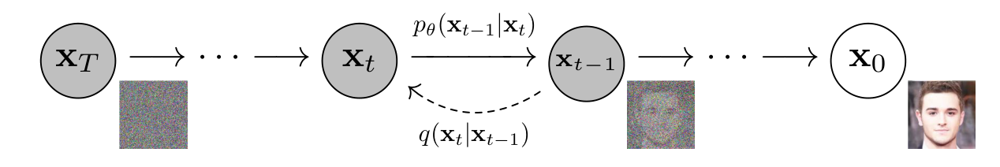

论文 Fig. 2。图把纯噪声放在左边、图像放在右边；实线向右是生成，虚线向左是加噪。

圆圈 x₀ 是干净图，xₜ 是第 t 个噪声等级的图，xT 是终点噪声。上方的 pθ(xₜ₋₁｜xₜ) 往右走，要学；下方 q(xₜ｜xₜ₋₁) 往左走，按预定规则加噪。图里的省略号表示中间还有很多步。它没有坐标轴，左右是**计算顺序**。图旁的小图是不同噪声状态的视觉提示。<!-- evidence:C04 -->

注意：架构 A 区把加噪画成从左到右，论文 Fig. 2 把它画成从右到左。两张图的摆法不同，判断方向请看下标：**0→T 是加噪，T→0 是生成。**

> 基础扫盲｜马尔可夫链：下一步只依赖眼前这一步。这里的生成器每次读取当前 xₜ 和时间 t，决定 xₜ₋₁ 的分布；不用把之前所有图像都当输入。

先规定形状。单张 RGB 图像写成 H×W×3 的实数数组，H、W 是高和宽；把它摊平，就是 D=H×W×3 个数。CIFAR10 的 D=32×32×3=3072。x₀、xₜ 和稍后用的噪声 ε，形状都一样。批量训练时再在最前面加批大小 B。这里的“潜变量”xₜ 仍是一整张带噪图，别急着脑补成 VAE 压出来的小向量。<!-- evidence:C04 -->

### 2.2 加噪公式里，为什么还要把原图缩小

用 q 表示固定的前向分布；βₜ 是第 t 步新加高斯噪声的方差，I 是 D×D 单位矩阵。高斯分布记作 N，括号内依次是均值和协方差。原文 Eq. (2) 的一步加噪是：

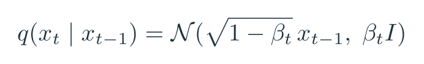

公式 1｜原文 Eq. (2)：先缩小信号，再加入方差为 βₜ 的高斯噪声。

均值前面的 √(1−βₜ) 很容易被略过。只加噪不缩信号，方差会一路膨胀；这个缩放让输入尺度更稳定。若输入每个坐标的方差是 1，新噪声独立，那么输出方差正好是 (1−βₜ)×1+βₜ=1。不是说每张图的像素一定服从标准高斯，而是这个缩放怎样控制尺度，可以直接算出来。<!-- evidence:C04 -->

再定义 αₜ=1−βₜ，ᾱₜ 是从第 1 步到第 t 步所有 α 的乘积。上横线表示累计保留比例；图中的 Π 是连乘，s 从 1 数到 t。ε 是独立采样的标准高斯噪声，每个坐标均值 0、方差 1。

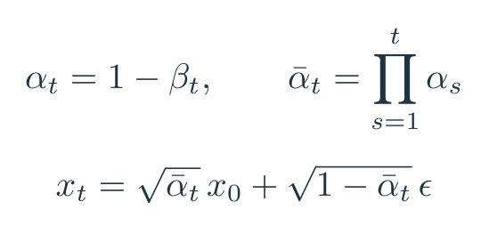

公式 2｜原文 Eq. (4) 的重参数化：不用真的加 t 次，直接构造 xₜ。

这里把信号乘 √ᾱₜ，把噪声乘 √(1−ᾱₜ)。不断相乘后，ᾱₜ 越来越小，原图影响越来越弱。

**训练不用先把每张图毁一千遍。** 抽到 t=600，就用这个式子直接造第 600 级噪声图。这个省事的“传送门”正是架构 A→B 能高效训练的原因。<!-- evidence:C05 -->

拿一个像素做教学例子：x₀=0.5，假设某一步 ᾱₜ=0.64，抽到 ε=−1。信号系数是 0.8，噪声系数是 0.6，于是 xₜ=−0.2。反过来，若知道准确的 ε，就能算回 0.5：

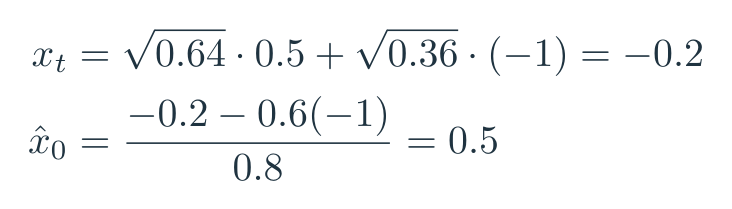

公式 3｜教学数值：展示同一坐标怎样混入噪声，随后按已知噪声还原。

这个例子是代数演示。真实网络只拿到 −0.2 和时间，手里没有答案“噪声就是 −1”。同一个 −0.2，可能由多种干净值和噪声组合得到。**它要从许多训练样本中学会合理的条件预测。**

### 2.3 训练知道原图，生成不知道，正好差在这里

生成时，模型 pθ 从 xT 的标准高斯开始，逐步生成 xₜ₋₁。θ 是网络参数。原文把每步分布设为高斯，网络决定它的均值 μθ，协方差在本文实验里固定成 σₜ²I。于是网络不是一次吐出完整生成链，而是提供**当前一步应该往哪儿走**的信息。<!-- evidence:C06 -->

训练时还有个福利：我们知道真图 x₀，因此“已知 xₜ 和 x₀ 时，上一步是什么分布”可以精确算。用带波浪线的 μ̃ₜ 表示这个后验分布的均值，β̃ₜ 表示方差；ᾱ₀=1。

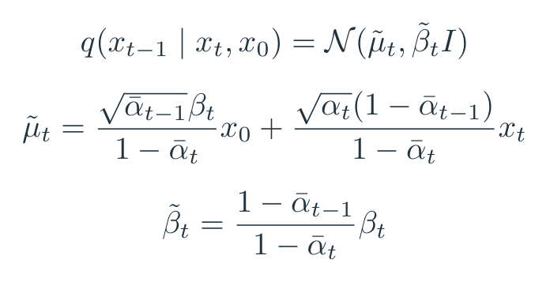

公式 4｜原文 Eqs. (6)–(7)：已知原图时，上一步的高斯后验。

别被这俩分式劝退。均值只做了一件事：**给真图 x₀ 和当前噪声图 xₜ 各配一个权重，再相加。** 每个系数是标量，所以输出仍是 H×W×3；方差控制在这个均值周围能散多开。

这不是把 x₀ 偷喂给生成器。x₀ 是训练时拿来算“标准答案”的；生成时只能靠 μθ(xₜ,t) 去近似合适的反向分布。这个区别，后面解释噪声预测时还会用到。<!-- evidence:C06 -->

## 3 方法：输出噪声，怎么就等于在学反向生成

### 3.1 固定前向过程：先别让出题人一起乱跑

论文第 3.1 节固定 β 的日程，不学习前向加噪参数。所有实验用 T=1000，β 从 0.0001 线性增加到 0.02。T 是总扩散步数，不是训练更新次数。按这个设置算完一千步，ᾱT 大约是 0.0000404，信号系数 √ᾱT 约 0.00635。原图已经被压得很弱，因此拿标准高斯作为生成起点是合适的。<!-- evidence:C07 -->

架构 A 是固定出题器，B 是做题网络。C 区只更新 θ；不会一边学去噪，一边偷偷把题目改简单。

为什么固定日程能让损失简单？要看原文 Eq. (5)。L 是负对数似然的变分上界，可以理解成一个可计算的训练账本；上界越小，就越在逼近“让真实数据获得高概率”的目标。KL 散度 DKL 用来比较两个概率分布：它量的是用一个分布描述另一个分布会多付出的代价，通常不对称。

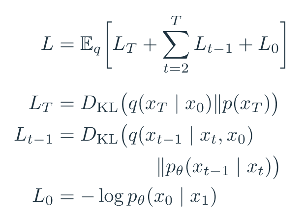

公式 5｜原文 Eq. (5)：起点匹配、中间转移、最后解码，分开记账。

E 表示对相应数据与噪声求平均，Σ 表示把各时间步的项相加，log 是对数。L 的下标是账目编号：LT 管终点噪声分布；Lₜ₋₁ 管从 t 回到 t−1 的转移；L₀ 管最后生成像素的概率。固定 A 后，LT 不含要学的 θ，训练不必优化它。中间那些 KL 都在比较高斯，有解析表达式，不用靠一大堆随机试验估计。<!-- evidence:C08 -->

### 3.2 反向均值：把难猜的对象换一种写法

现在看架构 B 输出什么。最直接的办法是预测 μ̃ₜ，也就是上面那张后验公式图里的均值。作者换了一种参数化：**网络输出 εθ(xₜ,t)，把它当噪声估计；再用固定公式换算成反向均值。**

先把公式 2 移项：已知 xₜ，猜到了 ε，就能得到一个 x₀ 估计。把这个估计代入公式 4 的 μ̃ₜ，整理后，得到原文 Eq. (11)：

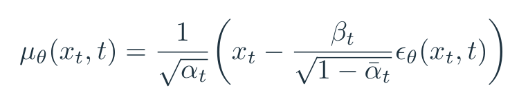

公式 6｜原文 Eq. (11)：预测噪声，随后换算成一步反向分布的均值。

μθ、xₜ、εθ 都是 H×W×3；αₜ、βₜ、ᾱₜ 是查日程表得到的标量。除法和减法逐坐标执行。网络不必额外学这些系数。

到这儿，第一问有了半个答案：**预测噪声可以通过解析公式表达反向均值。** “输出是一张噪声图”与“模型能生成图像”，中间就隔着这个换算和后面的逐步采样，不是玄学转场。<!-- evidence:C09 -->

但还得补一句实质内容：均方误差训练的理想输出，是给定 xₜ 时噪声的**条件均值**。网络不会从一张几乎纯噪声的图里，精准找回“它前世是哪张照片”。大量可能的原图共同决定了该往哪些合理的方向走。多步随机采样，才让结果保留多样性。

原文还把这个输出联系到 **score（得分）**：不是论文评分，而是“往哪个方向改一点输入，数据密度会上升”的梯度。qₜ 是第 t 个噪声等级的数据分布，∇xₜ 表示对图像各坐标求导；E[ε｜xₜ] 是给定当前带噪图后的噪声条件均值。高斯加噪给出下面的关系：

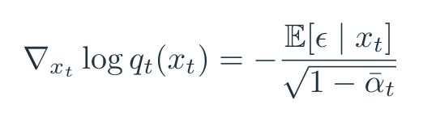

公式 7｜对原文第 3.2 节得分匹配联系的教学展开：最优噪声预测与噪声数据分布的梯度对应。

负号和噪声尺度很关键。网络预测出噪声后，换一个符号再除以尺度，就能提供朝数据高密度区域移动的方向。这也解释了它为什么和 Langevin dynamics（朗之万动力学）采样长得像：一边沿学到的方向挪，一边保留随机扰动。DDPM 具体挪多少、撒多少噪声，由前向日程推出来。<!-- evidence:C10 -->

### 3.3 最后一脚：连续数值怎么落回像素

原文第 3.3 节处理像素。8 位像素原本是 0 到 255 的整数，线性缩放到 [−1,1] 后送进网络，相邻等级间距是 2/255。最后一步解码要给**离散像素值**分配概率，因此用高斯在像素对应小区间内的积分，而不是把某一点的概率密度直接当成离散概率。区间半宽是 1/255，边界两端延伸到无穷。<!-- evidence:C11 -->

这段看着像抠小数，实际上决定了后面 bits/dim 能否当作离散图像的编码长度来读。最终展示图像时，最后一步直接取均值，不再撒新的随机噪声。架构 D 最后写 z=0，就是这个位置。

### 3.4 简化损失：删掉权重，训练重点跟着变了

用噪声参数化以后，每个中间 KL 项能写成加权的噪声平方误差。σₜ² 是固定反向方差；C 是与 θ 无关的常数；wₜ 是时间相关权重。双竖线的平方，把所有坐标的误差平方加起来。

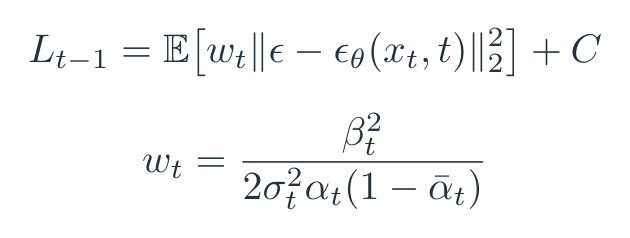

公式 8｜原文 Eq. (12)：原变分目标对应带时间权重的噪声误差。

作者实际得到最好样本质量的训练目标，把这些 wₜ 拿掉了：

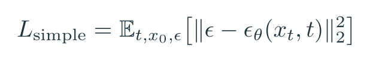

公式 9｜原文 Eq. (14)：随机抽时间步，对预测噪声做平方误差。

t 从 1 到 T 均匀抽，x₀ 从训练数据抽，ε 从标准高斯抽。先在 A 区合成 xₜ，再经 B 区得到 εθ，C 区把它和 ε 比较，反向传播更新 θ。实际程序可以把求和改成坐标平均，差一个固定尺度；这里保留论文的平方范数写法。<!-- evidence:C12 -->

这份答案为什么这么好拿？因为 ε 就是我们亲手抽出来、加进去的随机数，监督信号不用另请人标。举个两坐标的教学例子：真噪声是 (0.3,−0.8)，网络猜 (0.1,−0.4)，误差平方和就是 0.2²+(−0.4)²=0.20。对预测值的梯度是 2(预测−答案)，即 (−0.4,0.8)。梯度下降会把第一个预测往上拉、第二个往下压。

**但“删掉权重”不等于什么都没变。** 相对于原来的变分目标，这重新分配了不同噪声等级的话语权。按论文的日程，简化目标相对降低了小 t、微量噪声题的权重，让更难的去噪题得到更多关注。所以样本质量的提升，要把“猜噪声”与“怎么给题目分配权重”一起看。<!-- evidence:C12 -->

这里用一次“海燕啊，你长点心儿吧”倒挺贴切：ε 和 εθ 只差一个小下标，长得像，身份可差远了。前者是出题时留的答案，后者是网络猜的；把二者在脑子里直接画等号，整个训练问题就水灵灵地消失了。<!-- culture:song-haoyan-care -->

### 3.5 把算法摊开：训练一题，生成一整套

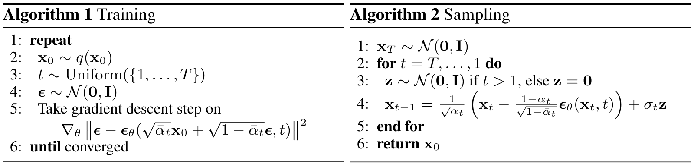

论文 Algorithms 1–2。左边随机抽一个 t 做训练，右边从 T 到 1 循环采样。

这张图是伪代码，没有坐标轴。左边第 2 行抽真图，第 3 行抽噪声等级，第 4 行抽 ε，第 5 行更新 θ；右边先抽 xT，再循环改变图像状态。**左边没有“展开全部反向采样步骤再训练”的循环。** 每次训练抽不同的时间，许多次更新合起来覆盖整条链。右边每一步都要调用同一个 εθ，参数不变，图像和时间在变。<!-- evidence:C13 -->

生成的一步还差一个新噪声 z。z 与图同形，σₜ 是反向标准差：

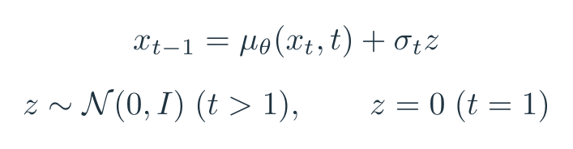

公式 10｜原文 Algorithm 2：先算均值，再按当前方差采样；最后一步令 z=0。

网络预测 εθ 后，用公式 6 算 μθ，然后加 σₜz，得到 xₜ₋₁；把新图和 t−1 再送回 B。z 是**这一步新抽的随机数**，不是训练答案 ε。论文比较过 σₜ²=βₜ 与 σₜ²=β̃ₜ 两种固定设置，报告效果相近。<!-- evidence:C13 -->

接着前面的标量例子，假设当前 xₜ=−0.2、αₜ=0.99、βₜ=0.01、ᾱₜ=0.64，网络猜 εθ=−0.9。选 σₜ²=βₜ，抽到 z=0.3：

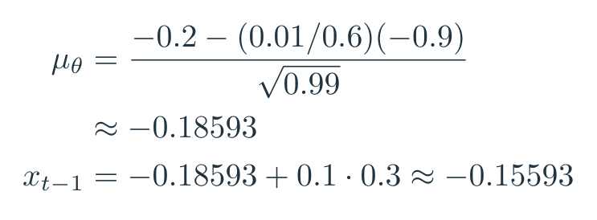

公式 11｜教学数值：网络估计先换算成 μθ，再加本步随机扰动。

算完是 −0.15593 左右。它没有一步回到原图值 0.5，目标本来就是 xₜ₋₁，不是直接跳到 x₀。这也解释了一个常见误会：把 xₜ 里的“预测噪声”一把全减掉，然后说 DDPM 采样完成，省事是省事，算法已经换了。

《钟点工》里，把大象装进冰箱被概括成开门、放进去、关门三步。三句话讲完，最难的那步就没了。只说“去噪得到图像”也有这个毛病。DDPM 的“放进去”是明确的一千次网络调用、系数换算和状态更新，开销一点没省略。<!-- culture:zhongdiangong-elephant-fridge -->

### 3.6 打开 B 区：U-Net 里面怎样处理图像和时间

> 基础扫盲｜U-Net：特征图先一层层缩小，获得更大的视野；再放大回原尺寸。把同分辨率的早期特征接到后面，细节不必全挤过最窄的瓶颈。这些跨过去的连接就是“跳连”。

以 CIFAR10 为例，输入是 B×32×32×3。前端卷积把像素变成特征，向下经过 32×32、16×16、8×8、4×4 四种空间分辨率；向上恢复空间分辨率，并使用对应层的特征。最后输出投影回 3 通道，所以 εθ 与原图同形。论文在各分辨率使用卷积残差块：块内学习修正量，再与原特征相加，帮助深层网络传递信息。附录 B 说明每级使用两个卷积残差块，并采用 GroupNorm。后者把通道分组后归一化，控制特征尺度。<!-- evidence:C14 -->

时间 t 是标量，先变成正弦位置嵌入，再加到各残差块。它告诉网络：眼前这张图是“基本清楚，修点细节”，还是“已经糊成雪花，先搭大轮廓”。**没有这个输入，外观近似的噪声图可能要求不同强度的处理。**

16×16 分辨率上还有自注意力，让一个位置参考其他位置。可以把这 256 个空间位置看成 256 个座位：每个座位产生查询 Q、键 K、值 V，Q 和 K 算匹配程度，再据此加权汇总 V。若每个头用 d 维向量，则 Q、K、V 都是 256×d；QKᵀ 是 256×256，行归一化后，每个位置都有一份对其他位置的权重。这是注意力模块的标准计算解释，d 不是在这里另设的论文超参数。<!-- evidence:C14 -->

附录报告 CIFAR10 模型有 3570 万参数，256×256 的 LSUN/CelebA-HQ 模型有 1.14 亿；更大的 Bedroom 变体约 2.56 亿。**一千步共用这些参数，不是一千套 U-Net。** 第二问到这里就接完整了：训练随机抽题覆盖噪声等级，生成沿 D 区连续调用同一个会做这些题的网络。<!-- evidence:C14 -->

## 4 实验：噪声预测到底赢在哪儿

### 4.1 样本质量：FID 3.17，先读条件再激动

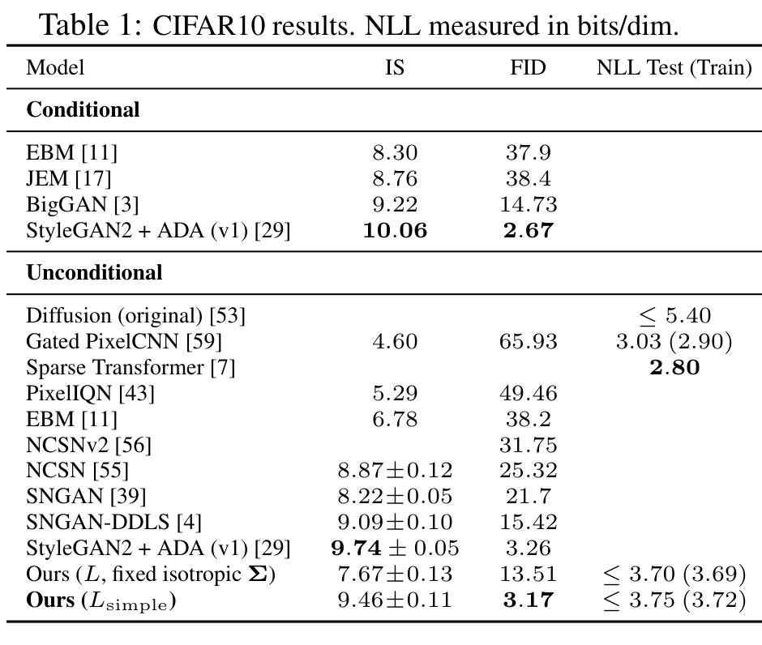

论文 Table 1。先分清 Conditional 与 Unconditional，再横着看 IS、FID 和 NLL。

表的行是模型和训练配置，列是指标。Conditional 指用了额外类别条件；Unconditional 指无条件生成。IS（Inception Score）看生成图被分类网络识别时是否清楚、总体是否有类别多样性，通常越高越好；它不直接比较真实数据分布。FID 把真实图与生成图送进特征网络，比较两边特征的均值和协方差，越低越好。NLL 是负对数似然，这里按 bits/dim 计，也就是平均每个像素通道需要多少比特，越低越好。DDPM 那两行带着“≤”，报告的是可计算的变分上界。IS/FID 看图的分布特征，NLL 算概率账本，它们在量不同的事。<!-- evidence:C15 -->

先只读无条件这一块：

| 配置 | FID，越低越好 |
| --- | ---: |
| NCSN | 25.32 |
| StyleGAN2 + ADA（v1） | 3.26 |
| DDPM，原变分目标 L | 13.51 |
| DDPM，简化目标 Lsimple | 3.17 |

DDPM 的 Lsimple 得到 IS 9.46±0.11、FID 3.17；CIFAR10 的 IS/FID 用 **50000 张生成图**计算。FID 对照训练集特征，改为对照测试集，论文报告是 5.24。这里的“±”按表中 IS 的报告保留；不是 FID 的误差条，也不是多次完整训练的置信区间。<!-- evidence:C15 -->

3.17 和 3.26 的数值接近，读到这里就喊“碾压 GAN”太着急。再往上看，同表的有条件 StyleGAN2+ADA 是 2.67。更有说服力的进展是：这条由许多小步组成的概率路线，样本质量确实追到了很强的 GAN 对照附近；同一个 DDPM 换目标，差异还很大。

把表里的 NLL 拎出来，会看到另一种排列：原目标的测试值上界是 3.70 bits/dim，Lsimple 是 3.75；**图更像了，编码账本却略差。** 原文实验的最终设置各训练一次，训练中持续评估，报告最低 FID 对应的结果。这个条件放在这里，才知道这些数字在回答什么。<!-- evidence:C16 -->

再看 256×256，别把 CIFAR10 的小图结果一口气推广过去。

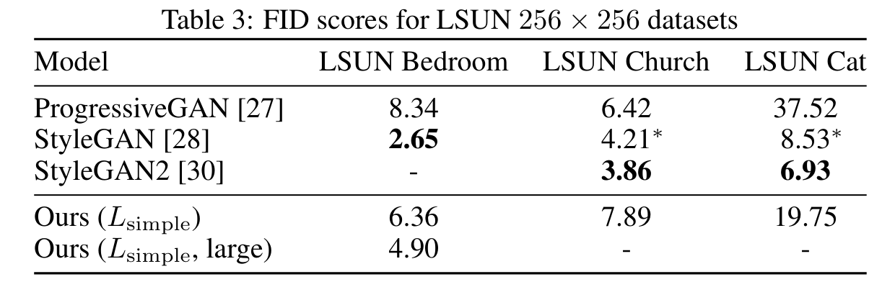

论文附录 Table 3。三列是不同 LSUN 数据集，不能跨列当成同一任务比。

行依次是 ProgressiveGAN、StyleGAN、StyleGAN2、DDPM 普通版与更大版；数字均是 FID，越低越好。Bedroom 上 DDPM 普通版 6.36、大版 4.90；ProgressiveGAN 是 8.34，StyleGAN 是 2.65。Church 上 DDPM 7.89，ProgressiveGAN 6.42，StyleGAN2 3.86。**DDPM 展示了竞争力，优势随数据集与模型大小变化。** 星号是表注里标记的基线来源，横线是该格没报告数值，不是零。LSUN FID 同样以 50000 张生成样本计算。<!-- evidence:C17 -->

### 4.2 消融：光把输出改成噪声，还不够

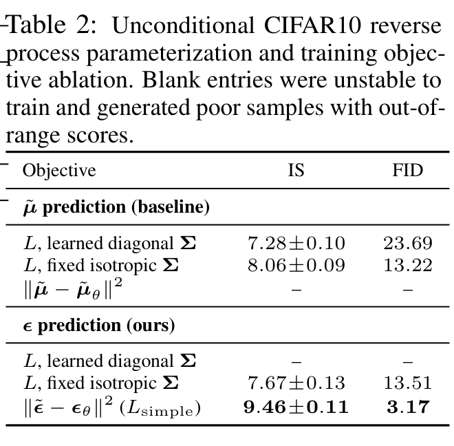

论文 Table 2。上半预测反向均值，下半预测噪声；每半块再比较目标与方差设置。

这张表才适合回答第一问剩下的半截。第一列是训练配置，IS 越高越好、FID 越低越好。Σ 是反向协方差；learned diagonal 表示学习各坐标的对角方差，fixed isotropic 表示固定、各方向相同的方差。横线对应训练不稳定、样本差到指标超出报告范围，别把它读成有效分数。

先固定“原变分目标 + 固定方差”这个条件：预测均值的 FID 是 13.22，预测噪声是 13.51，二者接近。再看噪声预测换成简化损失，才到了 3.17。反过来，把均值预测也直接换成无权重平方误差，那行却没训出可用结果。<!-- evidence:C18 -->

因此，**有效的是噪声参数化与时间重加权的组合。** 用原目标时，“猜噪声”没有单独带来大幅提升；它给出了一个改损失后很好用的表达方式。这比“去噪任务天生更高级”具体多了。

还有一笔时间账。附录 B 在 TPU v3-8 上报告：CIFAR10 训练批大小 128，约每秒 21 个更新，80 万步约 10.6 小时；生成一批 256 张图约 17 秒。256×256 模型生成一批 128 张约 300 秒。这些是特定硬件和批量下的运行时间；生成仍走 1000 步。训练简洁，采样可以很忙，二者一点不矛盾。<!-- evidence:C19 -->

### 4.3 逐步编码：为什么先有轮廓，后有细节

回到架构 D。当前 xₜ 还有噪声，但我们可以用网络预测构造一个“此刻猜的最终干净图”x̂₀。帽子表示估计值：

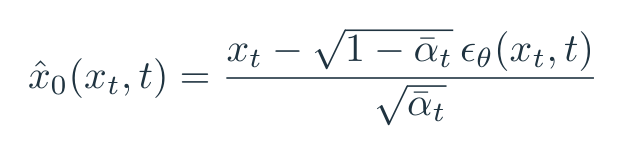

公式 12｜原文 Eq. (15)：从当前状态估计 x₀，用来观察生成进度。

**x̂₀ 是观察用的最终图估计，不是下一步状态 xₜ₋₁。** 把它们混了，接下来的图就全看反了。分母 √ᾱₜ 在高噪声时很小，预测误差会被放大；到了更低噪声，估计往往更清楚。

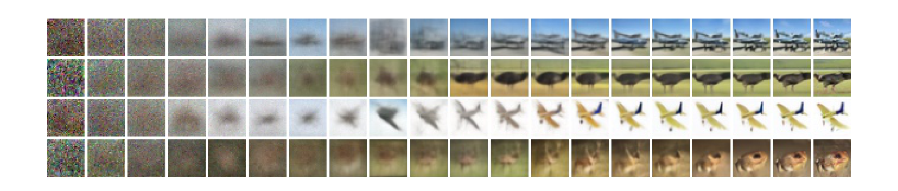

论文 Fig. 6。每行追踪一个样本，横着看时间推进；展示的是 x̂₀ 的变化。

这幅图没有数值坐标轴。左到右是反向生成推进，不是不同模型，更不是从左到右分块画像素。第一行一开始只有模糊色块，后来地平线与船的结构逐渐明确；下方几行分别出现飞机、动物等形状。**每一列都在重估整张图，粗结构先出现，细节后补。** 图没有给每一列精确时刻，不必对着格子硬报秒数。<!-- evidence:C20 -->

这会不会只是“眼睛觉得它变好了”？附录还有量化版本：

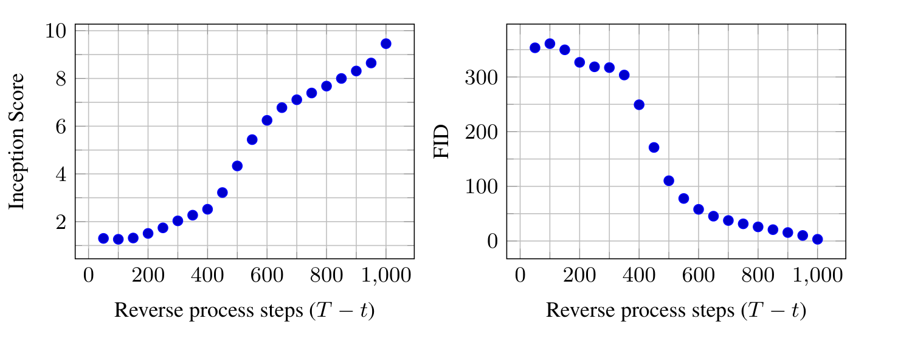

论文附录 Fig. 10。左右图横轴都是已完成的反向步数 T−t；左图 IS，右图 FID。

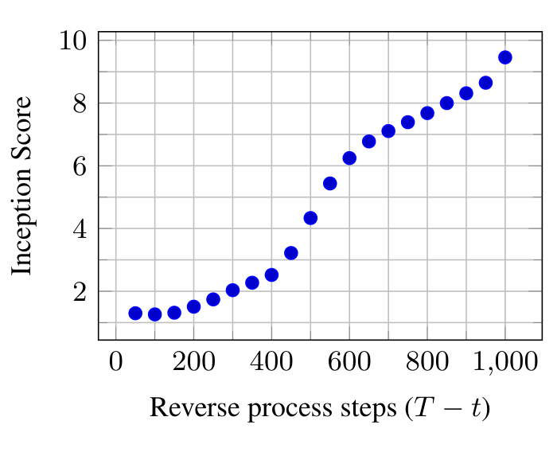

论文 Fig. 10 左图局部。IS 随反向步数上升，先认横轴的 0 和 1000，再看纵轴 2–10。

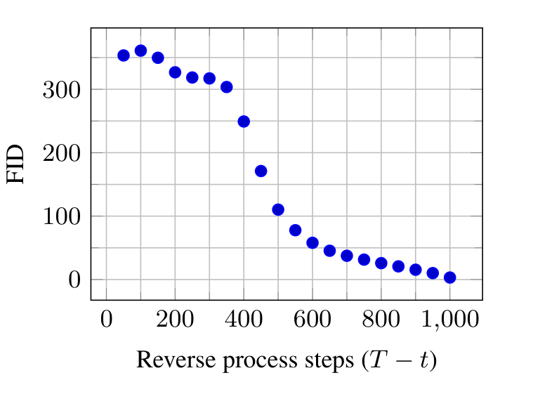

论文 Fig. 10 右图局部。FID 总体随反向步数下降；最前面的点有小幅起伏。

横轴从 0 向 1000 走，对应 D 区越来越接近成图。左图纵轴是 IS，向上更好；右图纵轴是 FID，向下更好。蓝点是不同进度下 x̂₀ 的指标，不是误差棒。中段的改善很明显，后面继续补细节；这说明中间预测的视觉与分布质量在变好，**图的横轴是步数，不是耗时**。看这张图，才知道前面那些模糊方块不是“网络已经画完、只是没加载清楚”。<!-- evidence:C21 -->

原文更进一步，把反向过程解释成逐步接收图像信息。先认识两个词：**rate（码率）**是已经接收多少比特，按每个像素通道维度计；**distortion（失真）**是重建和原图差多少，这里用 RMSE，也就是每个坐标误差平方的平均值再开根号，恢复到 0–255 的像素尺度。

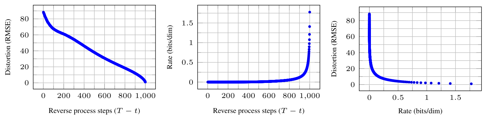

论文 Fig. 5。左图看失真随步数下降，中图看码率怎样累积，右图把二者放在一起。

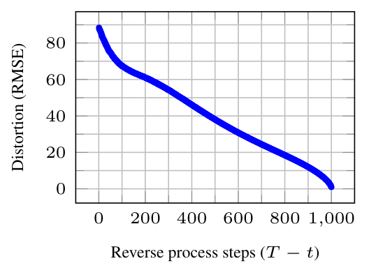

论文 Fig. 5 左图局部。横轴是已经完成的反向步数，纵轴是像素 RMSE。

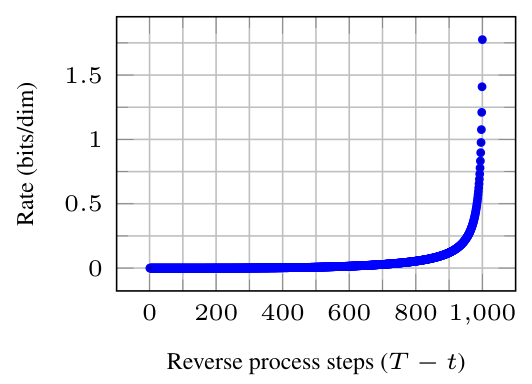

论文 Fig. 5 中图局部。横轴仍是反向步数，纵轴改为累计 bits/dim。

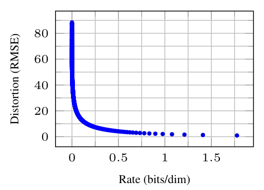

论文 Fig. 5 右图局部。横轴是码率，纵轴是 RMSE；左侧少量比特就能换来明显改善。

先看左图：横轴反向步数 T−t，纵轴 RMSE；往右走，重建越来越接近原图。中图同样以步数为横轴，纵轴 bits/dim；蓝点到最后一段陡起来，说明大量比特在后期才花出去。右图把横轴换成码率，纵轴仍是 RMSE；靠左那一小段，增加很少码率就能明显降低失真，继续花很多比特，主要在补很细的差别。三张图的点对应同一个逐步编码过程，坐标都是线性刻度；它们不是三套独立模型。<!-- evidence:C22 -->

数字放在旁边看，免得再往上翻：

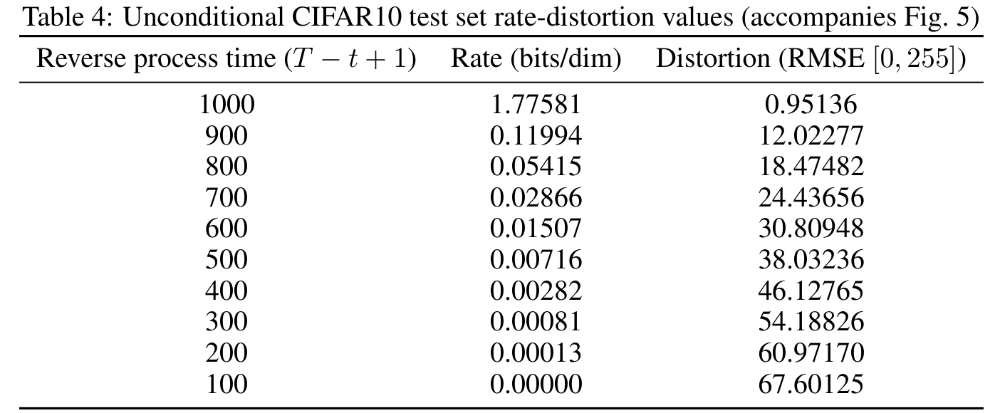

论文附录 Table 4。按实际反向进度读，后两列分别是累计码率和像素 RMSE。

| 表中反向进度 | 累计 bits/dim | RMSE（0–255） |
| --- | ---: | ---: |
| 800 | 0.05415 | 18.47482 |
| 900 | 0.11994 | 12.02277 |
| 1000 | 1.77581 | 0.95136 |

注意这张表的第一列明确写 T−t+1，比 Fig. 5 横轴的 T−t 多了 1，不能把末位下标机械对齐。由 900 到 1000，累计码率多了 1.65587 bits/dim，把 RMSE 从约 12.02 降到 0.95；末段花的码率约占最终累计值的 93.2%。这是按表中数值算出的比例。它把“最后补细节”变成了可核的代价。<!-- evidence:C23 -->

原文还将最优样本模型的无损编码上界拆成 rate 1.78 与 distortion 项 1.97 bits/dim，总计约 3.75。这里 distortion 项是负对数似然的编码量，**不是**上一张图纵轴的像素 RMSE；名字相同，单位不同，千万别相加错了。作者据此解释，很多编码长度花在肉眼难察觉的细节上，因而概率账本与视觉质量可以有不同偏好。<!-- evidence:C24 -->

这是一种压缩解释。附录专门指出，Algorithms 3–4 依赖的高维随机编码步骤还不实用。这里读到的是“怎样理解这些概率项”，不是一款已能替代 JPEG 的压缩工具。

再看生成过程的分叉：

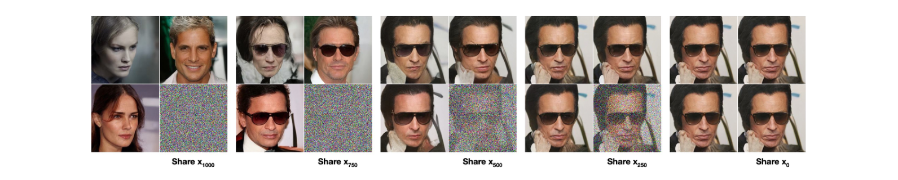

论文 Fig. 7。前四组共享 x1000、x750、x500、x250 后分叉，最后一组 x₀ 是已经成图的对照。

每组是 2×2 小格：**右下是固定的噪声状态，另外三格是从它继续生成的结果**。前四组之间比较共享状态的时间，组内比较相同起点下随机路径带来的差异；最后 x₀ 那组已经走到终点，没有后续随机步骤，四格保持相同图像。越早分叉，后续能改动的内容越多；在较低噪声状态分叉，几张图会保留更多高层属性，只在更细处变化。没有横纵数值轴，`Share x…` 是组标签。<!-- evidence:C25 -->

这也纠正了“最初一张随机噪声决定一切”的直觉。D 区除了 xT，之后每步还有 z；从同一个中间状态出发，也能生成不同结果。原文用这样的观察讨论“概念压缩”：某些高层信息已经在中间变量里，虽然人眼直接看它仍像一团雪花。

第 4.3 节最后把它与自回归连接。若前向过程每次遮掉一个坐标，反向过程就逐个补回坐标，能退化成一种自回归生成。高斯扩散改用噪声逐步破坏全图，反向就按某种从粗到细的信息顺序恢复，**不必按像素位置排队**。这是在比较“信息按什么顺序回来”，不是说 DDPM 实际从左上角画到右下角。<!-- evidence:C26 -->

### 4.4 插值：直接叠两张脸，为什么容易叠出双影

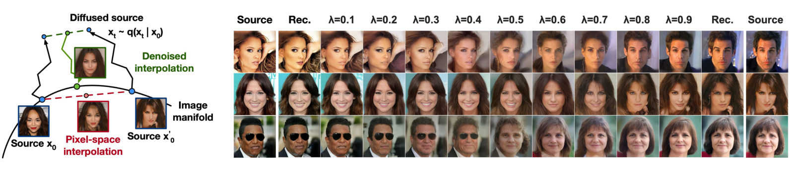

论文 Fig. 8。左边比较像素直接插值和先加噪再去噪；右边每行连接一对源图。

这张图想解决一个很直观的麻烦：两张脸直接按像素平均，很容易一脸两副眼镜。先加噪再混合，能让模型重新组织结构。

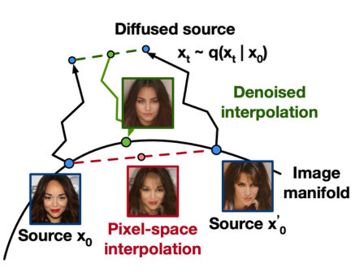

论文 Fig. 8 左侧局部。红虚线直接混像素，绿色路径先在带噪状态里混合，再去噪回来。

黑色曲线标着 Image manifold，可以把它理解成“看起来像真实图像的区域”。底部两个 Source 是源图，红虚线连它们，中间那张脸出现了双影；黑色折线箭头从下方蓝点出发，把源图扩散到上方的带噪状态。上方绿色虚线在这些状态之间插值，绿色折线再把中间状态去噪到下方的脸。**区别在于在哪儿混合，以及混合后有没有让反向模型重新生成。** 线条是机制示意，没有数值坐标轴；路径长短不表示算力或误差。<!-- evidence:C27 -->

数学其实很短。两张源图叫 x₀ 和 x′₀，撇号表示第二张；各自加噪到同一个时间得到 xₜ、x′ₜ。λ 是混合比例，x̄ₜ 是混合后的中间状态。这里 x 上横线表示插值，和 α 上横线的累计乘积不是一回事。

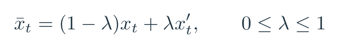

公式 13｜插值计算：先混合两个带噪状态，再用反向过程解码。

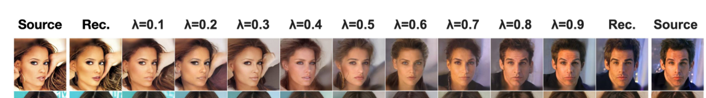

论文 Fig. 8 右侧首行局部。两端是源图，内侧是重建，中间逐步改变混合比例。

右边每行两端 `Source` 是原图，靠内的 `Rec.` 是重建；中间从 λ=0.1 到 0.9 逐渐偏向第二张。此图使用先加噪 500 步的设置。看的是姿态、肤色、头发、表情与背景怎样变化；原文同时指出眼镜未呈现同样顺滑的变化。不要把它读成“每个语义属性都有一根能独立拨动的滑杆”。<!-- evidence:C27 -->

还有一个公式阅读小坑：第 4.4 节正文给 x̄ₜ 写线性组合时，右侧误写成了 x₀、x′₀；前一句的定义、Fig. 8 和附录 D 讲的都是**加噪后的状态插值**。上面的教学式按这条完整机制写成 xₜ、x′ₜ。读论文时，符号不对劲就得沿上下文核，照抄最省事，也最容易把自己带沟里。<!-- evidence:C28 -->

## 5 相关工作：扩散、得分匹配和自回归在这儿碰头

按原文第 5 节与附录 C，DDPM 的贡献放在三条已有线索中更清楚。<!-- evidence:C29 -->

Sohl-Dickstein 等人的扩散概率模型提供了前向破坏、反向生成和变分训练框架。DDPM 固定小步高斯日程，把反向均值写成噪声预测，得到实用的高质量生成结果。

Song、Ermon 的 NCSN 用多噪声等级的得分匹配，再借退火朗之万采样。DDPM 的噪声预测能与得分联系起来，但前向每步还有信号缩放，采样系数从 β 日程推导；原文强调，它在变分训练里直接训练这条有限步采样链。两条路线在目标与采样上有联系，具体网络、缩放与系数仍不同。

自回归模型提醒我们：生成不只有“按像素或词的位置依次填空”。第 4.3 节把扩散看成一种更一般的信息恢复顺序，给“先粗后细”提供了概率角度的解释。

所以读完架构 A–D，最好留下的是这组对应关系：**固定破坏过程，给出可算的训练后验；噪声预测，表达反向均值与得分方向；训练权重，决定把能力花在哪类去噪题上。** 后来换网络、换日程、减少采样步数，都能沿着这些接口判断究竟改了哪里。

## 6 三个问题，再落到机器人动作上

原文结论把扩散、得分匹配、逐步压缩连在一起，并提出去其他数据模态继续试。我们读到这里，先把三个问题收回来，再沿动作生成这个接口往下看。<!-- evidence:C29 -->

**训练时明明知道原图，为什么偏要让网络预测噪声？**

噪声是自动得到的训练答案，通过公式 6 能换算成反向均值，还连接到数据分布的得分。实验证据支持的是**噪声参数化与简化权重的组合**，不是噪声输出单独就能让模型变强。第一问对应 A→B→C。把 Table 2 的关键比较再放这里：

| 输出与训练目标 | CIFAR10 FID ↓ |
| --- | ---: |
| 反向均值 + 原目标，固定方差 | 13.22 |
| 噪声 + 原目标，固定方差 | 13.51 |
| 噪声 + 简化目标，固定方差 | 3.17 |

同条件先换输出，再换损失，才能看出变化发生在哪一步。<!-- evidence:C18 -->

**训练只抽一个时间步，生成为什么要走一千步；每步到底算什么？**

前向闭式公式让训练能直接抽一道任意等级的题；生成则按已经定义的反向链前进。每步读 xₜ 和 t，预测噪声，换算均值，加入规定强度的新噪声，得到 xₜ₋₁。最后不再撒噪声。1000 是原文设置，意味着同一个网络调用 1000 次。第二问对应 D 的循环。

**图片更好看了，为什么概率分数未必更好；这和机器人动作有什么关系？**

Lsimple 重新分配了时间等级的训练权重，样本质量与像素精确编码的偏好有差异。Table 1 里 FID 改善而 NLL 上界略差；Fig. 5 和 Table 4 进一步展示，最后很多比特花在细微重建上。第三问先由 E 区的实验回答，再谈具身迁移。

机器人场景里，可以把“图像数组”换成“一段动作数组”。例如用 K 表示动作序列长度、dₐ 表示每步动作维数，干净动作块 A₀ 就是 K×dₐ；扩散下标 t 是去噪步，**不要和机器人真实执行时间混为一谈**。给动作块加噪，网络结合相机、状态等条件去预测噪声，再反向生成一个动作块，这就是读后续动作扩散方法时可以追的接口。Diffusion Policy 的正式论文也沿这条线介绍条件去噪策略。<!-- evidence:C30 -->

但换成动作后，问题变得很实际：绕障碍物左走与右走可能都行，平均一条轨迹反而撞中间。生成分布有机会保留多种选择；是否保留、能否执行，得检查后续策略的条件输入、动作表示和闭环实验。图像 FID 不能替动作成功率结账。原版一千步的时间代价，到了控制回路里还要重新安排。

读下一篇 Latent Diffusion 时，可以继续盯着 A 和 B：**加噪的对象还是像素吗？网络在哪个空间工作？** 而读 Diffusion Policy，要盯 D：每次重规划生成多少动作，实际执行哪几步，新的观测什么时候进来。DDPM 把计算链搭好了，后面的论文各自决定把它接向哪里。

---

在 GitHub 可以放大查看原图、公式和架构图源码，沿知识点继续读：

- [本篇 GitHub 解读](https://github.com/Zhu-Huixiang/embodied-world/blob/main/articles/ddpm-2006.11239/README.md)
- [DDPM 知识星系](https://github.com/Zhu-Huixiang/embodied-world/blob/main/universe/papers/ddpm.md)
- [具身榜](https://zhu-huixiang.github.io/embodied-world/leaderboard/)
- [ReadPaper skill](https://github.com/Zhu-Huixiang/ReadPaper) · [DrawPaper skill](https://github.com/Zhu-Huixiang/ReadPaper/tree/main/drawpaper)

可复制的技能仓库：https://github.com/Zhu-Huixiang/ReadPaper

公众号读者可点「阅读原文」，打开本篇 GitHub 入口。

---

公众号版由管理员在后台手动公开发表；永久文章链接待发表后补充。

关注公众号 **具身智能的 World**：

[原论文](https://arxiv.org/abs/2006.11239v2) · [证据索引](evidence.json)

[本篇知识星系](../../universe/papers/ddpm.md) · [知识点宇宙](../../universe/README.md)
