# DeepMimic：照着动作学，为什么还会摔？

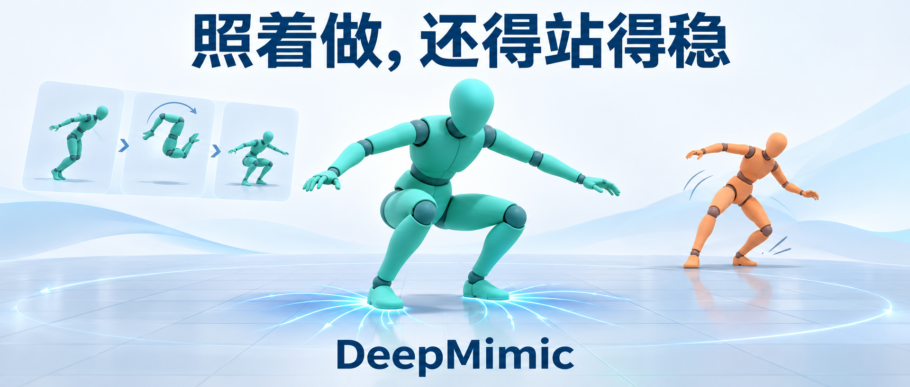

给一个物理仿真人形看后空翻，参考动作里的每个关节都摆得清清楚楚。把这些姿态依次抄过去，它就能稳稳落地吗？

身体一旦交给动力学，动作之间便多了重力、惯性和接触。膝盖此刻该弯多少，得看身体已经飞到了哪里。参考动画规定了想做成什么样，却没有直接告诉控制器此时该用多大力。DeepMimic 要补上的正是这一段。<!-- evidence:C02 -->

它面对两条熟悉的路线：运动学方法擅长合成好看的动作，再靠控制器跟踪；只按任务奖励训练的强化学习擅长寻找得分办法，动作却可能离人的示范很远。DeepMimic 把参考动作写进奖励，让同一个策略同时面对“做得像”和“完成目标”。作者把贡献定位在这些组件的组合：让同一套物理角色控制框架能学多种高动态技能。<!-- evidence:C03 --><!-- evidence:C04 -->

沿着原文，我们回答三个核心问题：

1. 参考姿态怎样变成能承受物理扰动的控制动作？
2. 模仿奖励、参考状态初始化和提前终止各解决什么困难？
3. 成功率、动作风格与多技能能力，实验分别支持到哪一步？

这里是「具身智能的 World」。配套 GitHub 有七个阅读入口：

- 论文解读：拆开方法、公式和实验。
- 论文地图：按科学问题找阅读路线。
- 顶会顶刊集锦：定位已核实的正式出处。
- 一周解读日程：看接下来准备讨论的问题。
- arXiv 新作：区分首次公开与版本更新。
- 具身榜：查看七维评分及逐项依据。
- 知识点宇宙：沿章节回链连接独有机制与共享技术。

入口：https://github.com/Zhu-Huixiang/embodied-world

**论文信息**

DeepMimic: Example-Guided Deep Reinforcement Learning of Physics-Based Character Skills。作者依次为 Xue Bin Peng、Pieter Abbeel、Sergey Levine、Michiel van de Panne；前三位署名 UC Berkeley，末位署名 University of British Columbia。首次公开于 2018 年 4 月 8 日，正式发表于 ACM Transactions on Graphics 37(4)，Article 143（SIGGRAPH 2018）。本文阅读作者官网的正式稿及随文补充材料，共 18 页。<!-- evidence:C01 --><!-- evidence:C60 -->

论文与项目：https://xbpeng.github.io/projects/DeepMimic/index.html

正式出处：https://doi.org/10.1145/3197517.3201311

代码：https://github.com/xbpeng/DeepMimic

**阅读目录**

- 1 引言：像人，还是能动
- 2 相关工作：参考动作应该放在哪里
- 3 方法总览：从参考姿态到物理动作
- 4 背景：奖励怎样改掉下一次动作
- 5 策略表示：状态、网络和奖励
  - 5.1 状态与动作
  - 5.2 网络
  - 5.3 奖励
- 6 训练
  - 6.1 参考状态初始化
  - 6.2 提前终止
- 7 多技能：三种不同的组织方式
- 8 角色：同一套框架，不同的身体
- 9 任务：目标究竟怎么进奖励
- 10 结果：先分清怎样计分
  - 10.1 任务表现
  - 10.2 多技能整合
  - 10.3 动作重定向
  - 10.4 消融
  - 10.5 抗扰动
- 11 讨论：时钟、奖励和训练成本

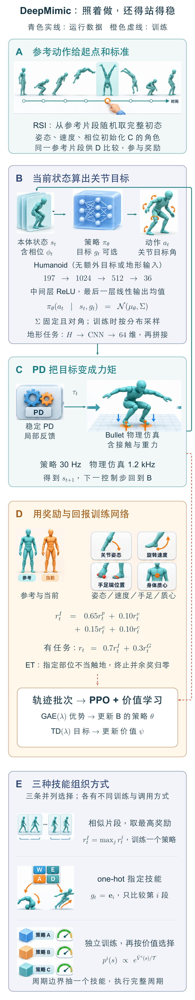

本图由 [DrawPaper skill](https://github.com/Zhu-Huixiang/ReadPaper/tree/main/drawpaper) 指挥 Codex，使用内置生图制作。

先认图中的五个区域。A 提供参考动作，并在训练开始时抽取初始状态；B 把当前身体状态、动作相位和任务目标送进策略；C 用 PD 控制与物理仿真执行动作；D 计算奖励、估计价值并更新策略；E 展示三种多技能组织方式。

**训练路线**是 A 初始化，B、C 反复交互，再由 D 更新网络。参考动作还持续给 D 提供模仿比较对象。**运行路线**主要沿 B→C→B 闭环：看现在的身体，给关节目标，接收下一状态。网络参数在运行时保持固定，反馈来自新状态。§5 拆 B、D，§6 解释 A 与 D 的训练处理，§7 对应 E，§9–10 检查目标和实际效果。

## 1 引言：像人，还是能动

后空翻最难的地方，并不只是“空中姿态有没有对上”。起跳时差一点，落地状态就会变；落地时差一点，下一步可能直接摔倒。控制器需要在这些偏差中调整关节动作，既守住参考风格，又服从身体能做到的运动。

《吃面条》里，陈佩斯拿着碗和筷子，把虚构的面条吃得活灵活现。《环球人物》的回顾写到，他捞起的是一筷子虚空。道具在，面条靠表演；看起来像吃面，并不等于真的把面送进了胃。<!-- evidence:C59 --><!-- culture:chen-noodles-empty-bowl -->

控制实验也要拆开看：动作形状、物理执行、任务结果，是三个要分别检查的对象。DeepMimic 的参考姿态负责提供形状；仿真负责检验身体能否这样动；任务奖励再追问目标是否完成。这个类比到此为止，策略没有演员的表演意图。

作者使用的示范可以来自动作捕捉，也可以是人工关键帧。它们提供一条随时间变化的姿态轨迹，通常只有约 0.5–5 秒；训练会反复从中取样。数据很短，并不意味着计算很少，后面会看到，一条技能可能要练几千万个仿真样本。<!-- evidence:C36 --><!-- evidence:C23 -->

## 2 相关工作：参考动作应该放在哪里

运动学动作合成可以从数据库拼接、插值或者生成姿态，画面容易接近人的运动。但姿态序列本身没有保证脚能踩住、重心能接住。把它再交给物理跟踪器，是一条自然的路；难处落在高动态动作、外界扰动和目标变化时，如何维持跟踪。

另一边，人工控制器能把动力学经验写进规则，却往往需要针对技能或身体细调。模型无关强化学习减少了这种控制规则设计，但若奖励只写“向前走得快”“碰到目标”，它会寻找能拿分的动作，不会自动尊重人的动作习惯。原文还讨论了 SAMCON 等基于采样的运动控制方法：它们与 DeepMimic 都利用参考动作，求解和策略组织方式有所不同。这里是论文对路线的梳理，并非所有方法都在相同预算下重新比了一遍。<!-- evidence:C04 -->

DeepMimic 选择把参考动作变成一个可计算的相似性奖励。策略没有逐帧监督动作标签，它收到的是：刚刚做出的物理运动，离参考姿态、速度、末端位置和质心分别有多远。<!-- evidence:C02 --><!-- evidence:C13 -->

## 3 方法总览：从参考姿态到物理动作

把图 B、C 展开，一个控制时刻有四步。

首先，仿真器给出身体状态 s，以及任务需要时的目标 g。其次，策略 π(a|s,g) 输出动作分布；这里 a 表示各关节的目标朝向。第三，PD 控制器根据目标和当前关节状态产生力矩。最后，物理仿真推进，接触、重力和惯性共同决定下一状态。<!-- evidence:C05 -->

PD 可以先理解成带刹车的弹簧：离目标角度越远，越想拉回去；转得太快，再用阻尼压一压。动作 a 因而不是关节力矩。论文使用 stable PD 控制，负责处理底层反馈；高层策略负责选择此刻应该追向哪些角度。<!-- evidence:C56 -->

策略频率为 30 Hz，Bullet 物理仿真为 1.2 kHz。因此，相邻两次策略查询之间约走 40 个物理步。这是两种仿真频率的比值，说明高层动作与底层动力学运行在不同节拍。<!-- evidence:C36 --><!-- evidence:C57 -->

训练时还有图 D：拿真实走出来的状态与同相位参考比较，算奖励，再更新网络。参考动作给的是目标标准，物理反馈决定这个标准在当前身体上怎样实现。

## 4 背景：奖励怎样改掉下一次动作

强化学习优化一段动作的累计收益。用 t 表示当前步，rₜ 表示本步奖励，γ 表示折扣因子，越远的奖励乘上的 γ 次方越多。论文取 γ=0.95。价值函数 V(s) 是一个标量，估计从状态 s 出发，遵循当前策略还能获得多少折扣回报。<!-- evidence:C22 -->

策略网络也叫 actor，参数记作 θ；价值网络的参数另记 ψ。训练先让旧策略与仿真交互，存下状态、动作、奖励和后继状态。收集完一批数据，再用它更新价值网络和策略网络。前者学习“这个局面大概值多少”，后者学习“哪个动作比原先预期好”。<!-- evidence:C16 -->

那个“比预期好多少”就是优势 A。正优势推动动作变得更常见，负优势推动它变得更少见。这里比较的是同一状态下的基准，不能只看一次奖励大不大。

附录 A 用多步回报解释价值目标：n 步回报由前 n 步奖励，加上第 n 步之后的价值估计组成。n 小，更多依赖当前价值网络；n 大，更多依赖这一段实际采样。TD(λ) 把不同长度的回报加权，GAE 则用对应的回报减去当前价值来估计优势。λ 是混合参数，本文实验取 0.95。下面用 δₜ 表示一步时序差分误差，l 是向后数的步数，K 是从当前步起纳入的采样长度；终止状态后不再追加未来价值；若只是采样截断而任务未终止，末端仍保留价值估计。图中 Â 是估计优势，Rₜ(λ) 是据此得到的价值训练目标。<!-- evidence:C20 --><!-- evidence:C22 -->

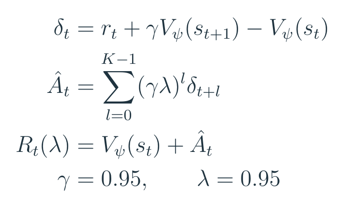

本文教学式（1）。附录A的λ回报用TD残差展开；终止归零，截断保留bootstrap。

这张式子把附录的 λ 回报改写为常见的 TD 残差展开，方便看计算。作为教学例子，若当前奖励是 0.8，下一状态估值为 8，当前估值也是 8，那么 δₜ=0.8+0.95×8−8=0.4。若下一步 δ 还等于 0.2，它给当前优势再贡献 0.95×0.95×0.2=0.1805。后面的好坏会折回来影响现在的动作。

PPO 进一步控制策略更新的幅度。用 wₜ 表示同一个已采样动作在新旧策略下的概率密度之比；它大于 1，说明新策略更愿意选这个动作。ε 是裁剪宽度，论文取 0.2；clip 把比值截到 0.8–1.2，min 取两项中较小者，平均后的目标 Lᶜˡⁱᵖ 被最大化。Eₜ 表示对采样时刻求平均，θ_old 是采样所用的旧参数，优势上的帽子表示估计量；为简洁，式中把任务目标条件并入状态记号。<!-- evidence:C21 -->

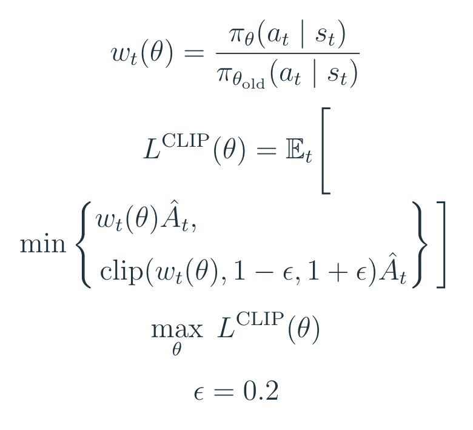

本文教学式（2）。按附录C重排；裁剪与未裁剪项取较小者，再最大化批平均。

假设优势是 2，新旧概率比为 1.3。未裁剪项为 2.6，裁剪项为 2.4，最终只取 2.4：继续把这个好动作推得更常见，暂时拿不到额外好处。若优势改成 −2，同样比值下取 min(−2.6,−2.4)=−2.6，增大坏动作概率仍会受到惩罚。**裁剪拦住的是过度改进方向上的收益，并非比值一出区间，所有梯度都归零。**<!-- evidence:C54 -->

附录 B 的概率比还需要一层理解：它在旧策略采到的状态上比较动作概率，形成可优化的代理目标。它没有把新策略将访问哪些状态也全部精确修正。这也是把 PPO 看作可用的更新机制，而非任意大步更新保证书的原因。<!-- evidence:C21 -->

## 5 策略表示：状态、网络和奖励

### 5.1 状态与动作

状态 s 包含身体各部分相对根部的位置、四元数旋转、线速度和角速度。根部取骨盆，坐标系的 x 轴沿根部朝向。这样，角色在场景里整体转个方向，不必把整套关节关系重新学一遍。四元数是用四个数表示三维旋转的方法；它与后面动作端采用的轴角表示不同，不能把两者逐元素对齐。<!-- evidence:C06 --><!-- evidence:C08 -->

状态还带一个相位 φ∈[0,1]，告诉策略参考动作进行到了哪里。0 是开始，1 是结束；循环动作走完后回到 0。它很像节拍器，让策略知道现在该起跳还是该落地。这个节拍按时间线性前进，受到扰动后也不会自动等身体恢复，我们会在最后回到这个代价。<!-- evidence:C07 -->

输出端，球关节用轴角表示目标朝向，单轴关节用一个角度。Humanoid 的状态为 197 维，动作参数为 36 维；身体自由度则是 34。表示参数的个数与物理自由度不同，不能用“有 36 个动作数”倒推出 36 个独立关节自由度。<!-- evidence:C10 -->

### 5.2 网络

论文 Fig. 2 画出了网络的数据流：没有地形输入时，状态和任务目标进入两层全连接网络；要看地形时，先把高度图压成一份特征，再拼进来。我们先看清数据在哪里汇合。

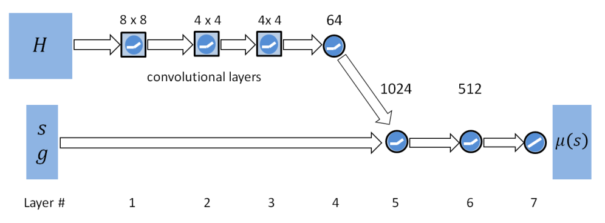

论文 Fig. 2。高度图经卷积与64维特征后，与本体状态和目标拼接；普通任务只用后端MLP。

策略均值网络的两个隐藏层分别为 1024、512 个 ReLU 单元，最后线性输出动作均值。无额外目标的 Humanoid，可按 197→1024→512→36 理解；有目标时，把相应的 g 一起拼入输入。对 B 条状态组成的批次，状态数组是 B×197，动作均值是 B×36。B 只是本文表示批大小的符号。<!-- evidence:C09 --><!-- evidence:C10 -->

用 μθ 表示这个均值网络，Σ 表示固定的对角协方差；N 表示高斯分布，Rⁿ 表示 n 维实数向量空间。策略从高斯分布采样动作，探索幅度由固定超参数控制，而不是网络同时输出一组可学习方差。价值网络结构相似，最后只输出一个 V 值。<!-- evidence:C09 -->

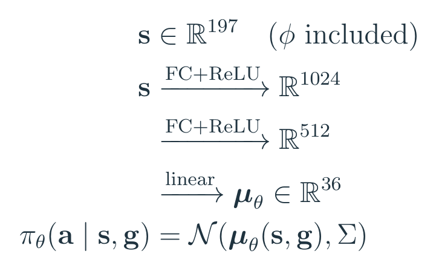

本文教学式（3）。无额外目标时的Humanoid维度；使用目标时将g拼入输入。

Fig. 2 的地形分支先过三层卷积，滤波器依次是 16 个 8×8、32 个 4×4、32 个 4×4，再压成 64 维特征，与 s、g 拼接。图展示的是二维地形输入的网络；后面一维地形采样的任务，应按其输入组织理解，不能把二维尺寸硬套过去。卷积负责找局部高低变化，全连接层再把“脚下地形”和“身体此刻怎样动”放到一起。<!-- evidence:C11 -->

把完整图分两处放大。图中的 H 是高度图；上支路压出地形特征，下支路与身体和目标输入汇合。

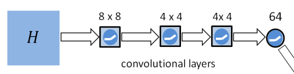

论文 Fig. 2，卷积前端局部。H依次经过8×8、4×4、4×4卷积核，再得到64维特征；该特征沿右下连接送入后端，完整连接见下一张局部图。

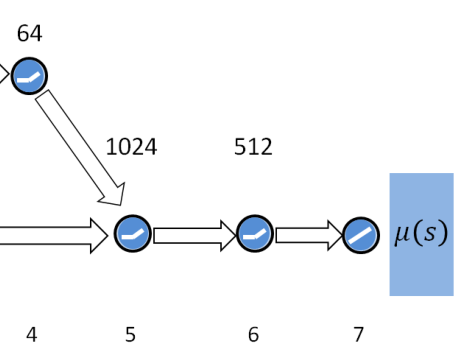

论文 Fig. 2，融合与MLP局部。64维地形特征沿斜箭头与左侧s/g输入汇合，随后经过1024、512单元层，线性输出高斯动作均值；左侧长箭头的源头见完整图。

### 5.3 奖励

现在到图 D。模仿奖励记作 rᴵ，任务奖励记作 rᴳ。带任务的实验采用 ωᴵ=0.7 和 ωᴳ=0.3 两个外层权重；纯模仿任务只用模仿奖励。模仿奖励内部又分四项：姿态 rᵖ、角速度 rᵛ、末端位置 rᵉ、质心位置 rᶜ，权重分别为 0.65、0.1、0.15、0.1。<!-- evidence:C12 --><!-- evidence:C13 -->

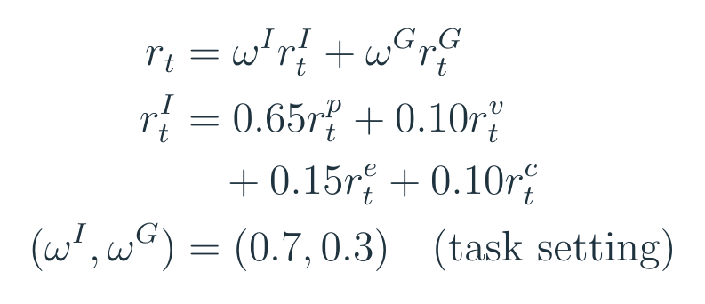

本文教学式（4）。四项模仿权重与带任务实验的外层权重。

每项都把误差放进负指数：完全对上时是 1，偏差增大时平滑下降。下面的帽子表示同相位参考值，下标 j 表示关节，e 表示左右手脚之一，c 表示质心。q 是关节旋转，带点的 q 在这里表示角速度；p 是位置。∑ 表示逐项求和，||·||² 表示相应差值的平方量。

姿态项里的 ⊖ 要特别小心：先求两个四元数对应的相对旋转，再取旋转角的大小，以弧度计。它不是把四个分量直接相减。速度项比较关节角速度，参考速度由参考运动的有限差分得到。<!-- evidence:C14 -->

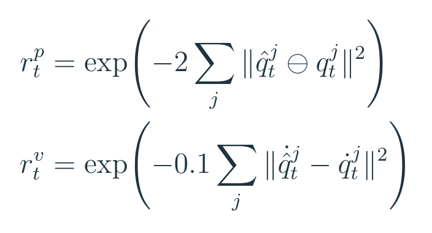

本文教学式（5a）。四元数差取相对旋转角，角速度则直接比较。

末端项比较手脚的世界坐标位置，质心项比较整体质心位置，距离按米计。它们补上了只看关节角不容易表达的整体移动和接触位置差异。四个尺度系数不同，因此相同数值的误差放在不同项里，影响并不一样。<!-- evidence:C15 -->

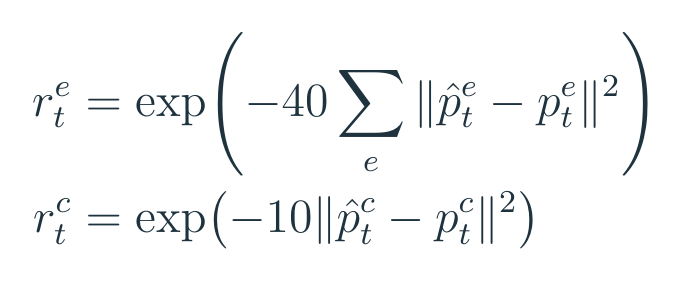

本文教学式（5b）。世界坐标位置差按米计；末端项对左右手脚求和。

算个教学例子：只让一只手的位置错 0.1 米，另外三个末端完全对上，那么末端奖励为 exp(−40×0.1²)=exp(−0.4)≈0.6703。它还会乘上 0.15，才进入模仿总分。<!-- evidence:C52 -->

再假设四项分数依次为 0.9、0.8、0.7、0.95，模仿分就是 0.865；若任务分为 0.5，最终奖励为 0.7×0.865+0.3×0.5=0.7555。这组数字只是代入演示，解释奖励怎样逐层汇总。<!-- evidence:C53 -->

姿态对了而手没碰到目标，任务项会拉低分；目标碰到了却动作走样，模仿项会拉低分。权重规定了两种要求怎样竞争。§10 的投球对照，会把这种竞争表现得很直白。

## 6 训练

回到图 A、D，作者使用模型无关强化学习反复采样，并没有学习一个动力学模型来规划。每批收集 4096 个样本，再以 256 个样本的小批量优化；TD(λ) 更新价值，GAE 估优势，PPO 更新策略。优化器用动量为 0.9 的 SGD。Humanoid、Atlas 的策略学习率为 5×10⁻⁵，Dragon、T-Rex 为 2×10⁻⁵；价值网络为 10⁻²。附录 D 给出了整个采样和更新过程。<!-- evidence:C16 --><!-- evidence:C22 -->

训练还有两个具体选择：从哪里开始练，以及什么时候结束这一轮。

### 6.1 参考状态初始化

如果每次都让角色从站立姿态开始，早期随机动作大多以摔倒收场。它还没学会起跳，就很难遇到合理的空中姿态；没见过合理落地，又难以发现起跳之后有什么好处。

参考状态初始化（Reference State Initialization，RSI）在每个回合开始时，从参考轨迹中均匀选一个时刻，把身体放到对应状态。策略因此能直接练后半段：这一轮从空中开始，学怎样落地；下一轮从起跳附近开始，学怎样接上后续。它改变的是训练初始状态分布，并没有在运行时替策略把身体瞬移到正确位置。<!-- evidence:C17 -->

这也解释了图 A 为什么既连初始化，又连模仿奖励：前一条让策略更早碰见有意义的状态，后一条告诉它这些状态之后怎样动更接近参考。

### 6.2 提前终止

提前终止（Early Termination，ET）在指定失败接触出现时结束回合，例如头或躯干触地。剩余时间的奖励视为零。这里的失败接触要按技能定义：翻滚、爬行、起身本来就需要身体接触地面，不能把任何触地都一律算失败。<!-- evidence:C18 -->

ET 有两层作用。倒下之后还在地上摆几个相似姿势，可能继续获得局部模仿分；提前终止拿走了剩余奖励，抑制这种局部解。它还省下早期大量地面挣扎样本，让更多采样花在仍有机会完成动作的阶段。后一层是作者对训练数据分布的解释。<!-- evidence:C19 -->

RSI 让有价值的后半程更容易被看见，ET 让失败后的低价值过程少占预算。它们作用的位置不同，效果也要分技能检验。

## 7 多技能：三种不同的组织方式

图 E 放了三个并列分支，因为原文确实提供了三种不同机制。

**第一种：一个策略，多条参考，奖励取最大值。** 图中 j 索引参考片段，k 表示参考总数；rʲ 是按第 j 条参考计算的模仿奖励。对当前状态逐条算模仿奖励，取其中最大值作为 rᴵ。策略只要像其中一条，就有机会得高分。<!-- evidence:C24 -->

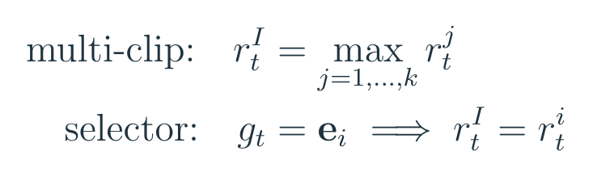

本文教学式（6）。上行取最大模仿分，下行按one-hot选择参考，两种方案分别使用。

图中第二行预先列出下面的选择器：eᵢ 是第 i 项为 1 的 one-hot 向量，rⁱ 是所选参考的奖励；两行是并列方案。

它没有把几条姿态直接求平均。训练可以让策略在不同状态下偏向不同参考，但如果动作差别过大，也可能只学会容易拿分的一部分。实验里，相近的走路与转向动作比较适合这种方式。<!-- evidence:C25 -->

**第二种：一个策略，用目标指定技能。** g 是 one-hot 向量，只有对应目标技能的一项为 1；奖励只计算那条被选中的参考。这个设置没有额外任务奖励，技能编号本身就是目标。训练中每个动作周期随机抽一个技能，因此一个网络还要学会技能之间怎样接上。作者用复制首尾帧的方式，把参考片段调整到等长；演示分别包含不同方向的翻转和跳跃。<!-- evidence:C26 --><!-- evidence:C27 -->

**第三种：多个独立策略，按价值选择接班者。** 每条技能已经分别训练好策略 πᵢ 和价值函数 Vᵢ；在当前状态 s 下，让各自的价值函数评估接手后能否做好，再用 softmax 变成抽样概率。这里 i 是技能索引，k 是候选技能总数，V 上的横线表示归一后的值，pⁱ(s) 表示选择第 i 条策略的概率。Π 是组合后的动作分布；它的加权和表示先抽策略、再由该策略选动作。T 是温度参数；值越高越容易被选中，温度越低越集中。<!-- evidence:C28 -->

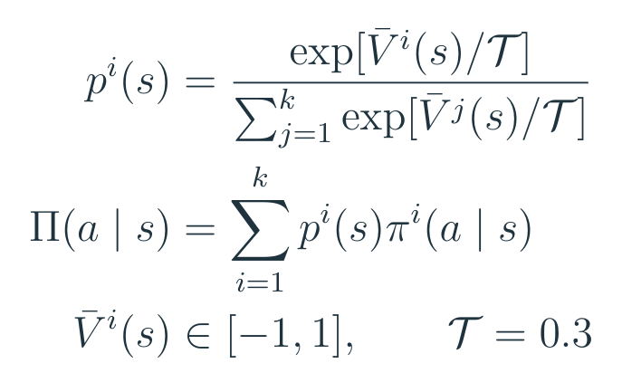

本文教学式（7）。先抽技能再选动作，混合的是动作分布。

论文先把价值归一到 [−1,1]，取 T=0.3。举个只比较两个候选的教学例子：若值为 0.6、0，两者概率约为 0.881、0.119。抽到哪一类，就执行哪条策略；这不是把两个动作向量按权重平均。<!-- evidence:C55 -->

演示组合了 8 个技能，在每个周期开始时抽取一个，并完整执行一个周期，还禁止连续两个周期选同一技能。它不在每个 30 Hz 控制步重新抽技能，也没有为这些过渡额外联合训练。这种做法借用了每条技能已经学到的恢复能力；能接哪些状态，仍取决于各自的策略与价值估计。<!-- evidence:C29 -->

## 8 角色：同一套框架，不同的身体

原文 Fig. 3 把四种身体并排放出来，目的不只是展示造型：Humanoid、Atlas、T-Rex、Dragon 的质量、关节和运动惯性都不同。同一组关节目标到了另一副身体上，未必会产生同样运动。

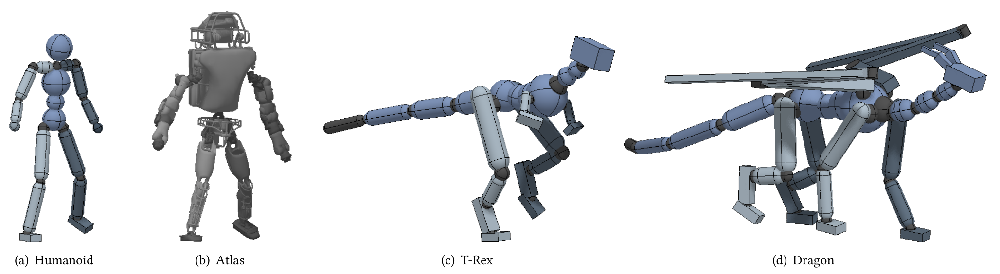

论文 Fig. 3。从左到右是Humanoid、Atlas、T-Rex、Dragon；图中的Atlas同样为仿真模型。

它们的质量依次为 45、169.8、54.5、72.5 千克，均为刚体仿真角色。Dragon 的状态达到 418 维，动作参数为 94 维，自由度为 79。作者针对身体调整 PD 增益，但同一种身体跨任务沿用这些增益。<!-- evidence:C30 --><!-- evidence:C10 -->

这里的 Atlas 是仿真模型。§10.3 要检查的是示范如何迁移到新身体，以及是否需要重新训练控制策略。

## 9 任务：目标究竟怎么进奖励

原文 §9 把任务分成目标朝向、击打、投掷和地形运动。图 B 中那个 g 因此没有固定一种含义，必须随任务解释。

**目标朝向。** g 提供水平面里的二维单位方向。用 d* 表示目标方向，v 表示质心速度，v* 表示目标速度；vᵀd* 是速度在目标方向上的投影，式中缩写为 uₜ；T 上标表示转置，与前节的温度参数不同。任务奖励先看“还差多少速度”，再取非负部分。<!-- evidence:C31 -->

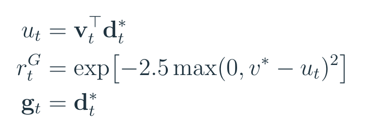

本文教学式（8）。u是沿目标方向的速度投影，只惩罚速度不足。

这项只惩罚不足。教学代入：目标速度 1 米/秒，朝向投影只有 0.6 米/秒，奖励约为 0.6703；投影达到 1.2 米/秒，max 截成零，奖励就是 1。要理解它鼓励的行为，得看这个单边惩罚，而不能笼统称为“精确速度跟踪”。<!-- evidence:C58 -->

**击打。** g 包含目标三维位置和是否已经命中的标志 h。图中 pᵉ 表示指定击打部位中心，pᵗᵃʳ 表示目标位置，dₜ 是二者距离；hₜ 为 0/1 命中标志。两者距离小于 0.2 米时算命中，此后奖励保持为 1。命中前，按距离平方的负指数给分。每个动作周期开始时，目标与 h 都会重设。h 把“已经打中过”这件事显式传给前馈网络，因此网络不用靠隐藏循环状态记住它。<!-- evidence:C32 -->

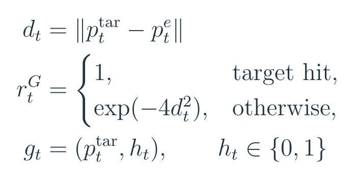

本文教学式（9）。一个周期内命中后保持满分，下周期重新设置目标与标志。

**投掷。** 球最初通过球关节连在手上，在固定时刻释放；状态还加入球的位置、旋转、线速度和角速度，目标与奖励沿用击打形式。动作会影响释放时的球状态，但释放时刻在这个实验中预先设定。<!-- evidence:C33 -->

**地形。** Fig. 4 的不同场景分别考验跨障碍、跨沟、窄梁转弯和上楼梯。作者先在平地训练不带视觉输入的模仿策略，再加入高度图与卷积分支，在复杂地形上训练。这样先学基本动作，再让动作随地面调整。<!-- evidence:C34 -->

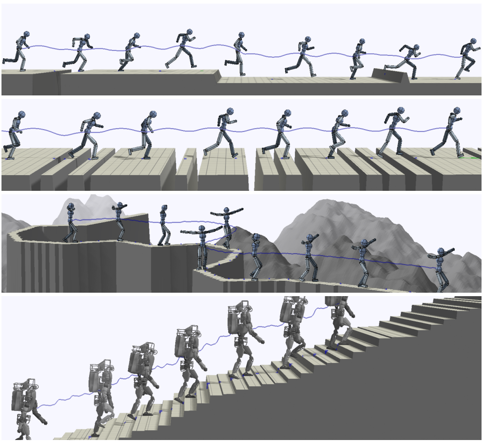

论文 Fig. 4。自上而下是混合障碍、密集沟槽、曲折平衡木和楼梯；蓝线是质心轨迹。

沿直线前进的混合障碍与密集沟壑，用覆盖前方 10 米的 100 点一维高度采样；曲折平衡木用覆盖 3.5×3.5 米的 32×32 二维高度图。这些是局部地面几何输入。图 B 的地形分支把它们变成特征，再与身体状态一起决定关节目标。<!-- evidence:C35 -->

## 10 结果：先分清怎样计分

原文的技能图先说明动作范围：奔跑、翻转、踢击等动作可以在同一套训练框架中学习，但通常各自训练策略。看图时，连续姿态表示动作过程，不表示一个网络已经无条件掌握了图里所有技能。

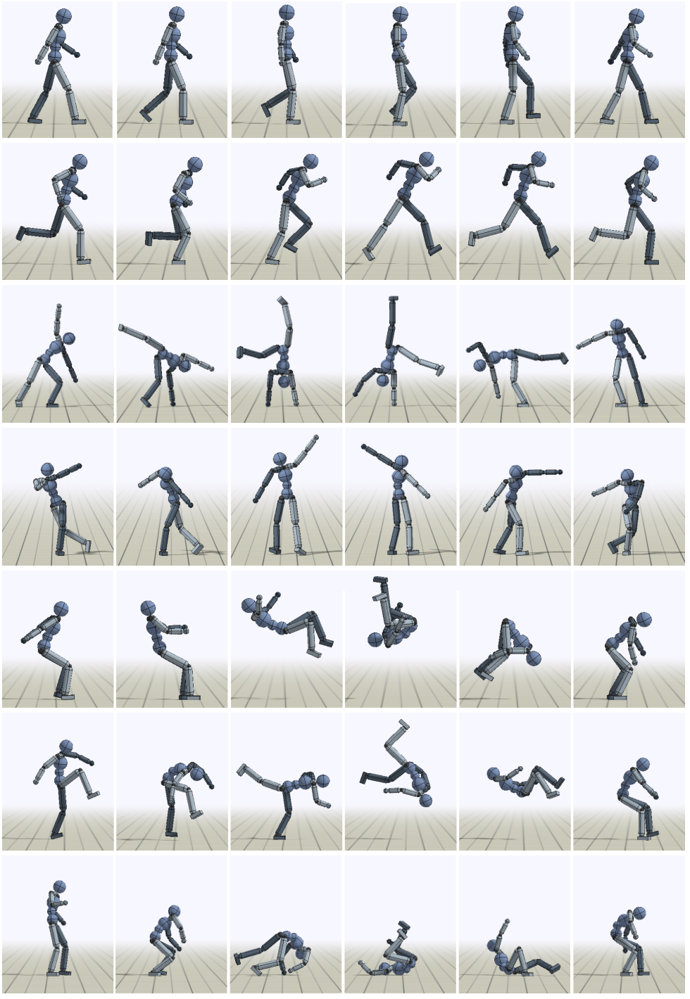

论文 Fig. 5。从上到下是走、跑、侧手翻、舞蹈A、后空翻、前空翻和滚动。

Table 2 的 NR 是归一化回报，0、1 对应规定的最小、最大回报；它不是成功率。表中每项取 32 个评估回合平均，循环技能评估 20 秒，非循环技能按参考片段时长评估。一般主实验评估启用 RSI 与 ET。最大理论奖励还可能达不到，例如投掷目标若要求球立即到位，就存在物理上的时间代价。<!-- evidence:C37 -->

作为尺度参考，后空翻参考长 1.75 秒，训练使用 7200 万样本，NR 为 0.729；走路参考长 1.26 秒，6100 万样本，NR 为 0.985；前空翻 NR 为 0.485。任务不同，回报差距不能直接读成统一的“动作合格率”。<!-- evidence:C38 -->

Table 3 中，混合障碍奔跑用了 4.66 亿样本，NR 为 0.285；密集沟壑是 2.65 亿、0.650；Atlas 楼梯是 1.74 亿、0.808。地形、身体和目标都变了，跨行比较时需要保留这些条件。<!-- evidence:C39 -->

### 10.1 任务表现

最值得停下来看的，是 Table 4：每个策略评估 100 次，比较模仿加任务、只有模仿、只有任务。这里才是命中成功率。先看击打，再看投球，二者给出的答案并不相同。<!-- evidence:C40 -->

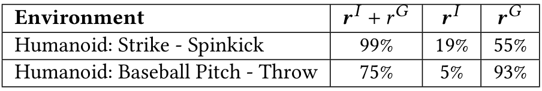

论文 Table 4。每个策略评估100次：两种奖励、仅模仿、仅任务三列不可混同动作质量。

击打使用旋踢参考：

| 奖励设置 | 命中成功率 |
| --- | ---: |
| 模仿＋任务 | 99% |
| 只有模仿 | 19% |
| 只有任务 | 55% |

加入目标让动作朝真正的击打位置调整，参考动作又为策略提供了有效的踢击方式，联合训练在这个任务里最好。<!-- evidence:C40 -->

投球使用棒球投掷参考：

| 奖励设置 | 命中成功率 |
| --- | ---: |
| 模仿＋任务 | 75% |
| 只有模仿 | 5% |
| 只有任务 | 93% |

这里，只有任务奖励反而得了最高成功率。Fig. 8 告诉我们它怎么得分：角色拿着球跑向目标。动作沿着奖励允许的路径完成了接近目标的事，却偏离了示范中的投掷方式。<!-- evidence:C40 --><!-- evidence:C41 -->

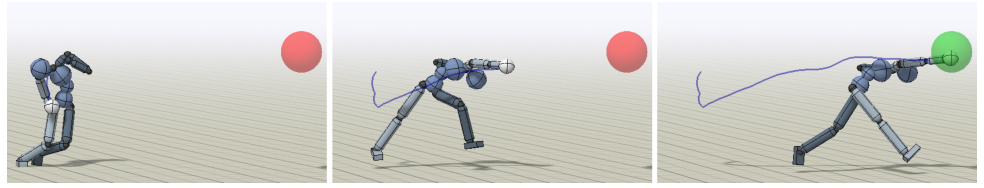

论文 Fig. 8。无模仿参考时，策略直接带球跑向目标，任务得分和投掷风格分离。

所以，DeepMimic 的证据不能压成一句“加模仿，成功率就更高”。投掷联合策略只有 75%，低于任务策略的 93%；它多承担了一项要求：按参考动作的方式完成任务。这张表恰好说明，任务分数必须和动作过程一起看。

### 10.2 多技能整合

Fig. 9 检查的是 §7 第一种方式：5 条走路/转向参考配合目标朝向。蓝线的 clip index 看左轴，0 是前走，1–4 是转向参考；橙线的目标朝向看右轴，单位是弧度，横轴是步行步次（Locomotion Step）。两条曲线量纲不同，不能因为线靠得近就理解成数值吻合。<!-- evidence:C25 -->

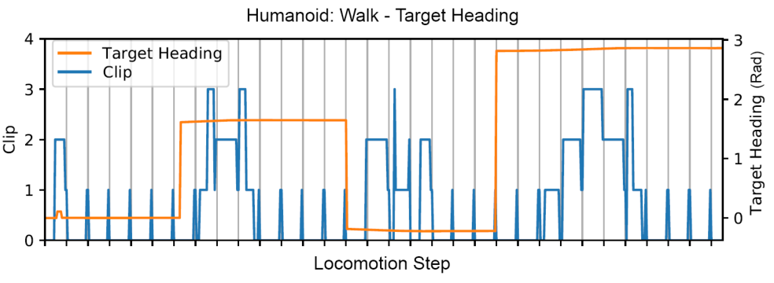

论文 Fig. 9。横轴Locomotion Step；左轴蓝线是clip ID，右轴橙线是目标朝向rad，0为前行，1–4为转弯。

目标朝向变化时，匹配转向参考的情况增多，支持策略能在相近片段之间调整。它展示的是这个小型走路库的组织能力。差异大的技能，还需要看 one-hot 选择器或独立策略组合的条件，而不能把这幅图扩展成任意技能库随取随用。<!-- evidence:C25 --><!-- evidence:C27 --><!-- evidence:C29 -->

### 10.3 动作重定向

Atlas 结果把“搬参考”和“搬控制器”区分得很清楚。作者先将 Atlas 模型中串联的单轴关节聚合为球关节，再把人形参考动作的局部关节旋转复制过去，训练新策略。若直接拿原人形策略去控制 Atlas，跑步与后空翻 NR 只有 0.013、0.014；重新训练 Atlas 策略后，分别为 0.846、0.630。身体变了，控制规律得重新适应。<!-- evidence:C42 -->

Fig. 10 展示动作如何适应新地形：左侧参考动作在平地落地，右侧训练后的角色从 2 米高台落地。姿态序列与蓝色轨迹线把两种运动展开，可以直接看出下落距离变化后，角色仍要接住自己的身体。<!-- evidence:C43 -->

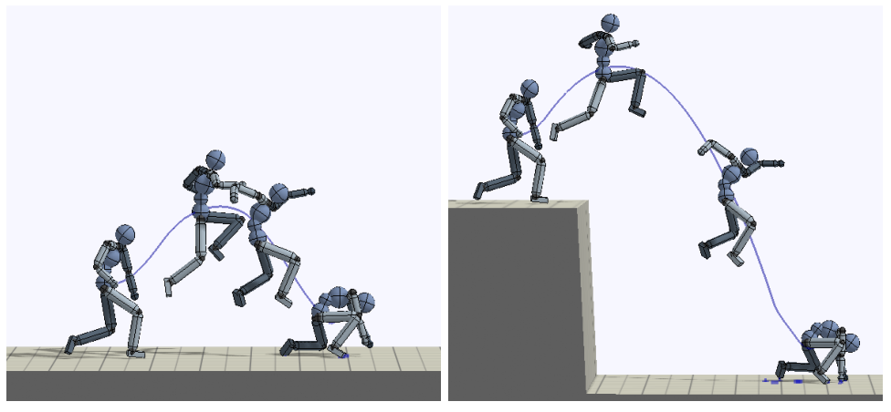

论文 Fig. 10。左为平地参考，右为用该参考重新训练的2米台阶落地。

更换物理条件后也可以重新训练。例如，在 1.622 米/秒²的月球重力下训练旋踢和侧手翻，NR 为 0.792、0.688。同一段运动学参考遇到不同地形或重力，控制策略仍需在新动力学下重新找到可执行动作。<!-- evidence:C43 -->

### 10.4 消融

现在检查 RSI、ET 是否真有必要。Table 5 与 Fig. 11 采用另一套评估协议：所有方法从固定初态开始，评估时关闭 ET；无 ET 的训练会继续完整的 20 秒。这样，结果更能暴露从开头完整完成动作的能力。**Table 5 的后空翻 0.791，不能与前面 Table 2 的 0.729 当成同条件涨分。**<!-- evidence:C44 -->

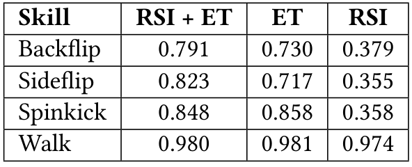

论文 Table 5。本表测试关闭ET、固定初态；后空翻0.791/0.730/0.379，行走近似。

先取后空翻这一行：

| 训练配置 | 归一化回报 |
| --- | ---: |
| RSI＋ET | 0.791 |
| 仅 ET | 0.730 |
| 仅 RSI | 0.379 |

没有 ET 时差距很大。没有 RSI 时分数似乎还行，但作者观察到的动作只是保持直立的小后跳，没有完成空中翻转。又是一次提醒：一个汇总回报可能掩盖关键动作缺失。<!-- evidence:C45 --><!-- evidence:C46 -->

Fig. 11 把训练过程补上。四个面板分别是后空翻、侧空翻、旋踢、走路；横轴是采样数，标有 ×10⁷ 倍率，纵轴是 Return。蓝线为 RSI＋ET，橙线仅 ET，绿线仅 RSI。先看颜色与条件，再看曲线有没有起来。<!-- evidence:C47 -->

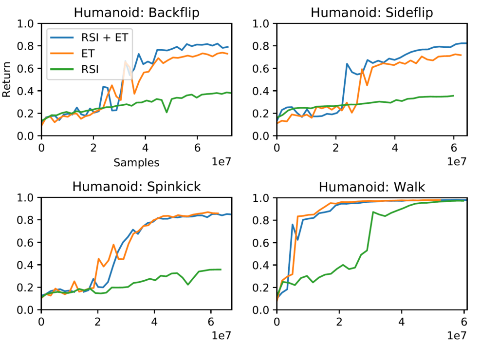

论文 Fig. 11。四图依次为后空翻、侧空翻、旋踢、行走；蓝RSI+ET、橙ET、绿RSI，横轴Samples线性且标1e7，纵轴Return。

后空翻细图里，蓝线最后高于橙线，绿线明显较低。侧空翻的最终值也呈类似关系：0.823、0.717、0.355。<!-- evidence:C45 -->

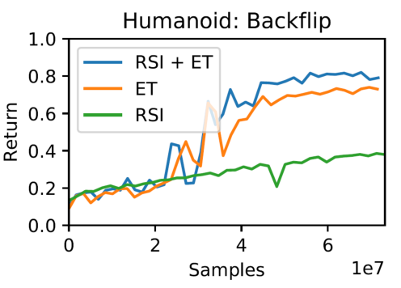

论文 Fig. 11（后空翻局部）。保留原图图例与完整坐标；蓝RSI+ET、橙仅ET、绿仅RSI。

走路则完全不同：三者为 0.980、0.981、0.974，差距很小；旋踢仅 ET 的 0.858 还略高于联合的 0.848。训练处理对不同技能的收益不同，不能把每条蓝线都说成最高。<!-- evidence:C45 -->

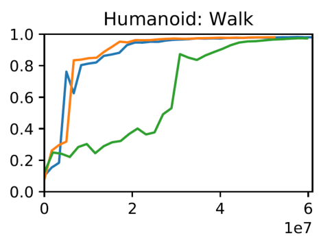

论文 Fig. 11（行走局部）。蓝RSI+ET、橙仅ET、绿仅RSI；图例沿用同一完整Fig.11，行走最终差异很小。

统计强度也要一起读。大多数技能只训练一次；补充 Fig. 12 额外给后空翻和跑步做了 3 个随机种子，每个评估点取 32 回合平均。图中的曲线帮助理解学习过程，不能自动变成所有结论都经过多种子验证。<!-- evidence:C51 -->

### 10.5 抗扰动

Table 6 的测试条件很具体：在动作周期中点向骨盆施力，持续 0.2 秒，每次按 10 牛顿增加，直到角色跌倒，分别测前向和侧向。奔跑可承受的力为 720/300 牛顿，旋踢为 690/600，后空翻为 440/100。两列分别是前向/侧向，差距体现身体姿态与受力方向的关系。<!-- evidence:C48 -->

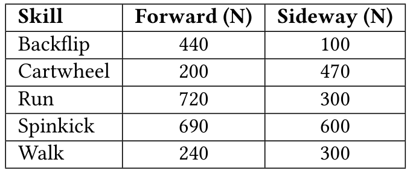

论文 Table 6。每次在周期中段对骨盆推0.2秒，每10N递增；前向和侧向分别报告。

因此，“能扛多少牛顿”得连着时刻、方向、持续时间和动作一起说。这是指定阶段的仿真脉冲测试，不是任意时刻受推的成功概率。作者训练时没有专门施加外力，推测随机策略的探索噪声贡献了很多恢复能力；论文未用单独消融确认这份贡献有多大。<!-- evidence:C49 -->

## 11 讨论：时钟、奖励和训练成本

**第一问，参考姿态怎样变成控制？** 状态与相位进入策略，策略输出关节目标朝向，PD 产生力矩，物理仿真返回新状态。参考动作持续提供相似性标准，闭环策略学会在身体偏离时调整。动作数据、控制动作和最终力矩在这条链上各有位置。

**第二问，三个训练组件分别做了什么？** 模仿奖励定义动作应该接近哪种姿态、速度和位置；RSI 让策略早期就能练到参考动作后半段；ET 减少倒地挣扎的奖励和采样占用。消融显示，这些处理对翻转类动作很关键，对走路的影响则小得多。

**第三问，实验支持到哪一步？** 它证明这套方法能在多种仿真身体上学习高动态技能，能结合目标调整动作，也能用三种明确机制组织小型技能库。投掷 93% 与 75% 的对照说明，完成目标和动作风格得分开衡量；Atlas 的重新训练说明，搬用参考并不等于直接搬用策略。<!-- evidence:C40 --><!-- evidence:C42 -->

剩下的代价都很具体。相位按时钟线性前进，身体被推歪后难以停下来等节拍；相似性奖励和权重需要人工设计，PD 增益也按身体调整。技能库规模较小，单技能训练又贵：典型人形动作约 6000 万样本，2018 年实现用 8 核 CPU 训练约两天，仿真和网络更新都在 CPU 上完成。<!-- evidence:C07 --><!-- evidence:C23 --><!-- evidence:C50 -->

从这篇论文继续往后读，我更想追问两件事：能否让动作进度跟身体状态一起调整？能否从大量动作中学到一种更通用的相似性标准，减少每条奖励的手工设计？它们分别接着 DeepMimic 的时序限制和奖励设计往下走。真实机器人还要进一步面对接触、执行器与观测误差；原文把实机部署列为后续工作。<!-- evidence:C50 -->

那次拿球跑向目标的动作，给阅读实验留下了一个问题：**看见一个漂亮分数之后，还得回头看看身体到底做了什么。**

---

继续阅读：

- [ReadPaper skill](https://github.com/Zhu-Huixiang/ReadPaper)：建立原文章节、机制笔记和待解问题。
- [DrawPaper skill](https://github.com/Zhu-Huixiang/ReadPaper/tree/main/drawpaper)：把论文机制画成可核对的架构图。

可复制地址：https://github.com/Zhu-Huixiang/ReadPaper

点击“阅读原文”，进入本文 GitHub 入口查看高清图、公式和图源：https://github.com/Zhu-Huixiang/embodied-world/tree/main/articles/deepmimic-1804.02717

---

公众号版由管理员在后台手动公开发表；永久文章链接待发表后补充。

关注公众号 **具身智能的 World**：

[原论文](https://doi.org/10.1145/3197517.3201311) · [证据索引](evidence.json)

[本篇知识星系](../../universe/papers/deepmimic.md) · [知识点宇宙](../../universe/README.md)
