# Diffusion Policy：动作也能靠去噪生成？

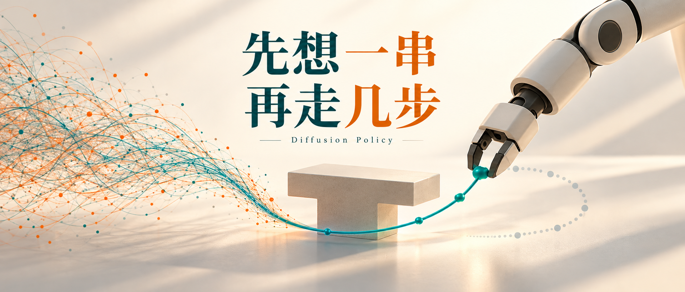

这里是「具身智能的 World」。我们从原文出发，把具身智能论文的机制、公式和证据讲明白。[GitHub 知识库](https://github.com/Zhu-Huixiang/embodied-world) 有七个入口：

- 论文解读：逐模块讲清怎么算、为什么这样算。
- 论文地图：按研究问题找到阅读路线。
- 顶会顶刊集锦：查询论文正式出处。
- 解读日程：了解接下来准备读什么。
- arXiv 新作集锦：跟进筛选后的新论文。
- 具身榜：查看评分与逐项依据。
- 知识点宇宙：让每篇论文里的概念互相连起来。

桌上一个 T 形积木，机器人想绕到下面推它。走左边可以，走右边也可以。你把两条示范都给模型，让它学一个“平均正确动作”——啪，平均到中间，直接撞上去。

模仿学习就容易卡在这儿：**答案有好几个，平均答案却可能一个都不对。** LSTM-GMM 用多个高斯分量表达选择，BET 用离散动作类别加偏移，IBC 给动作打能量分。Diffusion Policy 接着问：能否从随机噪声出发，逐渐修出一整串连贯动作，同时把训练和实际控制弄稳定？它挑战的是“每个时刻直接回归一个动作就够了”的假设，而不是否认前面这些工作知道多解存在。<!-- evidence:C01 -->

先捏住三个问题：

1. 把扩散从图像搬到动作，输入、输出和训练目标究竟改了哪里？
2. 为什么一次预测一串，却只执行其中几步，视觉和网络怎样配合？
3. 实验赢在多模态、稳定性还是闭环，哪些对照真正撑得住结论？

**论文信息**

**Diffusion Policy: Visuomotor Policy Learning via Action Diffusion**。Cheng Chi、Siyuan Feng、Yilun Du、Zhenjia Xu、Eric Cousineau、Benjamin Burchfiel、Shuran Song；哥伦比亚大学、丰田研究院、麻省理工学院。首发 2023-03-07，本文精读 arXiv v1；论文正式发表于 **RSS 2023**。RSS 是机器人学领域重视方法和系统实验的重要国际会议。<!-- evidence:C02 -->

[原文 v1](https://arxiv.org/abs/2303.04137v1) · [项目与代码入口](https://diffusion-policy.cs.columbia.edu/) · [RSS 正式出处](https://www.roboticsproceedings.org/rss19/p026.html)

**阅读目录**

- I 引言：多种正确动作，为什么不好学
- II 策略公式：扩散的对象换成动作序列
- III 关键设计：CNN、Transformer、视觉与加速
- IV 性质：多模态、位置控制、序列和稳定性
- V 仿真实验：读懂 checkpoint 与评估条件
- VI 实机实验：推积木、翻杯子、倒酱和抹酱
- VII 相关工作：它和轨迹规划是什么关系
- VIII 结论：三个问题收回来

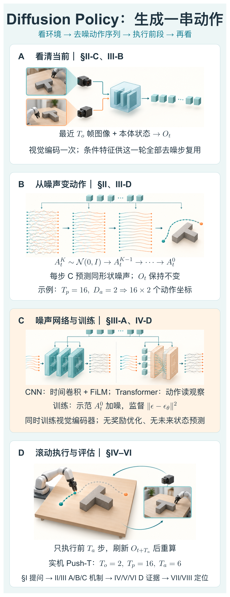

本图由 [DrawPaper skill](https://github.com/Zhu-Huixiang/ReadPaper/tree/main/drawpaper) 指挥 Codex，使用内置生图制作。

**运行从 A 出发**：相机和机器人状态先编码，得到当前观察条件；B 从一串随机动作噪声开始，每轮调用 C 的噪声网络逐渐修正；D 只执行前面一小段，然后重新看环境。**训练则从示范动作出发**：人为加噪，让 C 猜噪声，视觉编码器一起学。II 节拆 B 的数学，III 节拆 A/C，IV–VI 检查 D 的闭环与效果。这里没有“先生成未来视频、再从视频找动作”的支路。<!-- evidence:C03 -->

## I 引言：左右都能走，怎么偏偏走了中间

**多模态**在这里说的是“一种观察下，动作分布有多个高概率区域”，不是“相机加语言”那种多模态输入。同一个词，干的不是同一份活。

回归损失为什么会出事？做个教学例：同样的画面，一半示范横向动作是 −1，另一半是 +1。最小均方误差的单点预测是 0。数学上没毛病，桌子上可能就撞了。高斯混合模型可以放多个峰，离散动作也能分多个类别；可一旦连续预测很多步，还得保证前后选择相容。上一帧向左，下一帧向右，机器人当场开始“左右脑互搏”。<!-- evidence:C04 -->

Diffusion Policy 想同时处理两件事：让动作有多种合理答案，也让一串动作里别老换主意。总图 **B** 的输出因此是一段序列，不是一个孤零零的命令。

## II Diffusion Policy Formulation：扩散对象变了

### A 与 B：先把两个“时间”分清

t 是机器人真实控制时刻；k 是一次动作生成内部的去噪迭代。**机器人还没有动，网络里就可以已经算完很多个 k。** 这俩钟不能混着看。

oₜ 是当前观察，Oₜ 是最近 Tₒ 个时刻的观察集合；Tₒ 称观察窗口。aₜ 是一个动作向量，维度 Dₐ；Aₜ 是预测动作段，Tₚ 表示预测长度。Tₐ 是真正执行的步数。上标 0 表示干净动作，上标 K 表示去噪起点，千万别把 Aₜᴷ 看成机器人第 K 秒。<!-- evidence:C05 -->

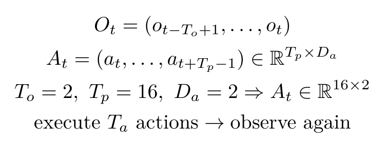

以二维末端位置为教学例，Tₚ=16、Dₐ=2，网络一次处理 **16×2** 个数：每一行是一个未来控制点，每一列是 x 或 y。别的任务可能有旋转、夹爪或双臂，Dₐ 会跟着动作定义变。它没有把所有机器人都硬塞成同一种维度。

训练先从示范中抽一个干净动作段 Aₜ⁰，选随机噪声等级 k，再加入同形状高斯噪声 ε。下面用标准 DDPM 的缩放写法展开原文 Eq. 3/5 的加噪监督：ᾱₖ 表示各步保留系数的累积乘积，θ 是噪声网络参数。<!-- evidence:C06 -->

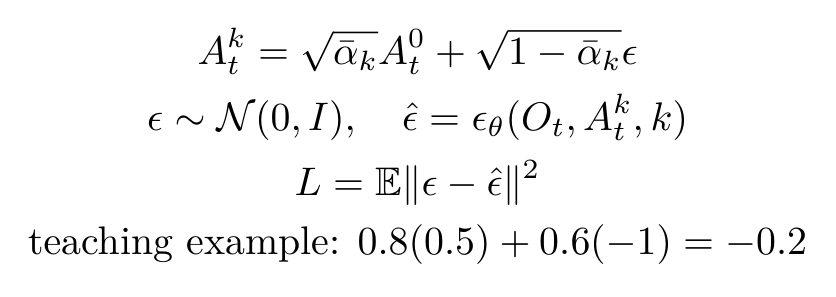

网络预测 ε̂，形状仍是 Tₚ×Dₐ。损失比较预测与真实噪声，平方误差对动作位置和数据样本汇总。例子中干净归一化动作值 0.5、ᾱₖ=0.64、噪声 −1，带噪值为 −0.2；目标仍是预测 −1。这个例子展示计算，不是某次机器人实验轨迹。

训练时它见过不同 k 的破坏程度，推理才有机会一层层把噪声“捋顺”。**行为克隆**就是从示范学习策略；本篇没有用奖励函数再训练一个在线强化学习代理。

### C：推理怎样从噪声走到动作

总图 **B** 每一步干的事，对应原文 Eq. 4：

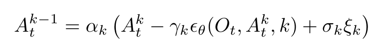

这里 αₖ、γₖ、σₖ 是随去噪等级变化的调度系数，分别参与缩放、噪声预测修正与随机扰动；ξₖ 是标准高斯随机量。**这组 αₖ 是原文反向更新记法，不要和上一式 ᾱₖ 的前向累积保留系数直接当同一个数。**

从 Aₜᴷ 的随机值开始，网络看着当前 Oₜ 和噪声等级 k，预测该往哪里修。循环结束得到动作段 Aₜ⁰。不同随机初始化可以落到不同的合理动作模式，于是“绕左”和“绕右”都有机会被生成。扩散不是把两种路线都走一遍，而是采样得到一条具体路线。

### 只生成动作，观察留在旁边当条件

原文选择 p(Aₜ｜Oₜ)，即**给定观察时的动作分布**。它没有联合生成观察与动作 p(Aₜ,Oₜ)，也不在这一步预测未来物体状态。这样视觉编码只需为当前规划调用一次；后面的多轮去噪反复读取同一份特征，少做了很多重复看图的计算。<!-- evidence:C07 -->

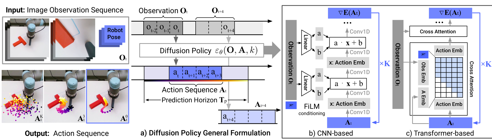

论文 Fig. 3。先看要点：**观察条件固定，动作噪声被反复修，执行完一段再刷新观察。** 左侧图像是条件输入，下面不同噪声程度的轨迹表示动作序列逐渐成形。中间时间轴标出观察窗口、预测窗口与执行部分；右侧 b/c 是两种替代的去噪网络，不是必须串联经过的两站。

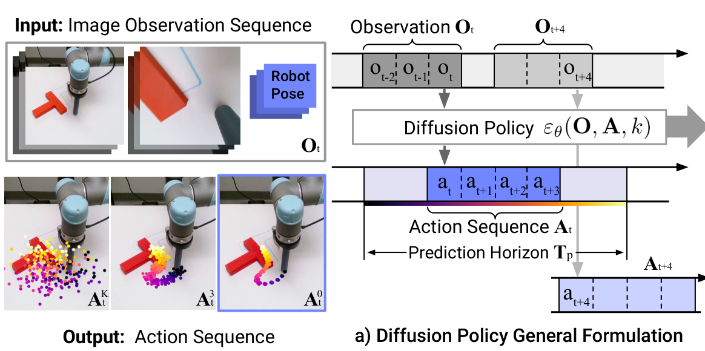

论文 Fig. 3 局部。灰块表示已有观察，淡色长条是整个预测范围，深色短段才是真正执行的动作。上方时间轴从 t 走到 t+4，是图中的示意；下一轮得到新的 O，再预测下一段。论文具体任务的 Tₐ 并不都等于 4。

这叫 **滚动时域控制**：先想一段，只走前面几步，再根据新观察重算。像开车不能只盯车头一厘米，也不能闭眼把导航路线一口气开完。预测长度和执行长度因此值得分开。

## III Key Design Decisions：好用不只靠扩散二字

### A 网络架构：CNN 和 Transformer 各干什么

总图 **C** 有两条候选路。**一维时间卷积 CNN** 沿动作序列时间轴聚合局部信息。输入是带噪动作段，输出还是这段动作的噪声估计；下采样、上采样和多层卷积帮助表达不同时间尺度。观察和去噪等级通过 **FiLM，特征线性调制**，送入卷积网络。<!-- evidence:C08 -->

F 是某层 T×C 的时间特征，T 为该层序列长度、C 为特征通道；c 是观察和 k 形成的条件表示，γ(c)、β(c) 各有 C 个数。i 是时间位置，j 是通道：

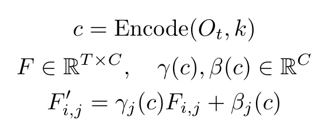

给每个通道配一个“音量旋钮”和“偏移旋钮”，同一条件下在时间位置间共享。它并不是把原始图片每轮都重新卷一遍；图像特征已经在总图 A 算好。

另一条是 **时间序列扩散 Transformer**：动作沿时间变成 token，k 经正弦嵌入进入序列，观察经共享 MLP 变成条件 token。动作 token 通过自注意力交换信息，通过交叉注意力读取观察；每个输出 token 对应一个时刻的噪声预测。原图还使用因果 mask，让动作位置只看自己和前面的位置。<!-- evidence:C09 -->

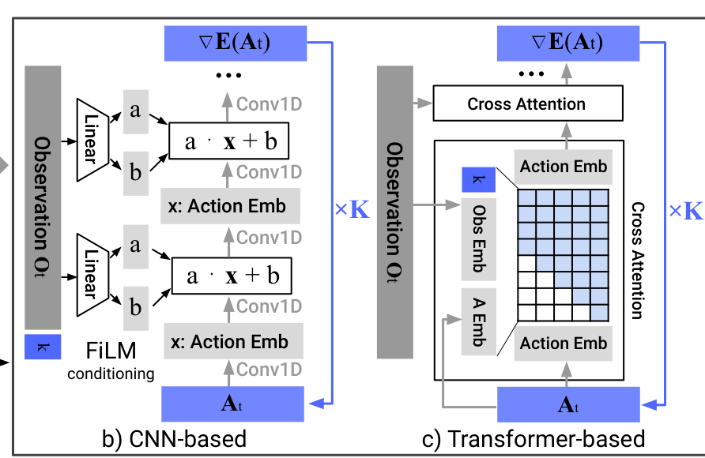

论文 Fig. 3 局部。b 左路里，观察与 k 从侧面生成 a、b，施加 a·x+b；竖向卷积堆栈在时间维处理动作。c 右路里，动作嵌入先做带 mask 的注意力，观察嵌入经 cross-attention 输入。蓝色回环和 ×K 表示同一个噪声预测器反复调用，**不是堆了 K 套不同权重网络**。

把单个交叉注意力头拆开：动作提供查询 Q，观察提供键 K 和值 V，d 表示这个头的通道宽度。若观察按 Tₒ 个时刻聚合成 token，则权重表是 Tₚ×Tₒ，输出每个动作位置读到的条件内容。<!-- evidence:C10 -->

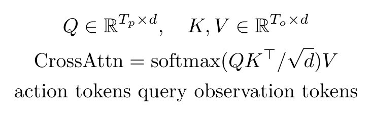

这张式子是基本计算教学，前面的 k token 和具体多头拼接在实现里另算。附录给出的实机 Push-T Transformer 是 **8 层、嵌入宽度 768**。不过论文并没有得出“Transformer 版本处处更强”：状态任务里它常表现好，视觉实机里 CNN 加端到端视觉编码器更稳。CNN 对时间信号的平滑偏好可能损伤快速变化的速度动作，Transformer 又更挑超参数。工具箱多一个扳手，拧螺丝时还是得挑合适的。<!-- evidence:C11 -->

### B 视觉编码：空间信息别一口吞掉

视觉编码器用未预训练的 ResNet-18，不同相机各有编码器，同一相机的各时刻分别编码后组合；还接上机器人本体状态。两个细节值得抄笔记：用 spatial softmax 代替全局平均池化，保留“特征出现在哪里”的信息；用 GroupNorm 代替 BatchNorm，让训练与指数滑动平均参数配合得更稳定。<!-- evidence:C12 -->

**空间 softmax**可以想成在一张特征热图上算关注位置；全局平均池化更像只问“这个特征总体有多少”。推积木时，知道积木在左边还是右边，显然比只知道“有积木”更有用。

### C 与 D：调度、归一化、推理加速

动作各维先按训练数据范围缩到 [−1,1]，避免不同单位和范围抢梯度。aⱼ 是第 j 维原动作，aⱼᵐⁱⁿ/aⱼᵐᵃˣ 是这维边界，ãⱼ 为归一化动作：<!-- evidence:C13 -->

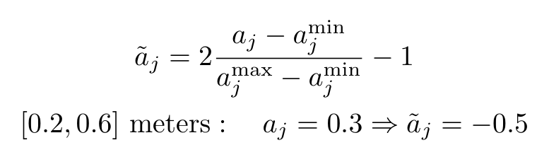

教学例中 0.2–0.6 米映射到 [−1,1]，0.3 米变成 −0.5。近乎常量的维度不能暴力除一个快接近零的范围；原文对这类维度只移中心，对旋转表示另行处理。位置控制使用连续的 6D 旋转表示，物理姿态的自由度和网络里表示姿态的数字个数，也要分清。

噪声采用平方余弦调度。实际控制时用 DDIM 减少网络调用：它让训练噪声等级数与采样迭代数不必一样。**本文附录实机配置为训练 100 级、推理 16 次**；实机 Push-T 的 Tₒ=2、Tₚ=16、Tₐ=6，倒酱和抹酱的 Tₐ=8。<!-- evidence:C14 -->

先把短段执行出去，网络才有机会赶在下一次规划前算完。延迟不是藏在模型外面的脚注，它会直接决定闭环多久看一次世界。

## IV Intriguing Properties：哪一步解决哪种毛病

### A 多模态：能选，也要选定

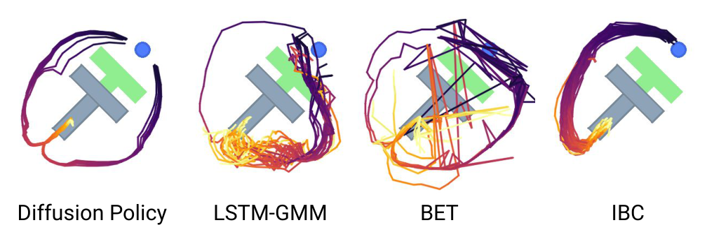

论文 Fig. 4。先看它想回答的事：面对同一个 T 块位置，策略能否产生左右两种可行绕行，并在一次 rollout 里保持路线一致？蓝点是末端，轨迹展示连续 40 步。四列是 Diffusion Policy、LSTM-GMM、BET、IBC；没有统计坐标轴，这是平面路径可视化。看左右两簇是否都有，再看单条路径是否反复横跳。Diffusion Policy 展现两种模式并保持一条路线，BET 的例子则暴露时间一致性问题。<!-- evidence:C15 -->

这里好笑的地方在于：每一步都“重新做最优选择”，合起来却可能特别没主意。**联合生成一段**让相邻动作一起参与建模，比给单步采样器反复抽签更容易保持连贯。

### B 与 C：位置控制和执行长度

作者观察到位置命令特别适合这种分段预测。位置命令告诉控制器“目标在哪”；速度命令告诉它“这会儿朝哪走多快”。速度误差随执行累积，时延也会改变实际走出的距离。论文对原因的解释是推测，实证主要看切换动作空间后的表现和延迟消融。<!-- evidence:C16 -->

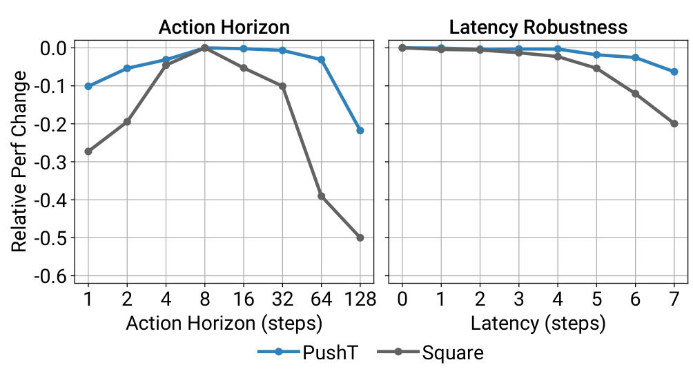

论文 Fig. 6。**执行段太短，连贯性不够；太长，又来不及反应。** 左图横轴是 Tₐ，即 action horizon，依次 1、2、4…128；纵轴是相对该任务最好表现的差值，0 为最好，负值越多下降越大，绝不是原始成功率。蓝色为 Push-T，灰色为 Square。中间区间较好，到长段时 Square 尤其明显下降。<!-- evidence:C17 -->

右图横轴为人为引入的延迟步数，纵轴同样是相对表现差值。图中两任务在短延迟下较稳，到更大延迟才下降。原文概括可承受约 4 步，但这属于所测任务与位置控制设置，不能拿去给所有机器人统一签“延迟免责条款”。

### D 训练稳定：为什么不用给动作能量做归一化

IBC 的能量模型为每个动作赋 Eθ(o,a)，能量越低概率越高。要成为概率分布，得除以归一化常数 Z(o,θ)。这个常数要把所有可能动作的权重汇总，连续高维空间里很难直接算。训练需要负样本近似，采样不准就可能添乱。<!-- evidence:C18 -->

Diffusion Policy 关注的是 **score，概率对动作的对数梯度**：从当前动作朝哪个方向挪，更像数据里的动作？符号 ∇ₐ 表示对动作 a 求梯度。Z 不依赖 a，求导后消失。

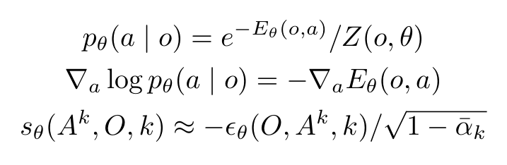

最后一行补出标准高斯加噪下，噪声预测与 score 的尺度关系；sθ 是 score 估计。它不是“把噪声原样取个负号，在所有 k 上就一样大”。这个缩放由噪声等级决定。

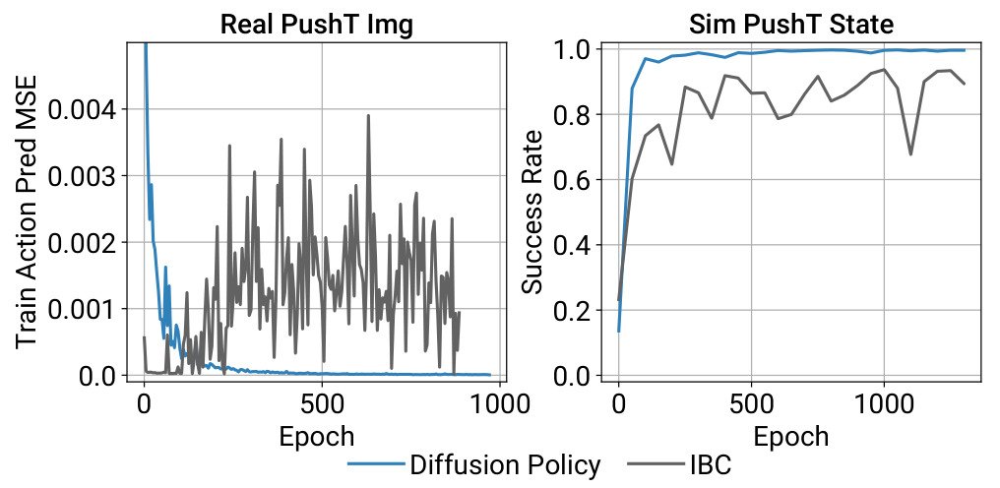

论文 Fig. 7。左图横轴 epoch，纵轴**动作预测 MSE**，不是两种模型各自训练损失的直接比较。蓝色 Diffusion Policy 的动作误差趋于降低，灰色 IBC 反复波动。右图横轴仍为 epoch，纵轴仿真 Push-T rollout 成功率；蓝色较平稳，灰色波动使 checkpoint 难选。它解释了为什么论文不只给最佳 checkpoint，还专门算最后十个的平均。

## V Evaluation：先把斜杠看懂

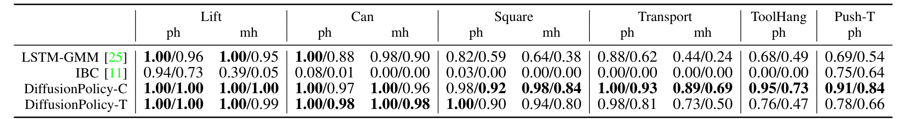

论文 Table II。各列为视觉输入的任务与示范类型，PH 是熟练操作者示范，MH 是多操作者示范。每格写成 **最佳 checkpoint／最后十个 checkpoint 平均**。评估覆盖 3 个训练随机种子、每个 50 种环境初始条件；最后十个合起来对应 1500 次评估。数字越大越好，但 Push-T 采用目标覆盖，不能把整个表每格都叫二元成功率。<!-- evidence:C19 -->

拿视觉 **Transport-PH**：DiffusionPolicy-C 是 **1.00／0.93**，LSTM-GMM 是 **0.88／0.62**。最佳成绩差 0.12，末十平均差 0.31，二者回答的是不同问题。视觉 **ToolHang-PH**，CNN 扩散是 **0.95／0.73**，LSTM-GMM 为 **0.68／0.49**。<!-- evidence:C20 -->

把末十平均单独摘出来，手机上更容易比较：

| 视觉任务，PH | CNN 扩散 | LSTM-GMM |
| --- | --- | --- |
| Transport | 0.93 | 0.62 |
| ToolHang | 0.73 | 0.49 |

数据取论文 Table II，均为三种子、50 初始条件、末十 checkpoint 平均。

论文让各方法使用各自较好的动作空间：Diffusion Policy 多用位置，基线多用速度。因此这是整套策略配置的比较；位置控制的单独作用，要回到前面的消融。视觉表里 Transformer 在 ToolHang 的末十平均只有 **0.47**，CNN 为 **0.73**，也再一次提醒我们：不是把网络名换成长一点就自动赢。<!-- evidence:C21 -->

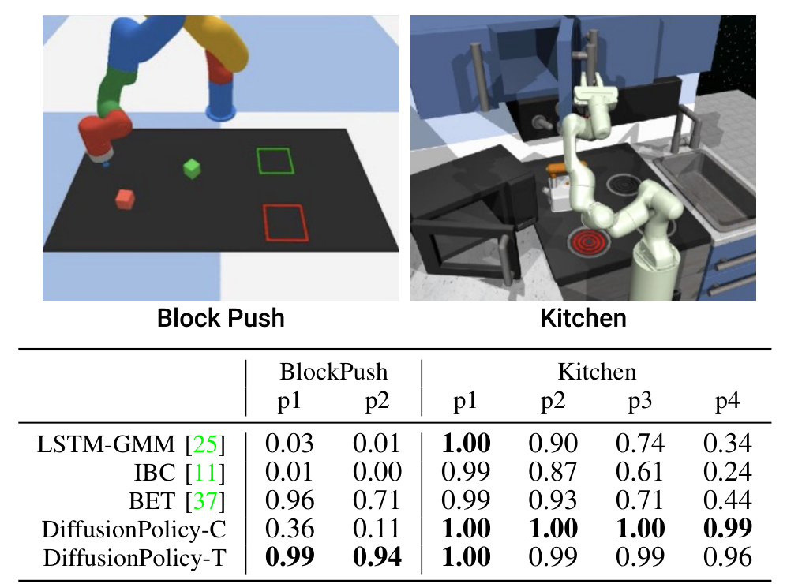

论文 Table IV。BlockPush 的 p2 表示两块都推到目标的频率；Kitchen 的 p4 表示至少完成四个交互的频率。两边都叫 p，但任务完成标准不同。BlockPush p2，Transformer 扩散 **0.94**、BET **0.71**；Kitchen p4，CNN 扩散 **0.99**、BET **0.44**。它们检查的是多阶段顺序选择，不只是单步动作抖不抖。<!-- evidence:C22 -->

论文摘要的平均增幅很显眼，但真正决定你能否借鉴的，是任务、指标、动作空间和 checkpoint 的这几层条件。把它们拆开，比背一句“提升多少百分比”更有用。

## VI Realworld Evaluation：到了桌上，还能不能顺手

### A Push-T：推到位之后，还得会收手

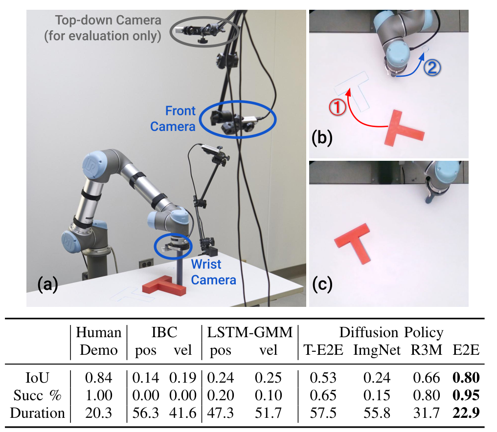

论文 Table V。a 是 UR5 硬件，相机分为前视、腕部和仅用于评估的俯视；b 先推积木到目标再移入结束区；c 是用于测 IoU 的终态。**IoU，交并比**，就是目标区域与积木区域的交集面积除以并集面积。最后一刻还遮着评估相机、或者过早收手，都可能影响结果。<!-- evidence:C23 -->

使用 **136 条示范**、每种方法 **20 次相同初始条件**测试，CNN 扩散加端到端视觉的成功率 **0.95**，平均 IoU **0.80**；LSTM-GMM 最好成功率 **0.20**，IBC 为 **0**。成功阈值按人类示范里的最低 IoU 设定。这里 95% 对应 19/20 次，样本量要和百分比一起记。<!-- evidence:C24 -->

同表还有一组很实在的视觉比较：扩散用 ImageNet 预训练特征为 **0.15**，R3M 为 **0.80**，端到端训练为 **0.95**。这个任务里，看得准和动作生成同样要紧；并非拿来一个视觉预训练模型，就能省掉任务适配。<!-- evidence:C25 -->

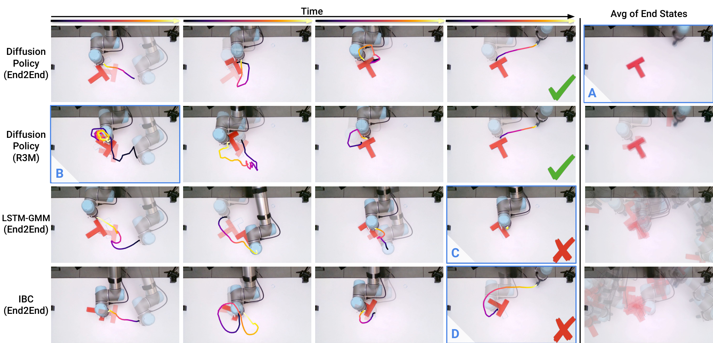

论文 Fig. 8。横向按关键时刻推进，纵向是不同策略；最右列把终态图像平均叠加，越集中表示结束位置越一致。第一行端到端扩散推准后退出；第二行 R3M 扩散有停顿但能恢复；第三行 LSTM-GMM 困在微调阶段；第四行 IBC 提早结束推动。彩线是动作轨迹，勾叉标任务结果，不是注意力热图。

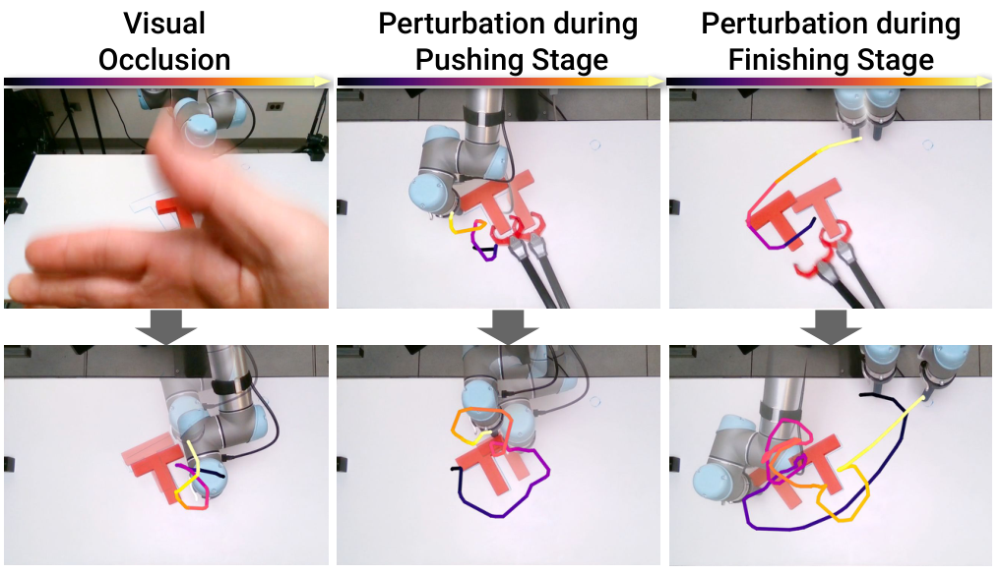

论文 Fig. 9。三列分别测试遮挡视野、推动过程中挪积木、准备退出时再挪积木；每列上下是干扰与后续反应。最后一列最能解释总图 **D**：机器人已经准备收工，看见目标又偏了，重新回去调整。这里展示的是单独干扰回合的行为证据，不把它并入上面那 20 次成功率。

### B 翻杯子：抓住只是第一步

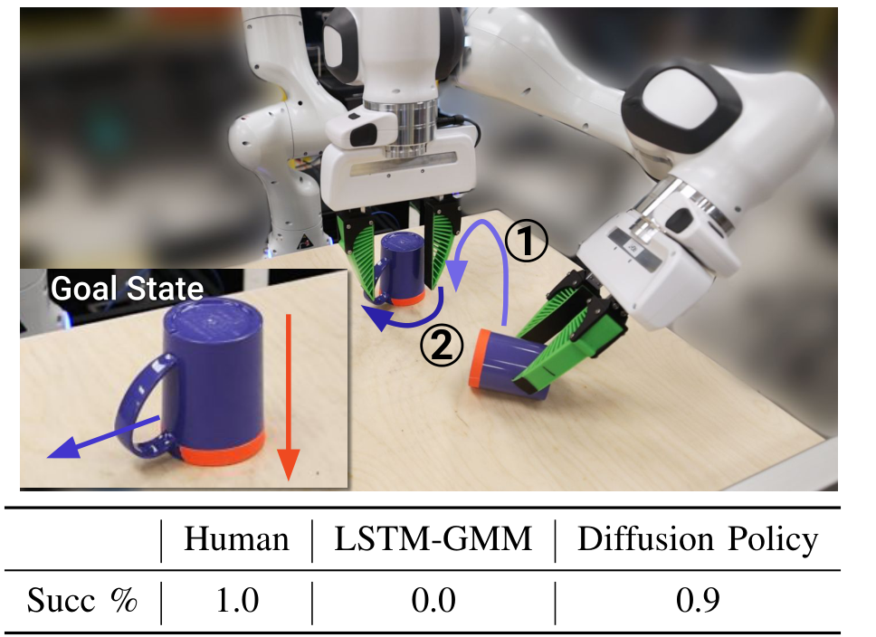

论文 Fig. 10。箭头 ①要求杯口朝下，②要求杯柄朝左；底部小图示目标姿态。动作既可能直接抓放，也可能借推杯柄补旋转。Diffusion Policy 在 **20 次试验中成功 18 次**。对照 LSTM-GMM 使用同一数据的一个子集，20 次均未成功，所以这项对比带着训练数据范围差异，不能当严格等数据的单因素消融。<!-- evidence:C26 -->

### C 倒酱和抹酱：该停的时候得真停

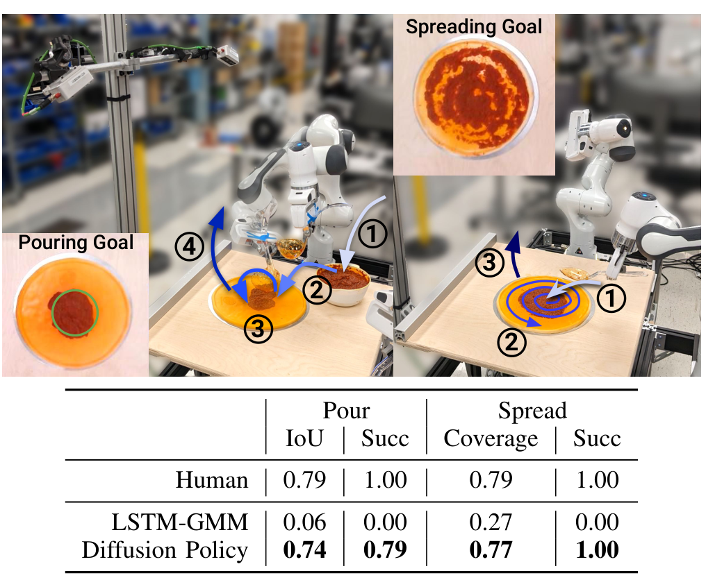

论文 Fig. 11。左边按数字看：舀酱→移到面饼中心→倒出→抬起结束。右边是到酱上方→按螺旋摊开→抬起。倒酱用实际酱区与目标圆的 IoU，抹酱用面饼覆盖率，表头是两个指标，别混称一个“覆盖率”。扩散的倒酱 IoU 为 **0.74**，人类为 **0.79**；抹酱覆盖 **0.77**，人类 **0.79**。<!-- evidence:C27 -->

黏稠番茄酱装满勺需要等一会儿，示范里自然有不动的片段。若把停顿全部过滤掉，训练数据反而错了；若单步策略把“停着”学成最保险选择，又会一直停。预测动作段的价值在这里很具体：一段轨迹既能包含等待，也能包含等待后的抬勺。

最后别漏掉真正接触硬件的那层：UR5 的策略命令频率为 10Hz，经插值送入 125Hz 控制；Franka 还有中层运动学控制器，约 1kHz 处理关节、碰撞和区域等约束。**扩散输出目标，不会顺手替你完成全部底层安全控制。**<!-- evidence:C28 -->

## VII Related Work：它不是偷偷长了个世界模型

按原文顺序，相关工作放在后面。显式策略直接输出动作或动作分布；隐式策略以能量表示哪些动作好；扩散逐步修出分布里的样本。此前 Diffuser 等工作把扩散用于轨迹规划，Diffusion Policy 则集中在示范学习的视觉运动策略上，用观察条件生成动作，并靠滚动执行接回真实环境。<!-- evidence:C29 -->

所以，你在它的结构里找不到显式未来状态预测器、接触动力学模型或在线搜索奖励。它能表现出连续的纠偏，是观察刷新后重新生成动作的闭环效果。要研究世界模型如何进一步帮它，应当从“额外预测能改善哪个失败条件”开始，而非看到一串未来动作就把世界模型的帽子扣上去。

## VIII Conclusion：三个问题回到手上

**第一，扩散搬到动作，改了什么？** 数据对象是 Tₚ×Dₐ 的动作段，当前观察作为条件，训练预测人为加入的噪声；采样输出一个具体的连贯动作方案。目标是示范动作分布，监督不是环境奖励。

**第二，为什么想一串、只走几步？** 长一点的预测能组织前后动作，短一点的执行让新观察及时介入。视觉编码一次，多轮去噪复用；CNN 与 Transformer 是噪声网络候选，具体任务选择比名字更重要。

**第三，实验支撑哪一部分？** 路径图展示多种模式与一致性，执行长度/延迟消融检查反馈取舍，checkpoint 曲线检查训练稳定；仿真和实机表再看最终任务表现。多条证据连起来，才是这篇的说服力。

我更想顺着它继续问：如果接触突然变化，六步执行里剩下的命令要不要立刻作废？如果计算越来越贵，能否一边执行一边更新尚未发生的动作？这不是给“扩散”两个字再加光环，而是把它放回机器人最朴素的难题：**世界已经变了，你手上那份计划还来得及改吗？**

精读使用 [ReadPaper](https://github.com/Zhu-Huixiang/ReadPaper)，架构整理使用 [DrawPaper](https://github.com/Zhu-Huixiang/ReadPaper/tree/main/drawpaper)。点击“阅读原文”可看 GitHub 解读、高清原图和公式源文件。可复制地址：https://github.com/Zhu-Huixiang/ReadPaper

---

公众号版由管理员在后台手动公开发表；永久文章链接待发表后补充。

关注公众号 **具身智能的 World**：

[原论文](https://arxiv.org/abs/2303.04137v1) · [证据索引](evidence.json)

[本篇知识星系](../../universe/papers/diffusion-policy.md) · [知识点宇宙](../../universe/README.md)
