# DINO：没人教它认狗，注意力却把狗圈了出来？

这里是**具身智能的 World**。我们把机器怎样看、怎样学、怎样动，拆到机制、公式和实验里讲。

**论文解读**：看懂架构、计算与证据。

**论文地图**：沿科学问题找到阅读路线。

**顶会顶刊集锦**：直达正式论文与原文。

**解读日程**：看看接下来准备读什么。

**arXiv 新作集锦**：筛选值得跟进的新研究。

**具身榜**：比较分数，也比较分数背后的依据。

**知识点宇宙**：顺着概念与论文之间的联系继续逛。

仓库：[Zhu-Huixiang/embodied-world](https://github.com/Zhu-Huixiang/embodied-world)。

训练时没有“这是一只狗”的标签，更没人拿画笔把狗的轮廓描一遍。训练完打开注意力图，咦，狗的区域亮了。

DINO 让人想点进去的，就是这个画面。问题马上就来了：**两个起初都不会认图的网络，一个当学生，一个当老师，互相追着学，怎么没有一起糊弄过去？**

它挑战的是一个很具体的预训练假设：图像级分类标签已经足够把视觉骨干训练好。作者想看，自监督训练是否会让 ViT 长出另一种表示——不只整图类别容易分开，内部还能保留物体与场景的空间组织。对比对象包括监督 ViT，以及当时的 MoCo v2、BYOL、SwAV 等自监督路线。<!-- evidence:C01 -->

带着三个问题读：

1. 老师没有事先学过，学生到底跟谁学，训练信号从哪来？
2. 两边都输出同一个答案就能交差，DINO 怎样挡住这种“集体摆烂”？
3. 注意力圈出物体、近邻分类很准，究竟分别说明了什么，又要付出多少计算？

**论文信息**：*Emerging Properties in Self-Supervised Vision Transformers*；Mathilde Caron、Hugo Touvron、Ishan Misra、Hervé Jégou、Julien Mairal、Piotr Bojanowski、Armand Joulin。团队来自 FAIR、Inria、索邦大学等，详细署名见原文首页。2021 年 4 月首次公开，发表于 ICCV 2021；本文以 CVF 正式主文为准，投影头和评估细节对照 arXiv v2 附录。ICCV 是计算机视觉主会。原文：[CVF](https://openaccess.thecvf.com/content/ICCV2021/html/Caron_Emerging_Properties_in_Self-Supervised_Vision_Transformers_ICCV_2021_paper.html)；代码：[facebookresearch/dino](https://github.com/facebookresearch/dino)。<!-- evidence:C02 -->

**阅读目录**

- 1 引言：分类标签之外，视觉还该留下什么
- 2 相关工作：从对比学习走到自蒸馏
- 3 方法：两路网络、跨视图交叉熵与慢老师
- 4 主要结果：分类、检索、物体区域和迁移
- 5 消融：哪些零件真不能少
- 6 结论：三个问题收回来

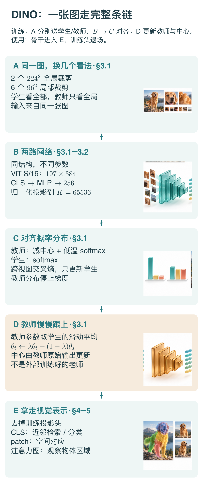

本图由 [DrawPaper skill](https://github.com/Zhu-Huixiang/ReadPaper/tree/main/drawpaper) 指挥 Codex，使用内置生图制作。

先抓闭环。**A** 从同一图片裁出不同视图；**B** 两路网络各自编码；**C** 让学生跨视图匹配教师分布，梯度只改学生；**D** 用学生参数的滑动平均更新教师，同时维护输出中心。训练结束，拿走骨干去 **E** 做检索、分类与空间分析。第 3 节拆 A—D，第 4 节看 E 究竟留下什么，第 5 节拆零件检验因果。图上的上下排列是阅读顺序，D 的参数更新会回到 B，不是一条只向前走的流水线。

## 1 引言：分类标签之外，视觉还该留下什么

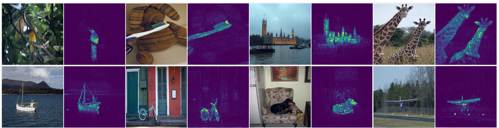

论文 Fig. 1：每张原图旁边是对应的末层注意力图，先看物体区域是否比背景更集中。

这张图没有横纵数值轴。它把鸟、鞋、建筑、长颈鹿、船等案例与彩色热图成对摆放。热图来自 **ViT-S/8 末层的 CLS token 对图块的注意力**：CLS 可以理解成负责汇总整图信息的一张额外卡片，颜色亮的地方表示该注意力分布给了更大的权重。<!-- evidence:C03 -->

先别急着说“机器懂狗了”。这里最清楚的观察是：**没有像素级标注的训练，也能让某些注意力头把权重集中到物体区域。**狗是什么品种、下一秒往哪跑、机器人应该怎么抓，都不是这张热图回答的问题。

为什么分类监督可能没有把这些东西留下来？因为“这张图是狗”只要求一个整图答案。网络找到一个足以分类的局部线索，就可能完成任务。自监督若要求不同视图的表示一致，局部和整体之间的关系就成了训练要反复处理的内容。这是作者研究的动机，机制是否成立，要继续看训练和消融，不能只凭首页几张好看的图下结论。

## 2 相关工作：从对比学习走到自蒸馏

对比学习常把同一图像的两个增强视图当正对，让它们靠近；同时借助其他图像，让表示别全部挤到一个地方。BYOL 等方法提示：没有显式负样本，也能学表示，但两路网络怎么更新、怎样避免坍塌，需要仔细设计。

**蒸馏**原本像让学生学老师的软答案。老师给出的不是一个硬类别，而是整个分布：第一种解释很像，第二种也有点可能。DINO 把这个想法搬进没有类别标签的训练里，而且老师不是从外部请来的“满级大佬”。它由学生参数的历史平均构成。<!-- evidence:C04 -->

这听起来有点像自己给自己补课。真正有用的部分却不是口号：两路看见的裁剪不同，输出处理不同，更新方式也不同。**这种不对称，配上图像增强，才给“互相学”安排了具体任务。**

## 3 方法：两路网络、跨视图交叉熵与慢老师

### 3.1 A 区：大图看整体，小图追整体

一张输入图 x 生成一个视图集合 V。默认多裁剪方案包含两个 224×224 的全局视图，以及六个 96×96 的局部视图。全局、局部指裁剪覆盖原图的相对范围，再各自缩放到这些输入尺寸。两个全局视图记作 v₁ᵍ、v₂ᵍ。<!-- evidence:C05 -->

教师只看两个全局视图，学生看全部八个。于是学生拿到一小片狗毛或半张狗脸，也要给出与教师较完整视图一致的表示分布。注意，“一致”不是让所有像素对应起来；对齐的是训练头输出的概率向量。

裁剪也可能丢掉关键对象，所以这个任务不是每次都完美干净。它通过大量增强样本，让特征倾向于抓住在不同视图里仍有联系的内容。A 区决定了训练要求模型对哪些变化保持稳定。

### 3.2 B 区：骨干负责看，投影头负责训练对齐

学生参数叫 θ_s，教师参数叫 θ_t，两者结构相同，参数各有一份。将骨干记作 f，训练投影头记作 h，组合 g=h∘f。下标 s、t 分别表示学生和教师。

以 ViT-S/16 的全局输入为例：224 图像切成 196 个 16×16 图块，加 CLS 后是 197 个 token；每个隐藏向量 384 维，12 个 Transformer 层、每层 6 个注意力头，每头 64 维。局部 96 输入是 36 个图块加 CLS，即 37×384。<!-- evidence:C06 -->

骨干里，每层先让各图块用注意力交换信息，再用 MLP 做通道变换，带归一化和残差。经过最后一层，取出 CLS 的 384 维表示送进投影头。**训练用的投影头不等于下游分类头。**

附录把这个小头写得很清楚：三层 MLP，隐藏层宽度 2048，末层输出 256 维；做 L2 归一化，即除以向量自身长度；然后通过权重归一化的线性层，输出 K=65536 个分数。ViT 这条路线的投影头不使用 batch normalization。<!-- evidence:C07 -->

65536 看着唬人，但它不是 ImageNet 的类别数，也没有预先规定“第 138 格是柯基”。这些维度是训练中形成的输出坐标。评估图像表示时，通常拿走 h，用 f 留下的特征。

### 3.3 C 区：把分数变分布，再跨视图对答案

g_s(v) 与 g_t(v) 是某个视图 v 的 K 维分数。softmax 把分数转成和为 1 的概率；温度 τ 控制分布的尖锐程度。温度越小，相同分差就越容易变成悬殊的概率。

教师输出还要减去一个 K 维中心向量 c。c_k 是第 k 个输出维度的历史平均水平。学生温度记 τ_s，教师温度记 τ_t；上标 (k) 表示向量的第 k 个元素。

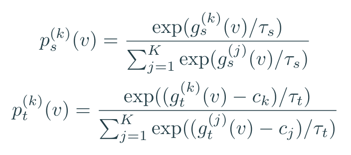

论文 Eq. 1 的学生分布，以及结合中心化操作展开的教师分布。

学生默认温度是 0.1。教师从 0.04 开始，在前 30 个 epoch 逐步升到 0.07。教师更尖的分布给学生比较明确的方向；中心化则压住那些长期无论什么图都特别高的输出维度。<!-- evidence:C08 -->

接下来用交叉熵。给定教师分布 p_t 和学生分布 p_s，H 衡量学生是否把概率分给了教师看重的位置。sg 表示 stop-gradient：把教师答案视为这一步的固定目标，不沿着它反向传播。

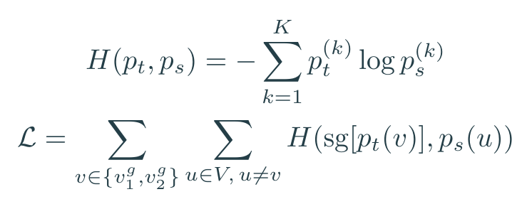

论文 Eqs. 2–3 的训练关系；外层遍历两张教师全局视图，内层遍历学生视图，排除与教师完全相同的那张裁剪。

八个学生视图、两个教师视图，排除两个同视图配对，合计 14 个跨视图方向。这里写的是论文求和形式，实际实现按参与配对求平均，不改变“谁跟谁对齐”的关系。

给一个只有三维的教学例子。老师给 [0.8,0.1,0.1]，学生若平均分配 [1/3,1/3,1/3]，交叉熵约 1.099；学生改成 [0.7,0.2,0.1]，降到约 0.677。自然对数 log 在这里给出损失单位。<!-- evidence:C09 -->

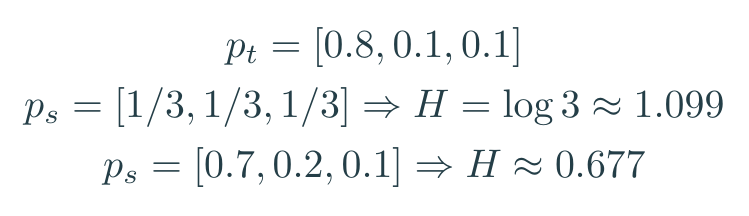

三维教学计算；真实训练头有 65536 维。

学生不是只复读第一名，它要调整整份分布。教师第二、第三项都给 0.1，学生把第三项完全压到零，同样会挨罚。

### 3.4 D 区：老师慢一点，训练才有个相对稳的目标

学生拿损失梯度更新，教师不吃这条梯度。教师参数用指数滑动平均：旧教师占 λ，新学生占 1−λ。λ 从 0.996 逐步趋近 1。中心 c 则用教师原始输出的批平均更新，中心动量记为 m。B 在下面公式中是参与中心统计的教师样本数，**不是 ViT-B 的 B**。<!-- evidence:C10 -->

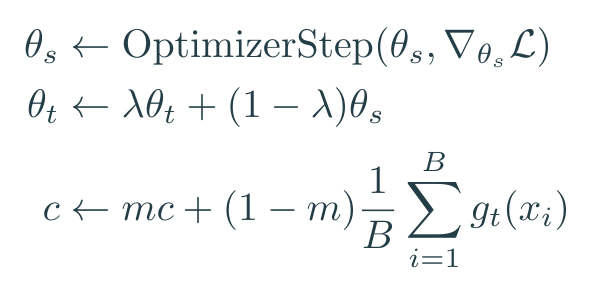

论文 Eqs. 4–5 与优化步骤合并展示；θ_s、θ_t 是参数，c 是输出统计，三者不要混成同一个“平均”。

拿一维参数作例子：旧老师是 2，新学生是 3，λ=0.996，更新后老师是 2.004。它会跟，但不猛拐。很多次更新累积起来，老师成为学生不同训练时刻的平滑版本。

这里有三条不同的线：输入图像流向两路网络；损失梯度只流向学生；参数平均从学生流向老师。架构图 D 特意把第三条单列，就是防止“教师也跟学生一起最小化损失”这个误读。

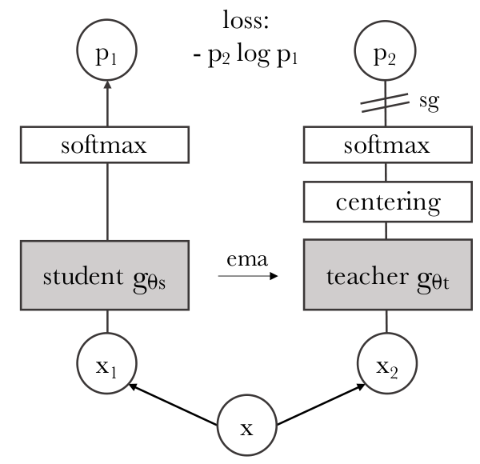

论文 Fig. 2：从底部 x 分成 x₁、x₂ 向上读，左右网络之间的 ema 是参数平均，不是把图片传过去。

左路 student 经 softmax 得 p₁；右路 teacher 先 centering，再 softmax 得 p₂；顶部计算交叉熵。sg 标在教师分布旁边，提醒这一侧停止梯度。这张原图只画一对视图帮助理解，真正训练的多裁剪关系是前面 A 区的两全局加六局部。

### 3.5 两个人都交白卷，损失也能很小，怎么办

如果所有图像都输出同一个分布，跨视图一致性照样可以满足。这个退化叫**表示坍塌**：看狗、看车、看桌子，结果都一样。配对很和谐，表示却没用了。

中心化与锐化在这里有一种有意安排的拉扯。某个维度总是偏高，中心化会减掉它的公共偏置，抑制“一格独大”；但它也可能把分布推得过于平均。低温锐化又把单个样本的分布变尖，抵抗“每格都差不多”。再加上更新较慢的教师，目标不会跟着学生当下的波动乱跑。<!-- evidence:C11 -->

这不是单靠一句“有老师就不会崩”保证的。后面拆掉动量、换掉损失，结果会立刻给脸色看。先把机制解释当作理解设计的线索，再用消融检查它有没有撑住。

## 4 主要结果：分类、检索、物体区域和迁移

### 4.1 最普通的分类，读出方式却要分清

训练没有类别标签，评估当然还要知道什么叫答对。DINO 用线性分类和 k 近邻两种读出方式。两者都会用带类别信息的评估训练集，只是**不把标签拿回去训练自监督骨干**。

k 近邻先缓存训练图片的特征。测试图特征为 z，缓存中的第 i 个特征为 z_i，都是归一化后的向量；它们的点积比较方向相似度。取最接近的 20 个邻居集合 N₂₀，每个邻居按 α_i 加权投票；y_i 是它的类别，指示函数在 y_i=c 时等于 1。<!-- evidence:C12 -->

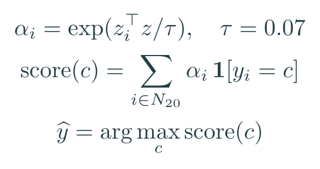

附录 F.1 的加权 k-NN 读出；温度 0.07，20 个邻居。

这个接口很直接：没有再训练一个复杂分类器，主要检验特征空间里的近邻是不是好邻居。线性探测则冻结骨干，用标签训练线性头。

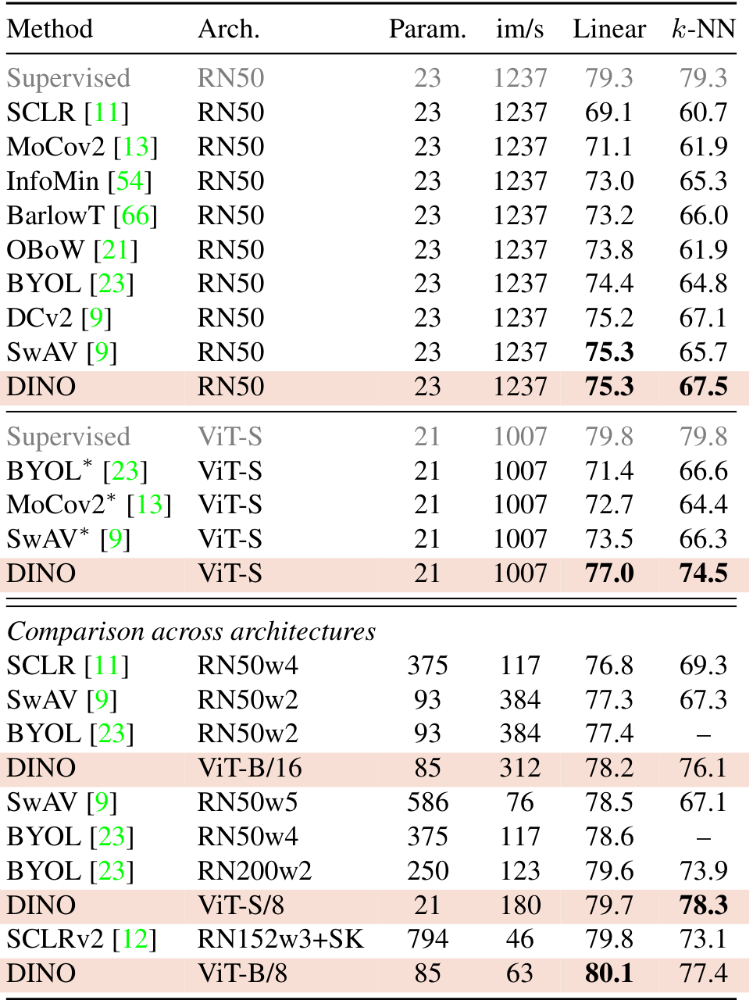

论文 Table 2：先选同一模型列与评估方式，再比较方法；参数量、吞吐和骨干大小一起看。

DINO ViT-S/16 的线性探测为 **77.0%**、k-NN 为 **74.5%**；换 S/8，分别为 **79.7%**、**78.3%**。ViT-B/8 的线性探测是 **80.1%**，k-NN 是 **77.4%**。这几个常被引用的数字不是同一模型同一种测法。<!-- evidence:C13 -->

还有一个藏在附录里的读出细节：S 模型线性评估拼接最后四层 CLS，384×4=1536 维；B 模型使用末层 CLS，加平均池化的 patch 特征，也是 1536 维。k-NN 使用的则是最后 CLS，S 为 384 维、B 为 768 维。读出接口不同，拿数字比较时得把接口一起带上。

### 4.2 表示的新性质：从找同类到找物体

先说检索。给一张建筑照片，库里找同一地点的其他照片，更关心相同实例，不只是“都是建筑”。论文 Table 3 里，ViT-S/16 在 Oxford Medium 的检索 mAP 从监督训练的 33.5 到 DINO 的 41.8；Paris Hard 上则是监督 37.2、DINO 34.4。mAP 是检索排序的平均精度，不等于分类准确率。<!-- evidence:C14 -->

所以这副特征有吸引力，但“所有检索都更强”不是表格讲的故事。数据、难度、读出方式都能改变胜负。

接下来是最抓眼的空间部分。我们把 Fig. 1 的惊喜拆成两个层次：注意力可视化是否覆盖对象，以及冻结特征能否用于空间对应。

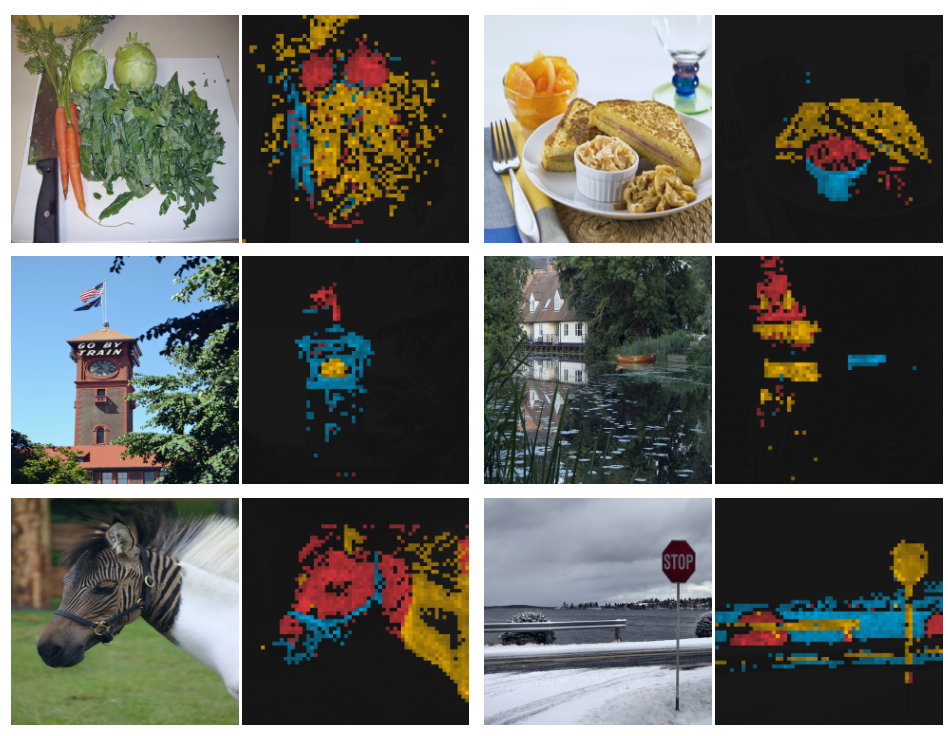

论文 Fig. 3：每个原图旁边叠放多个注意力头的响应，不同颜色区分不同头关注的位置。

这些颜色不是预先命名的语义类别。不能说红色永远是狗、蓝色永远是树。一个头可能关注主体，另一个头关注局部，第三个头可能落到背景结构。图里树丛遮挡的物体、建筑的小旗等位置也出现响应，说明网络保留了一些细粒度空间关系。

可视化用 480p 图像，ViT-S/8 对应序列长度为 3601。空间网格更细，眼睛看起来更有细节，计算也会跟着变重。<!-- evidence:C15 -->

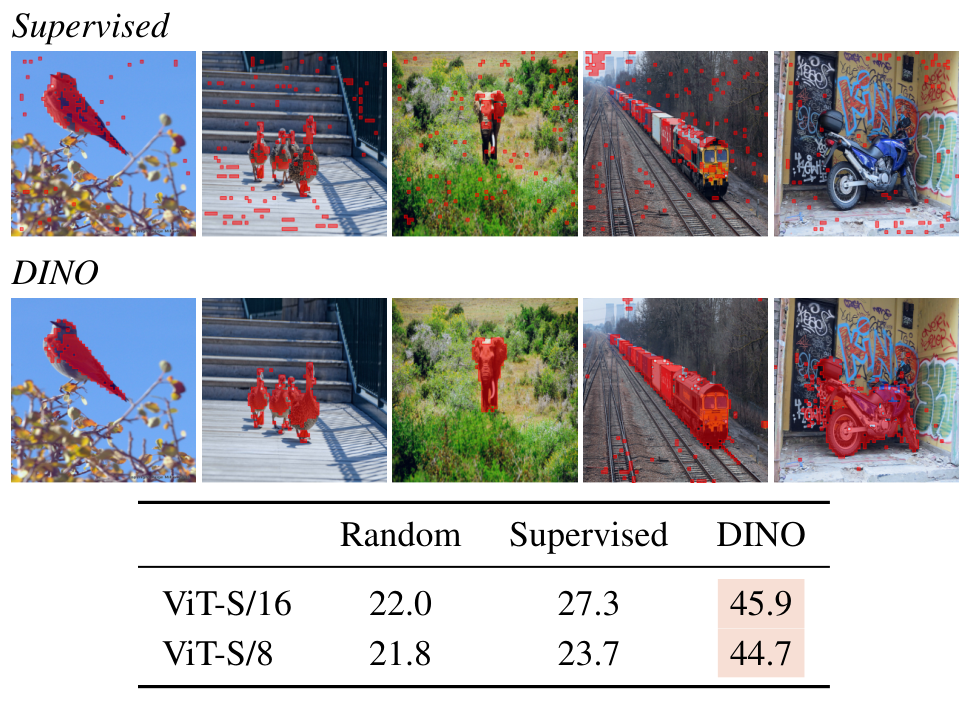

论文 Fig. 4：上排是监督训练，下排是 DINO；下方表格量化注意力掩码和真实前景的重合程度。

怎么把注意力变成掩码？作者按权重从大到小保留累计 **60% 注意力质量**对应的位置，然后与 PASCAL VOC12 的标注比较。注意这不是保留 60% 的图块数量。少数高权重块就可能占掉大部分质量。

表中 Jaccard 相似度，就是交集面积除以并集面积。ViT-S/16 随机权重是 22.0，监督训练 27.3，DINO 45.9；S/8 对应为 21.8、23.7、44.7。作者对两种训练都选了最佳注意力头，因此这是“这些头里有没有可提取的对象区域”的测量。<!-- evidence:C16 -->

还有个容易漏掉的细节：S/8 的分类更强，注意力掩码这张表却没有超过 S/16。任务指标不同，改善方向也可能不同。别把一个更小的 patch 写成全方位升舱。

再看视频。论文把相邻帧的 patch 特征做近邻对应，用来传播对象区域，冻结骨干，不针对这个任务微调。它测的是特征是否留下了跨帧空间对应信息。<!-- evidence:C17 -->

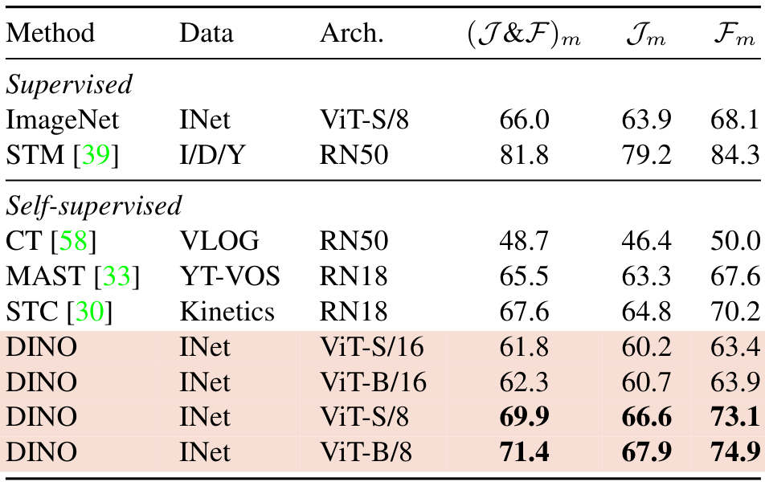

论文 Table 5：J 衡量区域重合，F 衡量边界质量，第一列结果是两者平均；按同样骨干和协议读。

DINO ViT-S/8 的 J&F 为 **69.9**，监督 ViT-S/8 为 **66.0**。ViT-B 从 /16 的 62.3 到 /8 的 71.4，说明较密的图块在这个空间任务里特别有价值。这条评估要沿 DAVIS 的对象传播协议理解，不能把它说成“无提示就自动给所有视频对象命名”。

### 4.3 换个数据集微调：底子有用，也有例外

Table 6 再把预训练权重接到不同分类数据集微调。总体上 DINO 常比相同 ViT 的监督预训练更好，例如 ViT-B/16 的 ImageNet 为 83.0 对 81.8；iNaturalist 2018 却是 72.6 对 73.2。<!-- evidence:C18 -->

对具身视觉，最诱人的两类接口已经能看见：整图特征可以做视觉状态或检索，patch 特征可以提供空间对应。但动作策略还要知道什么信息稳定、什么信息应随接触变化。把背景变化抹平通常有益，把杯柄方向也抹平就可能误事。训练增强要求的“不变”，得和机器人任务需要的“敏感”对上。

## 5 消融：哪些零件真不能少

### 5.1 拆零件：慢老师与跨视图训练各做了多少

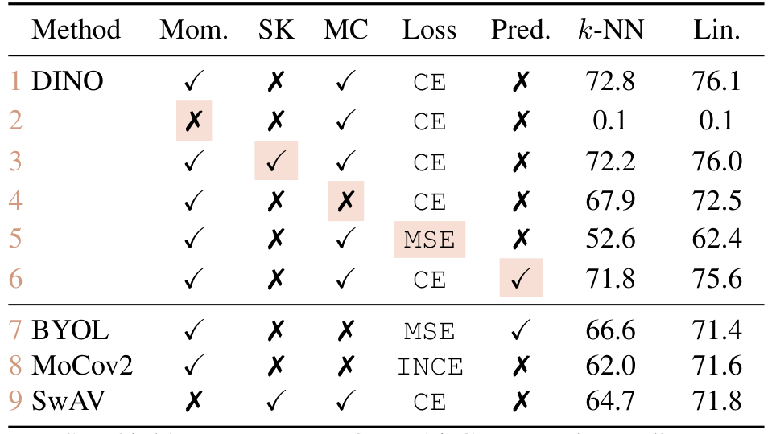

论文 Table 7：全部在 ViT-S/16、300 epoch 设置下比较，k-NN 和 Lin. 两列分开读。

先认缩写：Mom. 是动量教师，SK 是另一种分布归一化，MC 是多裁剪，Pred. 是额外预测器；CE 是交叉熵，MSE 是均方误差。默认 DINO 第一行的 k-NN/线性结果为 **72.8/76.1**。这比前面 Table 2 的 74.5/77.0 低，训练时长和线性读出细节不同，别把它当论文前后对不上。<!-- evidence:C19 -->

去掉动量、只保留当前学生的硬拷贝作目标，第二行掉到 **0.1/0.1**，几乎就是 ImageNet 千类随机猜的水平。这个条件下，单靠中心化救不回来。

去掉多裁剪，第四行是 **67.9/72.5**。把交叉熵换成这里采用的 MSE 版本，第五行 **52.6/62.4**。加预测器的第六行 **71.8/75.6**，没有成为必要的救命零件。

这些数字支持的判断很具体：在作者这套 ViT 训练配方里，动量教师与多裁剪很关键，概率分布上的损失也很关键；它们不是所有自监督方法都能随便拆装的万能插件。附录尝试把多裁剪直接加给 BYOL，结果并没有同样顺利。

### 5.2 图块变小：参数没涨，账单照涨

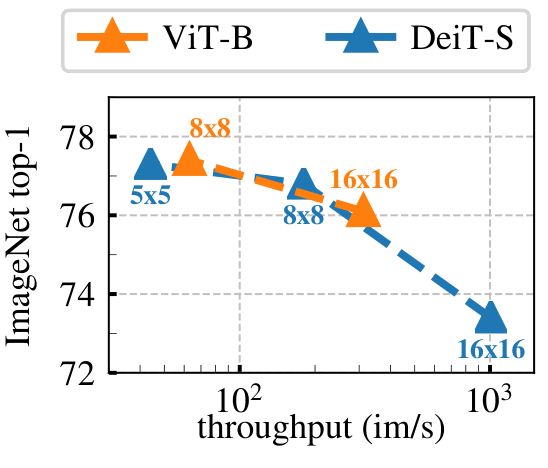

论文 Fig. 5：横轴是每秒处理图像数，向右越快；纵轴是 k-NN top-1，向上越准，横轴使用对数刻度。

橙色标 ViT-B，蓝色标小模型。每个点旁边写图块大小。图块从 16×16 变成 8×8，通常把点往左上推：准确率上去，吞吐下来。别把折线当训练过程，它连接的是不同模型配置。

224 输入，/16 是 196 块加 CLS，/8 是 784 块加 CLS。注意力矩阵元素数按序列长度平方变化：

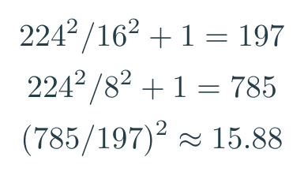

教学计算：197 到 785 个 token，单头注意力元素数约增至 15.88 倍。

参数矩阵可以不变，输入行数却变了。就像同一套会议规则，从 197 人换成 785 人，人人还都要看一遍其他人的发言，这会开得安静才怪。这个比喻只说明两两交互数量，真实网络是并行矩阵运算。

论文 Table 1 在单张 V100、batch 128 下，ViT-S/16 为 1007 图/秒，S/8 为 180 图/秒。Fig. 5 附近还报告 5×5 图块降到 44 图/秒。真实吞吐没有按 15.88 倍整齐变化，因为注意力之外还有投影、MLP 与硬件利用率。<!-- evidence:C20 -->

## 6 结论：三个问题收回来

**老师从哪来？**它是学生参数的时间平均。训练信号来自同一图像不同视图之间的分布对齐，不来自外部提供的类别答案。学生吃梯度，教师跟着慢慢变。

**为什么没一起交白卷？**中心化抑制公共偏置，锐化抵抗过度平均，动量教师提供较平稳的目标，多裁剪给出局部与整体的任务。具体设置是否管用，Table 7 和温度消融给了证据。

**圈出物体说明什么？**有些注意力头保留了可提取的对象区域，冻结 patch 特征也能支持空间对应；k-NN 的成绩则说明整图特征的邻域结构好用。这是几种不同的能力，不能揉成一句“理解世界”。

DINO 最值得记住的，不只是那张会发亮的狗。它让我们认真考虑：同一副 ViT，换一种训练题目，最后留下的东西可以很不一样。对机器人来说，选择怎样训练“眼睛”，其实已经在选择以后哪些变化容易被看见、哪些变化容易被忽略。

完整解读、公式源文件与知识点关联见 GitHub。点击公众号“阅读原文”进入本篇文章。

精读与配图工具：[ReadPaper](https://github.com/Zhu-Huixiang/ReadPaper) · [DrawPaper](https://github.com/Zhu-Huixiang/ReadPaper/tree/main/drawpaper)。可复制地址：https://github.com/Zhu-Huixiang/ReadPaper

---

公众号版由管理员在后台手动公开发表；永久文章链接待发表后补充。

关注公众号 **具身智能的 World**：

[原论文](https://openaccess.thecvf.com/content/ICCV2021/html/Caron_Emerging_Properties_in_Self-Supervised_Vision_Transformers_ICCV_2021_paper.html) · [证据索引](evidence.json)

[本篇知识星系](../../universe/papers/dino.md) · [知识点宇宙](../../universe/README.md)
