# DINOv2：不靠文字，怎样练出一套可复用的视觉特征？

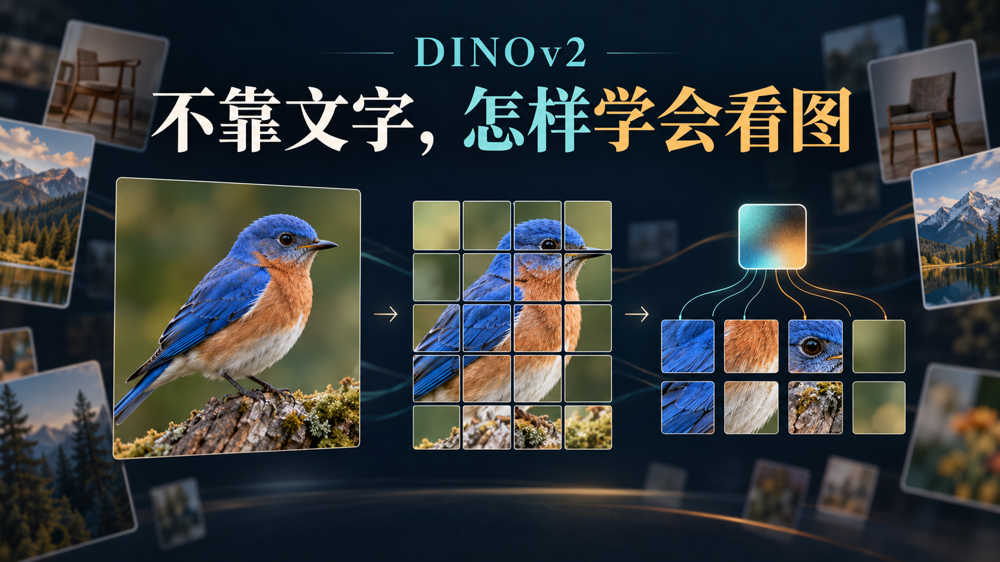

这里是「具身智能的 World」。把论文拆到输入、计算与实验，再看这些能力怎样接进机器人。

- 论文解读：读懂机制、公式和关键实验。
- 论文地图：沿科学问题寻找阅读路线。
- 顶会顶刊集锦：查正式出处与原文入口。
- 解读日程：查看未来一周的阅读安排。
- arXiv 新作：跟进经过筛选的研究。
- 具身榜：比较论文与逐项评分依据。
- 知识点宇宙：从一个技术点走向相关论文。

GitHub：[具身智能的 World](https://github.com/Zhu-Huixiang/embodied-world)。

给一张鸟站在树枝上的照片配文字，常见描述大概是“一只鸟”。鸟喙在哪里，翅膀边缘怎样弯曲，树枝从哪侧穿过，文字未必交代。用图文配对训练视觉模型，能得到很好用的语义接口；可像素里还有不少信息，等着另一种学习信号把它们留下来。

这就是 DINOv2 在挑战的假设：**通用视觉特征是否必须依赖文字监督，或者到了具体任务才重新训练编码器？**CLIP、OpenCLIP 代表图文引导路线；MAE 擅长为下游微调提供起点；DINO、iBOT 已经能学到有用的冻结特征。DINOv2 接着问，精心整理的数据、整图与局部目标、足够大的模型和稳定训练，能把纯图像自监督推到哪里。这里的分歧是监督方式与使用成本，论文没有在宣布文字路线失效。<!-- evidence:C01 -->

带着三个问题读：

1. 不用文字或类别标签当预训练目标，怎样挑出有用而多样的图像？
2. 识别整张图与理解局部，怎样由同一个视觉骨干学出来？
3. 编码器冻结以后，哪些任务真的受益，哪些能力还需要下游训练？

**论文信息**：*DINOv2: Learning Robust Visual Features without Supervision*。作者为 Maxime Oquab、Timothée Darcet、Théo Moutakanni 等，完整署名见原文；主要机构为 Meta AI Research，另有 Inria 及部分作者的联合署名机构。首次公开于2023年4月14日；本文读2024年2月2日 arXiv v2，首页标注 TMLR 2024年1月正式发表。TMLR 是以机器学习方法与实验为核心的同行评审期刊。<!-- evidence:C02 -->

[正式论文页](https://openreview.net/forum?id=a68SUt6zFt) · [所读原文 PDF](https://arxiv.org/pdf/2304.07193v2) · [作者项目](https://dinov2.metademolab.com/) · [官方代码](https://github.com/facebookresearch/dinov2)

**阅读目录**

- 1 引言：一套特征，能不能少为每个任务重练一次
- 2 相关工作：从猜像素，走到对齐特征
- 3 数据处理：样本变多之前，先看覆盖有没有变
- 4 方法：判别式自监督怎样兼顾整图与局部
  - 4.1 图像怎样变成 token
  - 4.2 DINO：不同裁剪，对齐整图判断
  - 4.3 iBOT：遮住局部，对齐对应位置
  - 4.4 EMA 与 Sinkhorn：目标怎样跟着学，又不挤成一团
  - 4.5 KoLeo 与高分辨率：让特征分得开，也看得细
- 5 高效实现：大模型训得动，小模型接得住
- 6 消融：每个改动究竟帮了谁
- 7 结果：冻结特征不等于免训练
  - 7.1 ImageNet 与分布变化
  - 7.2 其他图像与视频分类
  - 7.3 实例检索
  - 7.4 分割与深度
  - 7.5 PCA 与跨图匹配
- 8 公平性：覆盖面扩大以后，差距仍在哪里
- 9 训练代价：一次复训和整个项目分开算
- 10 讨论：从视觉特征走到机器人，中间还缺什么

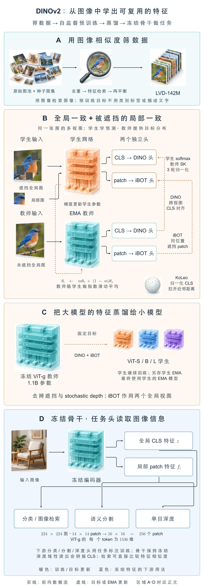

本图由 [DrawPaper skill](https://github.com/Zhu-Huixiang/ReadPaper/tree/main/drawpaper) 指挥 Codex，使用内置生图制作。

训练沿 **A→B→C** 走：A区筛选图像；B区用整图和局部目标训练大编码器，学生由梯度更新，教师由学生参数的滑动平均更新；C区固定训练好的大教师，把能力蒸馏给小模型。使用时看 **D区**：图像进入选定编码器，取整图或局部特征，再交给具体任务的头。论文多数评测固定编码器、训练任务头。第3节拆A，第4节拆B，第5—6节看C与代价，第7节检查D。<!-- evidence:C03 -->

## 1 引言：一套特征，能不能少为每个任务重练一次

视觉编码器可以看成图像的转换器：输入像素，输出数值向量。向量有没有用，要看后续问题是否容易从中读出来。把图片分成猫狗，要求整张图有可区分的表示；画出猫的轮廓，则要求每个局部仍保留位置与细节。

DINOv2 想交付一套可复用的转换器。换任务时，尽量保留编码器，只训练轻量的输出层。这会把昂贵的表征学习集中在预训练，把任务适配留给较小的模块。这里的“开箱即用”说的是特征，分类标签、分割类别与深度标定仍要有相应接口。<!-- evidence:C04 -->

难点在于，数据量与特征质量并不自动同步。网上最常出现的图像类型可能反复占据训练机会，少见的物体和场景却没有跟着增多。模型扩大后，如果输入分布仍很窄，算力就会更多地花在熟悉内容上。DINOv2 因此把数据处理放在方法的第一站。

## 2 相关工作：从猜像素，走到对齐特征

原文先区分两类自监督。第一类在单张图像内部构造任务，例如遮掉一部分，让模型恢复它。MAE 的重建目标是代表：模型为了补全内容，学到可用于微调的表示。第二类让不同视图的特征相互对齐，DINO 用同一图片的不同裁剪产生监督。iBOT 又把这种教师—学生关系用到被遮住的局部位置。<!-- evidence:C05 -->

DINOv2 以后一条路线为主，把 DINO 的整图目标和 iBOT 的局部目标放进同一次训练。它并不需要重新发明所有零件：主要贡献在于，哪些目标该共享，哪些参数该分开，以及数据与计算规模放大后，怎样让它们继续稳定工作。

与图文路线相比，它放弃了天然的语言查询接口。得到一个视觉向量，并不意味着可以马上拿一句文字与它比较相似度。得到像素级特征，也还没得到某个任务的标签。这些区别到第7节会变成具体的评测协议。

## 3 数据处理：样本变多之前，先看覆盖有没有变

北京青年报报道过徐志胜的一段回忆：早期有一阵子，台下连续两个星期都是同一个观众。演员们加了他的微信，人没来还要问问；为了让熟客继续听到新内容，只好不断换段子。演出场次在涨，面对的观众却还是那一位。<!-- culture:xu-one-repeat-audience -->

这段故事适合提醒我们分开数两件事：记录有多少，覆盖的对象有多少。不同段子当然仍有信息；换到图像数据，也不能把重复文件数直接折算成有效样本量。DINOv2 要做的是把去重和分布覆盖落实成处理步骤。

论文 Fig. 3 回答“已有的干净数据怎样帮我们挑网上的图”。它把整理过的数据当检索参照，从未整理图池里找视觉上接近的内容，扩充成 LVD-142M。<!-- evidence:C06 -->

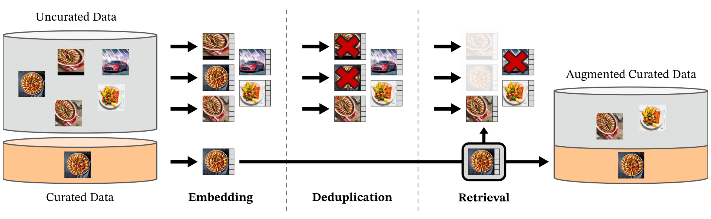

论文 Fig. 3：先映射到特征空间，再去重与检索；沿箭头看两种数据怎样汇合。

图中左侧橙色桶是精选数据，灰色桶是未整理数据；红叉表示去除，检索阶段变淡的图像表示没有被这次查询选中。Embedding 把图像转成向量；Deduplication 去掉未整理图池中的近重复；Retrieval 让精选数据提供查询，输出右侧扩充后的集合。这里没有文字提示框，选择依据是视觉相似度。

**先去重，再寻找相似内容。**去重使用拷贝检测特征；检索则使用在 ImageNet-22k 上自监督训练的 ViT-H/16。两者职责不同。检索时比较向量的余弦相似度：内积除以两个向量各自的长度。方向接近，得分就高；这一步衡量视觉特征相近，不判断文字描述是否一致。<!-- evidence:C07 -->

附录A把去重讲得更细：每张图找64个近邻，用相似度阈值连接近重复图，再在每个连通分量里保留一个代表。相对去重还会排除与评测参考划分过于相似的图像。这个处理减少直接拷贝带来的虚高，却不意味着预训练从未接触目标任务的数据分布。<!-- evidence:C08 -->

**再按数据集规模决定怎么取。**大数据集按图检索近邻；Table 15 中，ImageNet-22k 和 Google Landmarks v2 每个样本取4个，ImageNet-1k训练集取32个。小数据集用聚类：先把大图池分成10万个簇，选出包含足够查询样本的簇，再采样，并为每个小数据集限制最终取样量。这样做是为了让一个小领域有机会扩充，又不让某次检索把总配比带偏。<!-- evidence:C09 -->

最后得到142,109,386张图像，约1.42亿。里面既有直接纳入的精选图片，也有按样本或簇检索来的图片。Table 15 还列出了 ADE20K、KITTI、NYU Depth V2 等任务训练域作为检索参照。**无监督描述的是预训练损失没有用类别标签或文字，数据选择仍带着人工整理过的领域先验。**iNaturalist、Places205 等被留在检索之外，适合另看域外表现。<!-- evidence:C10 -->

这个区分关系到第一问的答案：DINOv2 没有把网络丢进任意图堆里，指望它自行决定什么都值得学。作者先规定想覆盖的视觉领域，再让自监督特征检索把规模补上。第6节用相同数量的随机图像作对照，检验这份整理有没有回报。

## 4 方法：判别式自监督怎样兼顾整图与局部

### 4.1 图像怎样变成 token

回到架构图B区。输入彩色图像记作 I，高、宽分别为 H、W，颜色通道为3。ViT 把它切成边长 P 的小块，每块线性映射成 d 维向量，并加入位置信息。N 是图像块数；额外的 CLS token 用来汇总整图信息。经过 Transformer，输出包含一个整图向量 z 和 N 个局部向量 fᵢ。<!-- evidence:C11 -->

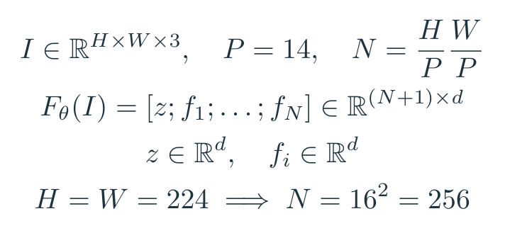

式（1），教学展开：图像块数量与视觉特征形状。Fθ 表示参数为 θ 的视觉编码器；下标 i 表示第i个图像块，d 是每个 token 的通道数。

用论文 ViT-g/14 举例：P=14、d=1536。224×224的输入被切成16×16=256块，连同CLS一共257个 token；98×98的局部裁剪是49块；518×518的高分辨率输入是1369块。这些是从尺寸计算出的形状，不是额外实验结果。大分辨率让模型看见更细的局部，也会增加注意力计算量。<!-- evidence:C12 -->

### 4.2 DINO：不同裁剪，对齐整图判断

先把总图B区拆成竖向读法：教师提供目标分布，学生学习预测，参数更新走另一条路线。

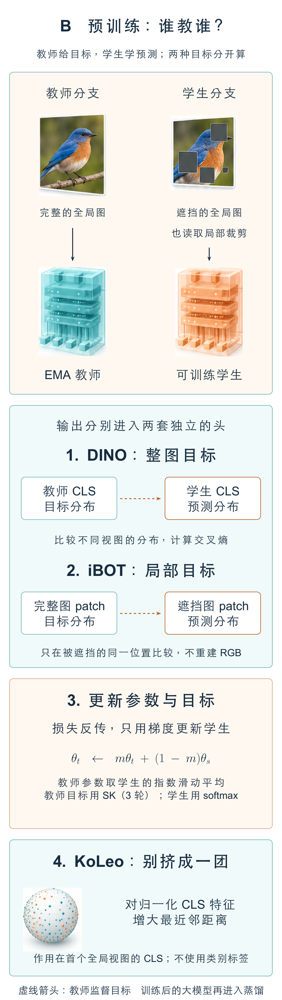

B区详图：沿输入、两种交叉熵和参数更新依次读；教师的目标不走梯度回传。

学生和教师看同一张原图的不同裁剪。学生的CLS向量经过 DINO 投影头，得到 K 个分数，再用 softmax 变成概率分布 pₛ；教师以另一裁剪生成目标分布 pₜ。K 对应可学习的原型槽位，不是人工标注的 K 种物体。Table 1列出的训练配方使用128k原型。<!-- evidence:C13 -->

“投影头”可以理解成训练用的翻译层：它把编码器输出变成适合比较的分布。比较结束后，要迁移到下游的是编码器的特征，而不是把这些原型槽位直接当成分割标签。

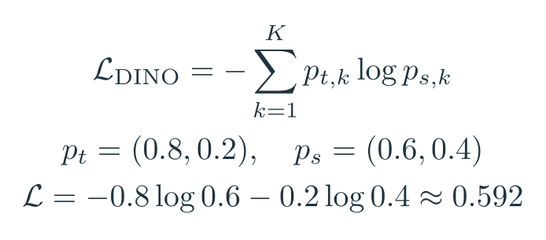

式（2），对应原文§4的 DINO 交叉熵，展开原型索引 k；log 为自然对数。pₜ提供目标，pₛ是被优化的学生预测。

做一个只有两个槽位的教学例子：教师给出(0.8, 0.2)，学生给出(0.6, 0.4)。交叉熵为 −0.8 ln 0.6 −0.2 ln 0.4，约0.592；如果学生对齐成(0.8, 0.2)，约0.500。损失下降，表示学生更接近教师的判断；软目标本身有熵，所以对齐后也未必等于零。

跨裁剪对齐迫使网络保留同一对象在不同局部视图中的共同信息。它不要求逐像素复原照片。对整图任务，这种一致性很有用；可轮廓和空间位置还需要另一份监督。

### 4.3 iBOT：遮住局部，对齐对应位置

iBOT 分支在学生输入中随机遮住部分图像块，教师看未遮挡视图。在对应被遮位置，学生输出局部特征，经自己的 iBOT 头得到分布；教师把该位置可见的局部特征转换为目标。损失只在选中的遮挡位置比较。设 M 为被遮位置集合，i 是其中一个位置，k 仍是原型索引。<!-- evidence:C14 -->

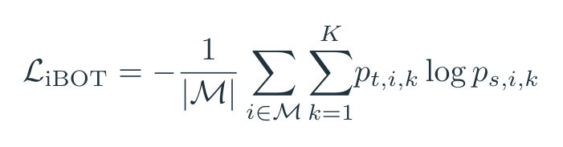

式（3），教学展开：在原文§4的 iBOT 交叉熵上按遮挡位置数 |M| 取平均，用于说明不同遮挡数量的归一化。

假设只遮两块，两处交叉熵分别为0.6和0.9，按位置平均就是0.75。学生要借周围内容预测教师在这两处产生的特征分布。目标是特征，不是把被遮鸟喙重新画成像素。

DINO 与 iBOT 共用视觉骨干，但投影头参数分开。前者需要整图跨视图一致性，后者需要对应位置的细节。原 iBOT 在较小设置里曾发现共享头更好；DINOv2 在扩规模后采用分开的头。这个决定不是“共享一定不好”，后面Table 1里，拆头提高了k-NN，却略降线性探针分数。<!-- evidence:C15 -->

### 4.4 EMA 与 Sinkhorn：目标怎样跟着学，又不挤成一团

教师的目标随学生训练逐渐变化。教师从学生的同一初始状态出发，此后取学生参数的指数滑动平均，简称 EMA。令 θₛ 为学生参数，θₜ 为教师参数，m 是动量，取值接近1。每个训练步结束后，教师保留大部分旧参数，再吸收少量学生的新参数。<!-- evidence:C16 -->

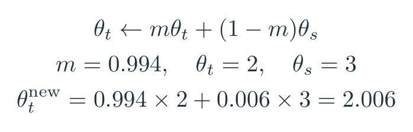

式（4），教学展开：EMA教师更新。教师目标停止梯度回传；学生通过损失更新，教师通过参数平均更新。

把某一个参数单独拿出来：旧教师值为2，学生更新后为3，m=0.994，那么新教师值是2.006。这个数字例子说明教师变化得慢，不是在给教师额外做一次梯度下降。论文把动量从0.994按余弦日程逐渐调到1。<!-- evidence:C16 -->

如果师生总是给任何图片同一种答案，跨视图一致也可能很好，但特征已经失去区分力。DINOv2 在教师输出上采用 Sinkhorn–Knopp，进行3次迭代；学生端仍用softmax。它在一批样本与原型之间交替归一化，限制所有样本都挤向少数原型的倾向。可以把它理解为给原型分配加上批次层面的平衡约束，目标来自数据中的相对结构，而不是人工给某个槽位命名。<!-- evidence:C17 -->

### 4.5 KoLeo 与高分辨率：让特征分得开，也看得细

整图和局部目标之外，KoLeo 直接约束特征空间的拥挤程度。这里 xᵢ 表示一个样本归一化后的整图特征，与前面的原始图像I不同。一个批次有 n 个特征；dₙ,ᵢ 是 xᵢ 到其他特征中最近一个的欧氏距离，双竖线表示向量长度。<!-- evidence:C18 -->

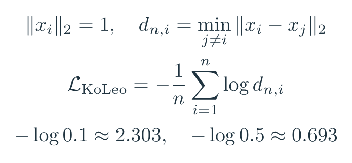

式（5），原文§4的 KoLeo 正则：先找最近邻距离，再取负对数并平均。附录B.1把它用于每张卡上第一全局裁剪的CLS特征，权重0.1。

若最近邻距离为0.1，对应 −ln 0.1≈2.303；距离为0.5时约0.693。挤得太近会付出更大损失。它并不要求每个语义类别互相排斥，也没有输入类别标签；它补的是特征分布的展开程度。与原型分配的批次平衡相比，这是直接作用在特征几何上的约束。

每步把整图、图块两类交叉熵与KoLeo正则合在一起更新学生，再用更新后的学生参数做教师EMA；Sinkhorn负责产生教师目标分布。

最后一项是分辨率适应。训练末尾把全局输入提高到518×518，再训练短阶段，让小物体和细边缘有更多token承载。附录B.2写明高分辨率阶段为1万步、缩短各项日程并降低基础学习率。作者把这项留到末尾，原因是高分辨率从头训练太贵。<!-- evidence:C19 -->

## 5 高效实现：大模型训得动，小模型接得住

### 5.1 计算工程怎样改变可训练规模

架构图B区的主模型是约11亿参数的 ViT-g。它采用1536维特征、24个注意力头，每头64维，便于GPU矩阵运算。作者比较同硬件的 iBOT 实现，报告约2倍速度、约三分之一显存占用；这个结果属于实现组合的对比，不能给每个技巧各记一次完整收益。<!-- evidence:C20 -->

FlashAttention式实现减少注意力中间矩阵的显存负担。Sequence packing则把不同长度的裁剪序列拼成一个长序列一起计算，再用块对角掩码禁止不同序列之间互相注意。224裁剪和98裁剪因此能更高效地一起处理，**信息仍各看各的，拼接的是计算批次。**<!-- evidence:C21 -->

随机深度也做了工程调整。训练丢弃残差分支时，直接跳过相应计算，而不是先算出结果再乘零。论文用0.4的丢弃率，省下的计算才会实际发生。FSDP则把学生、教师与AdamW的一阶、二阶状态分摊到多张GPU；这两份优化器状态分别追踪梯度与梯度平方的滑动平均；权重存储与通信采用不同精度，投影头的梯度归约保留更高精度以稳定训练。<!-- evidence:C22 -->

这些实现没有增加新的感知输入。它们让较大的批次、更长训练和更大编码器在既定硬件下可行，随后才由实验判断多花的规模有没有变成更好的特征。

### 5.2 蒸馏时，教师的更新规则变了

预训练大模型时，教师是同尺寸学生的EMA。架构图C区开始做另一件事：**固定训练好的 ViT-g，教一个更小的学生。**教师此时不再跟着小学生更新；小学生另外保存一份自己的EMA，最终评测使用这份EMA模型。<!-- evidence:C23 -->

蒸馏复用类似的训练循环，但去掉遮挡与随机深度，并在两个全局裁剪上计算iBOT目标。所以不能把“学生看遮挡、教师看完整”的预训练图原封不动搬到蒸馏阶段。小模型仍学整图与局部目标，监督来自已经训练好的大模型。

这种拆分让S、B、L等模型共享大模型训练得到的监督。较小的部署开销，是用前面的教师训练和蒸馏计算换来的；下一节看相同ViT-L结构到底赚到了多少。

## 6 消融：每个改动究竟帮了谁

### 6.1 训练配方：稳定性也会影响最终结果

Table 1在ImageNet-22k上用ViT-L逐项加入改动，主要优化k-NN表现。k-NN把新图与训练特征的近邻比较后投票；线性探针则训练一个线性分类器，两者读出特征的方式不同。复现起点是74.5%/83.2%，最终为82.0%/84.5%，斜杠前后分别是k-NN和线性探针。<!-- evidence:C24 -->

其中LayerScale给残差分支加上可学习的缩放系数；它与随机深度让k-NN上升，却让线性探针下降；作者保留它们，是因为训练更稳定，方便继续扩规模。最后拆开两个投影头时，k-NN从81.7到82.0，线性探针从84.7到84.5。逐项累加消融依赖加入顺序，不能把每一行当成独立、可相加的因果贡献。

### 6.2 数据来源：相同数量，整理确实有用

这里真正要比的是相同模型、相同训练迭代数下的整理数据与随机数据。两者都取1.42亿张图，实验使用ViT-g/14，训练比最终版本短，尚未做高分辨率适应。LVD-142M在多数列领先，但ADE20K这一列反而略低。<!-- evidence:C25 -->

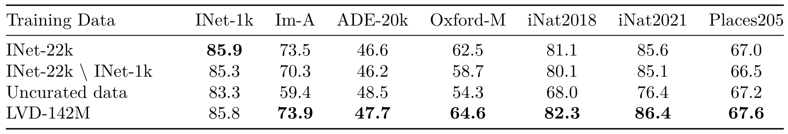

论文 Table 2：逐列比较数据来源；不同列是不同任务，不能把数值直接求和。

原表行是预训练数据，列是下游任务；INet-1k、Im-A和iNat是分类准确率，ADE20K是分割mIoU，即各类区域交并比的平均值；Oxford-M是检索mAP，用来衡量相关图像是否排在前面。先把几个判断拆开看：

| 下游指标 | 随机图池 | LVD-142M |
| --- | ---: | ---: |
| ImageNet-1k准确率 | 83.3% | 85.8% |
| ImageNet-A准确率 | 59.4% | 73.9% |
| iNaturalist2018准确率 | 68.0% | 82.3% |
| ADE20K mIoU | 48.5 | 47.7 |

整理数据没有包办所有列的最优。它带来的主要证据是，在相同样本数下，多个分类与检索域明显改善；iNaturalist又没有用于这套检索，说明收益不只停在被用于选数据的那些领域。

### 6.3 模型与数据：一起扩大才容易兑现

原文Fig. 4把ImageNet-22k约1400万张图与LVD-142M比较。横轴是L、H、g等模型规模，纵轴分别是各任务指标；模型越大，更多样的大数据在多数任务上的优势越明显。这组实验把数据规模与模型规模放在一起比较，优势主要出现在两者配合扩大的设置。<!-- evidence:C26 -->

### 6.4 损失项：局部任务与检索并不同步

Table 3把其他条件尽量固定，分别移除KoLeo或遮挡建模。KoLeo对Oxford-M检索帮助大；遮挡目标对ADE20K分割帮助大。两种目标服务的能力不同。<!-- evidence:C27 -->

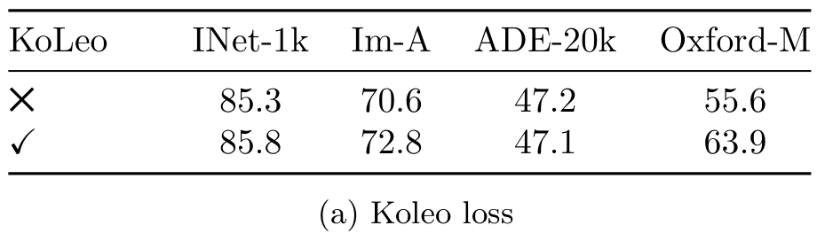

论文 Table 3(a)：KoLeo开启后，Oxford-M mAP从55.6到63.9；ADE20K mIoU为47.2到47.1。

表中叉号/勾号表示是否使用KoLeo，没有横纵坐标轴。检索提升8.3个点，分割没有随之提升。回到式（5），最近邻距离正是它直接作用的对象，这种结果与设计动机相符。

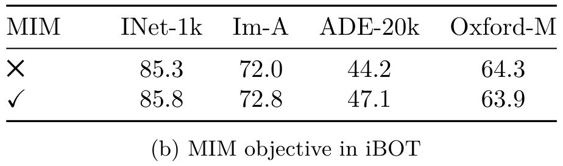

论文 Table 3(b)：遮挡目标开启后，ADE20K mIoU从44.2到47.1；Oxford-M mAP为64.3到63.9。

局部目标让分割多2.9个点，检索却小幅降低。这组取舍说明，整图相似度与像素级信息，需要不同约束共同照顾。

### 6.5 蒸馏：相同小模型，训练来源有差别

Fig. 5比较相同ViT-L/14从头训练与从ViT-g蒸馏。蒸馏在图示12项指标上都优于从头训练，部分检索指标还超过教师。教师的参数更多，并不保证每个任务都最高。<!-- evidence:C28 -->

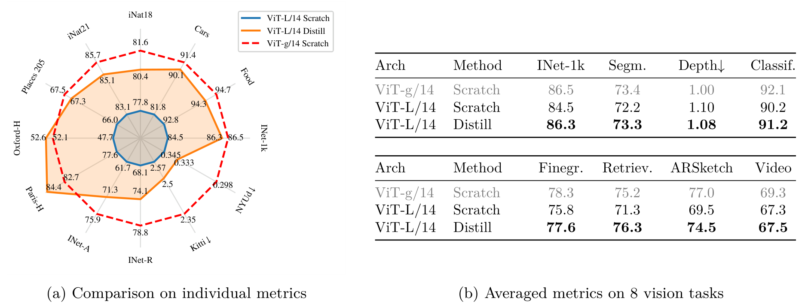

论文 Fig. 5：左侧雷达逐任务比较三个模型，右侧表格汇总八类任务；深度项以误差更低为好。

左侧蓝色实线为ViT-L从头训练，橙色实线为ViT-L蒸馏，红色虚线为ViT-g教师。每条辐射轴对应一个任务，数值写在相应曲线附近。

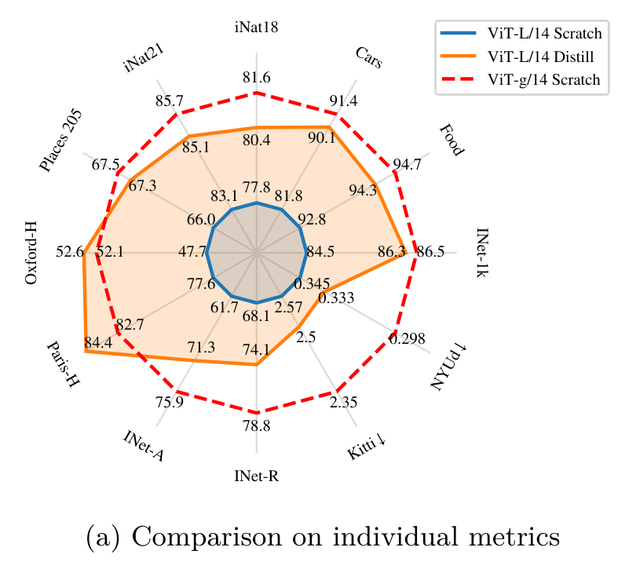

论文 Fig. 5(a)局部：蓝线与橙线使用相同ViT-L结构，先沿同一条轴比较。

ImageNet-1k为84.5%→86.3%，教师86.5%；NYUd深度指标为0.345→0.333，教师0.298；Oxford-H为47.7→52.6，教师52.1。各轴采用不同刻度，面积不能解释为一个统一总分；深度轴上向外的更好结果，对应的是更低误差。这里按Fig. 5内的数值比较蒸馏，后文完整结果表另行读数。

### 6.6 分辨率：最后补一段，能省多少训练

高分辨率消融为了控制成本，使用ImageNet-1k上的ViT-L/16，比较全程224、全程416，以及224训练后再用416补1万步。这组实验的416，别与最终配方的518混在一起。<!-- evidence:C29 -->

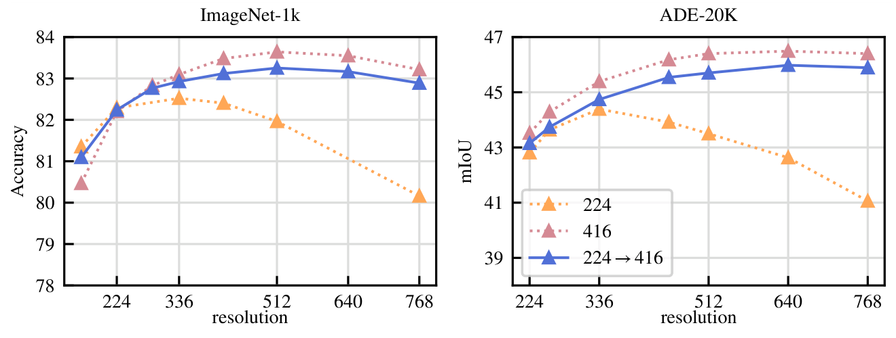

论文 Fig. 6：横轴为评测分辨率，左图是ImageNet准确率，右图是ADE20K mIoU；三条曲线表示不同预训练分辨率日程。

蓝色实线是224→416，粉色点线是全程416，橙色点线是全程224。蓝线接近粉线，尤其在分割图中更清楚。原文估计全程416训练约需224的3倍计算；短末段适应以较小额外成本取得接近的结果。这是作者选择末尾加分辨率的理由。

把左右两项分别放大，读数更容易。两图沿用蓝色224→416、粉色全程416、橙色全程224；共享图例原本位于右图内。

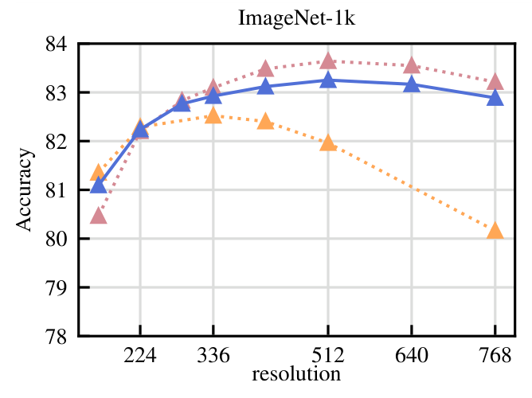

论文 Fig. 6左图：横轴是评测分辨率，纵轴是ImageNet-1k分类准确率；同一分辨率下比较三种训练日程。

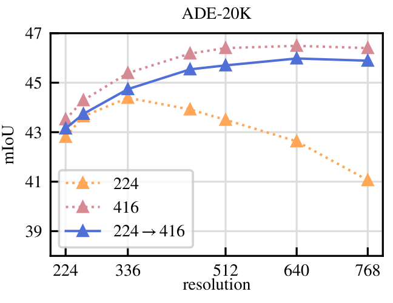

论文 Fig. 6右图：纵轴换成ADE20K mIoU；保留左下方原图例，观察蓝线与粉线的距离。

## 7 结果：冻结特征不等于免训练

把D区的特征去向放大：整图向量和局部向量进入不同读出，任务标注训练的是相应的头。

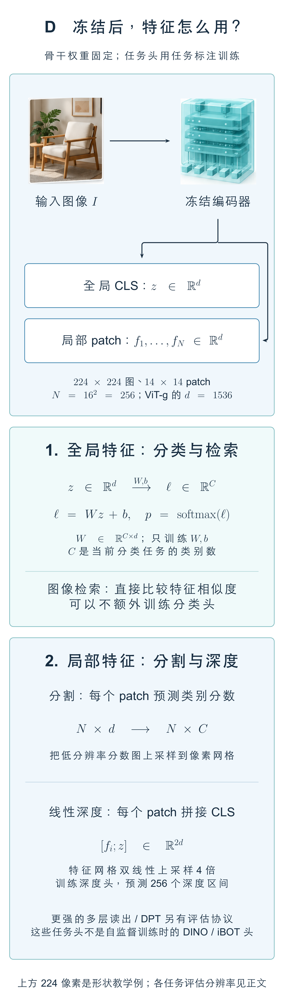

D区详图：先区分全局和局部输出，再看分类、检索、分割与深度各自怎样读取特征。

架构图D区里，“冻住”的是视觉编码器参数。先记 z 为图像特征，W、b 是任务头权重与偏置，ℓ 是类别分数。若只用一个d维CLS向量，C个类别对应的W形状为C×d；softmax把分数转换成类别概率。<!-- evidence:C30 -->

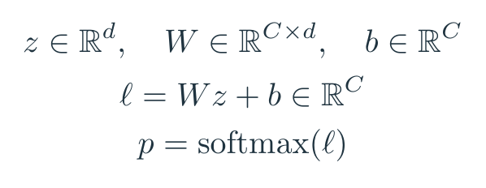

式（6），教学展开：固定视觉编码器，训练线性任务头。实际ImageNet探针还会选择拼接最后一层或四层CLS、是否加入平均池化的局部特征，所以输入维数取决于所选配置。

例如教学用的二维特征z=(1,2)，两类权重分别为(1,0)、(0,1)，偏置为0，类别分数就是(1,2)，softmax后约为(0.269,0.731)。标签监督更新W、b，编码器保持不动。特征容易被这样简单的头读出来，才是线性探针要检查的性质。

### 7.1 ImageNet 与分布变化

Table 4显示DINOv2-g冻结特征的ImageNet-1k线性准确率为86.5%，iBOT-L为82.3%，OpenCLIP-G为86.2%。都是在论文评测代码下训练线性头，但骨干规模、训练数据与监督方式并不相同，所以这是一组可用模型能力比较。<!-- evidence:C31 -->

| 冻结骨干 | ImageNet-1k | ImageNet-V2 |
| --- | ---: | ---: |
| iBOT-L/16 | 82.3% | 72.4% |
| OpenCLIP-G/14 | 86.2% | 77.2% |
| DINOv2-g/14 | 86.5% | 78.4% |

附录B.3说明，线性头会在学习率、输出层数、是否拼接局部均值之间搜索，并报告验证集最高值。因此86.5%包含一个调好的探针协议，不是随机接一层就必然得到的结果。另一方面，微调编码器仍然有用：224分辨率下86.5%提高到88.5%。冻结已经很强，微调还能继续挣到收益。<!-- evidence:C32 -->

换到分布变化，DINOv2-g在ImageNet-A为75.9%，OpenCLIP-G为63.8%；但在ImageNet-R，二者为78.8%和87.8%，Sketch为62.5%和66.4%。摄影里的自然困难样本、绘画风格和草图并不是同一种变化。谈鲁棒性时，要说清在哪种变化上更稳。<!-- evidence:C33 -->

### 7.2 其他图像与视频分类

在iNaturalist2018/2021上，DINOv2-g分别为81.6%和85.7%，高于OpenCLIP-G的73.0%和76.0%；Places205场景分类则是67.5%对69.8%。细粒度动物、植物分类与场景分类呈现不同取舍。12个迁移分类任务平均值为92.1%对91.9%，接近的平均数下，SUN与Cars等具体任务仍有差距。<!-- evidence:C34 -->

视频评测没有把图像编码器改成完整时序模型。作者抽取8帧，UCF-101与Kinetics-400把帧特征平均，Something-Something v2则拼接特征保留部分顺序信息，再训练线性头。DINOv2-g在三者分别为91.2%、78.4%、38.3%；最后一项略低于iBOT的38.7%。这套简单读出展示了图像特征的迁移用途，时序关系还有进一步建模空间。<!-- evidence:C35 -->

### 7.3 实例检索

分类问“是什么”，实例检索问“是不是同一座建筑、同一件作品”。论文直接按查询图和数据库图的特征余弦相似度排序，用平均精度衡量相关图片是否排在前面。DINOv2-L在Oxford-Hard为54.0 mAP，OpenCLIP-G为19.7；ViT-g为52.3，并没有超过L。<!-- evidence:C36 -->

这一节不需要为每个检索任务另训一个分类头。它与第4.5节的KoLeo联系更直接：特征之间的几何距离本身就是查询接口。但这里的检索仍限于视觉相似性，不是输入一句自然语言找图。

### 7.4 分割与深度

分割看的是局部特征。最简单的设置在每个patch token后面训练线性层，得到低分辨率类别分数图，再上采样到图像大小。mIoU是各类区域交并比的平均值，数值越高，预测区域与标注越重合。<!-- evidence:C37 -->

同样固定骨干、训练线性头，在ADE20K上，DINOv2-g为49.0 mIoU，OpenCLIP-G为39.3。+ms设置还会拼接最后四层、提高输入分辨率并做多尺度测试，这时分别为53.0和46.0。不能拿一个模型的+ms与另一个的简单线性设置混比。<!-- evidence:C37 -->

| ADE20K设置 | OpenCLIP-G | DINOv2-g |
| --- | ---: | ---: |
| 线性头 mIoU | 39.3 | 49.0 |
| 增强的+ms mIoU | 46.0 | 53.0 |

换更复杂的ViT-Adapter和Mask2Former头，固定DINOv2骨干得到60.2 mIoU；训练的适配器和头仍占整个模型的一部分。更复杂的下游读出确实能继续利用这些特征，代价也从一层矩阵乘法涨了上去。<!-- evidence:C38 -->

深度任务给每个位置预测距离。论文的简易头会把CLS拼到各局部特征上，上采样，再把深度范围划为256个区间训练；另一种设置拼接四个层级的特征；DPT则采用专门的深度解码器。它们都需要有深度标注的下游训练。<!-- evidence:C39 -->

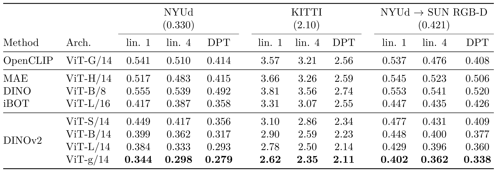

论文 Table 11：按数据集分组，每组内比较单层、四层和DPT头；RMSE越低越好。

把两项DPT比较单独放在手边：

| 评测数据 | OpenCLIP-G | DINOv2-g |
| --- | ---: | ---: |
| NYUd | 0.414 | 0.279 |
| NYUd→SUN RGB-D | 0.408 | 0.338 |

RMSE是预测与真实深度之差先平方、平均、再开方，保持深度的单位。表中NYUd与KITTI的场景和距离范围不同，原始RMSE不宜跨数据集排名。只比较NYUd的DPT列，DINOv2-g为0.279，OpenCLIP-G为0.414；从NYUd训练后直接迁移到SUN RGB-D时，分别为0.338和0.408。后者的“零样本迁移”指这个深度头没有用SUN RGB-D深度标签再训练，SUN RGB-D图像域却出现在预训练检索来源中。<!-- evidence:C40 -->

数值优势在图里是什么样？Fig. 7采用线性头，DINOv2的部分分割结果更连贯，深度图中的物体边界也更清楚。先看它与Table 11的协议区别：这里不是拿DPT结果来展示线性头能力。<!-- evidence:C41 -->

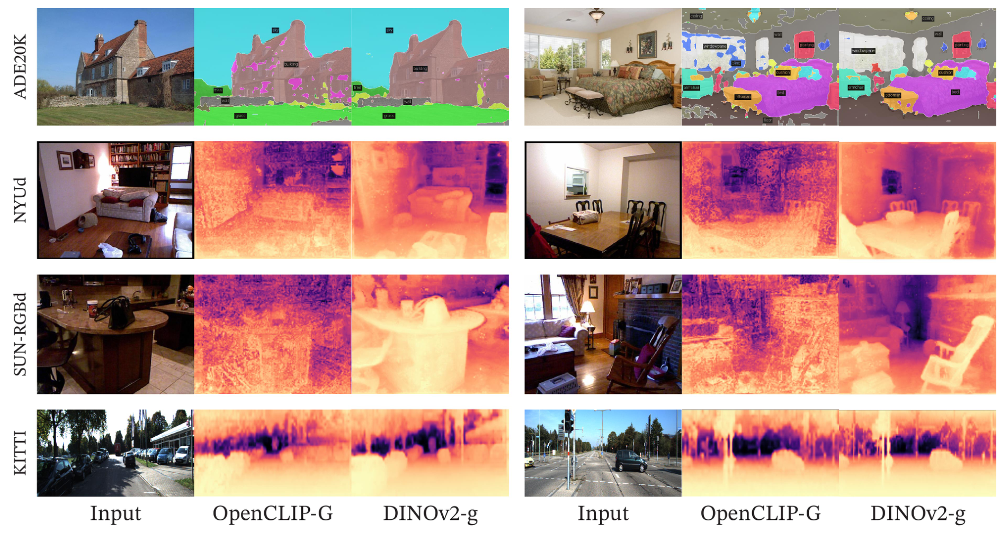

论文 Fig. 7：每组三列依次为原图、OpenCLIP-G和DINOv2-g的线性读出；逐行比较分割与三个深度数据集。

图中分割颜色表示类别，深度伪彩色用来观察距离层次与物体边界。左侧这组图放大后，可以看到城堡墙面上的零碎区域，以及客厅物体边界的差别。

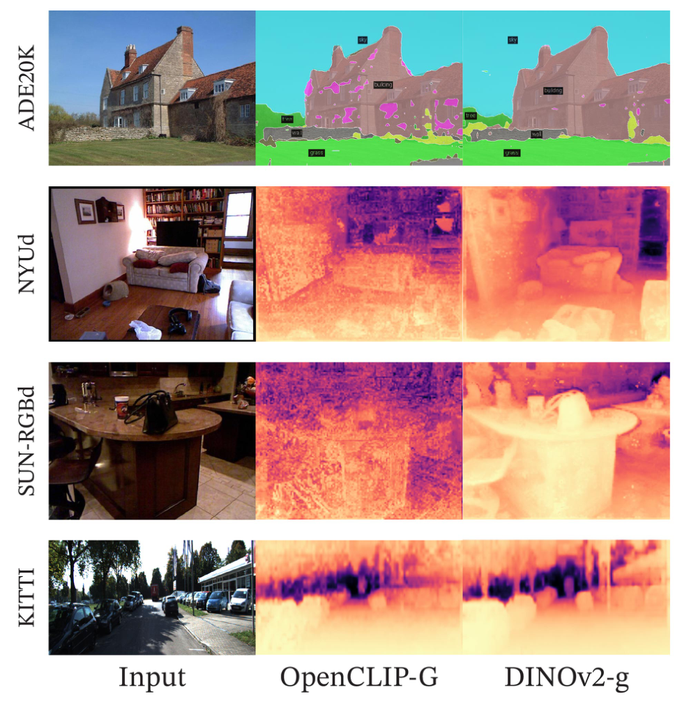

论文 Fig. 7左侧局部：保留原图和两模型结果的三列顺序，放大查看城堡、客厅与道路。

这些案例展示输出质量；跨样本的平均表现仍回到表格。Fig. 8进一步展示动物、绘画等分布外图像的分割和深度案例，说明作者还检查了日常基准之外的外观变化。

### 7.5 PCA 与跨图匹配

DINOv2常见的彩色动物图，很容易让人以为模型直接输出了身体部件标签。实际过程先提取patch特征，做主成分分析PCA，把高维数据沿变化最大的方向投影到少数坐标，再把坐标映射到颜色。<!-- evidence:C42 -->

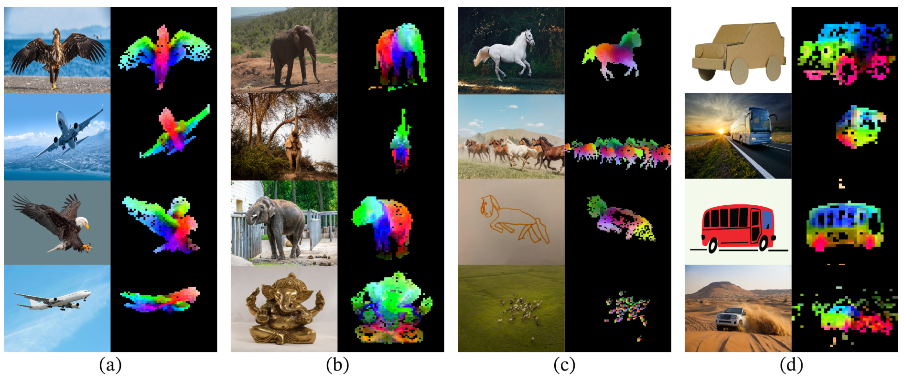

论文 Fig. 1：同一列图像联合计算PCA，用前三个分量着色；颜色相近表示投影坐标接近。

先放大左侧(a)组，观察鸟与飞机的两翼。

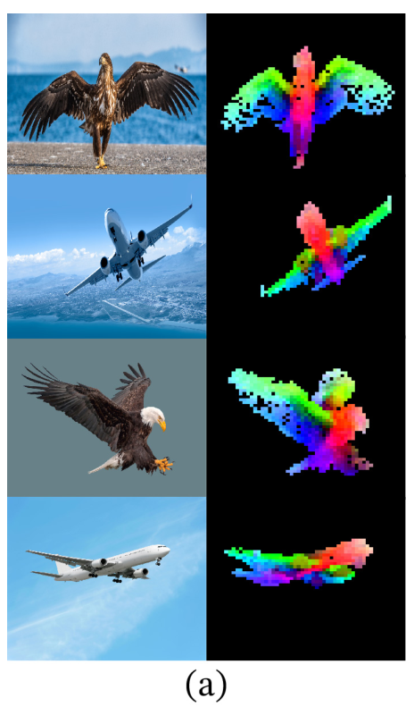

论文 Fig. 1(a)局部：左边是输入，右边是PCA着色；两翼、主体在跨图比较中呈现相近颜色。

原文§7.5先用第一主成分阈值选前景，再对保留特征做PCA。图中一些相似部件跨姿态、画风仍呈相近颜色，说明特征里存在可迁移的结构。颜色并没有“红色永远是头、绿色永远是翅膀”的固定含义；换一组图重新计算PCA，坐标方向与颜色都可能变化。

Fig. 10再进一步：先取前景，再计算两张图中patch特征的欧氏距离，解分配问题，最后用非极大值抑制减少冗余匹配。输出是对应关系，而不是动作。<!-- evidence:C43 -->

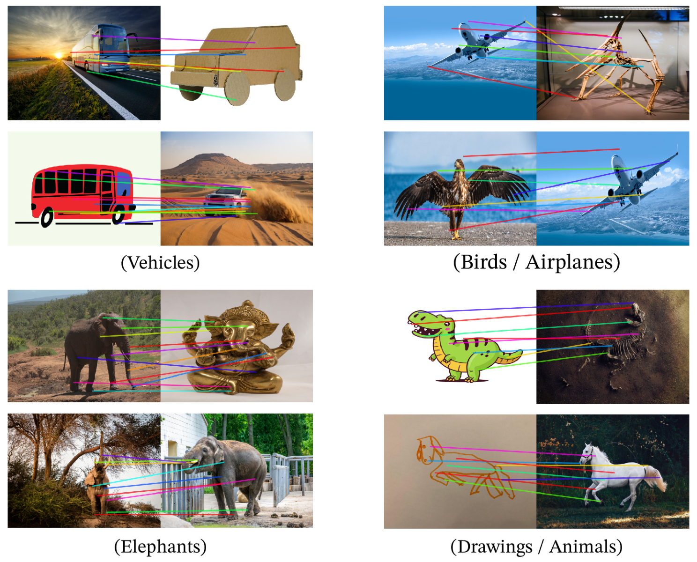

论文 Fig. 10：连线展示经过匹配与筛选的局部对应；关注跨姿态、照片与画作之间的关联。

把鸟与飞机这组放大，线的两端就是被匹配的局部；线色只是用来区分不同对应。

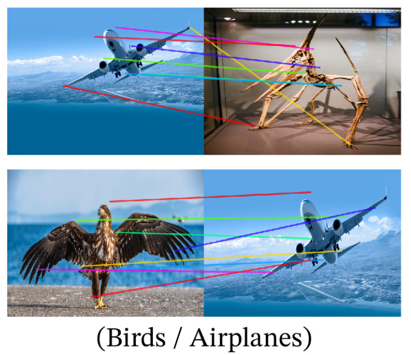

论文 Fig. 10鸟与飞机组：沿每根彩线看它连接了两幅图的哪个部位。

飞机翼与鸟翼等对应很有启发：特征可能保留了某些部件相似性。图里没有机械臂抓取轨迹，也没有接触反馈。把它用到机器人，需要另行判断这些对应能否在遮挡、视角变化与真实操作过程中维持。

## 8 公平性：覆盖面扩大以后，差距仍在哪里

原文没有在平均准确率处收笔。Dollar Street评测包含54个国家、289个家庭的16,073张图，比较94个概念在收入与地区变化下的识别表现。Table 12中，DINOv2的非洲组为74.0%，欧洲组为89.7%，差15.7个百分点；低收入组67.4%，高收入组90.5%，差23.1个百分点。数据量变大之后，覆盖不均仍然留在结果里。<!-- evidence:C44 -->

另一项评估在Casual Conversations的2955张图像上检查标签关联，分类头基于ImageNet-22k的619类，输出再汇总为几类关联。作者报告大部分分组没有出现所定义的有害类别，同时记录了少数例外。这个实验回答的是特定标签集合、阈值与样本上的行为；它没有穷尽一个视觉模型可能遇到的社会与场景偏差。<!-- evidence:C45 -->

对具身应用，直接的启发是评测覆盖。房间、器物、背景和家庭条件变了，视觉输入也会变。选择一个总体分数高的编码器之后，还要用自己的环境分布检查哪些对象和场景被遗漏。

## 9 训练代价：一次复训和整个项目分开算

Table 14估算复训一个DINOv2-g需要22,016 GPU小时；按单卡400瓦、PUE=1.1及指定电网碳强度，约9.7 MWh、3.7吨二氧化碳当量。PUE衡量数据中心总耗电相对于计算设备耗电的比例。这里是按统一假设计算的潜在排放，不是对原训练机房做现场电表测量。<!-- evidence:C46 -->

整个研究项目还包括多轮预训练、消融与其他尝试，原文估计约500—1000吨二氧化碳当量；两种范围相差很大。对使用者而言，复用冻结特征或较小蒸馏模型可以减少自己重复预训练的需求；对研究者而言，试验过程的成本仍应单独算进去。<!-- evidence:C47 -->

## 10 讨论：从视觉特征走到机器人，中间还缺什么

第一问，怎样在没有文字或类别预训练目标时选数据？DINOv2用整理过的图像领域作参照，通过去重、视觉检索和配比扩充数据。相同1.42亿张图的消融支持这种整理在多数任务上的收益；它也让我们看清“无标签训练”背后依然有数据选择。

第二问，整图与局部怎样一起学？同一个ViT骨干输出CLS和patch特征，DINO在不同裁剪间对齐整图，iBOT在遮挡位置对齐局部；两份投影头分开，EMA提供逐渐变化的教师，Sinkhorn和KoLeo分别约束原型分配与特征分布。分割与检索消融呈现不同取舍，组合这些目标才有具体意义。

第三问，冻结以后能做什么？分类、实例检索、分割和深度都展示了可复用特征，但多数任务仍训练有监督的头。PCA和patch matching提供结构线索；它们离闭环控制，还隔着动作表示、训练数据和执行反馈。

后来OpenVLA给出了一个可核对的接法：DINOv2与SigLIP分别编码图像，沿特征通道拼接，经两层MLP接入语言模型；模型还用机器人动作数据训练，并微调视觉编码器。因此，DINOv2在这条链路中提供视觉起点，动作能力来自后续完整训练。<!-- evidence:C48 -->

我更关心的是，哪些局部信息在接入任务后仍被保留。ImageNet上分得开，与抓取时分得清杯沿、把手、遮挡边界，是不同的检验。DINOv2把许多视觉信息变得容易读出，也把接下来的问题放到了一个更具体的位置：任务头能读到什么，微调又改变了什么。

---

用 [ReadPaper](https://github.com/Zhu-Huixiang/ReadPaper) 留下阅读地图与机制记录，用 [DrawPaper](https://github.com/Zhu-Huixiang/ReadPaper/tree/main/drawpaper) 对照全篇结构。

可复制地址：https://github.com/Zhu-Huixiang/ReadPaper

阅读原文：本篇完整解读与高清图源见 [GitHub文章入口](https://github.com/Zhu-Huixiang/embodied-world/blob/main/articles/dinov2-2304.07193/README.md)。

---

公众号版由管理员在后台手动公开发表；永久文章链接待发表后补充。

关注公众号 **具身智能的 World**：

[原论文](https://arxiv.org/abs/2304.07193) · [证据索引](evidence.json)

[本篇知识星系](../../universe/papers/dinov2.md) · [知识点宇宙](../../universe/README.md)
