# DiT：扩散画图，非得长一张 U-Net 的脸吗？

这里是「具身智能的 World」。我们沿着论文原文，把具身智能的机制、公式和证据拆开聊。配套 [GitHub 知识库](https://github.com/Zhu-Huixiang/embodied-world) 提供：

- 论文解读：读懂算法怎样算、实验说明什么。
- 论文地图：按问题找到相邻工作。
- 顶会顶刊集锦：查正式出处和原文。
- 解读日程：看接下来准备细讲哪些论文。
- arXiv 新作集锦：跟进经过筛选的新工作。
- 具身榜：按公开依据比较论文。
- 知识点宇宙：沿着一个概念串起多篇论文。

扩散模型画得挺好，可你打开模型结构，怎么又是 U-Net？一边下采样、一边上采样，中间拉几条跳线。像去不同城市吃连锁店，招牌换了，厨房布局还是那一套。

DiT 挑战的就是这个默认设置：**扩散需要一个会预测噪声的网络，但这个网络必须是 U-Net 吗？** DDPM、ADM、LDM 都让 U-Net 承担去噪主干；Peebles 和 Xie 则把潜变量切成 token，交给 Transformer。他们想验证的，不只是“这个模块也能用”，而是换骨架之后，模型变大、token 变多，质量能不能沿着一条更清楚的路线提高。<!-- evidence:C01 -->

先带着三个问题往下走：

1. 一张带噪图怎样变成 token，Transformer 最后又怎样还回噪声图？
2. 时间与类别从哪里进网络，adaLN-Zero 的“零”究竟帮了什么忙？
3. DiT 的提升来自参数、token 还是计算量，采样多跑几步能补回来吗？

**论文信息**

**Scalable Diffusion Models with Transformers**。William Peebles、Saining Xie；加州大学伯克利分校、纽约大学，Peebles 的工作部分在 Meta FAIR 实习期间完成。首发 2022-12-19，本文读 arXiv v2（2023-03-02）。正式发表于 **ICCV 2023**，计算机视觉领域的重要国际会议。<!-- evidence:C02 -->

[论文](https://arxiv.org/abs/2212.09748v2) · [项目](https://www.wpeebles.com/DiT) · [代码](https://github.com/facebookresearch/DiT) · [正式会刊](https://openaccess.thecvf.com/content/ICCV2023/html/Peebles_Scalable_Diffusion_Models_with_Transformers_ICCV_2023_paper.html)

**阅读目录**

- 1 引言：换主干到底想解决什么
- 2 相关工作：Transformer 接的是哪一棒
- 3 方法：从潜变量到 token，再把条件塞进 block
- 4 实验设置：先把账本摆对
- 5 实验：规模、引导和采样分别带来什么
- 6 结论：回收三个问题，看看它对具身意味着什么

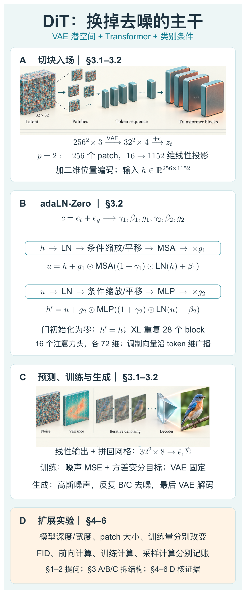

本图由 [DrawPaper skill](https://github.com/Zhu-Huixiang/ReadPaper/tree/main/drawpaper) 指挥 Codex，使用内置生图制作。

先看 **A→B→C**：图像经固定 VAE 压缩，加噪、切块，token 进 Transformer；C 把输出拼回网格，分别预测噪声与方差。训练拿预测噪声和真实噪声对答案，另有学习方差的目标。生成时从随机潜变量出发，反复走 B/C，最后才解码成图。**D 是算账区**：结构讲完后，要把训练计算和采样计算分开比较。第 3 节拆 A/B/C，第 4–5 节在 D 核验。<!-- evidence:C03 -->

## 1 引言：到底在换什么

U-Net 的设计挺有道理：低分辨率层看大结构，高分辨率层保细节，跳连把信息传回来。这种空间层级偏置在图像任务上很好用。DiT 没有把它说成过时废品，而是问：当数据和计算不断扩大时，还有没有更简单、可系统扩展的主干？

这里的 DiT 是 **Diffusion Transformer，扩散用的 Transformer**。它处理的是 LDM 那种压缩后的图像潜变量，任务是 ImageNet 类别条件生成。告诉它“鸟”或“狗”的类别，而非输入一大段自然语言。VAE 仍在网络外做压缩和重建，不能一听 Transformer 就脑补成整个系统从头到尾没有卷积。<!-- evidence:C04 -->

这也解释了为什么机器人读者值得看它：后来的动作、视频生成会继续碰到“连续对象怎么切成序列、条件怎么注入”的问题。DiT 提供的是结构经验。本篇先把图像实验讲透，不提前给它发机器人毕业证。

## 2 相关工作：接住三条线

原文把三件事连起来：扩散学习逐步去噪；LDM 把去噪搬到计算更便宜的潜空间；ViT 说明图像 patch 可以成为 Transformer 的 token。DiT 把这三条线接成一条计算链。<!-- evidence:C05 -->

**基础扫盲：归纳偏置。** 可以理解成模型入场时自带的做题习惯。卷积优先看局部、共享滤波器；注意力让位置之间按内容建立联系。习惯不一样，不等于一方天然更聪明，最后还是看任务和实验。

相比只换一个注意力小插件，DiT 让整个去噪主干由 Transformer block 组成。不过条件接口不是顺手一接就完事，下面这个接口，反而是全文最有用的部分。

## 3 Diffusion Transformers：拆开 A、B、C

### 3.1 先交代潜变量和噪声

一张 256×256 的 RGB 图像，经过预训练 VAE 编码器，得到 **32×32×4** 的潜变量。空间边长缩小八倍，扩散就在这个网格上做。记干净潜变量为 z₀，t 是扩散噪声等级，βₜ 是该步噪声调度系数，αₜ=1−βₜ，带横线的 ᾱₜ 是从第 1 步到第 t 步的 α 连乘。ε 是与 z₀ 同形状的标准高斯噪声。<!-- evidence:C06 -->

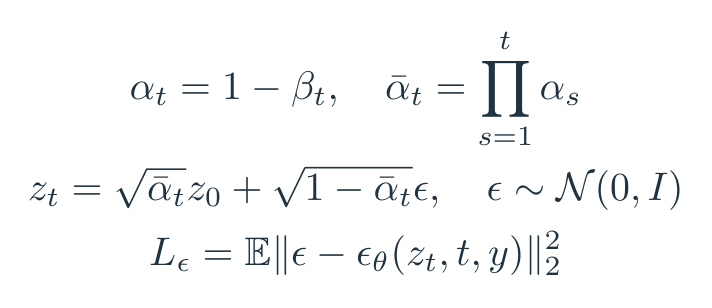

上面是原文 DDPM 预备知识在潜空间里的写法。εθ 是可训练的预测网络，θ 代表其参数；y 是类别。网络接到 zₜ、t、y，要预测当时加进去的 ε。平方范数把所有位置、通道的误差平方相加，再对数据、随机 t 和随机噪声取平均。

举个单坐标的教学例子：干净值为 2，ᾱₜ=0.64，噪声取 −1。带噪值就是 0.8×2+0.6×(−1)=1。训练时答案 −1 是我们自己抽的，监督不神秘。真正难的是：面对整张带噪图和不同噪声等级，网络能否稳定把这个答案猜准。

### 3.2 设计空间：patchify 怎么切

回到总图 **A**。I 表示潜变量网格的边长，C 是通道数，p 是每个正方形 patch 的边长，T 是 token 数，d 是 Transformer 隐藏宽度。W 是学习得到的线性投影矩阵，P 是二维正弦余弦位置编码。<!-- evidence:C07 -->

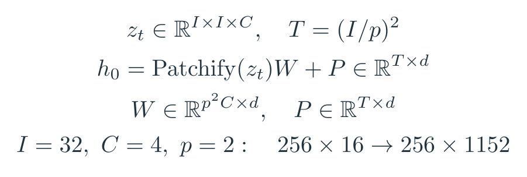

以 DiT-XL/2 为例：I=32，C=4，p=2。每块有 2×2×4=16 个数，一共 16×16=256 块；每块投影为 1152 维，所以进主干的张量是 **256×1152**。这里 /2 说的是 patch 边长，XL 说的是模型规模。两条控制杆，别混成一个“大号”。

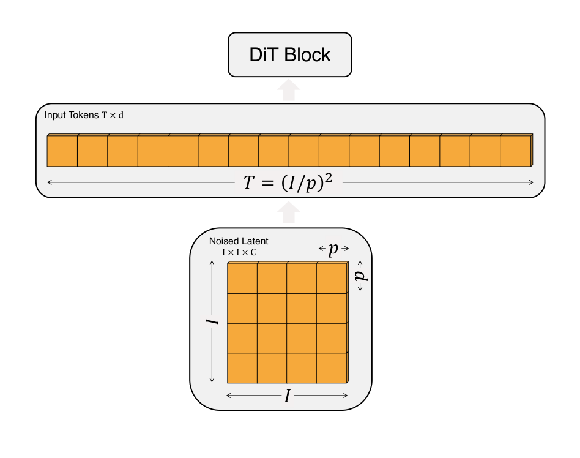

论文 Fig. 4。先看它想说明的事：**patch 越小，token 越多，计算会增加；参数量可以基本不变。** 原图从下往上读：底部是 I×I×C 带噪潜变量，p 标出一个 patch 的边长；中间把各块映射为 T×d token，顶端接入 DiT block。按图中 T=(I/p)² 计算，I=32 时 /8、/4、/2 分别得到 16、64、256 个 token。这里细化的是同一张潜变量的切法，输出图像分辨率没有变化。<!-- evidence:C08 -->

### block 内部：token 之间怎样互相看

XL 一共有 **28 个 block，宽度 1152，16 个注意力头**。每个头宽 72。先用一个头讲：Q、K、V 都由 token 特征线性投影而来，分别可看成“我想找什么”“我有什么特征”“我能提供什么内容”，形状都是 T×72。<!-- evidence:C09 -->

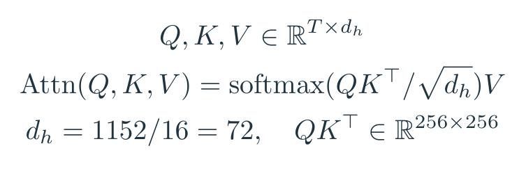

QKᵀ 得到 T×T 的匹配表，每个位置对所有位置打分。除以 √72 控制数值尺度，softmax 沿被读取的 token 归一化，再乘 V 汇总内容。多头结果拼接、线性投影回 d 维。随后逐 token 的 MLP 再做特征变换。MLP 是多层感知机，即几层线性变换配非线性激活；它不是另一个世界模型。

p 从 4 减成 2，token 数从 64 到 256，注意力匹配表从 4096 格变成 65536 格。**光这张表就大了 16 倍。** 小 patch 看起来只是把图切细一点，算账时可一点都不含蓄。但整个 block 还有投影和 MLP，因此不能把整网计算也直接乘 16。<!-- evidence:C10 -->

### 条件接口：同一个词，四种接法

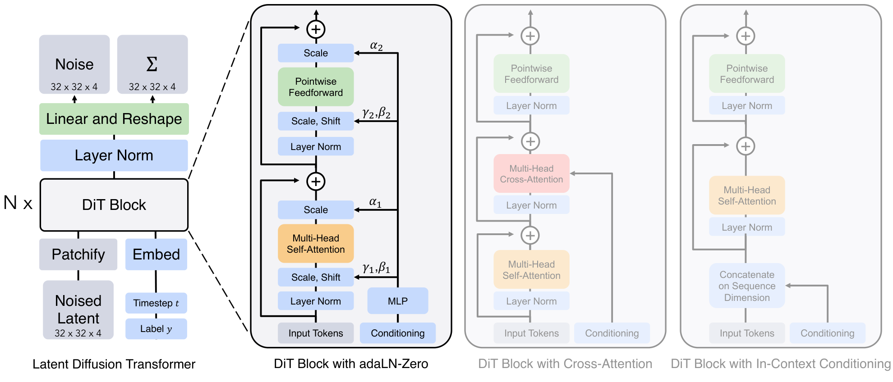

论文 Fig. 3。先抓结论：左边是主干，右边比较条件怎么进去；**胜出的改动集中在归一化与残差门，不是让类别 token 拼得更多。** 原图左侧从下往上读：Noised Latent→Patchify→多层 DiT block→Linear and Reshape→Noise/Covariance。右上浅色区列候选 block；timestep 和 class label 经嵌入变成向量，箭头指向各自的条件入口。<!-- evidence:C11 -->

四种接法分别是：

- **In-context**：把时间和类别当作两个额外 token，跟图像 token 一起做注意力，最后去掉这两个输出。
- **Cross-attention**：图像 token 作查询，另设一层交叉注意力读取两个条件 token。连接明确，计算也多一层。
- **adaLN**：adaptive LayerNorm，自适应层归一化。先把特征标准化，再让条件控制每个通道的缩放与平移。
- **adaLN-Zero**：在 adaLN 上再控制两个残差分支的输出强度，并让初始 block 近似恒等映射。

“时间和类别”不是两行字幕贴旁边。t 先变成 256 维频率嵌入，经两层 MLP 变到 d 维；类别也有 d 维嵌入。两者相加得到条件向量 c，调制网络从 c 生成六组 d 维参数。<!-- evidence:C12 -->

### adaLN-Zero：零在哪里

离完整图远一点就容易找不到，我们把关键 block 放近些。

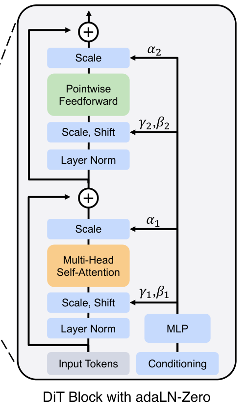

论文 Fig. 3 局部。图从下往上走：LayerNorm→Scale/Shift→Multi-Head Self-Attention→Scale→残差相加，然后再走一次 LayerNorm→Scale/Shift→Pointwise Feedforward→Scale→残差相加。右侧条件支路送来调制系数；绕过子层的长线是残差捷径。图里的“Scale”有两种用途，前一个调输入，后一个像音量旋钮控制这条分支说多大声。

把符号定好：h 是进入 block 的 T×d 特征，u 是过完注意力分支的中间结果。LN 是 LayerNorm，MSA 是多头自注意力。γ、β 分别表示缩放偏移和平移，g 是残差门；每组均为 d 维，沿 T 个 token 广播。⊙ 表示逐元素相乘。v₁、v₂ 是调制后的中间特征，形状仍是 T×d。下面是原图的教学展开，γ 采用“相对 1 的偏移”记法，避免把缩放零和残差零混淆：

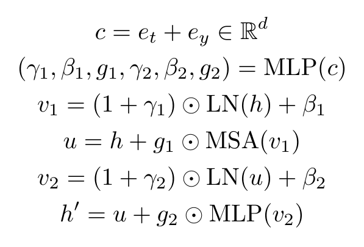

初始时 g₁、g₂ 为零，两条残差支路先不往主路硬塞内容，h′=h。训练再逐渐学会开门。可以想成新同事入职，先把流程走通，再调各环节的音量；不是第一天把二十八层同时开到最大，会议室直接红温。

**Zero 也不意味着所有权重都置零。** 主干有正常初始化，条件调制输出和最终输出层使用专门的零初始化设计。要是所有层都一刀切成零，讲的已经不是这篇论文了。<!-- evidence:C13 -->

### 出口：噪声与方差，分开交作业

来到总图 **C**。把经过 L 个 block 的特征记作 h_L，L 在 XL 中为 28。最后的归一化与线性层，把每个 d 维 token 变成 p²·2C 个数。再按空间位置拼回来，得到 I×I×2C。对于 256 图像，就是 32×32×8，再分为两个 32×32×4 的输出。<!-- evidence:C14 -->

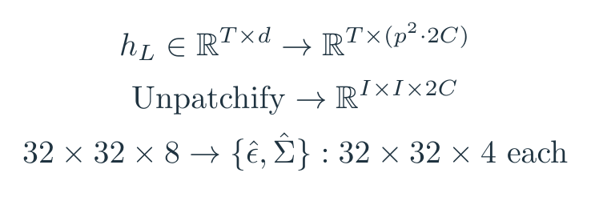

一份预测噪声，一份参数化反向扩散的对角协方差。前面写的 MSE 训练噪声；学习方差还使用完整变分目标中的 KL 项。**基础扫盲：KL 散度**衡量一个概率分布相对另一个的差异，在这里帮助调整反向一步该有多大的随机性。它不是像素误差，也不是把八个输出通道统一拿去和噪声做 MSE。

生成时噪声预测参与每一步反向更新，最终 z₀ 经 VAE decoder 成图。类别引导还用了 CFG：训练时有时丢掉类别，采样时比较有类别与无类别的预测。εᵤ 表示无条件预测，ε꜀ 表示条件预测，s 为引导强度。<!-- evidence:C15 -->

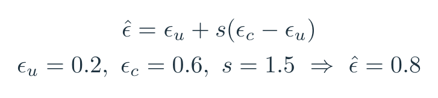

教学例子里 0.2、0.6、1.5 得到 0.8，展示的是“沿类别带来的变化再走一点”。这里有个细节值得留心：**本文主结果的引导只作用于潜变量前三个通道**，附录也比较了四通道引导；不同设定不能看见一个 scale 就当同一实验。<!-- evidence:C16 -->

## 4 实验设置：总图 D，先分清四本账

结构比较在 ImageNet 256×256 上，统一训练 40 万步，不加 CFG，以 FID₅₀K 比质量。训练 batch 为 256，学习率固定 10⁻⁴；采样基准使用 250 步 DDPM。**FID**比较真实与生成图像的特征分布，越低越好；50K 表示生成五万张计算，不能和一万张估计值混排。<!-- evidence:C17 -->

第一本是参数量，第二本是单次网络前向 Gflops，第三本是整个训练计算，第四本是生成一张图调用许多次网络的采样计算。Gflops 表示十亿次浮点运算量，本文不是直接拿秒表计时。训练图中的近似计算量，按前向计算×batch×训练步数×3 估算，3 包含反传约两倍前向的开销。<!-- evidence:C18 -->

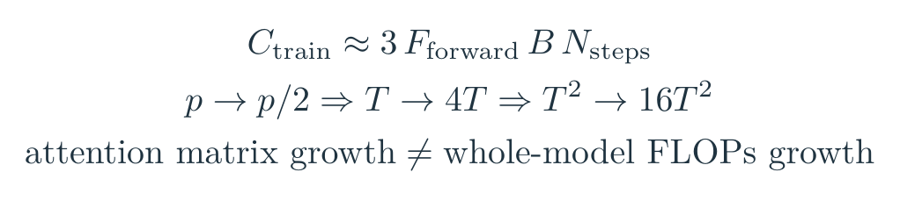

这四本账别搅成“模型越大越好”一句话。参数像厨房设备数量，前向计算是做一轮用了多少工；训练做了多少轮、出菜时又返工多少轮，是另外两件事。

## 5 实验：到底哪种“大”有用

### block 比较：先把接口选对

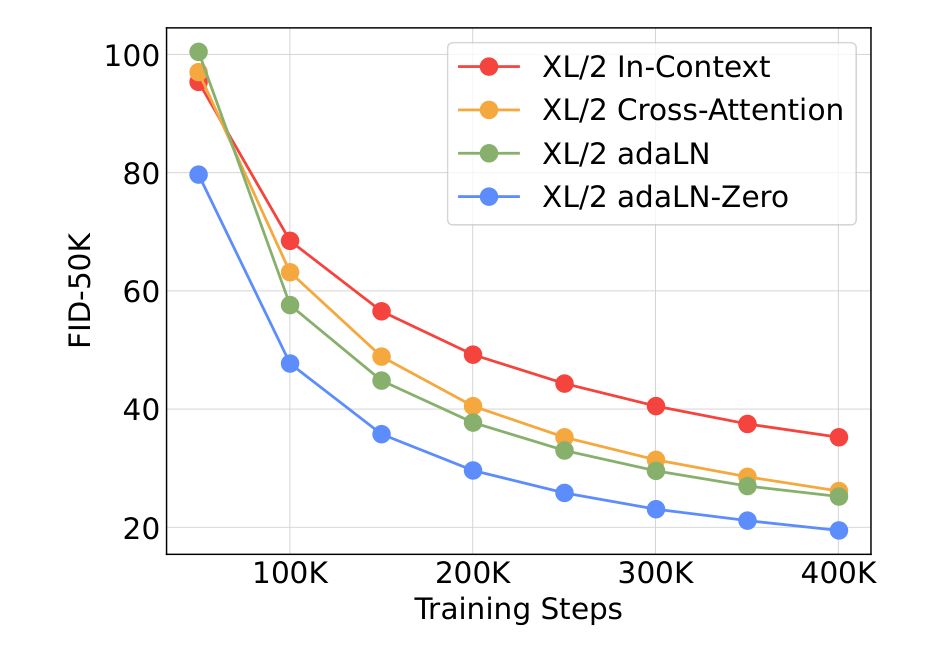

论文 Fig. 5。**adaLN-Zero 在这组比较里学得更好。** 横轴是训练步数，纵轴 FID₅₀K，向下更好；四色线对应四种条件 block。看终点，也看曲线是否持续下降。40 万步时，adaLN-Zero 为 **19.47**，普通 adaLN 为 **25.21**，cross-attention 为 **26.14**，in-context 为 **35.24**。<!-- evidence:C19 -->

这不等于“只改一个零初始化，所有参数和运算都完全一样”：四种实现的参数数目不同，cross-attention 的前向计算也更高。图证明的是这组可用设计里 adaLN-Zero 更合适，不能把所有差距只结算给“Zero”一个字。

### 规模与 token：两个旋钮都能拧

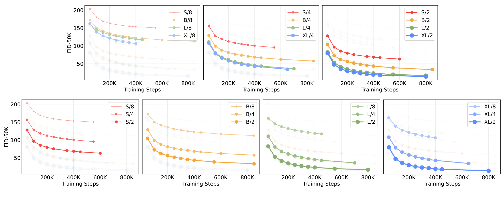

论文 Fig. 6。上排分别固定 patch 大小，比较 S/B/L/XL；下排固定模型大小，比较 /8、/4、/2。每个小图横轴训练步数，纵轴 FID₅₀K，颜色由各自图例解释。先读同一格：越大模型通常越低；同一个模型，较小 patch 也通常更低。再跨格比较，才会发现 **“把宽度深度做大”和“把 token 做多”是两条不同的扩展路线。**<!-- evidence:C20 -->

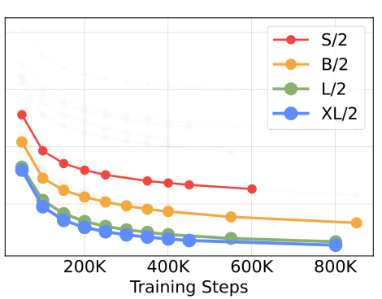

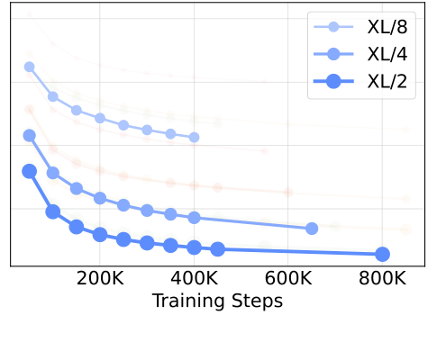

论文 Fig. 6 的两个局部放大，分别对应固定 /2 和固定 XL。局部沿用全图共享的 FID 纵轴，这里主要看曲线趋势；具体读数回到完整图和下文数值对照。先盯上排最右 /2：同样切法下，看四种模型的纵向差距；再盯下排最右 XL：同样主干下，看三种切法的差距。别一口气盯十二条线，眼睛也需要 batch size。

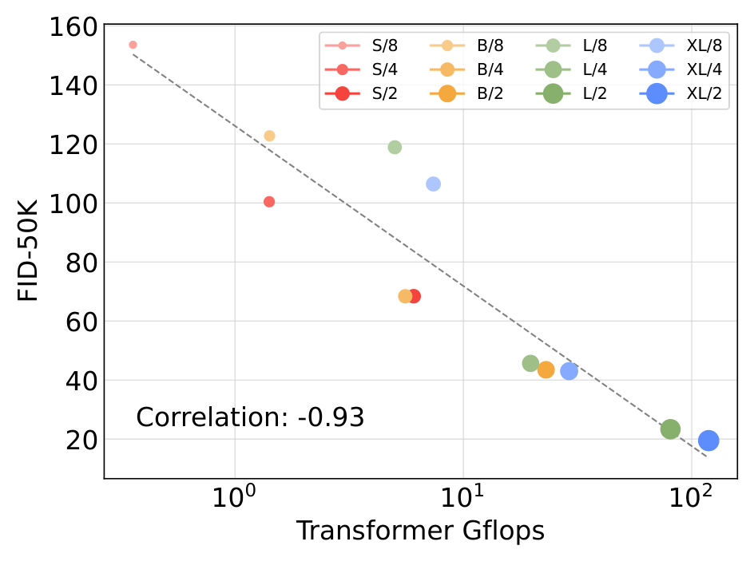

论文 Fig. 8。横轴为单次 Transformer 前向 Gflops，采用对数刻度；纵轴是 40 万训练步后的 FID₅₀K。每个点是一个规模/patch 配置，颜色与标记用于辨认模型配置，灰色虚线展示总体趋势，相关系数为 −0.93。点往右下聚集，说明在这个实验族里计算量和质量高度相关。<!-- evidence:C21 -->

一个具体对照很有意思：**S/2 约 3300 万参数、6.06 Gflops、FID 68.40；B/4 约 1.30 亿参数、5.56 Gflops、FID 68.38。** 参数差近四倍，计算和 FID 却接近。只拿参数量衡量“多大”，就漏掉 token 这根杠杆。<!-- evidence:C22 -->

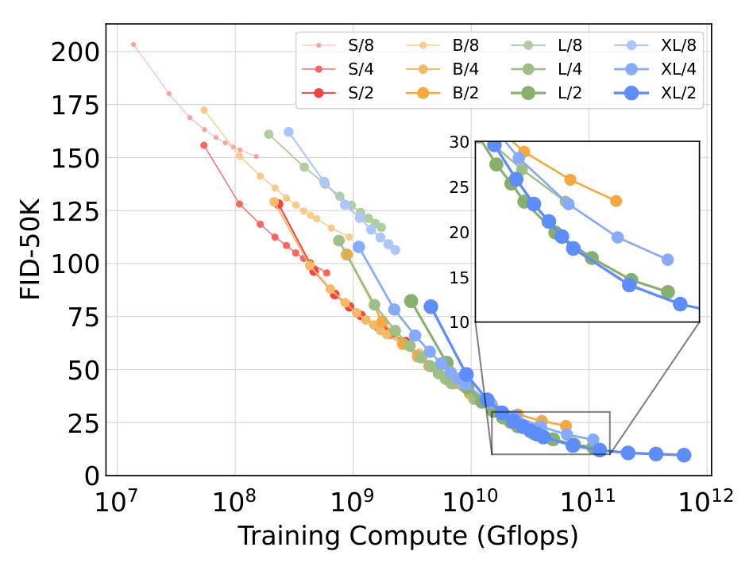

论文 Fig. 9。它把横轴换成累计训练 Gflops，同样是对数刻度；纵轴仍是 FID₅₀K。不同颜色与线型代表模型/patch 配置。此时比较同一横坐标附近，才接近“相似训练预算谁更值”。更大的模型在这些曲线上仍有优势，而且没有明显进入饱和。但这里只覆盖作者测试的配置，不是一张放之四海皆准的算力兑换券。

### 5.1 最强结果：别把有无引导混着报

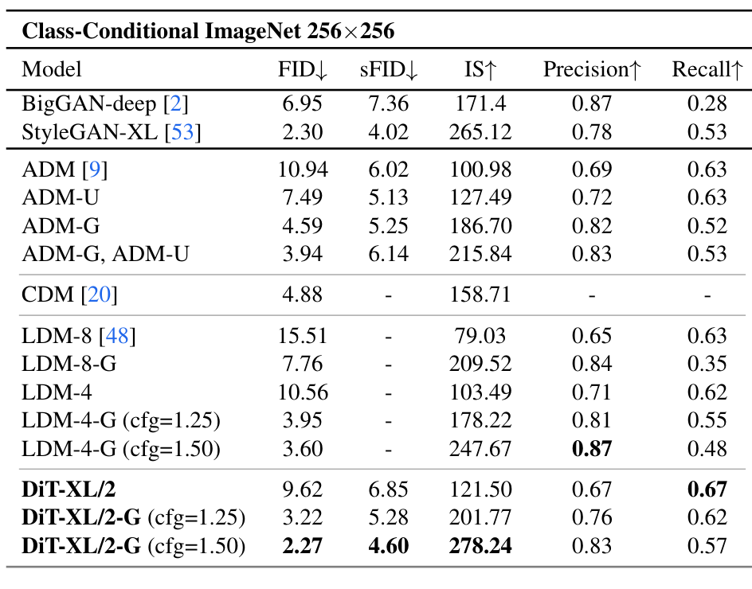

论文 Table 2。表通过模型名后的 G 或 cfg 标出引导设置，列出 FID、sFID、IS、precision、recall。sFID 更关注空间特征分布，仍是越低越好；IS 借分类器衡量类别清晰度和多样性，越高越好。缺格代表该比较项未报告。先看 **256×256 的同任务组**：DiT-XL/2 在训练 700 万步、CFG=1.5 的设置下，FID 为 **2.27**，LDM-4-G 为 **3.60**。同一个 DiT 不做引导时为 **9.62**，所以 2.27 绝不是裸模型一步改主干的成绩。<!-- evidence:C23 -->

precision 和 recall 可以粗略理解为“生成样本有多像真实分布”与“覆盖得有多广”。这里 DiT 的 recall 为 **0.57**，LDM-4-G 为 **0.48**；precision 则是 **0.83 对 0.87**。读到这就知道，不能一句“全面领先”把两个方向涂成一种颜色。<!-- evidence:C24 -->

还有计算：DiT 前向约 **118.6 Gflops**，LDM-4 约 **104 Gflops**，像素空间 ADM 约 **1120 Gflops**。相对 ADM 省很多，相对 LDM 则不是更少前向计算。这些值也不把 VAE 解码成本算进去。<!-- evidence:C25 -->

512×512 时，潜变量变成 64×64×4，/2 对应 **1024 个 token**；模型仍约 6.75 亿参数，前向变成 **524.6 Gflops**。训练 300 万步的引导 DiT 达到 **FID 3.04**，优于表内引导 ADM 加上采样器的 **3.85**；StyleGAN-XL 为 **2.41**，所以作者强调的是扩散模型这一组的表现。<!-- evidence:C26 -->

附录还提醒我们看 VAE：换 decoder 后 FID 能从 **2.46→2.30→2.27**，编码器与扩散网络不因此重训。成图质量是整条链的结果，主干之外的零件也在出力。<!-- evidence:C27 -->

### 5.2 小模型慢慢想，能追上大模型吗

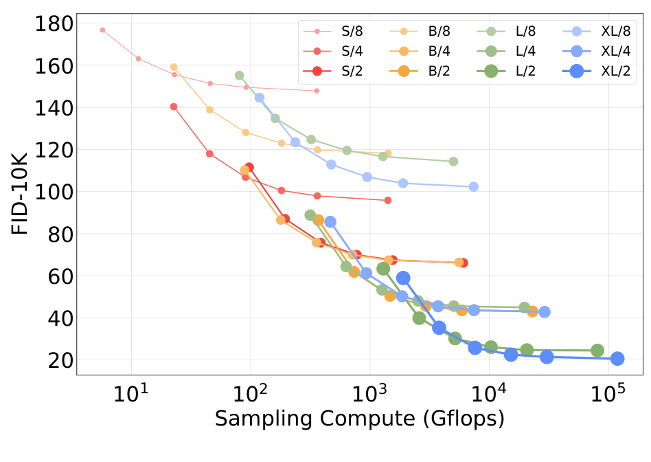

论文 Fig. 10。横轴为**生成一次样本累计的采样 Gflops**，对数刻度；纵轴是 **FID₁₀K**，这次一万张，别和刚才 Table 2 的五万张直接接表。每条线是训练 40 万步的一个模型配置，沿线的点把采样步数从 16 增到 1000。<!-- evidence:C28 -->

多去噪几步通常有帮助，但帮到哪里要看主干。L/2 跑 **1000 步**，约 **80.7 Tflops，FID 25.9**；XL/2 跑 **128 步**，约 **15.2 Tflops，FID 23.7**。后者采样计算约是前者五分之一，还更好。小网络不是给够加班费，就自动升级成大网络。<!-- evidence:C29 -->

这对应总图 **D** 最后那本账：训练得到的预测质量和采样数值积分的精细程度，是两种来源。一个噪声预测器本身更准确，少走一些步也可能胜出。反过来，把同一个误差较大的预测器重复调用更多遍，收益会变缓。

## 6 结论：三个问题，分别落地

**第一，图像怎么变 token，又怎样回来？** A 区用固定 VAE 得到低分辨率潜变量，切 p×p patch，投影到 d 维，加位置编码；B 区让 token 互相交换信息；C 区逐 token 输出、拼回噪声和方差网格，反复去噪后再由 VAE 解码。

**第二，条件怎么进来，“零”帮了什么？** 时间与类别嵌入生成归一化调制和残差门，沿 token 共享。Zero 让 block 初始像恒等通路，随后学会逐步介入。它解决的是条件与深层计算的组织问题，不是把语言理解凭空塞给模型。

**第三，提升和计算究竟什么关系？** 更大主干、更密 token、更多训练都能在本文实验中改善质量；参数量单独解释不够。采样步数能调精细度，却不总能抵消主干能力差距。

对具身研究，我最想带走的是这个问题：**动作序列的 token 粒度，到底是在保留必要控制细节，还是只把算力吃掉？** 图像 patch 越小，作者在这些实验里得到了收益；动作里还得看采样频率、接触时刻与闭环延迟。把 DiT 接到动作上时，值得继承的是分账实验的习惯，而不是看见 XL 就直接下单。

本文沿 [ReadPaper](https://github.com/Zhu-Huixiang/ReadPaper) 精读，并用 [DrawPaper](https://github.com/Zhu-Huixiang/ReadPaper/tree/main/drawpaper) 整理架构。点击“阅读原文”可看 GitHub 解读、高清图与公式源文件。可复制工具地址：https://github.com/Zhu-Huixiang/ReadPaper

---

公众号版由管理员在后台手动公开发表；永久文章链接待发表后补充。

关注公众号 **具身智能的 World**：

[原论文](https://arxiv.org/abs/2212.09748v2) · [证据索引](evidence.json)

[本篇知识星系](../../universe/papers/dit.md) · [知识点宇宙](../../universe/README.md)
