# DreamerV3：脑内练习，怎么没练成“幻想高手”？

这里是**具身智能的 World**。我们把论文里的动作、公式和实验，一步步拆给你看。

论文解读：沿原文读懂机制与证据。

论文地图：按问题找下一篇值得读的研究。

顶会顶刊集锦：追溯正式论文与原文入口。

解读日程：查看接下来准备细讲的工作。

arXiv 新作：筛选值得留意的新研究。

具身榜：查看评分依据与阅读顺序。

知识点宇宙：把论文、技术和前置知识串起来。

GitHub：https://github.com/Zhu-Huixiang/embodied-world

强化学习有一种很磨人的情况：昨天还在游戏里大杀四方，今天换成机械臂，奖励变了，图像变了，动作也变了。算法倒是没说话，调参的人先开始怀疑人生。

DreamerV3 想挑战的，就是**换一个领域，就得重新伺候一套超参数**这件事。论文把统一配置的 PPO 和为各领域调过的专门算法放在一起比较。它的主角不是更花哨的搜索树，而是一套能学世界、在脑内练动作，还不容易被不同量纲搞崩的训练方法。<!-- evidence:C01 -->

带着三个问题往下读：

1. 世界模型究竟记住什么，又怎样从真实经验切换到想象？
2. 在想象里练策略，奖励、价值和探索怎样配合，才不会越练越飘？
3. 跨领域成绩和 Minecraft 钻石说明了什么，最值得搬到机器人里的设计是哪部分？

**论文信息**

Mastering diverse control tasks through world models。Danijar Hafner、Jurgis Pasukonis、Jimmy Ba、Timothy Lillicrap；谷歌 DeepMind、多伦多大学。本文沿 **Nature 2025 正式版本**展开，在线发表于 2025 年 4 月 2 日，Nature 640：647–653。Nature 是综合性学术期刊，这篇的看点是跨领域控制能力及支撑它的完整实验。<!-- evidence:C02 -->

论文：https://www.nature.com/articles/s41586-025-08744-2
项目：https://danijar.com/project/dreamerv3/
代码：https://github.com/danijar/dreamerv3

**阅读目录**

- Main：真正贵的，往往是换任务之后的折腾。
- Learning algorithm：世界模型、critic、actor、数值稳定，按原文四小节拆。
- Evaluation：跨域基准、Minecraft、消融与规模扩展。
- Previous work：它与 PPO、MuZero、Gato 的问题意识有何不同。
- Conclusion：回收三个问题。
- Methods：网络、优化器、经验回放与环境协议，补上实现细节。

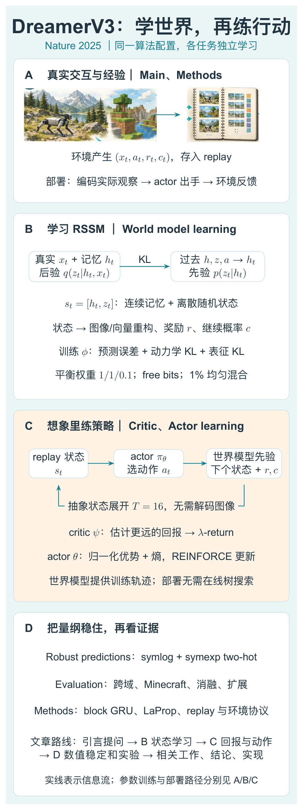

本图由 [DrawPaper skill](https://github.com/Zhu-Huixiang/ReadPaper/tree/main/drawpaper) 指挥 Codex，使用内置生图制作。

先认路。**A 是实际交互，B 是学世界，C 是脑内训练，D 是稳定这些计算的设计和实验检验。**真实轨迹先进入经验池，B 从中学“动作之后会发生什么”。C 再从经验里的状态出发，在模型中展开短轨迹，用奖励和价值训练动作策略。真正执行时走回 A：看当前观察，更新状态，actor 出手，再接收反馈。

注意这个顺序：脑内排练是在训练策略。执行时，Dreamer 直接从 actor 采样动作，不必每走一步都现场组织一场未来路径海选。接下来正文的四个方法小节，依次就是 B、C 的价值判断、C 的动作学习，以及 D 的数值稳定。<!-- evidence:C03 -->

## Main：别把“通用算法”读成“同一个万能大脑”

先把最容易误会的地方讲明白：这里的通用性，是**同一套算法与主要训练超参数，能在不同任务中分别学起来**。不是把所有游戏、机器人和 Minecraft 混进一个模型，训练完扔去哪都能干。

这两件事差得远。前者像同一套菜谱写法，换食材也能做；后者像已经做好的一锅万能汤，什么菜都能往里装。DreamerV3 主要验证的是前者。原文把跨领域共享一个世界模型放在结尾的未来方向里。<!-- evidence:C04 -->

为什么统一配置值得专门写论文？因为控制任务的信号太“各说各话”了。有的奖励每步都有，有的走很久才冒一次；有的数字不到 1，有的能蹿上几千。再加上图像细节、动作类型、记忆需求都变，损失函数里几个系数随便失衡，模型就可能忙着优化容易的部分，把真正影响行动的东西晾在旁边。

世界模型的基本承诺很诱人：真实试错费时，先在学到的模型里多练几遍。可一个模型若把世界想错了，练得越勤，越像拿错题答案刷题。DreamerV3 的工作，就是让“学世界”和“拿世界来训练”在多种任务里都站稳。

## Learning algorithm：方法先从可计算的世界开始

### World model learning：一半记忆，一半当前发现

先看原图。它要说明的核心只有一件事：**训练世界模型时，每一步都能看真实观察；想象展开时，只有起点看观察，后面靠动作和已学动力学往前推。**

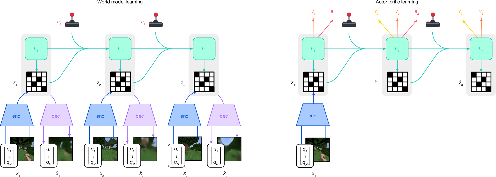

论文 Fig.1。左边逐帧用真实观察训练，右边从真实起点进入抽象状态想象。

这张图没有数值坐标轴，横向是时间推进。左半边底部的图像和向量都是观察 x；蓝色 enc 是编码器，紫色 dec 是解码器。绿色 h 是循环记忆，黑白格 z 是离散随机表征。摇杆对应动作 a。灰色竖条把同一时刻的 h、z 放在一起。绿色箭头将过去的记忆、状态与动作带到下一步。右边只在最左端保留 enc，之后黑白格上戴了帽子，表示由模型预测；黄色 r 是奖励，橙色 v 是价值，粉色 a 是动作。<!-- evidence:C05 -->

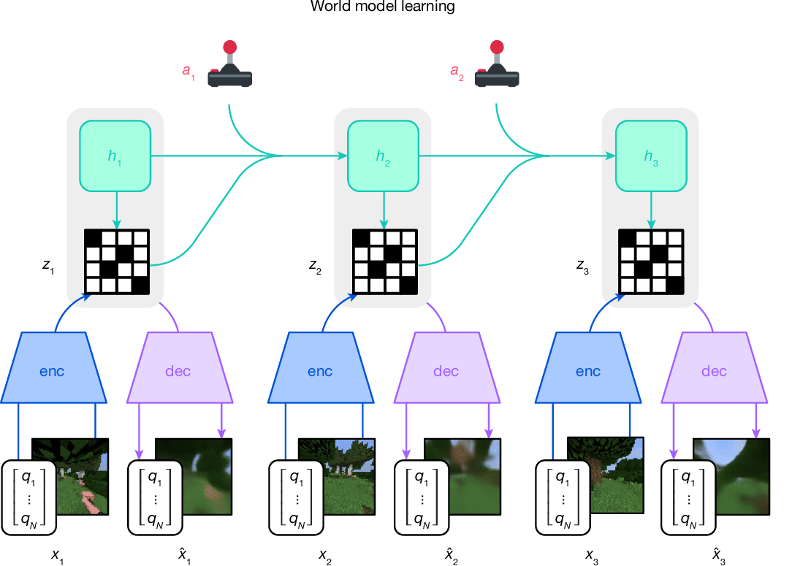

论文 Fig.1 左半部放大。沿每列从观察到状态再到重构，沿绿色横线看记忆如何向前传。

下面把符号落到具体对象上。t 是环境时间，x_t 是图像或向量观察，a_t 是动作；h_t 是记住过去的连续向量，z_t 是描述当前状态的离散随机变量；φ 是世界模型参数，q 是看过当前观察后的后验分布，p 是凭记忆预测的先验分布。帽子表示预测，方括号表示拼接。<!-- evidence:C06 -->

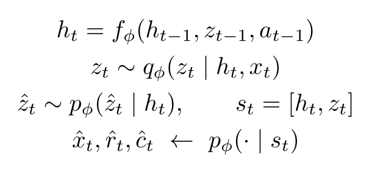

公式 1｜按原文 World model learning 的状态定义整理。

第一行：把上一步的 h、z、a 送进循环网络，得到 h_t。可以理解成“我刚才在哪里、做了什么，所以现在大概该到哪”。

第二行：当前观察 x_t 真的来了。编码器结合 h_t，产生 q，再采样 z_t。它补进记忆里还没准确预料到的信息。

第三行：如果现在在想象，就没有新的 x_t。于是用 p 从 h_t 预测 z_t，再继续滚动。

最后一行是三个读出头：从 s_t 还原观察、预测奖励、预测回合是否继续。c_t 在真实数据里是 0/1，模型预测的是继续的概率。它相当于告诉后面的价值计算：“这条分支还活着吗？”

> **基础扫盲｜潜在状态**
> 不是某种玄学空间。它就是网络内部那组便于预测和决策的数字。像看比赛时，你会记“球在左路、后卫回追、前锋有空位”，不会把每粒草的颜色都背下来。Dreamer 的状态由数据学出，而不是人工写这些字段。

离散 z 怎么反向传播？采样出来是硬选择，常规求导会卡住。论文用 **straight-through 梯度**：前向真采样，反向借用连续概率的梯度。就像出门最终选了一条路，学习时还保留“各条路当时有多大概率被选中”的信息。硬选择负责实际往前算，软概率负责把学习信号传回去。<!-- evidence:C07 -->

### 两个 KL：别让“好预测”把“有信息”挤掉

B 区有两件事要同时办：先验得预测得准，后验又得保留观察里有用的内容。要是只追求好预测，最省事的状态是“每次都一样”。好家伙，世界永远风平浪静，任务也永远学不会。

这里用到 **KL 散度**。可以把它看成两份概率判断的错位程度；它不对称，交换前后位置，结果通常会变。q 已看见当前观察，p 则是在猜它。sg 表示停止梯度：这次更新把括号里的对象当固定目标，不追着它修改。

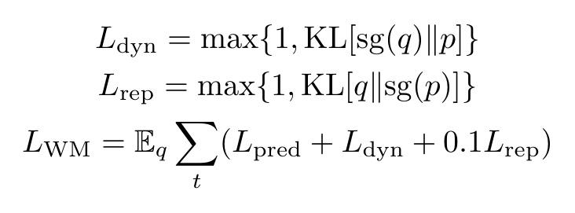

公式 2｜世界模型三项损失。省略 q、p 的条件，只为看清梯度分工。

动力学项固定 q，让 p 往它靠；表征项固定 p，让 q 别把状态编码得过分难猜。两者同时存在，却不是同等用力：Nature 版的预测、动力学、表征权重分别是 **1、1、0.1**。预测项还要求状态能重构观察、预测奖励和继续信号，防止表征缩成一张没有内容的白纸。<!-- evidence:C08 -->

max 里的 1 是 **free bits** 阈值，单位 nat，约 1.44 bit。KL 低于这个值时，这一项成为常数，不再逼着模型继续压低它。比如 KL=0.4 和 0.8 都落在这条缓冲带里；KL=3 才会继续被该项推着降。它不是“强制 KL 至少等于 1”，而是“足够接近之后，别再为这个指标卷了”。<!-- evidence:C09 -->

还有一个很小但实用的保险：分类概率混入 **1% 均匀分布**，剩下 99% 来自网络。这样一个选项不会被概率压成绝对的零，KL 也更不容易因为一次极端自信爆掉。对于有 K 个选项的分类变量，每个选项至少得到 0.01/K 的概率。<!-- evidence:C10 -->

学出来的模型到底能预测什么？下面这张原图，比“学到了物理常识”几个字实在得多。

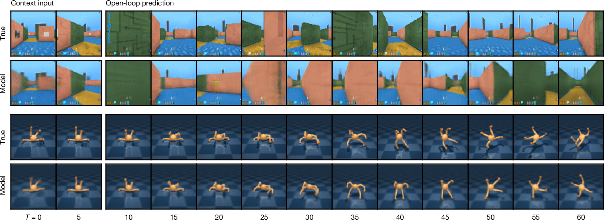

论文 Fig.3。上下对照真实帧与预测帧，看场景和动作趋势能否随着时间保持一致。

先看大的结论：给定一段真实上下文和后续动作序列，模型可以在不接收中间图像的情况下，继续预测迷宫视野、四足身体姿态等变化。它走的是架构图 B 的先验路线。

读法是沿横向时间看，每一组上排 True 是真实画面，下排 Model 是对应预测；左侧 Context input 是提供给模型的上下文，右侧 Open-loop prediction 是后续展开。底部 T 刻度标出展示帧的位置。这里纵向不是某个量的大小，而是两种来源的画面排列。看四足那一组，应关注身体倾斜、抬腿方向和落地点趋势，而不只是“像不像一张机器人照片”。

输入里给了后续动作，所以这项实验检查的是**知道动作之后能否预想后果**。到了 C 区，动作才由 actor 一步步产生。把两处接起来看，整条训练链才完整。<!-- evidence:C11 -->

### Critic learning：只想十六步，怎么惦记更远的钻石

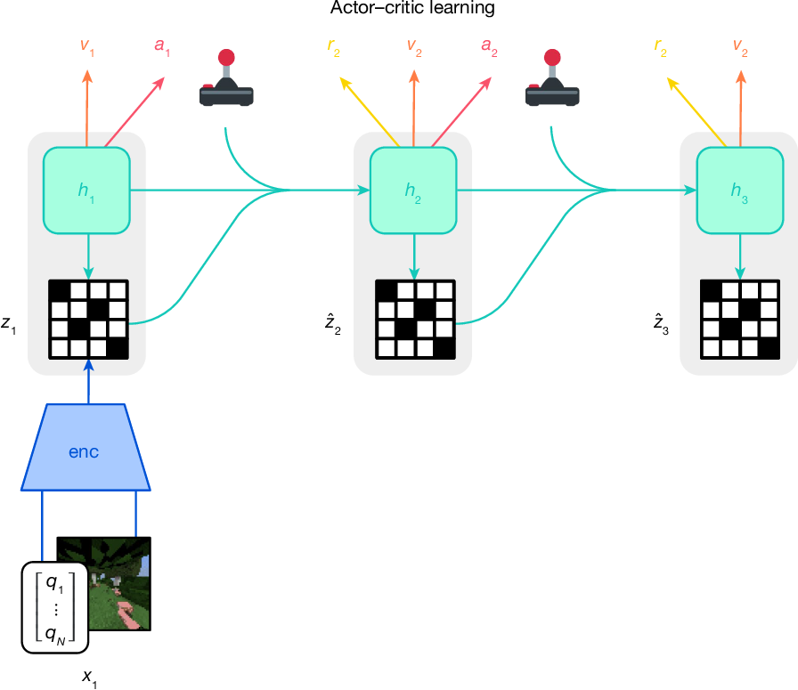

论文 Fig.1 右半部放大。只有起点编码真实观察，后面的状态、奖励与动作在模型中接续。

critic 可以叫“价值评估器”：它判断从当前状态继续照策略走，大约还能拿到多少累计奖励。奖励 r_t 是眼前反馈，价值 v_t 是对更远未来的估计，两者不是一回事。

方法正文用 T=16 表示想象序列，配置表的 imagination horizon 是 15；实现阅读时需要分清起始状态与后续转移，别把序列长度直接当动作次数。折扣 γ=0.997，λ=0.95。可 Minecraft 的钻石显然不会每十六步就自动送到手上。Dreamer 因此让短轨迹最后接上 critic 的估值，再用 **λ-return** 把眼前奖励和远期估值串起来。λ 是控制不同长度估计混合程度的系数。<!-- evidence:C12 -->

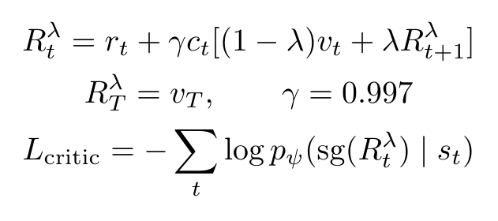

公式 3｜沿原文 Critic learning 的时间约定书写 λ-return。

先从最后的 R_T^λ=v_T 开始，倒着计算。对前面的每一步，把当前 r_t 加上后续价值；c_t 会在终止时把后半段切断。v_t 是 critic 分布的期望读数，ψ 是 critic 参数，p_ψ 是它对回报的概率预测。上标 λ 是“这种回报估计”的名字，不是次方。

来个只用于算账的例子：取 r=1、c=1、γ=0.9、λ=0.5、v=4，下一步的 λ-return=6，那么当前估计是 1+0.9×(0.5×4+0.5×6)=5.5。若这一步回合结束，c=0，就只剩当前奖励 1。例子里的参数为了好算，和论文配置分开。<!-- evidence:C13 -->

critic 不只吐一个孤零零的实数，而是输出回报分布，后面会讲这种分布如何表示。训练时拿 λ-return 当目标，提高对应回报的预测概率。Nature 版还让 critic 学经验池中的真实轨迹，权重 0.3；想象轨迹的价值损失权重是 1。这样奖励模型暂时猜不准时，真实奖励还能提供一条校正路线。<!-- evidence:C14 -->

它还把 critic 往自身参数的指数滑动平均版本约束，减少自举目标来回晃。奖励头和 critic 的输出权重从零开始，避免随机初始化一上来就幻想出巨额回报。先别宣布财富自由，连第一块木头都还没挖呢。

### Actor learning：奖励换了单位，探索别跟着抽风

到架构图 C 的 actor。策略 π_θ 根据状态 s_t 给动作分布，θ 是策略参数。它需要兼顾两件事：多选带来好回报的动作，同时保留适量探索。

困难来了：一个任务奖励 1 分，另一个奖励 1000 分，同样的探索系数会被后者的回报项盖过去。粗暴地把所有波动都放大到同一个标准差，也不行——稀疏奖励下几乎全是零，一点估计噪声可能被放大成“重大商机”。

Dreamer 用回报分布的第 95 与第 5 百分位之差估计尺度 S，再以 0.99 做指数平滑。分母至少取 1，只把很大的回报压小，不把很小的信号硬抬起来。这里 Per 表示百分位数，EMA 是指数滑动平均。<!-- evidence:C15 -->

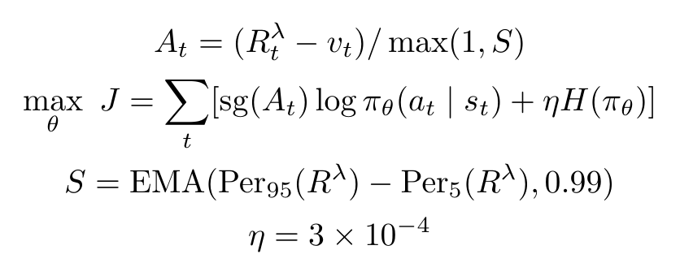

公式 4｜将论文的策略学习写成最大化目标，便于看清熵项鼓励探索的方向。

A_t 是归一化后的优势：这次回报 R_t^λ，比 critic 原先预期 v_t 好多少。它不是“动作 a”的大写版本。H 是策略熵，表示动作分布的分散程度；η=3×10⁻⁴ 是熵系数。

如果一批回报主要落在 20 到 120，尺度约 100，那么优势 10 归一化后是 0.1。若回报只在 0 到 0.01 摇晃，分母仍是 1，0.01 就不会被拔高成 1。第二种情况，探索项更有机会继续推动尝试。<!-- evidence:C16 -->

策略用 REINFORCE 梯度估计，离散和连续动作都走这条路线。它看“采到的动作后来比预期好多少”，好就提高其概率，差就降低。**这里不是直接对环境里的动作后果做解析求导，再一路穿过世界模型更新 actor。**世界模型提供想象轨迹，策略按采样动作的对数概率来学。这个区别对看过 Dreamer 早期版本的读者尤其重要。<!-- evidence:C17 -->

### Robust predictions：别让一个大数字把全场音量拉爆

前面已经有尺度归一化，为什么还要这一节？因为那处理的是 actor 的回报权衡；世界模型重构向量、预测奖励和 critic 学回报时，也会碰上大数值。

先看 **symlog**：带符号的对数压缩。正数和负数都能处理，接近零时变化又近似线性。u 是压缩后的数，symexp 是逆变换。

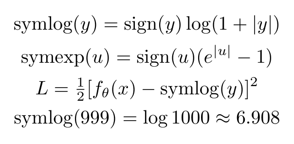

公式 5｜原文 Robust predictions 的双对称变换，以及一个数值例子。

999 被压到约 6.908，−999 被压到约 −6.908；0 仍是 0。模型学习压缩后的目标，读出时再还原。相当于给跨度离谱的数字配了一个更好用的音量旋钮，大信号不会一嗓子把小信号吼没。<!-- evidence:C18 -->

但奖励和回报可能有多个结果峰值，单靠平方误差仍嫌简单。Nature 版进一步使用 **symexp two-hot**：在原始值轴上摆一组指数间隔的桶，让网络预测落在各桶的概率。

b_i 是第 i 个桶的位置，p_i 是预测概率，y 是真实连续目标。two-hot 编码只给 y 两边的相邻桶分配权重，其余为零。桶位置来自 −20 到 +20 的等距点再经过 symexp。它们在原值轴上越往外越稀疏。<!-- evidence:C19 -->

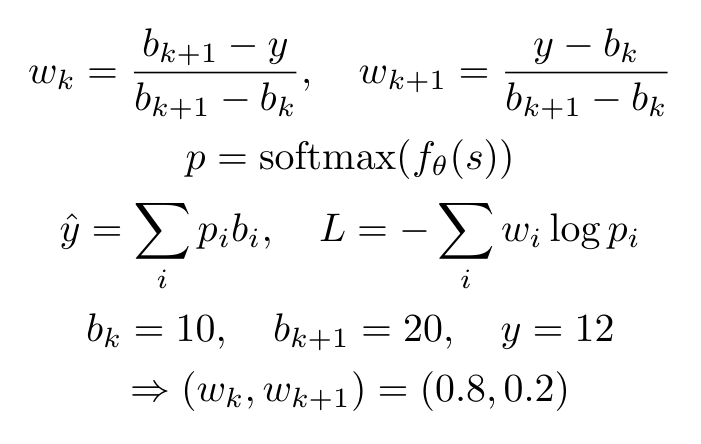

公式 6｜按原文 Distributions 的 two-hot 定义展开；下行用假设桶演示插值。

比如相邻桶是 10 和 20，目标 12 就写成 0.8 和 0.2。输出读数为概率加权的桶位置，因此可以落在桶与桶之间，**不是强行把所有回报四舍五入到桶中心**。训练用交叉熵，只比较概率分配；损失对网络输出的梯度不再直接随目标数值暴涨。<!-- evidence:C20 -->

到这里，D 区的“稳定”才有具体内容：有些变换管大数，有些阈值管过度压缩，有些归一化管探索比例。它们不是一把叫“归一化”的万能钥匙。

## Evaluation：先看跨域，再看钻石

### Benchmarks：蓝柱高，但别把不同纵轴混起来

先给结论：在论文覆盖的八类领域中，同配置 Dreamer 的总体表现超过同配置 PPO，并在多个领域达到或超过相应专门方法。控制套件包括仿真机器人任务；这里的机器人证据主要在模拟环境里。<!-- evidence:C21 -->

论文 Fig.4。每个小图在自己的任务集合和交互预算下比较算法，跨小图不直接比柱高。

这图看起来是一排柱子，其实是八场不同规则的比赛。深蓝是 Dreamer，青色是统一配置 PPO，灰色是为领域调过的专门方法。横向列的是方法，不是训练时间；纵轴 Score 是该基准的汇总指标。每格上方标任务数和预算。比如视觉控制的 900 刻度，和 Minecraft 的 9，不能读成前者能力高一百倍。

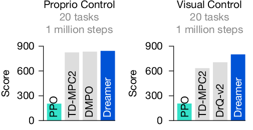

论文 Fig.4 控制任务两格放大。左为本体状态输入，右为视觉输入，各自比较同一任务集合上的平均回报。

先挑与具身最直接相关的两格：**Proprio Control** 给本体状态向量，**Visual Control** 给图像；都用相同的 20 个连续控制任务，预算 100 万环境步。本体状态下 Dreamer 与 DMPO、TD-MPC2 相近；视觉输入下，它高于图里的 DrQ-v2 和 TD-MPC2。补充 Table 5/6 的平均回报给出了具体读数：本体输入 Dreamer **843**、DMPO **834**、TD-MPC2 **825**；视觉输入 Dreamer **802**、DrQ-v2 **705**、TD-MPC2 **634**。这都是各自 20 项任务的平均回报，不是成功率。这个组合比只报一个平均分更有意思：世界模型在“从高维观察里形成可预测状态”这一关确实有用武之地。<!-- evidence:C22 -->

| 视觉任务平均回报 | 分数 |
| --- | ---: |
| Dreamer | 802 |
| DrQ-v2 | 705 |
| TD-MPC2 | 634 |

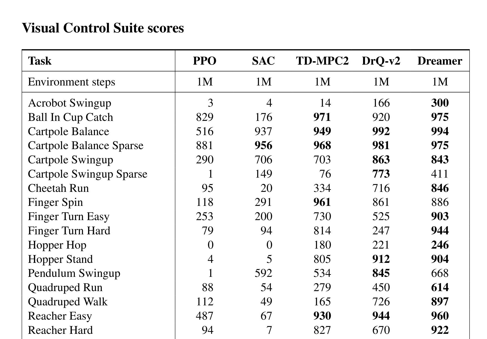

补充 Table 6。列为算法，行为具体任务，底部区分平均与中位数；窄表摘出平均值便于手机阅读。

看完整表还能发现，Dreamer 在稀疏摆杆等单项并不领先。均分优势来自整组任务的表现，选型时仍要回到与你机器人最接近的那一行。

另一项值得单独拎出来的是 DMLab：Dreamer 使用 **1 亿步**，超过论文对比的 IMPALA 在 **10 亿步**的汇总成绩。比较涉及 30 项三维任务；Dreamer 的一般基准实验跑 5 个种子。这里展示的是较少交互下达到更高成绩，计算时间还要另算。<!-- evidence:C23 -->

Atari100k 则必须把协议看细。名字里的 100k 指动作重复之后的 10 万次决策，原始环境帧预算是 40 万。原文把会提前重置关卡的 EfficientZero 单独讨论，因为提前重置增加数据多样性；Fig.4 这一格选了 TWM、IRIS 作比较。论文认真处理的协议差异，读解读时也别一笔划成“全面第一”。<!-- evidence:C24 -->

### Minecraft：每次训练都发现钻石，不等于每局都能挖到

Minecraft 最容易被浓缩成一句热闹标题：一个智能体靠做梦，自己挖出了钻石。

先把它实际面对的游戏说清楚。观察除了 **64×64×3** 的第一人称图像，还有物品计数、已达里程碑、当前装备、生命、饥饿和氧气等信息。动作空间是 **25 个离散动作**，包括移动、视角和抽象合成动作；方块破坏速度也做了加速。每个回合上限 36,000 步，即 20 Hz 下 30 分钟。<!-- evidence:C25 -->

奖励并不是最后挖到钻石才给一次。它沿科技树设置 **12 个里程碑**，每种首次取得给 +1，例如木头、木镐、石镐、铁镐，最后到钻石；还含少量生命变化奖励。难点在于：奖励虽分了台阶，怎么探索、哪些东西得多收几次、工具链怎么接起来，仍需智能体自己学。<!-- evidence:C26 -->

论文跑了 **10 个 Minecraft 训练种子**，全部在 1 亿环境步内发现过钻石。对比的 PPO、Rainbow、IMPALA 能推进到较晚物品，但这些实验中没有发现钻石。每个 Dreamer agent 的训练使用 1 张 A100，论文给出的 Minecraft 耗时为 9 天；它还使用远端 CPU 运行 64 个环境实例。<!-- evidence:C27 -->

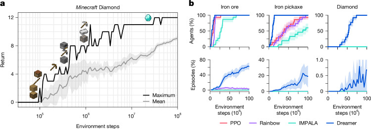

论文 Fig.5。左图看科技树推进，右上与右下分别读“训练种子曾成功”和“回合取得物品”。

左图横轴是对数刻度的环境步数，纵轴是 Return；黑线画最好回合，灰线画平均回报，阴影是一个标准差。黑线到 12 不表示平均回报也到 12。右侧三列依次是铁矿、铁镐、钻石；横轴改成百万环境步。上排 Agents (%) 的分母是训练运行，下排 Episodes (%) 的分母是回合。蓝色 Dreamer、红色 PPO、紫色 Rainbow、青色 IMPALA 要在同一小图里比，尤其注意钻石回合图的纵轴只到 1.0%。

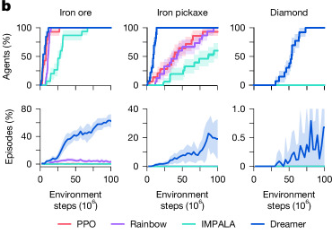

论文 Fig.5 右半部放大。上排钻石到 100%，下排的刻度仍在百分之一以内，两个纵轴的分母完全不同。

“全部训练种子曾成功”问的是重复训练会不会总有一部分彻底学不出来；“每回合成功率”问的是训好之后稳定到什么程度。这两个分母必须分开。把前者偷换成每局 100%，钻石是挖出来了，统计学被埋进去了。

这项结果让我在意的，倒不是它能不能代替玩家。它把短期想象、长期价值和持续探索接到了一个有较长前置链条的任务上。搬回机器人领域，就对应一个很朴素的问题：眼前动作没有立即奖励时，能否持续学到对后续有用的状态和行为？

### Ablations：那些小修小补，拆了才知道多要命

论文 Fig.6。a/b 检查稳健技巧和学习信号，c/d 检查模型规模与经验复用。

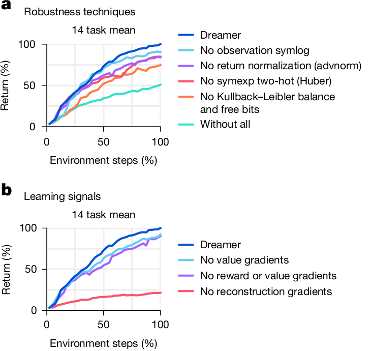

论文 Fig.6 a/b 放大。先看图例对应删掉了什么，再读曲线差距。

先读左上 a。横轴 Environment steps (%) 把各任务预算归一到百分比；纵轴 Return (%) 也做了归一，图例写的是 **14 个任务平均**。深蓝完整 Dreamer 最高；拿掉 KL 平衡和 free bits 的橙线明显变差，全拆掉的青线更低。紫色移除回报归一化，红色替换 two-hot，浅蓝去掉观察 symlog。不同颜色代表不同训练改动，不是不同随机种子。<!-- evidence:C28 -->

这张消融告诉我们前面那些公式不是装修。尤其 B 区那对“让状态可预测、但别压没信息”的约束，一旦失衡，C 区再努力也只能在质量不佳的状态上练。

左下 b 更值得停一会。去掉价值梯度，或去掉奖励与价值梯度，曲线接近完整版本；去掉重构梯度，红线低得多。这里去掉的是这些信号**塑造表征的梯度**，不是把 actor 的奖励目标删除。原文据此认为，世界模型的无监督重构信号在这组实验里承担了主要表征学习作用。<!-- evidence:C29 -->

说人话：学行动之前，好好看世界这件事没有白做。但重构也不是越精美越好——前面还专门用 KL 调节，避免状态被无关细节塞满。把两处放一起，才是完整答案。

### Scaling properties：少交互的代价，通常是多计算

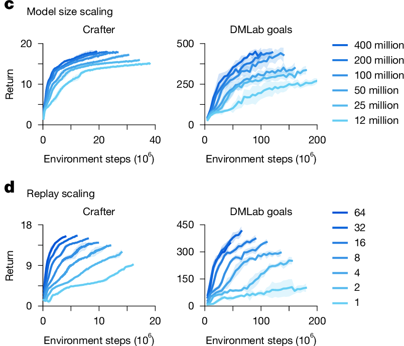

论文 Fig.6 c/d 放大。上排改变模型规模，下排改变经验复用量，横轴都是环境交互预算。

继续看 Fig.6 右上 c。横轴是环境步数，括号里的 10⁶ 表示以百万步计；纵轴是两个任务各自的 Return。颜色越深，模型越大，从 **1200 万到 4 亿参数**共六档。在 Crafter 与 DMLab goals 这两项实验里，较大模型通常学得更快、成绩更高。<!-- evidence:C30 -->

右下 d 换了自变量：模型的 replay ratio，也就是采来一份经验之后做多少训练。图例从 1 到 64。更高复用让同样交互数量的经验产生更多梯度更新，曲线相应更快抬起来。阴影显示种子之间的一个标准差。

所以，“更省交互”并不是“所有资源都更省”。如果机器人每次试错都费时间甚至磨损零件，多花 GPU 算力来复用经验很划算；如果环境模拟快得飞起，另一种取舍也可能合理。论文 Methods 提到，在相应训练比例比较下，PPO 可以跑得更快。你要优化的是实验室真正缺的那种资源。<!-- evidence:C31 -->

## Previous work：它接过的是哪条线

现在回看论文后置的相关工作，区别会清楚很多。

PPO 代表直接用交互经验更新策略的常用路线。Dreamer 多学一个世界模型，用它制造训练轨迹，代价是模型本身要训练、要预测靠谱。

MuZero 也用模型，但其路线强调基于价值预测模型的在线规划；Dreamer 把想象中的练习更多沉淀进 actor，执行时直接采样动作。

Gato 的多任务专家数据训练，与这里“同一算法在各环境里自己继续试错学习”的设定不同。Nature 版的 Previous work 还提到 TD-MPC2：它将学到的动力学与在线规划结合，也采用了 Dreamer 的一些稳健技巧。<!-- evidence:C32 -->

所以这几篇不只是按发布时间排成一根进度条。它们回答的提问不同：知识来自哪里？模型在训练还是执行时用？统一的是算法，还是一个已经训练好的参数集合？沿这三条看，世界模型这片领域就不那么像缩写大乱斗了。

## Conclusion：三个问题，现在能接上了

**第一，世界模型记什么？**连续记忆 h 加离散随机状态 z。真实观察校正后验，历史和动作推进先验；重构、奖励和继续预测让状态保留可用信息。想象从真实经验的状态起步，再由先验与 actor 循环展开。

**第二，怎么防止脑内训练越练越飘？**短想象接上 critic 的长回报；策略用归一化优势与熵维持学习和探索；symlog、two-hot、KL 平衡、free bits 等分别处理不同的不稳定来源。真实经验持续回来训练世界模型，也为 critic 提供额外约束。

**第三，实验最值得带走什么？**在明确的预算和环境协议下，这套配置跨越多类任务，Minecraft 的十个训练种子都曾取得钻石；消融则把功劳指向表征学习和稳健设计。对于具身控制，我最想继续追问的不是“能不能做更长的梦”，而是：接触突然变化、模型开始猜错时，哪些状态值得保留，哪些训练信号能及时把它拉回来？

做梦提供了更多练习机会。真正让这些练习变值钱的，是梦里的每一笔账，最后都得跟环境对得上。

## Methods：把实现里藏着的几颗螺丝拧出来

这一节对应原文后面的 Methods。前面给了因果链，这里补能影响实现理解的细节。

### 网络：大记忆，不必把矩阵平方放大

图像编码器用步幅 2 的卷积，把空间分辨率缩到 6×6 或 4×4 后展平；解码器反过来用转置卷积。向量输入先 symlog，再走三层 MLP；actor 和 critic 也是三层 MLP，奖励和继续预测头是一层 MLP。这里 MLP 就是多层全连接网络。<!-- evidence:C33 -->

循环状态用 **block GRU**。GRU 是带门的记忆更新：哪些旧信息留下、哪些新信息写进来，由网络学。block 则把循环权重切成八块，避免记忆维度扩大时，循环矩阵的计算量完整按平方增长。每步输入还会混合 z、a 和循环状态，让块之间能交换信息。

用原文的模型维度 d 表示：MLP 隐藏宽度为 d，循环记忆有 8d 个单元，分成八块；靠近数据的卷积通道数是 d/16，每个离散 latent 的类别数也是 d/16。以默认约 2 亿参数模型为例，d=1024，h_t 有 8192 个记忆单元，每个离散 latent 有 64 个类别。潜变量个数在不同模型规模间保持固定。这里 d 是模型容量旋钮，和前面的环境时间 t 完全两码事。<!-- evidence:C34 -->

### 优化器：梯度也要有合适的刹车

自适应梯度裁剪按每个权重张量的 L2 范数设置阈值，正文采用 30% 比例。它衡量的是“这一步相对当前这块参数有多猛”，不用全模型共用一个绝对裁剪数值。

随后用 LaProp：先对梯度做 RMSProp 归一化，再做动量平滑。与 Adam 直接从原始梯度分别估计动量和尺度的次序不同。这个改变在论文实验里用于减少偶发不稳定；其余还配了 RMSNorm 和 SiLU。它们共同服务于训练稳定，而不是悄悄换了研究任务。<!-- evidence:C35 -->

### Replay：32 倍复用，不是每走一步更新 32 次

经验池是均匀采样，并搭配在线队列。一个 minibatch 先用不重叠的最新轨迹填，再从旧经验均匀补齐。采集时存入潜在状态，训练后把新计算的潜在状态写回，减少回放起点拿着过期记忆的问题。<!-- evidence:C36 -->

replay ratio 比的是**训练过的时间步数／采集到的决策时间步数**。转成优化器更新次数，还得除以 batch 里的轨迹长度和数量；若换算原始环境步，再除动作重复次数。

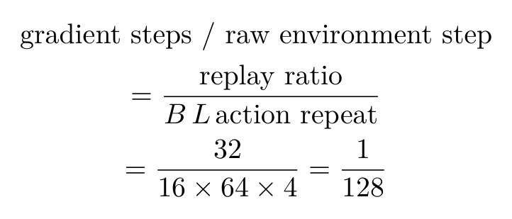

公式 7｜原文 Experience replay 的 Atari 示例。B 为 batch 中序列条数，L 为每条长度。

ratio=32、B=16、L=64、动作重复 4，于是平均每 **128 个原始环境步**对应一次梯度更新。乍一看都是“步”，单位其实换了三次。把这事算清楚，比拿一个 train ratio 数字直接抄进机器人代码靠谱得多。<!-- evidence:C37 -->

### 环境协议：把任务究竟难在哪里说清楚

Minecraft 的抽象合成和破坏加速，把“正确物品链如何发现”留下来，把“随机策略连续几百步按住同一个键”这类极难探索的输入习惯简化。VPT 使用的鼠标合成方式与数据设定不同，Voyager 则能调用更高层的脚本行为。比较它们时，要先问动作接口有多抽象，再谈用了多少 GPU。

同样，机器人上“给关节力矩”“给末端目标”“给抓取脚本”也不是同一难度。读到这里再回看开头 A 区：环境给什么观察、允许什么动作，已经决定了世界模型和 actor 实际需要学多复杂的东西。<!-- evidence:C38 -->

---

继续阅读与高清图源见本篇 GitHub 入口。论文原图来自 Hafner 等的 Nature 2025 论文，许可为 [CC BY 4.0](https://creativecommons.org/licenses/by/4.0/)；原图保持内容，局部放大另作标注。

精读工具：[ReadPaper](https://github.com/Zhu-Huixiang/ReadPaper) · 绘图工具：[DrawPaper](https://github.com/Zhu-Huixiang/ReadPaper/tree/main/drawpaper)

可复制地址：https://github.com/Zhu-Huixiang/ReadPaper

公众号读者可点“阅读原文”，查看论文入口、高清图与相关知识点。

---

公众号版由管理员在后台手动公开发表；永久文章链接待发表后补充。

关注公众号 **具身智能的 World**：

[原论文](https://www.nature.com/articles/s41586-025-08744-2) · [证据索引](evidence.json)

[本篇知识星系](../../universe/papers/dreamerv3.md) · [知识点宇宙](../../universe/README.md)
