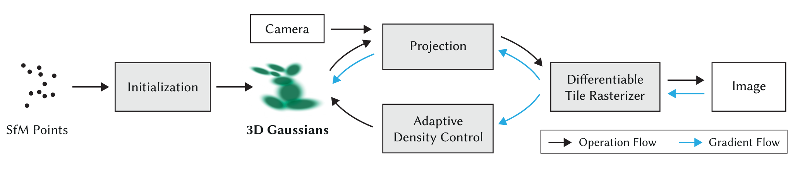
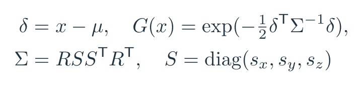
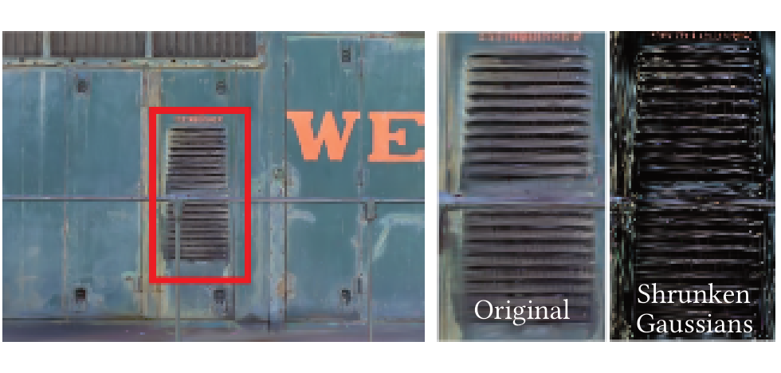
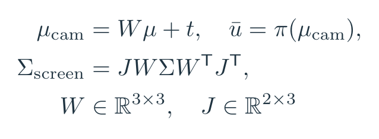
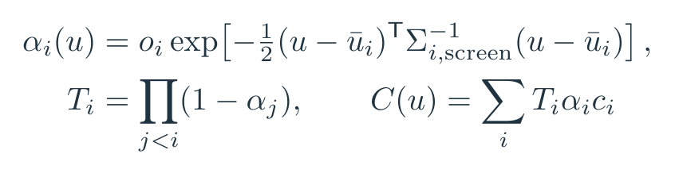
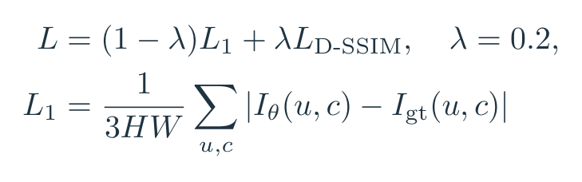
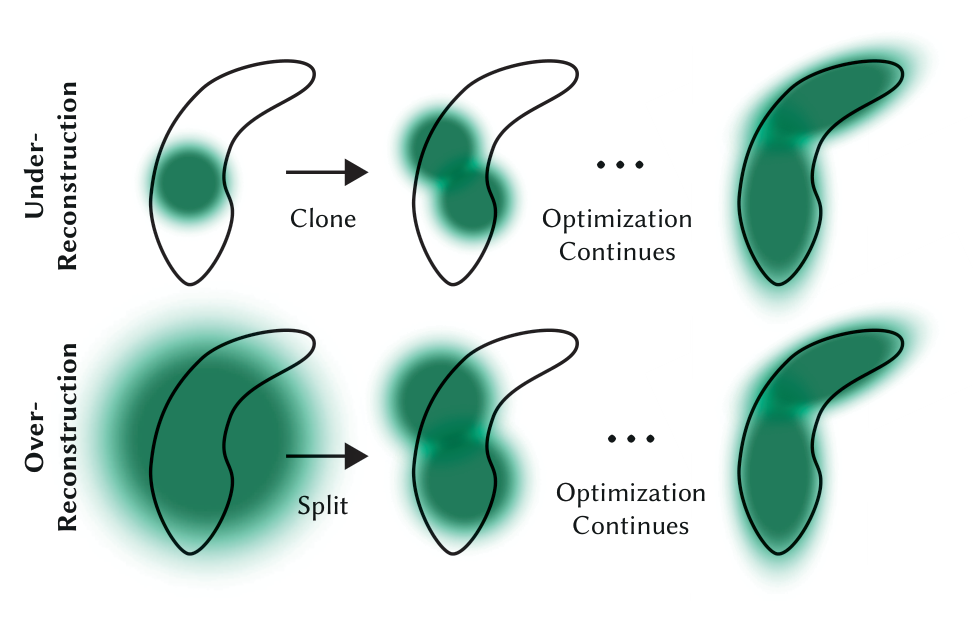
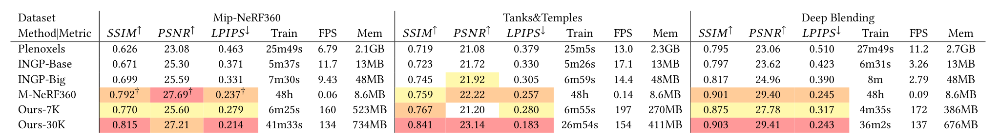
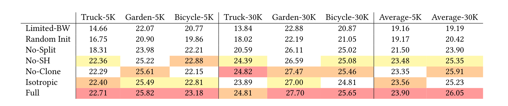
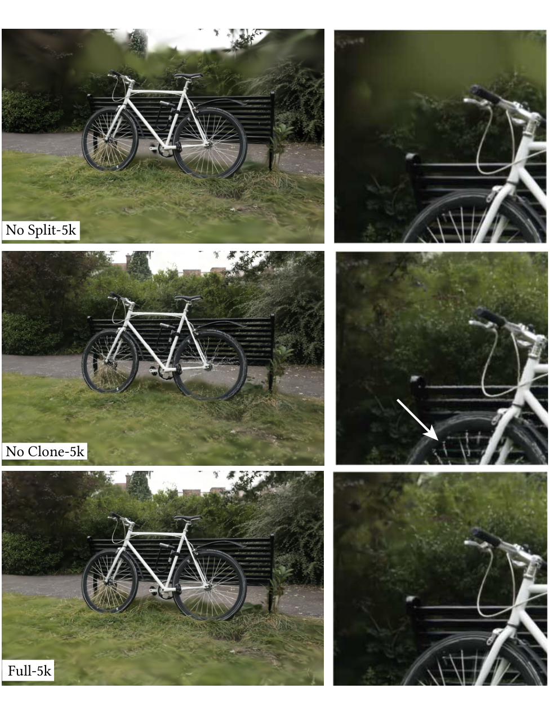

# 3DGS：不用沿光线慢慢找，撒一把椭球就能画？

**具身智能的 World**｜把值得读的论文，拆到能看懂计算的那一层。

论文解读：沿原文讲清问题、方法、公式与证据。  
论文地图：按科学问题找下一篇。  
顶会顶刊：查正式出处与原文。  
解读日程：看未来一周的阅读安排。  
arXiv 新作：看经过筛选的新研究。  
具身榜：比较七维评分与依据。  
知识点宇宙：从一个概念跳到使用它的论文。

[GitHub：Zhu-Huixiang/embodied-world](https://github.com/Zhu-Huixiang/embodied-world)

如果你已经拍了房间的一圈照片，能不能把相机挪到没拍过的位置，也看到一张像样的图？

NeRF 的办法，是学习空间位置与视角对应的颜色和密度，再沿每条光线采样、累积。质量可以很好，但每一帧的计算不便宜。3D Gaussian Splatting，也就是 3DGS，换了一个问法：**可不可以把场景直接存成一批可优化的三维图元，然后像图形学那样投到屏幕上？** 它挑战的是高质量新视角合成必须承担大量逐光线采样的成本，而不是在宣布神经网络一无是处。<!-- evidence:C01 -->

三个问题串起这篇论文：

1. 一个三维高斯到底存什么，怎么从空间椭球变成屏幕颜色？
2. 高斯的数量和位置从哪来，漏掉的细节怎样补？
3. 实时帧率靠哪几步省出来，画质与存储又付了什么代价？

**论文信息**  
3D Gaussian Splatting for Real-Time Radiance Field Rendering｜Bernhard Kerbl、Georgios Kopanas、Thomas Leimkühler、George Drettakis。法国国家信息与自动化研究所/蔚蓝海岸大学、马克斯·普朗克信息学研究所。  
arXiv 公开：2023-08-08；本篇读 v1。ACM Transactions on Graphics 42(4)，SIGGRAPH 2023，计算机图形学的重要期刊与会议发表渠道。  
[原文](https://arxiv.org/abs/2308.04079v1) · [官方项目](https://repo-sam.inria.fr/fungraph/3d-gaussian-splatting/) · [代码](https://github.com/graphdeco-inria/gaussian-splatting)<!-- evidence:C02 -->

**阅读目录**

- [1 引言：质量、训练速度、渲染速度能否一起要](#gs-intro)
- [2 相关工作：从 NeRF 到点渲染](#gs-related)
- [3 总览：照片怎样变成可渲染的场景](#gs-overview)
- [4 三维高斯：形状、投影、颜色与遮挡](#gs-gaussian)
- [5 优化：哪里该复制，哪里该拆](#gs-optimization)
- [6 光栅化：GPU 实际忙的是什么](#gs-raster)
- [7 实验与消融：把快、好看、占空间分开读](#gs-results)
- [8 结论：漂亮场景离机器人世界还有多远](#gs-conclusion)

本图由 [DrawPaper skill](https://github.com/Zhu-Huixiang/ReadPaper/tree/main/drawpaper) 指挥 Codex，使用内置生图制作。

可复制地址：https://github.com/Zhu-Huixiang/ReadPaper/tree/main/drawpaper

训练走 **A→B→C→D**：照片与相机位置初始化高斯，投影渲染后对照真值，误差再更新 B，必要时增删高斯。查看新视角时固定 B，换相机走 C→E。虚线向下是阅读顺序，不表示训练后才开始收集照片。第 3 节讲 A，第 4 节拆 B/C 的数学，第 5 节看 D，第 6 节把 C 放到 GPU 上，第 7 节检查 E。

## 1 引言：质量、训练速度、渲染速度能否一起要

这里的任务是新视角合成：给定同一静态场景的多张照片，训练一个场景表示，再从新的相机位置渲染图像。场景表示可以是网格、点、体素，也可以是一个会回答空间查询的网络。

早期 NeRF 画得好，但训练与渲染慢；后续加速方法把训练降到分钟级，复杂真实场景的画质或渲染速度仍有取舍。3DGS 想要一个可以快速训练、实时观看、细节又不错的表示。它靠的不是单独一个“高斯函数”，而是**表示、增删策略、可微渲染器一起配合**。<!-- evidence:C01 -->

## 2 相关工作：从 NeRF 到点渲染

NeRF 沿光线查询空间中的颜色与密度，把很多采样点合成一个像素。可以想成穿过半透明介质：前面挡得越多，后面颜色的贡献越少。

点渲染则从场景里已有的点出发，把点投向屏幕。孤零零的数学点面积为零，因此要给它一个覆盖范围——一个“splat”。直译成泼溅有点猛，理解成投到屏幕上的柔边笔触更顺手。

这两条路共享一件关键事：按遮挡顺序做颜色合成。3DGS 把可优化的三维高斯作为柔边图元，借图形学的投影与排序流程减少逐像素查询的成本。之前的高斯、点渲染、球谐颜色与可微渲染都提供了基础；贡献在于把这些选择组织成高效、可训练且有细节的系统。<!-- evidence:C03 -->

## 3 总览：照片怎样变成可渲染的场景

论文 Fig. 2。从稀疏点初始化，经投影渲染和损失反传更新高斯。

图先给出一个完整训练闭环。左边的稀疏点来自 SfM，中间把点扩成带形状与颜色的高斯，之后投影、排序、合成图像；下方的梯度路径将渲染误差送回参数。密度控制会在优化期间调整图元数量。右端展示的是渲染结果，不能把示意箭头理解成“一次前向就完成场景训练”。

> **基础扫盲｜SfM**：Structure from Motion，运动恢复结构。通过多张照片中的对应特征，估计相机位置与一批三维点。它给本方法一个稀疏几何起点，距离完整、无孔洞的场景表面还很远。

A 区输入多视角 RGB、估计相机位姿及稀疏点。每个点初始化一个高斯中心，其他属性也随之初始化。之后随机取一个训练视角：从高斯渲染这个视角，与已知照片比较，反传更新。新视角查看时无需再执行训练循环。<!-- evidence:C04 -->

## 4 三维高斯：形状、投影、颜色与遮挡

### 4.1 B 区：一个高斯不是一颗固定圆球

每个高斯包含：三维中心 μ、描述形状与方向的协方差 Σ、不透明度 o，以及随视角变化的颜色参数。μ 是 3 维向量，Σ 是 3×3 对称矩阵，o 是标量。

令 x 是要查询的三维位置，δ=x−μ 表示偏离中心的位移。G(x) 是这个高斯在 x 处的未归一化权重。R 为 3×3 旋转矩阵，S 是由三个正尺度 sₓ、sᵧ、s_z 组成的对角矩阵，ᵀ 表示转置。

公式 1｜原文 Eqs. (4)、(6)：中心、方向和三个尺度共同确定一个空间高斯。

在中心 δ=0，G=1；沿某条主轴走一个尺度，G≈0.607；走两个尺度，G≈0.135。这些是高斯函数的教学数值。它没有硬边界，离中心越远影响越小。

为什么绕一下，用尺度和旋转去构造 Σ？直接乱改协方差元素，可能得到不合法的矩阵。论文优化三个尺度、四维旋转四元数，再把四元数归一化为合法旋转；尺度用指数激活确保为正。这样图元可以沿表面伸长、压扁、转向，而不是只能“长胖或变瘦”。<!-- evidence:C05 -->

论文 Fig. 3。右侧缩小高斯后，能看到它们沿表面铺开的方向和尺度。

这组图没有坐标轴，横向是不同可视化方式。先看重建外观，再看缩小后的高斯：细长结构附近的图元能被拉长并调整方向。缩小是作者为了让你看清图元的展示操作，不是训练时把场景尺寸变小。

**各向异性**就是不同方向的尺度不同。用圆形喷笔补一根细杆，可能旁边也糊一圈；换成能旋转的细长笔触，表示就省事多了。论文后面会真的把各向异性关掉，看这个比喻有没有实验支撑。

### 4.2 C 区前半：三维椭球投到屏幕上

相机先把中心变换到相机坐标，再透视投影。令 W 为世界到相机的 3×3 旋转部分，t 为三维平移，π 为透视投影，ū 为投影中心。J 是投影函数在当前中心的 2×3 Jacobian，描述这个小邻域内三维位移怎样改变屏幕位置。

公式 2｜原文 Eq. (5) 的二维展开：用投影在中心处的 Jacobian 把三维椭球映到屏幕。

Σ_screen 得到 2×2 屏幕协方差，也就是一个二维椭圆的方向与尺度。这里局部线性化了透视投影，不是说整个三维空间的投影都线性。

拿相机坐标中的中心 (0,0,2) 做教学例子，焦距为 100 像素。中心附近横向移动 0.1 个空间单位，约对应屏幕上 5 像素。把距离改成 4，同样的物理宽度约只占 2.5 像素。近大远小就通过投影及其导数进入高斯覆盖范围。<!-- evidence:C06 -->

### 4.3 颜色随方向变，遮挡按顺序算

一块表面从不同方向看，颜色可能不同。论文使用球谐函数表达视角相关颜色：把方向送进一组固定基函数，再由每个高斯学习组合系数。可以把它想成给方向变化准备一组平滑“音色”，颜色由这些基组合出来。

论文逐步加入球谐的四个频带；对应 0 到 3 阶，共 1+3+5+7=16 个基函数，每个 RGB 通道各一组，因此完整颜色系数有 48 个。这里的计数来自球谐基的标准维数与原文四频带设置，不是说高斯只有 48 个总参数。<!-- evidence:C07 -->

接下来多个高斯同时覆盖一个像素，颜色不能简单求平均。用 u 表示二维像素位置，i 为按由近到远排列的高斯索引，oᵢ 为它的不透明度参数，αᵢ(u) 是它对当前像素的有效不透明度，cᵢ 是当前视角下的 RGB 颜色。Tᵢ 是前面图元之后还剩多少透过率。

公式 3｜原文 Eq. (3) 与 §4 的合成：前方越不透明，后方留下的颜色份额越少。

∏ 表示连乘，j<i 表示所有比当前高斯更靠前的图元。每项贡献是“还能看见多少 × 当前覆盖多少 × 当前是什么颜色”。实际渲染还处理背景的剩余贡献。

教学算一遍：前面红色 (1,0,0)，α=0.6；后面蓝色 (0,0,1)，α=0.5；背景黑。红色贡献 0.6，后方还剩 0.4 的透过率，蓝色贡献 0.4×0.5=0.2，最终颜色 (0.6,0,0.2)。交换前后顺序，颜色就会变。这也是为什么排序既影响速度，也影响画面。<!-- evidence:C08 -->

**一个三维高斯到底存什么，怎么从空间椭球变成屏幕颜色？** 位置与协方差决定在哪里、盖多大；视角相关颜色决定画什么色；投影给出二维覆盖，不透明度与前后次序决定每个像素收多少贡献。

## 5 优化：哪里该复制，哪里该拆

### 5.1 D 区：先让渲染结果接近真照片

Iθ 是参数 θ 渲染的图像，I_gt 是对应视角的真值，H/W 为图像高/宽，u 为像素索引，c 为三个颜色通道之一。L₁ 衡量逐像素颜色误差；D-SSIM 衡量结构差异，λ=0.2 为权重。

公式 4｜原文 Eq. (7)；第二行展开平均像素 L1 的教学定义。

损失通过渲染器反传，更新中心、尺度、旋转、不透明度和颜色。图像像不像不是只调滤镜，图元在三维空间里也真的会移动、改变形状。

但固定一批高斯，无论怎样挪，都可能不够表达复杂结构。那就得让表示本身长出需要的图元。

### 5.2 密度控制：不是哪里不清楚都狂撒点

论文 Fig. 4。上排复制小高斯补空缺，下排拆分大高斯补细节。

先看黑色轮廓，那是要拟合的几何细节；绿色椭圆是当前图元，橙色箭头表示处理后继续优化。上排的小高斯没有覆盖足够范围，于是复制一个，后续优化把覆盖补起来。下排一个大高斯横跨太多细节，拆成两个小高斯，让它们分别贴合局部。

两种情况都会出现较大的视图空间位置梯度：误差对“把这个图元挪一下”比较敏感。论文按这类梯度筛出候选，实验阈值 0.0002，再结合图元大小判断 clone 还是 split。拆分时用两个新高斯替换原图元，尺度除以 1.6，新位置按原高斯分布采样。<!-- evidence:C09 -->

与此同时，低不透明度图元会被删掉；过大的图元也会定期清理。训练过程中每隔 100 次迭代进行增密，约每 3000 步把不透明度压低一次，让真正有贡献的图元重新获得权重，其余可以被清除。它像不断重新分配画笔：细节处补笔，糊成一团的拆小，没用的收走。<!-- evidence:C10 -->

**高斯的数量和位置从哪来，漏掉的细节怎样补？** 初始位置来自 SfM，后续连续优化调整参数，离散的复制、拆分与删除改变数量。这两种变化交替进行，才把稀疏起点变成能覆盖复杂场景的表示。

## 6 光栅化：GPU 实际忙的是什么

回到 C 区。把公式写出来并不难，实时渲染的难点是：大量高斯、很多像素、排序、显存读写，还要能反向传播。光说“GPU 并行”，差不多等于维修师傅告诉你“电脑开机就好了”——关键活全略过去了。

原文按以下步骤组织：

1. 屏幕划成 **16×16 像素 tile**。先剔除视锥外的高斯，算剩余高斯的投影覆盖。
2. 一个高斯覆盖几个 tile，就在相应 tile 列表中各登记一次。
3. 给列表项一个包含 tile 编号与深度的键，用 GPU radix sort 一次排序。
4. 每个 tile 由一组线程处理，共享加载高斯数据；像素按近到远顺序累积颜色与不透明度。
5. 某像素已经接近不透明，就停止继续计算后方贡献；整个 tile 的像素都完成时，该组处理结束。<!-- evidence:C11 -->

**光栅化**可以理解为把空间图元变成离散像素的过程。这里用“投影覆盖了哪些屏幕块”来安排工作，避免让每条光线在整个空间里反复试探。

它没有为每个像素重新精确排序，而是复用按图元深度排好的列表。这带来速度，也带来近似：覆盖很大的高斯在不同像素处，严格遮挡顺序可能不同。图元足够小的时候影响通常较轻；视角变化时突然换序，则可能出现跳动。

训练的反向传播也讲究省内存。前向保留必要的累计信息，反向从后往前重走 tile 列表，恢复梯度所需的中间量；不必为每个像素另外保存任意长的贡献清单，也不武断限制只给最前面固定几个高斯传梯度。附录 C 的算法把这些步骤逐项列出。<!-- evidence:C12 -->

## 7 实验与消融：把快、好看、占空间分开读

### 7.1 实现与评测设置

原文用 PyTorch 配自定义 CUDA 光栅化核心，交互查看器用于测速。训练早期先用较低分辨率，再逐步恢复；球谐频带也分阶段加入，避免一开始就让缺少视角约束的高阶颜色四处乱跑。

真实场景包括 Mip-NeRF360、Tanks and Temples、Deep Blending。按相应协议留出照片做测试，论文对 Mip-NeRF360 使用每隔八张留一张的做法。训练图与测试图分开，才是在问“没见过的相机位置画得怎样”。<!-- evidence:C13 -->

### 7.2 Table 1：帧率很猛，但别把所有列读成同一种赢

论文 Table 1。三个数据集分别比较画质、训练时间、帧率和存储。

完整表横向分三组数据集，每组都有 SSIM、PSNR、LPIPS、训练时间、FPS 和参数存储；纵向是比较方法。SSIM 越高结构越相似，PSNR 越高平均像素误差越小，LPIPS 越低感知特征距离越小。FPS 是每秒画多少帧，存储列是场景参数体积。

手机上把第一组 Mip-NeRF360 拆开看：

| 画质指标 | Mip-NeRF360 | 3DGS 30K |
| --- | ---: | ---: |
| SSIM ↑ | 0.792 | 0.815 |
| PSNR ↑ | 27.69 | 27.21 |
| LPIPS ↓ | 0.237 | 0.214 |

3DGS 的 SSIM、LPIPS 更好，PSNR 略低。三个数衡量不同层面的误差，不能只挑两个好看的就宣布画质全面更高。表中带 † 的 Mip-NeRF360 质量数字沿用原论文，其余比较按本文说明运行。<!-- evidence:C14 -->

| 速度与体积 | Mip-NeRF360 | 3DGS 30K |
| --- | ---: | ---: |
| 渲染 FPS ↑ | 0.06 | 134 |
| 参数存储 | 8.6 MB | 734 MB |
| 表列训练成本 | 48 h | 41分33秒 |

这里得把训练时间的脚注读进去：Mip-NeRF360 用 4 张 A100 跑 12 小时，折为 48 GPU 小时；3DGS 的主要实验运行在 A6000。硬件与记账方式不同，不能拿 48 小时除以 41 分钟当成同机墙钟加速比。渲染帧率与参数体积的差距则直接展示了这套表示的取舍：显式存很多图元，占空间，但画得快。<!-- evidence:C15 -->

30K 表示 3 万训练步。7K 版本约 6分25秒，160 FPS，PSNR 25.60；30K 约 41分33秒，134 FPS，PSNR 27.21。继续训练不仅改变参数，也改变图元数量与分布，因此更久的训练没有保证渲染更快。<!-- evidence:C16 -->

合成 Blender 场景另用随机点初始化，平均 PSNR 33.32，Point-NeRF 33.30、INGP-Base 33.18。它说明在有充分视角约束、背景简单的场景里，随机初始化也能工作；真实大场景里 SfM 起点的价值，要看消融。<!-- evidence:C17 -->

### 7.3 消融：到底是哪几块撑住了效果

论文 Table 3。去掉某一环节再训练，看 PSNR 怎样变化。

表 3 按场景和训练步数列出结果，最后一列是三个场景 30K 的平均 PSNR。它另做了人工降采样配置，比较应当在这张表内部完成，不拿它的平均数直接减表 1。

完整版本 26.05。禁止拆分降到 23.90，禁止复制为 25.91，改成各向同性为 25.23，去掉球谐颜色为 25.35，随机初始化为 20.42，只让有限前方高斯接收梯度为 19.19。<!-- evidence:C18 -->

这里能得出的判断很具体：在这组场景里，大图元拆小、合理几何起点、充分反传，对结果尤其重要。clone 的平均差距较小，并不等于所有局部、所有场景都可以删掉它。看原图更直观。

论文 Fig. 8。从上到下是禁用拆分、禁用复制、完整方法；右列放大左列的同一区域。

原图从上到下三行排列：No Split、No Clone、完整方法，都是 5K 时的比较，右侧给出对应局部。先看轮廓与薄结构，再看周围是否有松散、模糊的覆盖。它展示训练早期不同增密策略造成的局部差异；与表 3 的 30K 平均分是互补观察，时间点不同。

联系回 D 区：拆分让单个大高斯不必硬撑复杂形状，复制让欠覆盖区域得到更多图元，连续优化接着把它们放到更合适的位置。公式中的参数更新，终于在画面里变成能看见的结构差异。<!-- evidence:C19 -->

### 7.4 代价与失败在哪里

未被训练照片充分覆盖的区域仍可能有伪影；大高斯、复杂视角变化与近似遮挡排序会引起跳动；存储明显大于紧凑隐式表示。原文还讨论更大场景可能需要减小位置学习率。把这些条件和 C/D 的机制对应起来，比一句“还有局限”有用得多。<!-- evidence:C20 -->

**实时帧率靠哪几步省出来，画质与存储又付了什么代价？** 显式图元减少空间查询，分块与一次排序组织并行，前向早停与反向列表复用减少重复工作。代价包括显式参数体积、近似排序和对观测覆盖的依赖；最终要看你的场景是否处在这组权衡里。

## 8 结论：漂亮场景离机器人世界还有多远

对具身研究，3DGS 最直接的用途是把真实环境转成能快速切换视角的视觉表示。做感知研究、数据合成或视觉仿真时，这种高保真又能快速渲染的能力很诱人。

但原论文拟合的是静态场景外观。椭球的协方差不是物体刚度，不透明度不是质量，多个高斯拼成的桌面也没有自动长出可用的碰撞模型。要做机器人闭环，就得继续接几何、物理、动态对象或动作接口，并按对应任务验证。

开头三问可以沿图走一遍：B 存可优化的形状与外观，C 投影后按遮挡合成；D 用误差和增删策略补细节；高帧率来自整条实现路径，而不是把“NeRF”改名为“高斯”。以后看到一段丝滑的 3DGS 漫游视频，除了感叹画面，顺手问一句训练用了哪些视角、场景占多大、移动到遮挡背后会怎样。它的能力边界，就会比视频镜头交代得更完整。

阅读工具：[ReadPaper skill](https://github.com/Zhu-Huixiang/ReadPaper) · [DrawPaper skill](https://github.com/Zhu-Huixiang/ReadPaper/tree/main/drawpaper)。

可复制地址：https://github.com/Zhu-Huixiang/ReadPaper  
公众号读者可点「阅读原文」，到 GitHub 查看高清图、公式与本篇图源。

---

公众号版由管理员在后台手动公开发表；永久文章链接待发表后补充。

关注公众号 **具身智能的 World**：

[原论文](https://arxiv.org/abs/2308.04079v1) · [证据索引](evidence.json)

[本篇知识星系](../../universe/papers/gaussian-splatting.md) · [知识点宇宙](../../universe/README.md)
