# LDM：画一张大图，为什么先把战场缩小？

**具身智能的 World**，一起把论文里那些“看着懂了，合上又不会”的地方拆开。

论文解读｜沿原文讲清机制、公式和实验。

论文地图｜按问题找到接下来该读什么。

顶会顶刊集锦｜直达正式论文与原文。

解读日程｜查看接下来一周的精读安排。

arXiv 新作｜筛选值得追的新工作。

具身榜｜比较贡献、证据和影响力。

知识点宇宙｜从一篇论文走到它用过的技术。

GitHub：[Zhu-Huixiang/embodied-world](https://github.com/Zhu-Huixiang/embodied-world)

扩散模型有个很费电的习惯：画一张图，先把每个像素糊成噪声，再一点点擦回来。图片越大，参与这场“全员返工”的数字越多。

LDM 挑战的是一个直觉：**既然最后要生成像素，最贵的生成过程也得一直在像素里干活吗？** DDPM、ADM 这条像素扩散路线把高质量生成做出来了；LDM 问的是，能否先把人眼不太在意的细节交给压缩器，让扩散模型集中处理更紧凑的表示。

压缩听着像搬家前打包：箱子少一点，来回搬运自然轻松。可把桌腿当包装纸扔了，到了新家也拼不回来。**压进去以后，什么还在，什么已经没了？** 我们就沿着这个问题，把压缩器和生成器一层层拆开。

带着三个问题读：

1. 压缩到多小才划算，怎样避免省了算力、丢了画面？
2. 在潜空间里“预测噪声”具体算什么，文字又怎样伸手影响每个位置？
3. 训练更快、图更漂亮、像素更准确，LDM 到底赢了哪些，付了什么代价？

> **论文名片**
> High-Resolution Image Synthesis with Latent Diffusion Models
> Robin Rombach、Andreas Blattmann、Dominik Lorenz、Patrick Esser、Björn Ommer；慕尼黑大学、海德堡大学 IWR、Runway ML。
> 首次公开：2021-12-20；本文阅读 arXiv v2（2022-04-13）。
> CVPR 2022，计算机视觉领域的主要研究会议。
> [论文](https://arxiv.org/abs/2112.10752v2) · [CVPR 正式入口](https://openaccess.thecvf.com/content/CVPR2022/html/Rombach_High-Resolution_Image_Synthesis_With_Latent_Diffusion_Models_CVPR_2022_paper.html) · [官方代码](https://github.com/CompVis/latent-diffusion)

**阅读目录**

- 1 引言：为什么对着每一个像素较劲？
- 2 相关工作：压缩不是新发明，分工才是关键
- 3.1 感知压缩：先把画面装进一个靠谱的小空间
- 3.2 潜空间扩散：随机抽一道题，学会整条去噪链
- 3.3 条件机制：文字如何进入图像的计算
- 4 实验：倍率、速度、条件生成、超分与补图
- 5 限制与社会影响：省下的计算，换来了什么约束
- 6 结论：回收三个问题，再接上具身智能

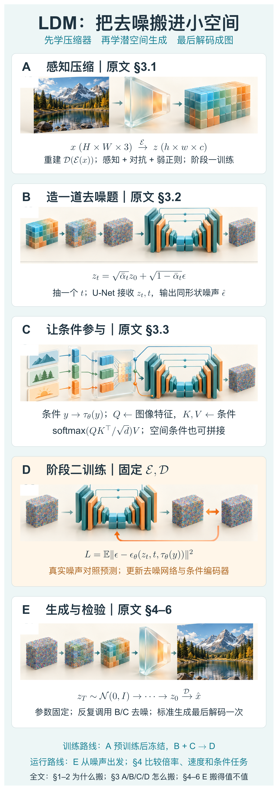

本图由 [DrawPaper skill](https://github.com/Zhu-Huixiang/ReadPaper/tree/main/drawpaper) 指挥 Codex，使用内置生图制作。

先看两条路线。**训练**先在 A 学编码器和解码器，再固定它们，用 B 造带噪潜变量，把 C 的条件接进去，在 D 比较预测噪声与真实噪声。**生成**走 E：从随机潜变量出发，反复调用 B/C 里的去噪网络，最后解码成图。A 不是每个去噪步都重新训练，D 的橙色回路也不是机器人执行反馈。

正文 §1–2 解释为什么这么分工，§3.1 对应 A，§3.2 对应 B/D/E，§3.3 对应 C；§4 则检查整个系统是否真的把钱花在了刀刃上。

## 1 引言：为什么对着每一个像素较劲？

一张 256×256 的 RGB 图有 196,608 个标量。扩散网络要对整张带噪图反复计算。图里杯子的轮廓、杯子属于什么类别，和桌布某根纤维的具体亮度，都挤在这张像素账单里。<!-- evidence:C01 -->

人判断“这是一张像样的照片”，通常不要求每根纤维都与某张训练照片一模一样。LDM 因而把问题分成两层：**压缩器负责能被重建的视觉细节，生成模型负责在这个表示里组织新的图像。** 这不是把扩散步数直接删掉，而是让每步面对更小的对象。<!-- evidence:C02 -->

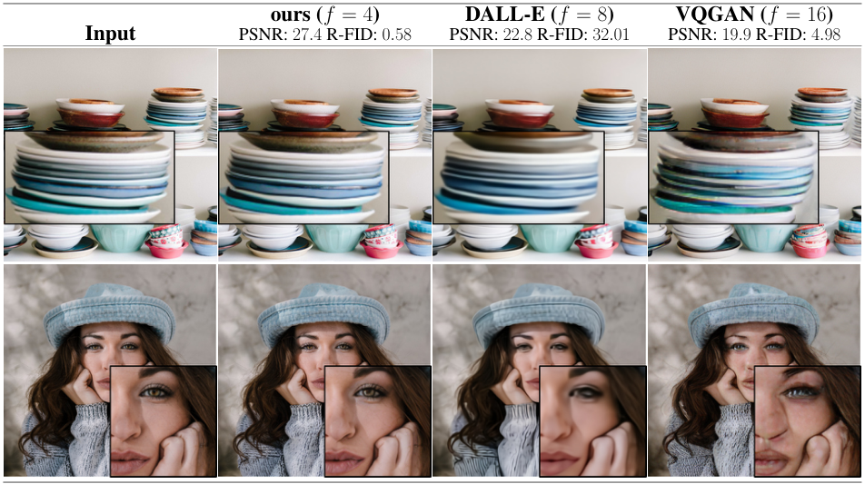

*论文 Fig. 1。先比较输入与重建，再看压缩倍率和指标。*

这张图先给我们一个底线：压缩器自身就得足够好，否则生成模型再能干，也是在一个漏水桶里打水。

四列从左到右是输入、作者的 f=4 自编码器、DALL-E 的 f=8 自编码器、VQGAN 的 f=16 自编码器。上下两排是碗碟和人像。先盯碗沿、帽子、眼睛这些结构，看压缩后边缘和细节怎样变；再读列头的 PSNR 与 R-FID。**PSNR 越高，逐像素重建越接近；R-FID 越低，重建图集合的视觉特征分布越接近真实图。** 作者这列的 R-FID 是 0.58，另两列为 32.01、4.98。<!-- evidence:C03 -->

这里比较的是几套完整压缩方案，连网络和训练目标都可能不同。真正要回答“LDM 该选多大 f”，得等 §4.1 那组专门的倍率实验。别在第一张图就把锅全甩给“压缩倍数”。

## 2 相关工作：压缩不是新发明，分工才是关键

原文 §2 把三条相关路线摆在一起。

GAN，也就是生成对抗网络，像画师和鉴定员互相较劲：生成器交图，判别器挑真假。它能很快出图，不过训练稳定性和覆盖多样模式一直需要照顾。自回归模型把图像或图像 token 排成序列，按顺序一个个预测；序列一长，等待也跟着长。扩散模型把生成拆成连续去噪，擅长利用图像的空间结构，却背着多次网络计算的账单。<!-- evidence:C04 -->

VQGAN 等工作已经会把图像压成 latent，也就是**潜变量：一组为后续计算服务、由模型学出来的内部数字**。它不是一张简单缩小的 JPG。你可以把它理解成一份“有解码规则的画面速记”，有的通道记纹理，有的组合帮助表达结构，具体含义由训练决定。

LDM 的选择是：保留二维潜变量网格，在这个网格上用 U-Net 去噪。U-Net 的下采样负责扩大视野，上采样找回空间分辨率，中间用跳连把细节特征送过去。相较于把网格硬排成一串逐 token 生成，这样仍能直接利用附近位置的关系。<!-- evidence:C04 -->

于是争论落到一个很实际的位置：**压缩有损没关系，但损失的是不是后续任务真正在意的东西？** 图像生成如此，机器人视觉也绕不开这笔账。

## 3.1 感知压缩：先把画面装进一个靠谱的小空间

回到总图 A。原图记作 x，高 H、宽 W、RGB 三通道。编码器记作 E，输出 z；z 的高、宽分别是 h、w，通道数是 c。解码器 D 把 z 还原为重建图 x̂。f 表示每条空间边缩小多少倍。<!-- evidence:C05 -->

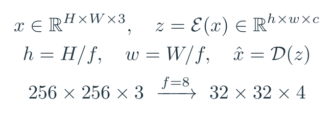

*公式 1｜原文 §3.1 的对象与形状，末行是文本模型配置。*

拿文生图模型的配置举例，256×256×3 变成 32×32×4。空间位置从 65,536 个降到 1,024 个，是 64 倍；但把通道也算进去，标量数从 196,608 降到 4,096，是 48 倍。**位置减少 64 倍，不等于整个系统立刻快 64 倍**：通道、网络宽度、注意力以及编码解码都有开销。<!-- evidence:C06 -->

打包的难处到这里才露出来：E 不能随便扔东西，D 得接得住。原文用像素/感知重建项、局部对抗项和正则项共同训练这一对网络。下面把 Appendix G 的目标压成便于读的结构。<!-- evidence:C07 -->

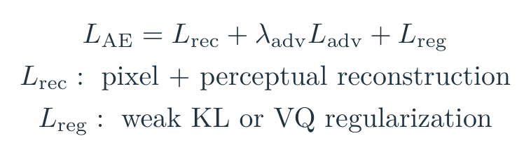

*公式 2｜对原文自编码器目标的教学归纳；保留各项职责。*

L 是损失，rec 指重建，adv 指对抗，reg 指正则；λ_adv 调整对抗项的分量。像素误差管“位置和值对不对”，感知误差在网络特征里管“视觉上像不像”，patch 判别器盯局部纹理是否像真实图。只盯像素平均，容易抹出一团温柔的糊；只追求纹理，又可能画得漂亮但对不上输入。

正则有两种版本。**KL-reg** 用很轻的 KL 约束控制潜变量分布；KL 散度可以先当作“两个概率分布差了多远”的非对称量，目的是让编码器别把数值尺度放飞。**VQ-reg** 使用向量量化：把特征与一个可学习码本中的向量对应起来。这里有个容易读岔的细节：LDM 的扩散仍作用于量化前的连续潜变量，量化层被算进解码器里，并非扩散网络每一步都在猜离散 token。<!-- evidence:C07 -->

A 训练好了以后，E 和 D 在第二阶段固定。它们提供的是工作场地；后面的去噪网络才是现在要训练的新工人。

## 3.2 潜空间扩散：随机抽一道题，学会整条去噪链

### 加噪：原来的 DDPM，换了工作对象

总图 B 里，干净潜变量记作 z₀，下标 0 表示尚未加噪。t 是扩散时间步，βₜ 是该步噪声强度，αₜ=1−βₜ，带横线的 ᾱₜ 是前 t 步 α 的乘积。ε 是与 z₀ 同形状、每个坐标服从标准正态分布的随机噪声；I 表示单位协方差。<!-- evidence:C08 -->

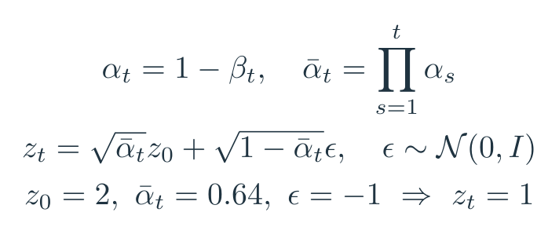

*公式 3｜原文附录 B 的前向扩散关系；末行是单坐标教学例。*

这个例子里，原值 2 乘 0.8，噪声 −1 乘 0.6，加起来得到 1。整块 32×32×4 的潜变量做的是同一件事。**训练不用先真的循环 t 次加噪**，可以直接用这个闭式公式跳到随机抽中的 t。

图上从清晰格子到噪声格子的渐变，是噪声强度的概念顺序。代码中的一次训练迭代通常只抽其中一道题。省得误会成“先把一千道题全做完，才更新一次”。

### 预测噪声：标签是自己刚加进去的答案

ε_θ 是参数为 θ 的去噪网络，输入 zₜ 和时间 t，输出噪声估计。输出形状与 zₜ 相同。总图 D 的橙色回路比较它和真实 ε 的差，再更新 θ。<!-- evidence:C09 -->

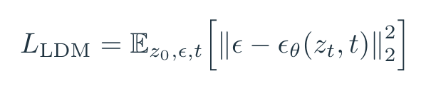

*公式 4｜原文 Eq. (2)。期望表示对数据、噪声和时间步取平均。*

双竖线的平方，是把所有坐标误差平方后相加。比如某坐标真实噪声为 −1，模型猜 −0.7，这个坐标贡献 0.09。训练的监督信号很朴素：答案不是人工给图上标出来的，是刚才程序亲手加进去的。

U-Net 先把带噪网格变成更宽的特征，逐级下采样、在残差块中混入 t 的嵌入，再上采样并接回同尺度特征。**时间嵌入是告诉网络“现在糊到什么程度”**；同一份参数要会处理从轻微污染到几乎纯噪声的不同难度。像素空间里的 ε 换成潜空间里的 ε，训练逻辑没有凭空变成另一套魔法。

以 Table 15 的文生图配置为例，U-Net 基础通道数为 320，通道倍率 1、2、4、4，对应主干各层的 320、640、1,280、1,280 通道；潜网格从 32×32 逐级到 16×16、8×8、4×4，再回到 32×32。残差块深度为 2，注意力使用 8 个头，最终输出回到 32×32×4 的噪声。小网格并不代表小脑袋：空间省下来，特征仍可以很宽。<!-- evidence:C27 -->

### 生成：网络猜噪声，采样器决定怎么往回走

总图 E 以标准高斯 z_T 开始；T 是链的终点时间。采样器反复调用网络，根据噪声估计和当前日程得到下一状态，最终得到 z₀，再调用 D。<!-- evidence:C10 -->

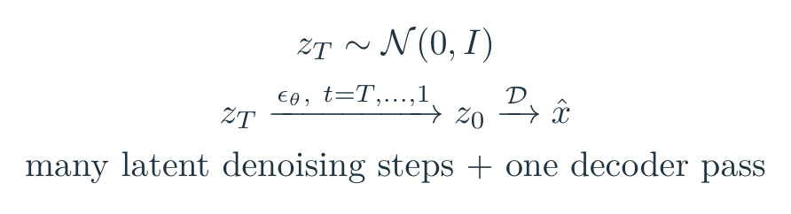

*公式 5｜标准 LDM 生成的数据路线；箭头代表采样器更新。*

这里网络输出的是噪声估计，**不是一下子输出最终大图**。论文实验主要使用 DDIM 采样；DDIM 可以选一组较稀的时间点走反向过程，不必把训练时所有时间点逐个走满。要少走多少步，还得看质量能不能扛住。

算力省在哪？最贵的反复去噪都留在小网格，通常直到最后才解码一次。若额外使用附录中的图像空间梯度引导，就需要在采样过程中解码来计算图像误差，这笔额外账另算。<!-- evidence:C10 -->

## 3.3 条件机制：文字如何进入图像的计算

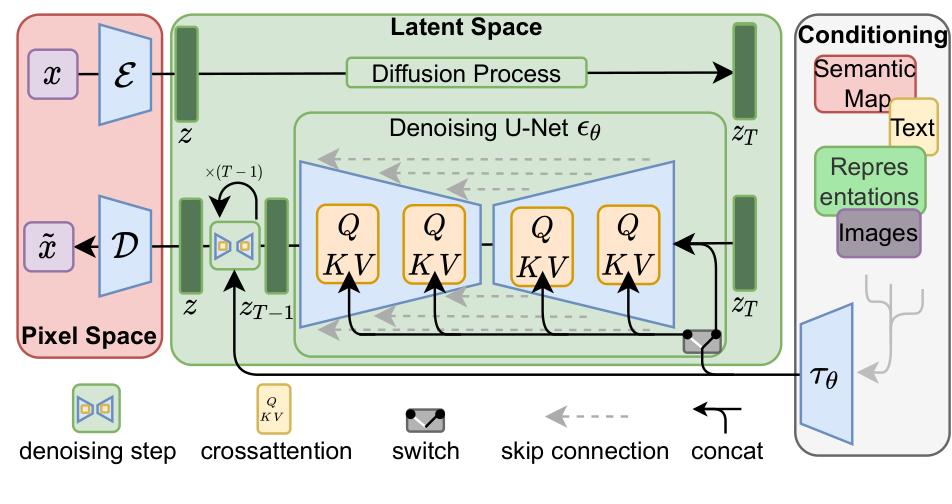

*论文 Fig. 3。先认三个区域，再沿箭头看条件在哪进入去噪网络。*

这张图回答的是：**压缩后的生成器怎样听懂外面的要求？**

左侧粉色区是像素空间，x 经 E 编成 z，生成后的 z 经 D 变成 x̂。中间绿色区是潜空间：上方长箭头表示加噪，下方 U 形结构表示去噪网络；跨层曲线是跳连，让上采样阶段接回同尺度信息。右侧灰色区收文本、语义图、图像等条件，经 τ_θ 编码后送进网络。黄色 Q/K/V 小块是交叉注意力，图底的小开关与 concat 标记表示不同条件可以采用拼接。**这些是不同条件接口，别把所有分支理解成每次生成都同时打开。**<!-- evidence:C11 -->

总图 C 画的就是这个接口。先说文字路线。

> **基础扫盲｜交叉注意力**
> 图像某个位置拿着问题去查条件：我现在该补什么？Q 是查询，K 是便于匹配的索引，V 是实际取回的内容。名字叫“注意力”，计算上就是先算权重，再做加权求和。

把 U-Net 第 i 层的二维特征摊成 F，有 N 个位置，每个位置 d_i 维。条件编码结果 C=τ_θ(y)，有 M 个 token，每个 d_τ 维；y 是用户给的条件。单个注意力头内部维度记作 d。使用行向量写法，W_Q 的形状为 d_i×d，W_K、W_V 为 d_τ×d。<!-- evidence:C12 -->

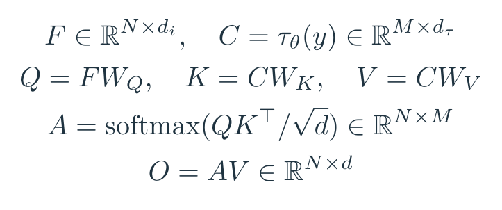

*公式 6｜原文 §3.3 交叉注意力，统一为行向量记法。*

QKᵀ 得到 N×M：每个图像位置对每个条件 token 的匹配分数。除以 √d 控制分数尺度；softmax 沿条件 token 维度把一行变成和为 1 的权重。A 乘 V 后回到 N×d，也就是每个图像位置拿到一份条件信息。多头并行计算后再合并、投影，接回 U-Net 特征。

来个两词小例子：某位置对“猫”和“草地”的权重是 0.8、0.2，它取回的是 0.8V_猫+0.2V_草地。**不是给某像素强行贴一张“猫”标签**，而是在后续去噪计算中补充偏向猫的特征。语义要经多层计算变成轮廓和纹理。

论文的文生图配置使用 BERT tokenizer 和训练的 Transformer 文本编码器；文本序列长度 77，编码宽度 1,280。这里讲的是这篇论文的配置，后来的产品实现可以换编码器。<!-- evidence:C13 -->

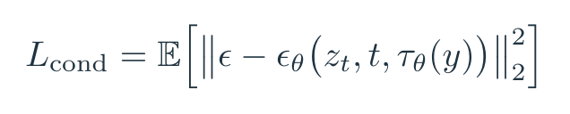

*公式 7｜原文 Eq. (3)。同时训练条件编码器与去噪网络。*

损失还是噪声误差，只是网络多看了一份条件。E/D 继续固定，τ_θ 和 ε_θ 一起学习。空间对齐的条件——比如低分辨率图或分割图——还可以降到相应尺度后按通道拼进输入。文本是一串 token，分割图是一张位置地图，让它们都强行走同一种门反而麻烦。

生成时还可以用 classifier-free guidance，简称 CFG。训练时让模型有时不看条件，生成时比较“看了条件”与“没看条件”两种噪声预测，用系数 s 放大差异。空集符号 ∅ 表示空条件；ε_u、ε_c 分别表示无条件与有条件预测。<!-- evidence:C14 -->

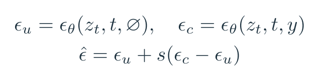

*公式 8｜对论文使用的 CFG 的教学展开；s=1 时回到条件预测。*

这有点像给要求加重语气。语气重一点，画面更贴合指定类别；重到什么程度合适，要看多样性是否被挤掉。后面的 precision/recall 表就抓到了这笔交换。

## 4 实验：到底省了什么，又损失什么？

### 4.1 感知压缩的取舍：小战场也不是越小越好

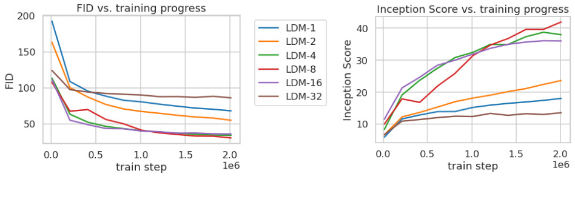

*论文 Fig. 6。同一组压缩倍率，左边看 FID，右边看 IS 随训练推进怎样变。*

先抓结论：**在这组设置里，中等压缩的 f=4、8、16 比两个极端更划算。** 像素空间 LDM-1 太贵，f=32 又把信息挤得太狠。<!-- evidence:C15 -->

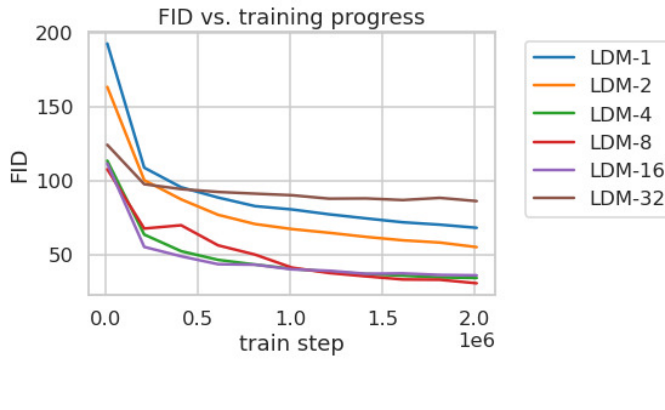

*论文 Fig. 6 左图局部。放大 FID 和倍率图例，便于看清各条线。*

两张子图横轴都是训练步数，单位到 2M，也就是 200 万步；左纵轴 FID 越低越好，右纵轴 Inception Score（IS）越高越好。IS 结合分类器对单图的确信度和整组图片的类别覆盖，和 FID 不是一回事。颜色区分 f；看图例对应曲线，尤其比较蓝色 LDM-1 与红/紫色中等压缩曲线。

实验使用 ImageNet 类别条件生成，模型规模相近，用 A100 训练；评估使用 100 步 DDIM。横轴画的是训练步，**同样一步面对的网格大小不同，耗时也不同**。附录 Fig. 17 又按固定 V100-days 算力预算比较，避免只盯迭代次数。<!-- evidence:C15 -->

所以 A 区压缩倍率不是一个无脑往上拧的旋钮。小到 f=32，后面再努力画，前面的表示瓶颈也会冒出来。第一个问题的答案到此有了实验支点：选压缩率，要同时看重建上限、生成质量和算力，三张账单一起结。

### 4.2 无条件生成：质量和速度放到一张图里

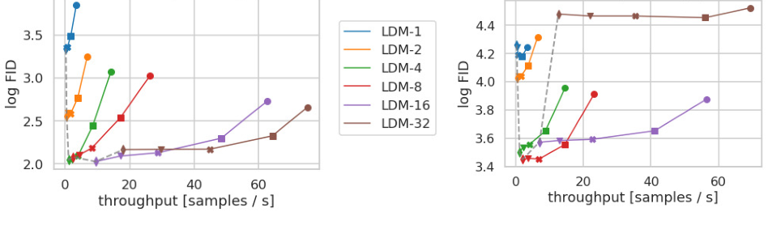

*论文 Fig. 7。往右更快，往下 log FID 更好；留意左右两张图的纵轴刻度。*

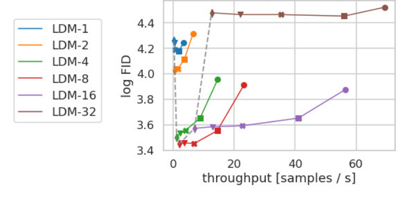

*论文 Fig. 7 右图与图例局部。每个颜色的一串点对应同一种压缩倍率。*

左图是 CelebA-HQ，右图是 ImageNet。横轴是吞吐，每秒生成多少张；纵轴是 log FID，也就是经过对数变换的 FID。右图刻度 3.4 可不是在报 FID=3.4，先认这个 log，别一眼看错数量级。一个颜色是一种 f，曲线上不同标记对应 10、20、50、100、200 个采样步。从右往左，步数增加，速度下降，通常质量改善。<!-- evidence:C16 -->

因此读法不是“找最高的线”，而是找同等质量下更靠右、或同等速度下更靠下的位置。图上 f=4 到 8 的曲线把质量和速度的关系拉得比较好。这些 FID 用 5,000 个样本估计，适合读同图的相对趋势，不要直接与用 50,000 张样本的其他表格拼成排行榜。

无条件任务也有输赢：正文 Table 1 的 CelebA-HQ 上，LDM-4 FID 为 5.11，LSGM 为 7.22；LSUN Bedrooms 上 LDM-4 为 2.95，ADM 为 1.90。**它给出的是更轻的通用生成办法，并没有让所有数据集的最佳 FID 自动改姓 LDM。**<!-- evidence:C17 -->

### 4.3 条件生成：会听话，也要看覆盖了多少画法

回看总图 C，论文把同一个条件接口接到文本、布局和类别。文生图使用 LAION 图文数据训练，类别生成则在 ImageNet 上做对照；两者的训练资源和输入不同，分开看。<!-- evidence:C18 -->

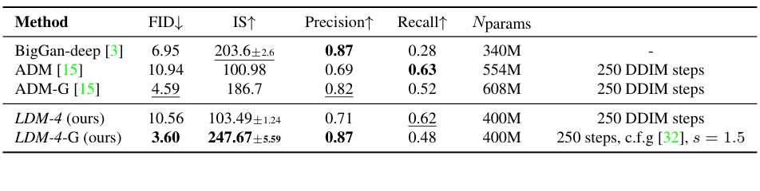

*论文 Table 3。先配对无引导与有引导设置，再比较 FID、precision 和 recall。*

这张表最值得读的是 LDM-4 的两行：不加引导 FID 10.56；使用 s=1.5 的 CFG 后是 3.60，都用 250 步 DDIM。对照 ADM 为 10.94，ADM-G 为 4.59；论文把参数量也放在右边，LDM 这组为 400M，ADM 为 554M、ADM-G 为 608M。<!-- evidence:C19 -->

但别盯 FID 一列就散会。LDM 从无引导到引导后，precision 从 0.71 升到 0.87，recall 从 0.62 降到 0.48。这里 precision 粗略对应“生成图落在真实数据流形附近的比例”，recall 看“真实分布的多少范围被生成覆盖”。**图更像标准答案了，覆盖的花样也少了一些。**<!-- evidence:C19 -->

这正好回答前面 CFG 的“加重语气”：想要更典型的猫，可以把条件音量拧大；一些不那么典型的猫，也可能被你一并关在门外。评价生成模型时，这种交换比一个单独的冠军数字更有用。

原文 §4.3.2 还把空间条件与卷积网络结合，在训练分辨率之外生成大图。条件图提供大范围布局，卷积网络可在更大的潜网格上运行。附录 D.1 指出潜变量尺度会改变信噪比，因而不能只把画布拉宽就当配方通用。<!-- evidence:C20 -->

### 4.4 超分辨率：照片更像照片，不等于更像原照片

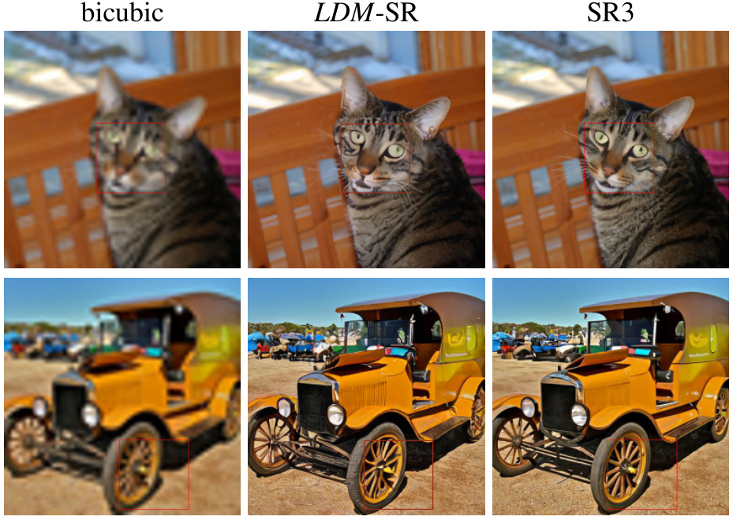

*论文 Fig. 10。每行同一输入，比较 bicubic、LDM-SR、SR3 三列。*

这张图想说明的矛盾很直观：LDM-SR 能补出逼真的纹理，SR3 在某些细结构上更连贯。

上排看猫毛、眼睛和椅背边缘；下排看车轮、格栅和细杆。左列 bicubic 是普通插值放大，纹理模糊；中列与右列都是生成式超分。别只问哪张更锐，得问锐出来的纹理与原来的物体结构是否一致。输入是 64×64，输出为 256×256。<!-- evidence:C21 -->

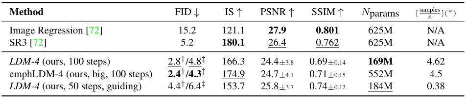

*论文 Table 5。FID 看整体视觉分布，PSNR/SSIM 看与原图的对应；两种 FID 参考集合不要混读。*

先读最朴素的 Image Regression 行：PSNR 27.9，比 LDM-SR 的 24.4 更高；但 FID 是 15.2，LDM-SR 在验证集特征参考下是 2.8。SR3 的对应 FID 是 5.2、PSNR 是 26.4。<!-- evidence:C22 -->

为什么像素误差好的反而更糊？低分辨率里很多高频细节已经丢了。对多种可能答案取平均，像素平方误差可以很舒服，观感却像隔着起雾的眼镜。生成模型敢补纹理，画面更真；补出来的这根毛未必就是原图那根毛。

表里 LDM 的 2.8/4.8 不是两次随机抽奖：它们分别用验证集、训练集的特征作 FID 参考。拿 4.8 去对别人按另一参考集报的数，比较就串台了。

这件事对具身读者很要紧：**“生成画面有说服力”和“接触边界、物体位置准确”是两种验收。** 若用生成图辅助控制，杯沿偏两像素可能比桌布少点纹理更重要。

### 4.5 补图：压缩是否真的省时间？

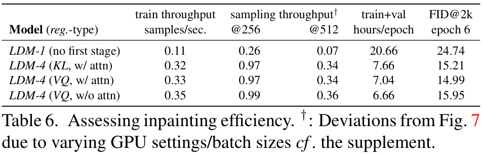

*论文 Table 6。前三个速度列越大越好，epoch 耗时与 FID 越小越好。*

这张表比“模型快了好多”更实在。作者固定扩散模型参数量，比较像素空间 LDM-1 与几个 LDM-4 版本，在 Places 补图任务上训练六个 epoch，并报告训练/采样速度。训练吞吐的单位是每秒样本数，采样分别给 256²、512² 分辨率；右侧是每轮小时数和验证 FID。<!-- evidence:C23 -->

选有注意力的 VQ 版本与 LDM-1 对照：训练吞吐从 0.11 到 0.33，大约 3 倍；512² 采样从 0.07 到 0.34，大约 4.9 倍；每轮时间从 20.66 小时降到 7.04 小时。FID 从 24.74 降到 14.99。<!-- evidence:C23 -->

这次不是只把粗糙图片更快交出去，效率和这组质量指标一起改善。但注意这测的是补图任务中的第二阶段；第一阶段压缩器本身也要训练。算完整项目成本，别把 A 区从预算表里橡皮擦掉。

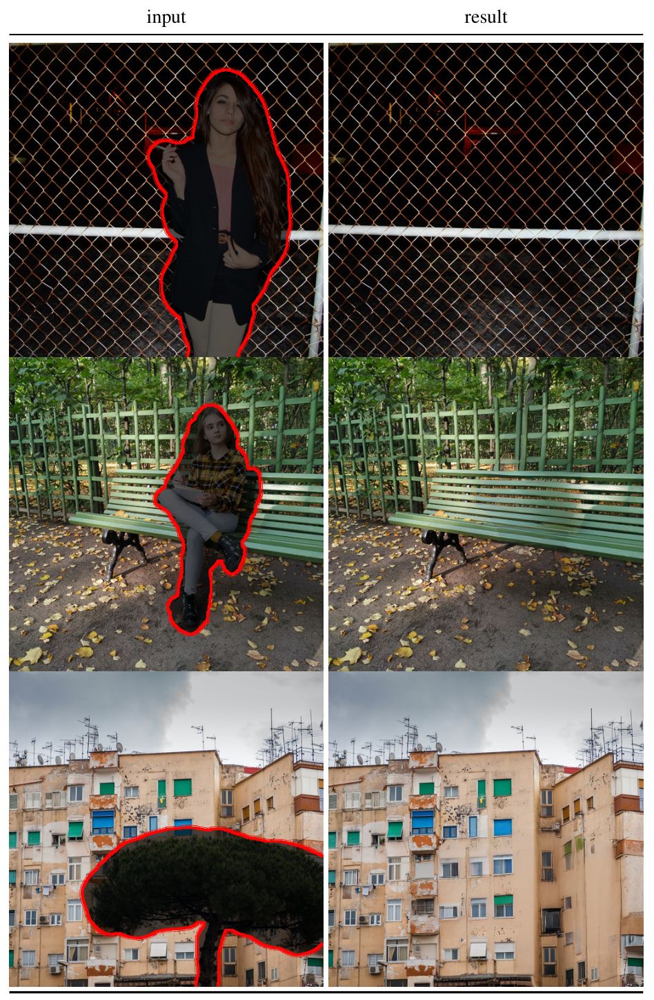

*论文 Fig. 11。每对图比较红线圈定的待移除对象与结果，沿目标边界检查衔接。*

这张原图展示物体移除：先认输入里红线圈定的待移除区域，再看补全后纹理、地面或背景能否接上。它没有曲线坐标轴，信息在一对对输入/输出里。观察时可以把视线放到待移除区域的边缘：颜色接上了没有，线条是否突然拐弯，补出的物体尺度和周围是否协调。

正文 Table 7 继续在 30,000 个 512×512 的 Places 裁块上比较：经微调的大模型整体 FID 为 1.50，LaMa 为 2.23；但 LPIPS 为 0.137，LaMa 为 0.134，后者在这个与目标图感知距离有关的指标上略低。<!-- evidence:C24 -->

又是同一笔账：一个洞可以有许多合理填法，而测试集只留了一张原图。填得合理，与复原唯一那张答案，评价会给出不同偏好。

## 5 限制与社会影响：省下的计算，换来了什么约束

原文 §5 首先提到压缩瓶颈：需要很精细的像素准确度时，E/D 的重建能力会成为限制；另一方面，扩散仍要顺序迭代，出图速度仍受多次网络调用约束。把场地缩小，不等于把全部工序取消。<!-- evidence:C25 -->

原文 §5 还讨论了训练数据偏差与图像生成的误用问题。放到这篇的方法里，关键是：压缩器和生成器都从数据学规律，省算力并不会顺带修复数据中的偏见。文字条件能更方便地控制生成，也让生成内容更容易按特定意图批量生产。<!-- evidence:C26 -->

我更关心一个具身问题：如果潜变量为“看起来像”而训练，细小但决定动作成败的信号会不会被压掉？指尖是否碰到杯沿、薄片的边缘在哪、透明物体的轮廓有多偏，这些都值得给单独指标。这里的延伸方向是给表示增加任务相关的检验，而不是看一张漂亮生成图就判它已经理解了接触。

## 6 结论：回收三个问题，再接上具身智能

**第一，压多小才划算？** LDM 先用可重建的感知压缩建立潜空间，再在不同 f 上比较。文中的中等倍率能保留足够视觉内容，同时减小反复去噪的工作量；继续压小会遇到信息瓶颈。

**第二，噪声和条件到底怎么算？** 训练抽时间步给 z₀ 加噪，用同形状噪声误差训练 U-Net；条件经编码后，用交叉注意力或空间拼接参与去噪。运行从高斯潜变量起步，多次更新后解码成图。到这里，前面的 A–E 应该能串成一条真正的数据路线了。

**第三，它赢在哪、代价是什么？** 实验展示了显著的效率收益，以及多种条件任务上的质量竞争力；同时，精度、多样性和像素对应并不总向同一个方向改善。Table 3 的 recall、Table 5 的 PSNR、Table 7 的 LPIPS，都是读主结论时值得留下的几颗钉子。

把这条链读完，会发现后续模型可以继续改两处：表示怎么学，生成网络怎么算。LDM 在这里的选择是：**先决定什么表示值得反复计算，再升级那个计算器。** 下一步如果把 U-Net 换成 Transformer，就是另一篇论文要较真的地方；如果生成对象换成动作，又得重新问，哪些动作细节一丁点都压不得。

阅读工具：[ReadPaper](https://github.com/Zhu-Huixiang/ReadPaper) · 绘图工具：[DrawPaper](https://github.com/Zhu-Huixiang/ReadPaper/tree/main/drawpaper)。

在公众号点击“阅读原文”，可到 GitHub 查看高清图、公式与完整图源。仓库地址：https://github.com/Zhu-Huixiang/embodied-world

---

公众号版由管理员在后台手动公开发表；永久文章链接待发表后补充。

关注公众号 **具身智能的 World**：

[原论文](https://arxiv.org/abs/2112.10752v2) · [证据索引](evidence.json)

[本篇知识星系](../../universe/papers/latent-diffusion.md) · [知识点宇宙](../../universe/README.md)
