# MAE：把图遮掉四分之三，为什么反而学会了看？

这里是**具身智能的 World**。我们沿着论文的问题、计算和证据，读懂机器怎样看、怎样学、怎样动。

**论文解读**：把架构、公式、原图和实验讲透。

**论文地图**：按科学问题找阅读路线。

**顶会顶刊集锦**：找到正式论文与原文入口。

**解读日程**：知道接下来准备读什么。

**arXiv 新作集锦**：筛选值得跟进的新研究。

**具身榜**：看评分、证据与同方向比较。

**知识点宇宙**：沿概念与论文之间的联系继续逛。

仓库：[Zhu-Huixiang/embodied-world](https://github.com/Zhu-Huixiang/embodied-world)。

给机器看猫，先把猫遮掉四分之三。不是考它视力，是防止它抄答案。

这就是 MAE 最好玩的出发点。图片相邻的像素太像了：挖一个小洞，旁边的颜色抹过来，作业就交了。重建得挺像，却未必学会“这是一只猫，耳朵应该长在头上”。MAE 挑战的假设是：**视觉预训练必须让网络看到大部分图像，才能学到有用特征。**它同时动了两处：遮得狠，而且让昂贵的编码器只算剩下的那一点。<!-- evidence:C01 -->

带着三个问题往下看：

1. 遮掉 75% 后，剩下的 49 个图块究竟怎样走过编码器和解码器？
2. 补像素为什么能练出识别能力，怎样确认它没有只学会“涂颜色”？
3. 省下多少计算，练出的特征又怎样接到分类、检测和机器人视觉上？

**论文信息**：*Masked Autoencoders Are Scalable Vision Learners*；Kaiming He、Xinlei Chen、Saining Xie、Yanghao Li、Piotr Dollár、Ross Girshick，FAIR。首次公开于 2021 年 11 月；本文读 CVPR 2022 正式论文与补充材料。CVPR 是计算机视觉主会，这篇工作的实验重心是视觉表示与迁移。原文：[CVF](https://openaccess.thecvf.com/content/CVPR2022/html/He_Masked_Autoencoders_Are_Scalable_Vision_Learners_CVPR_2022_paper.html)；代码：[facebookresearch/mae](https://github.com/facebookresearch/mae)。<!-- evidence:C02 -->

**阅读目录**

- 1 引言：让补图变难，也让训练变便宜
- 2 相关工作：借 BERT 的题型，改视觉的考法
- 3 方法：从 196 块到 49 块，再拼回来
- 4 ImageNet 实验：遮多少、谁来补、怎样读出能力
- 5 迁移实验：离开分类考场之后
- 6 讨论：三个问题收回来

本图由 [DrawPaper skill](https://github.com/Zhu-Huixiang/ReadPaper/tree/main/drawpaper) 指挥 Codex，使用内置生图制作。

先认路线。训练时，**A** 把图随机藏起来，**B** 只读可见块，**C** 把空位补回去，**D** 拿原图的隐藏部分批改作业；以后真去识别图像，拿走 B，丢掉 C，接到 **E**。第 3 节逐模块拆，第 4 节问这个作业究竟练到了什么，第 5 节去别的任务检验。不要把“补图效果好看”和“特征好用”提前画等号，后面的实验正是在拆这两件事。

## 1 引言：让补图变难，也让训练变便宜

先看作者最直观的展示。下面每组三张，分别是残缺输入、重建结果、原图。这里展示的是 **80% 遮挡，196 块只留 39 块**，比常用训练设置 75% 还狠一点。<!-- evidence:C03 -->

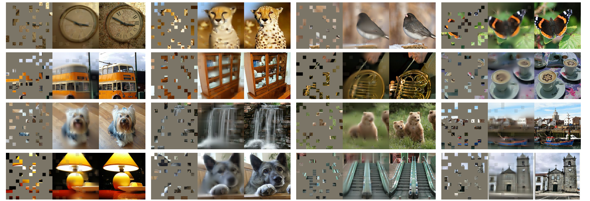

论文 Fig. 2：按“残缺图→重建→原图”三张一组看，重点比较主体结构与具体纹理。

这张图没有横纵坐标，它排的是不同图像案例。灰块是模型没看到的区域。中间重建图能补出猫头鹰、钟表、车辆的大致形状，但花纹、边缘、局部颜色会变软。先抓这个结论：**少量可见块确实足以约束整体，却不足以唯一决定每个像素。**

比如只剩鸟嘴和一段翅膀，模型可以猜出“这里大概有一只鸟”；羽毛究竟是哪一根朝左，图里没有线索。像素均方误差喜欢把多种可能性折中，所以模糊并不稀奇。拿清晰度当唯一成绩，反而会读偏这篇论文。

MAE 想培养的是架构图 B 里的编码器。补图的 C 是训练搭子，用完可以散伙。这个身份关系先记住，否则很容易把 MAE 读成一个专门修复照片的软件。

## 2 相关工作：借 BERT 的题型，改视觉的考法

BERT 会遮住一句话中的部分词，让模型根据上下文补出来。一个词经常装着很浓的语义；像素则不同。天空的一小块蓝，旁边多半还是蓝，视觉“填空题”有大量近路。

早期自编码器把输入压成隐藏表示，再解码回来。这里的**隐藏表示，也常叫 latent 表示**，就是网络内部的一组数；别被 latent 这个词唬住，它并没有天然对应“猫的姿态”“物体的位置”。训练目标决定这些数愿意保存什么。

对比学习走另一条路：把同一图像的不同增强视图拉近，把表征练得对裁剪、颜色变化更稳定。MAE 选择让图像自己出题：把一部分藏起来，原图就是答案。它也借鉴掩码图像建模，但不依赖额外的离散视觉词表来当重建目标。<!-- evidence:C04 -->

核心改造有两个：**高遮挡率减少邻近复制的捷径；编码器不接收那些空白位置，省下最贵的计算。**这里已经从“学什么”走到了“怎样安排算力”，两个问题扣在一起。

## 3 方法：从 196 块到 49 块，再拼回来

### 3.1 A 区：随机藏起来，位置仍然留着

令图像高宽为 H、W，颜色通道数为 C，每个正方形图块边长为 P。用 224×224 的 RGB 图片、16×16 图块作例子：H=W=224，C=3，P=16。整图一共 N=196 个块，每块展开成 16×16×3=768 个像素数。**这里的 768 是一块原始像素的长度，不是所有 MAE 编码器的隐藏维数。**

遮挡比例记为 r。取 r=0.75，随机留下的索引集合叫 V，有 49 个位置；被遮挡的索引集合叫 M，有 147 个位置。V 与 M 合起来覆盖所有 196 块。随机采样不放回，也不是专门挖掉中央一个大洞。<!-- evidence:C05 -->

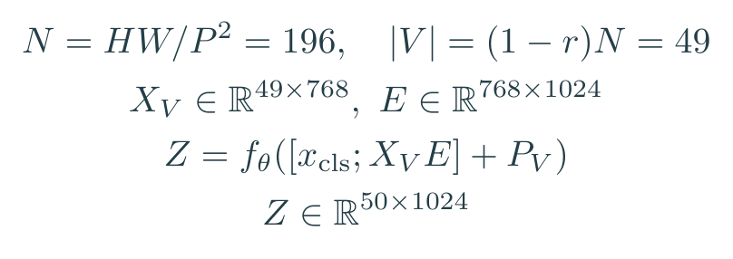

教学展开，对应论文 §3。X_V 表示只取 V 中的图块，E 是像素投影矩阵；x_cls 是额外的 CLS 向量，分号表示沿序列拼接。P_V 包含这些位置及 CLS 的编码，形状为 50×1024；f_θ 是参数为 θ 的编码器，Z 是输出表示。

真实顺序是：每块先线性投影到隐藏维度，加上自己的二维正弦余弦位置编码，再进 Transformer。藏掉第 2 块，并不会让原来的第 3 块冒充第 2 块；它还带着原来的地址。

看架构图 A→B，75% 的内容是真的从这段计算中移走了。不是把像素涂灰、再让大网络认真读完 196 张“此处无内容”的便签。

### 3.2 B 区：昂贵的编码器，只招待真有内容的客人

这里用 ViT-L/16 讲尺寸。每个可见块投影到 1024 维；补充材料还有一个辅助 CLS token，所以编码器序列长度是 **49+1=50**，矩阵形状 50×1024。24 个 Transformer 层依次处理它，输出形状不变。<!-- evidence:C06 -->

每层仍是熟悉的计算：归一化后，让每个 token 用 query 和其他 token 的 key 比较，softmax 得到权重，再加权汇总 value；残差把旧信息加回来，然后 MLP 对各个 token 做非线性变换，再加一次残差。不同位置交换信息，通道内部重新组合信息。两件事交替进行。

**基础扫盲｜token**：这里就是一个图块对应的一行特征向量。50 个 token 不是 50 个类别，1024 维也不是 1024 个物体。它们是网络计算的行数与每行宽度。

这样设计还有一个容易漏掉的好处：预训练时，编码器看到的都是有像素内容的块；下游处理完整图像时，也全是有内容的块。它不用适应从“一堆空白 mask token”到“完整图片”的输入变化。

### 3.3 C 区：小解码器补位，但得知道往哪补

到了编码器出口，才请空白 mask token上场。论文的默认解码器宽度为 512，深度 8 层；它比 24 层、1024 维的 ViT-L 编码器轻得多。<!-- evidence:C07 -->

先用矩阵 W_e 把 1024 维编码结果投影到 512 维。再添加 147 个 mask token：它们共享同一个可学习向量 m，表示“这里缺内容”。把 token 按原始图块顺序放回去，然后加解码器自己的位置编码 P_d。算上 CLS，解码器输入 U 是 197×512。

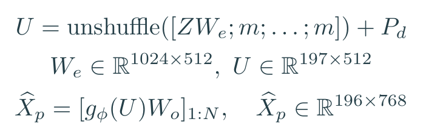

教学展开，对应论文 §3。unshuffle 表示还原原先随机打乱的顺序，g_φ 是解码器；W_o 是 512×768 的像素预测投影；末行的 1:N 取出第 1 到 N 个图块，跳过第 0 个 CLS。

别看 147 个 mask 向量一开始长得一样，它们的位置编码不同，可以关注到的可见内容也不同。站在猫耳朵附近的空位，与站在沙发边上的空位，任务很快分家。

解码器输出每个块的 768 个像素数，重排之后回到 224×224×3。**这里没有离散词典查表，也没有逐像素自回归生成**；所有位置通过解码器一起算出预测。

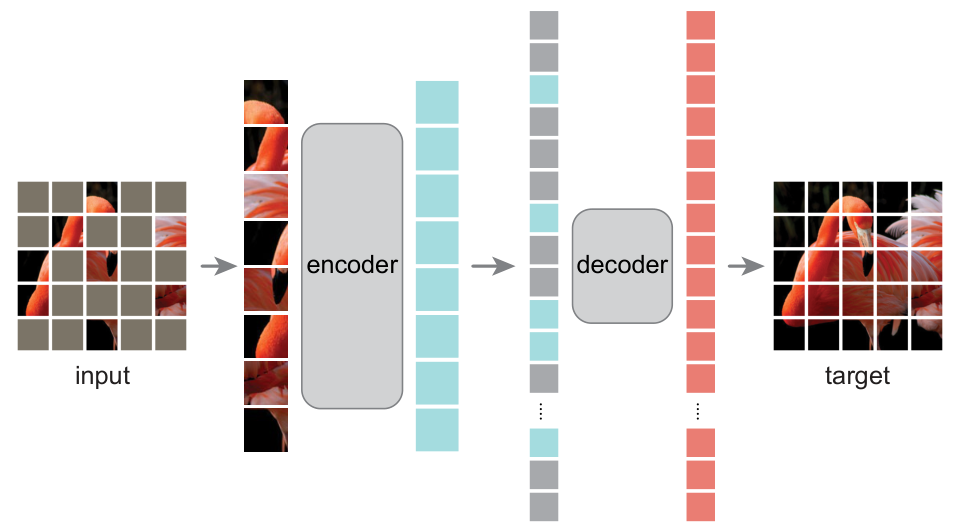

论文 Fig. 1：顺着左边稀疏图块、重编码器、中间补齐的序列、轻解码器和右边重建结果看。

这张原图把工程上的重点画得很省话。左边真正进入 encoder 的彩色条很少；encoder 之后的序列里多出灰色 mask 条；decoder 才处理完整序列。右侧 target 是原始图像，用来批改。训练梯度从重建误差回到解码器和编码器，灰色块并没有在 encoder 里兜一圈。

### 3.4 D 区：只给被遮住的地方判分

预测完整图，不等于对所有地方都算损失。MAE 的均方误差只在 M 中的遮挡块上平均。可见块已经给了答案，再奖励照抄它们，会稀释我们真正想练的部分。<!-- evidence:C08 -->

把第 i 个块的真实像素向量叫 x_i，预测叫 x̂_i，目标叫 t_i。P²C 是每块像素元素数量。若用原始像素，t_i=x_i；论文还测试了每块单独归一化的目标：μ_i 是该块像素均值，σ_i² 是方差，ε 是防止除零的小常数。

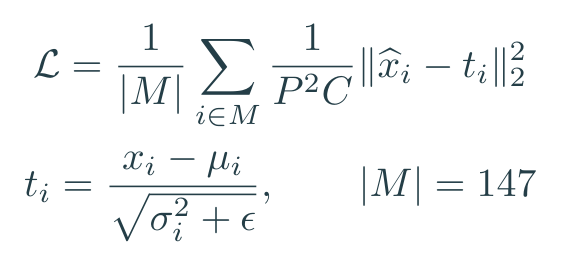

教学展开，对应论文 §3 的重建目标。外层在被遮挡的块之间平均，内层在一个块的像素元素之间平均。

这点数学值得真算一次。拿四个像素数 [0,1,2,3] 代替一个 768 维块，它们的均值是 1.5、方差是 1.25；暂忽略很小的 ε，标准化后约为下面四个数。若每个预测都比答案多 0.1，均方误差就是 0.01。<!-- evidence:C09 -->

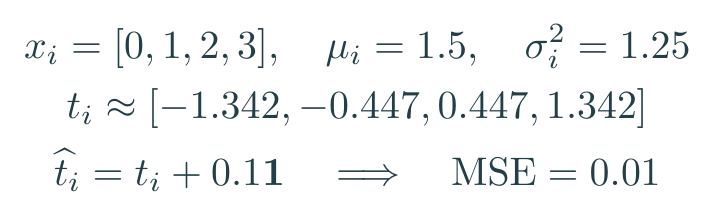

四元素教学例子，不是论文测量结果。

归一化把“整块偏亮一些”这类因素压下去，局部对比和纹理差异相对更突出。它没有让目标变成类别标签，却改变了网络努力拟合的内容。

### 3.5 一段实现顺序，别把训练路线绕晕

一张图先切块，给每个块加位置，生成随机排列，保留前 25%。编码器算完后投影，追加 mask token，再用排列的逆操作还原位置。解码器出像素，遮挡集合 M 负责选出损失项，反向传播更新参数。

这个流程用常规稠密矩阵算子就能完成。没有“为每张不规则残图开发一个稀疏卷积内核”的额外关卡。架构图 A 的随机性每次换题，B、C 的参数则在这些题目之间积累。

## 4 ImageNet 实验：遮多少、谁来补、怎样读出能力

### 4.1 性质实验：先把变量一个个拆开

作者先用 ImageNet-1K 训练 MAE，再用两种方式测表示。**完整微调**允许编码器和分类头一起学习标签；**线性探测**冻结编码器，只训练一个线性分类头。前者问“这副底子继续练能到哪”，后者问“现成特征用一刀能分多开”。<!-- evidence:C10 -->

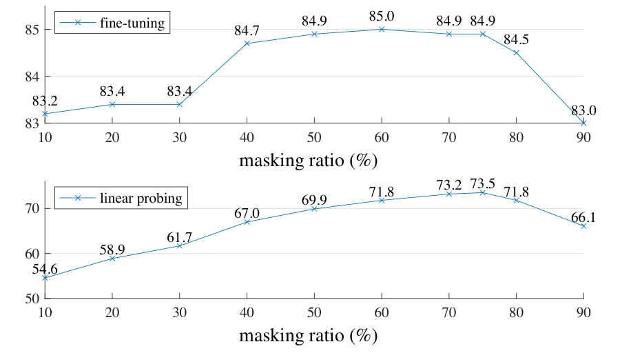

论文 Fig. 5：上下两幅共用遮挡比例横轴，上图看完整微调，下图看冻结特征的线性探测。

横轴是遮住多少百分比，纵轴都是 ImageNet top-1 准确率。两条线的高度不要直接比较能力高低，因为读出方式不同。要看各自随遮挡率怎样变化：微调在一段较宽的中高遮挡区间都不错；线性探测对比例更敏感，75% 左右表现好，90% 又掉下去。

所以“越遮越聪明”这个口号到这里就该退休了。题目太简单，近路多；题目难到只剩零星线索，也会学不动。75% 是这组设置里兼顾效果和计算的选择，不是视觉宇宙常数。

再看解码器。下面这张消融表，一次只改一类设置。默认是 ViT-L、800 个 epoch、75% 遮挡、8 层 512 维解码器，重建未经归一化的像素。ft 是完整微调，lin 是线性探测。<!-- evidence:C11 -->

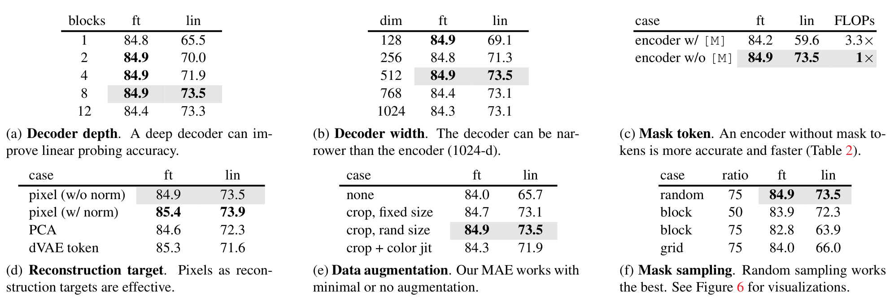

论文 Table 1：按子表逐个看；灰行是默认配置，别把不同子表的变化合成同一个模型。

手机上看总表可以先认位置：左上调解码器深度，中上调宽度，右上问编码器要不要读 mask；左下换重建目标，中下换数据增强，右下换遮挡方式。我们挑决定方法成立的三处细讲。

**第一处，空白 token 真的没必要挤进重编码器。**右上子表单独放大：

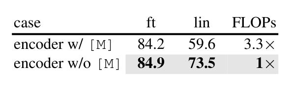

论文 Table 1(c) 局部：w/ [M] 表示编码器包含 mask，w/o [M] 表示把它们移走。

含 mask 时，微调 84.2%、线性探测 59.6%；拿走之后是 84.9%、73.5%，计算量从相对 3.3× 降到 1×。省算力的改法同时改善了特征，这才是 MAE 最划算的一刀。这里的 3.3 倍是整套预训练计算对照，不是“注意力矩阵缩小多少”的理论值。

**第二处，解码器越深，不代表微调一定越强。**1 层解码器的微调是 84.8%，8 层是 84.9%；线性探测却从 65.5% 变成 73.5%。重建工作由谁来承担，会改变编码器里留下的表示。线性探测对这种分工很敏感；允许微调时，网络还有机会重新安排最后几层。

**第三处，像素目标也有讲究。**把原始像素改成每块归一化像素，微调从 84.9% 到 85.4%，线性探测从 73.5% 到 73.9%。这个 0.5 个百分点提升来自目标处理，别记到“又多遮了几个块”的账上。

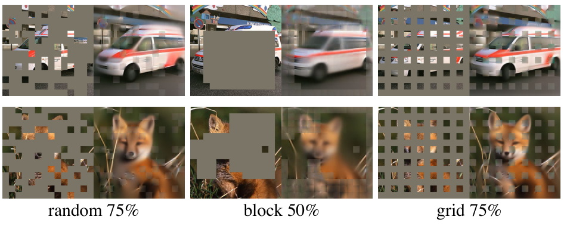

论文 Fig. 6：从左到右是随机、整片块状、规则网格遮挡；每种都给输入与重建对照。

这张图解释 Table 1(f) 为什么要分遮挡方式。随机遮挡把线索撒在各处；大块挖空会让整片区域缺少锚点；网格保留很均匀，任务又可能太容易。图中的块状案例展示的是 50% 遮挡，而表里还有 75% 的块状对照，读图时别把两者混成一个数字。表中随机 75% 的微调为 84.9%，块状 75% 为 82.8%，网格 75% 为 84.0%。题目怎么出，比“统一挖掉一样多”复杂一点。<!-- evidence:C12 -->

### 4.2 算力和规模：别把平方律直接报成实际提速

回到架构图 B，197 个 token 变成 50 个，单个注意力矩阵的元素数剩约 6.44%。看起来很猛，但 MLP、线性投影、解码器、数据流水线都还在。

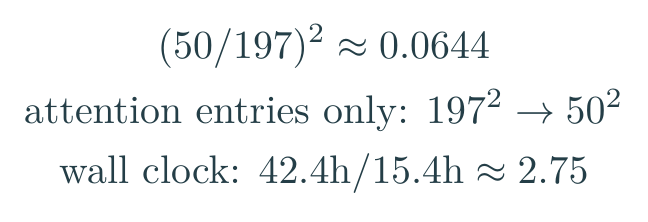

教学计算与论文 Table 2 的实测时间并列：矩阵元素比例与端到端耗时是两种指标。

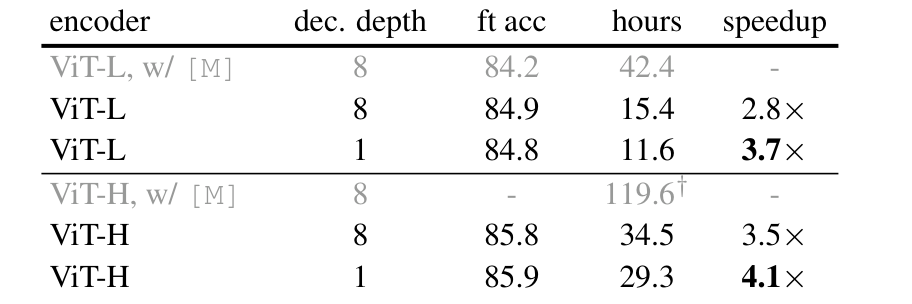

论文 Table 2：固定 800 个 epoch、128 个 TPU-v3 核与 TensorFlow，比较真实预训练耗时。

以 ViT-L 为例，编码器读 mask 的版本用 42.4 小时；移走 mask、保持 8 层解码器，降到 15.4 小时，表中记为 2.8 倍提速。再把解码器压到 1 层，11.6 小时、3.7 倍。第一步来自不算空白，第二步来自减轻补图模块。因果账本这么拆，就不容易把所有功劳都给“75%”。<!-- evidence:C13 -->

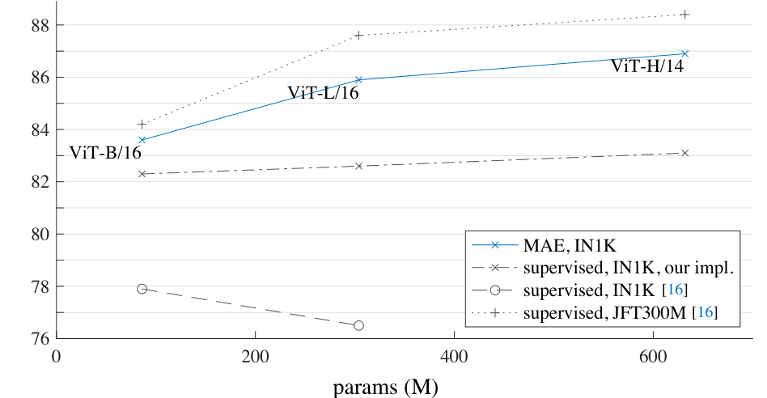

论文 Fig. 8：横轴是参数量，纵轴是微调后的 ImageNet 准确率；蓝色曲线是 MAE，其他线是不同监督训练方案。

先看趋势：模型从 B 到 L 再到 H，MAE 的收益持续上去。再看对手是谁：图里既有早期 ViT 监督配方，也有作者改进后的强监督配方。只盯最下面那条旧配方，就会把故事讲得过分轻松。

论文 Table 3 用 1600 epoch 预训练、归一化像素目标，224 输入下 MAE 的 B/L/H 分别为 **83.6/85.9/86.9%**；同表改进的从零监督训练为 **82.3/82.6/83.1%**。H 换成 448 分辨率微调得到 87.8%，这个数要和输入分辨率一起记。<!-- evidence:C14 -->

### 4.3 部分微调：线性探测没看见的能力

模型不是只分“全冻住”和“全部放开”两档；可以只微调末尾几层。

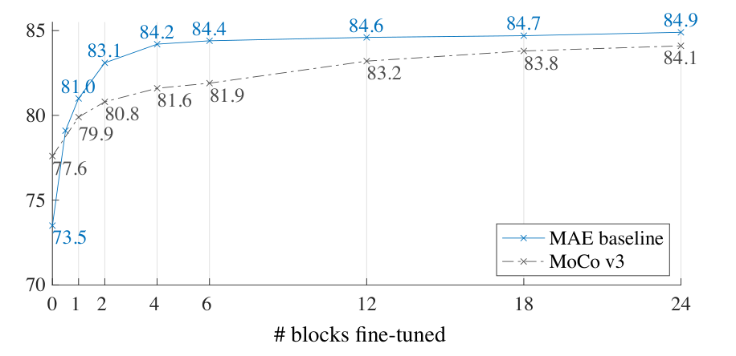

论文 Fig. 9：横轴是允许微调的 Transformer 层数，纵轴是 ImageNet 准确率；0 层就是线性探测，24 层就是完整微调。

蓝线是 MAE，灰虚线是 MoCo v3。最左边，MAE 冻结特征的 73.5% 低于 MoCo v3 的 77.6%；只放开最后一个 Transformer 层，MAE 跳到 **81.0%**，完整微调则为 84.9%。只放开末层里的 MLP，作者还得到 79.1%。<!-- evidence:C15 -->

一把直尺分不开，换一个允许弯曲的边界，成绩就变了。线性头只会做线性组合；末层里的非线性运算一旦能调整，特征的潜力就能被读出来。用线性探测一个数字给所有预训练方法排总榜，可能把“表示里有什么”和“固定读出器拿不拿得出来”混在一起。

图里每个点都是对应微调方案的结果，不是训练中每多跑一层就自动涨一截。读图的方向是“开放多少参数”，不是“时间走了多久”。

## 5 迁移实验：离开分类考场之后

架构图 E 终于上场。预训练 decoder 退场，完整图送进 encoder，再接下游网络。用于分类时是分类头；用于检测和分割时，还要把 ViT 特征接成任务需要的空间表示。

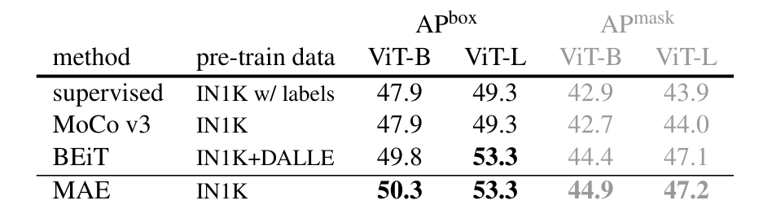

论文 Table 4：Aᴾ_box 是检测框平均精度，Aᴾ_mask 是实例掩码平均精度；同一种 ViT 大小内比较预训练方案。

以 ViT-L 为例，COCO 检测框 AP 从监督预训练的 **49.3 到 53.3**，实例分割 mask AP 从 **43.9 到 47.2**。它们是两个任务输出的分数，不是成功率，也不是“多识别出百分之几的机器人动作”。<!-- evidence:C16 -->

这里没有把一张分类向量硬塞给检测器。补充材料里，作者抽取 ViT 的不同中间层，通过上采样或下采样，接出检测网络需要的多尺度特征，再使用 Mask R-CNN 和 FPN。**FPN 可以理解成多层缩放地图**：小物体需要细地图，大物体也要看粗地图。原始 ViT 没有天然的金字塔，接口工程得补上。

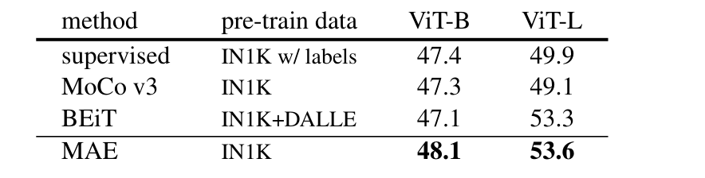

论文 Table 5：ADE20K 的语义分割 mIoU，按 ViT-B、ViT-L 分列。

mIoU 是各类别“预测区域与真实区域的交集/并集”的平均。ViT-L 从监督预训练的 49.9 提升到 MAE 的 53.6。这个结果和 COCO 一起说明，练出的视觉底子不只会报整张图的类别，还能在接好下游网络后帮助空间任务。<!-- evidence:C17 -->

那机器人能用在哪里？例如摄像头图像先经预训练编码器形成视觉 token，再交给动作策略；或者抽中间层空间特征，和深度、关节状态一起融合。这里最值得迁移的是**大量无标签图像如何训练视觉骨干**的思路。动作连续性、接触、遮挡中的物体位置，仍要靠任务数据和控制系统把接口接稳。

更具体的疑问是：如果任务只要抓住杯柄，重建整张桌子的纹理会不会花了太多劲？MAE 提供了一副可训练的视觉底子，如何把预算转向动作真正需要的线索，是接下来读具身工作时该带着的问题。

## 6 讨论：三个问题收回来

**49 块怎样变回整图？**保留块带着原位置进重编码器，输出投影后补入 mask，恢复顺序，再由轻解码器预测各块像素。训练损失只批改被藏起来的 147 块。这个过程把“贵的理解”和“便宜的补图”分了工。

**补像素怎样练出识别？**高遮挡减少复制邻居的近路；但真正的验证在迁移实验。微调、部分微调、线性探测会读出不同能力，尤其 Fig. 9 提醒我们：用一种读出方式概括全部表示，太着急。

**算力省在哪、成果拿走什么？**昂贵编码器只处理四分之一可见块，轻解码器负责完整序列；ViT-L 的匹配实验把 42.4 小时降到 15.4 小时。成果是编码器，不是那张看着有点糊的重建图。

我喜欢 MAE 的一点，是它把一个很朴素的念头做得足够狠：答案太容易抄，就把题目挖大；主力不该盯着空白发呆，就让它只读有内容的部分。最后再认真问一句——这样练出来的东西，换个任务还管用吗？整篇论文的证据链，就在这三个动作里。

后续完整解读、公式源文件和知识关联见 GitHub。点击公众号“阅读原文”进入本篇文章。

精读与配图工具：[ReadPaper](https://github.com/Zhu-Huixiang/ReadPaper) · [DrawPaper](https://github.com/Zhu-Huixiang/ReadPaper/tree/main/drawpaper)。可复制地址：https://github.com/Zhu-Huixiang/ReadPaper

---

公众号版由管理员在后台手动公开发表；永久文章链接待发表后补充。

关注公众号 **具身智能的 World**：

[原论文](https://openaccess.thecvf.com/content/CVPR2022/html/He_Masked_Autoencoders_Are_Scalable_Vision_Learners_CVPR_2022_paper.html) · [证据索引](evidence.json)

[本篇知识星系](../../universe/papers/mae.md) · [知识点宇宙](../../universe/README.md)
