# MuZero：不画出未来，怎么在脑内做规划？

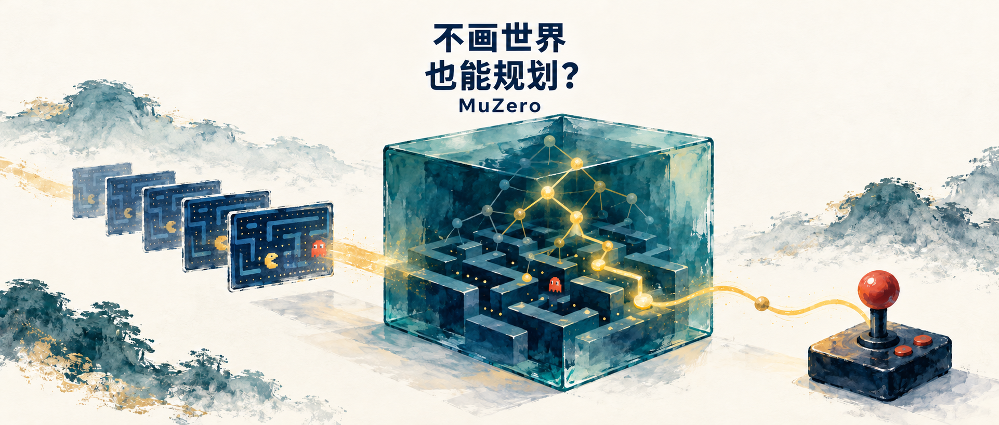

这里是 **具身智能的 World**。公众号把论文讲细，GitHub 留下可放大的原图、公式与阅读路线。

- **论文解读**：顺着原文，把计算过程拆开。
- **论文地图**：按研究问题找下一篇。
- **顶会顶刊集锦**：查正式出处和原文。
- **解读日程**：看接下来准备精讲什么。
- **arXiv 新作**：筛选值得跟的更新。
- **具身榜**：看七维评分和逐项依据。
- **知识点宇宙**：沿着概念，串起不同论文。

[GitHub 知识库](https://github.com/Zhu-Huixiang/embodied-world)

先摆个有点反直觉的问题：一个模型画不出下一帧，甚至没有学着画过下一帧，我们还能让它“想一想再行动”吗？

AlphaZero 的底气是手里有一本精确规则书：这步棋下完，棋盘怎么变，模拟器告诉它。另一条模型学习路线会尝试预测未来观测，把眼前世界在脑内重演。MuZero 挑战的，正是**规划是否必须先拿到这种完整、忠实的环境模型**。它把要交的作业缩成三项：这步得几分，后面大概还能得几分，下一步优先试哪些动作。至于未来画面里那块墙是什么颜色——如果不影响决策，先别给自己加戏。<!-- evidence:C01 -->

但这个省事办法马上惹出三个问题：

1. **只预测奖励、价值和策略，隐藏状态凭什么撑得起规划？**
2. **树搜索到底算了什么，又怎样把搜索结果教回网络？**
3. **分数涨了，功劳有多少来自搜索；这条路线搬到机器人还差什么？**

**论文信息**

《Mastering Atari, Go, chess and shogi by planning with a learned model》，Julian Schrittwieser、Ioannis Antonoglou、Thomas Hubert 等，DeepMind、伦敦大学学院。首次公开于 2019 年 11 月 19 日；本文读本为 arXiv v2（2020-02-21）。论文于 2020 年 12 月 23 日发表于 **Nature**，是一项面向广泛科学读者的强化学习研究。<!-- evidence:C02 -->

[所读原文](https://arxiv.org/abs/1911.08265v2) · [Nature 正式页面](https://www.nature.com/articles/s41586-020-03051-4) · [作者公开伪代码](https://arxiv.org/src/1911.08265v2/anc/pseudocode.py)

**阅读目录**

1. 引言：规划真正需要知道什么？
2. 相关工作：从精确规则，到只保留决策信息。
3. MuZero 算法：三个网络、一次搜索、一轮训练。
4. 实验：分数、预算、搜索消融和失手的游戏。
5. 结论：机器人能借走什么，下一道题是什么？

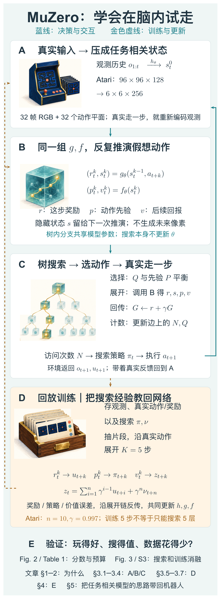

本图由 [DrawPaper skill](https://github.com/Zhu-Huixiang/ReadPaper/tree/main/drawpaper) 指挥 Codex，使用内置生图制作。

先沿蓝线走一遍：**A** 把真实观测压成状态，**B** 提供“假如这么走”的计算接口，**C** 在这些假想分支上搜，最后只执行一个真实动作。环境的新反馈再回到 A。

金色线是训练：C 留下的经历进 **D**，网络拿旧片段重做预测，和真实奖励、搜索策略、回报目标对答案。更新过的网络再去收集更好的经历。**E** 则专门问：这一大圈忙活，值不值？前两节解释动机，第三节逐个拆 A–D，第四节看 E，结尾再把整条链搬到具身问题上想一遍。

## 1. 引言：会做决定，得先会复刻世界吗？

想象你在陌生商场找出口。脑内当然可以建立一套豪华数字孪生：灯具样式、地砖纹理、每张海报的字号，统统还原。可眼下更有用的也许是：这个路口往左会不会走到死胡同，楼梯离出口还有多远。

MuZero 就是在追问这个“够用”的边界。论文把模型接在规划器前面，却没有给它加下一帧重建损失。**隐藏状态的用途，是让后续动作展开之后，仍能预测决策需要的量。** 模型内部可以长得不像环境的原始状态。<!-- evidence:C03 -->

这里的“价值”不是哲学词。它就是：从这个位置继续玩下去，预期还能累计多少奖励。眼前吃到一颗豆子的分数叫即时奖励；为了吃这颗豆子会不会被鬼堵住，得看后续价值。只盯即时奖励，确实容易把自己送走。

也因此，MuZero 并非靠一句“学到了世界”解决问题。它要把三件事接成闭环：模型给搜索提供预测，搜索给行动提供更好的选择，搜索经验又变成模型的学习目标。这三个接口，少解释一个，整篇就会听着很神，落到代码全是问号。

## 2. 相关工作：把模型的任务减到哪里？

原文先把几条路线摆在一起。**无模型强化学习**直接学策略或价值：看到状态就给动作，不显式展开一个环境模型。这里“无模型”说的是算法接口，不是说它脑子里什么规律都没存。**基于模型的方法**则学状态怎么变，再拿这个模型规划。图像任务里，重建未来画面是一种训练模型的办法，但预测每个像素，可能把大量容量花在与得分关系不大的细节上。<!-- evidence:C04 -->

AlphaZero 走的是另一种舒服路线：精确规则现成，模型不必学。树搜索可以调用规则，知道下一盘面，也知道走法是否合法。MuZero 想保留搜索，却把这种昂贵的先验换成从数据学出来的转移。

这条想法也有前辈。原文讨论价值等价模型、TreeQN、Value Prediction Networks 等：模型内部状态不必照搬现实，只要能为价值预测服务。MuZero 把策略预测也放进来，并把学到的模型真正接到蒙特卡洛树搜索上。**它有意思的地方，是“模型要预测什么”和“搜索需要什么”对上了口。**<!-- evidence:C05 -->

> **基础扫盲｜隐空间**
> 先把观测压成一组数字，再在这组数字上计算。这个内部空间就叫隐空间。它像一张为任务专门画的地图：保留哪些路口，取决于后面拿它干什么。MuZero 没有要求每个坐标都对应一个能叫出名字的物理量。

## 3. MuZero 算法：别急着看树，先认清三个接口

### 3.1 原始架构图，应该从哪边读？

论文 Fig. 1 把三件不同的事画在了一起：**A 是脑内规划，B 是真实玩游戏，C 是拿经历训练**。先分清场景，图就没那么吓人。

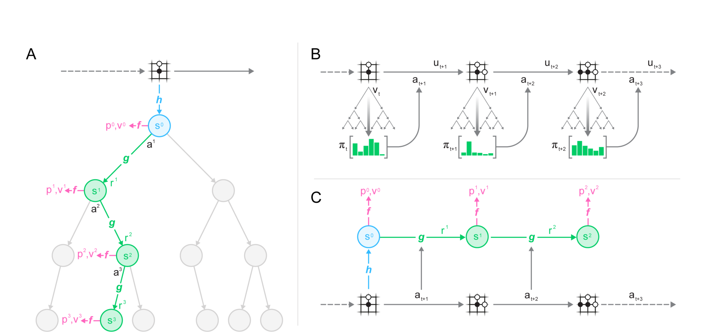

论文 Fig. 1。左边 A 是搜索分支，右上 B 是真实交互，右下 C 是训练展开。

左边蓝色圆点是从观测编码出的初始状态。绿色连线沿着一个候选动作往下推演，得到绿色状态和奖励；粉色分叉在每个状态上读策略与价值。灰色节点表示其他搜索分支，不是另一套网络。右上的小棋盘沿时间轴往前走，每个时刻下面都有一棵搜索树；绿色柱状条是搜索后的动作分布。右下把一段真实经历拿出来，沿已经发生的动作展开网络，用对应目标训练。<!-- evidence:C06 -->

这张图的箭头特别容易串台。**搜索里试了十条路，环境并没有真的走十次；真实经历只沿选中的动作前进一步。** 回头看开篇架构图，这就是 B/C 和 A 的接口差别。

### 3.2 h、g、f：各自接什么，吐什么？

先定义时间。t 是环境已经走到的真实时刻；k 是从这个时刻开始，在模型内部往后展开的第几步。观测写作 o，动作写作 a，模型参数统称 θ。下标 t 保留出发点，上标 k 标内部展开步数；这个 k 不是乘方。

三个函数分别叫**表示函数 h、动力学函数 g、预测函数 f**。其中“动力学”可以先理解为：给定当前状态和动作，算出下一状态及奖励。

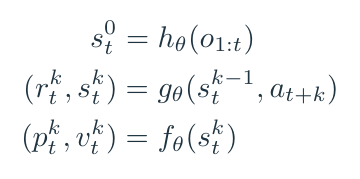

公式 1｜对原文 §3 三个函数加上真实时间 t，下标便于区分不同出发点。

第一行，h 读到 t 为止的观测历史 o₁:ₜ，输出初始隐藏状态 sₜ⁰。它对应开篇 A。第二行，g 读上一个隐藏状态 sₜᵏ⁻¹ 和准备尝试的动作 aₜ₊ₖ，输出预测奖励 rₜᵏ、下一个隐藏状态 sₜᵏ。第三行，f 读这个新状态，输出动作概率向量 pₜᵏ 和标量价值 vₜᵏ。策略向量长度就是可枚举动作集合的大小。<!-- evidence:C07 -->

这里得给三对长得很像的字母分个桌：

| 网络算出来的 | 拿来对照或使用的 |
| --- | --- |
| r：预测这一步奖励 | u：环境真的返回的奖励 |
| p：网络先猜的动作分布 | π：搜索后形成的动作分布 |
| v：网络估计的后续价值 | z：训练用回报目标；ν：搜索得到的价值估计 |

字母是有点多。可以把 p 记成“先凭经验选”，π 记成“在脑内试过后再选”。这两张概率表如果永远一样，搜索就白加班了。

> **基础扫盲｜策略与动作空间**
> 动作空间列出“有哪些按钮”，策略给这些按钮分概率。允许往左，不等于偏好往左；概率低，也不等于这个动作不存在。

北方公园的一篇人物采访写过，周奇墨连玩 GTA，都像是会跟在车后等红绿灯的那种人。游戏给的选择挺放飞，人的玩法可以很克制。这个反差刚好帮我们记住：**能做哪些事，和愿意选哪件事，是两层。** 回到 MuZero，前者决定搜索的动作集合，后者由 p 和搜索后的 π 表达。<!-- culture:zhou-gta-red-light -->

隐藏状态凭什么有用？看看它被要求交什么作业：

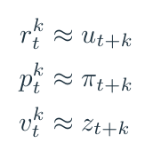

公式 2｜原文 Fig. 1C 的监督对应：奖励、策略、价值分别有自己的目标。

如果 s 忘了一个会改变后续奖励的重要信息，接着展开几步，r 或 v 就会预测错；如果它把好动作排低了，p 会被搜索策略 π 纠正。这些误差共同反传到 h 和 g，逼内部表示留下对任务有用的信息。**只预测奖励、价值和策略，也能用多步训练把隐藏状态约束成一个规划接口。** 至于它能把多少状态合并而不出错，要由搜索和任务表现来检验。<!-- evidence:C08 -->

### 3.3 Atari 的观测到底怎样变成隐藏状态？

这段在原文附录 E/F。只说“CNN 提取特征”太省略了，我们把张量摊开。

Atari 输入最近 **32 帧 96×96 RGB 图像**，颜色通道合起来是32×3=96；再放入32个历史动作平面，共 **96×96×128**。动作平面用常数编码对应动作，让模型知道这些画面之间做过什么。这里的128是输入通道数。<!-- evidence:C09 -->

表示网络先用步长2的卷积把空间尺寸减半到48×48、通道128，经过2个残差块；再用步长2卷积到24×24、通道256，经过3个残差块；平均池化到12×12，再过3个残差块，再池化到6×6。于是送进搜索的状态是 **6×6×256**。

“残差块”就是给一段变换旁边留一条捷径，让输入能直接加回输出，深网络不用每层都从头折腾。这里重点看尺寸：图像的细网格被压缩了，状态仍是一张有空间结构的特征图，而不是一个游戏分数。<!-- evidence:C10 -->

到了 g，候选动作被编码成 one-hot 向量，再平铺到6×6，和状态沿通道拼起来，经过动力学网络得到下一张同尺寸状态图与奖励。one-hot的意思是动作编号对应位置为1、其他为0；它告诉网络“这次试哪个按钮”。f则从状态读出策略和价值。开篇 B 的小立方体，因此代表一组计算用特征，不是藏在里面的一台像素模拟器。

Atari 的奖励和价值还用了一个有趣的工程技巧：先压缩标量的尺度，再用 **601 个位置（−300到300）**的分类分布表示。假如变换后的目标是3.7，就让位置3分到0.3、位置4分到0.7；预测时取分布期望，再做逆变换。这让原本跨度很大的分数，变成更稳的分类训练题。注意3.7是教学值，不是一局游戏的实测结果。<!-- evidence:C11 -->

### 3.4 一次搜索：挑路、扩一格、往回记账

现在放大 Fig. 1A，看开篇 C 怎样调用 B。

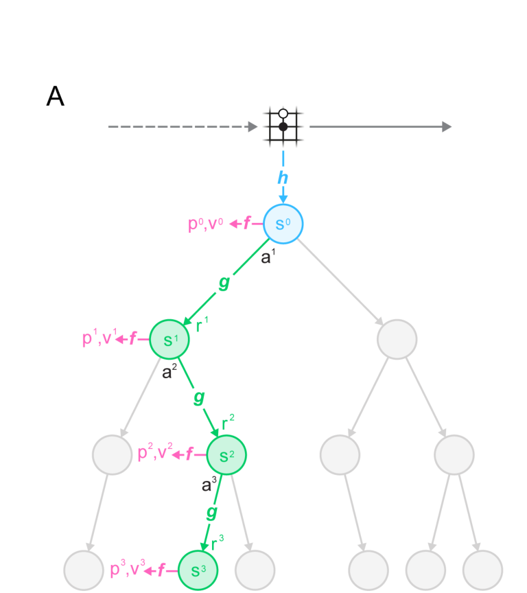

论文 Fig. 1A 局部。蓝色是根状态，绿色是一次展开路径，粉色给每个状态提供策略和价值。

蒙特卡洛树搜索，简称MCTS，可以先理解成“把有限的试走预算花在有希望的分支上”。MuZero不需要每次都把游戏走到结束；新叶子的价值由f估计。

每条边记几样东西：N是已经试过多少次，Q是这条边的平均回报，P是网络给这个动作的先验概率，R是该边预测奖励，S是缓存的后继隐藏状态。缓存很重要：已经展开的边可以直接读，不用反复算同一次g。<!-- evidence:C12 -->

**第一步，挑路。** 既想往目前分数高的方向走，又不能只盯着一条老路。pUCT选择规则把两种冲动加到一起。

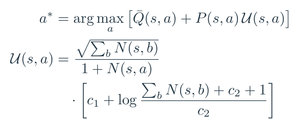

公式 3｜原文 Appendix B Eq. (2)，将探索系数单独记作 U；Q̄ 是搜索树内归一化后的Q。

这里s是当前搜索节点，a是待选动作，求和下标b遍历全部动作；U(s,a)是我们为了排版单列的探索系数。P(s,a)越大，网络越建议先试这条边；该边N越大，分母越大，它的探索奖励就会退一些。根下总访问次数增加，则鼓励再看看还没充分试过的分支。c₁=1.25、c₂=19652控制探索项尺度；Q̄用当前树中的最小、最大值缩放到0–1附近，让无界游戏分数不把概率项完全盖住。<!-- evidence:C13 -->

这公式看着像把整棵树的户口本塞进来了。抓住两件事就够：**目前好不好，看Q；还值不值得再试，看P和访问次数。** pUCT不会只按网络第一眼的偏好走，也不会把预算平均撒给所有动作。

**第二步，扩一格。** 沿着已存在的边走到一个还没展开的动作，调用一次g得到奖励和新状态，再调用f得到新状态的策略与价值。新节点建起来，孩子的访问次数从0开始。一次模拟最多新增一次动力学与预测计算；它不是从根开始把所有分支再算一遍。<!-- evidence:C14 -->

**第三步，往回记账。** 新叶子的价值是这次试走的尾款，路径上的每一步奖励依次加回来。对单玩家Atari，用下面这个递推最容易看明白。G表示本次路径回报，γ是折扣系数，Q_old/Q_new是更新前后的平均值。

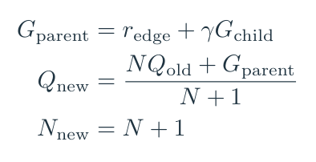

公式 4｜对原文 Appendix B 回传的教学递推：先加边奖励，再更新平均值与次数。

举个纯算术例子：叶子估值5，前一条边奖励2，教学折扣取0.9，那么父节点这次收到2+0.9×5=6.5。假如这条边以前访问3次，平均Q=4，更新后就是(3×4+6.5)/4=4.625，次数变4。双人零和棋类还要切换玩家的价值视角，不能把对手的好消息原样加到自己账上。<!-- evidence:C15 -->

重复到预算用完，根下各动作的访问次数变成搜索策略。τ是温度，调节分布有多尖：

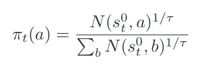

公式 5｜原文 Appendix D Eq.6 的按访问次数采样，τ=1时就是归一化计数。

例如访问次数30、15、5，τ=1时就得到0.6、0.3、0.1。温度更低，选择更集中。训练时会保留探索，评估时按相应设置更偏向高访问动作；棋类与Atari的温度安排不同，不能把“按π随机抽”当成所有评估局面的唯一规则。<!-- evidence:C16 -->

**真实执行只做这一个动作。** 环境返回新观测和真实奖励，重新走开篇 A。MuZero在根处使用环境提供的合法动作集合；树内部展开则不靠精确游戏规则逐步检查合法性。这也解释了为什么“没拿规则做树内模拟”不等于“连按钮有哪些都不知道”。<!-- evidence:C17 -->

### 3.5 搜索完了，谁来教网络？

看Fig. 1的右半边。上排实际玩，下排拿玩过的片段训练；开篇架构图的 D 就从这里来。

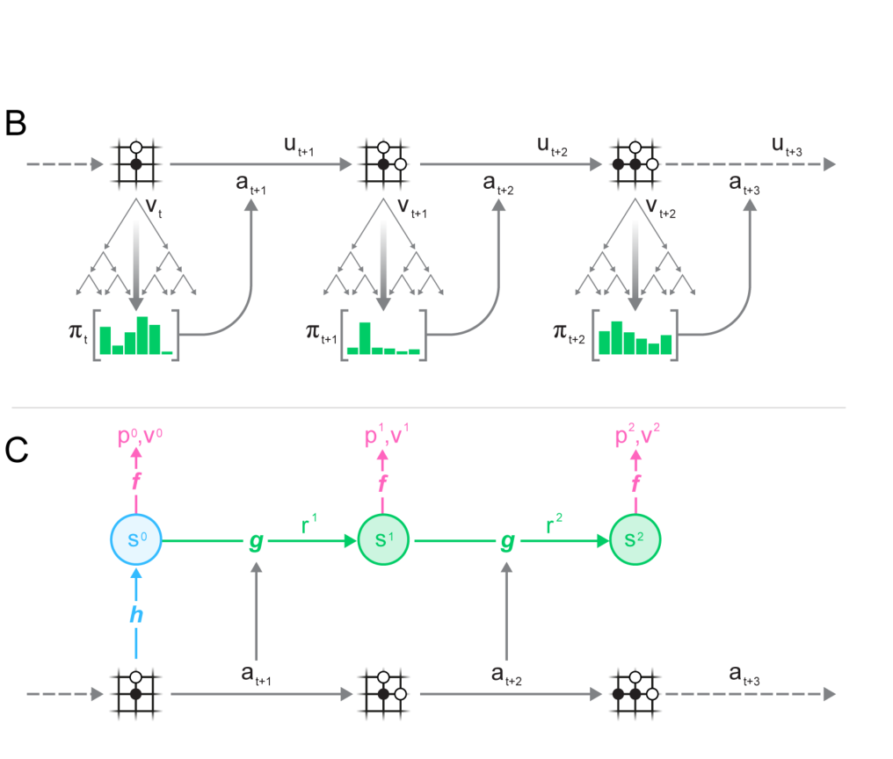

论文 Fig. 1B–C 局部。B每个真实时刻重新搜索，C沿回放中的真实动作展开网络。

每个真实时刻存观测、动作、真实奖励，还存当时搜索得到的策略π和搜索价值ν。训练时抽一个起点t，h先编码历史，g沿回放中**已经发生过的动作**展开K=5步，每一步让f出预测。

这个细节得加粗：**训练展开的动作来自回放，搜索展开的动作由当前树选择。** 二者共用网络，却不是同一批输入。把它们画成一条不断自说自话的想象链，会漏掉真正的环境监督。<!-- evidence:C18 -->

奖励目标很好懂，就是环境当时返回的u。策略目标是当时搜索得到的π。价值目标z则把几步真实奖励和后面的搜索估值拼起来。在Atari里，标准设置n=10，γ=0.997。

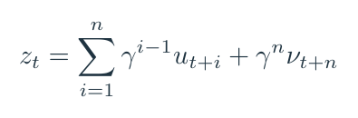

公式 6｜原文 §3 的 n-step return：前n步用真实奖励，之后用搜索价值ν接尾。

求和下标i从1到n，γⁱ⁻¹表示离当前越远的奖励折扣越多；末尾γⁿνₜ₊ₙ是“走到那儿以后还值多少”。这叫 **bootstrap，自举**：未来没有全部走完，就用一个估计接下去。名字挺玄，干的事很朴素。棋类则可用终局胜负作价值目标，且省掉中间奖励预测损失。<!-- evidence:C19 -->

### 3.6 损失函数：三份作业，一起改h、g、f

先看账本再说怎么记分。ℓᵖ是策略误差，ℓᵛ是价值误差，ℓʳ是奖励误差；c是L2正则系数，‖θ‖₂²是参数平方和，用来约束权重规模。起始状态也预测策略与价值，但它没有“刚走过的模型动作”，所以奖励项从k=1开始。

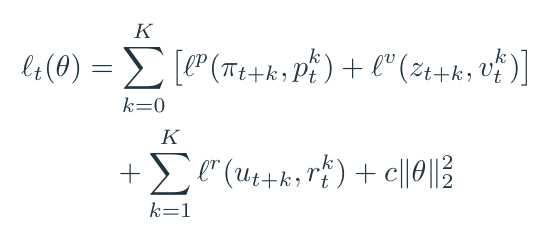

公式 7｜原文 Eq. (1) 的分项展开，把k=0的无奖励项显式分开。

这些误差沿着五步展开反向传播，共同更新h、g、f。不是先训练一个像素模型、冻住，再外接一个独立决策头。隐藏状态要保留什么信息，由这一整套预测任务共同塑形。<!-- evidence:C20 -->

策略用交叉熵。p(a)是网络给动作a的概率，π(a)是搜索目标的概率；log是自然对数。对Atari价值/奖励的分类表示，qⱼ是第j个支持点的预测概率，φ(y)是把压缩后的标量目标y摊到相邻支持点得到的目标分布。于是两类账都可以写成负对数概率：

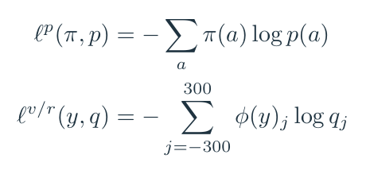

公式 8｜交叉熵的标准教学展开；策略对动作求和，价值/奖励对601个支持点求和。

交叉熵像一位只关心“该押的地方到底押了多少”的老师。答案不是硬塞一个动作，而是搜索产生的软分布：好几个动作都不错时，网络也要学这个分配。

下面用小数字把两份作业都算一次。策略目标π=(0.6,0.3,0.1)，网络p=(0.2,0.5,0.3)，损失约1.294。回报例子另取n=3、γ=0.9、真实奖励(1,0,2)、尾部估值ν=5，得到z=6.265。这些是教学参数，与标准Atari设置分开。

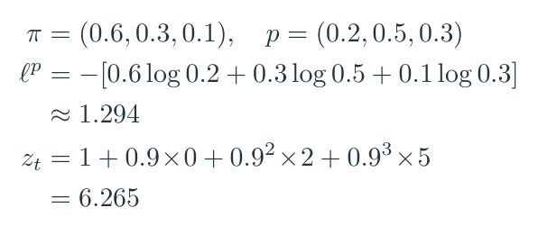

公式 9｜教学数值：上半算策略交叉熵，下半算三步回报。

实现还做了两处梯度缩放：各预测头按1/K缩放，动力学入口处的反向梯度乘1/2，防止展开长度把梯度尺度拖着跑。隐藏状态按自身范围缩放到0–1，帮助不同深度的状态分布接近。Atari回放优先抽搜索价值ν与目标z差异大的片段，并用重要性权重处理这种非均匀抽样。它不是只重复播放成功集锦。<!-- evidence:C21 -->

### 3.7 Reanalyze：老经历，重新做一遍题

回放有个麻烦：上周水平的搜索老师，留下的答案未必配得上今天的学生。MuZero Reanalyze用更新的网络重新搜索旧状态，刷新训练目标，让旧经历多发挥点作用。

在本文所读v2里，80%的更新使用重新分析得到的策略目标；每个状态的训练采样数由0.1增到2.0，价值损失权重降为0.25，回报目标步长从10改为5，并用近期目标网络提供更稳定的价值目标。这是一组一起调整的设置，后面看成绩时也要把它们一起算上。<!-- evidence:C22 -->

这个循环有点“自己给自己布置作业”的味道，但答案并非凭空编出来：回放里有真实动作和奖励，搜索在当前模型里改进策略，训练再吸收这种改进。**树搜索算出的策略分布，正是被教回网络的重要内容。** 它改善了下一轮“第一眼怎么选”，所以练到后面，少搜几次也可能挺能打。

## 4. 实验：搜索这笔电费，花得值吗？

### 4.1 先看整体学习曲线，别把横轴认成环境帧

Fig. 2的主信息是：同一套模型学习与搜索思路，在三种棋和Atari上都学出了强策略。但横轴是**百万次训练更新**，不是“只玩了百万步”。

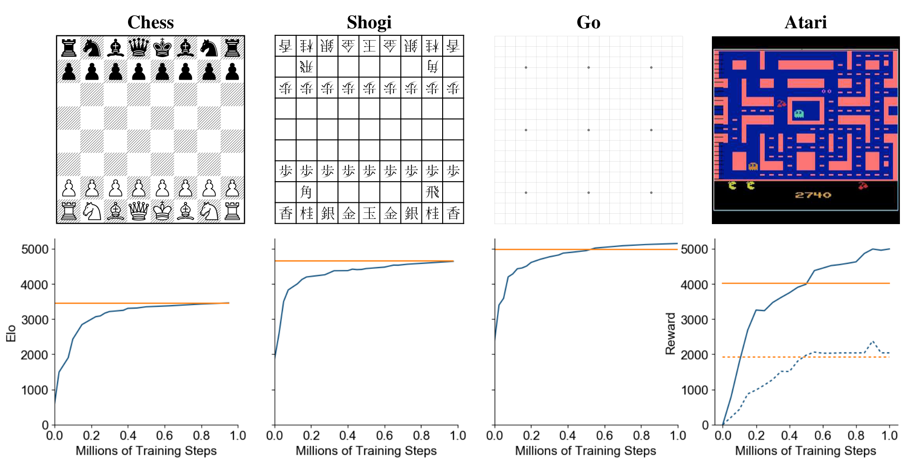

论文 Fig. 2。横轴是百万次训练更新；前三幅纵轴为Elo，最后一幅为人类归一化游戏分数。

前三幅从左到右是国际象棋、将棋、围棋。蓝线是MuZero，橙色横线是AlphaZero；评估棋类时双方每步都用800次模拟。Elo是一套由对局结果估计相对棋力的评分，往上表示更强，不是赢棋百分比。不能拿三个不同游戏的Elo直接横着比“谁更聪明”。<!-- evidence:C23 -->

Atari那一幅放大看：

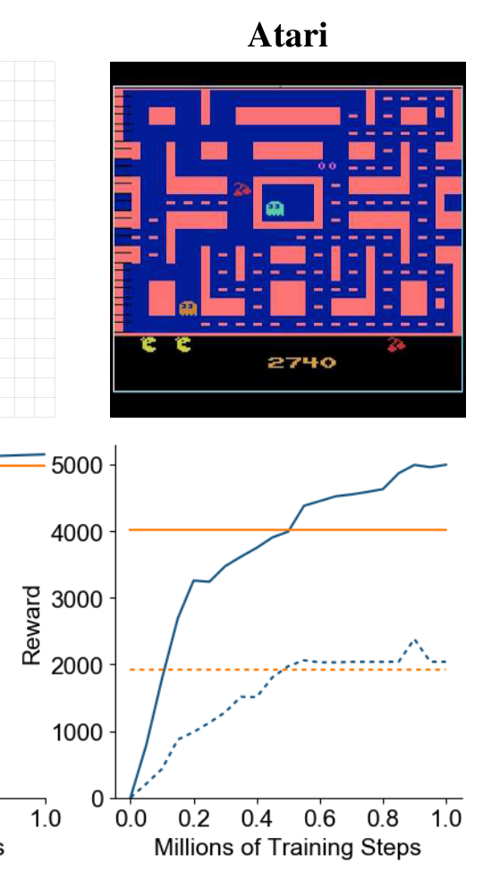

论文 Fig. 2 Atari 局部。实线表示57款游戏归一化分数的均值，虚线表示中位数；橙色是R2D2。

蓝色实线接近5000，蓝色虚线约2000，二者差这么大，提示少数高分游戏会把平均值拉上去。所以我们同时看均值和中位数，再去单款游戏里找掉链子的地方。

人类归一化分数怎么来？S_agent、S_random、S_human分别是智能体、随机策略和人类的原始游戏分数：

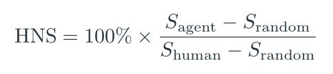

公式 10｜人类归一化分数：随机策略为0%，人类参考为100%。

假如随机100分、人类1100分、模型2100分，就得到200%。意思是模型相对随机基线的分差，是人类分差的两倍。**2041.1%是这种标尺上的分数，不是胜率。**<!-- evidence:C24 -->

### 4.2 Table 1：先把数据预算分组，再聊谁赢了

这张表有一条关键横线：上半是大数据预算，下半是小数据预算。别让加粗数字把眼睛牵着走。

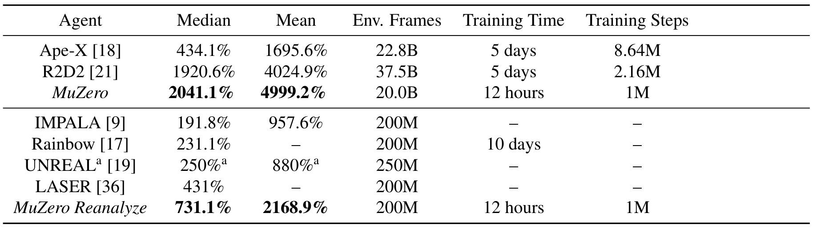

论文 Table 1。上半比较大数据设置，下半比较小数据设置；Median/Mean是归一化分数，Env. Frames是环境帧数。

大预算一组，MuZero中位数2041.1%、均值4999.2%，R2D2分别为1920.6%、4024.9%。表中环境帧预算分别为20B与37.5B，B是十亿；Atari逐游戏训练，不能把这项预算看成“57款游戏共享一个小模型就练完了”。原文按游戏结果统计，MuZero在57款中的42款超过R2D2。<!-- evidence:C25 -->

小预算一组用200M，也就是2亿帧。这里MuZero Reanalyze中位数731.1%、均值2168.9%；LASER中位数431%，Rainbow为231.1%，IMPALA为191.8%。**重新利用旧经历，确实让有限数据发挥了更大作用。** 不过Reanalyze同时改了目标刷新、采样次数和其他训练设置，单看这张表，还得把这组改动一起考虑。<!-- evidence:C26 -->

表里还有“12小时对5天”，看着很诱人。这一列得连硬件一起读：MuZero Atari每款游戏用8个TPU训练、32个TPU生成数据，棋类的自博弈配置还更大。不同系统的墙钟时间摆在一行，需要各自的硬件背景才能解释。所以聊“更省”时，得把数据帧数、训练机器和搜索计算一起摊开，光盯12小时容易看走眼。<!-- evidence:C27 -->

### 4.3 搜得更多就更强？围棋和Atari给了两种回答

回到开篇 E。Fig. 3最重要的作用，是把“结果好”拆成更具体的原因。先放全图看布局，然后分别放大。

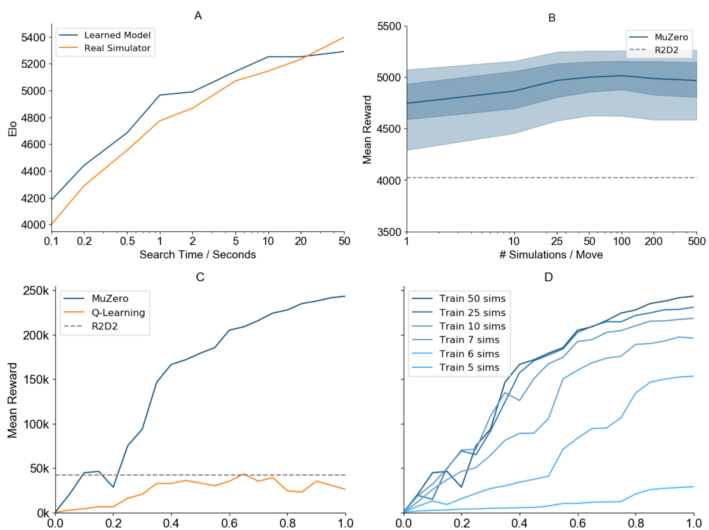

论文 Fig. 3。A/B改变评估时的搜索预算；C改变训练方法；D改变训练时的搜索次数。

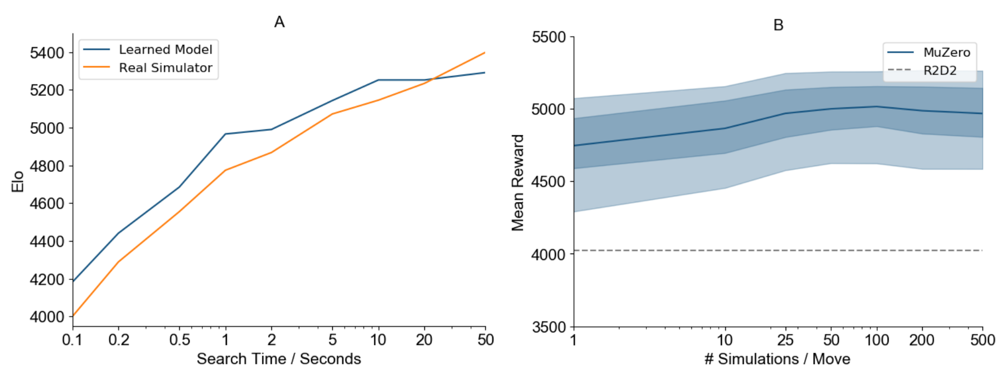

论文 Fig. 3A–B 局部。A横轴为每步搜索秒数、纵轴Elo；B横轴为每动作模拟次数、纵轴平均归一化奖励。

A看围棋。横轴刻度从0.1秒排到50秒，间距是非线性的；蓝线用学到的模型，橙线用真实模拟器。总体上，两条线都随搜索时间增加而提高，长时间搜索时仍处在相近水平。这回答了一个担忧：模型不是只会配合训练时那点小搜索预算，一拉长就立刻散架。

B看57款Atari。横轴从1次模拟到500次；蓝色中线是均值，深浅色带对应25–75与5–95百分位，灰虚线是R2D2参考。上升在约100次模拟处趋于平缓，继续加预算，提升没有围棋那么明显。原文提出模型误差可能限制额外规划的收益，这是对差异的解释方向。<!-- evidence:C28 -->

说白了，**多想一会儿是否划算，取决于想象有没有保真，以及这个任务还剩多少能靠搜索捞回来的收益**。如果脑内越走越偏，多开几层推演，也可能只是把错账算得更工整。

### 4.4 是网络大，还是搜索训练真的有用？

Fig. 3C专门做了一个更接近因果追问的对照：在MuZero框架里保留可比的网络规模和训练量，把训练目标换成Q-learning，并去掉搜索。

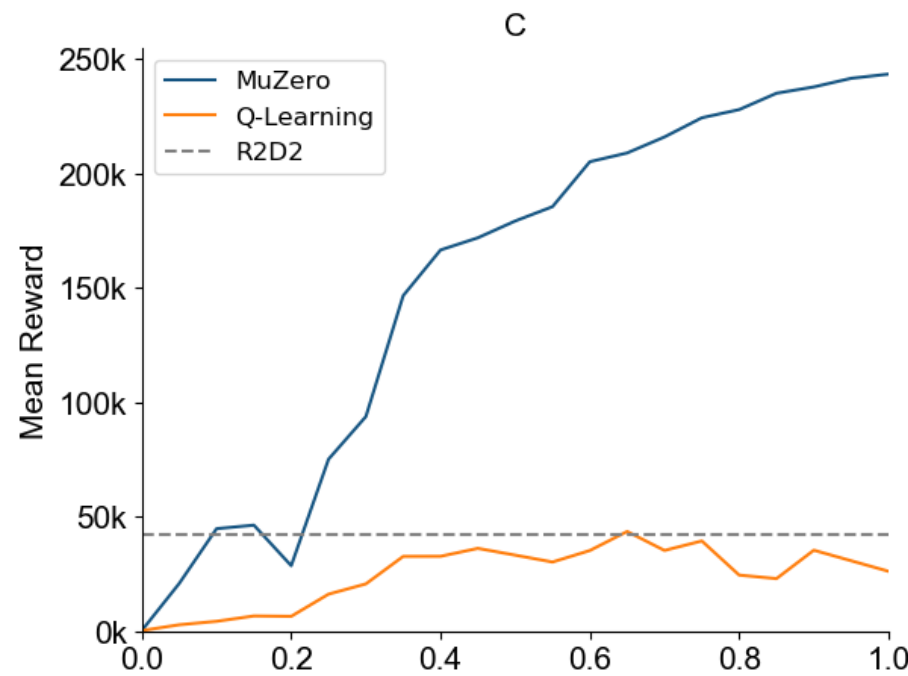

论文 Fig. 3C 局部。横轴是百万训练更新，纵轴为Ms. Pac-Man平均原始得分；蓝线MuZero，橙线Q-learning，灰虚线R2D2。

Q-learning学习“当前状态做这个动作，后续回报有多少”，这里用Q头替换原来的价值与策略头。蓝线最后接近25万分，橙线徘徊在几万分，接近R2D2参考。对这款游戏，这组控制规模/训练量的比较支持：差距不是简单靠塞进更大网络。原文认为搜索产生的策略改进，比高方差Q学习目标给出了更强的学习信号。<!-- evidence:C29 -->

接着看D，问题变成：**训练时让搜索老师认真一点，学生能学得更好吗？**

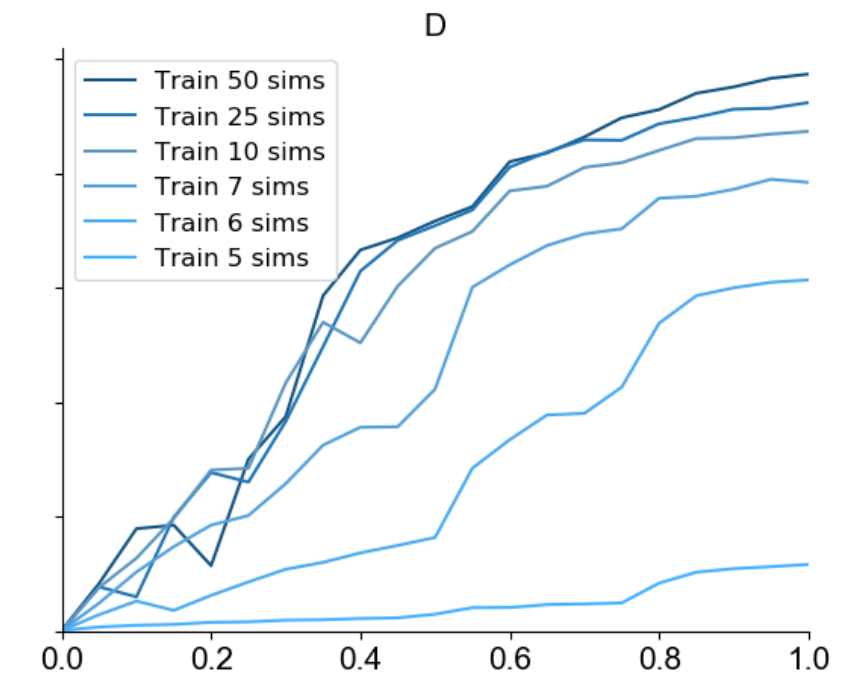

论文 Fig. 3D 局部。横轴仍是百万训练更新，纵轴沿用Ms. Pac-Man得分；各蓝线代表训练时每步5、6、7、10、25、50次模拟。

这些网络最终评估统一用50次模拟，考试时拿的是同一款计算器。差别在于训练时，搜索老师有多少预算。训练阶段搜索更多，学习一般更快、最终更高；只用6次模拟也学出了有效策略，虽然Ms. Pac-Man这里有8个可能动作，6次连全覆盖都做不到。先验与跨回合学习让预算不必每回合平均扫遍所有动作。<!-- evidence:C30 -->

### 4.5 训练展开5步，搜索为什么能走到更深？

这时得把附录Fig. S3拿到旁边，不能让读者脑补“5步模型”就是“五层封顶”。

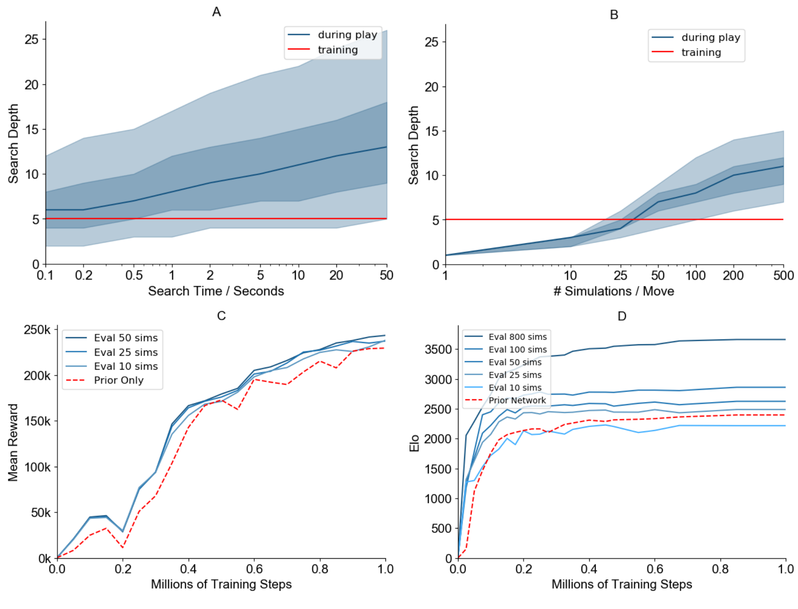

论文 Fig. S3。A/B看搜索深度，红线为训练展开5步；C/D在同一训练网络上改变评估搜索量。

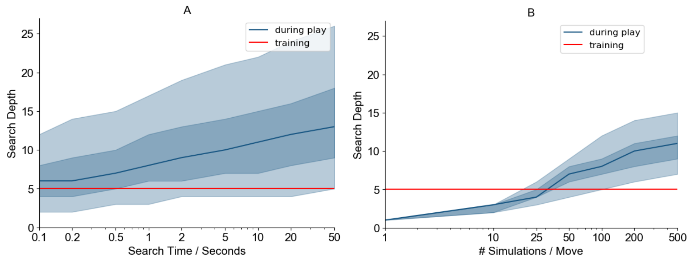

论文 Fig. S3A–B 局部。横轴分别为围棋搜索秒数和Atari模拟次数，纵轴是搜索树深度。

蓝线是中位搜索深度，深浅色带仍是25–75、5–95百分位。红线固定在5。随着预算加大，蓝线越过红线：g可以继续反复调用，结构上没有只能用五次的开关。**K=5限定训练反传的展开窗口，并不限定推理树深。** 深了以后还能不能保持有用预测，则是实验问题。<!-- evidence:C31 -->

Fig. S3下半部也别错过：C是同一个Ms. Pac-Man网络，用50/25/10次评估搜索，和直接取原策略最大概率动作的红虚线比较；D在围棋上做相应比较。C的间隙相对小，D的间隙大得多。这再次说明：搜索既在行动时帮忙，也在训练时教网络；训练完成后直接用网络，也已经带着一部分搜索经验。不能只看推理时省下几次搜索，就倒推训练时的搜索没贡献。

### 4.6 别让均分把难题盖过去

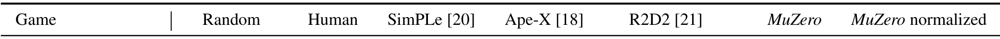

论文 Table S1 表头。列顺序为游戏、随机、人类、SimPLe、Ape-X、R2D2、MuZero、MuZero归一化分数。

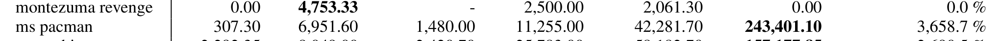

论文 Table S1 局部：Montezuma's Revenge与Ms. Pac-Man。紧邻两行，MuZero表现却差得很远。

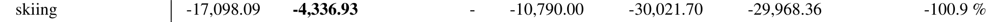

论文 Table S1 局部：Skiing。原始负分越接近0越好，最后一列是按随机与人类参照换算的分数。

Table S1逐款游戏的结果里，Ms. Pac-Man很亮眼：MuZero 243401.10，R2D2 42281.70。但到了Montezuma's Revenge，MuZero是0，R2D2为2061.3。Skiing的MuZero原始分数−29968.36，甚至低于随机参考−17098.09；这个游戏分数越接近0越好。<!-- evidence:C32 -->

把最相关的两列拎出来，手机上看得更轻松。该表按开局随机执行0–30个无操作的协议报告，单局最多30分钟；MuZero结果是每款游戏1000次评估的平均分。

| 游戏 | R2D2 → MuZero |
| --- | --- |
| Ms. Pac-Man | 42281.70 → 243401.10 |
| Montezuma's Revenge | 2061.3 → 0 |
| Skiing | −30021.70 → −29968.36 |

这几行放一起，比一句“平均超人类”更有信息量。搜索擅长比较模型已经能分辨的选择；如果奖励稀疏到几乎没见过，或者模型把关键长程关系丢了，树再大也可能绕着错误地图忙活。**任务相关模型的价值，和探索是否找到过好经验，是两道互相影响的题。** 这正是读MuZero时应该留在脑子里的下一步问题。

## 5. 结论：带回机器人时，先借思路，别照搬按钮

原文结论强调，精确模拟器不是结合学习与规划的唯一入口。用奖励、价值、策略训练出的模型，也能支撑强搜索。它给世界模型研究的一个具体启发是：**先问下游决策究竟需要哪些预测，再决定模型必须学什么。**<!-- evidence:C33 -->

这和具身智能很有关。机器人看到的图像细节太多，控制真正依赖的可能是接触、可达性、对象运动与任务进度。把每块背景纹理都预测得漂亮，和选对下一段动作，未必需要同一份表示。但机器人也会把MuZero目前避开的难题直接端上来：连续动作怎么展开分支？一个误判会撞到真实物体时，怎样限制想象误差？环境采样昂贵时，搜索目标又该多相信模型？

这里最适合接着读的，是模型学习与规划如何适配连续控制的工作，而不是把Atari动作按钮换成机械臂关节值，就宣布迁移完成。机器人每一步的代价，是真要付的。

最后把三个问题收回来。

**第一问，隐藏状态凭什么能规划？** 因为训练沿动作序列反复要求它预测奖励、价值、策略；这些目标共同约束h/g/f。它交的是决策作业，像素重建不在这份作业里。

**第二问，搜索怎么算、又怎么教回去？** pUCT选择分支，g/f扩出新状态与估值，奖励加折扣价值往回更新N/Q；根访问次数形成π。真实经历、π和回报目标进入回放，下一轮再训练网络。慢一点的脑内试走，逐渐改善快一点的第一反应。

**第三问，功劳怎么分？** Atari主结果有强分数，Ms. Pac-Man的Q-learning对照支持搜索训练的作用；评估时加搜索的收益在围棋更大、Atari更早趋平。稀疏奖励和一些失败游戏仍提醒我们：会规划，需要一张对当前任务足够可靠的地图，也需要真见过有价值的路。

我更愿意把MuZero看成一次相当大胆的减法：**先不要求模型把世界复刻出来，先让它把下一步算明白。** 省下来的建模功夫有没有换成更好的决策，就看那棵搜索树和它背后的训练账本。

**继续读与工具**

[MuZero 评分与来源](https://github.com/Zhu-Huixiang/embodied-world/blob/main/leaderboard/papers/muzero/README.md) · [世界模型阅读地图](https://github.com/Zhu-Huixiang/embodied-world/tree/main/paper-map) · [知识点宇宙](https://zhu-huixiang.github.io/embodied-world/universe/)

本篇的高清原图、精确公式和DrawPaper可编译图源都在GitHub文章目录。点击“阅读原文”可到对应入口。

[ReadPaper skill](https://github.com/Zhu-Huixiang/ReadPaper) · [DrawPaper skill](https://github.com/Zhu-Huixiang/ReadPaper/tree/main/drawpaper)

可复制地址：https://github.com/Zhu-Huixiang/ReadPaper

---

公众号版由管理员在后台手动公开发表；永久文章链接待发表后补充。

关注公众号 **具身智能的 World**：

[原论文](https://arxiv.org/abs/1911.08265v2) · [证据索引](evidence.json)

[本篇知识星系](../../universe/papers/muzero.md) · [知识点宇宙](../../universe/README.md)
