# NeRF：把照片藏进函数里，换个角度还能看见吗？

这里是「具身智能的 World」。我们把论文里的计算拆开，看看它们究竟替机器人解决了什么。

- 论文解读：原图、公式和实验一起读。
- 论文地图：按问题寻找下一篇。
- 顶会顶刊集锦：直接找到正式论文。
- 解读日程：查看接下来一周的选题。
- arXiv 新作：筛过一遍的新研究。
- 具身榜：评分、依据与研究团队。
- 知识点宇宙：沿着概念走到相关论文。

GitHub：[具身智能的 World](https://github.com/Zhu-Huixiang/embodied-world)。

给一个杯子拍几十张照片，再把相机挪到没拍过的位置。电脑该给你看什么？

拿两张照片搓个过渡，杯口容易变成重影；先建三维模型，又得把细边、反光、遮挡一个个收拾好。NeRF 挑战的是一个很具体的判断：**连续神经网络太糊，真想保住三维场景的细节，还得靠网格或离散体素。** 它沿着 SRN 等神经场景表示的路线往前走，却换了一种表示和渲染方法：不急着确定“光线到底撞上哪张表面”，而是沿途问每个位置能贡献多少颜色。<!-- evidence:C01 -->

这篇先带三个问题：

1. 一个只有坐标输入的网络，怎么装下整片场景，反光又该放哪？
2. 沿光线问到一串密度和颜色以后，怎样算出屏幕上的一个像素？
3. 位置编码和粗细采样分别救了什么，漂亮的新视角要花多大代价？

**论文信息**：*NeRF: Representing Scenes as Neural Radiance Fields for View Synthesis*；Ben Mildenhall、Pratul P. Srinivasan、Matthew Tancik 等；加州大学伯克利分校、谷歌研究院、加州大学圣迭戈分校。首次公开于 2020-03-19，本文读 arXiv v2（2020-08-03），正式发表于 ECCV 2020。ECCV 是计算机视觉领域主要国际会议之一，这篇讨论的是多视角场景表示与新视角合成。<!-- evidence:C02 -->

[论文](https://arxiv.org/abs/2003.08934v2) · [项目与视频](https://www.matthewtancik.com/nerf) · [代码](https://github.com/bmild/nerf)

**阅读目录**

- 1 引言：照片少了，三维世界怎么补？
- 2 相关工作：表面、体素与连续函数
- 3 方法起点——场景表示：一个点为什么有两套答案？
- 4 体渲染：沿途收颜色，还得看前面挡了多少
- 5 优化：高频坐标、粗细采样和照片监督
- 6 实验：画面、数字和时间账单
- 7 结论：它把哪扇门推开了？

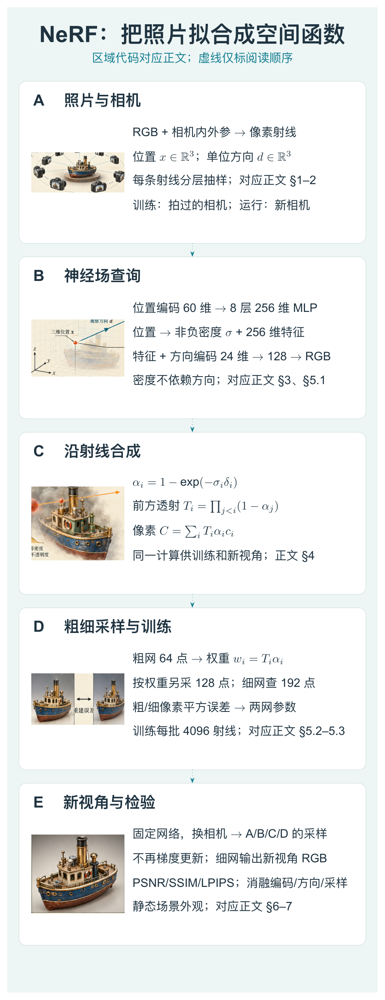

本图由 [DrawPaper skill](https://github.com/Zhu-Huixiang/ReadPaper/tree/main/drawpaper) 指挥 Codex，使用内置生图制作。

先认路线：**A** 从照片和相机位姿得到射线，**B** 把采样点变成密度与颜色，**C** 沿射线合成像素，**D** 用粗网络安排细采样，并用照片误差更新网络。训练后，**E** 换相机、重新走 B/C，就得到新视角。第 3 节拆 B，第 4 节拆 C，第 5 节把 A/D 接成训练循环，第 6 节检查 E 交出来的画面。这里没有“按一下按钮，照片自动脑补整个宇宙”；相机标定和多视角覆盖是起跑线。

## 1 引言：照片少了，三维世界怎么补？

一张照片把深度压扁了：左上角那块绿色，可能是近处叶子，也可能是远处墙面。多拍几张，前后景的位置关系会在视角变化里露出来。NeRF 利用的正是这批相互约束的观察。

它优化的是**一个场景专属的网络**。今天训练客厅，明天换厨房，要重新拟合厨房。输入照片是训练监督；运行时输入的不是“新照片”，而是想查看的位置与方向。这个区别先钉牢，否则很容易把 NeRF 想成看一眼照片就能通用建模的大模型。<!-- evidence:C03 -->

“神经辐射场”这个名字听起来像发电厂。可以先把它想成一部空间电话簿：拨一个三维坐标，它回答这里有多容易挡光；再附上观察方向，它回答从这边看是什么颜色。网络权重把这些查询结果压在一起。

## 2 相关工作：表面、体素与连续函数

原文先摆出两类难题。网格用顶点和三角形描述表面，表达很直观，但从照片倒推网格时，拓扑、初始化和优化都可能添堵。体素则把空间切成小格子，每格记颜色和不透明度，细节越多，格子越密，存储很快膨胀。

连续隐式表示走另一条路：不存满每个格子，存一个可查询的函数。DeepSDF 等工作查询距离，occupancy 方法查询点在物体里还是外面；SRN 则学习沿光线寻找表面，再给出颜色。NeRF 的关键转弯是查询**体密度与方向相关的颜色**，允许一条射线上多个位置共同参与成像。它沿用了经典体渲染，把神经表示、可微渲染和优化改进接在同一条线上。<!-- evidence:C04 -->

这也解释了它和机器人知识库的关系：它提供一种可从照片优化、可换视角查询的静态场景表示。后续做视觉定位、场景特征或视觉仿真，可以借这套表示思想。这里先把原论文的新视角合成讲清，机器人动作和动力学是另一层问题。

## 3 方法起点——场景表示：一个点为什么有两套答案？

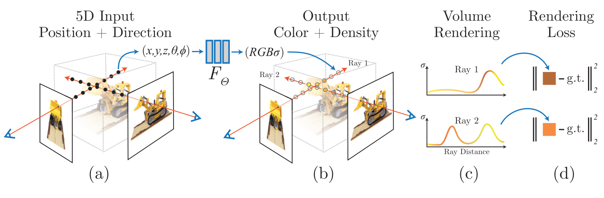

论文 Fig. 2。先沿相机射线找点，再查询网络，最后把一串答案积成像素。

这张总图讲的是“如何从一个场景函数得到一张照片”。从左往右看：**(a)** 两条射线上布了采样点，位置加观察方向形成 5D 查询；**(b)** 网络输出 RGB 与密度 σ；**(c)** 横轴是沿射线距离，曲线画密度，彩色条提示各段颜色；**(d)** 合成颜色和真值像素比较，误差沿计算链回去。图中两条射线是两个像素的示范，并非两个独立场景网络。<!-- evidence:C05 -->

### 3.1 位置定密度，方向管反光

记空间点为 **x=(x,y,z)∈ℝ³**，射线方向为 **d∈ℝ³**，且长度为 1。方向虽然用三个数存，单位长度约束让它只有两个自由度，所以论文称“5D”，不是算错了 3+3。

网络 F 的参数记作 Θ。它输出颜色 **c=(r,g,b)∈ℝ³** 和非负标量密度 **σ**。**σ 只依赖 x，c 同时依赖 x 和 d**。同一块杯壁不会因为相机挪了两步就换个物理位置，但反光确实会跟着视角走。把两者分开，是在网络结构里塞进一条多视角一致性约束。<!-- evidence:C06 -->

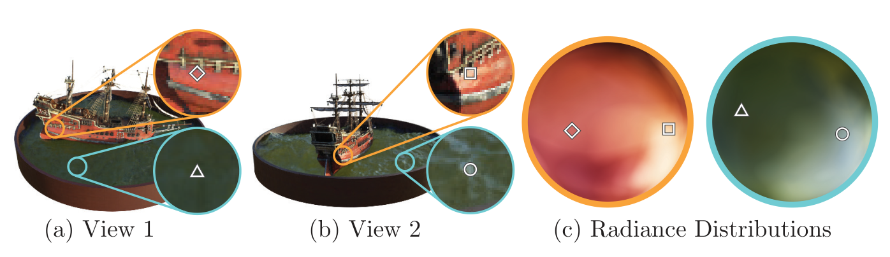

论文 Fig. 3。同一个空间点，换个方向看，亮度和颜色可以不同。

先看它要说明什么：一个固定的三维点，不必绑定永远不变的 RGB。左边 (a)、中间 (b) 是两台相机看到的船和水面。橙圈都指向船侧同一点，蓝圈都指向水面同一点；比较对应放大框，就能看到反光变化。右边 (c) 的两个圆盘把不同观察方向铺开，颜色是该位置向那些方向的预测 RGB；圆盘不是“物体颜色热力图”，也没有统计学横纵轴。图里的标记把两个例子相机方向对回圆盘。<!-- evidence:C07 -->

### 3.2 MLP 里面到底走了几步？

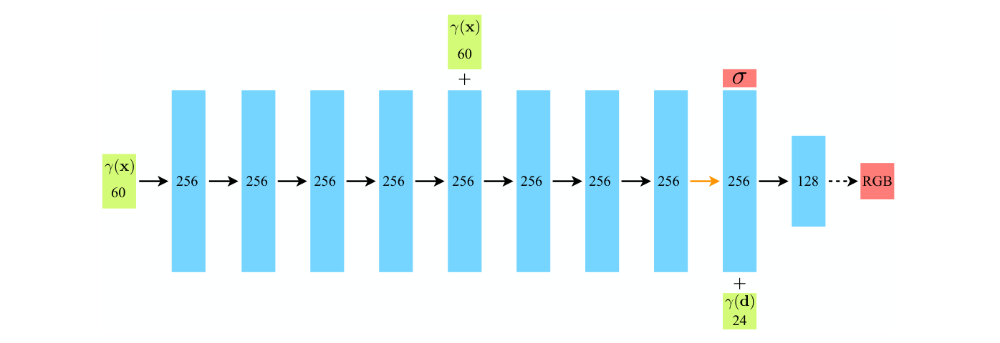

论文 Fig. 7。绿色是编码后的输入，蓝色是隐藏特征，红色是密度和 RGB 输出。

这张图回答的是 B 区里“一个坐标经过什么”。位置编码后是 60 维，先走 **8 层、每层 256 通道**的全连接网络；中途有输入跳接，把原始编码再拼进来，免得位置线索越传越淡。主干再分出非负密度与 256 维特征。观察方向编码成 24 维，与这 256 维特征拼成 280 维，经过 128 通道隐藏层，再输出 3 维 RGB。<!-- evidence:C08 -->

箭头要分开看：黑实线带 ReLU，负激活裁成零；橙线是线性映射；末端虚线带 sigmoid，把 RGB 压到 0–1。图里“+”是**拼接**，不是向量相加。绿色方向输入只在颜色分支入场，无法绕路改变密度。

> **基础扫盲｜MLP**：多层感知机就是反复做“矩阵乘法加偏置，再过非线性”。它不是把照片切成小块找相似图，而是学一套连续查询规则。

这一层层网络确实有点“为了问一个像素，把整套班子都叫来了”。这笔计算账先记着，第 6 节会结。

## 4 体渲染：沿途收颜色，还得看前面挡了多少

回到 C 区。一个像素对应一条射线，写成 **r(t)=o+td**：o∈ℝ³ 是相机原点，d 是射线方向，t 是沿线参数。tₙ、t𝒻 是近端和远端边界；σ(r(t)) 是该点密度，c(r(t),d) 是颜色。连续式里 **T(t)** 是光线从近端走到 t 还没被前方截住的透射比例。

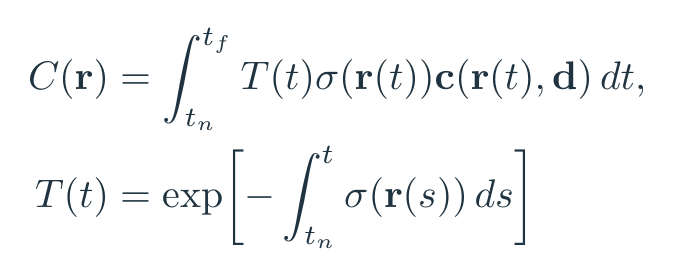

公式 1｜论文 Eq. (1)：把“到得了这里 × 在这里停下的份额 × 这里的颜色”沿射线累加。

s 是内层积分的临时位置变量，与外层 t 同样沿射线走；exp 是指数函数。密度在某段越大，T 往后衰减越快。它不是把 RGB 一锅倒进搅拌机——前面有堵墙，后面再鲜艳也很难透出来。<!-- evidence:C09 -->

### 4.1 连续积分怎样落到离散采样？

电脑不会真的查询无限多个点。把近远区间分成 N 段，每段随机抽一个 tᵢ；第 i 点与下一点的距离记 **δᵢ=tᵢ₊₁−tᵢ**，对应密度 σᵢ、颜色 cᵢ。用 **αᵢ=1−exp(−σᵢδᵢ)** 表示这一小段消耗的比例；**Tᵢ** 是到这段之前还剩多少。<!-- evidence:C10 -->

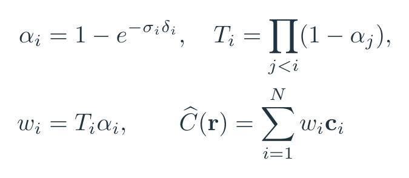

公式 2｜论文 Eq. (3) 的等价写法。i 是当前采样段，j 枚举它前面的段。

颜色 Ĉ 是三维向量，Tᵢ、αᵢ、权重 wᵢ 都是标量。它们相乘不改变 RGB 的维度。N 个点合成后，输出依然只是**一个像素的三个数**。

算个教学小例子：前段是红色 (1,0,0)，α₁=0.5；后段是蓝色 (0,0,1)，α₂=0.8。红色占 0.5；光穿过红段还剩 0.5，蓝色只分到 0.5×0.8=0.4。黑背景下结果是 **(0.5,0,0.4)**，余下 0.1 透到背景。如果背景是白色，还要加上 0.1×(1,1,1)。这也说明顺序很重要：把红蓝前后掉个个，答案就变了。

随机分层采样不是胡乱撒点。每个小区间都有一份预算，训练时落点又会变化，网络看到的不只是一套死板的固定网格。连续场依然靠有限查询近似，表示连续和计算离散可以同时成立。

## 5 优化：高频坐标、粗细采样和照片监督

有了网络和渲染器，照理可以开练。作者试了一下：细节还是糊，采样也浪费。于是 D 区加了两件工具。一个解决“学得出尖锐变化吗”，另一个解决“该把查询花在哪里”。

### 5.1 位置编码：给坐标装一排不同频率的旋钮

神经网络能逼近复杂函数，不等于它在有限时间里爱学所有频率。直接喂 x、y、z，容易先把平缓变化拟合得很好，细密纹理却像自带柔焦。

对单个标量坐标 p，定义编码 γ(p)。**L** 是使用的频率层数，ℓ=0,…,L−1 是层编号；每层贡献一对 sin/cos，所以输出 2L 维。<!-- evidence:C11 -->

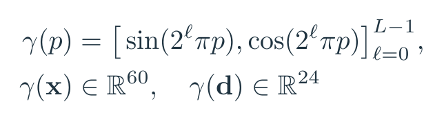

公式 3｜论文 Eq. (4)。位置三个分量各用 L=10，总共 60 维；单位方向三个分量各用 L=4，总共 24 维。

比如 p=0.25、只示范 L=2，编码是 **(√2/2,√2/2,1,0)**。原来只给一个“0.25”，现在同时报告这个位置在低频和高频波形上的相位。网络更容易把“缓慢轮廓”和“密集条纹”拆着表达。

它和 Transformer 都用了正弦余弦，但目的不一样：Transformer 用它告诉 token 在序列哪儿；这里是把连续坐标改写成高频特征，缓解函数拟合的频谱偏好。把名字抄对了，还得看它实际干什么。

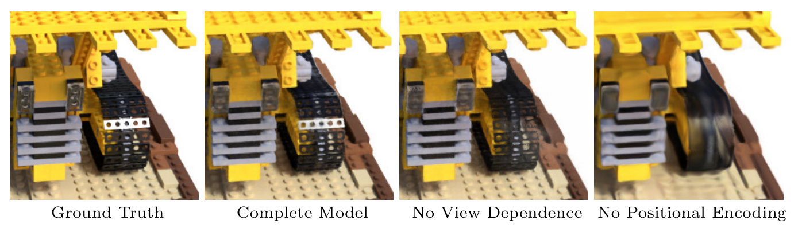

论文 Fig. 4。先看履带的反光，再看最右侧被抹平的纹理。

四列依次是真值、完整模型、去方向依赖、去位置编码。第三列尤其看金属履带，高光表现退化；第四列连边缘和齿轮纹理都变软。没有横纵数值轴；横向是模型设置，纵向只是图像位置。这个对照把两个模块分工画得很直接：方向分支负责“从哪边看”，位置编码帮助“空间变化有多细”。<!-- evidence:C12 -->

### 5.2 分层采样：先打草稿，再把算力花到画面上

设粗采样数为 **N꜀**、新增细采样数为 **N𝒻**。先用粗网络查 N꜀ 个点，得到合成权重 wᵢ=Tᵢαᵢ。把这些非负权重归一化成沿射线的分段概率分布，再从中抽 N𝒻 个新位置。细网络在**粗点与新点的并集**上重新查询并渲染。<!-- evidence:C13 -->

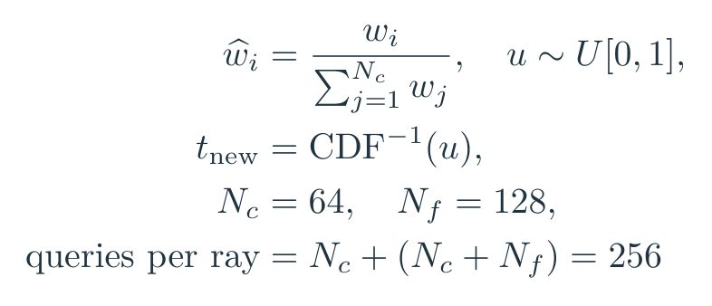

公式 4｜论文 Eq. (5) 与 §5.2 的计算展开。ŵᵢ 是归一化权重，CDF 是累积概率，u 是 0–1 均匀随机数。

逆变换采样可以想成按权重分抽签区间。若三段权重归一化后是 (0.1,0.7,0.2)，随机数 u=0.65 会落在第二段。然后在那段内定位，加入细采样。重点是 **Tᵢαᵢ** 而非只看 σᵢ：被前方完全挡住的高密度区域，对这条射线画面贡献也很小，预算没必要同样大。

原设置 N꜀=64，N𝒻=128，因此粗网查 64 次，细网查 192 次，总计每条射线 **256 次网络查询**。不是“64+128=192，所以只算192次”；粗细是两个网络，粗点在细网里还要再算。这里看着像套娃，确实也是 NeRF 慢的来源之一。

### 5.3 训练：照片给像素答案，不给每个点的标准密度

每次从训练照片随机抽 **4096 条射线**，粗细都算出 RGB。真值 **C(r)** 来自照片对应像素，Ĉ꜀、Ĉ𝒻 分别是粗细预测，ℛ 是本批射线集合，‖·‖₂² 是三个颜色通道的平方误差之和，e꜀、e𝒻分别记粗、细网络对这一像素的误差。<!-- evidence:C14 -->

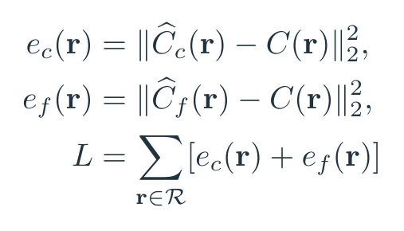

公式 5｜论文 Eq. (6)：粗细网络都接收像素监督。

为什么粗结果最终不用，还要训练？它负责给细采样安排座位。粗网乱分预算，细网就得在错误地方辛苦加班。梯度经过可微合成，同时调整颜色和密度；多台相机的照片共同约束同一个场景函数。

合成数据使用已知相机，真实照片通过 COLMAP 估计相机内外参与场景范围。相机内参管焦距、像素到射线的映射，外参管相机位置与朝向。没有这些，仅凭“像素坐标 (u,v)”还不知道它在三维里往哪儿射。

附录还处理了前视场景的无界远处：把射线变换到 **NDC（归一化设备坐标）** 空间。可把它理解成透视相机的压缩尺，远处占的刻度越来越少，深度轴与视差联系起来；相机近端前方的场景映到有限空间，再采样。它服务的是前视拍摄配置，和围着物体拍一整圈的数据处理有所区别。<!-- evidence:C15 -->

## 6 实验：画面、数字和时间账单

先把任务说清。原文做新视角合成：训练视角用来拟合，留下的视角用于检查。真实前视集有 8 个场景，每个拍 20–62 张图，留出八分之一测试。真实感合成集有 8 个物体，每个 100 张训练图、200 张测试图，分辨率 800×800。<!-- evidence:C16 -->

### 6.1 同样的照片，谁把新角度画得更准？

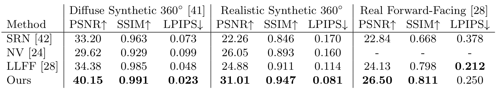

论文 Table 1。按数据集分三组，再在每组看 PSNR、SSIM 与 LPIPS。

行是方法；列分为简单漫反射合成、真实感合成、真实前视场景。**PSNR** 从像素均方误差换算，越高越好；**SSIM** 比较局部结构，越高越好；**LPIPS** 比较感知特征距离，越低越好。箭头已经写在表头，别把“数字大”统一当赢。<!-- evidence:C17 -->

把手机上最值得看的两组摘出来：

| 真实感合成，8 场景 | PSNR ↑ | LPIPS ↓ |
| --- | --- | --- |
| SRN | 22.26 | 0.170 |
| Neural Volumes | 26.05 | 0.160 |
| LLFF | 24.88 | 0.114 |
| NeRF | **31.01** | **0.081** |

NeRF 相比 Neural Volumes 高 **4.96 dB**，同时 LPIPS 更低；这不是只把图像整体涂得像，细节也有改善。<!-- evidence:C18 -->

| 真实前视，8 场景 | PSNR ↑ | LPIPS ↓ |
| --- | --- | --- |
| LLFF | 24.13 | **0.212** |
| NeRF | **26.50** | 0.250 |

这一组就有取舍：NeRF PSNR 高 2.37 dB，LLFF 的 LPIPS 反而更好。指标各看一面，读者没必要替论文把输的一格遮起来。SRN 的定量比较采用较低分辨率，相关实验说明放在附录 B；LLFF 还用跨场景预训练网络，而 NeRF 按场景拟合。看结果时把设置一起带上。<!-- evidence:C19 -->

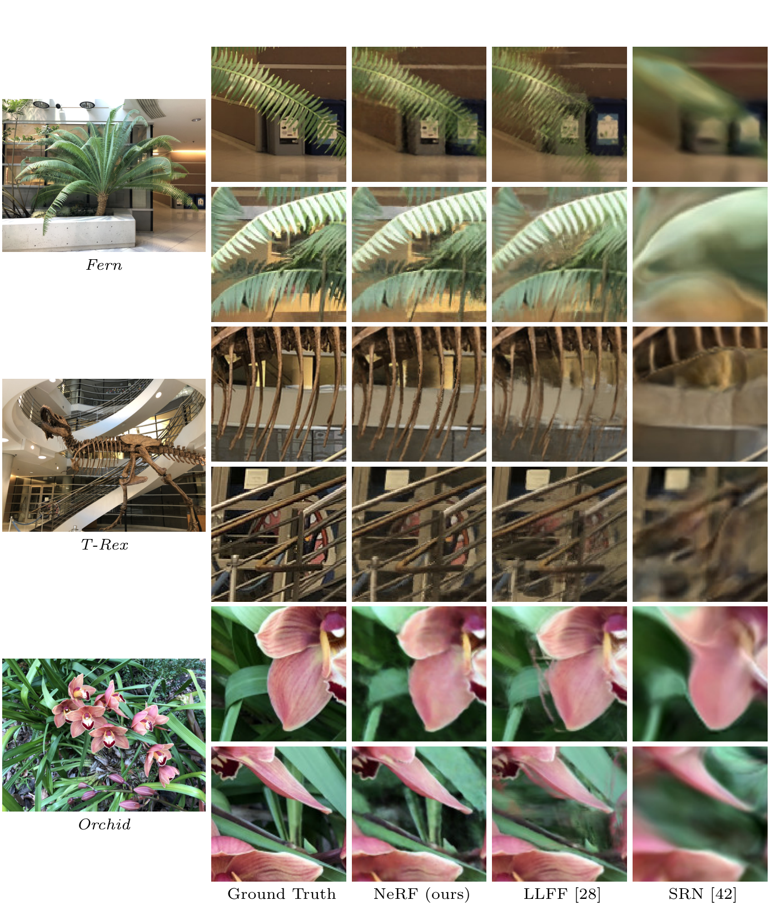

论文 Fig. 6。真实场景里，比较叶片、骨架和遮挡后的背景是否保持清楚。

每组对应 Fern、T-Rex、Orchid；横向是真值、NeRF、LLFF、SRN，彩框把同一个局部对应起来。先比较 Fern 叶缘后的黄色架子，再比较 T-Rex 骨架细肋，最后看 Orchid 的重复边缘。图中坐标是图像像素位置，不是性能曲线。作者强调 NeRF 的细结构和跨视角一致性；静态截图能看细节，连续视频更适合观察视角移动时的闪烁和重影。<!-- evidence:C20 -->

### 6.2 消融：三个零件，谁真正出了力？

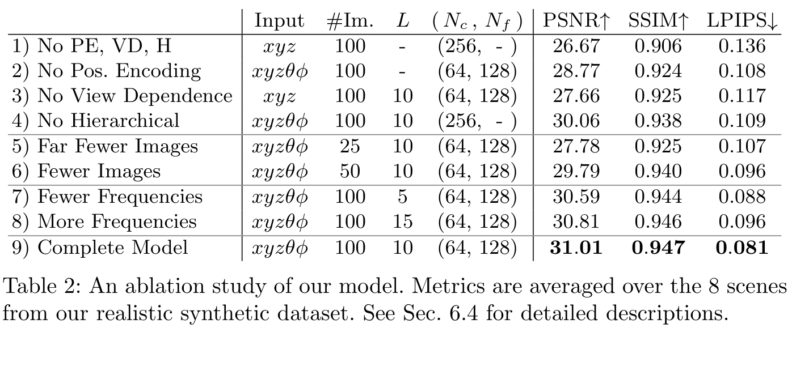

论文 Table 2。以最底行完整模型为参照，每次拿掉或调整一项。

这是同一个真实感合成集的八场景均值。左边 Input 写查询变量，#Im 是训练图数量，L 是位置频率数，(N꜀,N𝒻) 是粗细查询配置。它把“变了什么”放在分数前面，读起来很省心。

完整模型 **31.01 dB**；去位置编码 **28.77**；去方向依赖 **27.66**；去分层采样、改用单网 256 点 **30.06**。位置编码与方向依赖的影响更大，采样策略也有稳定收益。100 张减到25张时是 **27.78**，减到50张是 **29.79**。所以“只要几张照片就能随便重建”最好先看看自己的视角覆盖。<!-- evidence:C21 -->

论文 Fig. 4。把消融分数对回刚才那条履带：方向影响反光，编码影响高频细节。

频率也不是越多越好。L 从10加到15，PSNR 从31.01变成30.81；只有5层时是30.59。高频编码像更细的刻度尺，照片本身没有的信息，不会因为刻度更密就从天上掉下来。这个判断也对应图里 B 区：它提高可表达的变化，不凭空增加观测。<!-- evidence:C22 -->

### 6.3 存得小，算得可不轻松

原文报告每场景网络权重约 **5 MB**；LLFF 在一个真实感合成场景的体积表示可超过 **15 GB**。连续函数把存储压了下来，代价转移到查询计算。NeRF 每场景约训练100k–300k步，单V100约1–2天；附录报告一帧约30秒，约1.5亿–2亿次网络查询。<!-- evidence:C23 -->

回头看 D 区每射线256次查询，800×800就是约1.64亿次。账对上了。它的魅力不是当年已经实时，而是展示了：用一个紧凑、可微、连续的场景函数，确实能把复杂外观拟合到这样的质量。

## 7 结论：它把哪扇门推开了？

第一个问题：场景藏在网络参数里；位置决定密度，位置与观察方向共同决定颜色，让同一点的反光随视角变化。

第二个问题：一条射线的采样颜色按“前方透过多少、当前吸收多少”加权，得到像素。可微合成让照片误差能回到三维函数。

第三个问题：位置编码帮助拟合高频，粗细采样把查询集中到对图像有贡献的区域；代价是按场景优化和大量网络评估。小存储和快渲染，在原版 NeRF 里没有一起白送。

我更愿意把这篇的价值理解成：**它让“把场景当成可学习函数”从一个挺美的想法，变成了能用照片检验的方案。** 下一步再读 3DGS，就会发现大家继续吵的是同一本账：场景怎么存，像素怎么算，细节和速度到底由谁买单。

---

阅读工具：[ReadPaper](https://github.com/Zhu-Huixiang/ReadPaper) · 配图工具：[DrawPaper](https://github.com/Zhu-Huixiang/ReadPaper/tree/main/drawpaper)。

可复制仓库地址：https://github.com/Zhu-Huixiang/ReadPaper

点击“阅读原文”进入 GitHub 文章，查看高清图、公式与可编辑图源。

---

公众号版由管理员在后台手动公开发表；永久文章链接待发表后补充。

关注公众号 **具身智能的 World**：

[原论文](https://arxiv.org/abs/2003.08934v2) · [证据索引](evidence.json)

[本篇知识星系](../../universe/papers/nerf.md) · [知识点宇宙](../../universe/README.md)
