# 机器狗看错路，为什么还能走？

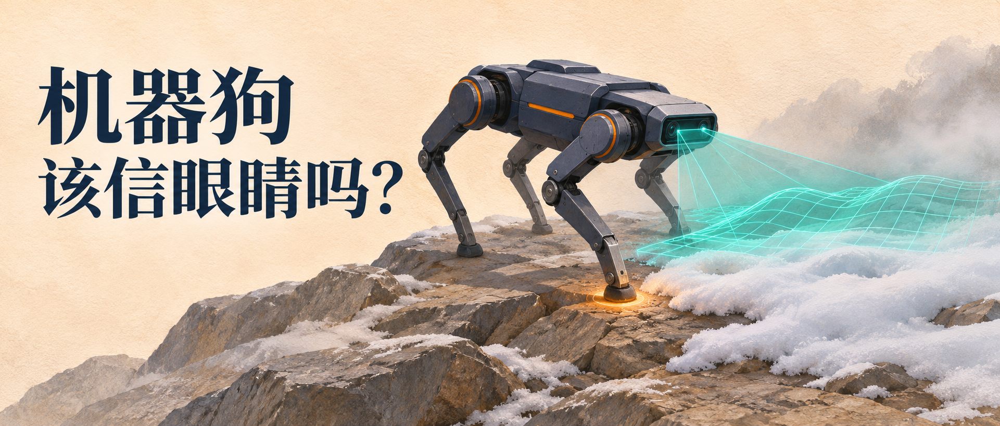

这里是「具身智能的 World」。把论文拆到输入、计算和动作，再用实验检查它到底解决了哪一步。

- 论文解读：读懂机制、公式和关键实验。
- 论文地图：沿科学问题寻找阅读路线。
- 顶会顶刊集锦：查正式出处与原文入口。
- 解读日程：查看未来一周的阅读安排。
- arXiv 新作：跟进经过筛选的研究。
- 具身榜：比较论文与逐项评分依据。
- 知识点宇宙：从一个技术点走向相关论文。

GitHub：[具身智能的 World](https://github.com/Zhu-Huixiang/embodied-world)。

机器狗面前有一团雪。相机给出的地形是雪面，脚踩下去，真正承重的地方却在更下面。再换成透明台阶：相机觉得前面是平地，脚才告诉它，这里有东西。

问题落在控制器的一次选择上：下一步继续相信地图，还是根据刚刚发生的接触改变走法？纯本体感知可以靠身体反馈摸着走，却要等碰到障碍才能反应；依赖准确地形图的落脚规划能提前抬腿，但错误地图会把规划带偏。Miki 等人的这篇工作挑战的假设是：**把地形估计交给前端之后，后端就可以把它当作可靠条件来算动作。**它让一个循环网络边走边整合地图与身体反馈，并学习调节外感知信息进入控制表示的方式。<!-- evidence:C01 -->

带着三个问题读：

1. 高度图会缺失、偏移甚至把软物体当成落脚点，控制器怎样修正它对地面的判断？
2. 仿真里的教师知道真实地形与接触条件，这些答案怎样教给真机上只能看见带噪观测的学生？
3. 眼睛、记忆和门控分别带来什么收益，哪些地形仍会让这种控制方式失效？

**论文信息**：*Learning robust perceptive locomotion for quadrupedal robots in the wild*。作者 Takahiro Miki、Joonho Lee、Jemin Hwangbo、Lorenz Wellhausen、Vladlen Koltun、Marco Hutter；署名机构为苏黎世联邦理工学院、韩国科学技术院、Intel。论文发表于 **Science Robotics 2022，7(62)，eabk2822**。arXiv v1 公开于2022年1月20日；本文读作者项目提供、编译日期为2022年1月20日的22页合并稿，含补充材料 S1–S9。<!-- evidence:C02 -->

[正式论文](https://doi.org/10.1126/scirobotics.abk2822) · [作者稿 PDF](https://leggedrobotics.github.io/rl-perceptiveloco/assets/pdf/wild_anymal.pdf) · [arXiv](https://arxiv.org/abs/2201.08117v1) · [作者项目](https://leggedrobotics.github.io/rl-perceptiveloco/)

**阅读目录**

- 1 引言：地图一旦骗人，规划还靠得住吗
- 2 结果：先看它在哪里走成了
  - 2.1 野外行走与登山
  - 2.2 外感知会怎样出错
  - 2.3 加上眼睛，多走快了多少
  - 2.4 接触之后，内部地形怎样改写
- 3 讨论：看不清悬崖，与看不清台阶不同
- 4 材料与方法：把两种感知接进同一个控制器
  - 4.1 总览与问题定义
  - 4.2 仿真环境、地形与课程
  - 4.3 教师策略：它先拿到哪些答案
  - 4.4 观察与动作：从 391 个数到 12 个关节目标
  - 4.5 奖励：走得快，还要少滑少撞
  - 4.6 学生训练：模仿动作，也重建环境
  - 4.7 高度噪声：故意把地图弄坏
  - 4.8 信念编码器：门控与记忆分别做什么
  - 4.9 部署：20 Hz 地图接上 50 Hz 控制
  - 4.10 附录消融：门控到底帮在哪里
- 5 回到三个问题

原文把 Results 放在 Materials and Methods 前面。我们也先看现象和对照，再拆控制器；相关工作在原文引言中，补充材料放到相应机制旁边读。

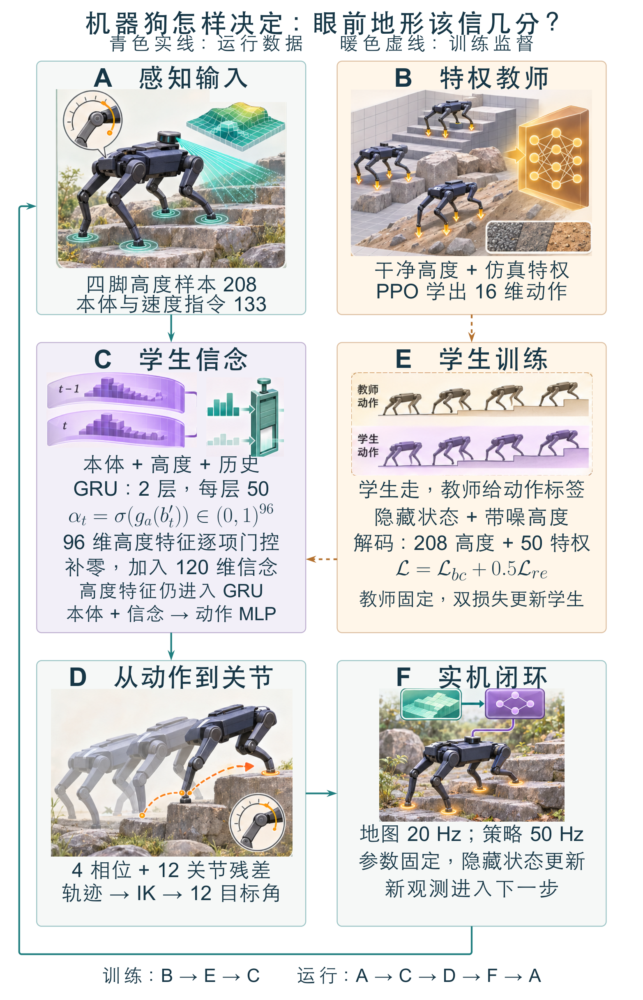

本图由 [DrawPaper skill](https://github.com/Zhu-Huixiang/ReadPaper/tree/main/drawpaper) 指挥 Codex，使用内置生图制作。

训练分两步看：先在B区用仿真真值和奖励训练教师；学生再沿 **A→C→D** 采样，由E区用教师动作与环境真值监督学习，更新学生网络。图中 **B→E→C** 的暖色虚线标出教师标签与学生更新关系。运行沿 **A→C→D→F** 看：实机高度样本与身体反馈进入C区，循环状态保留过去信息，门控调节外感知特征；D区把16维动作变成12个关节目标，F区执行并把新反馈送回来。训练会更新网络参数；部署时持续变化的是观测、循环状态和动作。第2节检查这条运行链，第4节拆开训练与计算。<!-- evidence:C03 -->

## 1 引言：地图一旦骗人，规划还靠得住吗

这里的“眼睛”泛指**外感知**：激光雷达、深度相机测到身体之外的环境。“脚下感觉”对应**本体感知**：关节位置与速度、机身姿态和速度等身体信息。前者让机器人提前知道哪儿要抬脚，后者让它知道动作执行成了什么样。<!-- evidence:C04 -->

原文先回顾依靠地形图选落脚点、优化运动轨迹的路线，包括 Fankhauser 等人的粗糙地形行走、Jenelten 等人的在线落脚优化，也讨论了 Gangapurwala 等人把强化学习落脚规划接到模型控制器的 RLOC。这些方法采用的模型和求解器不同，共同压力是：输入地图在野外是否仍然可信。雪、植被和悬垂物体带来的错误，有时连“测量噪声大一点”都概括不了。<!-- evidence:C05 -->

另一边，Lee 等人2020年的 *Learning quadrupedal locomotion over challenging terrain* 依靠本体感知实现了粗糙地形行走，也是本文主要比较对象。它绕开了坏地图，却失去了提前看到台阶的机会。脚已经撞上立面，再把腿抬高，和在接触之前就调好脚尖轨迹，是两种执行过程。本文试图保留后一种速度优势，同时让地图失灵时身体反馈仍然起作用。<!-- evidence:C06 -->

这也解释了为什么简单拼接两个传感器向量还不够。同一个高度值，遇到不同的接触反馈，可信程度会改变；当前帧没看见障碍，上一脚刚刚碰到的信息仍然有用。控制器需要同时处理信息质量和时间。

## 2 结果：先看它在哪里走成了

### 2.1 野外行走与登山

作者把同一类控制策略用于高山、树林、地下洞穴和城市环境，覆盖湿滑地面、草、雪、碎石、台阶以及雾等感知退化条件。论文报告这些部署中没有摔倒；这是一组已执行场景的结果，接下来更有用的问题是：在有明确对照的实验里，增加外感知到底改了什么。<!-- evidence:C07 -->

登山展示提供了一个长时间运行样本。ANYmal 在瑞士 Etzel 山走完2.2 km、累计爬升120 m的路线：31分钟到达山顶，路牌给人的预估是35分钟；全程78分钟，路线规划器的建议是76分钟。途中停下来重新固定脱落的鞋套并更换电池。最大坡度写的是38%，也就是上升距离与水平距离之比，换算约20.8°，别读成38°。<!-- evidence:C08 -->

这里的价值是多种困难连续出现：上坡有湿石，下坡有树根，树枝还可能污染高度图。它检验了控制器能否在一条长路线中持续工作。人类建议时间不是受控的机器人基线，登山也没有替代下一节的对照实验。

### 2.2 外感知会怎样出错

这张图的关键，是把“没有信息”和“有一份错信息”分开。高度图看起来铺满了，不等于每个高度都能承重。

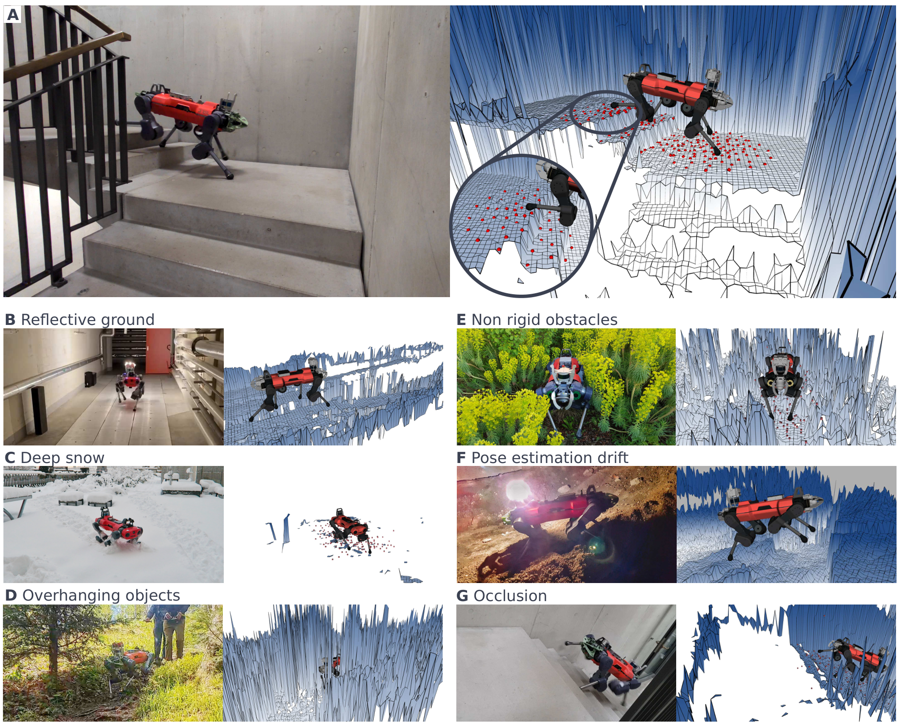

论文 Fig. 3。A里的红点是策略实际读取的高度样本；B–G分别看传感器、地图表示和位姿误差怎样改变这些样本。

A展示机器人周围的高度图与采样位置。B里的反光金属地面产生深度离群点，在图里像一道沟；C里的雪反光强、纹理弱，双目深度失效后留下空地图。D的树枝等悬垂结构，被只能存一层高度的2.5D地图压成了高障碍。E里的软植被与积雪，外表的高度与真正承重的位置不一致。F是打滑导致位姿估计漂移，不同时间的点云拼错；G则是机载视角被前方结构遮住，看不到后方地面。这些子图没有可用于横向排名的共同数值坐标，重点是每种错误进入控制器的路径。<!-- evidence:C09 -->

**2.5D地图**可以想成一张表：平面上的每个位置只填一个高度。树枝与树枝下面的地面同时存在时，这种表示天然装不下两层。再精密的落脚优化器，也得先面对表里填的究竟是哪一层。

在本文中，相机或雷达并不直接输出动作。它们先形成这张高度图，控制器再读脚周围的208个高度样本。因此，部署时更换深度传感器的便利，来自这个中间接口；材料、颜色和纹理中可能有用的线索，也会在这里损失。<!-- evidence:C10 -->

### 2.3 加上眼睛，多走快了多少

先看原文的实机比较页。步高、路径与速度是不同实验，读数时要分别看条件。

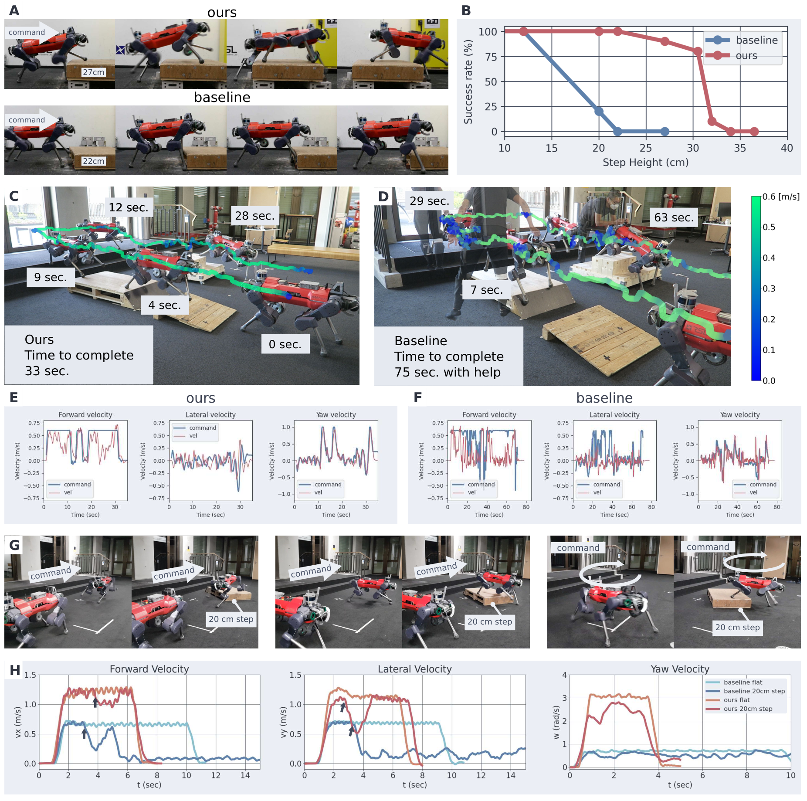

论文 Fig. 4（原文正文指称，作者稿第7页比较图）。A/B看跨台阶，C/D看障碍路线，G/H看前进、侧移与转向；不要把“有人帮忙走完”的时间直接折算成速度提升。

A展示本文方法提前抬腿、调整身体，而基线的脚先与台阶发生碰撞。B的横轴是台阶高度，纵轴是成功率。实验把12–36.5 cm的木台阶放在机器人前面，每个高度尝试10次，以5秒内跨过去为成功。基线从20 cm附近开始明显掉成功率；本文方法把可通过范围推进到约30.5 cm，但这不等于这个高度每次都成功。作者还观察到，高台阶上的失败可能是从侧边绕开；超过32 cm时会犹豫向前。因此，“没有摔倒”与“按要求跨过台阶”要分别计。<!-- evidence:C11 -->

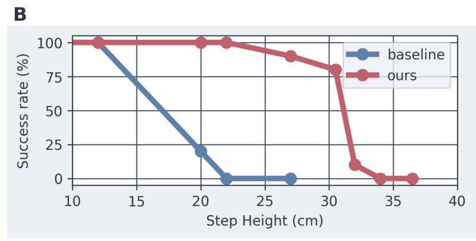

论文 Fig. 4B 局部。保留全部坐标和图例，单独看高度增加时两条成功率曲线在哪里下降。

C/D里的路线包含斜平台、抬高的平台、楼梯和方块。两者都跟随给定路径，由 pure pursuit 路径跟踪器产生行进命令。本文方法33秒完成；基线标注75秒，而且中途需要人抬、推机器人。这个结果说明基线在该路线发生了阻塞，不能把33与75当作同等自主条件下的计时赛。<!-- evidence:C12 -->

速度实验给出的数值更直接：

| 平地实机指标 | 本文控制器 | 本体感知基线 |
| --- | ---: | ---: |
| 前进与侧移速度 | 1.2 m/s | 0.6 m/s |
| 转向角速度 | 3 rad/s | 0.6 rad/s |

前进与侧移速度为基线的2倍，转向角速度为基线的5倍。图H从左到右三列分别看前进速度、侧移速度和转向角速度，横轴都是时间，纵轴单位依次为 m/s、m/s、rad/s。浅青线是基线平地，深蓝线是基线过20 cm台阶，橙线是本文平地，红线是本文过台阶；前两列黑箭头指向遭遇台阶附近的速度变化。红线在障碍附近也会波动，但能继续运动，深蓝线则明显受阻。<!-- evidence:C13 -->

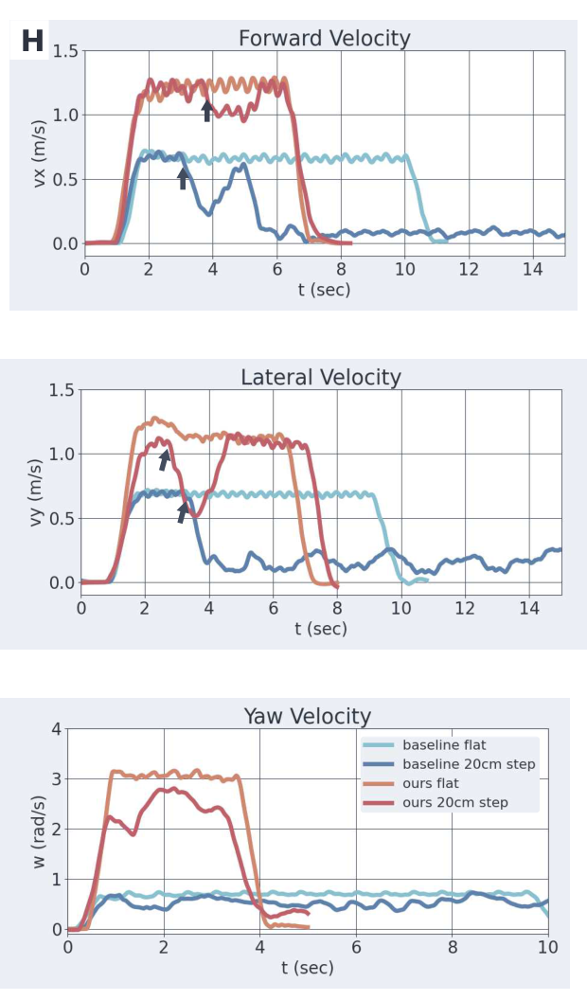

论文 Fig. 4H 局部。为手机阅读将原图三列依次竖排，自上而下看前进、侧移和转向；保留原轴与图例，平地和20 cm台阶是两种条件。

比较还有一项训练目标差异：本文接收目标速度，基线接收方向命令并学着沿该方向尽量快走。因此，这张表是两套完整控制器的实机结果。把提升进一步归给“加了眼睛”“用了记忆”或“多了门控”，需要后面的组件消融。<!-- evidence:C14 -->

补充材料 S2 又在仿真中扫了 grid steps 与楼梯的地形参数。条件是前进命令0.7 m/s、运行10秒，以不失败地走过4 m为成功；图 S1 图注报告41×41组参数组合、300次尝试的评估设置。它回答的是仿真中的地形覆盖范围；实机台阶实验仍按每个高度10次理解。<!-- evidence:C15 -->

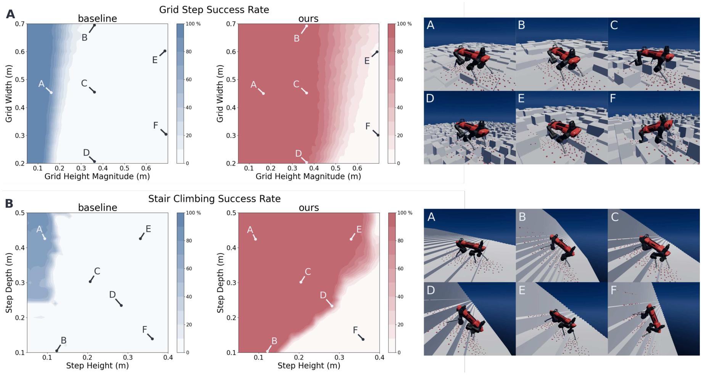

论文 Fig. S1。A的横轴是网格高度幅度、纵轴是网格宽度；B的横轴是台阶高度、纵轴是踏面深度，均为线性坐标、单位米。左侧蓝图是本体基线，中间红图是本文方法，两者各用0–100%的色标，颜色越深成功率越高。右侧A–F场景对应图中标注的参数点。读图时固定一组几何条件，再比较两张图；整片颜色分布表达的是成功范围，不能压成一个总成功率。

### 2.4 接触之后，内部地形怎样改写

如果要判断控制器有没有利用接触后的信息，光看机器人最后站着还不够。作者训练了辅助解码器，把内部表征译回地形高度与部分环境量，看看在冲突出现时，它的估计怎样变化。

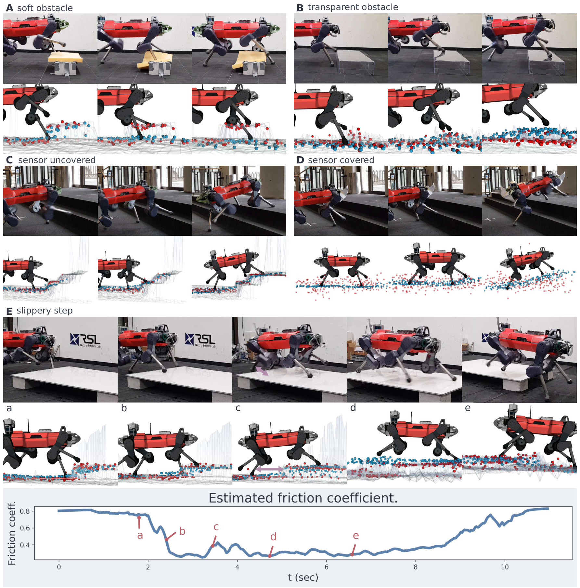

论文 Fig. 4（作者稿第9页图注）。红点是输入的高度样本，蓝点是从内部表征解码出的地形估计；看接触前后两种颜色怎样分开。

A是泡沫：传感器看见一块高物体，机器人起初准备踩上去，接触后泡沫下陷，内部地形估计向下修正。脚抬起来以后，修正的信息还留着。B是透明亚克力台阶：传感器没有准确看到它，机器人先按平地走，碰到台阶后把地形估计往上改，再调整步态。它们让第一问变得具体：身体反馈可以纠正外感知的错误方向，而且纠正后的信息可以跨时刻保留。<!-- evidence:C16 -->

C/D把相同楼梯放在传感器未遮挡和完全遮挡两种情况下。正常时，机器人提前调整脚步；遮挡时，缺失地图的位置用随机值填入，前脚先碰到第一阶立面，再改变步态。下楼时，前脚落地更重，但后腿能利用刚刚获得的信息改善接下来的动作。代价已经写在执行过程里：它保持了平衡，却失去了提前看路时的平顺性。<!-- evidence:C17 -->

E是湿滑平台。脚滑动使位姿估计与高度图一度不稳，控制器继续利用身体反馈；当地图稳定后，再利用外感知。下方曲线是解码出的摩擦系数随过程变化，字母a–e对应连续时刻，示意图把这些时刻对回机器人位置。蓝色地形点和摩擦曲线都是辅助解码结果，不是一个独立测量仪直接读出了网络“到底相信什么”。控制能力最终仍看闭环运动是否成立。<!-- evidence:C18 -->

## 3 讨论：看不清悬崖，与看不清台阶不同

论文的限制很具体。脚先撞上一个台阶，通常还有机会收腿、抬高；脚越过悬崖边缘再发现下面没有地面，恢复条件已经不同。作者指出，当前策略在窄悬崖或踏脚石附近遇到遮挡时，可能沿用“地面连续”的假设，进而踏空。<!-- evidence:C19 -->

所以我更关心的下一步，是把“当前估计不可靠”变成可用于选动作的信息。本文的门控隐式调节外感知，却没有给出一份经过校准的不确定性分布，让策略明确决定何时停下、探脚或绕行。把低权重当成可靠的危险概率，会多走一步未经实验检验的推断。

作者还提出直接处理原始传感器数据的可能性。现在的高度图带来传感器兼容性，但会丢失材料与纹理信息；地图依赖的位姿估计模块，也没有和策略一起训练。另一类边界在动作空间本身：腿卡进窄洞、需要攀上高台沿时，可能需要与正常行走差异很大的恢复动作。稳定行走的策略不一定覆盖这些操作。<!-- evidence:C20 -->

原文同时报告，这个控制器用于 CERBERUS 的 DARPA地下挑战任务，四台 ANYmal 在隧道、城市与洞穴赛道累计探索超过1700 m而未摔倒。它说明控制器进入过更大的自主系统；导航、定位和任务规划仍由相应系统完成，不能把整个参赛系统的能力都记在运动策略名下。<!-- evidence:C21 -->

## 4 材料与方法：把两种感知接进同一个控制器

### 4.1 总览与问题定义

先看原文怎样分训练和部署。最上面教师用仿真真值学走路，中间学生学着在观测残缺时复现教师动作，最下面才是实机运行。

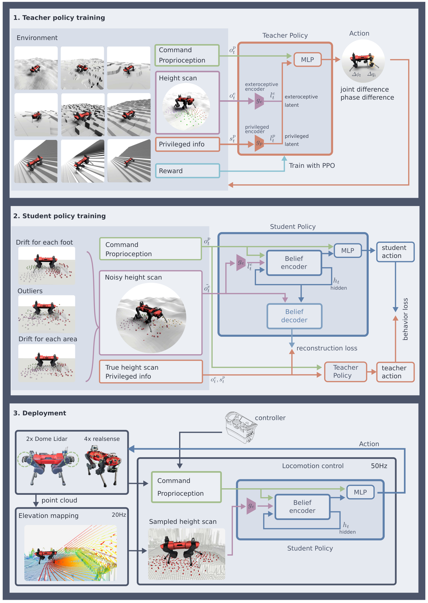

论文 Fig. 5。上排奖励训练教师，中排行为损失与重建损失训练学生，下排只保留学生与实机反馈；循着箭头辨认哪些真值在部署时已经拿掉。

这张图没有数值坐标轴。上排“Privileged info”与“Height scan”分别进入编码器，再与身体观测进入动作网络；中排同一仿真状态分成两路，学生拿带噪高度，教师拿真实高度和特权量，两者动作的差构成行为损失。辅助解码器还要从学生内部循环表征与输入信息还原真值，形成重建损失。下排是点云、地图、采样、学生、执行的闭环；隐藏状态回到下一时刻，教师与重建训练支路不再承担控制输出。<!-- evidence:C22 -->

用决策过程的语言讲，完整环境状态记作 sₜ，包括机器人和地面的真实条件；观测 oₜ 是传感器让策略看见的部分；动作 aₜ 改变下一时刻状态。若把这些条件都交给策略，可以按马尔可夫决策过程 MDP 训练。实机看不到全部摩擦、外力与地形，问题就成了部分可观测决策过程 POMDP。**信念状态** bₜ 在本文是根据观测历史学出的控制表征，用来补当前一帧缺失的信息；它不是论文显式求出的完整贝叶斯后验。<!-- evidence:C23 -->

《夏洛特烦恼》里，名字已经报了几遍，邻居还在问“马冬什么？”“马什么梅？”。这个包袱可以提醒我们分开两件事：信息曾经进来过，与此刻还能把它拿来用，并不是一回事。回到机器狗，上一脚确认了泡沫会塌，下一脚抬起后还得保留这次接触的信息。后面GRU的隐藏状态，就是要检查的具体存放位置。<!-- culture:xia-ma-name -->

### 4.2 仿真环境、地形与课程

作者用 RaiSim 并行模拟 ANYmal-C，并加入学习到的执行器模型，减少理想关节与真实驱动响应之间的差距。地形覆盖粗糙地面、离散起伏、大台阶、方块、网格台阶，以及标准、开放、带凸缘和随机楼梯。补充材料 S4 交代，粗糙地面从 Perlin 噪声生成，部分地形再量化成台阶；楼梯则用盒体构造。<!-- evidence:C24 -->

盒体这个细节很容易被跳过。高度场的台阶边缘并非完美竖直，策略曾在仿真中利用这个斜面，到了实机就不好用了。作者改用盒体，是为了让“踩着哪块几何就能过去”的训练条件更接近真台阶。<!-- evidence:C25 -->

域随机化同时改变机身和腿的质量、初始关节状态、机身姿态与速度，还施加外力和力矩，偶尔降低足端摩擦制造打滑。训练遇到机身触地、姿态过度倾斜或超过关节力矩限制时终止。这些变化和终止条件共同约束策略可探索的动作。<!-- evidence:C26 -->

课程分两条。地形课程用粒子滤波更新参数，让地形持续处于“有挑战但还能学”的范围；另一条用单调增大的系数放大奖励罚项与扰动。原文给出 cₖ₊₁=cₖ^d，附录设 d=0.98。比如教学取 cₖ=0.1，则下一次约0.1047；因为底数小于1、指数小于1，数值向1靠近。训练就这样逐步增加要求。<!-- evidence:C27 -->

### 4.3 教师策略：它先拿到哪些答案

图B区的教师先享用实机没有的条件。它知道无噪地形高度、接触状态与接触力、接触法向、足端摩擦系数、腿部碰撞、施加到机身的外力和力矩等。教师通过 PPO 学习运动策略：在随机地形与扰动中执行动作，根据累计奖励改进下一轮策略。<!-- evidence:C28 -->

PPO可以理解为“看这批动作赚了多少，再有限度地改策略”。它属于强化学习：教师没有逐步的标准关节答案，而是靠速度、平衡、碰撞与动作代价得到评价。教师采用高斯动作策略，网络给出均值，通过随机采样探索；并行采样之后再更新参数。这里的PPO更新发生在仿真训练阶段。<!-- evidence:C29 -->

补充材料 S3 给了规模：教师用1000个并行环境，每轮各收250个控制步；控制频率50 Hz，所以每条本轮轨迹覆盖5秒，合起来每轮250000个仿真步。PPO学习率为5×10⁻⁴，折扣因子0.996，clip ratio为0.2。这组设置给出了每轮采样规模，总训练时长还取决于迭代轮数与执行耗时。<!-- evidence:C30 -->

### 4.4 观察与动作：从 391 个数到 12 个关节目标

把输入拆开，才看得见教师向学生转移了什么。

本体观测 oₜᵖ 共133维。它包含3维命令、3维姿态、6维机身速度、各12维关节角与关节角速度、36维关节位置历史、24维关节速度历史、24维关节目标历史、13维步态相位信息。这里“本体观测”沿用作者的分组，命令也被放进这一组。<!-- evidence:C31 -->

外感知 oₜᵉ 共208维。每只脚周围取五个圆环，分别采6、8、10、12、16个点，半径分别为0.08、0.16、0.26、0.36、0.48 m。每脚52点，四脚208点。高度相对足端记录，网络看到的是局部脚地关系，而不是整幅彩色图。<!-- evidence:C32 -->

特权向量 sₜᵖ 共50维。注意同一个上标p：放在 o 上指 proprioception，本体观测；放在 s 上则指 privileged，特权信息，原文的记号需要按对象分辨。教师合计读取391个原始数，学生的本体加带噪高度则为341个。<!-- evidence:C33 -->

先认清式中的记号：t是控制时刻，方括号表示向量拼接，ℝⁿ表示n维实数向量，波浪号表示带噪观测。gₑ和gₚ分别编码外感知与特权量，输出潜在特征 lₜᵉ、lₜᵖʳⁱᵛ；这里字母l表示特征，稍后带腿下标时会另作说明。π是接收编码后输入的动作网络，上标或下标T表示教师，aₜᵀ是其16维动作。

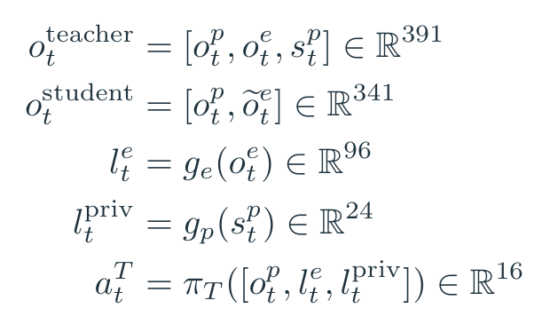

公式（1）按原文观察定义与附录维度展开。每只脚52维高度先分别过编码器，得到24维，再拼成96维外感知特征；50维特权量压成24维。加上133维本体观测，教师主网络的输入为253维。<!-- evidence:C34 -->

补充材料 S6 给出编码器隐藏层：外感知80、60，特权64、32；主网络隐藏层256、160、128，MLP激活用LeakyReLU。这些编码层把环境条件压缩到动作网络需要的大小。<!-- evidence:C35 -->

再看D区输出。动作 aₜ 是16维：四条腿各一个相位修正 Δφ，以及12个关节位置残差 Δq。**中央模式发生器 CPG**在这里提供周期抬脚的基础节拍；策略通过相位修正调节每条腿处于哪一步，再用关节残差改变姿态。逆运动学 IK 则把脚尖位置换算成能够实现它的关节角。<!-- evidence:C36 -->

接下来l标记四条腿，i标记12个关节，i∈l表示属于第l条腿的关节。φₗ是当前相位，Δφₗ是策略给该腿的相位修正，Δφ₀是原文的基础相位推进项；三者相加后的相位用教学短记号ψₗ表示。p把相位映射为三维脚尖位置，IK把该位置变成关节角；qᵗᵃʳᵍᵉᵗ是最终关节目标，Δq是策略给出的关节残差。

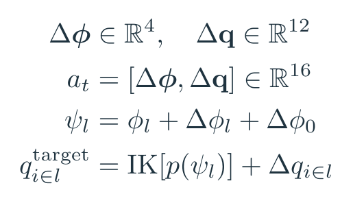

公式（2）对应补充材料 S5，ψₗ仅用于缩短排版。先在相位上加入策略修正，求脚尖位置，再做IK，最后加关节角残差。教学举例：某关节的IK结果为0.6 rad，残差为−0.1 rad，最终目标便是0.5 rad。这个加法才是策略输出如何落到电机关节目标的接口。<!-- evidence:C37 -->

脚尖基准轨迹也有明确计算。对抬脚的前半段，相位从0走到π/2；这里π是圆周率；为避免和控制时刻t混淆，我们把原文的局部样条变量改记作u，xₗⁿ、yₗⁿ、zₗⁿ是默认站姿脚尖坐标，上标n表示nominal，即基准位置。

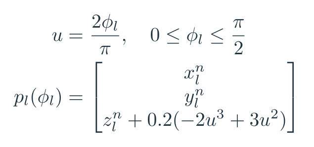

公式（3）等价改写S5的上抬段。0.2的单位是米，是这条基准轨迹的抬升尺度。教学取φₗ=π/4，得到u=0.5，括号里的三次多项式为0.5，于是脚尖在基准高度上升0.1 m。随后用对称样条下降，相位π到2π期间保持基准足位。策略的相位与关节残差叠加在这条基础运动上，所以0.2 m不是整套控制器最终能跨越的障碍上限。<!-- evidence:C38 -->

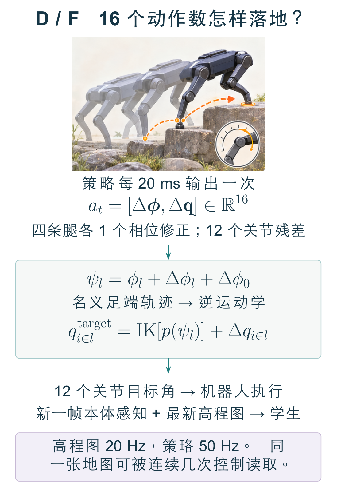

D/F区放大：策略输出相位修正与关节残差，经足端轨迹和逆运动学得到关节目标，再由身体反馈接回下一步。

### 4.5 奖励：走得快，还要少滑少撞

教师的速度奖励并非一句“匹配目标速度”就能讲完。原文 Eq. (1) 对沿命令方向的投影给分，达到条件后饱和为1；补充材料S7还单列了零命令时抑制运动的分支。

下面保留原文非零命令表达。v_des是二维水平期望速度向量，v是机身坐标系中的实际水平速度，点号是内积，双竖线表示向量长度。为缩短排版，令d表示两向量的内积、m表示期望速度向量的长度；这两个短记号与前面课程中的指数d无关。r_command是该命令奖励，exp表示自然指数函数。

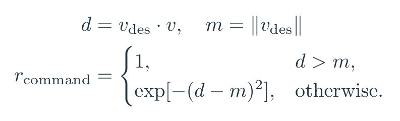

公式（4），对应原文 Eq. (1)。用单位前进命令 v_des=(1,0)做教学例子：实际速度v=(0.6,0)时，指数为−0.16，奖励约0.852；v=(1.2,0)满足上面的条件，得到1。这个例子展示原式的投影计算与饱和行为；改变命令长度时，也应把新的v_des代回同一个原式。<!-- evidence:C39 -->

只盯这一个分数，横晃、踢腿和猛蹬都可能混进来。S7同时约束偏离命令方向的运动、机身竖直速度和横滚俯仰运动，惩罚关节速度与加速度、关节目标的不平顺、力矩、脚滑动、胫部与膝部碰撞，并给膝关节越界软惩罚。足端净空项还抑制无必要的过度抬脚：高度样本以脚为原点，地面低于脚0.2 m的条件，与“障碍高0.2 m”是不同含义。<!-- evidence:C40 -->

这些项解释了训练为什么要看走路的样子。单个速度数字相同，代价可能差在身体晃动、电机力矩和脚尖轨迹上。奖励权重与课程一起塑造行为，论文也明确说作者通过仿真行为和运动平滑性调节了这些项。

### 4.6 学生训练：模仿动作，也重建环境

教师有391维真值输入，部署学生只有341维带噪观测。解决办法是先把教师学到的运动策略留下，再训练学生从有限信息中产生可用的控制表征。

学生主动作MLP与教师结构相同，使用教师权重初始化；循环编码器产生120维信念状态，与133维本体观测拼接，仍是253维主网络输入。教师权重提供学习起点，学生继续适应带噪观测。<!-- evidence:C41 -->

损失有两项。行为克隆损失比较同一仿真状态与命令下，学生动作 aₜˢ 和教师动作 aₜᵀ；重建损失比较学生辅助解码出的无噪高度估计、特权量估计与真实 oₜᵉ、sₜᵖ。帽子表示预测，上标S表示学生，L_bc、L_re分别是行为与重建损失，L是两者加权后的总损失；L₂范数平方表示向量各分量误差平方之和。下面是把原文文字定义写成算式的教学展开，跨样本的具体归约与缩放依实现而定。

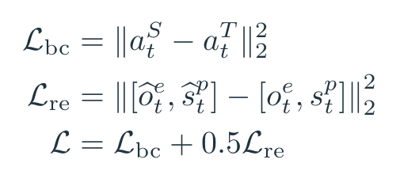

公式（5）依据正文学生训练说明和S3。总损失为行为损失加0.5倍重建损失。重建目标是208维原始高度与50维特权量，共258维。120维信念状态供动作网络使用；重建支路根据循环隐藏表征与带噪外感知生成预测，再与真实环境量比较。<!-- evidence:C42 -->

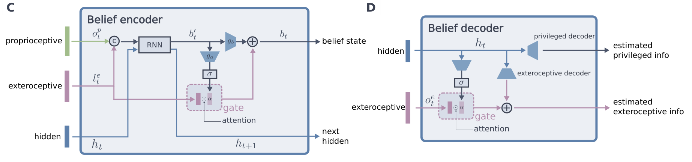

论文 Fig. 6C/D 局部。左侧编码器形成供控制用的信念；右侧蓝色支路从隐藏状态预测特权量与外感知，紫色原始外感知另经门控加入高度重建。右侧重建支路用于训练与分析。

假设某个教学样本的行为误差已经算成0.04、重建误差算成0.10，总损失就是0.09。这个算例只说明0.5怎样参与计算，不是论文实测损失，也不表示两种误差在物理单位上天然相同。重建任务的作用，是让内部表征保存能还原环境的内容，而不只在当前这一步偶然猜中教师动作。

采样由学生自己走出来，教师在这些状态上提供动作标签。原因是模仿稍有误差，学生就可能走到教师平时不会到的状态；若训练只见教师的顺利轨迹，这些偏离状态反而没人教。原文引用DAgger与策略蒸馏工作来支持这种学生rollout方式。<!-- evidence:C43 -->

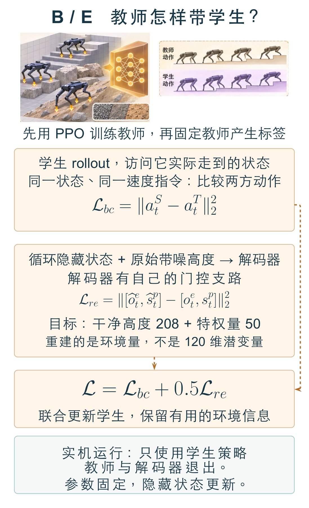

B/E区放大：动作模仿与环境重建是并行的监督目标，两项损失共同更新学生。

学生用300个并行环境，每轮各收400步，也就是每环境8秒、合计120000步；优化器学习率5×10⁻⁴。前10轮先用平地，再启用地形课程；20轮后逐步增大感知噪声，到100轮达到完整幅度。循环单元用截断反向传播，每10步截断一次梯度，对50 Hz控制相当于0.2秒。**0.2秒限制的是一次反向传播跨过的长度**；隐藏状态可继续传到后续时刻，具体保留多远的信息还要由行为实验判断。<!-- evidence:C44 -->

### 4.7 高度噪声：故意把地图弄坏

如果学生训练始终拿到完美地图，它没有理由学会处理坏地图。作者于是把错误拆成空间位置与高度两类，再按每个点、每只脚、每个回合三种尺度制造扰动。

这张图把噪声与门控放在一起。A说明哪些采样点受同一个偏差影响；B展示不同噪声条件；C才是学生如何处理这些输入，D是训练时检查内部信息的辅助解码器。

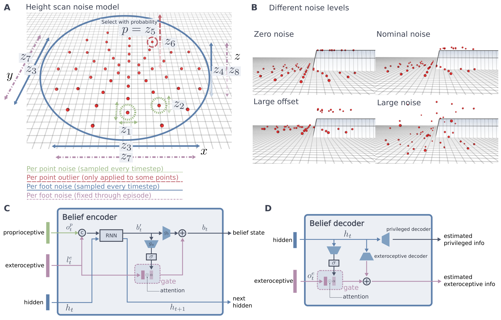

论文 Fig. 6。A/B看地图怎样被弄坏，C看门控控制的那条外感知直连，D看重建监督；C里的回环保留时间信息，门并不替代回环。

A中逐点噪声会让相邻点各自抖动，逐脚偏移让某只脚周围一整片采样一起偏，回合级偏差则持续一段轨迹。B的zero noise属于教师，nominal、large offset、large noise属于学生训练条件。C中圆点逐元素乘法表示门控，旁边加号把直接外感知特征与循环网络输出相加；D用循环隐藏表征及带噪外感知，经自己的门控支路重建环境信息，重建结果用于监督和分析。图里箭头不是机器人实际把预测地形重新写回外部地图的指令。<!-- evidence:C45 -->

补充材料S8把采样写得很具体。p现在是采样点下标，和前面的本体上标p区分；rₚ、θₚ是围绕某只脚的极坐标；h(x,y)是该位置的真实地形高度。εₚ是每点每步噪声，ε_f是某只脚共用、每步更新的噪声，w是在一段回合内保持的逐脚偏差，ε_outlier是偶发的离群值，h̃表示最终带噪高度；x、y、z标记扰动作用的坐标方向。

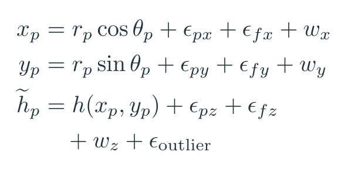

公式（6）按S8改记带噪高度为h̃。前两行先把“去哪里取样”挪歪，第三行再把“取回来的高度”改掉。教学想一个高0.10 m的点，如果该时刻共有0.04 m向上的高度偏差，输入就是0.14 m；若横向位置同时移到台阶边缘另一侧，误差还可能来自真实地形本身的突变。

三种地图条件按60%、30%、10%选择：常规噪声、较大逐脚偏移、逐点大噪声。地图还按区域增加偏移，用来模拟从硬地走进草、雪的转换。这样学生不仅学“噪声平均为零”，还会遇到连续一片区域都有偏差的情况。正文与S8对条件切换时点有不同描述，但共同设置是上述三种条件与比例；复现时应进一步核实现，而不凭空补一份完整噪声参数表。<!-- evidence:C46 -->

### 4.8 信念编码器：门控与记忆分别做什么

回到架构C区，输入先分两路：带噪高度经编码器变成96维 lₜᵉ；它和133维本体观测一起进入GRU。GRU是一种循环网络，保留隐藏状态，并根据新观测更新它。本文使用两层GRU，每层50个隐藏单元。<!-- evidence:C47 -->

把中间循环输出记为b′ₜ，上一时刻留下的隐藏状态记为hₜ，新隐藏状态为hₜ₊₁。gₐ和g_b是两套MLP；σ是sigmoid，把每个数压进0到1；αₜ是96维门控向量；⊙表示对应位置相乘。pad₁₂₀表示把96维结果补零到120维，避免把形状不同的向量硬加。

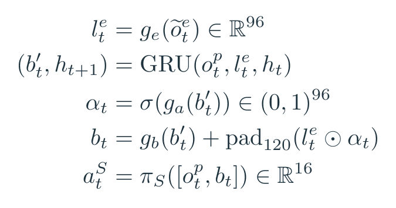

公式（7）把正文信念编码式与S6的补零说明合起来。g_b生成120维循环表征，门控筛过的96维外感知直连补零后加上去，得到120维bₜ。它与本体观测一起进入学生主网络，产生16维动作。这里的attention是逐维sigmoid门控，不是Transformer的查询、键、值注意力。<!-- evidence:C48 -->

手算两个维度就能看出这道门做了什么。假设外感知特征前两项是[2, −1]，门值是[0.8, 0.1]，直连贡献变成[1.6, −0.1]；若循环分支相应位置是[0.3, 0.5]，相加后得到[1.9, 0.4]。这些都是教学数值，潜在特征本身没有米这一单位，也不等于两个原始采样点的高度。门在特征层控制贡献大小，循环分支则可以带来过去接触留下的信息。

还要盯住公式的第一行：外感知已经进入GRU。把某个门值降到0，压低的是相应的**直连贡献**；外感知仍可通过GRU影响循环表征。门控的作用范围，就落在这条具体支路上。<!-- evidence:C49 -->

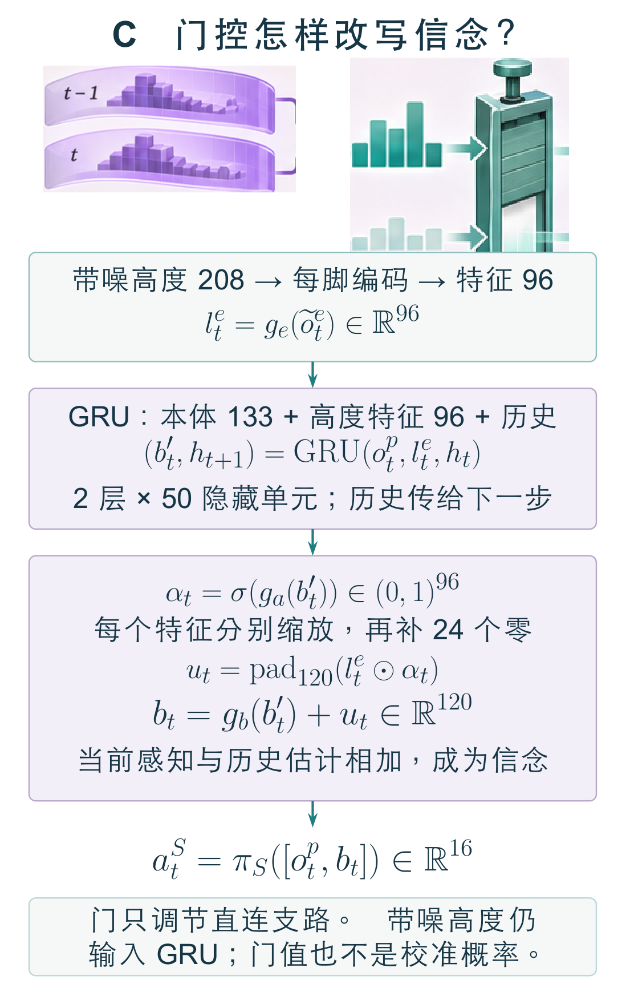

C区放大：顺着96维特征、GRU、门控直连和120维信念往下读；最下方再把信念与本体观测拼给动作网络。

回想泡沫与透明障碍，接触之前两者给出相反的错误提示；接触之后都需要结合身体反馈改写内部表示。循环状态承担跨时刻的信息保留，门控为可靠外感知提供直接进入控制表示的通道。两者有没有分别起作用，要看下一节消融。

### 4.9 部署：20 Hz 地图接上 50 Hz 控制

部署使用ANYmal C，传感器配置可以是两台Robosense Bpearl激光雷达，也可以是四台Intel RealSense D435深度相机。相同策略不经微调接入这些配置。GPU上的高度建图融合点云，按类似卡尔曼滤波的方式更新，并做漂移补偿与射线投射；建图依赖独立的位姿估计。<!-- evidence:C50 -->

地图以20 Hz更新，学生以50 Hz执行，每次读取最近的高度图；查询位置没有地图信息时填入随机样本。因此，20 Hz对应每50 ms来一张新地图，50 Hz对应每20 ms出一次控制结果。教学上可理解为有些连续控制步会使用同一张最近地图，但身体反馈与循环状态仍在更新；两个频率的比值2.5也意味着它不是固定“每两步刷新一次”。<!-- evidence:C51 -->

这一拆分关系到前面说的“看不见也能走”。丢失外感知时，控制循环没有停下来等待新点云；学生继续根据本体观测、隐藏状态与当前输入出动作。预先学过的噪声条件，让这种继续执行有训练基础，而不是到了现场临时增加一条手写切换规则。

### 4.10 附录消融：门控到底帮在哪里

S9比较四种学生编码器：GRU有门、GRU无门、MLP有门、MLP无门。GRU与MLP的差别是有没有循环记忆；gate与no gate的差别是有没有前面那条带门的外感知直连。四者尽量把“记住过去”和“让可靠信息直接通过”拆开检验。

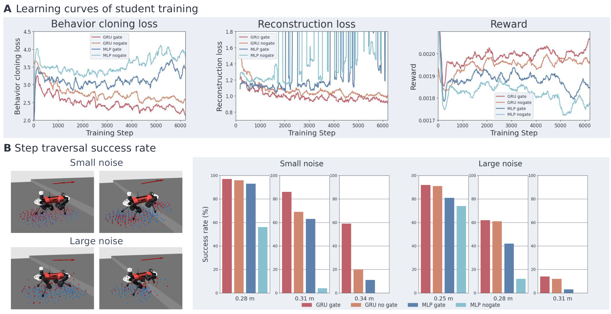

论文 Fig. S2。A看训练损失与奖励，B看不同噪声下的跨台阶成功率；开头损失升高时先看课程是否正在加难度。

A中横轴是训练推进，纵轴分别是行为损失、重建损失和奖励，各颜色对应四个编码器。GRU能更好地重建特权信息；加入门控也改善了学习曲线。训练初段的损失上升与奖励下降，伴随地形和噪声课程增难，不能仅凭曲线朝上就判训练坏了。B右侧是柱状图，左三幅对应小噪声，右三幅对应大噪声；每幅下方标具体台阶高度，纵轴是成功率。红、橙、深蓝、浅青依次为GRU有门、GRU无门、MLP有门、MLP无门；左侧示意照片才按上下两排区分小、大噪声。实验每个高度100次，以0.8 m/s命令向前，前后腿都跨过台阶才成功。<!-- evidence:C52 -->

再读Table S4/S5中的两项，避免把所有收益压成一个“更鲁棒”。先选**小噪声、大台阶仿真地形**：

| 指标，均值±标准差 | GRU有门 | GRU无门 |
| --- | ---: | ---: |
| 与教师动作的平方距离 | 0.719±0.40 | 0.855±0.43 |
| 高度重建误差 | 0.00137±0.00080 | 0.00203±0.00100 |

两者都越低越好。前一项按均值算减少约15.9%，后一项约32.5%。这些数来自每类地形100组参数、各收300个时间步的编码器评估，属于动作模仿与重建误差；论文表格没有把它们换算成成功率，也没有提供这些差值的显著性检验。<!-- evidence:C53 -->

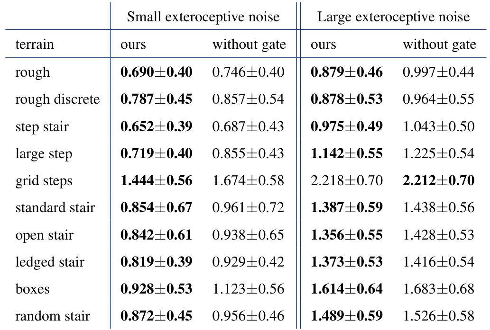

论文 Table S4。行是地形，列是小噪声/大噪声下的有门与无门GRU；数值为均值±标准差，越低越好。先找 Large step 行的小噪声两列，再横向看大噪声条件。

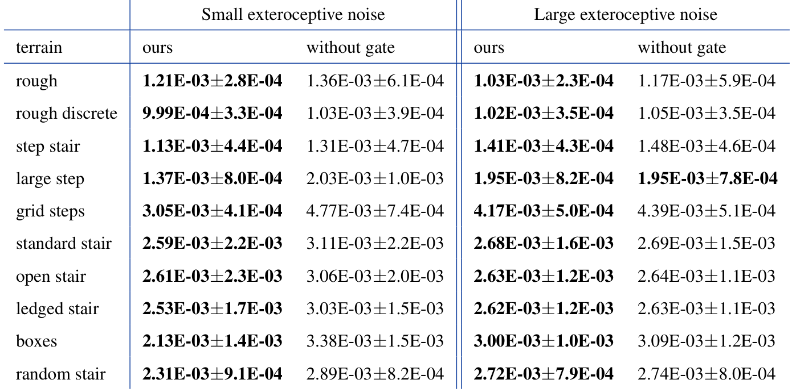

论文 Table S5。列分组与上表相同，指标换成高度重建误差。原表以科学记数法列值，正文窄表将所选一行展开为小数，保留相同精度。

大噪声时，差别明显缩小。large step的高度重建误差两者都四舍五入为0.00195；grid steps的动作差反而是有门2.218、无门2.212，几乎相同且有门略高。作者的整体解释是：可靠时，门控直连有助于利用外感知；外感知很差时，两者行为接近。这个解释比“门控在每个地形、每个指标都更好”贴近表中的数。<!-- evidence:C54 -->

我会把它看成一种可用性收益：相机确实看清时，别让这份提前量在循环网络里被浪费；看不清时，仍能靠已有的身体与历史信息行动。若要进一步证明门值精确反映了传感器置信度，就还需要把门值、已知错误强度和闭环风险放在同一套实验里测。

## 5 回到三个问题

**第一问，地图骗人后怎样改判断？** 输入包含当前带噪高度与身体反馈，GRU保存跨时刻信息，门控调节外感知特征直连。泡沫下陷、透明台阶和遮挡楼梯的实验展示了接触后修正地形估计，以及修正信息的保留。代价是失去预见之后，机器人可能先碰撞或重落地，再调整步态。

**第二问，仿真答案怎样教到实机？** 教师先用无噪高度与特权状态经PPO学动作；学生在自己产生的轨迹上模仿教师，并重建真实高度与特权量。运行时留下学生、地图接口与反馈循环，更新的是隐藏状态和动作，训练所需的真值不再输入。

**第三问，各部件的收益与边界是什么？** 完整实机控制器相对本体基线提高了速度与跨障碍能力；GRU和门控的消融进一步把记忆与直接外感知通道的作用分开。大噪声下部分差距收窄，悬崖遮挡、窄洞卡腿和高台沿恢复仍然需要额外的判断或动作能力。

这篇论文留下的具体问题是：当内部地形与新接触开始冲突时，控制器应当继续迈步，还是先花一步试探？现在它学会了在若干坏观测下继续走；要走到悬崖边，信息是否可靠还需要更明确地影响风险决策。

继续读原文：[作者项目与实验视频](https://leggedrobotics.github.io/rl-perceptiveloco/)。

精读工作流：[ReadPaper](https://github.com/Zhu-Huixiang/ReadPaper)；论文架构图工作流：[DrawPaper](https://github.com/Zhu-Huixiang/ReadPaper/tree/main/drawpaper)。可复制地址：https://github.com/Zhu-Huixiang/ReadPaper

点击“阅读原文”可进入「具身智能的 World」GitHub知识库，查看高清图、公式图源与证据索引：https://github.com/Zhu-Huixiang/embodied-world

---

公众号版由管理员在后台手动公开发表；永久文章链接待发表后补充。

关注公众号 **具身智能的 World**：

[原论文](https://arxiv.org/abs/2201.08117) · [证据索引](evidence.json)

[本篇知识星系](../../universe/papers/perceptive-loco.md) · [知识点宇宙](../../universe/README.md)
