# RMA：脚下突然打滑，机器狗怎么边走边改？

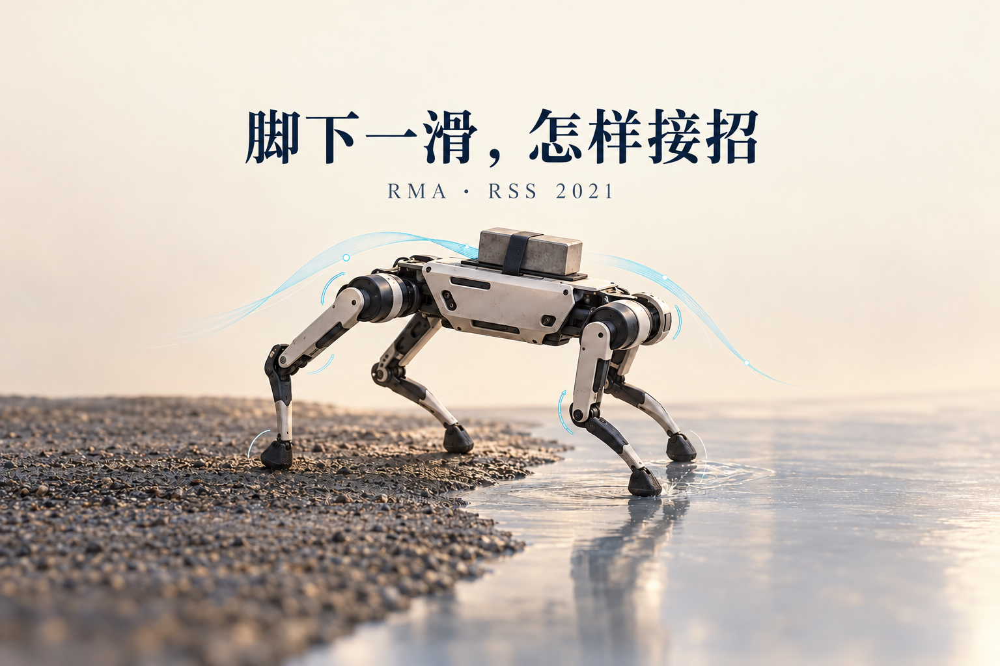

这里是「具身智能的 World」。把论文拆到输入、计算和动作，再用实验检查它到底解决了哪一步。

- 论文解读：读懂机制、公式和关键实验。
- 论文地图：沿科学问题寻找阅读路线。
- 顶会顶刊集锦：查正式出处与原文入口。
- 解读日程：查看未来一周的阅读安排。
- arXiv 新作：跟进经过筛选的研究。
- 具身榜：比较论文与逐项评分依据。
- 知识点宇宙：从一个技术点走向相关论文。

GitHub：[具身智能的 World](https://github.com/Zhu-Huixiang/embodied-world)。

陈佩斯在采访里回忆，《主角与配角》那次枪套带子断了，朱时茂边说台词边修。修是修好了，带子却短了一截，拿来照旧一挂，又成了一个包袱。动作还是那个动作，道具已经不按原来的尺寸配合了。<!-- culture:chen-zhu-shortened-holster -->

机器狗碰到的版本更直接：上一脚踩木地板，下一脚踩到油；刚刚还能抬腿，背上忽然多了一袋重物。继续照旧使劲，效果就变了。

RMA 挑战的是一个适应速度的假设。先收集新环境里的几轮轨迹，再优化控制器，在一些任务里行得通；可一只正在打滑的四足机器人，未必等得起。另一条路线是把训练环境随机得足够丰富，让同一个策略遇事都稳一点。RMA 继续使用随机化，却给策略补了一个接口：**根据刚刚发生的动作与身体反馈，持续估计当前该怎样调整走法。**这段估计能力也在仿真里学好，真机运行时直接推理。<!-- evidence:C01 -->

带着三个问题读：

1. 仿真知道摩擦、负载，真机却不知道，怎么把这些特权信息教给一个能落地的策略？
2. 只看过去半秒的身体反馈，为什么有机会判断环境变了；“在线适应”具体更新了什么？
3. 这套拆分在实机和仿真里分别换来多少收益，又会在哪些变化面前来不及？

**论文信息**：*RMA: Rapid Motor Adaptation for Legged Robots*。作者 Ashish Kumar、Zipeng Fu、Deepak Pathak、Jitendra Malik；机构为加州大学伯克利分校、卡内基梅隆大学、Facebook。首次公开于2021年7月8日；本文读 RSS 2021 正式论文及作者项目页提供的补充材料。RSS 是聚焦机器人方法与实验验证的学术会议。<!-- evidence:C02 -->

[正式论文](https://www.roboticsproceedings.org/rss17/p011.html) · [原文 PDF](https://www.roboticsproceedings.org/rss17/p011.pdf) · [作者项目](https://ashish-kmr.github.io/rma-legged-robots/)

**阅读目录**

- 1 引言：环境变了，腿还在照旧使劲
- 2 相关工作：先校准、求稳，还是边走边适应
- 3 RMA 方法：把会走和会判断分开
  - 3.1 基础策略：特权信息怎样教出一套步态
  - 3.2 适应模块：从半秒经历估计控制条件
  - 3.3 异步部署：腿快一点，判断慢一点
- 4 实验设置：机器人看见什么，训练改动什么
  - 4.1 环境与动作接口
  - 4.2 网络与训练预算
- 5 结果与分析：换地面以后究竟赚到了什么
  - 5.1 室内：迈台阶与负载
  - 5.2 室外：走得过去，和看得见路
  - 5.3 仿真：把适应模块单独拿出来比
  - 5.4 适应过程：打滑以后，哪条信号先变
- 6 结论：历史能补物理，视野还得补

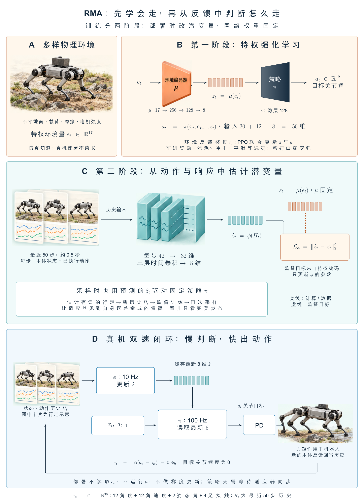

本图由 [DrawPaper skill](https://github.com/Zhu-Huixiang/ReadPaper/tree/main/drawpaper) 指挥 Codex，使用内置生图制作。

先沿训练路线看：**A区**在仿真里改变负载、摩擦、电机强度和地形；**B区**把这些特权信息压成8个数，与当前身体状态一起训练基础策略；**C区**改用历史状态与动作估计这8个数，并拿B区的编码结果当监督。运行路线只留下**D区**：适应模块慢一些更新条件，基础策略快一些出关节目标，底层控制器驱动机器人，身体反馈再回到历史里。两阶段训练会改网络参数；部署阶段的网络参数固定，变化的是输入、潜变量和动作。第3节拆B/C/D，第4节交代A及训练设置，第5节检查闭环是否奏效。<!-- evidence:C03 -->

## 1 引言：环境变了，腿还在照旧使劲

仿真到实机的差距，不只是一两个参数填得不够准。机器人的真实电机可能与模型有偏差；接触地面的材料变了；泥沙会下陷，草会缠腿，石块还可能被踩动。一个在理想刚性地面上练熟的动作，到了这些地方，执行出来就不是原来的效果。<!-- evidence:C04 -->

RMA 关心的是变化发生之后的那一点时间。机器人发出了关节目标，身体实际怎么动，里面已经藏着环境的影响。例如同样抬腿，负载更大时，关节响应和身体姿态可能不同；同样向前蹬，地面更滑时，接触与运动关系也会变。把这段经历读出来，策略就有机会在下一步作出调整。

RMA 要恢复的是“对走路有用的环境信息”，不用把世界每一个物理参数都报得清清楚楚。摩擦到底是0.23还是0.24，在当前动作里可能远没有“继续这样蹬会不会滑”重要。后一种信息可以保存在学习得到的低维表示中。<!-- evidence:C05 -->

论文用约12 kg的宇树 A1 做实验。训练和适应模块都在仿真中完成，再部署到真实机器人上，没有做实机微调。它依靠关节、姿态与足接触反馈走路；没有相机提前告诉它前面是泥、石头还是台阶。<!-- evidence:C06 -->

## 2 相关工作：先校准、求稳，还是边走边适应

原文先回顾控制方法。模型预测控制，也就是 MPC，会用动力学预测未来运动，再选择当前动作。像 MIT Cheetah 3 这样的工作说明，这条路能做出很强的运动能力；相应地，模型、步态与控制器设计需要专业知识和调节。RMA 的动机是让一部分这种适配过程由学习承担。<!-- evidence:C07 -->

接着是强化学习与仿真迁移。**域随机化**可以想成在训练场不断换考题：这轮地滑一点，下轮电机弱一点，再下一轮背上加点重量。策略接触的变化范围扩大了，但如果没有当前环境的条件输入，它仍得从同一个观察里选一个尽量通用的动作。RMA 的 Robust 对照就是这样训练的。到底会不会过于保守，要看后面的同条件实验，而不是给随机化这条路线先判死刑。<!-- evidence:C08 -->

另一条路是**系统辨识**：从施加的动作和观测到的响应，估计环境或机器人参数，再交给控制器。Yu 等人的通用策略工作采用这样的接口；Peng 等人的动物模仿路线则可以优化低维隐变量，调整已有运动策略。原文指出，某些适应过程需要多次真实环境 rollout，也就是让策略执行一段、收一段数据。RMA 把这类估计计算提前学成一个神经网络，运行时沿当前这一条轨迹更新结果。<!-- evidence:C09 -->

所以它和前人的分歧，具体落在三个位置：估计物理参数还是控制相关的潜变量；需要另收几轮探索数据，还是直接读当前历史；运行时再优化参数，还是使用已经学好的映射。接下来逐项拆。

## 3 RMA 方法：把会走和会判断分开

这张原图先回答“哪些东西在训练，哪些东西真正上机器人”。上半部有两阶段训练，下半部才是部署。先认清这条分界，后面的“在线”就不容易看串。

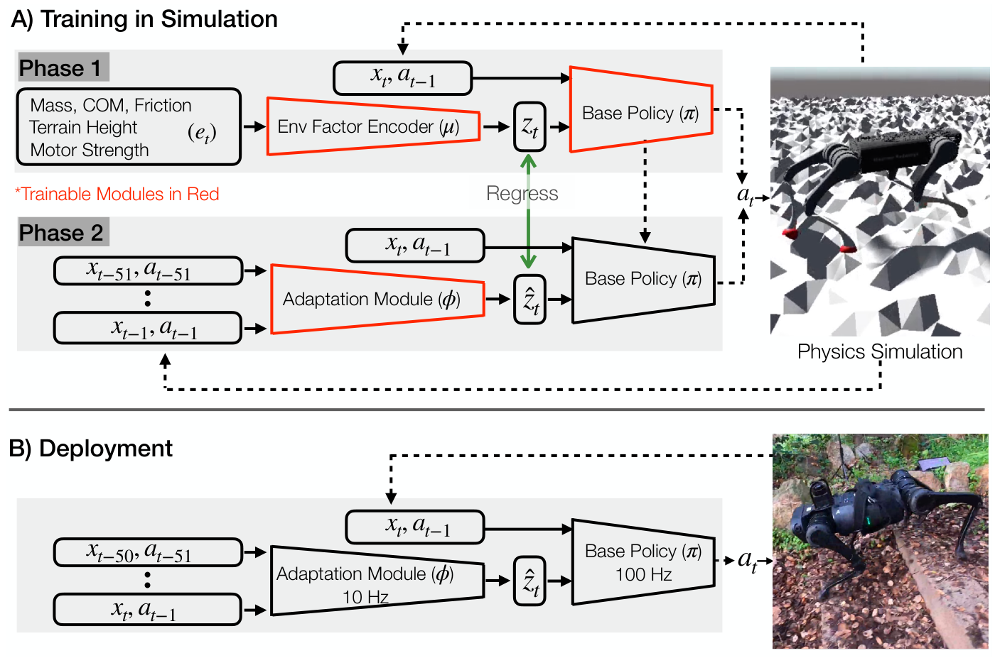

论文 Fig. 2。先找红色可训练模块，再沿下半部读真实机器人反馈怎样回到适应模块。

图里没有数值坐标轴。箭头表示信息传递，虚线把机器人或仿真执行后的反馈接回来。第一阶段红色的是环境编码器和基础策略；第二阶段红色只剩适应模块，绿色“Regress”表示它的预测要对齐第一阶段的编码。底部两个模块都不再标红：它们在运行，参数不再靠现场梯度更新。右边仿真地形与真机照片，对应的是训练环境和部署环境。<!-- evidence:C10 -->

把训练部分放大，红框的变化就是两个阶段的分界；绿色监督箭头把适应器预测接到环境编码，而不是让真机提供摩擦标签。

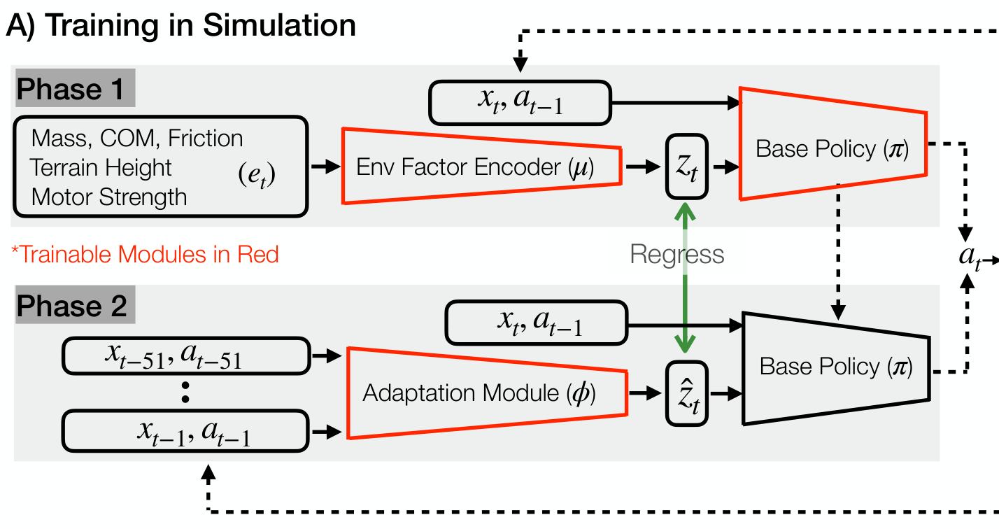

论文 Fig. 2 训练局部。上排联合训练 μ 与 π，下排固定两者、训练 φ；完整仿真闭环见前面的全图。

### 3.1 基础策略：特权信息怎样教出一套步态

先回到架构图B区。时间下标 t 表示当前控制时刻。状态 xₜ 是30维向量：12个关节角、12个关节角速度、身体的 roll/pitch 两个姿态角，加4个脚是否接触地面的二值标记。上一动作 aₜ₋₁ 是12维关节目标。仿真额外提供环境向量 eₜ，共17维，包括负载质量及其位置合计3维、12个电机强度系数、摩擦系数和局部地形高度。<!-- evidence:C11 -->

环境编码器用希腊字母 μ 表示。它把17维环境信息压到8维 zₜ。作者把 z 称为 extrinsics，这里的意思是影响运动的外部条件表示，别与相机外参混在一起。基础策略 π 接着接收当前30维状态、上一动作12维和条件8维，共50维输入，输出下一步12个关节目标。<!-- evidence:C12 -->

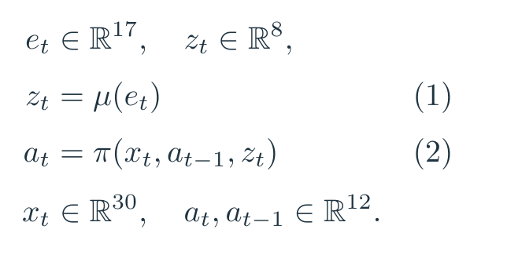

图中是原文公式（1）和（2）。括号中放输入，等号左边是输出；μ 和 π 都是神经网络。先由环境得到 z，再让 z 改变策略在当前状态下的动作选择。

这8个数没有人工规定“第1个必须代表摩擦，第2个必须代表重量”。训练只要求它们能帮助机器人走好路。不同的物理条件，如果在当前控制问题中需要类似的动作修正，就可能落到相近表示；反过来，完整恢复所有物理参数，还可能是在花力气做策略用不到的区分。这里对应第一个问题：特权信息先通过强化学习形成一个有控制用途的接口，下一阶段再学怎样从可观测历史补上它。<!-- evidence:C05 -->

基础策略和编码器由 PPO 联合训练。PPO 是一种限制单次策略改动幅度的强化学习方法：先执行策略获得轨迹，再根据回报调整参数。原文的目标是提高折扣累计奖励的期望。令 rₜ 为一步奖励，γ 为折扣因子，T 为轨迹步数；公式图用花体 T 表示整条轨迹，p 表示策略诱导的轨迹分布，J 表示这项期望回报目标。<!-- evidence:C13 -->

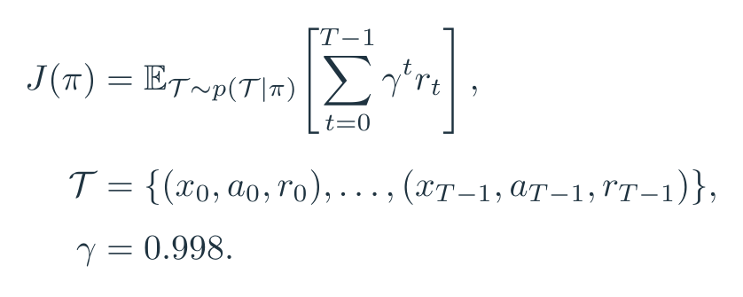

这是原文未编号的回报公式，图中把原文的轨迹符号 τ 改写成花体 T，以免与后文电机力矩混淆；γ 的数值来自补充材料。求和把一段运动的收益加起来，期望表示对可能出现的轨迹取平均。

**奖励先让它愿意走，再让它走得像样。**前进项鼓励向前运动，但在0.35 m/s处封顶；这只是奖励封顶，不是机器人的物理限速。其余项约束侧移、偏航、用力、冲击和动作变化。<!-- evidence:C14 -->

把十项拆成两组更好读。第一组决定运动目的：向前速度乘20；侧向速度平方和偏航角速度平方作为惩罚，乘21。第二组管动作质量：做功惩罚乘0.002，脚底接触力的变化乘0.02，力矩变化乘0.001，动作幅度乘0.07，关节速度乘0.002，roll/pitch姿态乘1.5，竖直速度平方乘2.0，接触脚滑动速度乘0.8。这里的平方项把各分量平方后求和；做功项是力矩与关节角变化的内积取绝对值。<!-- evidence:C15 -->

这些项各管一件具体的事：少乱蹬、别突然撞地、力矩别抖得像在打摆子；接触标记还会筛出已经着地的脚，只惩罚这些脚的滑动。奖励里用了仿真可取的力、速度等量，这不等于真机策略输入里也塞进了全部这些传感器。<!-- evidence:C16 -->

一个教学算例：如果前向速度是0.2 m/s，前进奖励为4；到0.4 m/s时，前进奖励为7，因为截在0.35。若侧向速度0.1 m/s且没有偏航，该惩罚是−0.21。其他项暂时不算，就能看到它既要往前，也不愿为往前而横着乱晃。这些是代入公式的例子，不是论文新做的实验。

可一开始就把全部惩罚拉满，网络也可能找到一种省事解法：少动。目标是走路，奖励却让“原地省电”挺划算。作者因此采用训练课程，先弱化惩罚，再逐渐加上去；质量、摩擦和电机强度变化的难度也逐步增大。地形难度没有跟着做课程，而是从固定难度的随机地形分布采样。补充材料进一步给出，第三至第十项的初始额外乘数是0.03，按固定递推逐渐增大。<!-- evidence:C17 -->

### 3.2 适应模块：从半秒经历估计控制条件

到了真机，仿真那张环境参数表就没法直接读取。C区的适应模块 φ 因此接过这个工作：读过去50步的状态与动作，输出估计的8维条件。上面的帽子表示“估计值”，k 是历史长度；100 Hz控制下，50步覆盖0.5秒。<!-- evidence:C18 -->

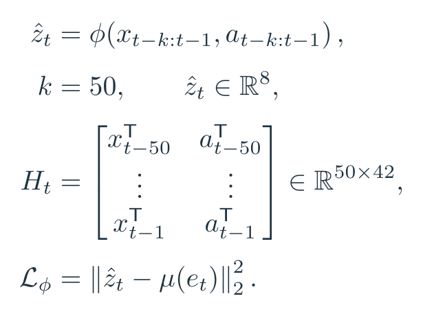

图中 Hₜ 是为讲清形状而显式写出的历史矩阵：50行对应50个时刻，每行并列30维状态和12维动作；上标 T 表示转置成行。最后一行的 Lφ 是适应模块损失，即原文未编号的平方误差。每个维度先算预测与目标的差，再平方相加。监督目标仍由仿真中的环境编码器 μ 计算，梯度只更新 φ。

可以把这段输入理解为一次具体的“赛博对账”：刚才给关节下了什么目标，随后身体和接触反馈发生了什么变化。只看一个姿态，机器人可能只是恰好蹲低；连着看动作与响应，才有机会区分是不是背上突然变重。网络读的是状态、动作的时序关系，论文没有把一个手工计算的“误差账户”单独做成输入。<!-- culture:cyber-accounts --><!-- evidence:C19 -->

为什么不用历史直接回归摩擦、重量？因为控制接口已经在第一阶段学好了。φ 只要把对走路有用的条件估计出来，就能接回原策略。假设教学用的前两维目标为0.4、−0.2，预测为0.1、−0.1，其余六维完全正确，那么平方误差为0.09＋0.01＝0.10。这两个分量是潜变量，不带 kg 或摩擦系数的物理单位。

训练数据怎么来，才是这里容易漏掉的关键。若始终用“真实环境编码＋基础策略”走，历史大多比较顺；可部署时 φ 会估错，策略就会走到不同的状态。只在好轨迹上练过的估计器，可能一走歪就更不会读。

作者让当前 φ 的估计真正参与仿真动作：估一个条件，基础策略据此走，收集它走出来的历史，再拿仿真真实环境经过 μ 得到的编码监督 φ。反复采样与更新，训练数据就包括估计不准造成的偏离。这是 on-policy 数据的要点，数据分布跟着当前部署组合走；补充材料 Algorithm 1 也明确显示，第二阶段只更新适应模块。<!-- evidence:C20 -->

在线适应依赖历史中的动力学痕迹，而“能从这些痕迹推什么”是仿真训练学来的。它没有保证每一种变化都能唯一辨认；是否足够有用，要到第5节看动作结果。

### 3.3 异步部署：腿快一点，判断慢一点

把原图的部署部分再放在这里。现在只盯下半部：历史输入走向 φ，当前状态与上一动作直接进 π，两条路径最后在动作输出前汇合。

论文 Fig. 2。下半部10 Hz和100 Hz分别属于适应模块与基础策略，别把它们读成同一个控制周期。

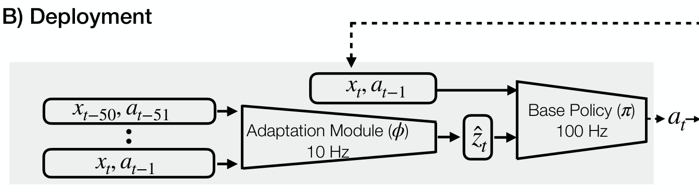

论文 Fig. 2 部署局部。左侧历史交给 φ，当前状态与上次动作直接交给 π；完整的机器人反馈回路仍见全图。

D区的基础策略以100 Hz运行，每10 ms给一次关节目标；适应模块读取较长历史，以10 Hz更新估计条件，约每100 ms一次。两者异步运行，没有一个中心时钟要求它们每次同步；基础策略每次取最新已经算好的条件。<!-- evidence:C21 -->

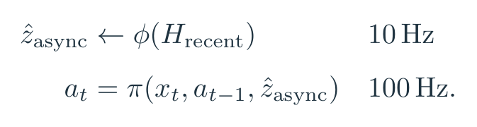

这里 H_recent 表示刚读到的最近历史缓存，箭头表示用新计算结果写回；async 表示共享的最新估计，它可能在几个基础策略周期内保持不变。但当前身体状态仍每步更新，所以“条件暂时沿用旧值”并不意味着机器人在这100 ms里闭眼放录像。若膝盖角度变了、某只脚接触丢了，快速路径仍会立即读到新的状态。

这也补齐“在线”的另一半：部署时不做 PPO、不反向传播，也不现场重训网络。历史窗口滚动，φ 的输出随之变化，π 因条件和当前状态变化而改变动作。把在线推理误读成在线梯度学习，就会把算法的时间成本和风险都理解错。<!-- evidence:C22 -->

作者还试过把状态和动作历史直接塞进单一策略。原文报告，这种耦合设计仿真表现较差、步态不自然，而且在使用的机载计算条件下只能跑到10 Hz。拆分让“估环境”可以慢一点，“出动作”保住高频；它依赖的实际条件是，控制相关外部因素通常比身体状态变化慢。突变刚发生时，估计仍然会有滞后。<!-- evidence:C23 -->

## 4 实验设置：机器人看见什么，训练改动什么

### 4.1 环境与动作接口

A1 有18个自由度，其中12个关节由电机驱动，每腿3个。策略接收的30维本体状态，来自电机编码器、IMU姿态与足接触传感器。**本体感觉**就是读取自己的身体：腿弯到哪、弯得多快、身体倾了多少、脚有没有落地。它和“看到前方台阶”是不同的信息来源。<!-- evidence:C24 -->

π 输出的是目标关节角，记作 q̂；q 是实测关节角，q̇ 是实测关节角速度。底层 PD 控制器用位置差和速度差算力矩。P可以理解成“差多少，就往回拉多少”，D则对运动速度施加阻尼。目标关节速度设为0，真机固定增益为 Kₚ＝55、K𝒹＝0.8。<!-- evidence:C25 -->

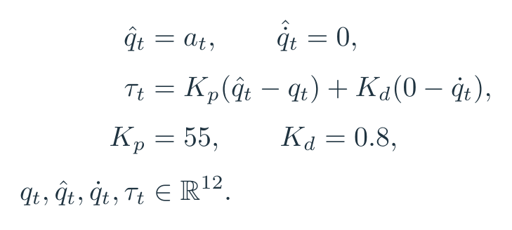

这是原文未编号的控制关系。举一个单关节教学例子：目标0.5 rad，当前0.4 rad，角速度0.2 rad/s，则按该式得到55×0.1−0.8×0.2＝5.34 N·m。目标角没有直接“变成姿态”；它先经过反馈控制，再让电机施力，真实身体怎么动还取决于负载和接触。

训练用 RaiSim 的刚体与接触仿真，随机分形地形提供高低起伏。单个 episode 最多1000步；高度低于0.28 m、roll幅度超过0.4 rad，或pitch超过0.2 rad，会提前终止。局部地形高度也没有以高分辨率地图交给策略：作者把四脚下高度离散到一位小数，再取最大值形成一个标量。这个设计降低基础策略对快速、精确地形信息的依赖。<!-- evidence:C26 -->

下表回答的是“测试究竟比训练多难了一点”。先看行里的物理量，再横向比较训练范围与测试范围。

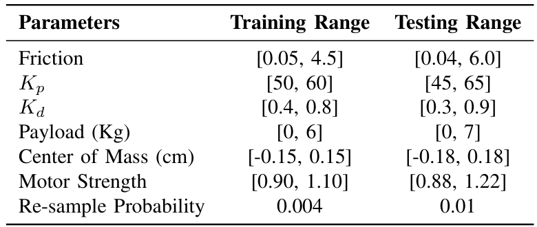

论文 Table I。测试既扩展参数范围，也提高episode内部重新采样的概率。

例如训练负载0–6 kg，测试0–7 kg；摩擦系数训练0.05–4.5，测试0.04–6.0。摩擦系数是无量纲量。增益 Kₚ、K𝒹 与电机强度也在范围内变化；电机强度是相对缩放系数。最后一行是每个仿真步重采样环境参数的概率，训练0.004，测试0.01。表中质心一行的单位与数值存在疑点，本文不据这一行换算真实位移尺度。<!-- evidence:C27 -->

这里既有“参数范围更宽”的压力，也有“走着走着就变”的压力。后面拿 AWR 比较时，这个条件尤其重要：环境持续改变，会压缩离线优化适应可利用的时间。

### 4.2 网络与训练预算

网络规模不大，但每条数据流各有任务。基础策略是三层 MLP，隐藏层宽128；环境编码器也是三层 MLP，两个隐藏层宽256和128，输出8维。这里MLP就是全连接网络，把输入分量混合、经过非线性，再交给下一层。<!-- evidence:C28 -->

φ 的输入沿时间堆叠。每步状态30维、动作12维，合起来42维；50步形成一段50×42的历史。两层 MLP先把每步压成32维，再由三层一维卷积沿时间读相邻片段，最后展平并线性投影到8维。三层卷积的“输入通道、输出通道、卷积核、步幅”依次是［32，32，8，4］、［32，32，5，1］、［32，32，5，1］。所以它学习的是一段动作响应的时序结构，而非把50个时刻当成互不相关的照片。<!-- evidence:C29 -->

原文报告，第一阶段15000次迭代，每次采80000条转移，合计12亿步；约需一台普通桌面电脑加一张GPU训练24小时。第二阶段1000次迭代，同样每次80000条，合计8000万步，约3小时。两阶段学习率都是0.0005。这里的机器与耗时是作者当年的报告，重点是在线轻量推理背后有大量仿真训练。<!-- evidence:C30 -->

补充材料还有 PPO 的实现细节：策略比率裁剪区间0.8–1.2，价值损失系数0.5，折扣因子0.998，GAE参数0.95。GAE用来估计某动作比当前基准好多少，从而给策略梯度提供训练信号。它们属于训练优化设置，真机每10 ms那条执行路径不需要重新计算这些损失。<!-- evidence:C31 -->

## 5 结果与分析：换地面以后究竟赚到了什么

原文的评估分室内、室外、仿真与适应过程。读数字前先统一含义：成功率看是否完成指定任务；TTF把跌倒前时间除以本次任务的最大时长，范围0–1，越大越好；实机 Distance也按任务目标距离归一化，仿真表里的Distance则用米。**站住了和走到了，得分开看。**<!-- evidence:C32 -->

### 5.1 室内：迈台阶与负载

这张图要检查同一台A1换控制方式以后，在软地面、台阶与负载变化中表现怎样。红线是完整RMA，绿线是去掉适应模块，黑线是厂家A1控制器；照片中的箭头标运动方向。

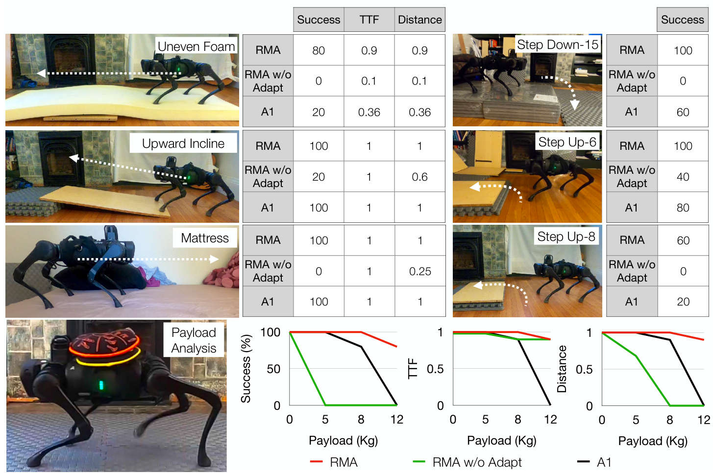

论文 Fig. 3。先按每个任务的小表读成功率，再看底部负载增加时三条曲线如何分开。

上半部各小表的行是方法，列是Success、TTF、Distance；迈台阶只报告成功率。原文设置每方法通常5次试验，但剧烈失败时做两次就停止，以减少硬件损坏。所以这些小样本比例适合看失败模式，还需要更多重复才能估计稳定差异。图内“Uneven Foam”和“Step Down-15”的数值与原图注存在冲突；下面选用图内外不冲突的上台阶结果。<!-- evidence:C33 -->

下面把上台阶两组放大：上排是6 cm，下排是8 cm，右侧按完整RMA、无适应、原厂A1的行序读成功率。

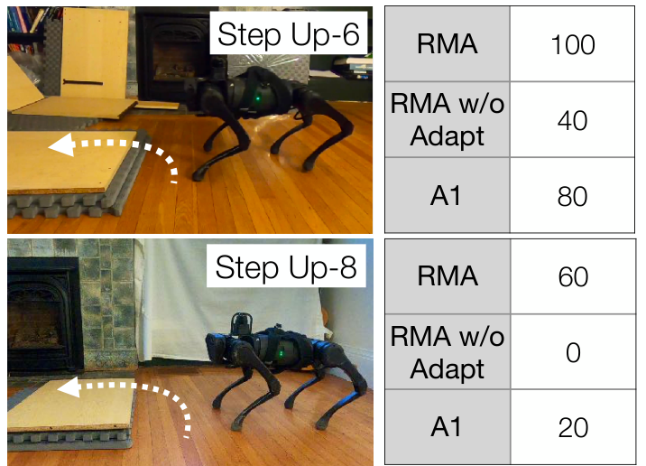

论文 Fig. 3 上台阶局部。两张小表右列都是成功率（%），保留全部方法行；每组试验次数见前文。

8 cm台阶，RMA为60%，A1为20%，去掉适应模块为0%。6 cm台阶，对应为100%、80%、40%。这是同一硬件上的室内对照；台阶高了2 cm，完整RMA也从全部成功降到60%。小尺寸差异能把接触与支撑条件改得很厉害，别看着“就两厘米”便替机器人觉得简单。<!-- evidence:C34 -->

再看底部三个折线图。横轴都是负载，标0、5、8、12 kg；它们是实验取样点，图上点位间距近似均匀，不能拿横向像素距离当等距的公斤尺。纵轴从左到右是成功率、归一化TTF、归一化距离。红线在12 kg负载时仍保有较高水平；绿色曲线则更早出现“没走多远”，但TTF仍然较高的情况。<!-- evidence:C35 -->

这正是只看不摔会误判的地方：一个策略可以少动甚至不动，把跌倒时间拖长，却完不成向前行走任务。RMA背12 kg，即接近机器人自身重量的负载，是论文报告的能力边界之一；本文不把这张图读成任意路线、任意速度下的额定载重。<!-- evidence:C36 -->

### 5.2 室外：走得过去，和看得见路

室外照片回答“环境类型是否比仿真接触模型丰富”。沙地会下陷，植被会挡腿，碎石会改变落脚支撑；这些变化比调一个固定摩擦系数复杂。

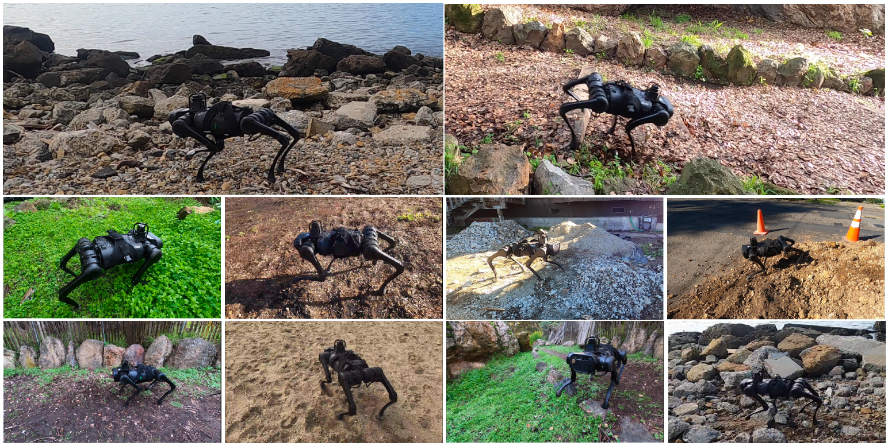

论文 Fig. 1。先看脚下材料与落脚条件，照片展示的地形差异比机器人姿态更关键。

这是一组真实场景照片，没有横纵坐标，也不是一条连续运动轨迹。画面分别覆盖岩石、林间地面、植被、沙地和建筑碎料等场景；不能凭拼图反推每段测试的长度或连续无干预时长。<!-- evidence:C37 -->

作者报告，沙、泥土和部分植被场景中本次试验全部通过，林间楼梯下行成功率70%，水泥堆与卵石堆穿行80%。这些野外结果主要展示同一策略迁移到多种地面的能力，正文没有逐场景列出完整分母，也没有在所有室外场景重跑全套对照。它们和室内5次试验、仿真3000个episode要分别读。<!-- evidence:C38 -->

仿真提供的特权表示，配合历史估计，在这里支持了训练中没有直接出现的接触情况。但它仍是走上去以后根据身体反馈调整。前方有多高的台阶、哪个落脚点更安全，是视觉能提前提供的信息，RMA这版并没有。

### 5.3 仿真：把适应模块单独拿出来比

为了尽量隔开硬件风险，作者把更完整的方法对照放到仿真里。Expert直接读真实环境编码，是带特权信息的参考；Robust没有条件向量；SysID预测物理参数；AWR用额外测试环境数据离线优化条件；RMA w/o Adapt用于去除适应模块。学习类对照沿用相同架构、奖励与其他超参数设置。<!-- evidence:C39 -->

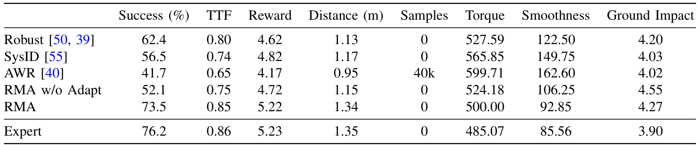

论文 Table II。先读成功率与距离，再看Smoothness和Ground Impact；每一列都要认准是越大越好还是越小越好。

行是方法，列从左到右是成功率、TTF、奖励、距离、额外适应样本、力矩代价、平滑性代价和地面冲击。成功率用百分比，距离用米。Torque是关节力矩平方和，Smoothness是相邻步力矩差的平方和，Ground Impact是足端地面反作用力变化的平方和，后三项越小越好。Reward只汇总前进与侧向相关项，也不是整套训练奖励的总和。<!-- evidence:C40 -->

为方便手机读，把当前这一项判断单独列出来：

| 方法 | 仿真成功率 |
| --- | ---: |
| RMA | 73.5% |
| Robust | 62.4% |
| RMA w/o Adapt | 52.1% |
| SysID | 56.5% |
| AWR | 41.7% |
| Expert | 76.2% |

这里是3个随机初始化策略，每个1000个测试episode，共3000个episode的汇总。把测试条件放回旁边看：

论文 Table I。右列是本节的测试范围；最下一行0.01表示每一步重新采样环境参数的概率。

RMA比Robust高11.1个百分点，比去掉适应模块高21.4个百分点，距离带真实条件的Expert差2.7个百分点。百分点是百分比直接相减，别把11.1个百分点写成“提升11.1%”。<!-- evidence:C41 -->

前进距离也支持这个方向：RMA为1.34 m，Robust为1.13 m，Expert为1.35 m。RMA在力矩和平滑性代价上更低，但地面冲击4.27，高于Robust的4.20和SysID的4.03。它没有把每一列都赢下来；成功与稳定前进，是这里最清楚的收益。<!-- evidence:C42 -->

再看Samples列：RMA的0，指不需要另外收一批测试环境探索数据来优化适应，当前运行的历史当然仍在用。AWR用到40000步，面对本实验不断变化的环境，效果较差。这个结果支持RMA的快速条件估计，但比较条件包含“走着走着参数又变了”，不能抹掉这个前提，把所有离线适应方法一概判为无用。<!-- evidence:C43 -->

### 5.4 适应过程：打滑以后，哪条信号先变

成功率告诉我们完成了多少次，时间曲线则能看出“适应”到底发生在什么位置。下面是脚包塑料、地面塑料上又倒油的试验。作者报告，这组过油面运行成功率为90%；图里画的是其中一次过程。<!-- evidence:C44 -->

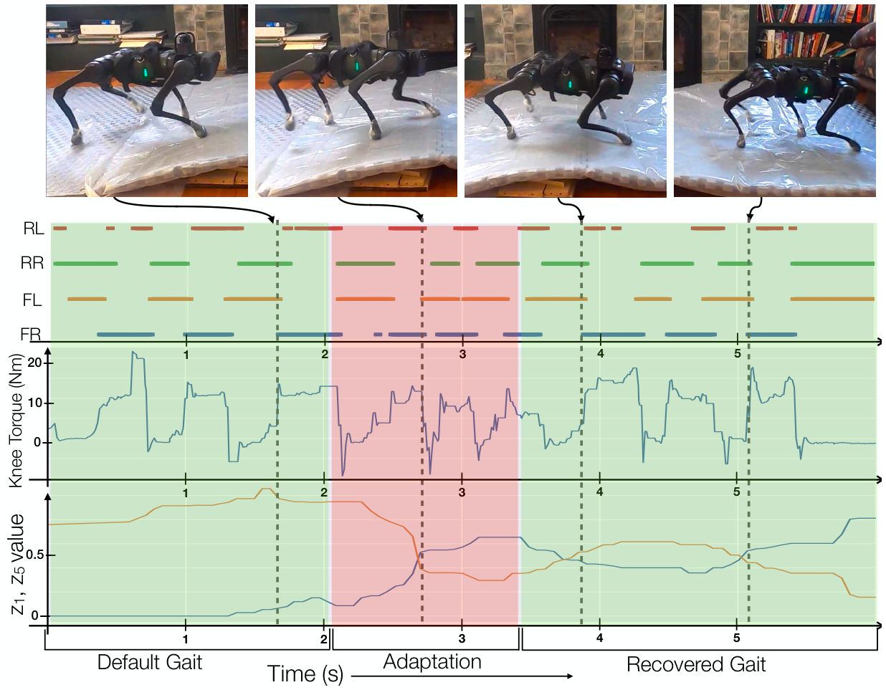

论文 Fig. 4。横向对齐同一个时刻，依次看脚接触、膝关节力矩和潜变量；不要把最下方两条线读成摩擦系数。

全部横轴是秒，1、2、3、4、5的刻度等距，是线性时间。上排照片由箭头连到对应时刻。第一组条带的RL、RR、FL、FR分别是后左、后右、前左、前右腿；条段表示该脚接触地面的时段，颜色用来区分腿。中间纵轴是膝关节力矩，单位N·m。底部画经过中值滤波的潜变量第1、5维，纵轴只是这两维的数值，没有固定物理单位；作者没有把两个分量分别标成“摩擦”和“负载”。<!-- evidence:C45 -->

绿色背景是原有或恢复后的步态阶段，粉色背景标适应阶段。约2秒发生打滑后，接触节奏受扰，潜变量曲线也发生变化；随后步态周期大致恢复，膝力矩水平比最初略高。潜变量并没有回到原值，因为地面仍然滑，机器人需要的是“在新条件下重新走稳”，而不是忘掉这块地。<!-- evidence:C46 -->

这张图给第二个问题补上过程证据：变化确实进入了学习到的状态表示，动作也随之改变。不过它没有给出每次10 Hz更新都必然恢复的时限保证。控制条件更新一次需要100 ms，与整次扰动恢复用了多久，是两种时间。

补充材料还安排了一次更直观的突变：走着走着往背上扔5 kg负载。把原图放在旁边，比较同样的接触、力矩与条件变化。

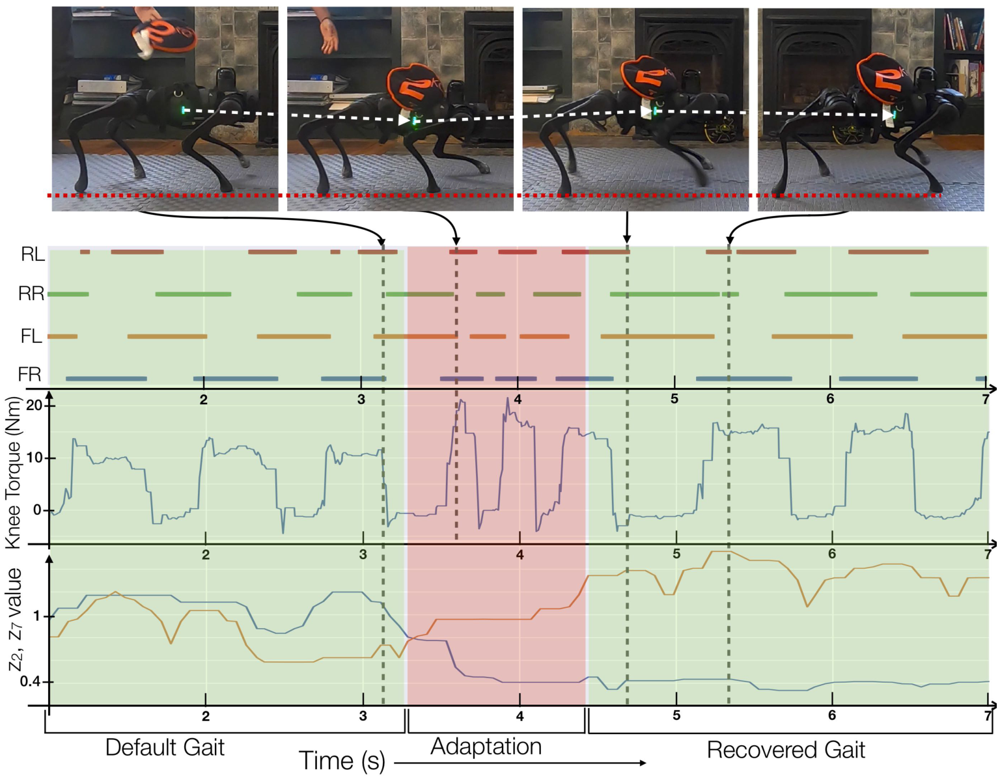

补充材料 Fig. 2。负载落下后身体先下沉，接着看接触节奏和力矩如何恢复；照片袋子上的字样受翻转影响，实验负载按图注为5 kg。

横轴仍是线性秒轴，四条接触条带沿用前后左右腿的标记；中间是膝力矩N·m，底部改画潜变量第2、7维。照片中的白色虚线辅助观察机身高度变化。负载落下后的粉色阶段里，身体受到扰动，条件向量改变；进入右侧绿色阶段后，步态重新稳定，力矩处于较高水平，潜变量也保留了新的状态。<!-- evidence:C47 -->

与油面图放在一起，能读出的共同点是：不同扰动通过历史反馈进入同一个8维接口，再影响基础策略。这里没有人工切换“油面控制器”“背包控制器”，也没有现场重新优化整套网络。

## 6 结论：历史能补物理，视野还得补

第一个问题，特权信息如何落地：先在仿真里联合训练环境编码器和基础策略，让8维条件确实服务走路；再训练历史估计器补上这个接口。部署时，参数表退出，身体反馈留下。

第二个问题，半秒历史为什么有用：它包含了动作与真实响应之间的关系，适应模块用这些关系估计当前的控制条件。在线更新的是潜变量，网络权重固定。100 Hz策略持续响应身体，10 Hz模块更新外部条件，两条路径共同维持闭环。

第三个问题，收益落在哪里：把同一组仿真对照收回来，条件仍是每步以0.01概率重采样环境参数，每种方法合计3000个测试episode。<!-- evidence:C41 -->

| 方法 | 仿真成功率 |
| --- | ---: |
| RMA | 73.5% |
| 无条件 Robust | 62.4% |

室内台阶、负载和打滑试验也给出了具体对照与过程。代价和边界同样具体：训练需要大量仿真，某些接触冲击指标仍高于对照；真实世界的突变得先反映到身体历史里，估计才有机会跟上。<!-- evidence:C42 -->

原文结尾把下一步指向外部感知：下楼时突然下落，或几条腿同时被石头阻住，仍会导致失败。相机若能提前看到落差或障碍，就有机会把调整从“踩上去以后”提前到“踩下去以前”。<!-- evidence:C48 -->

因此，下一次比较这类方法，我更想看一个拆得开的实验：保持身体历史与基础策略不变，只加入前方地形信息，分别量刚接触扰动时的失稳幅度和恢复时间。这样才知道，视觉究竟帮机器人更早改了哪一步，而不是只给最终成功率添了一个数字。

继续沿原论文读，可以用 [ReadPaper](https://github.com/Zhu-Huixiang/ReadPaper) 保留机制地图与问题；画方法结构可用 [DrawPaper](https://github.com/Zhu-Huixiang/ReadPaper/tree/main/drawpaper)。可复制地址：`https://github.com/Zhu-Huixiang/ReadPaper`。

原论文入口：`https://www.roboticsproceedings.org/rss17/p011.html`。GitHub中的高清图、公式与图源可放大查看；“阅读原文”进入本文完整解读。

---

公众号版由管理员在后台手动公开发表；永久文章链接待发表后补充。

关注公众号 **具身智能的 World**：

[原论文](https://www.roboticsproceedings.org/rss17/p011.html) · [证据索引](evidence.json)

[本篇知识星系](../../universe/papers/rma.md) · [知识点宇宙](../../universe/README.md)
