# RT-1：机器人看过十三万次示范，就会举一反三了？

这里是「具身智能的 World」。我们把具身研究拆到能看懂、能比较、能接着读。

[GitHub 知识库](https://github.com/Zhu-Huixiang/embodied-world)：高清图、公式和后续更新都在这里。

论文解读：沿原文把方法与证据讲透。

论文地图：按问题串起阅读路线。

顶会顶刊集锦：找正式论文与原文入口。

解读日程：看接下来准备读什么。

arXiv 新作：筛选值得追踪的新研究。

具身榜：看评分、依据与研究出处。

知识点宇宙：沿技术节点走到相关论文。

机器人最让人血压上来的地方，经常不是完全不会，而是**换个说法、换个瓶子、换张桌子，它就仿佛第一天上班。**

一种常见做法是：某个任务不行，那就专门收一批数据，再练一个策略。抓杯子一个，开抽屉一个。问题越补越多，技能越来越像手机里那些“这次肯定会整理”的文件夹。

RT-1 挑战的正是这里的假设：机器人是不是必须按任务分开练？如果把许多任务、物体和场景汇进一个语言条件策略，数据之间能不能互相帮忙？它接着 BC-Z、Gato 等通用策略路线往前试，重点落在真实机器人能否可靠执行，而不是只看模型能吞多少种 token。<!-- evidence:C01 -->

带着三个问题读：

1. **六帧图像和一句话，怎样变成机械臂真正能执行的动作？**
2. **把动作切成离散档位、把视觉压成少量 token，究竟省掉什么，又损失什么？**
3. **十三万回合教出来的“举一反三”，在哪些测试里成立，换机器人、换厨房又怎样？**

论文信息：*RT-1: Robotics Transformer for Real-World Control at Scale*；Anthony Brohan 等，Google Robotics、Everyday Robots 等团队；首次公开于 2022-12-13。本文读 arXiv v2（2023-08-11），论文发表于 **RSS 2023**。RSS 是机器人学的重要研究会议，本文重点是大规模真实机器人控制。[论文](https://arxiv.org/abs/2212.06817v2) · [RSS 页面](https://www.roboticsproceedings.org/rss19/p025.html) · [项目与演示](https://robotics-transformer1.github.io/) · [代码](https://github.com/google-research/robotics_transformer)。<!-- evidence:C02 -->

**阅读目录**

- 1 引言：多练一些任务，能帮其他任务吗？
- 2 相关工作：继承哪些积木，真正改哪里？
- 3 问题定义：一句指令，不等于一整套计划
- 4 系统概览：数据究竟从哪里来？
- 5 方法：从六帧图像走到动作
- 6 实验：把泛化拆开测，别一口吞
- 7 结论：规模有用，但要看规模长在哪里

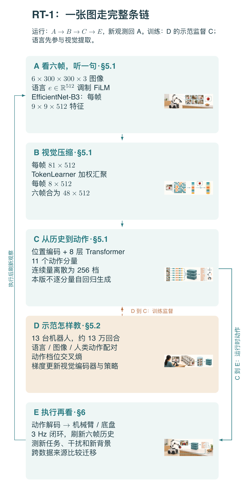

本图由 [DrawPaper skill](https://github.com/Zhu-Huixiang/ReadPaper/tree/main/drawpaper) 指挥 Codex，使用内置生图制作。

先把路认清。**运行时走 A→B→C→E**：图像和语言进入视觉编码器，压成 token，Transformer 输出动作，机器人执行，再把新画面送回来。**训练走 D→C，并把误差传回 A/B**：人类示范告诉模型，这个时刻该选哪一档动作。

第 3、4 节解释任务和数据；第 5 节拆 A/B/C/D；第 6 节检查 E 区到底干成了多少事。这个模型没有在脑内先拍一段未来视频，语言也不是最后才贴到视觉后面的标签——它很早就参与“看哪里、提什么特征”。

## 1 引言：多练一些任务，能帮其他任务吗？

抓苹果的数据，能否帮助抓饼干？把杯子移到盘子旁边的经验，能否帮助处理一条训练中没出现过的指令？

这些问题里有两种增长。第一种是同一招多练几遍，把手练稳；第二种是多见些招式和物体，让不同任务之间共享结构。RT-1 想同时研究它们，最后还专门把数据总量和任务多样性分开做实验。

它的基本策略相当朴素：**模仿成功示范。**人类做过的动作是标签，模型学着预测。主模型不是靠自己在厨房里试错攒奖励；后面混入的另一机器人数据，才包含强化学习产生的成功轨迹。这个训练来源差别，读到跨机器人实验时很关键。<!-- evidence:C03 -->

## 2 相关工作：继承哪些积木，真正改哪里？

RT-1 没打算把每个零件都重造。

视觉骨干沿用经过 ImageNet 预训练的 EfficientNet，语言使用预训练句子编码器；FiLM 把语言注入视觉，TokenLearner 压缩视觉序列，Transformer 汇总历史。模仿学习提供监督，动作离散化让输出变成分类问题。<!-- evidence:C04 -->

> **基础扫盲｜模仿学习**
> 给模型看“当时看到了什么、目标是什么、人类下一步怎么动”。它学的是观测到动作的映射。像照菜谱练切菜，菜谱本身不会因为切得不好自动长出奖励函数。

与 Gato 的对照也要摆对位置：本文在同一份 RT-1 数据上重新训练约 37M 参数的 Gato 变体，RT-1 共约 35M。表里的 Gato 不是那个跨海量任务、约 1.2B 参数的原版模型直接下场。否则比较对象从第一步就串台了。<!-- evidence:C05 -->

## 3 问题定义：一句指令，不等于一整套计划

模型每次收到一句任务描述与最近六帧图像，输出当前一步动作。相机是它看世界的主要入口；机器人靠执行、观察、再执行闭环前进。

“把苹果拿起来”是一条 RT-1 可以接的短程指令。“给我准备一份午餐”则涉及选东西、排序和多个子目标。论文的长程实验把 RT-1 接到 SayCan：上层规划技能顺序，RT-1 负责把单步技能落到动作。别把厨师、菜单和后厨执行员全塞进一个名字里。<!-- evidence:C06 -->

动作向量共有 11 个分量：

- 机械臂 7 个：末端位置 x/y/z、姿态 roll/pitch/yaw，以及夹爪开合。
- 移动底盘 3 个：平面 x/y 与 yaw。
- 模式 1 个：控制手臂、控制底盘，或者结束当前回合。

这里的姿态角描述末端朝向，底盘 yaw 描述水平转向；它们虽然同名，控制的部件不同。模型输出也不是七个关节各自的力矩。<!-- evidence:C07 -->

## 4 系统概览：数据究竟从哪里来？

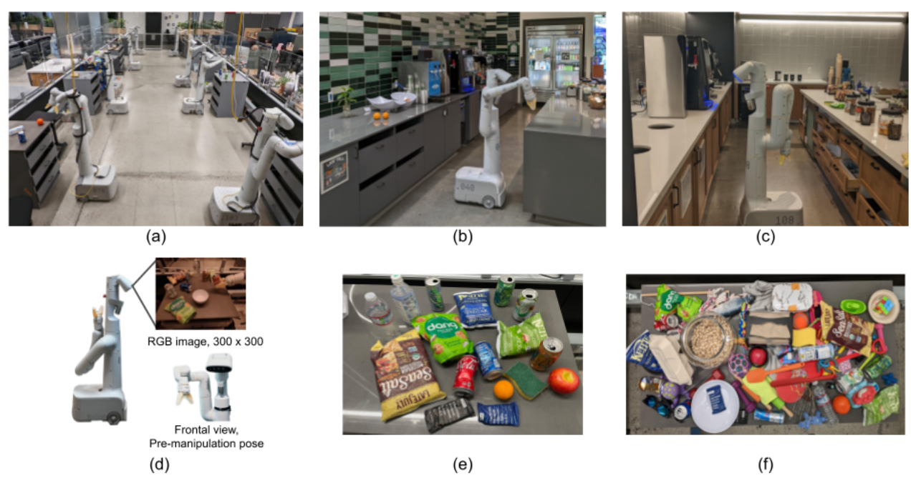

论文 Fig. 2：先认场地，再看对象；上排是采集教室与两个厨房，下排是机器人视角和两组物体。

这张图是在交代“泛化”的地理边界。左上 (a) 是大量收数据的机器人教室，(b)、(c) 是两处办公厨房；下方 (d) 展示移动机械臂和相机画面，(e) 的物体用于扩展技能，(f) 则更偏向扩展抓取物体的种类。**物体多、技能多、环境多，是三个不同按钮。**把一堆新包装扔上桌，不会自动得到开门这种新动作。

作者在约 17 个月里，用 13 台机器人收集约 13 万个成功回合，覆盖 744 条任务指令。这里“744”按指令统计，有些共享技能或物体；不是 744 种彼此独立的运动控制原语。<!-- evidence:C08 -->

示范序列里，指令、图像与动作按时刻对应。落到开头 D 区，就是把人类当时怎样动，变成网络的监督答案。这个数据工程看着不酷，实际上相当扎实：模型再花哨，训练集中从没出现过的接触方式也不会凭空到账。

## 5 方法：从六帧图像走到动作

### 5.1 A 区：语言先改“看法”，再决定“做法”

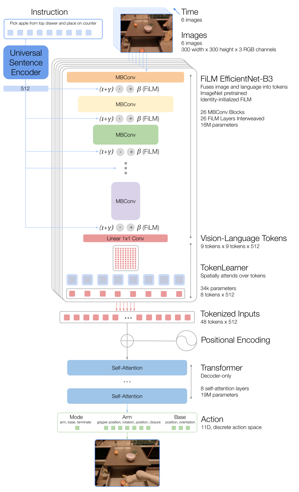

论文 Fig. 3：沿上到下读，先看语言侧线怎样进入视觉骨干，再看视觉序列怎样收缩到动作出口。

最上面左侧是一句指令，右侧是六帧 RGB 图像；蓝色语言支路接入多层 FiLM。中间的红色小网格表示视觉 token，TokenLearner 把每帧压成八个，再拼接六帧；位置编码加入时序位置，蓝色 Transformer 块处理历史，最下方分别输出模式、手臂与底盘动作。

把上半截拉近一点：

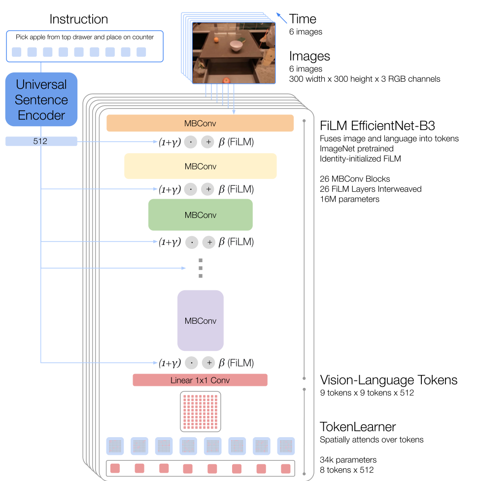

论文 Fig. 3 局部：蓝线是语言调制，主干是视觉计算；两条线在视觉特征阶段已经相遇。

每帧输入为 300×300×3。EfficientNet-B3 最后给出 9×9×512 的特征图：9×9 是空间格子，512 是每个格子的通道数。Universal Sentence Encoder 将整句指令编码成 512 维向量 e。<!-- evidence:C09 -->

FiLM 可以想成一组语言控制的音量旋钮：同一幅画面，“拿苹果”与“打开抽屉”会让不同视觉通道受到不同调制。设 F 为特征图，h/w 为行列坐标，c 为通道；γ(e)、β(e) 分别是由语言算出的缩放与平移参数。下面用末层特征形状说明这项运算：

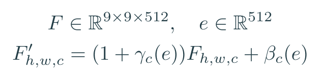

教学式：语言调制通道的幅度与偏置，空间位置保持不变。

假设某格某通道原值 2，语言算出 γ=0.5、β=−0.2，调制后就是 1.5×2−0.2=2.8。旋钮不负责把苹果变成抽屉，它改变的是后续计算收到的视觉信号。

更细的一点：新加 FiLM 层时，产生这些调制参数的线性层以零初始化，让 γ=0、β=0，于是初始变换等于原样通过。这样不会刚接上语言，就把预训练视觉能力一脚踹飞。图中的 FiLM 穿插在 26 个 MBConv 块之间。<!-- evidence:C10 -->

### 5.1 B 区：81 个格子，压成八张小抄

9×9 共 81 个空间位置，每个位置 512 维。六帧直接拼起来就是 486 个 token。

TokenLearner 学习八张空间权重图，每张图都决定哪些位置值得汇总。为了看清接口，令 V 为展平后的 81×512 特征，A 为 8×81 的汇聚权重矩阵；每一行对应一张“从全图提取什么”的小抄：

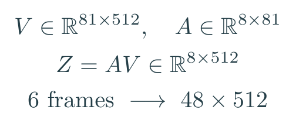

教学式：Z 是八个压缩 token 组成的 8×512 矩阵；每个 token 汇总整张空间图，而非固定裁出一个小方块。

压完每帧八个，六帧共 48 个。这里的八个 token 不是“苹果、杯子、桌子……”八个固定名字，也不是人工挑出的八个关键点。**它们的用途由动作预测损失来塑造。**<!-- evidence:C11 -->

这步很像开会前把 81 页材料压成八张摘要卡。不过摘要删掉什么，就可能丢掉什么；省算力的同时，我们也得看末端任务是否受损。网络可不会因为写得短，就自动保证重点一个不漏。

### 5.1 C 区：Transformer 输出的是动作档位

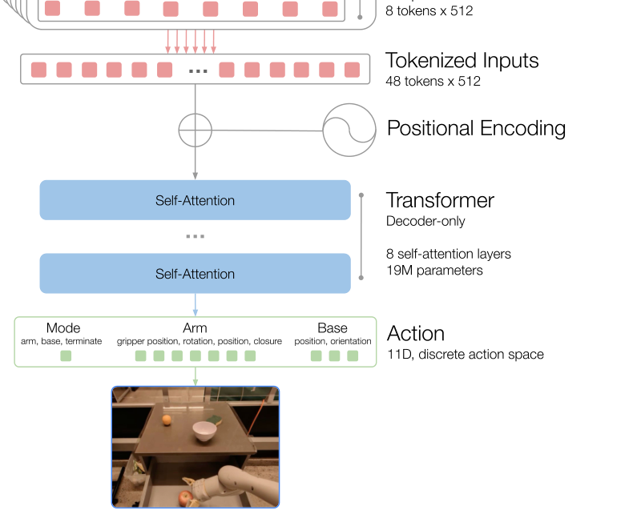

论文 Fig. 3 局部：48 个视觉 token 加位置编码，经过八层注意力，走向 11 维动作出口。

图中位置编码告诉模型 token 来自哪个时刻和位置。八层 decoder-only Transformer 约 19M 参数，加上约 16M 的图像与语言调制部分，整体约 35M。注意力让一段历史中的信息互相参照：当前抓爪靠近哪里，前几帧是否已经碰到物体，都可以影响下一步。<!-- evidence:C12 -->

连续动作量按各自上下界均匀离散成 256 档。为何绕这么一圈？这样位移、角度和夹爪都可以用“选哪一档”的分类接口训练，而不用直接回归每个连续数。

来一个明确的教学量化方式。第 j 个连续分量是 aⱼ，允许范围为 [lⱼ,uⱼ]；bⱼ 是 0 到 255 的整数档位，Δⱼ 是相邻中心的间距。round 取最近整数，clip 把结果限制到合法范围，âⱼ 是解码值：

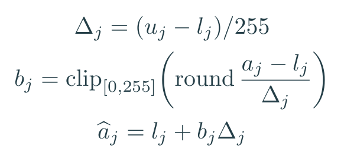

教学式：用包含两端的等距中心演示量化；论文确定的是均匀 256 档。

若为了讲解设某个变量范围为 −1 到 1，Δ=2/255≈0.00784。真实值 0.2 恰好对应第 153 档。这个 −1 到 1 是演示区间，各个真实动作量用自己的界限和单位。模式变量则表示三种语义类别，不需要把“结束回合”理解成第 256 种姿态。<!-- evidence:C13 -->

有个容易顺手读错的地方：**最终 RT-1 不逐个动作分量自回归生成。**decoder-only 和 causal mask 描述模型结构及可见历史，不能由此脑补成“先出 x，再拿 x 生成 y，一口气串行猜完 11 个量”。附录专门试过自回归动作版本，后来选了更快的输出方式。<!-- evidence:C14 -->

### 5.2 D 区：监督的答案就是人类当时选的动作

令 t 是时刻，j 是动作分量；Iₜ₋₅:ₜ 是六帧图像历史，e 是指令向量，b* 是示范动作对应的正确档位，θ 是模型参数。训练要求条件概率 pθ 给正确档位更大概率：

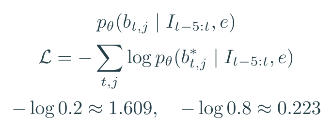

教学式：把动作 token 的交叉熵按时刻和分量求和；概率依赖图像历史与指令。

正确档位概率从 0.2 升到 0.8，这一项损失就从约 1.609 降到 0.223。模型不用等到整段任务结束才知道哪里错了，每个带示范动作的时刻都能提供学习信号。

训练误差沿策略、TokenLearner 与视觉特征提取链条回传；预训练语言编码提供指令条件。训练时的示范动作是答案，运行时没有人类在旁边悄悄递答案。<!-- evidence:C15 -->

### 5.3 E 区：动作算出来，要赶得上现场

作者把控制频率设为 3Hz，也就是每秒更新三次动作。六帧窗口往前移动时，有五帧与上一轮重叠，已经算过的图像特征可以缓存；TokenLearner 又缩短 Transformer 的输入序列。论文分别给出 TokenLearner 约 2.4 倍、缓存复用约 1.7 倍的推理加速。<!-- evidence:C16 -->

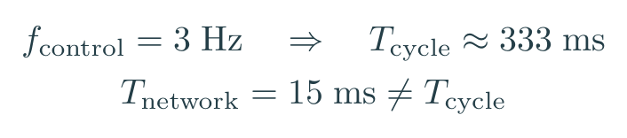

f_control 是控制频率；T_cycle 是一次控制循环的时间，T_network 是一次网络推理耗时。3Hz 对应约 333ms 一个控制循环；15ms 是 Table 13 的网络推理时间，两把秒表计的范围不同。

相机采集、数据传输、动作下发和机器人响应都在完整链条里。附录还规定从状态捕获起固定等待 280ms 后触发动作，以减小训练与执行的时序偏差。单拿网络耗时倒数，说它能 66Hz 控制，就像外卖点单只花三秒，于是宣布三秒能吃上饭——后厨听完都沉默了。<!-- evidence:C17 -->

## 6 实验：把泛化拆开测，别一口吞

### 6.1 已见任务与未见指令：最硬的一张总表

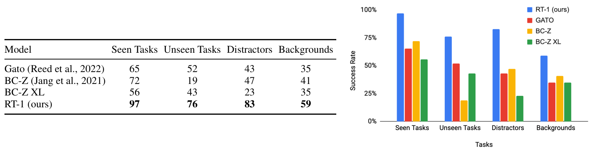

论文 Table 2：四列分开看，横轴是测试类型，右侧纵轴是成功率；同色柱对应同一方法。

表里四种测试分别是已见任务、没见过的指令组合、干扰物、背景变化。右侧蓝柱为 RT-1，红柱为 Gato，黄柱与绿柱为两个 BC-Z 版本。这里的任务来自真实机器人测试，不是图像分类准确率。

先拿最关心的两项：

| 同一数据上训练的方法 | 已见任务成功率 | 未见任务成功率 |
| --- | --- | --- |
| Gato 变体 | 65% | 52% |
| BC-Z | 72% | 19% |
| BC-Z XL | 56% | 43% |
| RT-1 | 97% | 76% |

RT-1 的已见任务比 BC-Z 高 25 个百分点；未见任务比 Gato 高 24 个百分点。这组“未见”重点是已知概念的新组合，例如见过相关技能与物体，却没见过这条组合指令。不是语言里随便说个新动作，就能原地解锁。<!-- evidence:C18 -->

干扰物一列 RT-1 为 83%，新背景为 59%。**换背景比换指令更容易把它绊住。**所以开头的“举一反三”要加一个具体落脚点：这套训练显著改善组合任务，但视觉分布一换，仍会掉很多成功率。

### 6.2 真实厨房：多个变化一起上

在办公厨房里，作者还把任务按变化程度分为 L1、L2、L3：台面和照明变了；再加新干扰；再要求更复杂的新指令组合。Table 3 中，RT-1 总体成功率 70%，三个等级分别 88%、75%、50%。BC-Z XL 总体 55%，对应 63%、75%、38%。<!-- evidence:C19 -->

这组结果比四列总表更接近现实——现实可不会温柔地只改一个变量。但 L3 上 BC-Z 也有 50%，RT-1 并没有在每个小格子里单独领先。值得肯定的是总体稳健性，别把总分优势夸成每个场景都赢。

### 6.3 仿真数据能不能搬到现实？

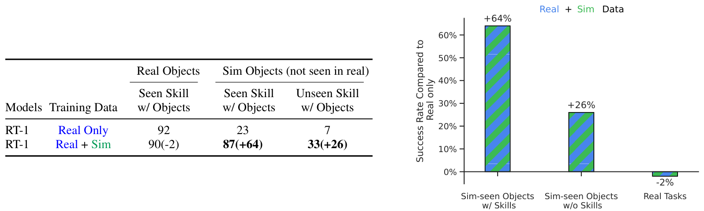

论文 Table 4：右侧纵轴是相对“只用真实数据”的成功率变化；+64 指增加 64 个百分点。

左表把三种条件拆得很清楚。第一列是训练里真实见过的物体与技能；第二列的物体只在仿真里出现过，但技能见过；第三列进一步考验这些物体与技能的新组合。**三列最终都在真实世界测试。**右图带斜纹的柱是混合数据相对基线的变化，不是另一套绝对成功率。

| 真实机器人测试 | 只用真实数据 | 真实＋仿真 |
| --- | --- | --- |
| 原有真实物体与技能 | 92% | 90% |
| 仅仿真见过的物体，已见技能 | 23% | 87% |
| 仅仿真见过的物体，新技能组合 | 7% | 33% |

这很有意思：模拟里练过的物体，到了现实中可以被更好地操作，原有任务只降了 2 个百分点。但最难的新组合仍只有 33%。收益没有平均分配到所有任务。<!-- evidence:C20 -->

跨机器人数据也做了类似测试。混入 Kuka 的约 20.9 万条成功抓取回合后，Everyday Robots 机器人的 bin-picking 成功率由 22% 升到 39%，原教室任务由 92% 到 90%。然而只用 Kuka 数据训练，在 Everyday Robots 上这两项都是 0%。<!-- evidence:C21 -->

这说明混合训练能借到外部数据里的有效结构；跨形态迁移仍需要目标机器人数据搭桥。把别人的驾考题拿来复习有帮助，直接换一辆操作接口不同的车上路，那是另一回事。

### 6.4 长程任务：把“想做什么”和“做没做成”拆开

SayCan 用语言模型等模块安排技能，RT-1 接收短程任务并执行。Table 6 的相同规划设置下，Gato、BC-Z 与 RT-1 的规划成功率都是 87%；执行成功率却相差明显。RT-1 在 Kitchen1、Kitchen2 都为 67%，Gato 是 33%、0%，BC-Z 是 53%、13%。评估使用 15 条长程指令。<!-- evidence:C22 -->

同一份菜单，后厨换了班，出餐率就变了。这个实验是在检查低层执行拖了多少后腿；它没有把上层规划的全部功劳也算给 RT-1。项目里展示的长达 50 步视频能帮助理解执行链，但不要拿一条长演示替代这组统计。

### 6.5 数据多样性：不是把同一道菜炒十三万遍

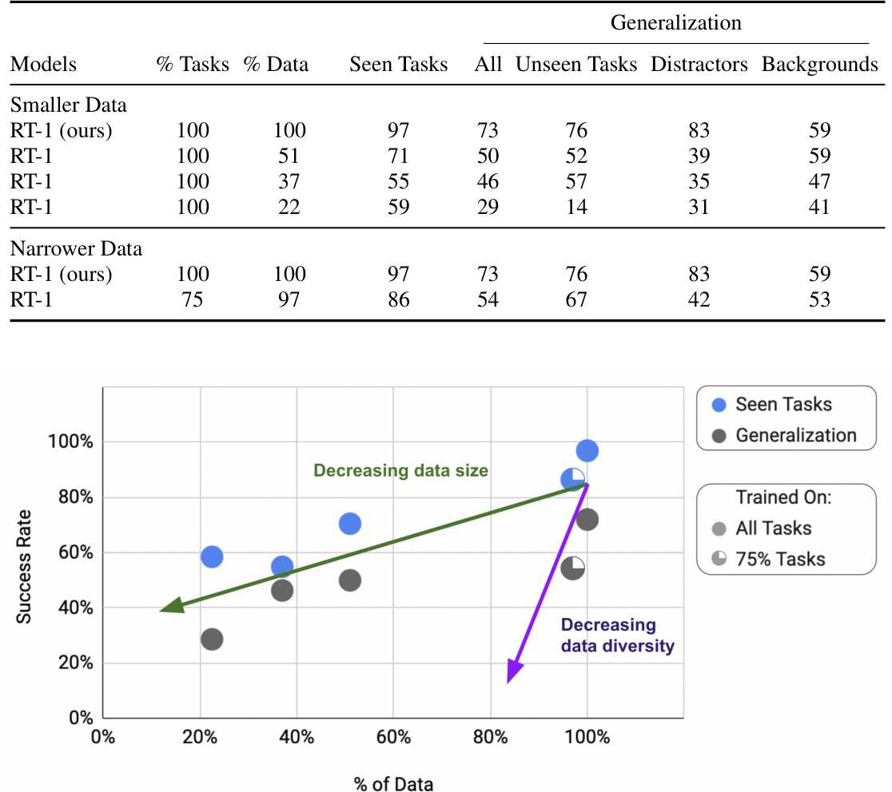

论文 Table 7：横轴是保留的数据比例，纵轴是成功率；蓝点看已见任务，灰点看泛化。

上半张表是删数据、保留任务覆盖；下半张表是删任务种类。图中实心圆使用全部任务，另一种标记使用 75% 任务；绿色箭头沿数据量变化，紫色箭头提醒你看数据多样性。**泛化分数不是仅由横轴数据条数决定。**

完整数据的泛化汇总为 73%。保留全部任务、把数据减到 51%，泛化降到 50%；保留 97% 数据，却只保留 75% 的任务，泛化也降到 54%。两种删法都伤得很重。<!-- evidence:C23 -->

这里最值得带走的不是一条普适的增长公式，而是采集决策：相同动作刷更多回合，和覆盖更多任务组合，花的都是现场成本，收益却不同。数据仓库看起来越来越胖，技能覆盖可能还在原地踏步。

### 6.6 附录消融：哪些设计真的帮了忙？

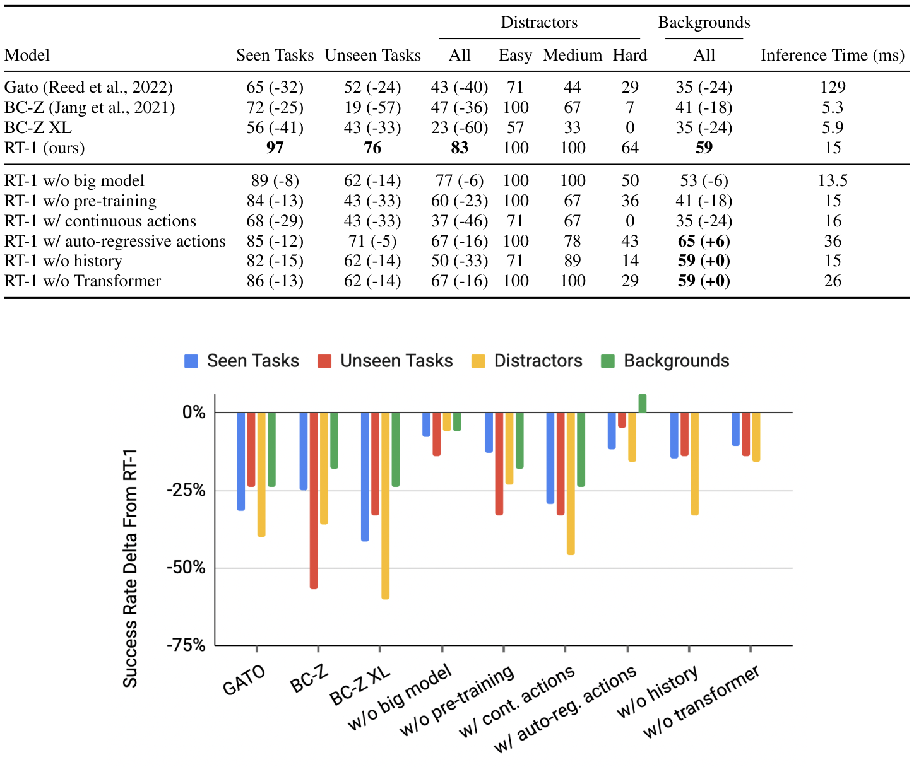

论文 Table 13：上表读成功率与网络毫秒数，下图读相对 RT-1 的变化；越向下表示退步越多。

下图蓝、红、黄、绿依次对应已见任务、未见任务、干扰物和背景。纵轴是成功率差值，零点为完整版 RT-1；它不是不同方法的绝对成功率。横轴是移除或替换的组件。

去掉 ImageNet 预训练，未见任务由 76% 到 43%；改为连续动作输出，降到 43%；不用历史帧，降到 62%。这几项共同指向 A/B/C 的接口：视觉起点、动作建模和时间线都重要。<!-- evidence:C24 -->

而动作自回归版本是 71% 的未见成功率、36ms 网络耗时；最终版为 76%、15ms。两者并非所有条件都同序，自回归版背景测试 65%，比最终版 59% 更高。最终取舍看的是整个性能与延迟组合，论文没有一条“自回归永远不好”的定律。

## 7 结论：规模有用，但要看规模长在哪里

回到三个问题。

**六帧怎样变动作？**语言先通过 FiLM 调制视觉，81 个空间 token 被压成八个，六帧共 48 个进入 Transformer，再解码为动作分量，执行后刷新观察。开头 A→B→C→E 的循环，到这里可以自己从头复述了。

**离散化与压缩为什么有用？**它们把动作变成统一分类接口，把视觉算力花在较短序列上；缓存再去掉重复计算。效果要用任务成功率检查，网络快与完整控制循环快也要分别计时。

**举一反三到了哪？**同一机器人上，新指令组合、干扰和部分跨域数据都出现明确收益。新背景、复杂组合和完全跨形态执行仍然难。与其说 RT-1 已经掌握厨房常识，我更愿意记住它给出的那张账单：哪些数据共享真能带来进步，哪些变化仍在收迁移税。

下一步最诱人的问题是：如果语言不只调制视觉，还能带进更广的语义知识，这条动作学习链会怎样变化？而更现实的问题也摆着——在更高控制频率、更精细接触下，256 档和短历史还够不够用？

阅读工具：[ReadPaper](https://github.com/Zhu-Huixiang/ReadPaper) · [DrawPaper](https://github.com/Zhu-Huixiang/ReadPaper/tree/main/drawpaper)。

可复制地址： https://github.com/Zhu-Huixiang/ReadPaper

点击“阅读原文”进入 GitHub 文章页，可放大原图、查看公式和继续沿知识点阅读。

---

公众号版由管理员在后台手动公开发表；永久文章链接待发表后补充。

关注公众号 **具身智能的 World**：

[原论文](https://arxiv.org/abs/2212.06817v2) · [证据索引](evidence.json)

[本篇知识星系](../../universe/papers/rt1.md) · [知识点宇宙](../../universe/README.md)
