# SAM：点一下就能抠图，它真知道你想要什么吗？

**具身智能的 World**｜把值得读的论文，拆到能看懂计算的那一层。

论文解读：沿原文讲清问题、方法、公式与证据。  
论文地图：按科学问题找下一篇。  
顶会顶刊：查正式出处与原文。  
解读日程：看未来一周的阅读安排。  
arXiv 新作：看经过筛选的新研究。  
具身榜：比较七维评分与依据。  
知识点宇宙：从一个概念跳到使用它的论文。

[GitHub：Zhu-Huixiang/embodied-world](https://github.com/Zhu-Huixiang/embodied-world)

你在杯柄上点一下。你要杯柄、整个杯子，还是包括里面的咖啡？

这个问题，比“边缘抠得齐不齐”更早一步。SAM 想挑战的是：**做分割之前，是否必须先规定类别、收集这个任务的标注，再训练一个专用模型？** 它把接口换成“图像 + 提示 → 一个合理的掩码”，希望同一模型接不同下游需求。交互分割早就有了；SAM 的野心，是把这种接口、大模型和数据生产连成一套。<!-- evidence:C01 -->

带着三个问题读：

1. 一个点这么含糊，SAM 怎样避免自作主张，只给一个答案？
2. 一张大图如何变成掩码，为什么改提示时能很快？
3. 十亿掩码换来了什么，哪些实验又给它踩了刹车？

**论文信息**  
Segment Anything｜Alexander Kirillov、Eric Mintun、Nikhila Ravi 等，Meta FAIR。  
arXiv 公开：2023-04-05；本篇读 v1。ICCV 2023，计算机视觉领域的主要同行评审会议。  
[原文](https://arxiv.org/abs/2304.02643v1) · [项目](https://segment-anything.com/) · [代码](https://github.com/facebookresearch/segment-anything)<!-- evidence:C02 -->

**阅读目录**

- [1 引言：先把“分割什么”交给提示](#sam-intro)
- [2 任务：一个点可以有三个合理答案](#sam-task)
- [3 模型：图像、提示、解码器逐步拆](#sam-model)
- [4 数据引擎：模型怎样给下一代自己做题](#sam-engine)
- [5 数据集与责任分析：大，也有分布](#sam-data)
- [6 零样本实验：把图读成几项具体判断](#sam-results)
- [7 讨论：机器人拿到的是哪块拼图](#sam-discussion)

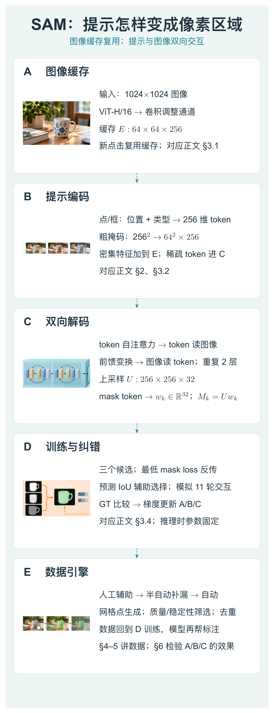

本图由 [DrawPaper skill](https://github.com/Zhu-Huixiang/ReadPaper/tree/main/drawpaper) 指挥 Codex，使用内置生图制作。

可复制地址：https://github.com/Zhu-Huixiang/ReadPaper/tree/main/drawpaper

先记两条路线。**使用时走 A→B→C**：图像先算成缓存，提示变成向量，解码器产出候选掩码；继续点击时复用 A。**训练时走 D，并与 E 的数据生产相连**：拿真值掩码模拟点击，算损失更新参数，模型再帮助收集更多掩码。图中虚线向下表示阅读次序。第 2 节讲为什么 C 要保留多个答案，第 3 节拆 A/B/C，第 4—5 节看 D/E，第 6 节检查输出究竟好不好。

## 1 引言：先把“分割什么”交给提示

传统语义分割问“每个像素属于哪个已知类别”；实例分割还要把两只同类物体分开。它们各自有成熟系统，但训练标签、输出类别与任务绑定。换一个没标过的领域，往往又要准备数据。

SAM 借的是基础模型的思路：把预训练任务设计成能反复组合的接口。一个检测器可以把框交给它，人可以点击，已有粗掩码也可以送进去。模型负责回答“这个提示对应哪些像素”。它不必在每次输出时顺便给物体起名字。把杯子准确圈出，与判断“这是可抓的陶瓷杯”，是两件工作。<!-- evidence:C01 -->

论文把相关工作放在引言和后面的模型、实验里讨论，没有独立的 Related Work 大章。阅读也跟着这个顺序：先搞明白任务，再看 ViT、交互分割与检测系统在其中各占什么位置。

## 2 任务：一个点可以有三个合理答案

**掩码**就是一张与图像对齐的像素地图：某个像素属于目标，还是背景。训练中通常先输出连续分数，最后再转成二值区域。

论文要求：提示不够明确时，也要返回一个有效掩码。这里的“有效”允许多种粒度。

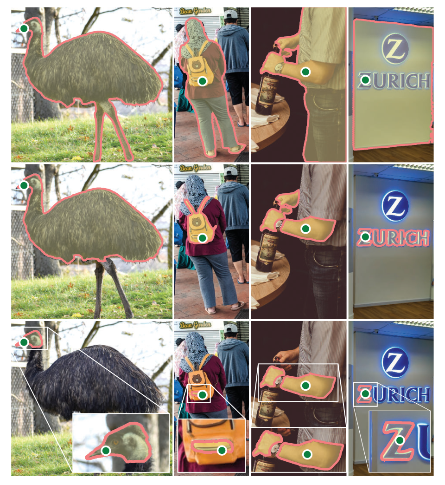

论文 Fig. 3。同一列共享一个绿点，三行是三种合理的分割范围。

这不是三次点击的过程图。**按列看**：绿点没换位置，模型却能给出物体整体、局部或更小部分。彩色区域是预测的前景，没有横纵坐标轴，三行也没有固定“第一行一定是整物体”的类别语义。它说明单点歧义是任务本身就有的，不能只怪模型没听话。

最近导演姚婷婷谈《蒸蒸日上》，提到一个即兴桥段：对方刚掏名片盒，王皓饰演的董北虎先来了一句“我不抽我不抽”。信息还没齐，熟悉的情境已经抢答了。SAM 在这里选了一条有意思的路：先留几个合理范围，再用更多提示缩小歧义。这个类比只借“别急着押一个答案”；模型具体怎样留答案，还得看下面的损失。<!-- evidence:C03 -->

**一个点这么含糊，SAM 怎样避免自作主张，只给一个答案？** 它默认预测三个候选掩码，并估计各自质量；用户后续加入点或框，可以进一步指定范围。三个候选不是三种物体类别，也不保证恰好是你脑中的那个目标。<!-- evidence:C04 -->

## 3 模型：图像、提示、解码器逐步拆

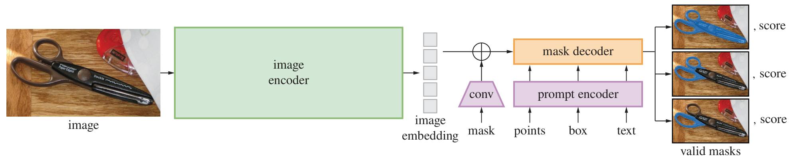

论文 Fig. 4。左边重算一次图像，右边轻量处理不同提示。

先看它要解决的工程问题：整张图很贵，每次点击重新算图就太磨叽。于是左侧大块 image encoder 先提取一次特征；中间 image embedding 是缓存。下方 prompt encoder 接点、框、掩码，右侧 mask decoder 合并两路，输出多张掩码及分数。图里出现 text，论文后面的语言实验用到了额外训练的变体，常用几何提示模型的输入接口先按点、框和掩码理解。<!-- evidence:C05 -->

### 3.1 A 区：大图压成一张可反复查询的特征地图

图像长边缩到 1024，再填充成 1024×1024。图像编码器采用经 MAE 预训练的 ViT-H/16。ViT 把图像拆成块，用注意力在块之间交换信息；MAE 是先遮住一部分图块、再学习补回内容的预训练办法。

16×16 的图块意味着空间上剩 64×64 个位置。骨干后接 1×1、3×3 卷积，把输出通道调成 256，得到 **64×64×256** 的图像嵌入。这里前两维是网格位置，最后一维是每个位置的特征长度。不是把原图压成 256 个像素。<!-- evidence:C06 -->

ViT 使用窗口注意力，并插入四个全局注意力块。窗口里先局部交换信息，全局层再让远处图块互相联系；这兼顾大图的计算成本和远距离关联。

### 3.2 B 区：提示也得翻译成模型能计算的对象

一个点不是两个坐标扔进去就完事。位置编码告诉模型“在哪里”，一个可学习类型向量告诉它“这是前景点还是背景点”。二者相加，得到 256 维 token。**Token 在这里是特征向量，不是汉字或自然语言单词。**

框则用左上、右下两个角的 token，并加不同的角点类型。你给的框会变成两个位置约束，而不是拿剪刀把框外都删掉。

粗掩码走另一条路线：256×256 的输入掩码，经两次步长为 2 的卷积降到 64×64，再把通道升到 256，与 A 区图像特征逐位置相加。没有掩码时，使用可学习的“无掩码”嵌入。稀疏点/框保留为 token，密集掩码保留空间排列，这两个接口各干各的。<!-- evidence:C07 -->

### 3.3 C 区：提示看图，图也回头看提示

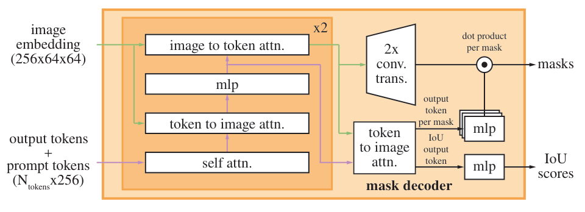

论文 Fig. 14。双向注意力先更新提示，再让提示反过来更新图像。

这张小图把大量信息压在一起，值得慢一点。左下是提示 token 和可学习输出 token；左上是图像嵌入。橙色框里是两层重复的解码模块，按箭头依次做四步：

1. token 之间自注意力，提示与输出 token 先交换信息。
2. token 作 query，图像作 key/value，让 token 从 4096 个图像位置读取相关内容。
3. token 经过小型前馈网络，进一步变换读到的信息。
4. 图像反过来作 query、token 作 key/value，让空间特征也带上本次提示的约束。

> **基础扫盲｜交叉注意力**：把 query 当“我想找什么”，key 当“每条信息的检索标签”，value 当“实际取回的内容”。先算匹配权重，再加权读取；这里不是人工搜索引擎，而是可训练矩阵运算。

token 通道为 256，前馈层中间宽度 2048，使用 8 个注意力头；交叉注意力内部把通道降到 128，减少计算。图像特征以 4096×256 的序列参加注意力，之后再恢复空间网格。<!-- evidence:C08 -->

接下来，图像分支用两层转置卷积上采样：64×64×256 → 128×128×64 → **256×256×32**。两层解码之后，token 还要最后读一次更新后的图像嵌入；输出 token 再过一个三层 MLP，得到 32 维向量，去读每个像素位置的 32 个特征。

令 E 为 A 区图像特征，U 为更新并上采样后的特征；tₖ 是第 k 个掩码输出 token，wₖ 是它生成的 32 维读出权重。Mₖ(u,v) 表示候选 k 在像素 (u,v) 的掩码 logit，冒号表示取这个像素的全部通道，ᵀ 表示转置。

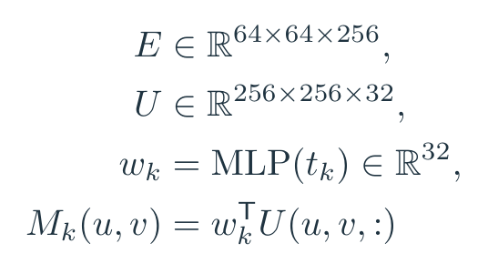

公式 1｜依据附录 A 展开的掩码计算：每个输出 token 变成一组逐像素读出权重。

拿一个缩成两通道的教学例子：某像素特征是 (2,−1)，一个候选的读出权重是 (1,1)，点积得到 1；另一个候选权重 (−1,1)，得到 −3。同一个像素特征，因为查询的候选不同，可以落进不同区域。正式模型用 32 通道，这里只为看清“点积读掩码”这一步。输出随后恢复到原图尺寸。<!-- evidence:C09 -->

**一张大图如何变成掩码，为什么改提示时能很快？** 关键在 A 区只算一次，后续反复运行 B/C。论文报告缓存后的提示编码与掩码解码，在浏览器 CPU 上约 50 ms。大图编码的时间没有塞进这个数，千万别给它加戏。<!-- evidence:C10 -->

### 3.4 D 区：三个答案怎么训练，不会全长成一样吗？

用 Y 表示真值掩码，Mₖ 表示第 k 个候选，ℓₖ 是它的分割损失。focal loss 关注难分像素，Dice loss 比较区域重合；两者在本文以 20:1 混合。k* 是三项损失中最小者。

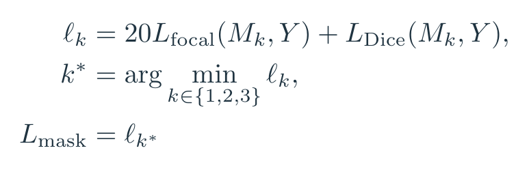

公式 2｜附录 A 的训练规则：含糊提示给出三个候选，只用掩码误差最小的候选更新掩码预测。

假设三项误差为 0.8、0.2、0.7，本轮使用 0.2 对应分支的掩码损失。这样允许不同候选承接不同合理范围，而不是要求三张图都复制同一真值。这个小数例不是论文实验。模型还学习预测掩码 IoU，作为质量排序；IoU 回归用均方误差。

训练并不只练“第一次点哪里”。附录模拟 11 轮：起始点或框，8 轮从错误区域补纠正点，再有 2 轮不增加新点，只利用上一轮掩码继续修正。反馈的是未经二值化的分数图，保留边界附近的不确定程度。多提示时用额外输出 token 产生单个掩码；不要把所有交互都理解为每轮固定弹三张。<!-- evidence:C11 -->

## 4 数据引擎：模型怎样给下一代自己做题

回到 E 区。SAM 的模型和数据不是先后独立完成的：训练模型帮助标注，新增标注再训练模型。

第一阶段，人点选、修正模型掩码，收集约 430 万个掩码、12 万张图。随着模型改善，平均单掩码标注时间从 34 秒降到 14 秒。第二阶段先自动找出显眼对象，让人补遗漏区域，又增加约 590 万个掩码、18 万张图。<!-- evidence:C12 -->

第三阶段终于开始大规模自动生产：在图像上布 32×32 个点，每个点尝试多个掩码，根据预测质量和稳定性筛选，再做 NMS 去重。NMS 可以理解成“这些区域几乎一模一样，就留代表”，不是把重叠物体都认定为同一个物体。多层图像裁块帮助找到小目标。

这里有个细节很实在：把二值化阈值稍微上调、下调，掩码如果大变脸，说明边界很不稳定。数据引擎会利用这类稳定性信号筛样本。附录用于自动标注的生成器有自己的设置，包括更深的解码器，不能把它与常用两层解码器混成一个配置。<!-- evidence:C13 -->

## 5 数据集与责任分析：大，也有分布

最终 SA-1B 约 1100 万张图、11 亿个掩码。公开数据集收的是自动阶段掩码；论文说整个引擎产生的掩码中 99.1% 来自自动阶段。十亿级别的量，就是这样做出来的，靠标注员一张张描，工位得排到天边。<!-- evidence:C14 -->

数量还得和覆盖分开看。原文第 5 节比较了对象尺寸、形状与图像分布，第 6 节检查地区、收入与人物群体表现。欧洲图像占比约 49.8%，低收入国家约 0.9%；人脸和车牌做了模糊处理。对具身应用，这提醒我们实际选训练源时看场景分布：家庭厨房、工厂台面、某种特殊成像设备，不会因为“十亿”两个字就自动有同样覆盖。<!-- evidence:C15 -->

## 6 零样本实验：把图读成几项具体判断

### 6.1 先看单点，再看多点

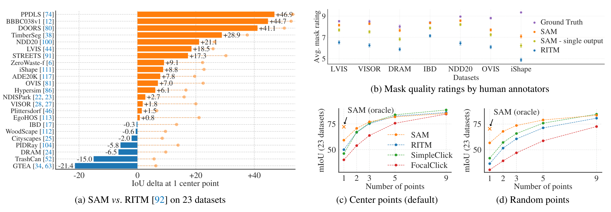

论文 Fig. 9。先看左侧单点差距，再看右下多点交互曲线。

这张图给出的判断是：**单点提示下 SAM 很有竞争力；多点不断纠错时，专门为交互细修设计的系统会追上来。** 看图时分三块。

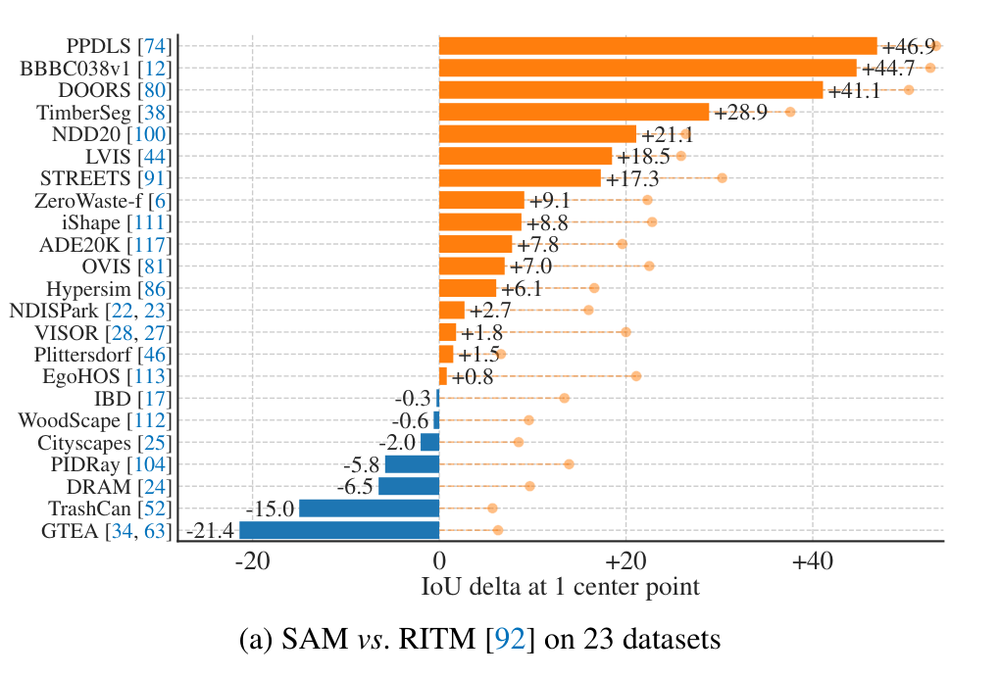

论文 Fig. 9a 局部。横轴为单点 mIoU 相对 RITM 的百分点差，右侧更好。

左侧 (a) 的纵轴是 23 个数据集，横轴是 SAM 相对 RITM 的平均 IoU 差，单位为百分点；0 是打平，向右更好。16 个数据集优于 RITM，最大差距约 +46.9。小圆点是 oracle：用真值从三个候选里挑最好的那个。它帮助分析候选里有没有好答案，部署时没有真值可代你挑。<!-- evidence:C16 -->

IoU 是预测区域与真值的交集除以并集。若 A 是预测的 80 个像素，B 是真值 70 个，交集为 60，则：

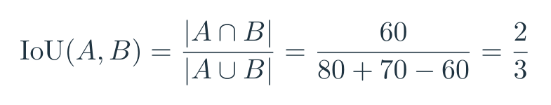

公式 3｜教学例子：预测 80 个像素、真值 70 个，重合 60 个时 IoU 为 2/3。

右上 (b) 横轴是不同数据集，纵轴是人工 1—10 分评分，误差棒是均值的 95% 置信区间。它回答“这个分割看起来是否合理”，与严格匹配数据集唯一标注的 IoU 并非同一问题。SAM 在这些人工评价里更受认可，正好对应单点可能存在多个合理范围的设定。

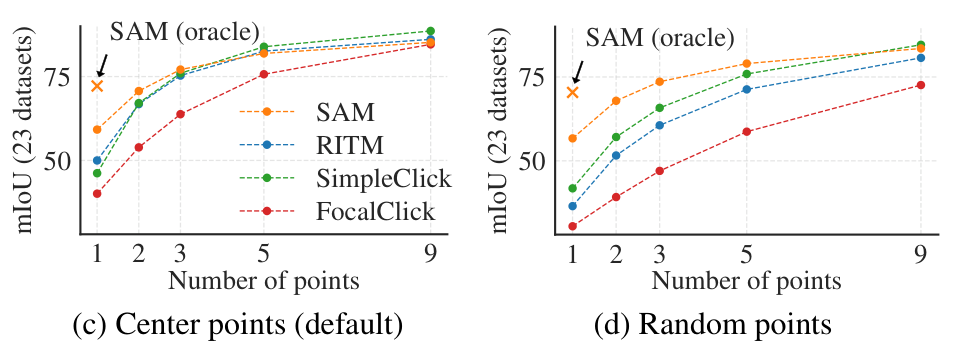

论文 Fig. 9c–d 局部。横轴增加点击次数，纵轴观察平均 IoU 的变化。

右下 (c)、(d) 横轴是点击次数 1、2、3、5、9，纵轴是跨 23 个数据集的平均 IoU；不同颜色是不同方法。(c) 用目标中心点起步，(d) 用随机点。随着提示增多，SAM 相对其他交互分割方法的差距收窄甚至被反超。换成随机起点后仍能看到相近趋势。<!-- evidence:C17 -->

回想 C 区：候选覆盖和质量排序擅长起步，后续要极精细地沿着边界修到高 IoU，又是另一项考验。

### 6.2 接上检测框，别把任务的另一半忘了

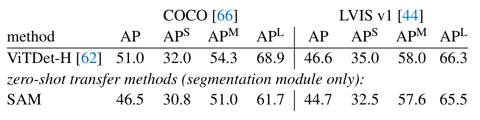

论文 Table 5。固定 ViTDet 检测框，比较后续分割的 AP。

表的列是 COCO 与 LVIS，行为完整 ViTDet 和把分割换成 SAM 后的组合。AP 越高越好，它把不同置信度阈值和 IoU 门槛下的精确率、召回率汇成指标。

COCO 上是 51.0 对 46.5，LVIS 上是 46.6 对 44.7，专门监督训练的 ViTDet 更高。检测框来自已有检测器，SAM 的零样本指后续分割模块；整套系统的框不是凭空来的。<!-- evidence:C18 -->

这组结果值得留在文章里：一个统一的提示接口已经能迁移到多种任务，但专门训练的系统仍有优势。它让工程选择更具体——你是在追某个固定测试集的峰值，还是需要接很多提示、换很多场景的通用分割组件？

### 6.3 原文其他实验在回答什么

原文 §7.2 把掩码边界接到边缘检测；§7.3 生成大量候选区域；§7.4 接检测框做实例分割，刚才已经看过。它们在测试同一接口能被怎样组合。

区域提案还给了一个有意思的拆分：LVIS 的 AR@1000，ViTDet 总体 63.0、SAM 59.3；稀有类别上 SAM 65.8、ViTDet 58.3。AR@1000 是最多 1000 个候选区域的平均召回，衡量有没有把目标罩住；它不等同于分类正确，也不是最终机器人识别成功率。<!-- evidence:C19 -->

§7.5 的 text-to-mask 另用 CLIP 文本/图像嵌入训练一个概念验证变体，展示语言提示与补点配合。几何提示版本的默认能力不能从这张演示图直接继承。对机器人接自然语言，接口间怎么连、语义谁来判断，仍应单独设计。<!-- evidence:C20 -->

### 6.4 十亿数据是不是必须全上？

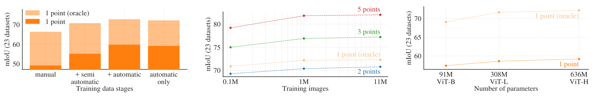

论文 Fig. 13。依次拿数据阶段、数据量和编码器规模做消融。

三幅图的纵轴都是 23 个数据集上的平均 IoU；横轴依次是数据引擎阶段、图像数量、编码器参数量。左图深橙柱为单点选择结果，浅橙柱为用真值选候选的 oracle；中图不同颜色对应不同点数或单点 oracle，右图两条线比较单点选择与 oracle。先看图例，再比较同一种提示设置。

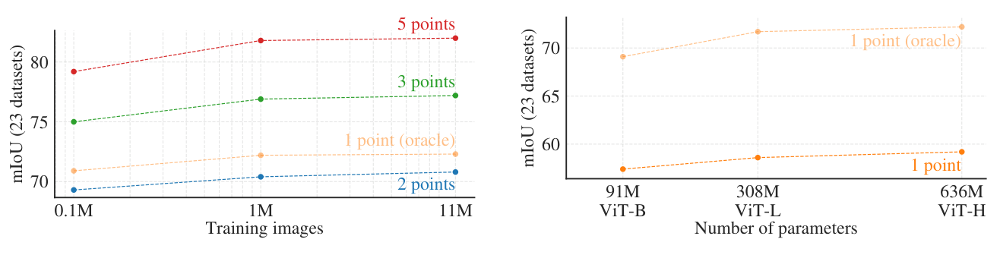

论文 Fig. 13 中、右局部。图像数量和编码器规模扩大后，收益逐步变小。

左图沿人工辅助→加入半自动→加入全自动，表现继续提高；正文另测只用自动数据，效果比全套只低约 0.5 mIoU。中图比较 10 万、100 万、1100 万张图，100 万已相当接近全量。右图从 ViT-B 到 ViT-L 改善明显，从 L 到 H 的提升小得多。<!-- evidence:C21 -->

**十亿掩码换来了什么，哪些实验又给它踩了刹车？** 它支持跨数据集、跨提示的迁移，尤其是单点起步；但更多数据与更大骨干都有边际收益，多点精修与固定任务最优也有各自对手。读到这里再回看 A/C/E，就知道成本该往哪里花了。

## 7 讨论：机器人拿到的是哪块拼图

在桌面操作中，一个检测框或一个指定点可以先变成目标像素区域，再交给深度、姿态或抓取模块。SAM 最实用的贡献，是把“指哪块、分哪块”做成可复用入口，让很多下游不必各自从零训练分割器。

剩下的距离同样具体：遮挡后的物体几何、抓取稳定性、运动中的跟踪、夹爪怎么闭合，都需要后续模型和控制验证。像素分清了，机械臂还没开工。

开头三问可以合起来了：含糊提示由多个候选承接；重复交互依靠图像缓存和轻量解码；大规模数据带来迁移能力，实验也把单点、多点和专门任务的差异摆出来。以后看一个“用 SAM 搞定机器人感知”的项目，先沿这张接口图追一下：提示由谁给、选哪个掩码、掩码之后又怎么算动作。答案通常就藏在这些接头里。

阅读工具：[ReadPaper skill](https://github.com/Zhu-Huixiang/ReadPaper) · [DrawPaper skill](https://github.com/Zhu-Huixiang/ReadPaper/tree/main/drawpaper)。

可复制地址：https://github.com/Zhu-Huixiang/ReadPaper  
公众号读者可点「阅读原文」，到 GitHub 查看高清图、公式与本篇图源。

---

公众号版由管理员在后台手动公开发表；永久文章链接待发表后补充。

关注公众号 **具身智能的 World**：

[原论文](https://arxiv.org/abs/2304.02643v1) · [证据索引](evidence.json)

[本篇知识星系](../../universe/papers/sam.md) · [知识点宇宙](../../universe/README.md)
