# SAM 2：点一下就一直跟住？视频分割最难的，其实是别失忆

这里是「具身智能的 World」。我们沿论文原文拆方法，也追问实验到底测到了什么。

[GitHub 知识库](https://github.com/Zhu-Huixiang/embodied-world) 保存高清图、精确公式与可继续阅读的技术节点。

论文解读：看清输入、计算、输出与证据。

论文地图：按研究问题找到下一篇。

顶会顶刊集锦：定位正式出处与原文。

解读日程：查看接下来的阅读安排。

arXiv 新作：筛选值得追的新工作。

具身榜：比较评分与逐项依据。

知识点宇宙：把论文中的技术串起来。

一段视频里，你点一下狗的舌头，想把它一路分出来。下一秒，狗转头，舌头藏了；再下一秒，它又吐出来。

单张图上的分割已经很厉害了，可把一段视频拆成一张张图，会遇到一个有点荒诞的场景：**你明明已经告诉它“我要舌头”，它却隔几帧就像重新认识你。**

SAM 2 挑战的是“图像分割器先圈物体，跟踪器再往后传”的割裂接口。它把新提示、旧预测与对象记忆放进同一个循环：你在后面纠正一次，它应该利用已经积累的上下文，而不是重新开一局。<!-- evidence:C01 -->

带着三个问题读：

1. **它记住的究竟是什么，旧帧怎样帮当前帧把同一个对象找回来？**
2. **点击、掩码、存在性判断怎样一起训练，对象被挡住时该交什么答案？**
3. **“更少交互”“更快”“更准”各自在哪种协议下成立，接到机器人上还差哪几步？**

论文信息：*SAM 2: Segment Anything in Images and Videos*；Nikhila Ravi 等，Meta FAIR；首次公开于 2024-08-01，发表于 **ICLR 2025**，这是一项视觉基础模型与视频分割研究。本文读 arXiv v2（2024-10-28）；该版本脚注明确说明，文中 SAM 2 的结果使用升级后的 **SAM 2.1 权重**。[论文](https://arxiv.org/abs/2408.00714v2) · [会议页面](https://openreview.net/forum?id=Ha6RTeWMd0) · [官方代码与模型](https://github.com/facebookresearch/sam2)。<!-- evidence:C02 -->

**阅读目录**

- 1 引言：图片点得准，视频就跟得稳吗？
- 2 相关工作：分割器与跟踪器之间的缝
- 3 任务：一次点击，确定的是哪一个对象？
- 4 方法：当前图像怎样读写对象记忆
- 5 数据：模型帮人标，人再教模型
- 6 零样本实验：少点几次，能少多少？
- 7 视频分割对照：速度与记忆也要算账
- 8 结论：它给机器人补了哪块感知拼图？

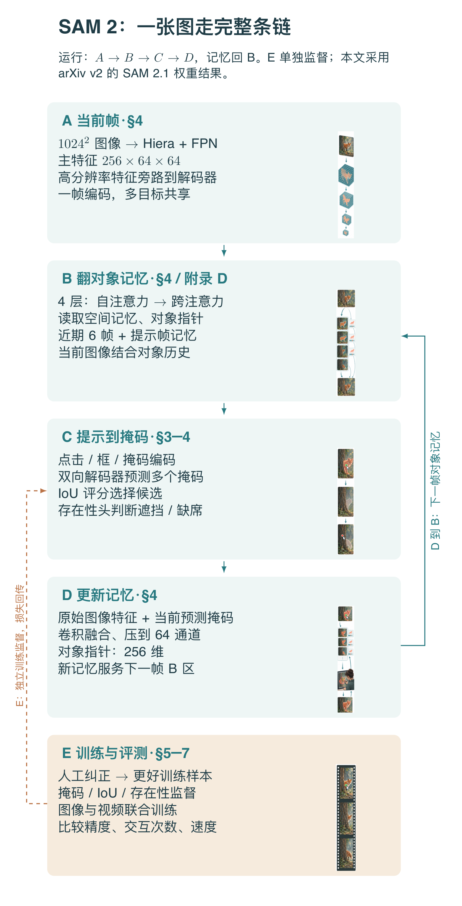

本图由 [DrawPaper skill](https://github.com/Zhu-Huixiang/ReadPaper/tree/main/drawpaper) 指挥 Codex，使用内置生图制作。

看一帧时，**A 提取当前图像，B 翻对象记忆，C 接收提示并输出掩码，D 把这一帧写回记忆**。下一帧再从 A 来一遍，但 B 的参考资料已经更新。E 是训练与数据改进的路线，不是每处理一帧就现场重训模型。

第 3 节讲点击到底指定什么；第 4 节沿 A→B→C→D 走一圈；第 5 节解释 E 的数据循环；第 6、7 节检验效果。全文最值得盯住的，是 B、D 之间那条回路：**预测会成为下一次预测的条件，好处和错误都可能沿它传下去。**

## 1 引言：图片点得准，视频就跟得稳吗？

图像分割给一张图，圈出某个对象的像素。视频多了一项麻烦：不仅要每帧圈得好，还得一路圈的是同一个对象。

对象会变形、被遮挡、走出镜头，再回来。甚至你指的是整个动物，还是动物的一部分，也可能暂时说不清。拿第一帧的外观一路死追，像拿着入职照找一个戴口罩、换了衣服的同事：信息没错，但未必够用。

SAM 2 的目标叫可提示视频分割，英文简称 PVS。用户可以在任意帧用点、框或掩码指定对象，也可以在后面补提示纠正。输出则是一段 **masklet**：同一个对象在多个时刻的掩码序列。<!-- evidence:C03 -->

## 2 相关工作：分割器与跟踪器之间的缝

把 SAM 接到 XMem++、Cutie 这类视频分割方法上，是很自然的组合：SAM 负责根据提示生成初始掩码，后面的模块负责传播。

麻烦在交互纠错。若传播到一半跟丢，用户又点了一下，新提示如何利用原先的对象上下文？如果两个模块交接得不紧，可能需要更多点击重新圈准，甚至把过去的积累白干一遍。

SAM 2 将可提示分割与流式记忆整合起来。它同时借用了 Hiera 的层次视觉表示、SAM 的提示编码与掩码解码思路，再加入读写视频记忆的模块。贡献要从这条完整接口看，而不是看到 Transformer 就宣布“加注意力，大功告成”。<!-- evidence:C04 -->

## 3 任务：一次点击，确定的是哪一个对象？

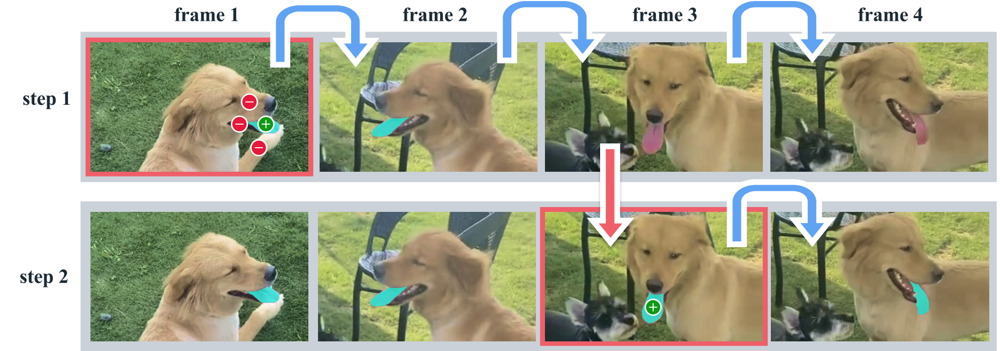

论文 Fig. 2：先看两行的差别；上行传播途中丢了目标，下行在第三帧补一次点击后重新接上。

四列是连续四帧，两行是两次交互过程。绿色点表示“我要这部分”，红色点表示“这部分不要”；蓝箭头是向后传播，红箭头表示用户选择了新帧纠错。红框标出收到提示的帧。青色区域是分割出的舌头。

这张图要表达的不是“狗被识别出来了”，而是**用户指定的一个局部，在跨帧和纠错后仍然能保持身份**。第三帧的一次正点击之所以有价值，是因为系统已拥有此前对目标的记忆；它不是只靠这一点凭空猜完整对象。<!-- evidence:C05 -->

还得区分两种使用方式。在线模式按时间往前看，未来帧还没到；离线编辑已经有完整视频，可以在后面点一下，再向前、向后传播。论文所说提示帧可能来自“未来”，指的是后一种可用信息条件，不是实时摄像头能偷看明天。

> **基础扫盲｜掩码**
> 一张与图像位置对应的“要／不要”地图。像给每个像素贴标签：属于目标就留下，不属于就排除。软掩码先保留概率，最后再转成二值区域。

## 4 方法：当前图像怎样读写对象记忆

### 4.1 A 区：一张图先变成多尺度特征

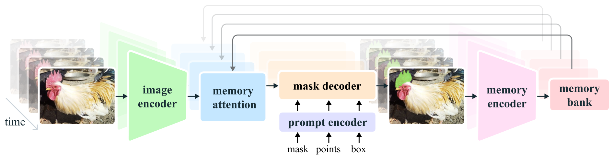

论文 Fig. 3：从左到右是一帧的处理过程，上方回线是旧记忆；提示从下方进入掩码解码器。

左边视频逐帧送入绿色 image encoder；蓝色 memory attention 查询粉色 memory bank，橙色 mask decoder 接收当前表示和提示，输出目标掩码；右边 memory encoder 把本帧图像与预测结果整理进记忆，再供后续帧使用。

上方那些回线不是额外视频输入，而是过去帧存下来的对象相关信息。尤其注意：记忆编码器使用**未经过记忆条件化的图像特征**加当前掩码，这条图像支路在简图里没有完整画出来，附录 D 补充了细节。<!-- evidence:C06 -->

A 区的图像骨干是经过 MAE 预训练的 Hiera。它逐层降低空间分辨率，得到不同尺度的表示。输入缩放为 1024×1024；特征金字塔 FPN 融合 stride 16 与 32 的特征，产生 256×64×64 的主特征。这里 stride 16 表示特征网格的间隔大约对应原图 16 个像素。<!-- evidence:C07 -->

256 是通道数，64×64 是位置数，共 4096 个空间位置。stride 4 和 8 的更细特征则绕过记忆注意力，在解码上采样时补回局部细节。粗图负责看明白对象关系，细图负责把边界抠利索；二者分工，省得所有像素都挤进同一场大会。

### 4.2 B 区：记忆里放的不是整段录像

SAM 2 保存两类东西。

一类是**空间记忆**：图像里哪里像目标、目标周边是什么。另一类是**对象指针**：由解码器输出得到的紧凑语义向量，方便后续帧抓住“这一个对象”的高层线索。

空间记忆以 64 通道保存；对象指针为 256 维，进入记忆跨注意力时拆成四个 64 维 token。近期帧记忆用先进先出队列，默认保留六帧；带人工提示的帧有单独记忆队列，因此初始提示不会单纯因为视频往前走六帧就被挤掉。<!-- evidence:C08 -->

“先进先出”就像桌面便签位有限，新便签进来，最早的普通便签收走。提示帧更像钉在软木板上的关键说明，管理方式不同。近期帧加入时间位置编码，提示帧的空间记忆则不采用同样的时间编码安排。

读取时有四层记忆注意力模块。每层依次做当前帧自注意力、对记忆的交叉注意力，再过 MLP。自注意力整理当前图内部关系；交叉注意力让当前图去问旧记忆：“我眼前这片区域，和你记住的那个对象有什么关联？”<!-- evidence:C09 -->

把交叉注意力单独写出来。Xₜ 是第 t 帧的 4096×256 主特征；M 是展平后 K×64 的记忆序列，K 是可用空间位置和指针 token 的总数。WQ、WK、WV 是学习到的投影矩阵，Q 为查询，Kᴹ 为键，Vᴹ 为值；键和查询投到同一个 d 维空间：

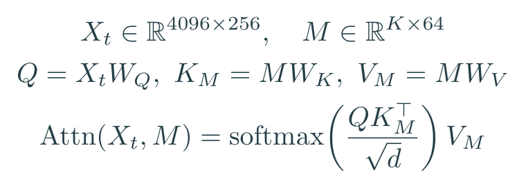

教学式：当前帧提出查询，旧记忆提供键和值；softmax 在每个查询的所有记忆位置上归一化。这里 WQ 的形状为 256×d，WK 为 64×d；若值向量宽度记为 dᵥ，WV 就是 64×dᵥ。上标 ⊤ 表示矩阵转置，√d 用来缩放查询与键的点积。

相似度高的记忆位置获得更大权重，值向量加权后送回当前帧表示。比如某个查询对两个旧位置的归一化权重是 0.8 和 0.2，结果就偏向第一个位置的内容，而不是把两个对象各画一半。

上式省略了残差、归一化、多头拼接与位置编码，目的是把跨帧信息流单独摊开。真正的主计算仍在开头图 B 区；记忆不会直接替代当前画面。

### 4.3 C 区：点击、候选掩码与“它现在不在”

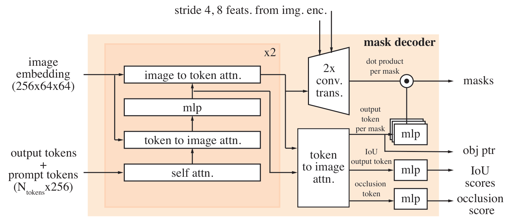

论文 Fig. 8：左侧两路输入，中间双向交换信息，右侧分别给出掩码、对象指针、质量评分与存在性评分。

先从左下的提示与输出 token 往上走，橙色区域重复两次。左上的图像特征进入 image-to-token 与 token-to-image 交互；右上还有 stride 4、8 的细尺度特征接入上采样。最右侧四个出口各负其责，别把预测 IoU 的分支当作掩码本身。图中的 N_tokens 是提示及输出 token 的数量，每个 256 维。

提示编码沿用 SAM 的思路。点和框等稀疏提示，用位置编码加类型向量表示：正点、负点、框角点的角色不同；已有掩码经过卷积，作为稠密提示加入图像表示。

解码器采用双向 Transformer。每个块先让提示／输出 token 自注意力，再让 token 读图像，经过 MLP，随后让图像反过来读 token。两块之后，再做一次 token 到图像的注意力；图像特征上采样，掩码 token 经 MLP 转成权重，与逐像素特征做点积，得到掩码。<!-- evidence:C10 -->

这些来回不是玄学“融合”。它们解决的是两件事：提示要从图中找目标，图中哪些位置属于目标也要受提示控制。只做单向广播，信息交换会更单薄。

一个点击有时同时允许多种答案：点在车轮上，你可能要车轮，也可能要整辆车。SAM 2 输出多个候选掩码，再预测各自的 IoU 分数；没有进一步提示时，选择预测质量最高的候选继续传播。**IoU 头是预测评分，不是在推理时偷拿真实标注算分。**

视频还多了一个存在性／遮挡头：对象彻底被挡住时，空掩码可能就是正确答案。否则模型被迫“每帧都画点什么”，很容易把旁边长得像的东西认领过来。空白不是摆烂，乱画才是交白卷还顺手编答案。<!-- evidence:C11 -->

### 4.4 D 区：把这次预测写进下次的条件

设 Ŷₜ 为当前预测掩码，Down 为降采样到图像特征网格的卷积操作，ConvFuse 为融合图像与掩码的轻量卷积网络。Xₜ 在这里按 256×64×64 的空间布局使用，与前一节展平形式对应：

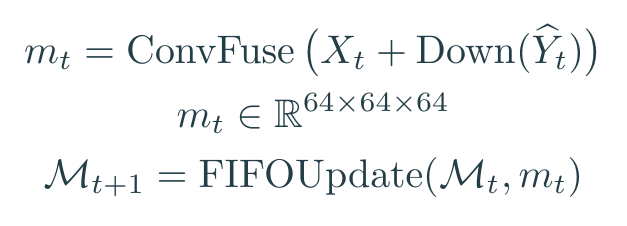

教学式：图像提供“长什么样”，掩码标出“这次关注哪一块”，融合后压到 64 通道。

mₜ 是这一帧的空间记忆，形状按通道×高×宽写成 64×64×64；𝓜ₜ 是处理当前帧前的记忆库，FIFOUpdate 表示普通近期记忆的入队与出队。提示帧记忆另行维护，对象指针也一同提供后续读取。完全遮挡时，还可加入可学习的遮挡表示。<!-- evidence:C12 -->

回看原图右边：**掩码既是结果，也是下一轮的输入条件之一。**这就是记忆带来的红利与风险。前面认错，后面可能越记越偏；交互纠正因此不只是改一张图，也是在修后续条件。

多对象时，图像编码可共享，但各对象的记忆库、解码等模块分别运行。它并不是先建一个所有物体互相讨论的世界模型。跟十个对象时，不能把单对象推理速度原封不动照搬。<!-- evidence:C13 -->

### 4.5 E 区：训练时怎样教它别跟丢？

先在 SA-1B 静态图像上预训练，再混合图像与视频训练。视频初始使用八帧片段，最多选择两帧提供纠正提示；首个提示以 50% 概率用真实掩码、25% 用正点击、25% 用框。模型既要学被完整指明的对象，也要学只有一点线索时怎么办。<!-- evidence:C14 -->

掩码监督由 focal loss 与 Dice loss 组成。前者降低大量容易像素的支配，让难像素的错误更显眼；后者直接关心预测区域与目标区域的重叠。令 pᵢ 为像素 i 的前景概率，yᵢ 为 0/1 标签，ε 为防止分母为零的小常数：

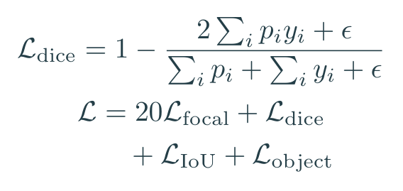

教学式：上行为常用软 Dice 展开，下行为论文训练中四项损失的权重关系。

IoU 损失让质量预测靠近真实掩码的 IoU，采用平均绝对误差；object 项用交叉熵监督该帧对象是否存在。这里的 MAE 是 mean absolute error，**不是**前面 Hiera 预训练用的 Masked Autoencoder，缩写撞车了，别让它们偷偷串门。

多掩码输出时，分割监督选损失最小的那个候选；各候选的 IoU 评分都受监督。若当前帧真实标签没有对象，就不监督掩码输出，但仍监督存在性头。这样“暂时看不见”与“轮廓没画好”有不同学习信号。<!-- evidence:C15 -->

v2 还增加十六帧序列微调：从修改帧数最多的前 50% 困难样本里训练，50k 步，学习率减半，并冻结图像编码器以适应显存。这是在专门补长期视频与难例，而不是把八帧训练的故事一直讲到底。<!-- evidence:C16 -->

## 5 数据：模型帮人标，人再教模型

### 5.1 数据引擎：麻烦的帧，值得人来处理

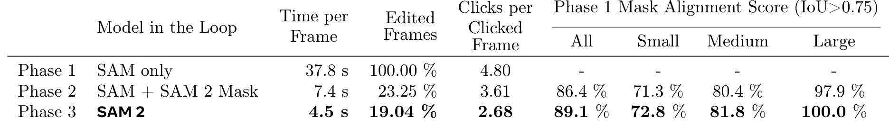

论文 Table 1：沿行看三代工具，沿列看人工时间、修改比例、点击次数与掩码对齐质量。

Phase 1 用 SAM 逐帧处理；Phase 2 加入自动传播；Phase 3 使用完整 SAM 2 交互纠错。每帧标注耗时从 37.8 秒降至 7.4 秒，再到 4.5 秒，首尾约 8.4 倍。这是同一批 169 段视频、452 个 masklet 的控制比较，不是拿两个团队不同熟练度随便除一下。<!-- evidence:C17 -->

“Edited Frames”是每段 masklet 中需要修改的帧比例，从 100% 到 19.04%；“Clicks per Frame”统计被点击帧上的点击数，最后为 2.68。右侧质量栏衡量与 Phase 1 掩码的 IoU 超过 0.75 的比例。89.1% 不是“89.1% 的像素都对了”，分母完全不同。

人力省下来之后，作者让标注员重点找难对象、纠正模型容易出错的段落。这里 E 区形成闭环：模型让标注更便宜，人工把错误修成新训练材料，模型再学。自动生成的轨迹也要经过质量筛选，不是模型说自己对就直接收进仓库。

### 5.2 SA-V：数字大之外，还要看包含哪些变化

SA-V 包含 50.9k 段视频、642.6k 个 masklet、35.5M 张掩码。其中人工部分是 190.9k 个 masklet、约 10M 张掩码；其余主要为自动生成。人工 masklet 有 42.5% 出现过消失后重新出现的情况，这正对着视频记忆的难点。<!-- evidence:C18 -->

这些数不能直接当作公开模型训练配方。附录写明，发布模型使用 SA-V 人工部分、内部数据和 SA-1B；全训练研究还包含其他公开视频数据。数据集包含自动部分，与发布权重是否用其训练，是两件需要分别对账的事。

划分训练、验证和测试时，作者按视频作者及地理来源组织，降低相似内容重叠；验证测试掩码采用早期逐帧人工标注流程。否则拿模型自己批量出的答案考自己，这考试多少有点过于善解人意。<!-- evidence:C19 -->

## 6 零样本实验：少点几次，能少多少？

### 6.1 先认指标，再看交互曲线

J 是区域 IoU，预测区域 P 与真实区域 G 的交集面积除以并集面积；F 是边界 F 分数，关心轮廓是否贴合。J&F 取两者平均。

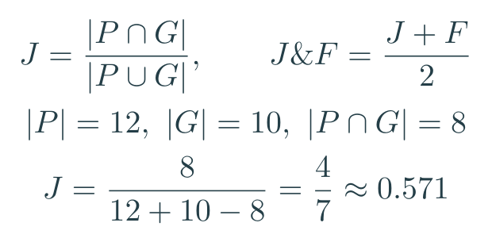

教学例：预测 12 个像素，真实 10 个，重合八个，则并集为 14，IoU 为 4/7。

这解释了为何“只把整块涂大一点”不一定能刷高分：多涂的背景会增大分母，边界也会偏。<!-- evidence:C20 -->

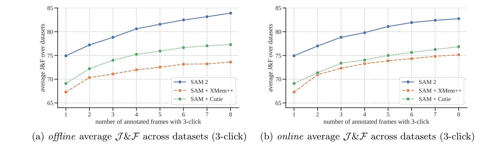

论文 Fig. 5：横轴是被交互的帧数，每帧固定三次点击；纵轴是九个数据集的平均 J&F，越高越好。

左图离线：可以看完整视频，每轮找当前最差的帧纠正，再重新传播。右图在线：只往前走，遇到预测较差的帧才停下来补点，纠正不回改之前帧。蓝色为 SAM 2，橙色和绿色是 SAM 接不同视频方法。<!-- evidence:C21 -->

想看“同样点击预算谁准”，竖着比；想看“达到同样精度要点几次”，横着比。蓝线在两图里都明显高于对照。论文概括为达到相近质量所需交互可少于对照的三分之一，这句话对应的是这些交互协议，不能直接翻译成“任何视频只点一次就永不跟丢”。

评估里的点击由真实标注和预测误差模拟：先在目标内部选点，再在错误区域选修正点。在线触发也利用真实 IoU 阈值模拟。实用工具里，哪个时刻要纠正由用户观察决定，模型不会免费拿到评测答案。

### 6.2 只在第一帧给提示，还能传多远？

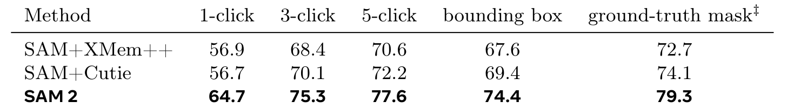

论文 Table 4：每列是一种首帧提示预算，后续不再补点；同列比较才公平。

这组在 17 个视频数据集上测试。一个点、三个点、五个点、框、真实掩码，信息量逐渐改变：拿完整真实掩码开局当然比只给一个点更清楚。

| 首帧提示 | SAM＋Cutie | SAM 2 |
| --- | --- | --- |
| 1 次点击 | 56.7 | 64.7 |
| 3 次点击 | 70.1 | 75.3 |
| 真实掩码 | 74.1 | 79.3 |

分数按各数据集协议汇总，多数用 J&F，VOST 按其协议用 J。这里 SAM 2 的一点击增益为 8.0 分，三点击增益为 5.2 分。更好的提示会缩小一部分差距，但没有抹平模型传播能力的差别。<!-- evidence:C22 -->

### 6.3 图片也变好了？顺便把“六倍快”拆清楚

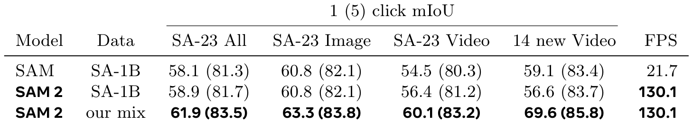

论文 Table 5：括号外是一点击 mIoU，括号内是五点击；最右侧是图像吞吐率。

先比较同用 SA-1B 数据：原 SAM 在 SA-23 的一点击平均 mIoU 为 58.1，SAM 2 为 58.9；图像速度从 21.7 到 130.1 FPS，约六倍。加入混合训练后，Table 5 的 SA-23 总体分数为 61.9，五点击为 83.5。<!-- evidence:C23 -->

但这把秒表测的是**单张图像任务、A100、batch size 10**；视频采用 batch size 1，常用 B+ 模型为 43.8 FPS，大模型为 30.2 FPS。图像 130.1 FPS 不能复制粘贴到视频，更不能直接当机器人端侧速度。

这张表还值得看数据域：SA-23 Image、SA-23 Video 是原评测数据中静态图与视频来源图的分组；“14 new Video”是在新增视频来源上按单张图评测。名字有 Video，不意味着这一栏使用了整段视频记忆。

## 7 视频分割对照：速度与记忆也要算账

### 7.1 首帧真实掩码：开局信息充分，还能领先吗？

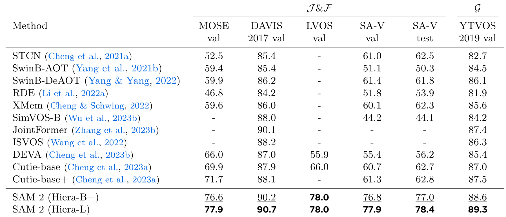

论文 Table 6：列对应数据集，行对应方法；SAM 2 的 B+ 与 L 是不同图像骨干规模。

这节用标准视频对象分割协议，首帧给真实掩码，后续自动传播。它与上一节零样本交互的训练数据条件不同：这里允许按相应标准协议使用相关训练数据，不要把全部成绩打包成一个“零样本”标签。<!-- evidence:C24 -->

在 MOSE，Cutie-base+ 为 71.7，SAM 2 B+ 为 76.6；在 SA-V test，两者为 62.8 与 77.0。L 版本的 SA-V test 为 78.4。提升在不同数据集上并不相等，SA-V 的困难对象与遮挡特别考验这种记忆接口。

最后一列 YTVOS 使用 G 指标，要按该数据集定义理解，不与前面 J&F 的绝对数横向排大小。读表时先固定一列，再比较模型；跨列的任务难度和统计方式都变了。

### 7.2 记忆多一点，就一定好一点？

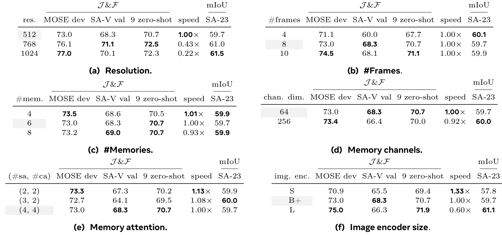

论文 Table 9：六个小表分别改分辨率、训练帧数、记忆数、记忆通道、注意力规模与骨干；灰行是消融默认设置。

这张不是统一调大一个按钮。上排左图 (a) 加输入分辨率，(b) 加训练序列帧数；中排 (c) 加保留记忆帧数，(d) 改每条空间记忆的通道；下排改注意力层数与图像编码器。各列含不同视频与图像指标，speed 是相对速度，1.00× 为本组基准。

先看 (c)：默认六帧记忆，SA-V val 为 68.3，九个零样本数据集平均为 70.7；改四帧分别 68.6、70.5，改八帧为 69.0、70.7，但速度降到 0.93×。**记得更多，不会让每个分数都整齐上涨。**这些消融主要采用 512 分辨率，别直接和前面的 1024 主结果拼一张表。<!-- evidence:C25 -->

再看 (d)，空间记忆从 256 压到 64 通道，存储元素数降为四分之一。若只算六帧、64×64 网格：

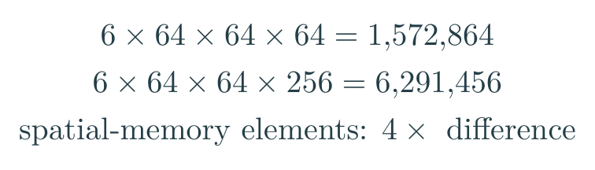

教学算账：这是空间记忆元素数，不含对象指针、缓存、中间激活和提示帧。

64 通道设置的 SA-V val 为 68.3，256 通道为 66.4；这一组里更宽反而没赚到。压缩不只是“穷人的无奈”，有时能把有效信息组织得更合适。当然，用更少显存不等于整个系统显存按相同比例下降——大头还可能在别处。

## 8 结论：它给机器人补了哪块感知拼图？

三个问题可以收回来了。

**记住什么？**空间记忆带位置与对象区域，对象指针带紧凑语义；当前图像通过交叉注意力读取它们，再把本次预测写回。开头 B↔D 是整篇的主线。

**怎样学会纠错和缺席？**点、框、掩码提供不同提示，训练模拟跨帧修正；掩码、质量评分和存在性各有监督。对象消失时可以输出空区域，后面出现时再利用上下文找回。

**效果在哪成立？**交互实验比较同等提示预算下的分割质量，首帧实验比较传播，图像与视频速度分开计。困难数据、遮挡和多对象让系统仍然有事可做；尤其镜头切换、相似目标、快速细小物体与长遮挡，都可能让身份线索断掉。

对机器人来说，SAM 2 可以提供一条很实在的感知输入：我指定的这个杯子，现在在哪些像素里，它沿时间怎样变化。往后还得接深度、相机与机器人坐标、接触判断和动作控制。一个杯子的轮廓不等于它能怎么抓，空掩码也不等于它在物理世界里消失了。

我更关心的是下一层接口：当视觉记忆不确定时，机器人是继续伸手，还是先换视角确认？到那里，“别跟丢了”才真正从视频编辑问题，变成具身决策问题。

阅读工具：[ReadPaper](https://github.com/Zhu-Huixiang/ReadPaper) · [DrawPaper](https://github.com/Zhu-Huixiang/ReadPaper/tree/main/drawpaper)。

可复制地址： https://github.com/Zhu-Huixiang/ReadPaper

点击“阅读原文”进入 GitHub 文章页，可放大原图、查看公式与知识点关联。

---

公众号版由管理员在后台手动公开发表；永久文章链接待发表后补充。

关注公众号 **具身智能的 World**：

[原论文](https://arxiv.org/abs/2408.00714v2) · [证据索引](evidence.json)

[本篇知识星系](../../universe/papers/sam2.md) · [知识点宇宙](../../universe/README.md)
