# UMI：没带机器人，怎样教会机器人？

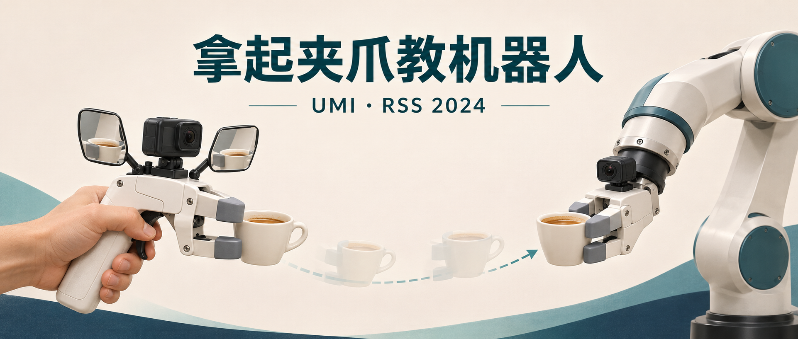

人拿着夹爪把杯子放好，相机录下来。回到实验室，机器人照着学。UMI 的演示看起来很顺，难处就在这个“照着”里：人手和机械臂的坐标不同，相机、机械臂、夹爪各慢一点，放杯时可以忍过去的错位，到了抛掷时可能直接把东西甩偏。

机器人模仿学习常沿两条路线攒数据：ALOHA 这样的遥操作系统让人直接控制机器人，拿到匹配的观测和动作；人类视频学习则把采集范围扩到机器人之外，再想办法跨越手与机械夹爪的差别。**UMI 挑战的假设是：要得到机器人可执行的高质量动作示范，采集时就必须把机器人带在身边。**它给人一副与机器人末端匹配的手持夹爪，再把观察、动作表示和时间对齐一起设计。所有实验采用 Diffusion Policy，四类任务分别训练。<!-- evidence:C01 -->

这里是「具身智能的 World」。配套 GitHub 提供七个入口：

- 论文解读：沿原图和公式看方法怎样工作。
- 论文地图：按科学问题找下一篇要读的论文。
- 顶会顶刊集锦：查已核实的正式出处。
- 一周解读日程：看按具身榜安排的阅读计划。
- arXiv 新作集锦：查首次公开、版本更新与收录时间。
- 具身榜：比较七维评分、依据与原文入口。
- 知识点宇宙：从具体机制跳到其他论文里的相关用法。

仓库：<https://github.com/Zhu-Huixiang/embodied-world>

**这篇解读回答三个问题：**

1. 人拿着夹爪录下的视频，怎样变成机械臂能学的动作标签？
2. 同一段示范换到另一台机器人，怎样对齐坐标、视觉和执行时间？
3. UMI 的成功来自哪些接口设计，跨机器人与野外泛化各走到了哪一步？

**论文信息**：*Universal Manipulation Interface: In-The-Wild Robot Teaching Without In-The-Wild Robots*。作者 Cheng Chi、Zhenjia Xu（共同第一作者）、Chuer Pan、Eric Cousineau、Benjamin Burchfiel、Siyuan Feng、Russ Tedrake、Shuran Song；署名机构为斯坦福大学、哥伦比亚大学、丰田研究院。论文发表于 **Robotics: Science and Systems（RSS）2024**，这是机器人学的同行评审会议。arXiv 首次公开于2024年2月15日；本文读 RSS 正式稿，并结合作者项目提供的附录 A–F。<!-- evidence:C02 --><!-- evidence:C51 -->

原文：<https://www.roboticsproceedings.org/rss20/p045.html>  
项目：<https://umi-gripper.github.io/>  
代码：<https://github.com/real-stanford/universal_manipulation_interface>

**阅读目录**（沿原文 I–IX 的论证顺序，方法拆成采集与策略两节）：

1. 引言：没有机器人，示范还剩下什么
2. 相关工作：三条采集路线各缺一块
3. 方法A：先把手里的动作录成可用数据
4. 方法B：先对时间，再对坐标
5. 评估设置：每一项成功都得先讲判据
6. 四项能力：哪些接口真的起作用
7. 野外泛化：把杯子带出训练桌
8. 吞吐与精度：采得快，标得准
9. 局限：采集自由之后的约束
10. 结论：回到三个问题

本图由 [DrawPaper skill](https://github.com/Zhu-Huixiang/ReadPaper/tree/main/drawpaper) 指挥 Codex，使用内置生图制作。

训练沿 **A→B→C** 看：人在 A 区示范，B 区离线恢复夹爪轨迹与开合宽度，过滤机器人不适合执行的片段，再交给 C 区学习条件动作分布。运行沿 **D→C→D** 看：机器人端图像和本体反馈先按时间对齐，C 区从噪声生成动作序列，D 区把相对目标换回机器人坐标、丢弃过期目标，并给机械臂和夹爪分别安排下发时刻。执行后的新观测进入下一轮。训练用的 SLAM 轨迹提取，不在这条部署循环里。<!-- evidence:C03 --><!-- evidence:C07 --><!-- evidence:C12 -->

## 1 引言：没有机器人，示范还剩下什么

把一段普通人类操作视频交给策略，首先缺的是动作标签。画面能说明杯子动了，却没有直接告诉机械臂末端该平移多少、旋转多少、什么时候松开。即便从视频恢复出人手轨迹，人手还能侧捏、勾住、换指头；平行夹爪通常只有一对手指和一个开合自由度。这是身体差异带来的动作问题。

另一类问题来自眼睛。训练时相机在人的胸前，运行时相机在机器人腕上，杯子在两幅图里的尺寸、遮挡和背景都不同。策略需要一边辨认任务，一边适应视角变化。

UMI 做了一个主动的取舍：让人也使用平行夹爪，用同一类软手指接触物体，把相机固定在与机器人端匹配的位置。人自由移动手持装置，所记录的观察更接近机器人将来会看到的观察，所记录的动作也更接近机器人末端能表达的动作。成本是人要适应这件工具；收益是从采集阶段就减少两种身体之间要补的差别。<!-- evidence:C03 -->

因此，论文标题里的 Universal 首先指向一个**能跨采集场景和机器人本体复用的接口**。理解后面的每项结果，都要带着这个问题：它到底统一了哪一部分，又把什么留给了具体机器人？

## 2 相关工作：三条采集路线各缺一块

原文把相关工作分成机器人遥操作、人类视频与手持示范接口。它们面对的是同一笔账：每条示范能否方便地收集，又能否直接拿去学机器人动作。<!-- evidence:C52 -->

遥操作让人控制真正的机械臂，关节、末端位姿和夹爪状态都有记录。ALOHA 用便宜的主从双臂降低操作门槛，SpaceMouse 一类设备则让人操纵末端运动。代价是采集吞吐受机器人的速度、可达范围、搬运和恢复过程限制；若想在三十个地方收数据，部署负担也跟着走。

人类视频能覆盖更多地方和动作。问题是画面里的手指接触方式不一定能由夹爪复现，动作和受力标签也不天然存在。仅仅增加视频量，并不会自动解决机器人应该执行哪条轨迹。

手持夹爪介于两者之间。它让人的示范更接近机器人末端，早期工作已经证明这种采集形式有价值。UMI 在此基础上要处理的是**动态动作与双手协同**：抛东西时，几何路径对了还不够，速度和松手时刻也要对；折衣服时，两只手都知道自己的轨迹，还得知道对方在哪里。接下来的硬件设计与策略接口，都围绕这些具体缺口展开。<!-- evidence:C52 -->

## 3 方法A：先把手里的动作录成可用数据

### 3.1 HD1：相机跟着夹爪走

这一节对应架构图 A 区。Fig. 2 要回答的是：如何让同一套观察和接触方式从人的手上搬到机器人身上？作者把鱼眼相机、侧镜、软手指和开合机构放在一件手持装置上，再让机器人使用相匹配的末端接口。

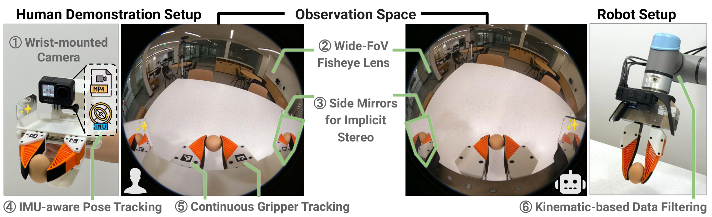

论文 Fig. 2。左边是手持夹爪，中间是155度鱼眼观测，右边是机器人端同构相机/夹爪。

图中上方是相机，两侧是镜子，下方是手指与开合机构；它们之间的固定位置关系决定了相机看到怎样的抓取画面。手持端不靠外置相机或随身计算机完成记录，GoPro 自己保存视频和惯性数据。部署端仍然要装上合适的机械连接件，例如论文的 Franka FR2 配 WSG50 夹爪时使用了90°转接件。<!-- evidence:C03 --><!-- evidence:C48 -->

这种“匹配”不等于两台机器人长得一样。策略主要看到末端附近的图像、末端位姿历史和夹爪宽度；机械臂的连杆长度和关节限位则留在下游执行层。两台机器人的手可以看见相似画面，但肩膀与肘部仍可能把同一个目标变成不同的可达性问题。

### 3.2 HD2与HD3：鱼眼看周边，镜子补视差

腕部相机离物体近，正常视角容易只看见眼前一小块。UMI 采用155°鱼眼，把周边上下文一起放进图像，中央保留较多细节，外围被压缩。策略直接使用鱼眼图像，训练输入没有先拉直成针孔相机视图。<!-- evidence:C04 -->

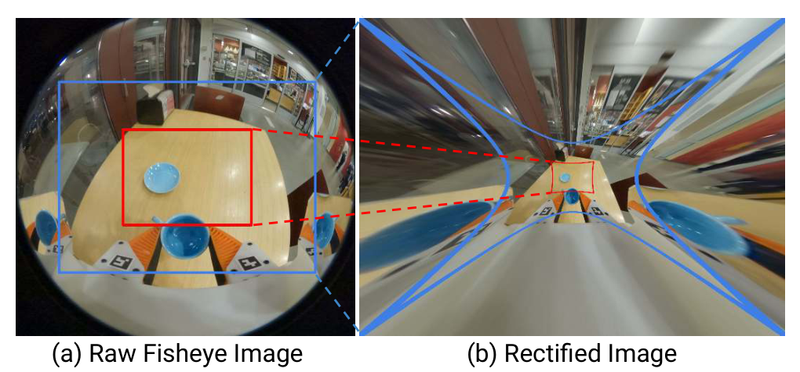

论文 Fig. 3。左边原始鱼眼保留中心信息；右边校正透视图拉伸外围，红蓝框标出压缩和拉伸区域。

Fig. 3 的重点是视野范围：手指正夹着物体时，下一步要放去的盘子或桶是否还在画面内？后面的摆杯消融会把这一点与成功率对上。图像弯一点，可能比把目标裁出去更合算。

近距离抓取还需要区分“夹爪已经贴到杯壁”和“还差一点距离”。两片侧镜相当于添了两个虚拟观察位置，同一物体在主视图和镜中出现不同投影，策略可以利用这种视差。这里进入网络的仍是RGB图像，而不是另算好的一幅深度图。<!-- evidence:C05 -->

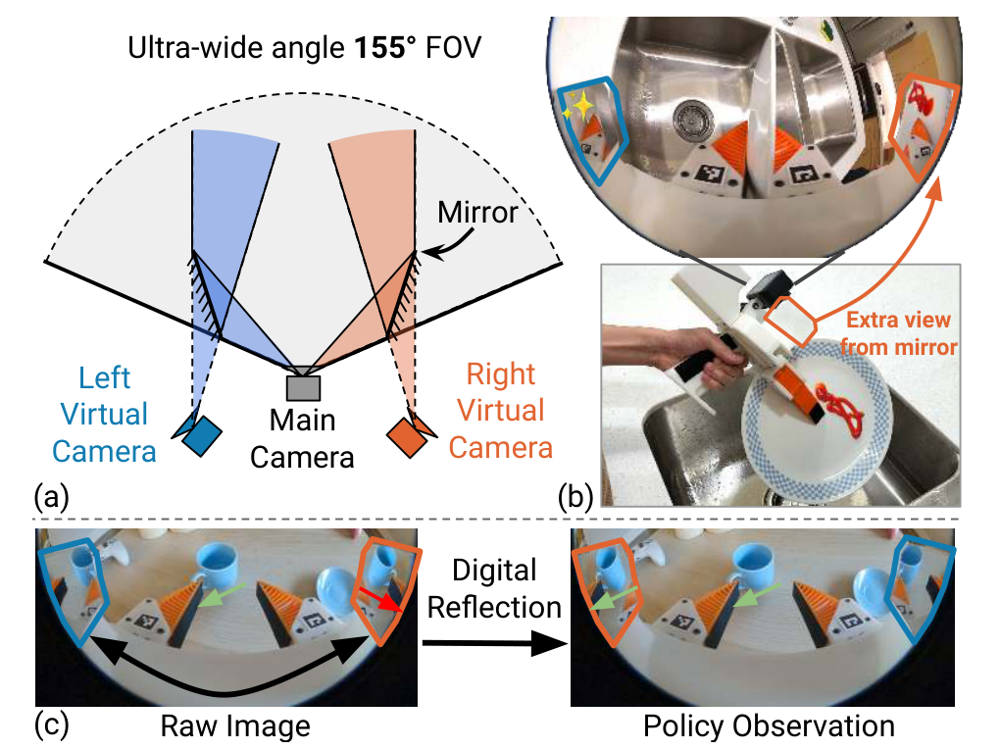

论文 Fig. 4。a看主相机和两个虚拟相机，b看被主视角遮住的番茄酱，c看镜区数字反射后的方向。

Fig. 4 先画物理相机与镜面构成的虚拟视角，再展示图像里的镜区。论文还对镜区做数字反射并交换左右内容，让视觉输入中的运动关系更适合学习。后面的消融会分开比较“有镜子”与“完整镜面处理”两种配置。<!-- evidence:C06 -->

### 3.3 HD4：视频怎样长出以米为单位的轨迹

人手没有机器人编码器，所以 B 区先做离线轨迹恢复。GoPro 把视频、加速度计与陀螺仪数据存进同一个 MP4，作者改造 ORB-SLAM3，联合图像特征和惯性约束估计相机的运动。SLAM 可以理解为“边认路标，边拼地图和自己的位置”；惯性信息在这里还帮助确定真实尺度，让一段平移从“画面动了多少”变成可以用米表示的位移。短时模糊或纹理不足时，惯性约束也能提供连续性。<!-- evidence:C07 -->

操作前先做一段建图视频，再让每段示范重定位到这个场景地图。双手示范的两段轨迹由此进入同一个坐标系。附录 D 说明，已建地图用来初始化，之后仍继续建图和优化，以适应操作引起的场景变化。低纹理场景可以在建图时临时放已知尺寸的标记，示范时移走。<!-- evidence:C38 -->

附录 B 给出的采集步骤很朴素：新场景先做约一分钟的建图，夹爪开合五次用于宽度标定；双机可借 QR 时间码同步，每条示范单独录成视频。它把传感器校准和场景建图集中到采集流程里。<!-- evidence:C37 -->

到这里，一帧图像旁边已经有了一个夹爪位姿。位姿描述平移与朝向；它还需要与开合状态一起，才构成抓取动作。

### 3.4 HD5：夹爪宽度要连续，接触靠软指

只标“开/关”会丢掉很多接触细节。UMI 从视觉基准标记追踪连续宽度，手指使用肋状95A TPU材料，接触后能被动变形。较小的宽度目标压缩软指，可以隐式改变抓紧程度；这是通过机构顺应性传递的效果，没有另外测出一个力传感器标签。<!-- evidence:C08 --><!-- evidence:C48 -->

杯子、海绵和衣服对接触的要求不同。连续宽度让策略学到何时握住、松一点、完全放开；柔软指尖则在目标位姿有小误差时提供一点机械余地。宽度控制和力控制之间仍隔着材料、摩擦和物体形状，读到“隐式抓力”时要把这些条件带上。

### 3.5 HD6：人的动作，机器人不一定够得着

手持装置可以绕到桌子背面，人还能随时挪动身体。机械臂底座固定后，关节限位和运动范围就在那里。UMI 因而按目标机器人的底座位置与运动学，过滤不合适的示范轨迹。采集阶段摆脱了机器人，准备训练数据时仍要检查下游本体能否执行。<!-- evidence:C09 -->

接口减少了人和机器人的表示差异，**可达性还得由机器人自己的几何条件决定**。跨本体测试里剩下的两个失败，恰好与这一点有关。

## 4 方法B：先对时间，再对坐标

### 4.1 PD1.1：把各路观测拨到同一个时刻

赖宇涵聊应景内容制作时，在《联合早报》采访里开过一个玩笑：“等录完出来，可能烟霾都散了，哈哈。”这是一个假设式的制作时效笑话：成品终于出来，眼前的情境已经变了。<!-- culture:lai-recording-lag --><!-- meme:recording-lag -->

机器人也得算输出赶不赶得上的账，尺度换成了毫秒。相机传一帧要时间，动作网络推理要时间，机械臂和夹爪收到指令后也不会立刻到位。先看 D 区的输入端：若相机回来的画面是一百毫秒前拍的，却配上刚到的机械臂位置，策略得到的就是一个从未同时存在过的“当前状态”。

Fig. 5 把观测、策略和执行排在一张时间线上。核心做法是先还原观测的真实发生时间，再为未来动作保留足够提前量。<!-- evidence:C11 --><!-- evidence:C12 -->

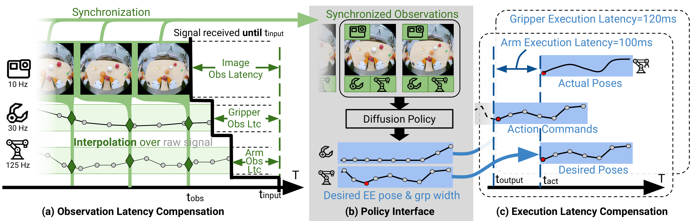

论文 Fig. 5。左侧把各观测对到同一个采集时刻，中间输出相对末端轨迹和夹爪宽度，右侧把命令提前到各硬件执行时延之前。

先放大左侧。横向是时间，彩色流分别代表图像、机械臂状态和夹爪宽度，采样频率与传输延迟各不相同。作者以延迟最大的流为基准，通常就是相机；选定图像的拍摄时刻后，对其他历史观测做插值。图中10/30/125 Hz属于示意里的不同数据流，不是全文所有任务统一采用的频率。<!-- evidence:C11 -->

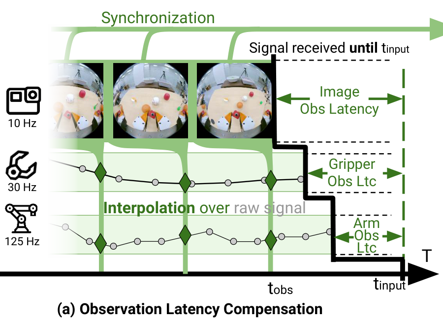

论文 Fig. 5a。横向是时间；按选定图像的真实拍摄时刻，插值夹爪宽度和机械臂观测。10/30/125Hz是此示意图的不同流频率。

以夹爪宽度为例。设图像拍摄于 t_obs，夹爪在此前、此后两个采样时刻 t_i、t_j 分别记录了宽度 w_i、w_j；λ是 t_obs 在这两个时刻之间的比例。先算时间比例，再按比例插值宽度：

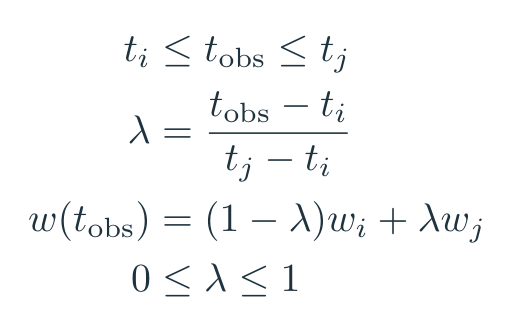

教学式（3）。先找出包围图像采集时刻的两个夹爪宽度样本，再按时间距离加权；使用的是同一物理时刻的观测。

这是一项标量插值教学例：若两次采样在90 ms和110 ms，宽度分别为40 mm和20 mm，那么100 ms处 λ=0.5，配给该图像的是30 mm。直接拿110 ms的20 mm去配，会把尚未发生的闭合混进旧图像。双臂场景还要对齐两台相机；论文用最近帧软同步，帧间最大差异为1/60秒。<!-- evidence:C11 --><!-- evidence:C53 -->

### 4.2 PD1.2：动作算出来，还得来得及执行

时间对齐后的最新观察，其发生时刻记作 t_obs。策略输出从这个时刻开始的一段未来动作。等输出抵达执行器，最前面几项目标可能已经过去了；把整段动作从头照放，相当于让机器人一直追赶一段过时的计划。UMI 丢弃已经赶不上的目标，并按机械臂、夹爪各自的延迟提前发出后续指令。<!-- evidence:C12 -->

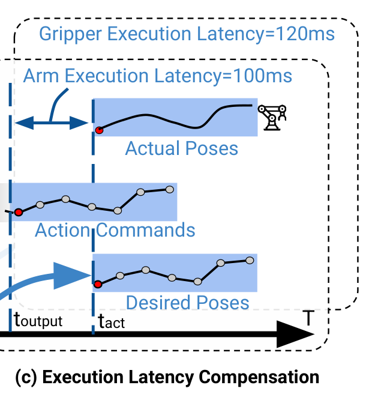

论文 Fig. 5c。横轴是时间。下方是带期望时间的Desired Poses，中间Action Commands提前下发，上方Actual Poses显示执行响应；机械臂100ms、夹爪120ms是此示意例的两种时延。

Fig. 5c 下方是期望到达的位姿，中间是提前发出的命令，上方是实际响应。图里的机械臂100 ms、夹爪120 ms是这幅示意使用的延迟。两者要在同一个时刻配合，较慢的夹爪就要先收到命令。

这些延迟怎样测？附录 A 用显示器上的滚动 QR 时间码估计相机延迟，减掉显示器自身的刷新延迟。有全局时间戳的机器人状态，直接比较发送与接收时间；没有硬件时间戳的 UR5 和 WSG50，则用一半网络往返时间作近似。<!-- evidence:C34 --><!-- evidence:C35 -->

执行延迟则用一段命令序列与回读序列做时间对齐：夹爪采用正弦开合信号，机械臂用遥操作轨迹。两段信号对齐得到端到端延迟，再减去观测回传部分，估计命令到实际运动的执行延迟。<!-- evidence:C36 -->

下面把这几笔时间分开记。t_recv 是电脑收到数据的时刻，t_display 是屏上时间码标记的时刻，ℓ_display 是显示器自身延迟；t_robot 是机器人给状态打的时间戳。ℓ_cam、ℓ_obs、ℓ_e2e、ℓ_act 分别是相机、状态回传、端到端、动作执行延迟。t_output 是模型完成本轮推理的时刻，t_act 是该硬件收到本轮输出后最早响应的时刻，t_desired 是希望动作真正到位的时刻，t_send 是下发时刻：

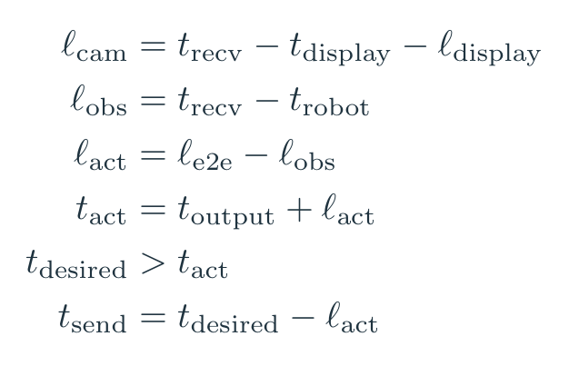

公式组（4）。前三行是附录的时延标定式；后三行将主文的丢弃过期动作和提前发命令写开。每种硬件分别代入自己的执行时延。

用一个教学数值例子算：图像在0 ms拍摄，100 ms传到电脑，推理再用50 ms，模型在150 ms输出。若机械臂和夹爪执行延迟分别取图中的100/120 ms，它们最早约在250/270 ms响应。若计划要求两者在300 ms配合，就应分别在200/180 ms发出命令；目标若要求200 ms到位，这一轮已经赶不上，应被跳过。**提前发的是已经预测出来的命令，推理用掉的时间并没有消失。**<!-- evidence:C54 -->

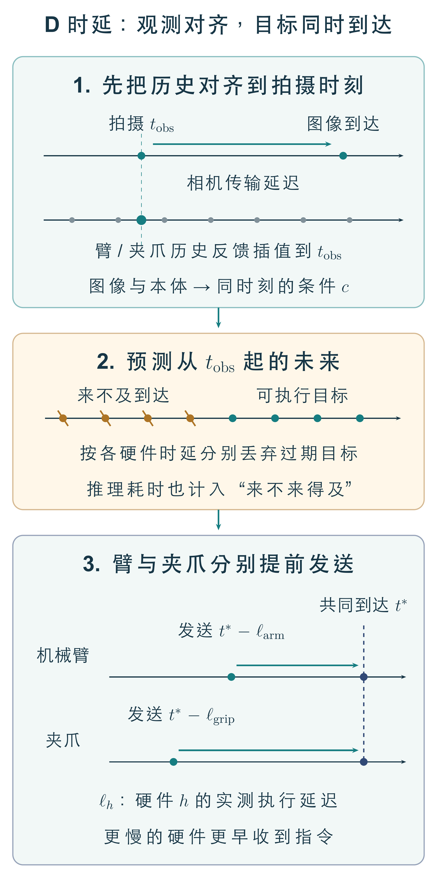

D区展开。先把图像与本体历史对齐，再剔除过期目标；臂和夹爪按各自延迟提前接收指令，在同一目标时刻配合。

把这张细图与 Fig. 5 对着看：观测先对齐，模型再生成带时间的目标，执行器按自己的提前量排程。抛掷时，“胳膊到这里”和“夹爪现在松开”能否碰在一起，就取决于这条链。

### 4.3 PD2.1：相对目标，为什么不等于逐步增量

时间对上之后，还要回答动作相对谁。论文比较三种表达：世界坐标里的绝对目标、每一步相对前一步的增量，以及**整段轨迹相对本轮当前末端的目标**。UMI 采用第三种。<!-- evidence:C13 -->

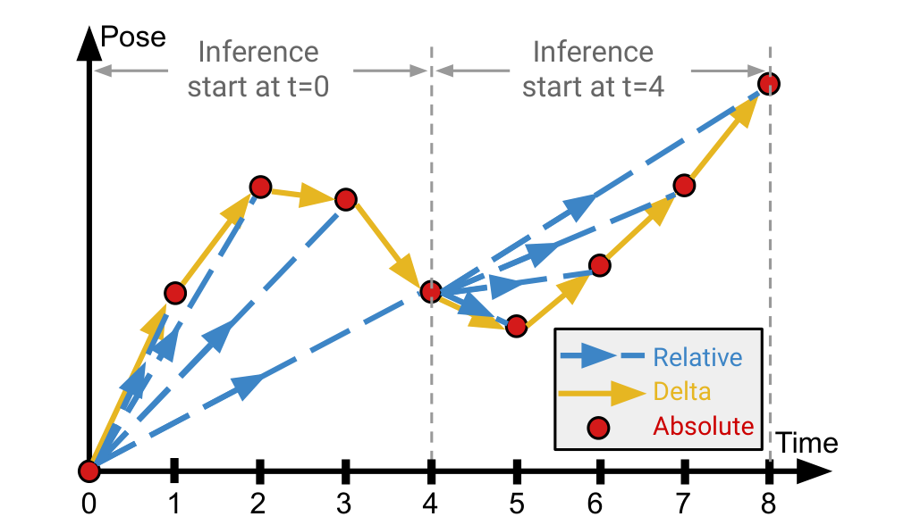

论文 Fig. 6。横轴时间，纵轴位姿示意；相对轨迹在每次推理起点用同一参考，delta逐步依赖前一步，absolute依赖世界坐标。

Fig. 6 横轴是时间，纵轴是位姿示意。绝对轨迹离不开共同世界坐标；delta要一段段接起来；UMI 每次推理选定一个当前参考，预测的所有未来点都相对这个参考。下一轮得到新观测后，再更新参考。

先定义对象。T_t 表示时刻 t 的末端坐标系在参考坐标系中的刚体变换，用4×4齐次矩阵写：左上角 R_t 是3×3旋转矩阵，右上角 p_t 是3×1位置向量，最后一行补成齐次坐标。t₀是本轮预测所用的当前时刻，ΔT₀t 表示从 t₀末端坐标看未来 t 的目标；R作为矩阵符号表示旋转；符号上方的帽子表示模型预测量，T₀的逆表示把参考坐标变到当前末端坐标，R₀右上角的⊤表示矩阵转置。下式是对原文相对位姿机制的数学展开，4×4是刚体变换的数学表示，并非声称策略直接输出16个数。<!-- evidence:C49 -->

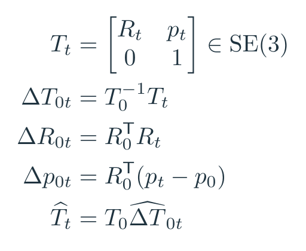

教学式（1）。同一动作块里的所有目标都相对该轮观测的末端起点，执行时也乘回同一个参考位姿。

先算 T₀的逆，再乘 T_t，得到未来目标相对当前末端的平移和旋转。恢复机器人目标时，用该轮参考时刻的机器人末端位姿左乘预测的相对变换。整段动作共用这一个参考，不能每执行一步就改乘最新末端姿态。旋转不为零时，平移差还要乘 R₀的转置，才能把方向转进当前末端坐标；单纯做世界坐标相减是不够的。

用一维且朝向不变的教学例子更容易分辨。当前位置是0.40 m，未来三个目标是0.45、0.52、0.60 m：绝对表示就是这三个数；逐步delta是0.05、0.07、0.08 m；相对当前的目标是0.05、0.12、0.20 m。换到当前位置1.10 m的机器人，相对目标恢复为1.15、1.22、1.30 m。

假如delta第一个0.05 m被预测成0.06 m，后续累加会把这项误差传下去。固定起点的相对目标不经过这种逐步求和。但它仍受当前位姿估计、动作预测和执行误差影响，优势来自减少特定误差传播路径，而不是把误差整体消掉。<!-- evidence:C55 -->

### 4.4 PD2.2与PD2.3：记住刚才，也知道另一只手在哪

动作相对当前末端，本体历史也要用相同参考。论文通常输入两个时刻的末端位姿和夹爪宽度，把历史位姿换到当前末端坐标中。两个采样点之间的变化提供局部速度信息，让策略区分“同样在杯口上方，但正向下走”与“已经停住”。这里用的是这段短历史，而非一个跨很长时间保存经历的循环状态。<!-- evidence:C14 -->

双手叠衣还缺一项关系：两只夹爪相对彼此在哪里。手持数据中的左右轨迹先重定位到共同场景地图，再计算左夹爪到右夹爪的变换。两台相机因此不必始终直接看见对方。部署时，集中式策略把两边观察和相对位姿一起使用，共同产生两只手的动作。<!-- evidence:C15 --><!-- evidence:C23 -->

设 T_L、T_R 分别是左右夹爪在同一参考坐标系中的4×4变换，T_L←R把右夹爪坐标变到左夹爪坐标。S表示两条轨迹共同经历的一次参考坐标变换，波浪号标记换参考后的位姿；下式把乘积的逆写成两个逆矩阵相乘，并把次序颠倒：

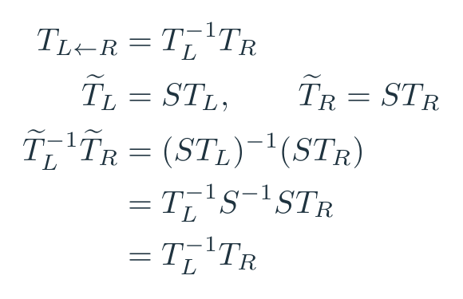

教学式（2）。两只夹爪若共同换一个世界参考S，相对位姿不变；它保留的是两只夹爪之间的位置和朝向。

式中的逆矩阵会让共同的 S 抵消。用一维教学例子，左手0.2 m、右手0.7 m，间隔0.5 m；把共同原点平移，两者都加1 m，间隔仍是0.5 m。左右相对位姿让策略直接得到这项与共同原点无关的关系。共同坐标变换可以抵消，两条轨迹各自不同的估计误差则会留下；第8节会检查这种相对误差。<!-- evidence:C56 -->

### 4.5 接上Diffusion Policy：观察怎样变成一段动作

回到架构图 C 区。B 区产出的训练样本包含图像历史、本体历史、双手相对信息，以及接下来要模仿的动作序列。视觉编码器把图像变成特征，再与低维状态共同作为条件；动作模型在这些条件下学习哪些未来轨迹像示范。原文实验全部采用 Diffusion Policy。<!-- evidence:C01 -->

先说明输入怎么组织：若批量大小为 B，图像历史长度为 T_I，相机数为 N，RGB图像可以排列成 B×T_I×N×3×224×224 的张量。单手N=1、双手N=2；附录 Table A1 中图像历史通常为2，野外摆杯为1，本体历史均为2。表里的 T_a=6是**动作执行视野**，不要把它自动当成完整预测窗口。<!-- evidence:C39 -->

为了看清计算，下面展开标准噪声预测式的动作扩散训练。令 A⁰是一个示范动作块，形状为 H×d：H是预测时间步数，d是选定编码下的每步动作维数。这里只用符号，不给原文没有在该表中定义的编码维数补数字。O是观测条件，c是编码后的条件特征；k是扩散噪声等级，ε是与动作块同形状的标准高斯噪声，β_j是第j个扩散步骤的噪声方差比例，ᾱ_k把前k步的信号保留因子连乘；这里的乘积符号Π表示从j=1乘到k，j是连乘索引。ε_θ是参数为θ的噪声预测网络。I表示单位协方差，𝒩(0,I)表示各分量为零均值、单位方差的高斯噪声；上标0与k分别标记干净动作和第k级带噪动作。损失中的F范数平方，等于把误差矩阵每个元素先平方再求和，除以H×d取元素均值；最外侧E再对示范、观察、噪声等级与噪声抽样取平均。

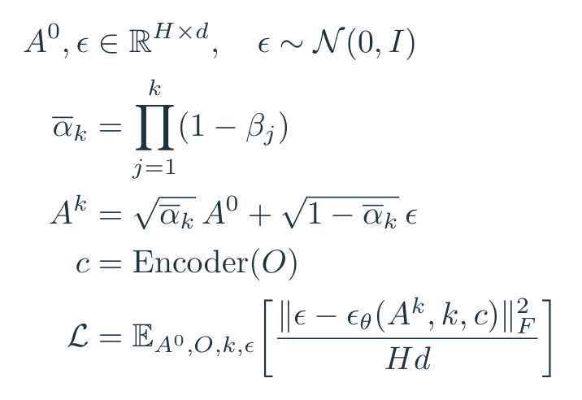

教学式（5）。给归一化动作块加噪声，再在观测O的条件下预测噪声；H是时间步数，d是每步动作编码维数。这是标准去噪目标的展开，不是UMI新增的编号公式。

训练先按给定比例把示范动作和噪声混合，再让网络根据带噪动作、噪声等级和观察条件预测加进去的噪声，计算逐元素均方误差并更新参数。这是标准 Diffusion Policy 的教学展开，UMI 没有把它单列成自己的编号公式。<!-- evidence:C50 -->

拿一个归一化后的动作分量算一次：设干净值0.8、ᾱ_k=0.81、抽到噪声−0.2，带噪值约为0.9×0.8+0.436×(−0.2)=0.633。若网络预测噪声−0.1，这一分量的平方误差就是0.01。整个动作块把这样的误差取平均；动作块不同位置的数值，在真实训练中要共同拟合。<!-- evidence:C57 -->

运行时，从高斯噪声动作块出发，在同一份观察条件下反复去噪，最后取得有结构的动作序列。附录记录50个训练扩散步、16个推理采样步；执行一部分动作后，用新观察重新规划。视觉编码器按任务不同：抛掷与叠衣用从头训练的 ResNet-34，窄域摆杯与洗碗用CLIP预训练ViT-B/16，野外摆杯用ViT-L/14。CLIP在这里提供视觉初始化，没有给机器人加入文字指令输入。CLIP视觉编码器的微调学习率为动作扩散网络的十分之一。<!-- evidence:C41 --><!-- evidence:C58 -->

附录的图像增强包括保留95%范围的随机裁切、±5°旋转及颜色抖动，用来扰动训练观察。抛掷以20 Hz按示范原速执行；其他任务设置10 Hz并把执行速度放慢到示范的0.5倍。慢放通过调整目标时刻之间的间隔实现，这项慢放设置描述目标时序，传感器采样频率要另看。<!-- evidence:C40 --><!-- evidence:C42 -->

## 5 评估设置：每一项成功都得先讲判据

论文先测实验室里的四项能力，再单独做野外摆杯泛化。前一组在采集环境中测试，随机化物体初始状态；不同方法之间，人工对齐同一组机器人与物体初态。附录用第三视角参考图尽量匹配位置，也先通过遥操作确认任务可达。测试有人监督，机器人故障、安全条件、超时或成功都可以结束一回合。<!-- evidence:C16 --><!-- evidence:C43 -->

Fig. 7 展示任务是什么，Fig. 8 再问每项设计有什么用。前者是执行画面，后者才给出对照与成功率。

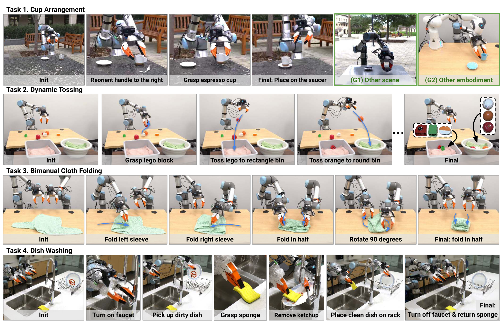

论文 Fig. 7。从上到下是摆杯、抛掷、双臂叠衣和洗碗。各行从左到右按时间推进，照片是作者实机执行。

四行从上到下是摆杯、抛掷、双手叠衣、洗碗，每行按时间从左往右读。摆杯要辨杯柄方向，抛掷要在运动中松手，叠衣要控制双手关系，洗碗还要把一连串接触操作接起来。它们把接口的不同弱点分别放大。

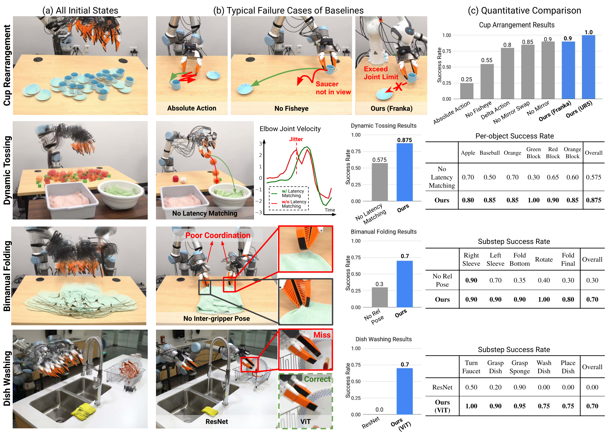

论文 Fig. 8。左列是叠加的初始状态，中列为典型失败，右列为成功率；红箭头标失败方向，绿箭头标期望行为。

Fig. 8 左列叠加初始状态，中列放典型失败，右列列成功率。红色箭头说明失败往哪里偏，绿色表示期望行为。右侧既有柱图也有分步表：单个步骤做成的比例，与整项任务完成的比例要分开读。下面逐任务放大。

## 6 四项能力：哪些接口真的起作用

### 6.1 摆杯：视野、坐标和跨机械臂

摆杯数据来自两位示范者，共305条。成功要求杯子竖直放在碟上，杯柄朝机器人左侧，偏差在±15°以内；不是只把杯子移到桌上某处。<!-- evidence:C17 -->

主要结果在这一组：

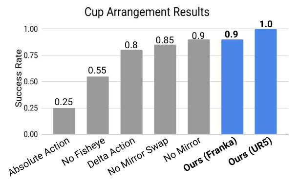

论文 Fig. 8c top。纵轴成功率0到1；横轴依次为绝对动作、无鱼眼、delta动作、未交换处理镜面、无镜面、UMI Franka和UMI UR5。

纵轴是0到1的成功率。横轴依次比较绝对动作、去鱼眼、delta、未做反射交换的镜面输入、无侧镜、Franka与UR5。完整策略在UR5上20/20；**同一检查点转到Franka FR2得到18/20**，两个失败由关节限位引起。这个结果支持匹配接口下的跨机械臂迁移，也把第3.5节的可达性问题暴露出来。<!-- evidence:C18 -->

把155°鱼眼图像纠正并裁成69°水平/垂直视角，成功变为11/20。这是从原鱼眼视频做后处理的视角对照，不是另外换了一台相机再比较。它说明任务需要的周边信息值得保留，尤其是在抓住杯子之后还要看见放置目标时。<!-- evidence:C19 -->

坐标对照也很直接：绝对动作5/20，逐步delta16/20，固定当前参考的相对动作20/20。作者观察到绝对动作的系统性偏移，并推测与SLAM坐标和机器人坐标之间的标定不准有关。因此更准确的结论是：**在这套采集和标定链下，相对目标避开了一项明显的跨坐标负担。**其他标定质量与动作任务下的比较，还要另做实验。<!-- evidence:C20 -->

侧镜的结果更细：无镜18/20，未经数字反射与左右交换的镜区17/20，完整处理20/20。样本只有20回合，镜面本身与镜面后处理的作用应一起看；“多装两片镜子就一定更好”并不是数据展示的关系。<!-- evidence:C06 -->

### 6.2 抛掷：关掉时延匹配，多丢了36件

抛掷把桶放到机械臂够不着的地方，强迫机器人用动态动作。训练有280回合，混合单物体和多物体示范；测试用六种YCB物体，三个球状物投圆桶，三个乐高件投矩形桶。<!-- evidence:C21 -->

这里的对照沿用同一个已经训练好的检查点，只在推理端把观测与动作延迟都设为零，相当于假装硬件没有这些延迟。完整方案投中105/120件，关闭时延匹配后69/120件，即87.5%对57.5%，差30个百分点。分母是**120个物体结果**，不是120回合完整任务。<!-- evidence:C22 -->

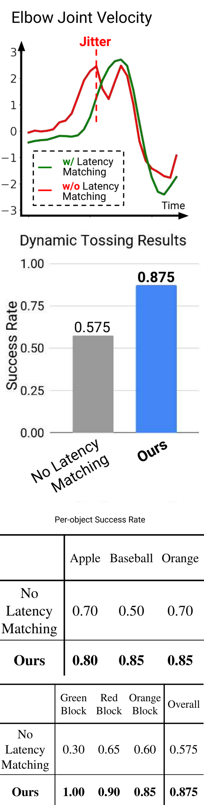

论文 Fig. 8b/c tossing row。为手机阅读将原图三块竖排：上为肘关节速度，中为成功率，下为按列分成两段的各物体数据（重复原行标签）。绿色时延对齐、红色未对齐；表按物体统计。

上方曲线看肘关节速度随时间的变化，绿色时延对齐、红色未对齐；中间柱图看最终成功率，下表按六种物体列数据。红线的抖动显示轨迹响应出了问题；正文还指出，夹爪与机械臂的执行延迟不同，会让释放时机变差。只追踪机械臂轨迹不够，松手也要落在合适的运动阶段。模型权重相同而结果不同，把一部分收益明确指向了执行接口。

附录还有一个会影响数字解释的判据：物体碰到桶底后弹出去，仍算成功；弹回桌面后再抓起投中，也可以计为成功。这里测的是在给定回合规则下把物体投进目标的能力，不要求每件都一次出手、稳定留在桶里。<!-- evidence:C44 -->

### 6.3 双手叠衣：各管各的还不够

叠衣有250条示范、两位示范者。两只手由一套集中策略控制。完整策略14/20成功；训练和推理都去掉双夹爪相对位姿后，成功降到6/20。它改变了训练输入，而非临时把已训模型的某一列置零。<!-- evidence:C23 -->

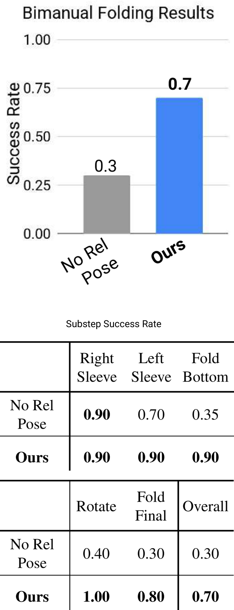

论文 Fig. 8c folding row。为手机阅读将柱图和表格竖排：上看去除双夹爪相对位姿与完整UMI的总成功率，下表按列分两段看各子步骤，重复原行标签。

上面比较完整成功率，下面逐步列成功情况。中间过程可能已经抓对衣角，却在折叠时因为两手关系不稳而走偏。双臂相对变换提供的正是第4.4节那项信息：另一只手相对我在哪里。只给各自局部历史，策略就得从其他信号间接猜这段关系。

“叠好”的人工判据是两袖折入、投影近似方形，面积约为衣服躯干部的四分之一，不要求达到熨平后的整齐程度。柔性物体的结果应和这套可观察判据一起读。<!-- evidence:C45 -->

### 6.4 洗碗：视觉预训练与恢复示范

洗碗使用一位示范者的258条数据，包含操作中再次加番茄酱后继续清洗的恢复示范。策略要拿盘子、用海绵擦、放下海绵、把盘子立回架上。采用CLIP预训练ViT-B/16并微调的方案完成14/20。<!-- evidence:C24 -->

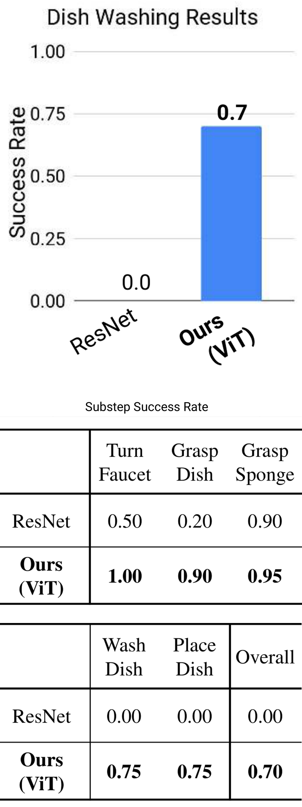

论文 Fig. 8c washing row。为手机阅读将柱图和表格竖排：灰色ResNet、蓝色ViT；下表按列分两段列子步骤和全任务，重复原行标签，样本数按正文分别说明。

灰色ResNet对照与蓝色ViT方案的总成功率差异很大。按正文记录，从头训练ResNet-34的对照是0/10；ViT方案是14/20。这里同时换了骨干架构和预训练，因而更适合把结果理解成“预训练视觉方案在这套任务上更有效”，不能仅归因于Transformer里的某一个算子。<!-- evidence:C25 -->

下方子步骤表帮助定位长任务在哪断开；正文描述ResNet方案会忽略盘子和海绵的位置变化，学到对观察变化不够敏感的行为。测试把小于5 mm的残留斑点视作干净，并要求盘子竖直回到架子；海绵放到槽边后滑进水槽，不会自动让整项任务判失败。<!-- evidence:C46 -->

我更关心恢复数据在这里的作用。再次加酱后继续擦，是示范里就出现的条件分支；策略在反馈里看见污渍，才有数据教它重新进入清洁动作。若把“会从中断中恢复”写成模型凭空发明的能力，就会漏掉数据设计这一步。

## 7 野外泛化：把杯子带出训练桌

前面四项能力仍在采集环境里测。原文第VI节另做了一组摆杯实验，把采集范围扩到30个地点：三位示范者累计12人时，采集1400条示范；RSS正文记载训练使用15种杯子，视觉编码器换为CLIP预训练ViT-L/14。<!-- evidence:C27 -->

Fig. 9 要回答的是：当背景和杯子外观都变了，策略还能否把同一件事做完？

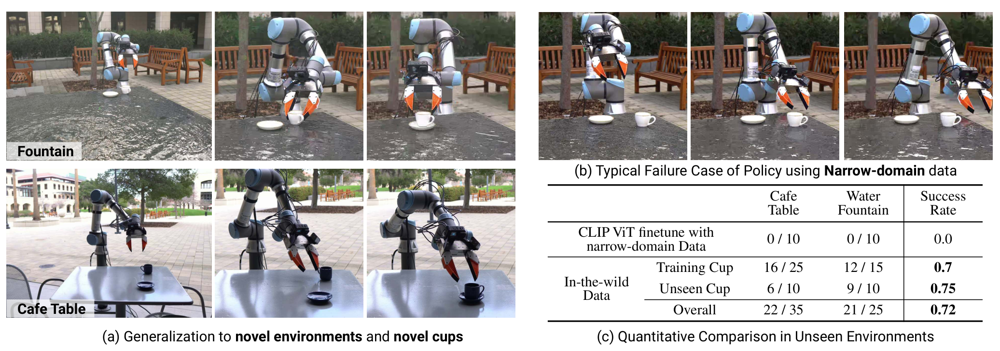

论文 Fig. 9。左为喷泉和咖啡桌的执行画面，右上是窄域数据训练的失败，右下按环境与杯子是否见过分组。

左边是咖啡桌和喷泉两处新环境的执行，右上展示只用窄域数据训练的策略在新环境里的失败，右下分环境、分见过与没见过的杯子给结果。画面说明环境差异，表格决定这组证据有多大。

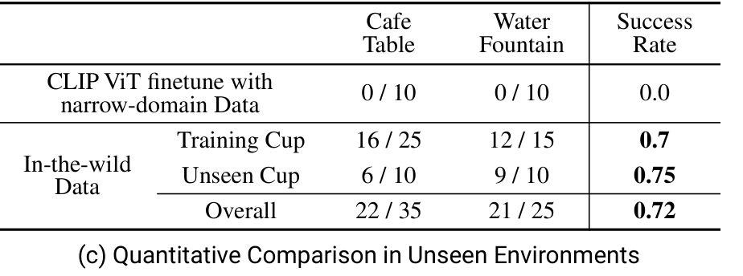

论文 Fig. 9c。两个未见环境分开列分子分母，训练杯与未见杯分开；合计43/60对应71.7%。

咖啡桌做35次测试，喷泉25次：前者是5种训练杯加2种测试杯，各5个初态；后者是3种训练杯加同样2种测试杯，各5个初态。测试新杯是未见过的深蓝色和棕色环纹外观。任务里的杯柄朝左，以该回合初始夹爪姿态为参考。<!-- evidence:C28 --><!-- evidence:C47 -->

| 杯子是否见过 | 两处新环境合计 |
| --- | --- |
| 训练杯 | 28/40，70% |
| 未见杯 | 15/20，75% |
| 全部 | 43/60，71.7% |

按地点合计则是咖啡桌22/35、喷泉21/25。未见杯的75%比训练杯70%高五个百分点，但两组杯子、样本和初态都不同，这里不需要给“新东西反而更容易”编一个机制。更稳妥的观察是：这60次新环境测试里，两组都出现了成功。<!-- evidence:C29 -->

只使用窄域数据、但采用同样预训练视觉骨干的基线，在两个新环境各0/10。这说明把接口做成能外出收数据，确实打开了一条改善跨场景表现的路线。不过1400条野外数据与窄域数据相比，同时增加了规模和多样性；若要单独回答“多地点比多收同地点更值多少”，还需要等量数据的控制实验。<!-- evidence:C30 -->

这组泛化发生在摆杯任务。换机械臂、换地点、换杯子是三种不同变化：第6.1节主要证实匹配末端接口下的跨机械臂，第7节证实更广采集后的摆杯迁移。把它们合起来，会得到更完整的数据接口证据，而不是一台已经什么家务都会做的机器人。

## 8 吞吐与精度：采得快，标得准

### 8.1 十五分钟里，真正留下多少示范

采集工具若只在执行动作时很快，重置却很慢，总吞吐仍可能低。论文让同一位操作者分别使用UMI、裸手和SpaceMouse遥操作，各采集15分钟，时间包含重置、随机化以及处理机器人故障。正文报告：摆杯时UMI超过SpaceMouse的三倍，达到裸手速度的48%；抛掷达到裸手的64%，SpaceMouse在该15分钟窗口内没有成功示范。<!-- evidence:C31 -->

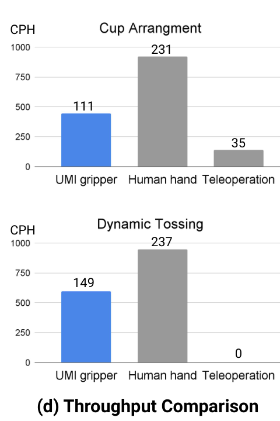

论文 Fig. 11d。上摆杯、下抛掷，横轴依次UMI、裸手和SpaceMouse遥操作。原图纵轴CPH与柱顶数字尺度不一致，因此只按正文比较吞吐比例，保留原图而不重标数值。

上面摆杯、下面抛掷，横轴依次是UMI、裸手和SpaceMouse。纵轴标CPH，即每小时循环数，但原图柱顶标签与柱高刻度不一致，所以这里保留原图，只使用正文明确给出的相对比例。这组比例已经能回答：同一段采集时间里，接口之间有多大差距。

这个协议把恢复和重置都算进时间，是因为它们也占用示范者。裸手依然更快：拿着有重量、有体积的平行夹爪，本来就在限制人的动作。这份限制换来了更接近机器人接口的数据，是否划算要看后续训练收益与采集需求。

### 8.2 六毫米的平均误差，意味着什么

数据标注的另一头是精度。作者用动捕作为参考，测了7个单手任务和7个双手任务，分别考察单个夹爪的绝对轨迹，以及两只夹爪之间的相对关系。<!-- evidence:C32 -->

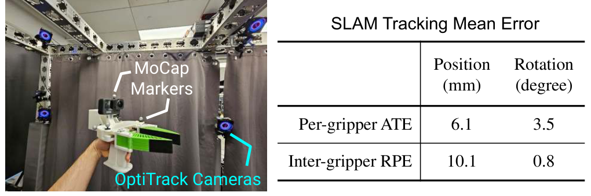

论文 Fig. 12。左为动捕对照设置，右表区分每夹爪绝对轨迹误差ATE与双夹爪相对误差RPE；两类误差都分别报告平移mm与旋转degree。

左侧是测量设置，右表把ATE与RPE分开：ATE看整条单夹爪轨迹与参考的差异，RPE看双夹爪间的相对变换误差；平移单位是毫米，旋转单位是角度。平均单夹爪ATE为6.1 mm、3.5°；双夹爪间RPE为10.1 mm、0.8°。这些是所测任务的平均量，不能拿来当每帧的最大误差上界。<!-- evidence:C32 -->

第4.4节说共同坐标变换会抵消，为什么双手还有10.1 mm？因为两条轨迹的误差不完全相同。共享地图让它们进入共同参考，并不保证两路估计永远同步偏向同一个方向。对柔软衣服，这种精度或许仍能完成折叠；对紧配合装配，更值得追问的是误差尾部、接触约束和后续修正能否承受。

## 9 局限：采集自由之后的约束

原文把限制落在三个地方。首先是机器人可行性：人的手持轨迹很自由，目标机械臂的关节、速度和工作空间却有边界。跨本体复用需要保留过滤与执行层适配。其次是SLAM：画面长期缺纹理，或有效特征被运动和遮挡破坏，离线恢复的标签会受影响。最后是手持接口本身：平行夹爪的自由度、体积和重量限制了可示范动作，也解释了为什么吞吐还追不上裸手。<!-- evidence:C33 -->

相对动作减少了相机与世界、机器人底座之间的外参负担，整个系统仍需要相机内参、惯性与时间信息、夹爪宽度等校准。省掉哪项标定，要和保留下来的采集步骤一起看。

这篇工作留给后续研究的一个具体问题是：**当数据越来越多，最先卡住的是视觉泛化，还是动作标签与执行接口的误差？**可以固定数据条数和策略架构，分别增加采集地点、改变可控时延误差、给轨迹标签加入已知扰动，再比较杯子、抛掷与紧接触任务。这样才能把“多收一些数据”与“把每条数据对准”各自的收益拆开。这是本文提出的后续实验思路。

## 10 结论：回到三个问题

**第一问，人类示范怎样变成动作标签？**人使用与机器人末端匹配的手持夹爪；视频和惯性数据离线恢复公制位姿，视觉标记恢复连续宽度，再过滤机器人不适合执行的轨迹。人类动作的灵活性被收进了一个更容易迁移的接口。

**第二问，换机器人怎样对齐？**视觉端尽量保持相机与手指关系一致；动作端把整段目标与历史位姿放在本轮当前末端坐标里，双手再加入彼此相对位姿；时间端把观测对到同一时刻，跳过过期动作，按每个执行器的延迟提前下发。空间和时间各解决一种错位。

**第三问，证据支持到哪里？**摆杯同一检查点从UR5的20/20到Franka的18/20；抛掷保持模型不变，时延匹配带来105/120对69/120；双手相对位姿对应叠衣14/20对6/20。扩大到30个地点采集后，摆杯在两处新环境得到43/60。它们共同说明接口设计能把机器人之外的数据送进可执行策略，同时把可达性、任务范围和评估判据留在明处。<!-- evidence:C18 --><!-- evidence:C22 --><!-- evidence:C23 --><!-- evidence:C29 -->

UMI 最值得带走的做法，是在按下录制键之前就想清楚：机器人以后会看见什么，能表示什么动作，又会在什么时刻真正做到。网络训练接在这条链上，链上的坐标和时钟也会决定训练成果能否落地。

继续读机制，可用 [ReadPaper skill](https://github.com/Zhu-Huixiang/ReadPaper)；整理全篇结构，可用 [DrawPaper skill](https://github.com/Zhu-Huixiang/ReadPaper/tree/main/drawpaper)。可复制地址： https://github.com/Zhu-Huixiang/ReadPaper

点击“阅读原文”进入本篇 GitHub 完整解读，查看高清原图、公式与可编译图源： https://github.com/Zhu-Huixiang/embodied-world/blob/main/articles/umi-2402.10329/README.md

---

公众号版由管理员在后台手动公开发表；永久文章链接待发表后补充。

关注公众号 **具身智能的 World**：

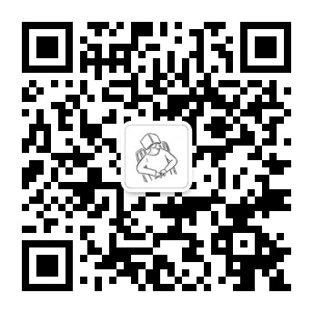

[原论文](https://www.roboticsproceedings.org/rss20/p045.html) · [证据索引](evidence.json)

[本篇知识星系](../../universe/papers/umi.md) · [知识点宇宙](../../universe/README.md)
