# ViT：把图片切碎，怎么就打过了卷积？

这里是「具身智能的 World」。我们沿着原文，把机器人背后的模型拆到能跟着算。

论文解读：讲清问题、模块、公式和实验。

论文地图：按研究方向找阅读路线。

顶会顶刊集锦：找到正式论文与原文入口。

解读日程：看看接下来准备精讲什么。

arXiv 新作：筛选值得追的研究。

具身榜：查看评分、出处和入选理由。

知识点宇宙：顺着一个技术，串起用过它的论文。

[GitHub 知识库](https://github.com/Zhu-Huixiang/embodied-world) · 可复制地址：`https://github.com/Zhu-Huixiang/embodied-world`

卷积神经网络教视觉模型看图，有点像带新同事认路：先看附近，再一层层扩大范围。同一套“小窗口”可以在整张图上巡逻，边缘、纹理、零件就这么逐渐拼成对象。

ViT 却说：**这些规矩，能不能少写一点？把图片切成小块，送进原本处理词序列的 Transformer，让块与块自己交流。**

这句话在小数据上不怎么硬气。原论文里，大号 ViT 只用 ImageNet 训练，甚至输给小号。让这条路线站住的是后面的规模实验：数据规模上去之后，原先的短板变成了可学习的东西。争论于是从“视觉一定要卷积吗”，转成了“先验该写进架构，还是交给数据买单”。<!-- evidence:C01 -->

先带着三个问题往下看：

1. 图片被切碎之后，位置和空间关系去哪了，Transformer 究竟在算什么？
2. 为什么 ViT 的大模型在小数据上吃瘪，换大数据又能翻身？
3. 分类分数很好看之后，怎么把这副“眼睛”接到新的任务，尤其是机器人身上？

**论文信息**

An Image is Worth 16×16 Words: Transformers for Image Recognition at Scale。Alexey Dosovitskiy、Lucas Beyer、Alexander Kolesnikov 等，Google Research Brain Team。2020 年 10 月 22 日首次公开；本文使用 arXiv v2（2021 年 6 月 3 日）。发表于 ICLR 2021，机器学习表征与方法研究的重要主会。<!-- evidence:C02 -->

[论文与附录](https://arxiv.org/abs/2010.11929v2) · [ICLR 页面](https://iclr.cc/virtual/2021/poster/3013) · [官方代码](https://github.com/google-research/vision_transformer)

**阅读目录**

- §1 引言：卷积给了什么，ViT 又拿掉什么。
- §2 相关工作：把注意力塞进 CNN，与直接处理块序列，有什么区别。
- §3 方法：切块、位置、注意力、CLS，以及迁移分辨率。
- §4 实验：先看数据规模，再看效果、计算成本和模型学到的空间结构。
- §5 结论：读懂 ViT 给机器人视觉留下的接口。

本图由 [DrawPaper skill](https://github.com/Zhu-Huixiang/ReadPaper/tree/main/drawpaper) 指挥 Codex，使用内置生图制作。

可复制地址：`https://github.com/Zhu-Huixiang/ReadPaper/tree/main/drawpaper`

先认路。**A 把图变成序列，B 让序列交换信息，C 从中读出类别。**训练时 D 用标签检查结果，梯度回到 A、B、C；换数据集时走 E，复用已经学过的编码器、换掉分类头。§3 负责拆这条链；§4 检查 D 得喂多少数据、B 花多少计算，以及 A 的位置能否真的被学懂。图里的鸟只是帮助认路，实验图随后看论文原版。

## §1 引言：少带一点“视觉常识”，代价谁出？

先别急着宣布 CNN 退役。卷积里写着两条很实用的常识。

第一，附近的像素常常有关，先局部处理不吃亏。第二，一个边缘移到别处，仍然是边缘，所以同一组卷积参数在不同位置复用。再靠多层网络扩大感受野，逐渐看见整件物体。这里的**归纳偏置**，就是模型还没看数据时，架构已经给它安排好的倾向。<!-- evidence:C03 -->

ViT 保留切块这个入口，却大幅减少内部的二维空间规矩。B 区每个 token 都有机会与其他 token 建立联系；并不规定“先只找邻居，隔壁的隔壁下一层再说”。连接放开了，训练数据也得跟上。数据不够，少了好用的提示，模型更容易学歪；数据足够，模型又有机会学出更灵活的联系。

**这篇论文真正挑战的假设是：高性能图像识别必须依赖卷积式的结构先验。**它拿大规模预训练与迁移实验回答这个问题，代表性的比较对象包括 BiT 的大 ResNet。别把标题理解成“16×16 个词”。16×16 是一个图像块的像素边长，块才是送入序列的单位。

## §2 相关工作：别只把方向盘换了，就说造了一辆新车

原文先回顾 CNN 中加注意力、局部注意力、以及用注意力替换部分卷积的路线。那些设计往往还保留多尺度层级或局部连接等视觉结构。

ViT 的主线更干脆：**先把二维图像转成一串向量，然后尽量复用标准 Transformer 编码器。**它也研究混合版本——先用 CNN 提取特征，再将特征图变成 token；但理解核心贡献，先盯住纯 ViT。别把混合版本的 CNN 前端偷偷塞回主架构。<!-- evidence:C03 -->

另一个背景是 iGPT 的逐像素序列。若一张 224×224 图把每个像素都当一个位置，会得到 50,176 个位置。注意力要两两配对，这可不是“多聊几句”，这是群聊消息爆炸。ViT 先切成较大的块，把序列压到几百个位置，计算才比较像能开得起的会议。

## §3 方法：这张图到底怎样穿过 Transformer？

### 3.1 A 区：切块不是把信息扔掉，是先换个包装

先给原图，整条计算线都在这儿。

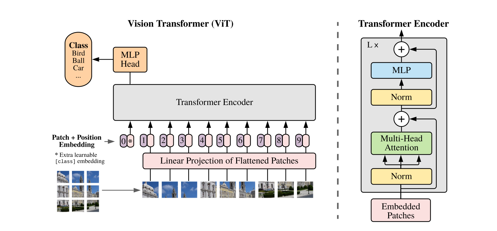

论文 Fig. 1。沿左侧图片块、线性投影、位置编号往上读；右侧展开一个 Transformer 编码器块。

这不是有横纵坐标的曲线。左下方小方块代表图像块，下面编号表示序列位置；编号 0 处的特殊向量是 CLS。灰色的大盒子把整个序列送入编码器；顶部 MLP Head 接收 CLS 对应的输出，做图像级分类。右边的放大结构从下往上读：Norm、Multi-Head Attention、残差相加，再 Norm、MLP、残差相加。侧面的弯箭头就是“旧表示保留一份，和新算出来的内容相加”。<!-- evidence:C04 -->

设图像 x 的形状为 H×W×C。H、W 是高宽，C 是通道数；彩色图通常 C=3。每块边长 P，块数 N=HW/P²。把每块拉直，得到 N 行、每行 P²C 个数的矩阵 Xₚ。D 是 token 的特征宽度；E 是把像素块映射到 D 维的可学习矩阵。

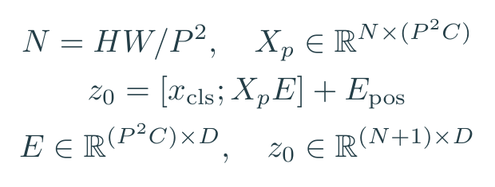

公式 1｜原文 Eq. (1)：图像块投影、CLS 和位置嵌入共同组成输入序列。

方括号里的分号表示沿序列方向拼接。x_cls 是可学习的分类向量；E_pos 是每个位置自己的 D 维嵌入；z₀ 是进第一层前的完整序列。

举个可以当场算的配置：224×224 彩色图，P=16。每行 14 块，一共 196 块。每块 16×16×3=768 个数。ViT-B 的 D 也是 768，所以 E 恰好是 768×768；**这两个 768 撞数了，含义不同**：前者是原始像素数量，后者是设计选定的特征宽度。加上 CLS，z₀ 变成 197×768。<!-- evidence:C04 -->

位置嵌入干什么？如果所有 token 都无差别地参加交流，模型很难区分“头在翅膀上面”和“头在翅膀下面”。E_pos 给每个位置一个可以学习的地址。原文采用普通的一维位置嵌入，并不是先造一套复杂的二维地图；空间关系会在训练里逐渐出现。

### 3.1 B 区：注意力不是“看见重点”的黑箱

先拆一个注意力头。令 Z 表示经过层归一化的输入，形状 S×D，其中 S=N+1。一个头用投影 U_qkv 产生 Q、K、V：查询、键、值；三者各为 S×d_h。d_h 是单头宽度，ViT-B 有 12 个头，所以 d_h=768/12=64。

> 基础扫盲｜可以把 Q 理解成“我现在想找什么”，K 是“我这里有什么”，V 是“真匹配上后，我给你什么内容”。这是三套不同的可学习投影，不是给向量换三个洋气的名字。

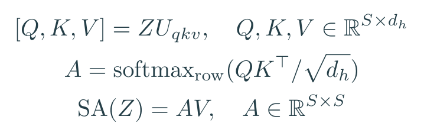

公式 2｜原文附录 A Eqs. (5)–(7)：相似度先变成权重，再加权汇总内容。

QKᵀ 的第 i 行、第 j 列，是位置 i 对位置 j 的匹配分数。除以 √d_h 用来控制分数尺度；softmax 沿一行归一化，让这一行的权重和为 1。A 是 S×S 的注意力矩阵。AV 则给每个位置生成一份信息汇总。注意，这里没有自回归的“只能看前面”遮罩：图像块之间可以双向交流。<!-- evidence:C05 -->

把维度缩小做一道教学算术：假设某个查询对三个位置的分数是 0、ln2、0。softmax 后为 0.25、0.50、0.25。三个位置提供的某一个值通道分别是 2、6、10，那么这个通道的输出就是 6。

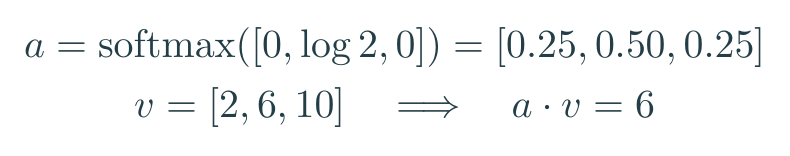

公式 3｜教学例子：一行注意力权重怎样把三个值汇成一个数。

这一步并没有选中一个位置、把其他位置全部删掉，而是按权重混合。多个头各做一套，拼回 D 维再投影。因此同一层可以同时探索不同联系。想想鸟的分类：有的头可能综合纹理，有的可能连接相距较远的部位。具体学成什么，要回头看实验，不能给每个头提前安排工种。

接着放回完整的 B 区。ℓ 是层号，L 是总层数，zℓ 是第 ℓ 层输出；LN 表示 LayerNorm，逐 token 归一化特征；MSA 表示多头自注意力；z′ℓ 是两段子层之间的中间结果。

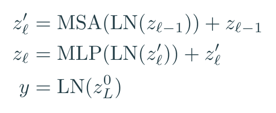

公式 4｜原文 Eqs. (2)–(4)：两次“归一化—计算—残差”，最后读 CLS。

第一段让 token 之间交流，第二段 MLP 则分别加工每个 token 内部的通道。以 ViT-B 为例，它先把 768 维扩到 3072，经过 GELU 非线性，再压回 768。W₁、W₂ 是这两次映射的矩阵，b₁、b₂ 是偏置，u 是 MLP 输入。

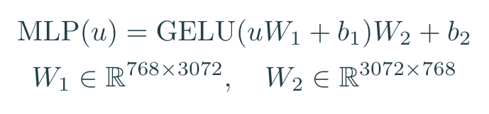

公式 5｜对原文 MLP 的教学展开：扩宽通道，做非线性变换，再回到残差所需的宽度。

加残差需要形状相同，所以 B 区里序列长度与输出宽度保持住：197×768 进，197×768 出。ViT-B 重复 12 层；ViT-L 为 24 层、宽度 1024；ViT-H 为 32 层、宽度 1280。这里的 B、L、H 是模型规模，不是图像块大小；“/16”才是 P=16。<!-- evidence:C06 -->

### 3.1 C、D 区：CLS 的“代表发言权”怎么来的？

输出 y=LN(z_L⁰)，上标 0 指 CLS 那个位置，不是零次幂。CLS 一开始只是可学习向量，经过一层层注意力，逐渐汇总对分类有用的内容。预训练时接带一层隐藏层的 MLP 分类头；换新任务时，换成新的线性头。<!-- evidence:C04 -->

接下来给分类算术补齐。s_k 是类别 k 的打分，K 是当前任务类别总数，c 是图像的正确类别。把打分转成概率 p_k，交叉熵损失就是正确类别概率的负对数。

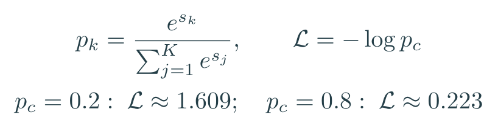

公式 6｜监督分类的教学展开：正确类别概率越低，损失越大。

正确类别只拿到 0.2，损失约 1.609；拿到 0.8，约 0.223。优化器沿梯度调整分类头、编码器、块投影和可学习嵌入。这个训练目标可没直接说“鸟头必须在某个位置”。空间、纹理、部位关系能否长出来，要看它们对大量样本的分类有没有帮助。

也别把 CLS 神化。附录 D.3 比较 CLS 与全局平均池化：最初平均池化吃亏，重新调学习率后差距消失。**CLS 是好用的读出接口，但“没有 CLS 就不能分类”不是这篇的结论。**<!-- evidence:C07 -->

### 3.2 E 区：换了大图，座位表不能原封不动

迁移到新数据集时，丢掉旧分类头，加一个 D×K 的新线性头，并整体微调。原文发现用更高分辨率微调有帮助。块大小 P 保持不变，图片变大，token 数量就增加。

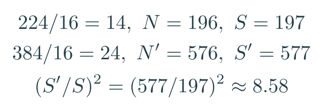

公式 7｜教学配置：从 224 到 384，固定 16 像素块后的序列增长。

14×14 块变成 24×24 块，旧位置表怎么放？原文把图像部分的位置嵌入恢复为二维网格，再做二维插值；CLS 的位置单独处理。注意力本身可以处理变化的长度，真正需要搬家的就是这个位置表。<!-- evidence:C08 -->

多了多少开销？单个头的注意力矩阵，从 197² 个元素变成 577² 个，约 8.58 倍。哦豁，图片宽高各放大不到两倍，聊天记录先膨胀八倍多，显存预算先红温了。<!-- culture:overheat -->**这是注意力矩阵元素数，不是整个模型运行时间直接乘 8.58。**投影、MLP、硬件效率都还在账上。

## §4 实验：先把“靠数据还是靠架构”这笔账算清

### 4.1 设置：它到底吃了多少数据？

原文使用 ImageNet、ImageNet-21k 和 JFT，约 130 万、1400 万、3.03 亿张图像。主线是有标签的预训练，之后迁移到分类数据集与 VTAB 的 19 个任务。VTAB 每个任务只有 1000 个训练样本，包含自然图像、专门领域和结构性任务。<!-- evidence:C09 -->

这里要分清三种读法：**整体微调**会更新编码器；**线性评估**冻结编码器，只学简单读出；**少样本评估**限制每类能用的标注数量。这三种结果不能混到一栏里排大小。

### 4.2 与强基线比较：同样是“省算力”，省在哪？

先看论文的总成绩表。它回答的是：大规模预训练之后，ViT 能否与强 CNN 比，并交出怎样的训练预算？

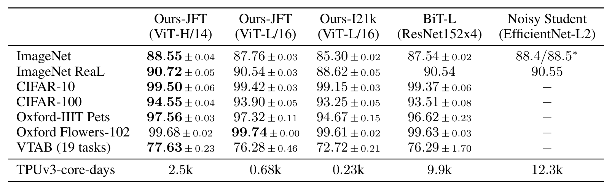

论文 Table 2。先按列确定预训练模型，再沿行比较同一数据集；底行单列预训练计算成本。

表的列是 ViT-H/14、ViT-L/16 等不同模型及预训练设置，行是 ImageNet、CIFAR、VTAB 等评测。分类数字通常是准确率，越大越好；最后的 TPUv3-core-days 是预训练资源，越小越省。它不是精度行，也不是端到端部署延迟。

抓两组值得记住的数：

| ImageNet 设置 | Top-1 |
| --- | ---: |
| JFT 预训练 ViT-H/14 | 88.55±0.04% |
| JFT 预训练 ViT-L/16 | 87.76±0.03% |
| BiT-L，ResNet-152×4 | 87.54±0.02% |

预训练资源对应为 2.5k、0.68k、9.9k TPUv3-core-days。平均数与波动来自 3 次微调；ImageNet 这里还对 L/16 使用 512 分辨率、H/14 使用 518 分辨率及权重平均。它们并非本节前面演算的 224 配置。<!-- evidence:C10 -->

这组结果让“纯 Transformer 做图像识别不行”很难继续成立。但看表也得具体：VTAB 上 ViT-L 为 76.28，BiT-L 为 76.29；真正更高的是 H/14 的 77.63。把“大体很强”顺手写成“所有型号、所有任务都更强”，就把表看走样了。

### 4.3 数据需求：大模型吃瘪那张图，才是论文的转折

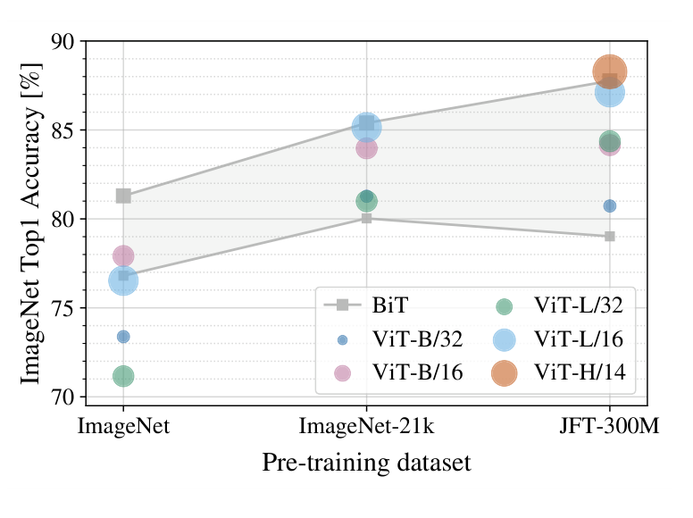

论文 Fig. 3。横轴是预训练数据集，纵轴是 ImageNet Top-1；不同颜色或形状区分模型。

先看左边的 ImageNet，小数据条件下大 ViT 没占到便宜；再往右看 ImageNet-21k、JFT，大 ViT 的表现变得有竞争力。灰色方点和折线给出 BiT 这条 CNN 路线的结果范围，帮助比较；横轴换了位置，也就换了预训练数据集。这个图直接回答第二个问题：**少结构先验的代价，在数据不够时最明显。**<!-- evidence:C11 -->

附录 Table 5 在统一 384 分辨率下给出更直观的对照：

| 预训练数据 | ViT-B/16 | ViT-L/16 |
| --- | ---: | ---: |
| ImageNet | 77.91% | 76.53% |
| ImageNet-21k | 83.97% | 85.15% |
| JFT | 84.15% | 87.12% |

大模型多了参数，却在第一行少了 1.38 个百分点；到第三行反过来多了 2.97 个点。规模带来的容量不是自动兑现的优惠券，训练数据与配方得把它用起来。这里用 Table 5 的统一设置解释趋势，不与刚才 Table 2 的专门调优结果逐位混算。<!-- evidence:C11 -->

作者还做了更控制变量的实验：从 JFT 取不同大小子集，而不是只换数据集名称。

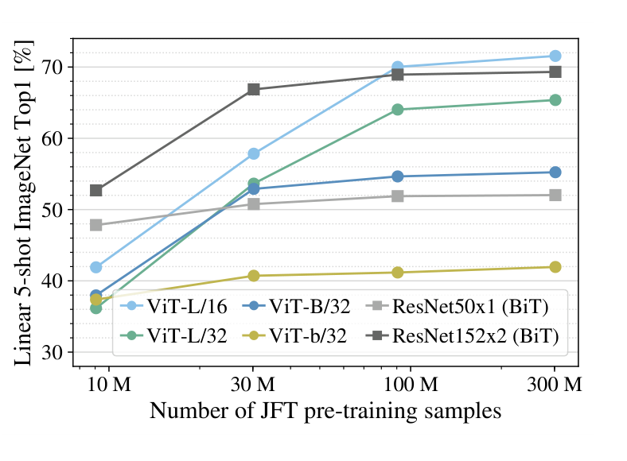

论文 Fig. 4。横轴是 JFT 预训练图像数量，纵轴是冻结表示后的 ImageNet 5-shot 准确率。

横轴 9M、30M、90M、300M 是数据规模；纵轴评估每类只用 5 个样本拟合线性读出。不同线对应模型。比较重点是曲线随数据量的变化，以及模型间相对次序。它不是“让 5 张图片直接教会整个 ViT”。原文固定大体训练超参、使用早停，这使数据量这根旋钮更容易被看见。<!-- evidence:C12 -->

这也让“归纳偏置”从术语变成可观察的问题：CNN 先替模型写了一些局部规则，低数据时少走弯路；ViT 让更多规则从数据里学。谁更划算，要看你手上是几百张机器人场景，还是大规模预训练资源。

### 4.4 扩展研究：大，得大在预算能换来收益的地方

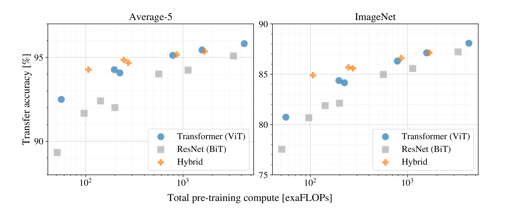

论文 Fig. 5。横轴是预训练计算量，左图纵轴是五个数据集平均准确率，右图是 ImageNet 准确率。

横轴使用对数刻度，单位是 exaFLOPs，即 10¹⁸ 次浮点运算；向右表示预训练更贵。纵轴越高，准确率越好。蓝色圆点、灰色方点和橙色十字分别代表 ViT、ResNet 与混合模型；每个点对应一个模型规模和训练设置。先横着比较：达到类似纵轴高度，哪条路线更靠左？再看同一类点：追加预算还有没有收获？<!-- evidence:C13 -->

在作者这套受控比较范围内，ViT 达到相近平均表现通常约少用 2–4 倍计算。混合模型在较小预算时有收益，大规模时纯 ViT 追上来。这里用的是已修正计算量的 v2 图。

回头看开头 A、B：块越小，序列越长，保留的细节更多，也会放大注意力的两两配对。这就是后续视觉模型一直在处理的预算问题。机器人有连续视频、多相机和实时控制，序列不会因为论文写完了就忽然变便宜。

### 4.5 检查内部：位置表有没有学出“附近”？

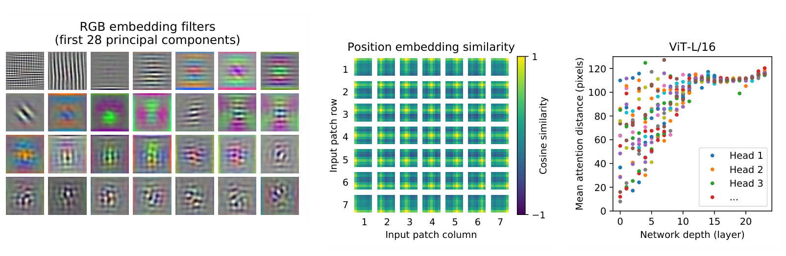

论文 Fig. 7。左边看块投影，中间看位置相似性，右边看不同注意力头的信息跨度。

这张图值得拆开看，不是三幅漂亮花纹的拼盘。

左侧每个小方块，是输入投影权重经过主成分分析后的可视化。**PCA** 可以理解成把一大堆变化方向压成几条最主要的轴。出现边缘和纹理样式，说明最早那层线性投影学到了有空间结构的基元；这不是直接给它预置了一套卷积滤波器。<!-- evidence:C14 -->

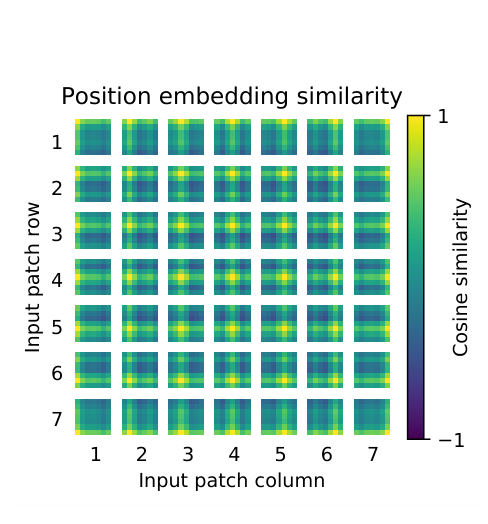

论文 Fig. 7 中间局部。大网格选一个位置，每张小热图显示它与所有位置嵌入的余弦相似度。

中间是 ViT-L/32 的 7×7 位置网格。每个格子里又是一张 7×7 热图；亮暗对应色条上的相似度，范围从 −1 到 1。看某个位置周围是不是更亮、同行同列有没有结构，就能判断位置嵌入是否形成空间规律。这里的坐标是块位置，不是时间步。

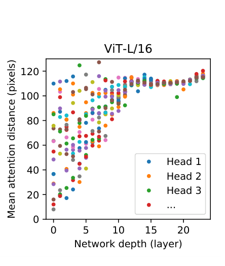

论文 Fig. 7 右侧局部。横轴为网络深度，纵轴为平均注意力距离，单位是输入像素。

一个点表示某层的一个注意力头：按注意力权重计算，它平均从多远的位置取信息。早期就有局部头和远距离头；往深层走，更多头覆盖较大范围。点的位置说明信息跨度，不直接等于某个头“懂鸟嘴”或“懂翅膀”。

**第一问的答案到这里完整了：位置通过可学习地址进入，块通过注意力交换内容；空间规律既被入口保留，也在大规模监督中长出来。**CLS 则把这些变化汇成图像级读出。不是图片切碎后“玄学地又看懂了”。

### 4.6 自监督：下一条路线已经露头，但还没走完

原文最后试了 masked patch prediction：随机选一半位置，其中 80% 替换成遮罩、10% 换随机块、10% 保留，预测粗量化的块颜色。ViT-B/16 取得 79.9% 的 ImageNet 准确率，比从头训练约高 2 个点，仍落后大规模监督预训练约 4 个点。<!-- evidence:C15 -->

这个分支回答一个更尖锐的问题：D 区一定要靠海量人工标签吗？ViT 这里给了初步方向。后面的 MAE 会重新设计遮罩比例和编码器/解码器分工；它不是把本节的流程原样放大。读 MAE 时，可以拿这段作为对照，看看“同样是遮住图片”究竟改了哪些接口。

## §5 结论：机器人需要的，常常不是最后那个类别

ViT 的贡献是把一种可扩展的视觉接口做实了：**图像块→token→可交互的表示。**大规模数据能让弱视觉先验的标准 Transformer 学到很强的迁移特征。代价也摆得很明白：数据需求、序列长度、计算预算，缺一笔都算不完整。

再回答最初三个问题：

**切碎后怎么保留空间？**每块的像素先投影，位置嵌入提供地址，注意力按内容聚合；模型内部的空间结构可以用位置相似性和注意力距离具体检查。

**为什么大模型会先输后赢？**容量要靠足够的数据与训练配方兑现。ImageNet 那一行与 JFT 那一行，给出了很直观的翻转；卷积的局部先验在低数据条件下依然值钱。

**怎样接到新任务？**保留学好的编码器，按任务换读出方式并微调。分类可以用 CLS，定位或操作可能更需要多个 patch token，告诉后续模块“东西在哪里、附近是什么”。这属于把视觉表示接进系统的设计问题；ViT 原文的实验终点是图像识别与迁移。<!-- evidence:C16 -->

对具身智能，我更在意第三点。机器人要拿杯子，最后一句“这是杯子”还不够；它需要可供定位、融合和控制使用的视觉信息。ViT 给了后续模型一套整齐的向量接口，但该保留多少空间细节、读出哪些 token、能否赶上控制频率，仍要落到具体任务上算。

这篇把“我替模型规定多少常识”和“我愿意付多少数据与算力”变成了一组可以实验比较的选择。后面读 MAE、DINO，正好继续追问：如果不喂类别标签，这些 token 还能学到什么？

论文入口：[arXiv v2](https://arxiv.org/abs/2010.11929v2) · [官方实现](https://github.com/google-research/vision_transformer)

精读工具：[ReadPaper skill](https://github.com/Zhu-Huixiang/ReadPaper) · [DrawPaper skill](https://github.com/Zhu-Huixiang/ReadPaper/tree/main/drawpaper)

可复制地址：`https://github.com/Zhu-Huixiang/ReadPaper`

点击「阅读原文」进入 GitHub，查看高清图、公式、图源与知识点之间的联系。

---

公众号版由管理员在后台手动公开发表；永久文章链接待发表后补充。

关注公众号 **具身智能的 World**：

[原论文](https://arxiv.org/abs/2010.11929v2) · [证据索引](evidence.json)

[本篇知识星系](../../universe/papers/vit.md) · [知识点宇宙](../../universe/README.md)
