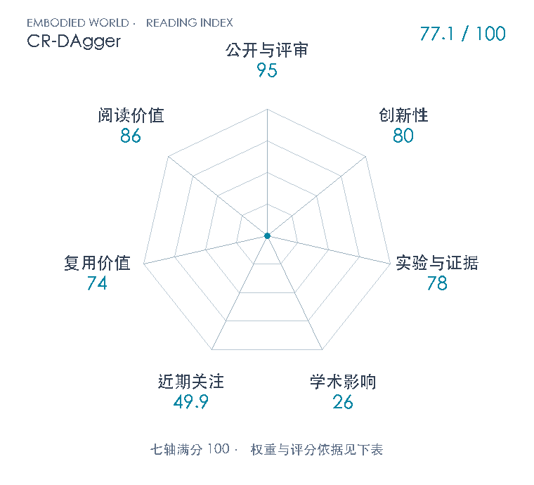

# Compliant Residual DAgger: Improving Real-World Contact-Rich Manipulation with Human Corrections

**CR-DAgger** · NeurIPS 2025 · 本版排名 106 · 综合分 **77.1 / 100**

[解读导读](../../../library/cr-dagger.md) · [操作与动作块](../../../paper-map/README.md#track-manipulation) · [NeurIPS集锦](../../../venues/NeurIPS/README.md)

[知识星系](../../../universe/papers/cr-dagger.md) · [原文](https://proceedings.nips.cc/paper_files/paper/2025/hash/cbf883a744952d4a40591271a58ab9d0-Abstract-Conference.html) · [PDF](https://compliant-residual-dagger.github.io/files/CR_DAgger_extended.pdf) · [阅读卡片](../../../library/cr-dagger.md)

论文出处：[**Xiaomeng Xu**](../../origins/papers/cr-dagger.md) [斯坦福大学](../../origins/papers/cr-dagger.md)

## 机制简析

CR-DAgger保留低频扩散基策略，通过顺应式动觉接口在策略继续运行时采集人的位置增量和接触力纠正。扩展稿用参考速度跟踪和硬件时延对齐避免微小纠正标签被控制滞后淹没。冻结视觉编码器，力历史经时间卷积，与状态共同输入轻量残差头；残差推理循环约50Hz，每次预测5个间隔0.02s的15维动作（9维位姿表示与6维目标力/力矩），由500Hz导纳控制器执行基准动作加局部修正。无干预段学零残差，并对纠正附近数据重采样，避免用少量新数据直接改坏完整基策略。

带着这个问题读：为什么人把机器人推回正确方向，训练出的策略反而会变差？纠正的采集方式、控制延迟和残差学习分别解决什么？

初读判断：80：顺应纠正接口让人能在原策略运行中给位置与力增量，配套冻结基策略的力感知残差学习；扩展版具体处理追踪滞后导致的意图误读。DAgger、残差学习、导纳控制各有前作，贡献是重要接口及组合机制，不另称全新方法家族。 78：四项真实接触任务，多种同数据更新基线，接管/on-policy与力模态、采样/批次、残差头的对照，补充轨迹和阶段成功诊断。仍为单平台20–32回合规模，多训练seed与不确定性缺失，不到跨域系统验证。 74：专属MIT代码含actor/learner、基策略与残差训练说明、控制配置及依赖来源；算法与接口能迁移，但力传感、动觉采集和C++硬件/导纳栈增加工程门槛，未本地复现或核全套预训练权重。 86：把纠正数据分布、保留既有策略能力、接触力与控制跟踪误差连在一起，提供从模仿学习走向真实接触部署的清楚桥梁；适合作为DAgger/残差控制专题，而非所有具身任务前置。

## 七维评分

<picture>
  <source media="(prefers-color-scheme: dark)" srcset="radar-dark.gif">
  
</picture>

[透明静态图](radar.svg) · [深色静态图](radar-dark.svg)

| 维度 | 分数 / 100 | 权重 |
| --- | --- | --- |
| 公开与评审 | 95.0 | 30% |
| 创新性 | 80 | 20% |
| 实验与证据 | 78 | 20% |
| 学术影响 | 26.0 | 10% |
| 近期关注 | 49.9 | 5% |
| 复用价值 | 74 | 8% |
| 阅读价值 | 86 | 7% |

刊会依据：[NeurIPS 2025](../../../venues/NeurIPS/README.md)，正式出处见[出版/原文记录](https://proceedings.nips.cc/paper_files/paper/2025/hash/cbf883a744952d4a40591271a58ab9d0-Abstract-Conference.html)；采用2026-10-10刊会快照。

公开与评审依据：完整可追溯作者稿满足公开阶段60；同研究原版正式NeurIPS主会按既有profile95计公开与评审最高阶段，不臆造IJRR等级或JIF。；正式刊会按登记量表计分，取较高阶段。

编辑深度：通读作者扩展PDF14页含A.1–A.6与参考文献；目视完整9/10/14页核Fig9、12、13、14坐标与数字。此为机制与实验初读筛选，尚未制作完整精讲、未复现代码。；评分记录：2026-11-04。

计量来源：OpenAlex；NeurIPS 2025 original research record linked to arXiv:2506.16685; journal extension citations not summed；匹配题目：Compliant Residual DAgger: Improving Real-World Contact-Rich Manipulation with Human Corrections。累计被引 **7**，2025–2026 被引 **7**；快照：2026-11-04T08:37:28.460727+08:00。

[指标记录](https://api.openalex.org/works/https://doi.org/10.48550/arXiv.2506.16685) · [文献计量条目](https://openalex.org/W4415202784)

### 影响与关注的计算依据

- **学术影响 26.0**：身份匹配的累计引用C=7，对数压缩上限3000。 [依据1](https://api.openalex.org/works/https://doi.org/10.48550/arXiv.2506.16685)
- **近期关注 49.9**：github 的论文专属入口：GitHub Star=98；按10000上限对数压缩。 [依据1](https://compliant-residual-dagger.github.io/) · [依据2](https://github.com/yifan-hou/cr-dagger)

### 论文公开入口与传播快照

- [project 入口](https://compliant-residual-dagger.github.io/)

| 平台 / 入口 | 公开计量 | 统计范围 | 快照 |
| --- | --- | --- | --- |
| [github](https://github.com/yifan-hou/cr-dagger) | GitHub Star 98；GitHub订阅关注 1；GitHub Fork 4 | single_paper；创建于近期窗口内的单篇官方仓库累计快照 | 2026-11-04T08:37:29.820012+08:00 |

[传播数据与采用依据](../../social-signals.json)保留归属、统计窗口与计分信号。
[评分说明](../../methodology.md) · [返回具身榜](../../README.md) · [论文地图](../../../paper-map/README.md)
