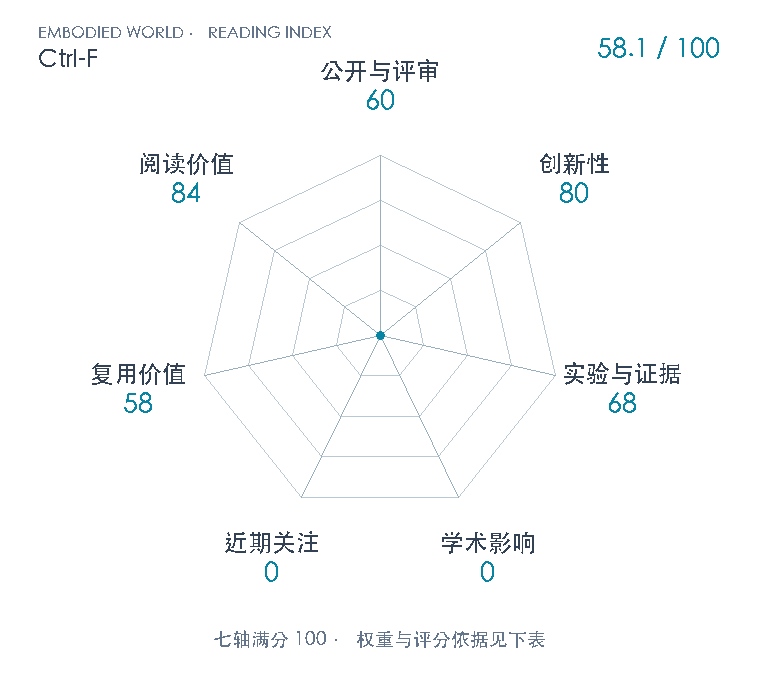

# Ctrl-F: Force as an Interface for Humanoid Loco-Manipulation

**Ctrl-F** · arXiv 2026 · 本版排名 133 · 综合分 **58.1 / 100**

[解读导读](../../../library/ctrl-f.md) · [Locomotion 与运动适应](../../../paper-map/README.md#track-locomotion) · [arXiv集锦](../../../arxiv/README.md#paper-ctrl-f)

[知识星系](../../../universe/papers/ctrl-f.md) · [原文](https://arxiv.org/abs/2611.05507v1) · [PDF](https://arxiv.org/pdf/2611.05507v1) · [阅读卡片](../../../library/ctrl-f.md)

论文出处：[**Mengjie Zhao / Yuxin Chen**](../../origins/papers/ctrl-f.md) [加州大学伯克利分校](../../origins/papers/ctrl-f.md)

## 机制简析

低层运动–力跟踪器读取参考动作、本体状态与每接触刚体三维力，输出全身关节位置目标。无物体训练时按可施力mask采样f并施加−f，沿原运动跟踪目标学习；力幅度从零递增。冻结低层后，高层读取机器人/物体参考、物体接触点、物体实测状态和本体状态输出f。解析教师用PD位姿速度反馈、Newton–Euler及重力/摩擦补偿求六维W*，再按Gf≈W*和可行力集合分配。教师使用训练时真实质量；高层用在策略访问状态上的模仿目标和PPO联合训练，模仿权重衰减。部署不输入质量或测得接触力，仍依赖AprilTag物体姿态。

带着这个问题读：跟得像的动作为什么会抓不住重物？把每个接触部位的力独立发成指令，能否在保持全身跟踪时随负载变化调整施力？

初读判断：80：把每个指定接触刚体的三维力做成全身运动跟踪的显式接口，并用无物体反向外力训练连接低层与物体反馈高层，改变重要控制接口。解析力分配、PPO、DAgger/DAPG均继承已有思路，未宣称首次力控制。 68：同权重正确/关掉/反向力指令、BC消融、负载扫描和冻结高层的实机对照支持核心机制；九任务及三家族有多方面可读证据。仿真分母/seed未列，RL-only仅定性，硬件仅2kg抬箱明报9/10，多数任务为演示；completion图注口径有冲突，未达到80分的充分多方面统计验证。 58：完整版本原文、解析接口和作者浏览器策略演示可参考，但无专属训练仓库链接或完整网络/损失/超参配方，三家族分别训练且新动作需重训；不把mjlab共享仓库当该论文官方代码，也未将浏览器展示当复现。 84：连接运动模仿、接触力、解析物体动力学教师和在线反馈，适合区分抗扰能力与主动施力，也能训练对质量倍率、测力精度和成功率分母的理解。不是所有机器人方法共同前置。

## 七维评分

<picture>
  <source media="(prefers-color-scheme: dark)" srcset="radar-dark.gif">
  
</picture>

[透明静态图](radar.svg) · [深色静态图](radar-dark.svg)

| 维度 | 分数 / 100 | 权重 |
| --- | --- | --- |
| 公开与评审 | 60 | 30% |
| 创新性 | 80 | 20% |
| 实验与证据 | 68 | 20% |
| 学术影响 | 0 | 10% |
| 近期关注 | 0 | 5% |
| 复用价值 | 58 | 8% |
| 阅读价值 | 84 | 7% |

公开与评审依据：完整可追溯公开稿按既有量表60，不由作者机构或视频提升评审阶段。；当前阶段为预印本公开。

编辑深度：15页主文和参考文献完整阅读；arXiv源包无附录。PDF页1/4/5/6/7/8/9/10/11/12目视检查身份、方法、原图、坐标/图例、表格和硬件条件。没有运行代码、策略demo或自行重复实验。；评分记录：2026-11-06。

累计引用与近期引用尚未匹配；原始值保留null。下面列出已定位的评分信号。

### 影响与关注的计算依据

- **学术影响 0**：未匹配引用计量：S2限流429，OpenAlex精确DOI404；本次没有独立实质技术采用证据，按既有证据量表起点0，原始citation_count保留null。 [依据1](https://arxiv.org/abs/2611.05507v1) · [依据2](https://arxiv.org/pdf/2611.05507v1) · [依据3](https://forcectrl.github.io/) · [依据4](https://api.semanticscholar.org/graph/v1/paper/ARXIV:2611.05507?fields=title,year,authors,externalIds,citationCount,influentialCitationCount,publicationDate,venue) · [依据5](https://api.openalex.org/works/https://doi.org/10.48550/arXiv.2611.05507) · [依据6](https://huggingface.co/api/papers/2611.05507)
- **近期关注 0**：HF精确论文404，官网无阅读量，未定位专属仓库或合格独立讨论。按证据量表起点0，不把搜索结果数量、共享mjlab星数或作者粉丝记为论文关注。 [依据1](https://arxiv.org/abs/2611.05507v1) · [依据2](https://arxiv.org/pdf/2611.05507v1) · [依据3](https://forcectrl.github.io/) · [依据4](https://api.semanticscholar.org/graph/v1/paper/ARXIV:2611.05507?fields=title,year,authors,externalIds,citationCount,influentialCitationCount,publicationDate,venue) · [依据5](https://api.openalex.org/works/https://doi.org/10.48550/arXiv.2611.05507) · [依据6](https://huggingface.co/api/papers/2611.05507)

零分表示本次快照已定位的信号处在量表起点；创新和实验两轴分别评价方法。

### 论文公开入口与传播快照

- [project 入口](https://forcectrl.github.io/)

[传播数据与采用依据](../../social-signals.json)保留归属、统计窗口与计分信号。
[评分说明](../../methodology.md) · [返回具身榜](../../README.md) · [论文地图](../../../paper-map/README.md)
