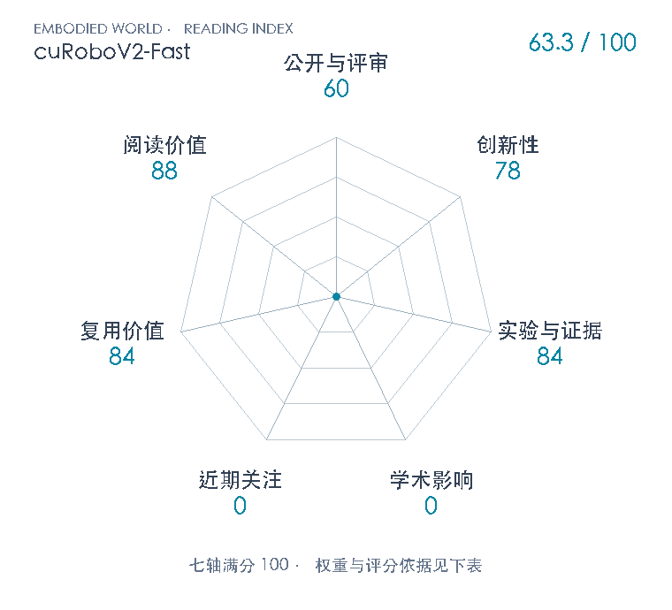

# cuRoboV2-Fast: Fast Torque-Limited Collision-Free Motion Planning

**cuRoboV2-Fast** · arXiv 2026 · 本版排名 122 · 综合分 **63.3 / 100**

[解读导读](../../../library/curobov2-fast.md) · [操作与动作块](../../../paper-map/README.md#track-manipulation) · [arXiv集锦](../../../arxiv/README.md#paper-curobov2-fast)

[知识星系](../../../universe/papers/curobov2-fast.md) · [原文](https://arxiv.org/abs/2611.06913v1) · [PDF](https://arxiv.org/pdf/2611.06913v1) · [阅读卡片](../../../library/curobov2-fast.md)

论文出处：[**Balakumar Sundaralingam**](../../origins/papers/curobov2-fast.md) [英伟达](../../origins/papers/curobov2-fast.md)

## 机制简析

用三次B样条降低轨迹优化变量耦合；直线种子不足时GPU双向RRT补路线。随后TimeOpt固定几何、以路径速度平方样条非均匀分配时间，局部支持产生带状Newton系统，预测校正复用Cholesky。运动学、碰撞与RNEA直接梯度共同减少每次迭代成本，负载惯量可运行时更新。

带着这个问题读：当规划只占抓取周期的1%，怎样同时缩短求解时间与受力矩限制的真实运动？

初读判断：创新78：局部支持TimeOpt、GPU原始对偶求解和全链计算优化具实质接口贡献，B样条与固定路径动力学是继承。证据84：匹配IK种子收敛、时间优化消融、多负载2590查询/重复、两硬件和内核分析、实机周期拆账；实机完成样本不等量且缺总失败分母，碰撞及约束为采样检查。复用84：原文公式和官方已公开TimeOpt/RRT实现可追溯，仍需CUDA硬件/机器人配置，未独立运行。阅读88：将几何路径、时间参数化、动力学约束和真实吞吐拆开，适合机器人规划控制路线。

## 七维评分

<picture>
  <source media="(prefers-color-scheme: dark)" srcset="radar-dark.gif">
  
</picture>

[透明静态图](radar.svg) · [深色静态图](radar-dark.svg)

| 维度 | 分数 / 100 | 权重 |
| --- | --- | --- |
| 公开与评审 | 60 | 30% |
| 创新性 | 78 | 20% |
| 实验与证据 | 84 | 20% |
| 学术影响 | 0 | 10% |
| 近期关注 | 0 | 5% |
| 复用价值 | 84 | 8% |
| 阅读价值 | 88 | 7% |

公开与评审依据：13页arXiv v1完整可追溯；官方Technical Reports页明确单列本研究，与2023 ICRA cuRobo和早期V2分开。；当前阶段为预印本公开。

编辑深度：13页v1正文§I–V及相关引文/官方项目、代码接口初读；完整关键页4/7/9/12目视，包含Eq3–6和Figs10–13/18–19。无单独附录，非全文解读，未复现。；评分记录：2026-11-06。

累计引用与近期引用尚未匹配；原始值保留null。下面列出已定位的评分信号。

### 影响与关注的计算依据

- **学术影响 0**：本次仅定位作者研究、官方代码与摘要转载，未定位本篇独立技术采用；按量表起点0，不挪用早期cuRobo影响。 [依据1](https://arxiv.org/abs/2611.06913v1) · [依据2](https://arxiv.org/pdf/2611.06913v1) · [依据3](https://research.nvidia.com/labs/lpr/curobov2-fast/) · [依据4](https://github.com/NVlabs/curobo) · [依据5](https://nvlabs.github.io/curobo/latest/technical_reports.html)
- **近期关注 0**：共享NVlabs/curobo累计1958star/20订阅/383fork不归单篇；HF404、无可核本篇X或阅读计数，保留未知。 [依据1](https://arxiv.org/abs/2611.06913v1) · [依据2](https://arxiv.org/pdf/2611.06913v1) · [依据3](https://research.nvidia.com/labs/lpr/curobov2-fast/) · [依据4](https://github.com/NVlabs/curobo) · [依据5](https://nvlabs.github.io/curobo/latest/technical_reports.html)

零分表示本次快照已定位的信号处在量表起点；创新和实验两轴分别评价方法。

### 论文公开入口与传播快照

- [project 入口](https://research.nvidia.com/labs/lpr/curobov2-fast/)

| 平台 / 入口 | 公开计量 | 统计范围 | 快照 |
| --- | --- | --- | --- |
| [github](https://github.com/NVlabs/curobo) | stars 1958；subscribers 20；forks 383 | shared_multi_paper；cumulative | 2026-11-06T08:40:33+08:00 |

[传播数据与采用依据](../../social-signals.json)保留归属、统计窗口与计分信号。
[评分说明](../../methodology.md) · [返回具身榜](../../README.md) · [论文地图](../../../paper-map/README.md)
