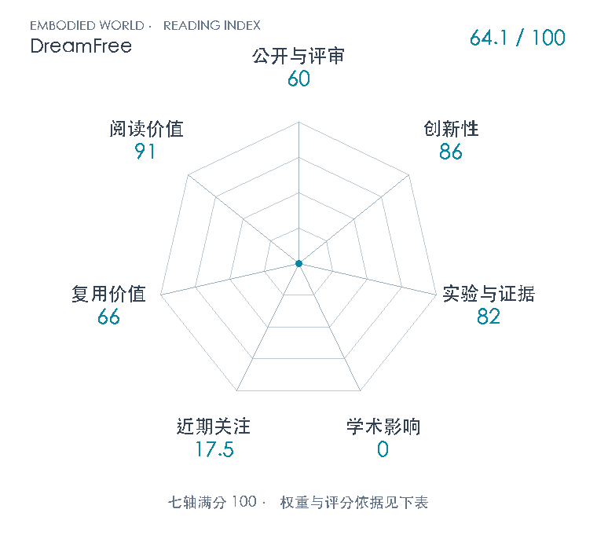

# Future Representation Distillation for Imagination-Free World Action Models

**DreamFree** · arXiv 2026 · 本版排名 118 · 综合分 **64.1 / 100**

[解读导读](../../../library/dreamfree.md) · [世界动作模型](../../../paper-map/README.md#track-world-action-model) · [arXiv集锦](../../../arxiv/README.md#paper-dreamfree)

[知识星系](../../../universe/papers/dreamfree.md) · [原文](https://arxiv.org/abs/2611.04527v1) · [PDF](https://arxiv.org/pdf/2611.04527v1) · [阅读卡片](../../../library/dreamfree.md)

论文出处：[**Jaehyeong Jo / Sangwon Jang**](../../origins/papers/dreamfree.md) [韩国科学技术院（KAIST）](../../origins/papers/dreamfree.md)

## 机制简析

先对机器人视频适配Wan，再冻结教师；学生用注意力mask让当前token只读当前观测和指令，投影成未来布局，与看过带噪真实未来的教师token做余弦蒸馏，同时保留视频流匹配正则。第二阶段冻结视觉编码器，用64个query读出预测特征，约1B动作DiT条件于指令、本体和DROID动作历史学流匹配。运行只单次视觉编码，动作仍去噪10或16步，输出32动作并执行指定前缀。

带着这个问题读：视频模型知道一些将来会发生什么，控制器是否必须先把未来逐帧画出来，还是能把预测知识压进当前帧表征？

初读判断：创新86：把未来信息显式蒸馏到当前表示，改变视频先验进入控制的接口；继承REPA/Fast-WAM/Perceiver与梯度隔离思想。证据82：两仿真基准、目标消融、冻结表征探针及带明确50次分母的实机对照，另有视频迁移；训练seed不确定性未给、部分基线沿报道、DROID预训练和部署条件不同、YAM仅定性，不能据8个百分点断言稳健统计优势。复用66：23页稿有公式、算法和超参，但DROID约16 H200一周且仓库main尚无实现；保留可学机制，未视作成熟工具。阅读91：连接视频表征、WAM、蒸馏、流匹配动作与执行时钟，能澄清视频预测是否必需。

## 七维评分

<picture>
  <source media="(prefers-color-scheme: dark)" srcset="radar-dark.gif">
  
</picture>

[透明静态图](radar.svg) · [深色静态图](radar-dark.svg)

| 维度 | 分数 / 100 | 权重 |
| --- | --- | --- |
| 公开与评审 | 60 | 30% |
| 创新性 | 86 | 20% |
| 实验与证据 | 82 | 20% |
| 学术影响 | 0 | 10% |
| 近期关注 | 17.5 | 5% |
| 复用价值 | 66 | 8% |
| 阅读价值 | 91 | 7% |

公开与评审依据：arXiv v1完整稿与附录可追溯，作者官方页称Technical report；未核正式录用/出版，不猜目标刊会；当前阶段为预印本公开。

编辑深度：23页v1正文§1–5、相关附录A–E及引用来源逐节初读；原图表关键完整页1/5/7/8/9/10/11/16/17/21/22目视。非完整精讲，未执行复现；评分记录：2026-11-05。

累计引用与近期引用尚未匹配；原始值保留null。下面列出已定位的评分信号。

### 影响与关注的计算依据

- **学术影响 0**：本次有界查找未定位独立技术采用；引用计数不可得保持null，采用量表暂用起点0，不宣称实际影响为零。 [依据1](https://arxiv.org/abs/2611.04527v1) · [依据2](https://arxiv.org/pdf/2611.04527v1) · [依据3](https://harryjo97.github.io/dreamfree/) · [依据4](https://api.github.com/repos/harryjo97/dreamfree)
- **近期关注 17.5**：github 的论文专属入口：GitHub star=4；按10000上限对数压缩。 [依据1](https://arxiv.org/pdf/2611.04527v1) · [依据2](https://harryjo97.github.io/dreamfree/) · [依据3](https://api.github.com/repos/harryjo97/dreamfree) · [依据4](https://github.com/harryjo97/dreamfree)

零分表示本次快照已定位的信号处在量表起点；创新和实验两轴分别评价方法。

### 论文公开入口与传播快照

- [project 入口](https://harryjo97.github.io/dreamfree/)

| 平台 / 入口 | 公开计量 | 统计范围 | 快照 |
| --- | --- | --- | --- |
| [github](https://github.com/harryjo97/dreamfree) | GitHub star 4；GitHub订阅关注 1；GitHub fork 0 | single_paper；2026-11-05单篇官方仓库实读 | 2026-11-05T09:10:30+08:00 |

[传播数据与采用依据](../../social-signals.json)保留归属、统计窗口与计分信号。
[评分说明](../../methodology.md) · [返回具身榜](../../README.md) · [论文地图](../../../paper-map/README.md)
