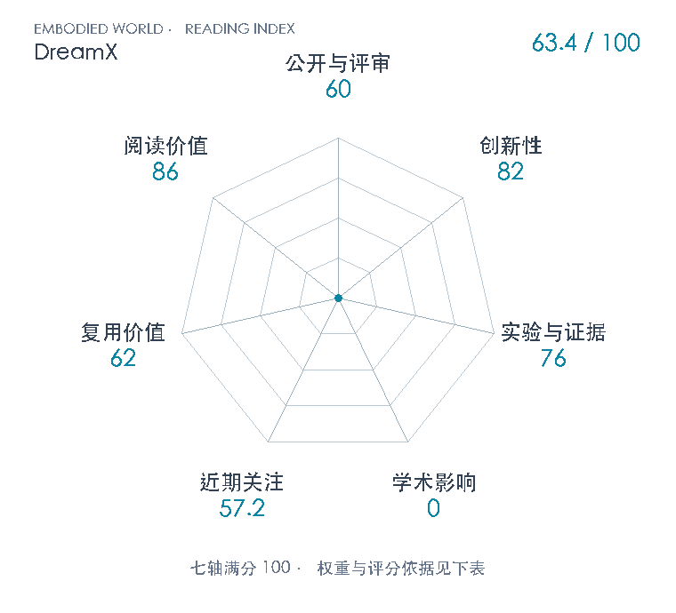

# DreamX: Video Diffusion Model is a Universal Latent Action Learner

**DreamX** · arXiv 2026 · 本版排名 121 · 综合分 **63.4 / 100**

[解读导读](../../../library/dreamx.md) · [视频动作模型与视觉推理](../../../paper-map/README.md#track-video-action) · [arXiv集锦](../../../arxiv/README.md#paper-dreamx)

[知识星系](../../../universe/papers/dreamx.md) · [原文](https://arxiv.org/abs/2611.05377v1) · [PDF](https://arxiv.org/pdf/2611.05377v1) · [阅读卡片](../../../library/dreamx.md)

论文出处：[**Jisoo Kim / Chaehyun Kim**](../../origins/papers/dreamx.md) [韩国科学技术院（KAIST） / 英伟达](../../origins/papers/dreamx.md)

## 机制简析

DreamX用Cosmos-Predict2.5 2B的时空特征直接读出动作latent：每个VAE潜帧分配4个可学习query，最长32个2048维token。编码与解码分别用rank16 LoRA，骨干冻结；解码器从首帧和query重建未来，有机器人标签时另加动作流匹配损失，视频流与动作流不互相注意。预训练混合约2.19k小时人/机器人视频。一个变分瓶颈再把每token压到32维；下游策略由当前画面和文字预测这些code，动作DiT读取latent特征和本体状态，不在控制时生成未来视频。源视频迁移则冻结编码器/解码器，换目标首帧生成视频，或换目标初始状态解码开放环动作。

带着这个问题读：视频重建好为什么未必学会可迁移动作？把动作从视频骨干内部读出，能否把外观留给生成先验，并让控制时少生成一段视频？

初读判断：创新82：把视频生成骨干内部时空特征作为latent动作编码器，并用同源生成先验与紧凑瓶颈连接表示、跨本体迁移及动作策略，改变重要动作接口。LoRA、query pooling、VAE与flow目标均有继承；未做骨干/预算完全匹配的原创组件归因。 证据76：公共probe覆盖多数据集，H&R1008clip生成迁移、三配置实机及动作监督/latent条件/扰动分析相互支撑。实机仅每配置10次，开放环动作迁移定性，基线预训练不同，CALVIN split/回合/seed与测时硬件缺失，未达到跨域闭环系统验证。 复用62：完整原文/附录、公开数据配方与LoRA/瓶颈训练设置可学；项目Code soon，未取得可运行专属代码或权重，2B骨干和2H200训练带来工程门槛。不能按已开源成熟工具评分。 阅读86：把视频表征、动作latent、生成迁移与控制效率串起，适合辨析何时需要生成未来视频；96.7%子目标与实际推闭成功的区别也提供明确评测训练。不是所有控制任务共同前置。

## 七维评分

<picture>
  <source media="(prefers-color-scheme: dark)" srcset="radar-dark.gif">
  
</picture>

[透明静态图](radar.svg) · [深色静态图](radar-dark.svg)

| 维度 | 分数 / 100 | 权重 |
| --- | --- | --- |
| 公开与评审 | 60 | 30% |
| 创新性 | 82 | 20% |
| 实验与证据 | 76 | 20% |
| 学术影响 | 0 | 10% |
| 近期关注 | 57.2 | 5% |
| 复用价值 | 62 | 8% |
| 阅读价值 | 86 | 7% |

公开与评审依据：可追溯完整公开稿满足60；未核独立技术复现或正式录用，不由机构和项目传播提升公开评审阶段；当前阶段为预印本公开。

编辑深度：25页主文与附录A–D文本已读；PDF完整页1/4/5/6/7/8/9/15/16/17/18/19/24/25目视核机制、身份、表格与定性图。初读筛选非完整精讲或代码复现；评分记录：2026-11-05。

计量来源：Semantic Scholar；arXiv:2611.05377v1；匹配题目：DreamX: Video Diffusion Model is a Universal Latent Action Learner。累计被引 **0**，2025–2026 被引 **0**；快照：2026-11-05T09:10:54+08:00。

[指标记录](https://api.semanticscholar.org/graph/v1/paper/ARXIV:2611.05377?fields=title,year,authors,externalIds,citationCount,influentialCitationCount,publicationDate,venue) · [文献计量条目](https://www.semanticscholar.org/paper/c281e190866d4335e24eb8c2cf8da2c0733a272d)

### 影响与关注的计算依据

- **学术影响 0**：S2匹配引用0；本次未核到独立技术采用，按证据量表起点0，非实际学术影响总量为0。 [依据1](https://arxiv.org/abs/2611.05377v1) · [依据2](https://api.semanticscholar.org/graph/v1/paper/ARXIV:2611.05377?fields=title,year,authors,externalIds,citationCount,influentialCitationCount,publicationDate,venue) · [依据3](https://huggingface.co/api/papers/2611.05377) · [依据4](https://cvlab-kaist.github.io/DreamX/)
- **近期关注 57.2**：huggingface 的论文专属入口：HF论文赞=51；按1000上限对数压缩。 [依据1](https://huggingface.co/api/papers/2611.05377) · [依据2](https://arxiv.org/abs/2611.05377v1) · [依据3](https://cvlab-kaist.github.io/DreamX/) · [依据4](https://huggingface.co/papers/2611.05377)

零分表示本次快照已定位的信号处在量表起点；创新和实验两轴分别评价方法。

### 论文公开入口与传播快照

- [project 入口](https://cvlab-kaist.github.io/DreamX/)

| 平台 / 入口 | 公开计量 | 统计范围 | 快照 |
| --- | --- | --- | --- |
| [huggingface](https://huggingface.co/papers/2611.05377) | HF论文赞 51 | single_paper；近期窗口内新论文页的累计upvote快照 | 2026-11-05T09:10:54+08:00 |

[传播数据与采用依据](../../social-signals.json)保留归属、统计窗口与计分信号。
[评分说明](../../methodology.md) · [返回具身榜](../../README.md) · [论文地图](../../../paper-map/README.md)
