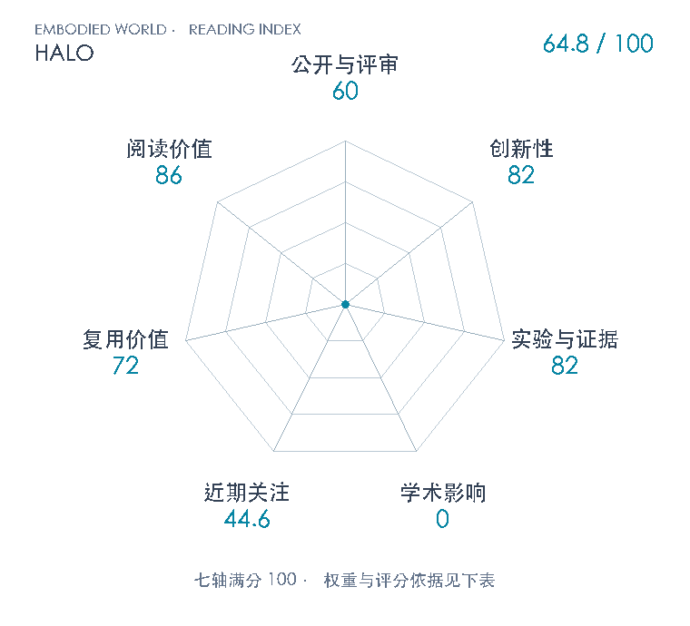

# Perceptive Humanoid Motion from Simulation

**HALO** · arXiv 2026 · 本版排名 117 · 综合分 **64.8 / 100**

[解读导读](../../../library/halo.md) · [动作先验与全身技能](../../../paper-map/README.md#track-motion-priors) · [arXiv集锦](../../../arxiv/README.md#paper-halo)

[知识星系](../../../universe/papers/halo.md) · [原文](https://arxiv.org/abs/2611.06908v1) · [PDF](https://arxiv.org/pdf/2611.06908v1) · [阅读卡片](../../../library/halo.md)

论文出处：[**Siyuan Hu**](../../origins/papers/halo.md) [苹果](../../origins/papers/halo.md)

## 机制简析

HALO先用INFINIGEN房间、KIMODO约束运动、场景摆放和第一视角渲染合成162698回合/296.3小时的视觉—指令—全身轨迹。冻结Qwen3.5-2B编码224×224RGB与文字，8层DiT以流匹配生成150×36的五秒骨盆相对计划；首15帧保持干净，学习接续135帧，并以15步Euler、约3Hz异步更新。低层先训练三类特权PPO专家，再按技能路由BC/DAgger蒸馏为深度学生，最后多critic PPO微调。共享跟踪器融合48×84深度、30步本体历史和计划，以50Hz输出29关节目标。上层VLM从自由语言选择有限技能并检查完成/重试，默认两台机载计算机协作。

带着这个问题读：机器人会做动作，为何到了陌生客厅还是不会坐？把大规模仿真监督、语义运动生成和深度跟踪分层，能否同时补上看懂目标与处理身体接触两道缺口？

初读判断：82：把程序化场景、受约束运动先验和第一视角渲染组成规模化全身监督，再以语义运动生成器、感知跟踪器、技能编排器贯通语言到29关节控制。贡献在数据与系统接口整合及异步连续执行，流匹配、RTC条件、PPO、DAgger等组件有清楚继承，不把组合写成全新算法。 82：六技能覆盖6000次仿真与360次实机，另有1500次仿真和30次实机组合任务；房间数、RTC、生成头、深度四组SIT仿真消融支持关键接口。实机只有6个单任务环境、组合任务仅1环境，未列多seed/误差条；回归比较同时失去RTC，跨论文Table I非匹配数值基线。 72：专属仓库已含数据生成、生成器、跟踪器、编排与部署真实代码及文档，原文细节较全。未执行复现；README明确不随仓库提供tracker权重，训练使用大规模GPU和改装G1双机系统，Apple自定义许可及第三方依赖须分别遵守。 86：把语义感知、几何接触、动作块连续性和sim-to-real分层，适合学习视觉全身控制为何不能只靠动作模仿；任务库、参考连续与物理安全边界也有清楚反例。并非所有机器人任务的共同前置。

## 七维评分

<picture>
  <source media="(prefers-color-scheme: dark)" srcset="radar-dark.gif">
  
</picture>

[透明静态图](radar.svg) · [深色静态图](radar-dark.svg)

| 维度 | 分数 / 100 | 权重 |
| --- | --- | --- |
| 公开与评审 | 60 | 30% |
| 创新性 | 82 | 20% |
| 实验与证据 | 82 | 20% |
| 学术影响 | 0 | 10% |
| 近期关注 | 44.6 | 5% |
| 复用价值 | 72 | 8% |
| 阅读价值 | 86 | 7% |

公开与评审依据：版本化完整原文可追溯，公开阶段60；未核正式录用或独立技术检验，不由机构、演示或代码发布自动升级评审阶段。；当前阶段为预印本公开。

编辑深度：20页主文及附录A–G全部文本已读；完整PDF页面1/2/5/7/10/11/12/13/17/18/19/20目视核原图、身份、机制与表格。此为原文筛选，未写完整精讲、未运行代码复现。；评分记录：2026-11-06。

累计引用与近期引用尚未匹配；原始值保留null。下面列出已定位的评分信号。

### 影响与关注的计算依据

- **学术影响 0**：没有得到身份匹配引用数，亦未核独立技术采用，按有来源证据量表起点0评分；原始引用保持null，0不代表实际影响总量。 [依据1](https://arxiv.org/abs/2611.06908v1) · [依据2](https://apple-aiml-research.github.io/ml-halo/) · [依据3](https://api.semanticscholar.org/graph/v1/paper/ARXIV:2611.06908?fields=title,year,authors,externalIds,citationCount,influentialCitationCount,publicationDate,venue) · [依据4](https://api.openalex.org/works/https://doi.org/10.48550/arXiv.2611.06908) · [依据5](https://github.com/apple-aiml-research/ml-halo)
- **近期关注 44.6**：github 的论文专属入口：专属GitHub仓库star=60；按10000上限对数压缩。 [依据1](https://arxiv.org/abs/2611.06908v1) · [依据2](https://apple-aiml-research.github.io/ml-halo/) · [依据3](https://github.com/apple-aiml-research/ml-halo) · [依据4](https://api.github.com/repos/apple-aiml-research/ml-halo)

零分表示本次快照已定位的信号处在量表起点；创新和实验两轴分别评价方法。

### 论文公开入口与传播快照

- [project 入口](https://apple-aiml-research.github.io/ml-halo/)

| 平台 / 入口 | 公开计量 | 统计范围 | 快照 |
| --- | --- | --- | --- |
| [github](https://github.com/apple-aiml-research/ml-halo) | 专属GitHub仓库star 60；GitHub订阅者 0 | single_paper；近期窗口内新建论文专属仓库累计star快照 / cumulative | 2026-11-06T08:33:06+08:00 |

[传播数据与采用依据](../../social-signals.json)保留归属、统计窗口与计分信号。
[评分说明](../../methodology.md) · [返回具身榜](../../README.md) · [论文地图](../../../paper-map/README.md)
