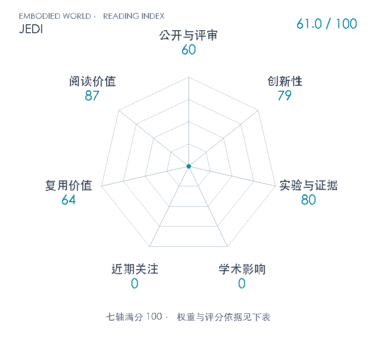

# JEDI: Joint-Embedding Demonstration Compression for In-Context Imitation Learning

**JEDI** · arXiv 2026 · 本版排名 127 · 综合分 **61.0 / 100**

[解读导读](../../../library/jedi.md) · [视觉语言动作模型 VLA](../../../paper-map/README.md#track-vla) · [arXiv集锦](../../../arxiv/README.md#paper-jedi)

[知识星系](../../../universe/papers/jedi.md) · [原文](https://arxiv.org/abs/2610.40356v1) · [PDF](https://arxiv.org/pdf/2610.40356v1) · [阅读卡片](../../../library/jedi.md)

论文出处：[**Jiazhao Liang / Zhewen He**](../../origins/papers/jedi.md) [纽约大学坦登工程学院 / 纽约大学阿布扎比分校人工智能与机器人中心 · 另1个机构](../../origins/papers/jedi.md)

## 机制简析

每段示范由4层Perceiver独立压成8个slot并缓存；π0的flow-matching动作专家读取查询观测与这些slot。辅助预测器在冻结V-JEPA2.1空间预测查询回合下一关键帧，对当前观测支路stop-gradient，使预测损失真正训练示范压缩器。错误任务和同任务不同过程的反事实margin约束保留目标/顺序。用示范间交叉预测误差和查询初图相似性选取一致示范，支持阶段性commitment；人类视频扩展经同平台真实posttraining，用手/物体关键点补充对应，不是任意人类视频免训练通用控制。

带着这个问题读：把一段演示压成几个token，怎么保证保留下来的正好是当前机器人要用的信息？让压缩结果预测当前回合的下一关键帧，能否同时保住目标和执行次序？

初读判断：创新79：查询未来预测和任务/过程反事实把示范压缩目标与策略使用场景对齐，缓存及一致性筛选扩展many-shot接口；Perceiver、JEPA与flow专家均有先例。证据80：匹配backbone/data/schedule/label消融、3seed仿真、多种语义与干扰控制、真实40次matched-context控制和成本表；自定义划分、单平台厘米级容差与有限实机试次限制外推。复用64：附录给slots、网络、超参、负样本和协议，缓存代价也可核；未定位作者实现，过程标签构造与真实posttraining仍有工程门槛。阅读87：把示范压缩、预测表征、因果依赖和上下文任务执行串成清楚研究问题，且揭示更多示范并不总更好。

## 七维评分

<picture>
  <source media="(prefers-color-scheme: dark)" srcset="radar-dark.gif">
  
</picture>

[透明静态图](radar.svg) · [深色静态图](radar-dark.svg)

| 维度 | 分数 / 100 | 权重 |
| --- | --- | --- |
| 公开与评审 | 60 | 30% |
| 创新性 | 79 | 20% |
| 实验与证据 | 80 | 20% |
| 学术影响 | 0 | 10% |
| 近期关注 | 0 | 5% |
| 复用价值 | 64 | 8% |
| 阅读价值 | 87 | 7% |

公开与评审依据：完整可追溯公开稿60；未核独立技术检验或正式刊会，不因大学/实验室知名提高；当前阶段为预印本公开。

编辑深度：读取v1主要正文pp1–9及相关实现/协议/消融附录pp13–20；关键方法pp3–6与全部实验协议已读，参考文献p10/12抽核；未宣称逐条读完参考文献。目视1/7/8/13/18/19/20完整页。 本次是有证据初读筛选，不是已写完整公开精讲，也未执行代码复现；评分记录：2026-11-02。

计量来源：Semantic Scholar；arXiv 2610.40356v1; 10.48550/arXiv.2610.40356；匹配题目：JEDI: Joint-Embedding Demonstration Compression for In-Context Imitation Learning。累计被引 **0**，2025–2026 被引 **0**；快照：2026-11-02T09:22:58.688420+08:00。

[指标记录](https://api.semanticscholar.org/graph/v1/paper/ARXIV:2610.40356?fields=title,authors,year,publicationDate,venue,citationCount,influentialCitationCount,externalIds,url) · [文献计量条目](https://www.semanticscholar.org/paper/534e4f304bd2834cee746983c1604e643306b7c1)

### 影响与关注的计算依据

- **学术影响 0**：已匹配引用来源实测0；本次原文/官方入口与有界网页检索未定位独立研究采用。采用证据量表起点0，不以作者名气、摘要转载或自身对照算独立采用。 [依据1](https://arxiv.org/abs/2610.40356v1) · [依据2](https://arxiv.org/pdf/2610.40356v1) · [依据3](https://api.semanticscholar.org/graph/v1/paper/ARXIV:2610.40356?fields=title,authors,year,publicationDate,venue,citationCount,influentialCitationCount,externalIds,url) · [依据4](https://api.openalex.org/works/https://doi.org/10.48550/arXiv.2610.40356) · [依据5](https://api.openalex.org/works?search=JEDI%3A%20Joint-Embedding%20Demonstration%20Compression%20for%20In-Context%20Imitation%20Learning&per-page=5) · [依据6](https://huggingface.co/api/papers/2610.40356)
- **近期关注 0**：两匹配引用源当前0，HF精确页404，未核到官方专属仓库/项目或带计数独立讨论。按本次证据量表起点0，未知平台计数保持null，不能说无人关注。 [依据1](https://arxiv.org/abs/2610.40356v1) · [依据2](https://arxiv.org/pdf/2610.40356v1) · [依据3](https://api.semanticscholar.org/graph/v1/paper/ARXIV:2610.40356?fields=title,authors,year,publicationDate,venue,citationCount,influentialCitationCount,externalIds,url) · [依据4](https://api.openalex.org/works/https://doi.org/10.48550/arXiv.2610.40356) · [依据5](https://api.openalex.org/works?search=JEDI%3A%20Joint-Embedding%20Demonstration%20Compression%20for%20In-Context%20Imitation%20Learning&per-page=5) · [依据6](https://huggingface.co/api/papers/2610.40356)

零分表示本次快照已定位的信号处在量表起点；创新和实验两轴分别评价方法。
[评分说明](../../methodology.md) · [返回具身榜](../../README.md) · [论文地图](../../../paper-map/README.md)
