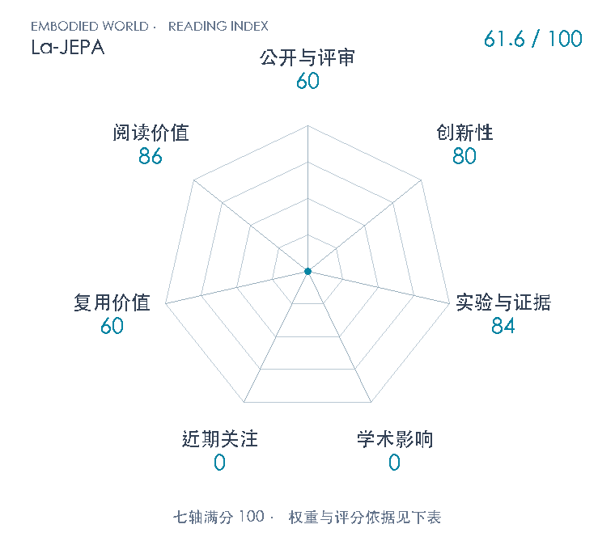

# La-JEPA: Compact Robot Policies with Latent World Modeling

**La-JEPA** · arXiv 2026 · 本版排名 128 · 综合分 **61.6 / 100**

[解读导读](../../../library/la-jepa.md) · [世界动作模型](../../../paper-map/README.md#track-world-action-model) · [arXiv集锦](../../../arxiv/README.md#paper-la-jepa)

[知识星系](../../../universe/papers/la-jepa.md) · [原文](https://arxiv.org/abs/2611.08156v1) · [PDF](https://arxiv.org/pdf/2611.08156v1) · [阅读卡片](../../../library/la-jepa.md)

论文出处：[**Mateo Clémente**](../../origins/papers/la-jepa.md) [华为 / 多伦多大学 · 另2个机构](../../origins/papers/la-jepa.md)

## 机制简析

La-JEPA以预训练V-JEPA 2.1 ViT-L编码当前两帧和32帧范围内的未来16帧，FLAN-T5-large编码语言，本体投影为条件token。在该表征空间从头训练World DiT和Action DiT，分别对未来特征与32步动作块做独立时间的流匹配。观测只读观测、未来读观测和未来、动作只读观测和动作；未来损失通过共享World参数影响观测表示。部署删除未来token，固定World时间0并缓存观测K/V，仅对动作做10步Euler积分，LIBERO执行10步、RoboTwin执行24步后重规划。最终观测编码器用LoRA和增强，未来目标保持原冻结编码器的干净特征；无需像素解码。

带着这个问题读：要借用预训练视觉知识，就得把大视频生成器整套搬上机器人吗？如果只保留JEPA表征并训练小型动作模型，未来预测在部署被删除后还剩下什么价值？

初读判断：80：把策略骨干与感知预训练解耦，在V-JEPA 2.1表征中从头训练小型World/Action DiT，以联合未来监督提升动作学习，再在部署删去未来分支。改变了继承大生成骨干的接口选择；注意力隔离和训练预测/部署动作分离明确继承Fast-WAM/Faster-WAM，不能把全部架构当新发明。 84：两套模拟基准主结果各三训练seed，RoboTwin每条件每seed 5000回合；多组设计消融、匹配指令的基线重测与四任务实机（除LingBot-VA餐具仅10次外，每任务20次）支持贡献。多数消融单seed且与主结果管线不同，跨论文RoboTwin基线训练/取值来源混合，实机单平台且小样本；延迟未提供具体GPU型号。 60：30页原文与A–E附录给出架构、训练、数据过滤、注意力掩码、推理缓存和评测协议，机制可学。论文称代码可用，实际专属仓库此刻为空，未取得实现、权重或许可，尚不能开箱复现；保留空库实际状态并待后续复查。 86：把JEPA表征、流匹配、训练时世界监督、部署计算和评测文本混杂连在一起，是理解WAM何时需要预测未来的重要桥梁。小策略与冻结大编码器的参数口径、校正前后排名提供可教的比较边界；不是所有具身路线的共同前置。

## 七维评分

<picture>
  <source media="(prefers-color-scheme: dark)" srcset="radar-dark.gif">
  
</picture>

[透明静态图](radar.svg) · [深色静态图](radar-dark.svg)

| 维度 | 分数 / 100 | 权重 |
| --- | --- | --- |
| 公开与评审 | 60 | 30% |
| 创新性 | 80 | 20% |
| 实验与证据 | 84 | 20% |
| 学术影响 | 0 | 10% |
| 近期关注 | 0 | 5% |
| 复用价值 | 60 | 8% |
| 阅读价值 | 86 | 7% |

公开与评审依据：版本化完整原文可追溯，公开阶段60。投稿中不增加评审分；没有已核独立复现或正式录用记录；当前阶段为预印本公开。

编辑深度：30页主文、参考文献与附录A–E全部文本已读；完整PDF页1/4/6/10/16/17/19/23/24/27已亲自目视核身份、架构、原图与表格。此为原文筛选与机制登记，不是完成中文精讲或代码复现；评分记录：2026-11-07。

累计引用与近期引用尚未匹配；原始值保留null。下面列出已定位的评分信号。

### 影响与关注的计算依据

- **学术影响 0**：引用未匹配且未核独立技术采用，按有来源证据量表起点0；原始引用保留null，0不表示实际影响总量。 [依据1](https://arxiv.org/abs/2611.08156v1) · [依据2](https://arxiv.org/pdf/2611.08156v1) · [依据3](https://georgexue.com/) · [依据4](https://github.com/mt-clemente/lajepa) · [依据5](https://api.github.com/repos/mt-clemente/lajepa) · [依据6](https://api.semanticscholar.org/graph/v1/paper/ARXIV:2611.08156?fields=title,year,authors,externalIds,citationCount,influentialCitationCount,publicationDate,venue) · [依据7](https://api.openalex.org/works/https://doi.org/10.48550/arXiv.2611.08156) · [依据8](https://huggingface.co/api/papers/2611.08156)
- **近期关注 0**：未核独立讨论或逐篇计数；专属新仓库实测star和订阅均0，最终依现有公式取最高信号，证据起点0。 [依据1](https://arxiv.org/abs/2611.08156v1) · [依据2](https://arxiv.org/pdf/2611.08156v1) · [依据3](https://georgexue.com/) · [依据4](https://github.com/mt-clemente/lajepa) · [依据5](https://api.github.com/repos/mt-clemente/lajepa) · [依据6](https://api.semanticscholar.org/graph/v1/paper/ARXIV:2611.08156?fields=title,year,authors,externalIds,citationCount,influentialCitationCount,publicationDate,venue) · [依据7](https://api.openalex.org/works/https://doi.org/10.48550/arXiv.2611.08156) · [依据8](https://huggingface.co/api/papers/2611.08156)

零分表示本次快照已定位的信号处在量表起点；创新和实验两轴分别评价方法。

### 论文公开入口与传播快照

- [author 入口](https://georgexue.com/)

| 平台 / 入口 | 公开计量 | 统计范围 | 快照 |
| --- | --- | --- | --- |
| [github](https://github.com/mt-clemente/lajepa) | 专属GitHub仓库star 0；GitHub订阅者 0 | single_paper；近期窗口内新建论文专属仓库累计快照 | 2026-11-07T08:48:58.269000+08:00 |

[传播数据与采用依据](../../social-signals.json)保留归属、统计窗口与计分信号。
[评分说明](../../methodology.md) · [返回具身榜](../../README.md) · [论文地图](../../../paper-map/README.md)
