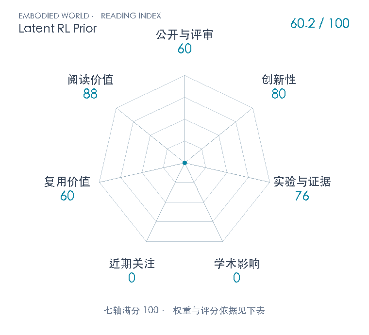

# Latent RL Priors for Data-Efficient Dexterous Manipulation

**Latent RL Prior** · arXiv 2026 · 本版排名 131 · 综合分 **60.2 / 100**

[解读导读](../../../library/latent-rl-prior.md) · [操作与动作块](../../../paper-map/README.md#track-manipulation) · [arXiv集锦](../../../arxiv/README.md#paper-latent-rl-prior)

[知识星系](../../../universe/papers/latent-rl-prior.md) · [原文](https://arxiv.org/abs/2611.08458v1) · [PDF](https://arxiv.org/pdf/2611.08458v1) · [阅读卡片](../../../library/latent-rl-prior.md)

论文出处：[**Yixiao Wang**](../../origins/papers/latent-rl-prior.md) [加州大学伯克利分校 / 亚马逊](../../origins/papers/latent-rl-prior.md)

## 机制简析

先微调SimToolReal teacher并收集100000条成功程序化姿态对齐轨迹，将特权历史经state tokenizer/Q-Former压为任务context；flow-matching动作transformer通过cross-attention读context，通过AdaLN读本体历史与flow time。视觉阶段冻结decoder，只以动作flow loss训练DINOv2-Small与视觉Q-Former，直接生成latent而不需要特权/latent标签；双臂的两组queries共同自注意力协调后，分别结合各臂本体进入共享单臂decoder。

带着这个问题读：特权RL已经学会灵巧控制，少量视觉示范该学动作本身，还是只学怎样把图像接进冻结控制先验？

初读判断：80：改变特权RL控制器接入视觉的接口：将RL成功rollout蒸馏为解耦本体条件的动作decoder，冻结后只以动作loss学习视觉latent，无需成对特权状态或latent标签；联合Q-Former queries把单臂先验扩为双臂。Flow Matching、Q-Former、DINOv2和策略蒸馏均继承已有组件，创新落在迁移接口与受控实证。 76：三种MuJoCo Warp任务、同结构scratch对照、latent/explicit接口、视觉和decoder学习率消融、质量变化与力探针提供多方面支撑；主实验3seed/每checkpoint256rollouts。仅同一KUKA+SHARPA形态仿真，100k对30k优化步不同，报告末5checkpoint最大值，未提供完整网络/优化超参与probe数据规模；力可读性未隔离因果机制。 60：输入/损失/冻结接口可学，复用已公开SimToolReal teacher与DINOv2，但本篇代码和数据仍coming soon，依赖100,000成功预训练rollouts且M/d/H/K、动作维度和完整优化配置未在12页稿列出；目前偏方法配方，尚非开箱即用工具。 88：连接特权RL、视觉模仿、动作生成和双臂协调，能讲清为什么有控制先验仍要选对视觉接入方式，以及下游少示范不等于总数据/算力少；泛化结论局限于同本体三项仿真任务。

## 七维评分

<picture>
  <source media="(prefers-color-scheme: dark)" srcset="radar-dark.gif">
  
</picture>

[透明静态图](radar.svg) · [深色静态图](radar-dark.svg)

| 维度 | 分数 / 100 | 权重 |
| --- | --- | --- |
| 公开与评审 | 60 | 30% |
| 创新性 | 80 | 20% |
| 实验与证据 | 76 | 20% |
| 学术影响 | 0 | 10% |
| 近期关注 | 0 | 5% |
| 复用价值 | 60 | 8% |
| 阅读价值 | 88 | 7% |

公开与评审依据：可追溯完整预印本公开阶段60，无已核正式会刊或独立技术检验；当前阶段为预印本公开。

编辑深度：12页主稿全部文字读核，含§1–6、三声明、完整参考；无附录。目视完整页1/3/5/6/7/8/9涵盖身份、Fig1–9和Table1；官方项目全文HTML读核。未看视频、未执行代码、未复现；评分记录：2026-11-07。

累计引用与近期引用尚未匹配；原始值保留null。下面列出已定位的评分信号。

### 影响与关注的计算依据

- **学术影响 0**：引用未取得身份匹配记录，未核独立技术采用；按有来源量表起点0，原始引用null不是实测0。 [依据1](https://arxiv.org/abs/2611.08458v1) · [依据2](https://arxiv.org/pdf/2611.08458v1) · [依据3](https://yixiaowang7.github.io/latent-rl-prior-page/) · [依据4](https://api.semanticscholar.org/graph/v1/paper/ARXIV:2611.08458?fields=title,authors,year,citationCount,influentialCitationCount,externalIds,publicationTypes,publicationDate,url) · [依据5](https://huggingface.co/api/papers/2611.08458) · [依据6](https://api.openalex.org/works?filter=locations.source.id:s4306400194&search=Latent%20RL%20Priors%20for%20Data-Efficient%20Dexterous%20Manipulation&per-page=5) · [依据7](https://api.openalex.org/works/https://doi.org/10.48550/arXiv.2611.08458)
- **近期关注 0**：未取得本篇合格引用/专属仓库/HF/X/阅读量信号；0为已核范围证据起点，账号/教师共享仓库数量不归本篇。 [依据1](https://arxiv.org/abs/2611.08458v1) · [依据2](https://arxiv.org/pdf/2611.08458v1) · [依据3](https://yixiaowang7.github.io/latent-rl-prior-page/) · [依据4](https://api.semanticscholar.org/graph/v1/paper/ARXIV:2611.08458?fields=title,authors,year,citationCount,influentialCitationCount,externalIds,publicationTypes,publicationDate,url) · [依据5](https://huggingface.co/api/papers/2611.08458) · [依据6](https://api.openalex.org/works?filter=locations.source.id:s4306400194&search=Latent%20RL%20Priors%20for%20Data-Efficient%20Dexterous%20Manipulation&per-page=5) · [依据7](https://api.openalex.org/works/https://doi.org/10.48550/arXiv.2611.08458)

零分表示本次快照已定位的信号处在量表起点；创新和实验两轴分别评价方法。

### 论文公开入口与传播快照

- [project 入口](https://yixiaowang7.github.io/latent-rl-prior-page/)

[传播数据与采用依据](../../social-signals.json)保留归属、统计窗口与计分信号。
[评分说明](../../methodology.md) · [返回具身榜](../../README.md) · [论文地图](../../../paper-map/README.md)
