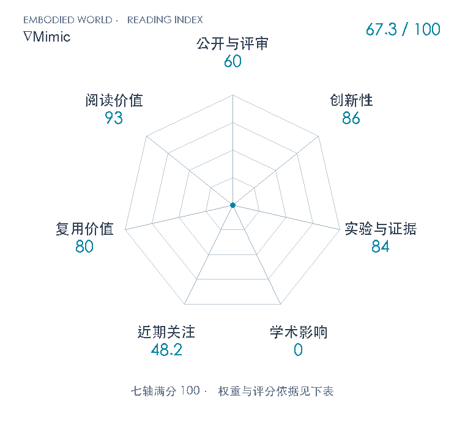

# ∇Mimic: Ultra-Efficient Humanoid Control with Differentiable Simulation

**∇Mimic** · arXiv 2026 · 本版排名 113 · 综合分 **67.3 / 100**

[解读导读](../../../library/nablamimic.md) · [动作先验与全身技能](../../../paper-map/README.md#track-motion-priors) · [arXiv集锦](../../../arxiv/README.md#paper-nablamimic)

[知识星系](../../../universe/papers/nablamimic.md) · [原文](https://arxiv.org/abs/2610.41654v1) · [PDF](https://arxiv.org/pdf/2610.41654v1) · [阅读卡片](../../../library/nablamimic.md)

论文出处：[**Weyl Lu**](../../origins/papers/nablamimic.md) [加州大学戴维斯分校](../../origins/papers/nablamimic.md)

## 机制简析

在4096个64步窗口中沿MuJoCo接触动力学求导，逐反向时间步对每个样本的动作cotangent按批中位范数裁剪，再以固定弧度RMS步长构造目标动作、做8次小批回归。G1专用NablaEngine用每world一个warp及整控制步adjoint megakernel降低求导成本。保留TDλ critic、参考姿态残差和回放起点；训练导数在近自接触、近平行胶囊及饱和actuator处采用特定规则，并非处处无偏的精确梯度。

带着这个问题读：世界模型的收益有多少来自导数本身？把精确仿真梯度中的少数极端样本截住，再把更新改成定弧度动作目标，能否稳定而廉价地训练全身跟踪？

初读判断：创新86：逐样本反传裁剪、定弧度多步动作回归和G1融合解析adjoint针对可识别失败；PODS、median clipping、replay均有继承。证据84：三seed核心消融、导数数值校验和算法/引擎拆分充分；仅一机器人/平地/40训练动作，无实机，PPO/Warp部分单seed，跨GPU引用SuperMimic限制比较。复用80：作者训练/引擎Apache2公开并有环境、基线、评测说明；G1专用CUDA和默认约50GB显存有门槛，数据另受非商业许可。阅读93：澄清世界模型、解析梯度、接触非光滑性及样本效率与wallclock差别。

## 七维评分

<picture>
  <source media="(prefers-color-scheme: dark)" srcset="radar-dark.gif">
  
</picture>

[透明静态图](radar.svg) · [深色静态图](radar-dark.svg)

| 维度 | 分数 / 100 | 权重 |
| --- | --- | --- |
| 公开与评审 | 60 | 30% |
| 创新性 | 86 | 20% |
| 实验与证据 | 84 | 20% |
| 学术影响 | 0 | 10% |
| 近期关注 | 48.2 | 5% |
| 复用价值 | 80 | 8% |
| 阅读价值 | 93 | 7% |

公开与评审依据：公开可追溯arXiv v1已读，不推断录用或把自动review升为同行评审。；当前阶段为预印本公开。

编辑深度：arXiv v1主文§§1–9与附录A–H逐节机制/实验初读；26页全文文本已读、关键图表目视，非完整精讲或复现；评分记录：2026-11-04。

计量来源：OpenAlex；arXiv2610.41654v1; DOI10.48550/arXiv.2610.41654；匹配题目：$\nabla$Mimic: Ultra-Efficient Humanoid Control with Differentiable Simulation。累计被引 **0**，2025–2026 被引 **0**；快照：2026-11-04T08:33:46+08:00。

[指标记录](https://api.openalex.org/works/https://doi.org/10.48550/arXiv.2610.41654) · [文献计量条目](https://openalex.org/W7225087060)

### 影响与关注的计算依据

- **学术影响 0**：匹配OpenAlex C=0；本次有界检索未核到独立技术采用，处于采用量表起点，非实际影响总量为零。 [依据1](https://arxiv.org/abs/2610.41654v1) · [依据2](https://api.openalex.org/works/https://doi.org/10.48550/arXiv.2610.41654)
- **近期关注 48.2**：github 的论文专属入口：GitHub star=84；按10000上限对数压缩。 [依据1](https://api.github.com/repos/OamIcs/NablaMimic) · [依据2](https://api.github.com/repos/OamIcs/NablaMimic/contents/README.md?ref=main) · [依据3](https://arxiv.org/pdf/2610.41654v1) · [依据4](https://github.com/OamIcs/NablaMimic)

零分表示本次快照已定位的信号处在量表起点；创新和实验两轴分别评价方法。

### 论文公开入口与传播快照

- [project 入口](https://sailab.ai/nablamimic/)

| 平台 / 入口 | 公开计量 | 统计范围 | 快照 |
| --- | --- | --- | --- |
| [github](https://github.com/OamIcs/NablaMimic) | GitHub star 84；GitHub订阅关注 0；GitHub fork 4 | single_paper；2026-11-04论文专属官方仓库实读快照 | 2026-11-04T08:34:08+08:00 |

[传播数据与采用依据](../../social-signals.json)保留归属、统计窗口与计分信号。
[评分说明](../../methodology.md) · [返回具身榜](../../README.md) · [论文地图](../../../paper-map/README.md)
