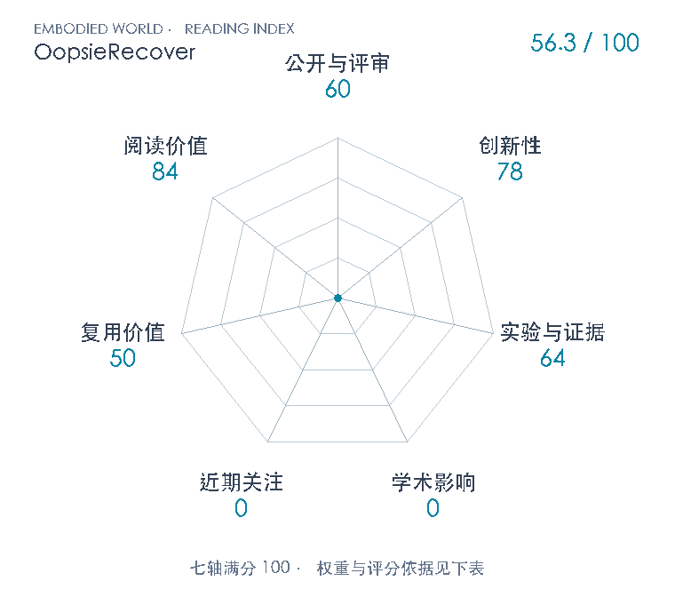

# OopsieRecover: Learning Transferable VLA Corrections from Semantic Interventions

**OopsieRecover** · arXiv 2026 · 本版排名 135 · 综合分 **56.3 / 100**

[解读导读](../../../library/oopsierecover.md) · [操作与动作块](../../../paper-map/README.md#track-manipulation) · [arXiv集锦](../../../arxiv/README.md#paper-oopsierecover)

[知识星系](../../../universe/papers/oopsierecover.md) · [原文](https://arxiv.org/abs/2611.08462v1) · [PDF](https://arxiv.org/pdf/2611.08462v1) · [阅读卡片](../../../library/oopsierecover.md)

论文出处：[**Arpit Bahety / Skand Peri**](../../origins/papers/oopsierecover.md) [得克萨斯大学奥斯汀分校 / 丰田研究院](../../origins/papers/oopsierecover.md)

## 机制简析

人接管时提供纠正轨迹、语言和纠正类别。VLM选语义实体种子，分割与深度把区域变成3D点集，质心时间轨迹用于生成gate×(纠正代价+λ任务代价)。触发阈值从同类记录中gate=1的干预前分数取最小；用人类/后续基策略窗口的较低成本及触发检查做经验一致性核验，失败促使程序细化，但预算耗尽仍保留最后程序。部署重新定位实体，从冻结π0.5采样动作块并可加cardinal actions，预测点集后按折扣成本筛最优；仿真用模拟器物理，实机用grasp-based近似。

带着这个问题读：纠正机器人一次，它记住的是那条手的轨迹，还是“别碰到咖啡机”这条规则？把几何意图单独存起来，能否在换场景后继续帮冻结VLA选动作？

初读判断：78：将少量轨迹干预与人类纠正语义转成局部激活的几何代价，复用冻结VLA候选并跨场景重新定位实体，形成清楚的纠正接口。VLM代价生成、关键点/点集、重排序和人类干预各有前作，贡献在局部纠正规则的推断、校准与运行连接。 64：三仿真任务、同纠正数据HG-DAgger*/OLAF和文字VLS对照、L1/L2变化以及三实机任务支持有限系统效果；实机20回合/方法/任务/level与统计分组可核。无组件消融，实机阶段评分细则、部分超参及运行延迟未展开，Fig5峰值与版本图表有冲突，故不采用精确峰值或强因果结论。 50：9页版本化原文、公式和官方项目视频可追溯，能理解接口与校准逻辑。未定位专属实现/权重/配置，K/H/B、VLM配置及grasp-based动力学细则缺失；仿真还直接使用模拟器预测，不认作可直接部署的完整开源栈。 84：可清楚对照“把纠正当状态—动作样本”和“把纠正当局部规则”，贯通语义定位、点集几何、成本校准、候选动作与测试时反馈，也适合区分经验一致性检查与安全保证。

## 七维评分

<picture>
  <source media="(prefers-color-scheme: dark)" srcset="radar-dark.gif">
  
</picture>

[透明静态图](radar.svg) · [深色静态图](radar-dark.svg)

| 维度 | 分数 / 100 | 权重 |
| --- | --- | --- |
| 公开与评审 | 60 | 30% |
| 创新性 | 78 | 20% |
| 实验与证据 | 64 | 20% |
| 学术影响 | 0 | 10% |
| 近期关注 | 0 | 5% |
| 复用价值 | 50 | 8% |
| 阅读价值 | 84 | 7% |

公开与评审依据：版本化完整原文可追溯，公开阶段60；没有已核正式录用证据；当前阶段为预印本公开。

编辑深度：完整9页v1文字已读；页面1/4/5/6/7亲自目视核身份、机制与图。官方8页PDF经全文词级差异和关键图视觉对照；未下载视频逐帧核验或运行代码。没有附录，项目未链接补充技术材料；评分记录：2026-11-07。

累计引用与近期引用尚未匹配；原始值保留null。下面列出已定位的评分信号。

### 影响与关注的计算依据

- **学术影响 0**：没有身份匹配引文计数，亦未核独立技术采用，按有来源证据量表起点0评分；原始指标null，不把0称实际影响总量。 [依据1](https://arxiv.org/abs/2611.08462v1) · [依据2](https://arxiv.org/pdf/2611.08462v1) · [依据3](https://robin-lab.cs.utexas.edu/oopsierecover/) · [依据4](https://api.semanticscholar.org/graph/v1/paper/ARXIV:2611.08462?fields=title,year,authors,externalIds,citationCount,influentialCitationCount,publicationDate,venue) · [依据5](https://api.openalex.org/works/https://doi.org/10.48550/arXiv.2611.08462) · [依据6](https://huggingface.co/api/papers/2611.08462)
- **近期关注 0**：无论文专属仓库/HF/X/阅读量等可核计数，也未核独立讨论证据，按证据量表起点0；不挪用UT Austin/TRI组织热度或聚合站自动分数。 [依据1](https://arxiv.org/abs/2611.08462v1) · [依据2](https://arxiv.org/pdf/2611.08462v1) · [依据3](https://robin-lab.cs.utexas.edu/oopsierecover/) · [依据4](https://api.semanticscholar.org/graph/v1/paper/ARXIV:2611.08462?fields=title,year,authors,externalIds,citationCount,influentialCitationCount,publicationDate,venue) · [依据5](https://api.openalex.org/works/https://doi.org/10.48550/arXiv.2611.08462) · [依据6](https://huggingface.co/api/papers/2611.08462)

零分表示本次快照已定位的信号处在量表起点；创新和实验两轴分别评价方法。

### 论文公开入口与传播快照

- [project 入口](https://robin-lab.cs.utexas.edu/oopsierecover/)

[传播数据与采用依据](../../social-signals.json)保留归属、统计窗口与计分信号。
[评分说明](../../methodology.md) · [返回具身榜](../../README.md) · [论文地图](../../../paper-map/README.md)
