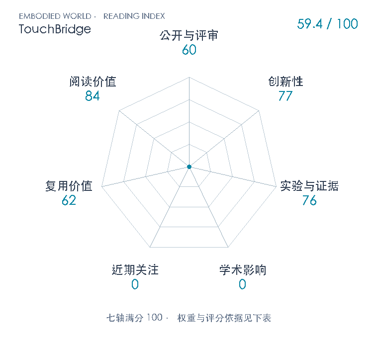

# TouchBridge: Tactile-Conditioned Human-to-Robot Transfer for Dexterous Manipulation

**TouchBridge** · arXiv 2026 · 本版排名 126 · 综合分 **59.4 / 100**

[解读导读](../../../library/touchbridge.md) · [操作与动作块](../../../paper-map/README.md#track-manipulation) · [arXiv集锦](../../../arxiv/README.md#paper-touchbridge)

[知识星系](../../../universe/papers/touchbridge.md) · [原文](https://arxiv.org/abs/2610.40349v1) · [PDF](https://arxiv.org/pdf/2610.40349v1) · [阅读卡片](../../../library/touchbridge.md)

论文出处：[**Haozhe Zhang / Gu Zhang 等3位**](../../origins/papers/touchbridge.md) [清华大学 / 浙江大学 · 另3个机构](../../origins/papers/touchbridge.md)

## 机制简析

TouchBridge让人类手套和Wuji灵巧手共享指尖触觉布局及腕相机视角。Tac-Retarget联合优化两手基座SE(3)与关节，匹配指尖位姿、触觉加权接触中心及活跃taxel支撑，并沿用TopoRetarget的距离加权Laplacian思想建立触觉激活的双手接触图。接触时减弱位姿跟踪，并用响应相关几何位移补偿顺应性。SAM2/ProPainter移除人手、渲染机器人外观，固定场景AprilTag消除头部相机运动后转换动作，用转换后的视觉/状态动作微调GR00T N1.7。触觉只服务离线重定向，不输入运行策略。

带着这个问题读：手指位置对上了，为什么接触还是会丢？把指腹真实接触位置和跨手接触关系一起迁移，能否省去每个物体的重建与专门机器人示范？

初读判断：创新77：触觉patch与跨手接触关系改变纯位姿重定向接口，并结合硬件对应、视觉合成和动作坐标；Laplacian图继承TopoRetarget，不能把各部件都算首创。证据76：等量人类/遥操、两项核心消融、仿真接触误差和四任务实机闭环；仅单平台、每任务20次、无跨seed不确定性/未见物体系统测试，未达跨域80+。复用62：明确优化公式、标定与retarget超参可学习，但同款触觉布局和硬件成本高，未定位公开训练实现及完整微调参数。阅读84：清楚区分位姿像、接触对和策略能执行，连接跨本体示范与触觉接口。

## 七维评分

<picture>
  <source media="(prefers-color-scheme: dark)" srcset="radar-dark.gif">
  
</picture>

[透明静态图](radar.svg) · [深色静态图](radar-dark.svg)

| 维度 | 分数 / 100 | 权重 |
| --- | --- | --- |
| 公开与评审 | 60 | 30% |
| 创新性 | 77 | 20% |
| 实验与证据 | 76 | 20% |
| 学术影响 | 0 | 10% |
| 近期关注 | 0 | 5% |
| 复用价值 | 62 | 8% |
| 阅读价值 | 84 | 7% |

公开与评审依据：完整可追溯公开稿60；未核独立技术检验或正式刊会，不因大学/实验室知名提高；当前阶段为预印本公开。

编辑深度：通读10页v1正文、附录及参考文献；目视1/4/6/7/8/9/10完整页，核触觉与策略接口、回放/闭环/接触误差协议及图中误差条。 本次是有证据初读筛选，不是已写完整公开精讲，也未执行代码复现；评分记录：2026-11-02。

计量来源：OpenAlex；arXiv 2610.40349v1; 10.48550/arXiv.2610.40349；匹配题目：TouchBridge: Tactile-Conditioned Human-to-Robot Transfer for Dexterous Manipulation。累计被引 **0**，2025–2026 被引 **0**；快照：2026-11-02T09:22:58.204439+08:00。

[指标记录](https://api.openalex.org/works/https://doi.org/10.48550/arXiv.2610.40349) · [文献计量条目](https://openalex.org/W7224927844)

### 影响与关注的计算依据

- **学术影响 0**：已匹配引用来源实测0；本次原文/官方入口与有界网页检索未定位独立研究采用。采用证据量表起点0，不以作者名气、摘要转载或自身对照算独立采用。 [依据1](https://arxiv.org/abs/2610.40349v1) · [依据2](https://arxiv.org/pdf/2610.40349v1) · [依据3](https://touchbridge2026.github.io/) · [依据4](https://api.semanticscholar.org/graph/v1/paper/ARXIV:2610.40349?fields=title,authors,year,publicationDate,venue,citationCount,influentialCitationCount,externalIds,url) · [依据5](https://api.openalex.org/works/https://doi.org/10.48550/arXiv.2610.40349) · [依据6](https://api.openalex.org/works?search=TouchBridge%3A%20Tactile-Conditioned%20Human-to-Robot%20Transfer%20for%20Dexterous%20Manipulation&per-page=5) · [依据7](https://huggingface.co/api/papers/2610.40349)
- **近期关注 0**：匹配引用当前0，HF单篇upvote实测0；官方项目未展示阅读量或研究代码仓库，未定位单篇可核X/博客计数。本次证据起点0，未知计数仍null。 [依据1](https://arxiv.org/abs/2610.40349v1) · [依据2](https://arxiv.org/pdf/2610.40349v1) · [依据3](https://touchbridge2026.github.io/) · [依据4](https://api.semanticscholar.org/graph/v1/paper/ARXIV:2610.40349?fields=title,authors,year,publicationDate,venue,citationCount,influentialCitationCount,externalIds,url) · [依据5](https://api.openalex.org/works/https://doi.org/10.48550/arXiv.2610.40349) · [依据6](https://api.openalex.org/works?search=TouchBridge%3A%20Tactile-Conditioned%20Human-to-Robot%20Transfer%20for%20Dexterous%20Manipulation&per-page=5) · [依据7](https://huggingface.co/api/papers/2610.40349)

零分表示本次快照已定位的信号处在量表起点；创新和实验两轴分别评价方法。

### 论文公开入口与传播快照

- [project 入口](https://touchbridge2026.github.io/)

| 平台 / 入口 | 公开计量 | 统计范围 | 快照 |
| --- | --- | --- | --- |
| [huggingface](https://huggingface.co/papers/2610.40349) | HF论文upvote 0 | single_paper；截至2026-11-02单篇快照 | 2026-11-02T09:22:58.204593+08:00 |

[传播数据与采用依据](../../social-signals.json)保留归属、统计窗口与计分信号。
[评分说明](../../methodology.md) · [返回具身榜](../../README.md) · [论文地图](../../../paper-map/README.md)
